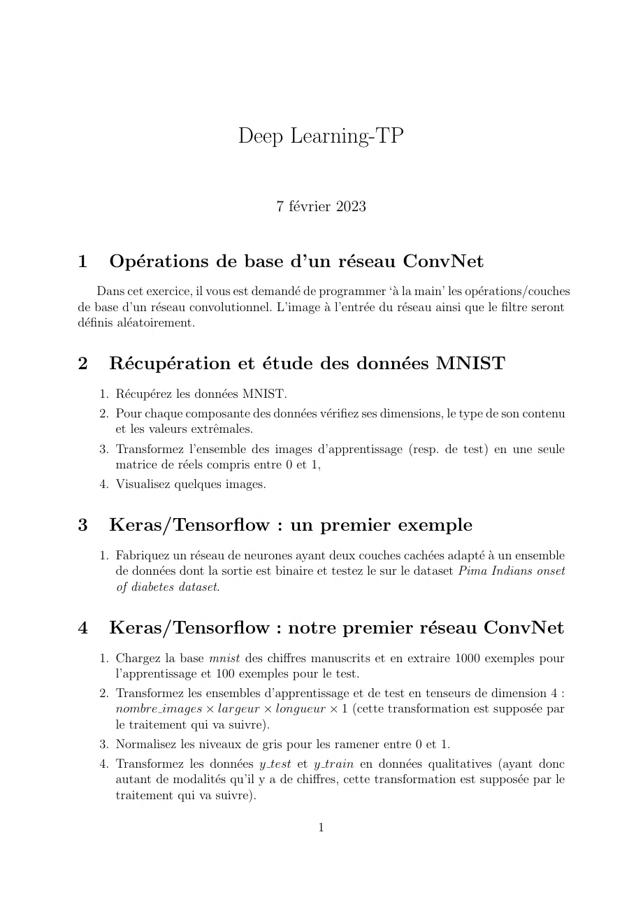

# App_Profond_Exos.pdf

[Ouvrir l’original](https://drive.google.com/open?id=1Oc7l64Lt44lbcWY5jRqPoMjk3ZxxKhTG) · Les deux lectures automatiques du PDF divergent sur les pages indiquées. Leur fac-similé accompagne le texte.

**Pages présentant un écart entre les deux extractions** — 1–2.

## Page 1

~~~text
                              Deep Learning-TP

                                      7 février 2023

1     Opérations de base d’un réseau ConvNet
     Dans cet exercice, il vous est demandé de programmer ‘à la main’ les opérations/couches
de base d’un réseau convolutionnel. L’image à l’entrée du réseau ainsi que le filtre seront
définis aléatoirement.

2     Récupération et étude des données MNIST
    1. Récupérez les données MNIST.
    2. Pour chaque composante des données vérifiez ses dimensions, le type de son contenu
       et les valeurs extrêmales.
    3. Transformez l’ensemble des images d’apprentissage (resp. de test) en une seule
       matrice de réels compris entre 0 et 1,
    4. Visualisez quelques images.

3     Keras/Tensorflow : un premier exemple
    1. Fabriquez un réseau de neurones ayant deux couches cachées adapté à un ensemble
       de données dont la sortie est binaire et testez le sur le dataset Pima Indians onset
       of diabetes dataset.

4     Keras/Tensorflow : notre premier réseau ConvNet
    1. Chargez la base mnist des chiffres manuscrits et en extraire 1000 exemples pour
       l’apprentissage et 100 exemples pour le test.
    2. Transformez les ensembles d’apprentissage et de test en tenseurs de dimension 4 :
       nombre images × largeur × longueur × 1 (cette transformation est supposée par
       le traitement qui va suivre).
    3. Normalisez les niveaux de gris pour les ramener entre 0 et 1.
    4. Transformez les données y test et y train en données qualitatives (ayant donc
       autant de modalités qu’il y a de chiffres, cette transformation est supposée par le
       traitement qui va suivre).

                                              1
~~~

## Page 2

~~~text
5. Créez un réseau de neurones convolutionnel avec dans l’ordre la couche d’entrée,
   une couche convolutionnelle, une deuxième couche convolutionnelle, une couche
   Pooling, une couche Dropout, une couche Flatten, une couche Dense, une deuxième
   couche Dropout, la couche de sortie.
   NB : le nombre, le type et l’ordre des couches est celui utilisé et testé par le
   travail sur lequel nous nous sommes basés pour préparer ce TP. Il n’est en aucun
   cas obligatoire. Les étudiants peuvent essayer des variantes (tout en restant dans
   le cadre des réseaux convolutionnels).
6. Affichez une description du réseau et vérifier la cohérence de cette description.
7. Complétez le programme en ajoutant la compilation, l’apprentissage et l’évaluation.

                                          2
~~~
