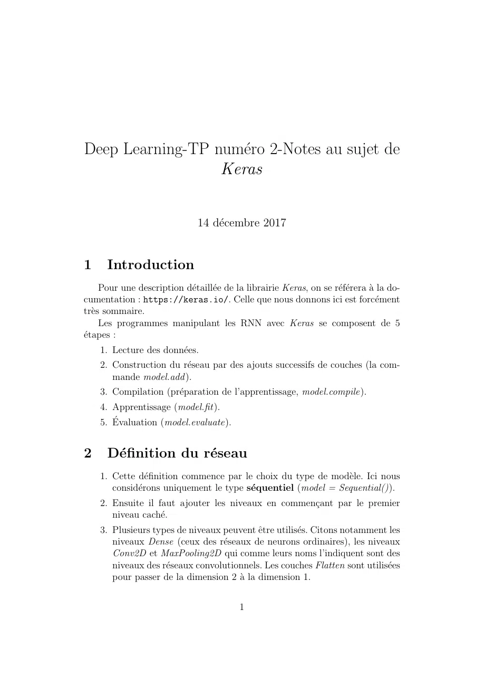
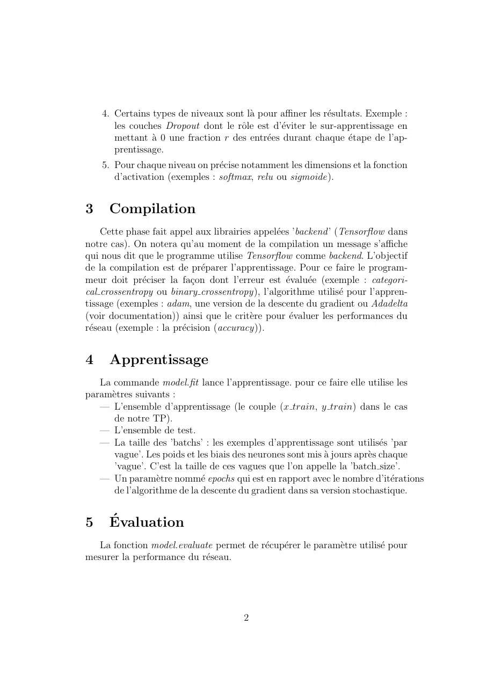

# App_Profond_Exos-Annexe.pdf

[Ouvrir l’original](https://drive.google.com/open?id=1Ie8RX5ukfzBgWtGReMs8K3SGzdq9lK2M) · Les deux lectures automatiques du PDF divergent sur les pages indiquées. Leur fac-similé accompagne le texte.

**Pages présentant un écart entre les deux extractions** — 1–2.

## Page 1

~~~text
Deep Learning-TP numéro 2-Notes au sujet de
                  Keras

                               14 décembre 2017

1     Introduction
     Pour une description détaillée de la librairie Keras, on se référera à la do-
cumentation : https://keras.io/. Celle que nous donnons ici est forcément
très sommaire.
     Les programmes manipulant les RNN avec Keras se composent de 5
étapes :
    1. Lecture des données.
    2. Construction du réseau par des ajouts successifs de couches (la com-
       mande model.add ).
    3. Compilation (préparation de l’apprentissage, model.compile).
    4. Apprentissage (model.fit).
    5. Évaluation (model.evaluate).

2     Définition du réseau
    1. Cette définition commence par le choix du type de modèle. Ici nous
       considérons uniquement le type séquentiel (model = Sequential()).
    2. Ensuite il faut ajouter les niveaux en commençant par le premier
       niveau caché.
    3. Plusieurs types de niveaux peuvent être utilisés. Citons notamment les
       niveaux Dense (ceux des réseaux de neurons ordinaires), les niveaux
       Conv2D et MaxPooling2D qui comme leurs noms l’indiquent sont des
       niveaux des réseaux convolutionnels. Les couches Flatten sont utilisées
       pour passer de la dimension 2 à la dimension 1.

                                          1
~~~

## Page 2

~~~text
    4. Certains types de niveaux sont là pour affiner les résultats. Exemple :
       les couches Dropout dont le rôle est d’éviter le sur-apprentissage en
       mettant à 0 une fraction r des entrées durant chaque étape de l’ap-
       prentissage.
    5. Pour chaque niveau on précise notamment les dimensions et la fonction
       d’activation (exemples : softmax, relu ou sigmoide).

3    Compilation
     Cette phase fait appel aux librairies appelées ’backend ’ (Tensorflow dans
notre cas). On notera qu’au moment de la compilation un message s’affiche
qui nous dit que le programme utilise Tensorflow comme backend. L’objectif
de la compilation est de préparer l’apprentissage. Pour ce faire le program-
meur doit préciser la façon dont l’erreur est évaluée (exemple : categori-
cal crossentropy ou binary crossentropy), l’algorithme utilisé pour l’appren-
tissage (exemples : adam, une version de la descente du gradient ou Adadelta
(voir documentation)) ainsi que le critère pour évaluer les performances du
réseau (exemple : la précision (accuracy)).

4    Apprentissage
   La commande model.fit lance l’apprentissage. pour ce faire elle utilise les
paramètres suivants :
   — L’ensemble d’apprentissage (le couple (x train, y train) dans le cas
      de notre TP).
   — L’ensemble de test.
   — La taille des ’batchs’ : les exemples d’apprentissage sont utilisés ’par
      vague’. Les poids et les biais des neurones sont mis à jours après chaque
      ’vague’. C’est la taille de ces vagues que l’on appelle la ’batch size’.
   — Un paramètre nommé epochs qui est en rapport avec le nombre d’itérations
      de l’algorithme de la descente du gradient dans sa version stochastique.

5    Évaluation
   La fonction model.evaluate permet de récupérer le paramètre utilisé pour
mesurer la performance du réseau.

                                       2
~~~
