# Apprentissage_renforcement_HSe.pdf

[Ouvrir l’original](https://drive.google.com/open?id=15B1DfwB5CWLuEb8vF_NTu0enLlc-btdH) · Les deux lectures automatiques du PDF divergent sur les pages indiquées. Leur fac-similé accompagne le texte.

**Pages présentant un écart entre les deux extractions** — 1–51.

## Page 1

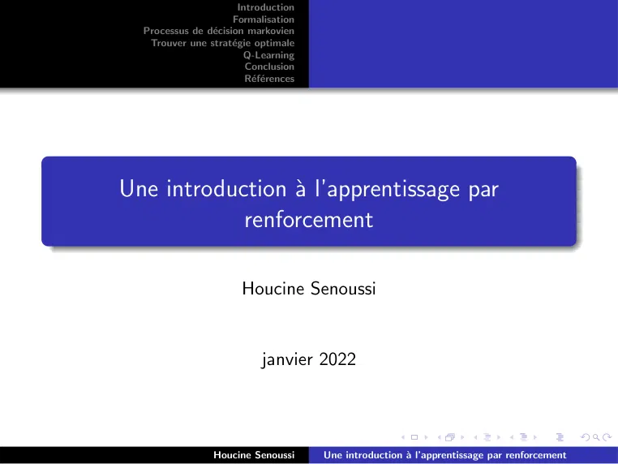

~~~text
                       Introduction
                      Formalisation
  Processus de décision markovien
   Trouver une stratégie optimale
                        Q-Learning
                         Conclusion
                         Références

Une introduction à l’apprentissage par
            renforcement

                        Houcine Senoussi

                             janvier 2022

                  Houcine Senoussi      Une introduction à l’apprentissage par renforcement
~~~

## Page 2

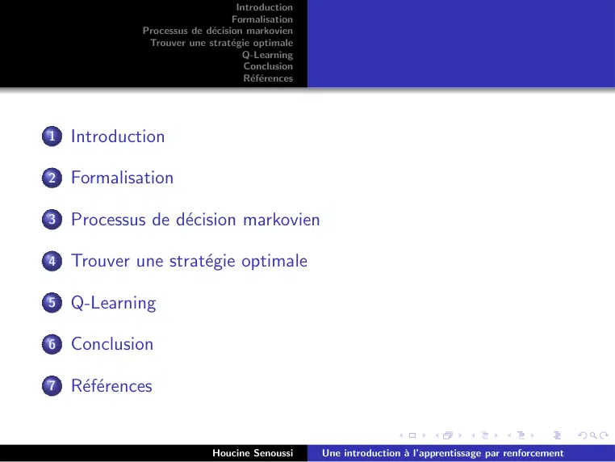

~~~text
                                   Introduction
                                  Formalisation
              Processus de décision markovien
               Trouver une stratégie optimale
                                    Q-Learning
                                     Conclusion
                                     Références

1   Introduction

2   Formalisation

3   Processus de décision markovien

4   Trouver une stratégie optimale

5   Q-Learning

6   Conclusion

7   Références

                              Houcine Senoussi      Une introduction à l’apprentissage par renforcement
~~~

## Page 3

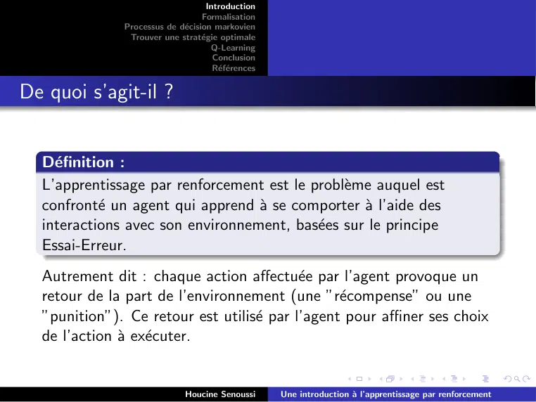

~~~text
                                   Introduction
                                  Formalisation
              Processus de décision markovien
               Trouver une stratégie optimale
                                    Q-Learning
                                     Conclusion
                                     Références

De quoi s’agit-il ?

  Définition :
  L’apprentissage par renforcement est le problème auquel est
  confronté un agent qui apprend à se comporter à l’aide des
  interactions avec son environnement, basées sur le principe
  Essai-Erreur.
  Autrement dit : chaque action affectuée par l’agent provoque un
  retour de la part de l’environnement (une ”récompense” ou une
  ”punition”). Ce retour est utilisé par l’agent pour affiner ses choix
  de l’action à exécuter.

                              Houcine Senoussi      Une introduction à l’apprentissage par renforcement
~~~

## Page 4

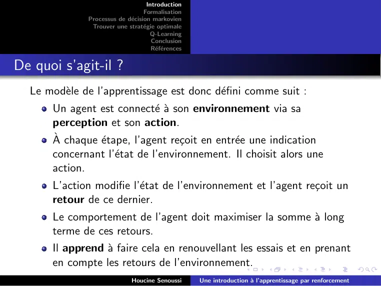

~~~text
                                   Introduction
                                  Formalisation
              Processus de décision markovien
               Trouver une stratégie optimale
                                    Q-Learning
                                     Conclusion
                                     Références

De quoi s’agit-il ?
  Le modèle de l’apprentissage est donc défini comme suit :
      Un agent est connecté à son environnement via sa
      perception et son action.
      À chaque étape, l’agent reçoit en entrée une indication
      concernant l’état de l’environnement. Il choisit alors une
      action.
      L’action modifie l’état de l’environnement et l’agent reçoit un
      retour de ce dernier.
      Le comportement de l’agent doit maximiser la somme à long
      terme de ces retours.
      Il apprend à faire cela en renouvellant les essais et en prenant
      en compte les retours de l’environnement.
                              Houcine Senoussi      Une introduction à l’apprentissage par renforcement
~~~

## Page 5

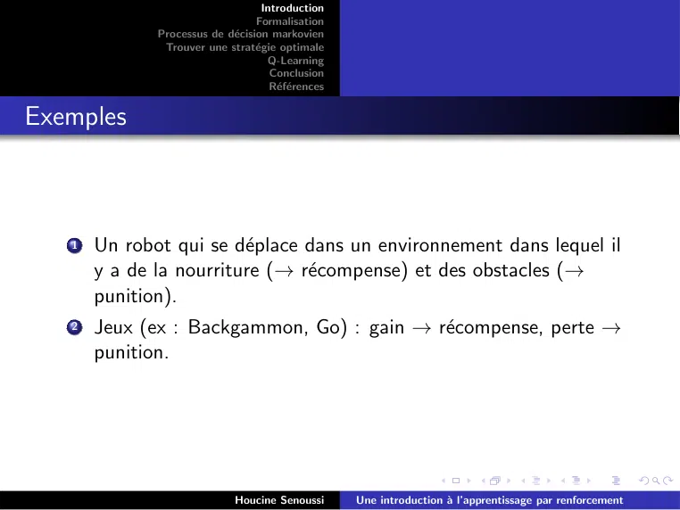

~~~text
                                   Introduction
                                  Formalisation
              Processus de décision markovien
               Trouver une stratégie optimale
                                    Q-Learning
                                     Conclusion
                                     Références

Exemples

   1   Un robot qui se déplace dans un environnement dans lequel il
       y a de la nourriture (→ récompense) et des obstacles (→
       punition).
   2   Jeux (ex : Backgammon, Go) : gain → récompense, perte →
       punition.

                              Houcine Senoussi      Une introduction à l’apprentissage par renforcement
~~~

## Page 6

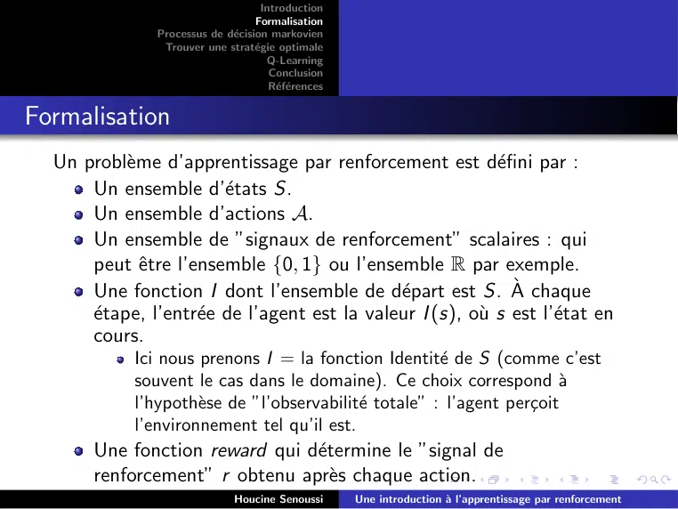

~~~text
                                    Introduction
                                   Formalisation
               Processus de décision markovien
                Trouver une stratégie optimale
                                     Q-Learning
                                      Conclusion
                                      Références

Formalisation
  Un problème d’apprentissage par renforcement est défini par :
      Un ensemble d’états S.
      Un ensemble d’actions A.
      Un ensemble de ”signaux de renforcement” scalaires : qui
      peut être l’ensemble {0, 1} ou l’ensemble R par exemple.
      Une fonction I dont l’ensemble de départ est S. À chaque
      étape, l’entrée de l’agent est la valeur I (s), où s est l’état en
      cours.
            Ici nous prenons I = la fonction Identité de S (comme c’est
            souvent le cas dans le domaine). Ce choix correspond à
            l’hypothèse de ”l’observabilité totale” : l’agent perçoit
            l’environnement tel qu’il est.
       Une fonction reward qui détermine le ”signal de
       renforcement” r obtenu après chaque action.
                               Houcine Senoussi      Une introduction à l’apprentissage par renforcement
~~~

## Page 7

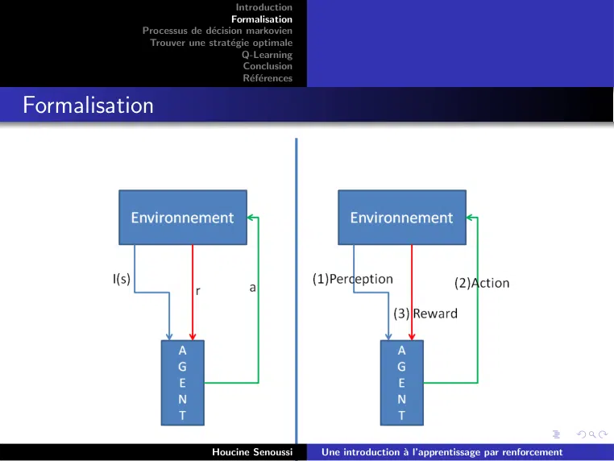

~~~text
                                Introduction
                               Formalisation
           Processus de décision markovien
            Trouver une stratégie optimale
                                 Q-Learning
                                  Conclusion
                                  Références

Formalisation

                           Houcine Senoussi      Une introduction à l’apprentissage par renforcement
~~~

## Page 8

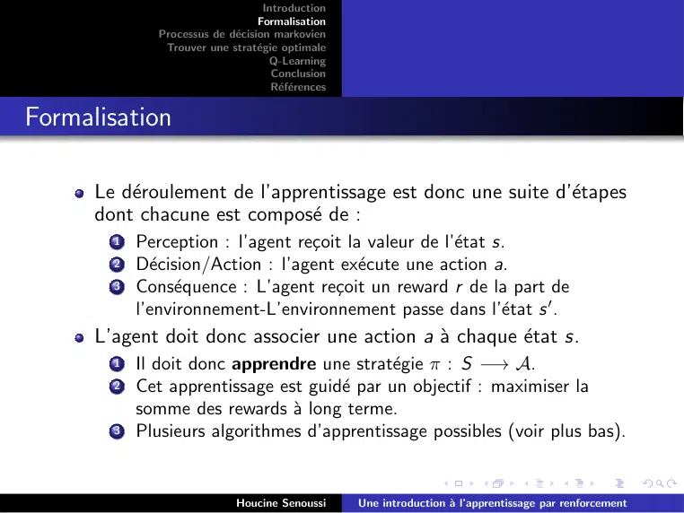

~~~text
                                   Introduction
                                  Formalisation
              Processus de décision markovien
               Trouver une stratégie optimale
                                    Q-Learning
                                     Conclusion
                                     Références

Formalisation

      Le déroulement de l’apprentissage est donc une suite d’étapes
      dont chacune est composé de :
        1   Perception : l’agent reçoit la valeur de l’état s.
        2   Décision/Action : l’agent exécute une action a.
        3   Conséquence : L’agent reçoit un reward r de la part de
            l’environnement-L’environnement passe dans l’état s 0 .
      L’agent doit donc associer une action a à chaque état s.
        1   Il doit donc apprendre une stratégie π : S −→ A.
        2   Cet apprentissage est guidé par un objectif : maximiser la
            somme des rewards à long terme.
        3   Plusieurs algorithmes d’apprentissage possibles (voir plus bas).

                              Houcine Senoussi      Une introduction à l’apprentissage par renforcement
~~~

## Page 9

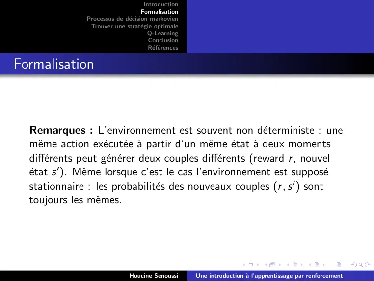

~~~text
                                   Introduction
                                  Formalisation
              Processus de décision markovien
               Trouver une stratégie optimale
                                    Q-Learning
                                     Conclusion
                                     Références

Formalisation

  Remarques : L’environnement est souvent non déterministe : une
  même action exécutée à partir d’un même état à deux moments
  différents peut générer deux couples différents (reward r , nouvel
  état s 0 ). Même lorsque c’est le cas l’environnement est supposé
  stationnaire : les probabilités des nouveaux couples (r , s 0 ) sont
  toujours les mêmes.

                              Houcine Senoussi      Une introduction à l’apprentissage par renforcement
~~~

## Page 10

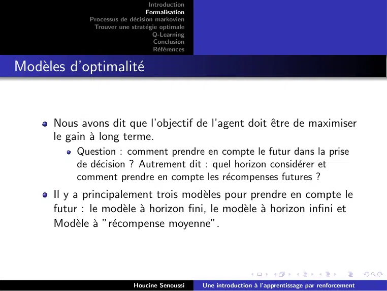

~~~text
                                   Introduction
                                  Formalisation
              Processus de décision markovien
               Trouver une stratégie optimale
                                    Q-Learning
                                     Conclusion
                                     Références

Modèles d’optimalité

      Nous avons dit que l’objectif de l’agent doit être de maximiser
      le gain à long terme.
           Question : comment prendre en compte le futur dans la prise
           de décision ? Autrement dit : quel horizon considérer et
           comment prendre en compte les récompenses futures ?
      Il y a principalement trois modèles pour prendre en compte le
      futur : le modèle à horizon fini, le modèle à horizon infini et
      Modèle à ”récompense moyenne”.

                              Houcine Senoussi      Une introduction à l’apprentissage par renforcement
~~~

## Page 11

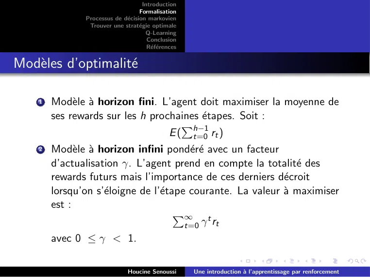

~~~text
                                    Introduction
                                   Formalisation
               Processus de décision markovien
                Trouver une stratégie optimale
                                     Q-Learning
                                      Conclusion
                                      Références

Modèles d’optimalité

    1   Modèle à horizon fini. L’agent doit maximiser la moyenne de
        ses rewards sur les h prochaines étapes. Soit :
                                     Ph−1
                                  E ( t=0   rt )
    2   Modèle à horizon infini pondéré avec un facteur
        d’actualisation γ. L’agent prend en compte la totalité des
        rewards futurs mais l’importance de ces derniers décroit
        lorsqu’on s’éloigne de l’étape courante. La valeur à maximiser
        est :
                                      P∞ t
                                        t=0 γ rt
        avec 0 ≤ γ < 1.

                               Houcine Senoussi      Une introduction à l’apprentissage par renforcement
~~~

## Page 12

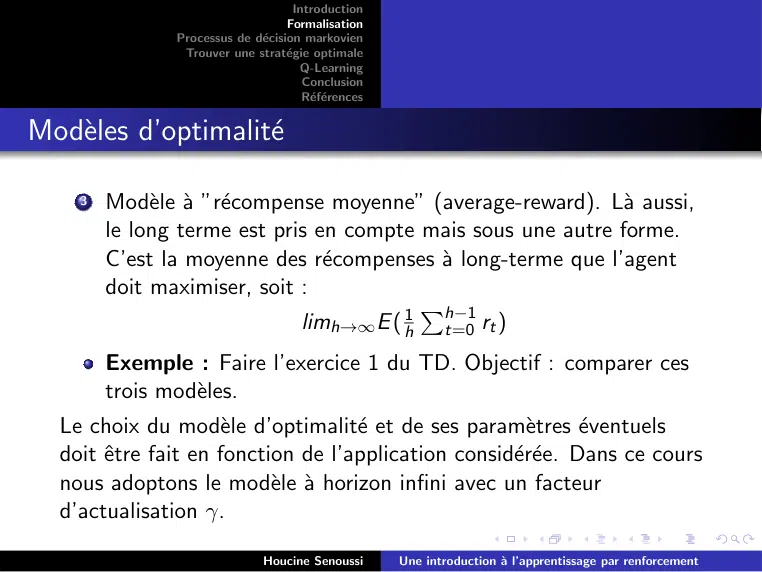

~~~text
                                    Introduction
                                   Formalisation
               Processus de décision markovien
                Trouver une stratégie optimale
                                     Q-Learning
                                      Conclusion
                                      Références

Modèles d’optimalité

    3   Modèle à ”récompense moyenne” (average-reward). Là aussi,
        le long terme est pris en compte mais sous une autre forme.
        C’est la moyenne des récompenses à long-terme que l’agent
        doit maximiser, soit :
                                          Ph−1
                             limh→∞ E ( h1 t=0 rt )
        Exemple : Faire l’exercice 1 du TD. Objectif : comparer ces
        trois modèles.
  Le choix du modèle d’optimalité et de ses paramètres éventuels
  doit être fait en fonction de l’application considérée. Dans ce cours
  nous adoptons le modèle à horizon infini avec un facteur
  d’actualisation γ.

                               Houcine Senoussi      Une introduction à l’apprentissage par renforcement
~~~

## Page 13

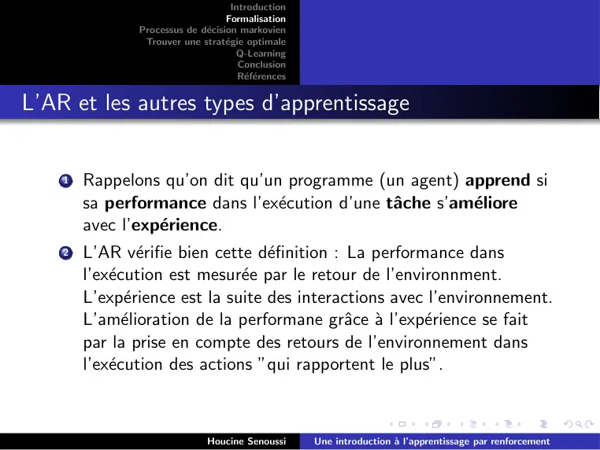

~~~text
                                    Introduction
                                   Formalisation
               Processus de décision markovien
                Trouver une stratégie optimale
                                     Q-Learning
                                      Conclusion
                                      Références

L’AR et les autres types d’apprentissage

    1   Rappelons qu’on dit qu’un programme (un agent) apprend si
        sa performance dans l’exécution d’une tâche s’améliore
        avec l’expérience.
    2   L’AR vérifie bien cette définition : La performance dans
        l’exécution est mesurée par le retour de l’environnment.
        L’expérience est la suite des interactions avec l’environnement.
        L’amélioration de la performane grâce à l’expérience se fait
        par la prise en compte des retours de l’environnement dans
        l’exécution des actions ”qui rapportent le plus”.

                               Houcine Senoussi      Une introduction à l’apprentissage par renforcement
~~~

## Page 14

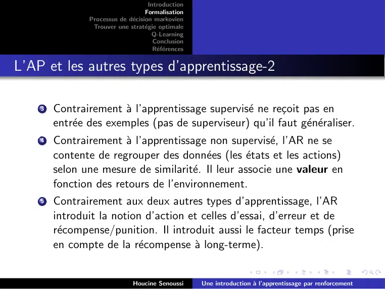

~~~text
                                    Introduction
                                   Formalisation
               Processus de décision markovien
                Trouver une stratégie optimale
                                     Q-Learning
                                      Conclusion
                                      Références

L’AP et les autres types d’apprentissage-2

    3   Contrairement à l’apprentissage supervisé ne reçoit pas en
        entrée des exemples (pas de superviseur) qu’il faut généraliser.
    4   Contrairement à l’apprentissage non supervisé, l’AR ne se
        contente de regrouper des données (les états et les actions)
        selon une mesure de similarité. Il leur associe une valeur en
        fonction des retours de l’environnement.
    5   Contrairement aux deux autres types d’apprentissage, l’AR
        introduit la notion d’action et celles d’essai, d’erreur et de
        récompense/punition. Il introduit aussi le facteur temps (prise
        en compte de la récompense à long-terme).

                               Houcine Senoussi      Une introduction à l’apprentissage par renforcement
~~~

## Page 15

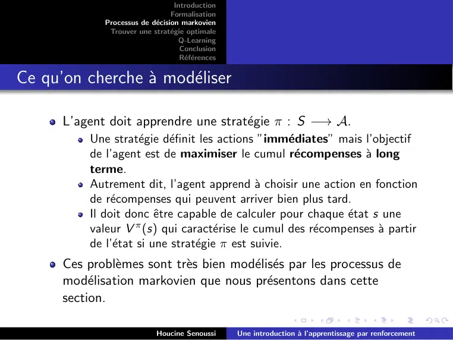

~~~text
                                   Introduction
                                  Formalisation
              Processus de décision markovien
               Trouver une stratégie optimale
                                    Q-Learning
                                     Conclusion
                                     Références

Ce qu’on cherche à modéliser

      L’agent doit apprendre une stratégie π : S −→ A.
           Une stratégie définit les actions ”immédiates” mais l’objectif
           de l’agent est de maximiser le cumul récompenses à long
           terme.
           Autrement dit, l’agent apprend à choisir une action en fonction
           de récompenses qui peuvent arriver bien plus tard.
           Il doit donc être capable de calculer pour chaque état s une
           valeur V π (s) qui caractérise le cumul des récompenses à partir
           de l’état si une stratégie π est suivie.
      Ces problèmes sont très bien modélisés par les processus de
      modélisation markovien que nous présentons dans cette
      section.

                              Houcine Senoussi      Une introduction à l’apprentissage par renforcement
~~~

## Page 16

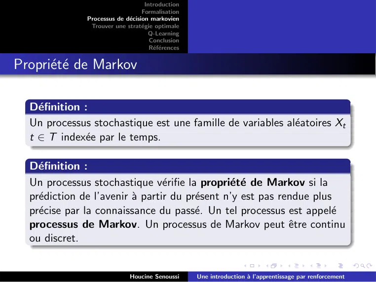

~~~text
                                   Introduction
                                  Formalisation
              Processus de décision markovien
               Trouver une stratégie optimale
                                    Q-Learning
                                     Conclusion
                                     Références

Propriété de Markov

  Définition :
  Un processus stochastique est une famille de variables aléatoires Xt
  t ∈ T indexée par le temps.

  Définition :
  Un processus stochastique vérifie la propriété de Markov si la
  prédiction de l’avenir à partir du présent n’y est pas rendue plus
  précise par la connaissance du passé. Un tel processus est appelé
  processus de Markov. Un processus de Markov peut être continu
  ou discret.

                              Houcine Senoussi      Une introduction à l’apprentissage par renforcement
~~~

## Page 17

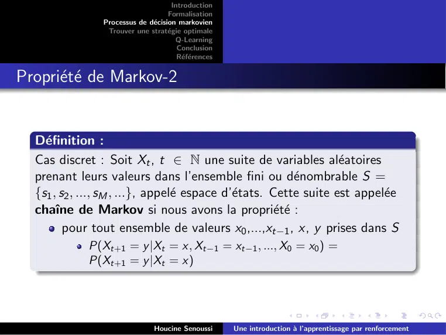

~~~text
                                     Introduction
                                    Formalisation
                Processus de décision markovien
                 Trouver une stratégie optimale
                                      Q-Learning
                                       Conclusion
                                       Références

Propriété de Markov-2

  Définition :
  Cas discret : Soit Xt , t ∈ N une suite de variables aléatoires
  prenant leurs valeurs dans l’ensemble fini ou dénombrable S =
  {s1 , s2 , ..., sM , ...}, appelé espace d’états. Cette suite est appelée
  chaı̂ne de Markov si nous avons la propriété :
         pour tout ensemble de valeurs x0 ,...,xt−1 , x, y prises dans S
             P(Xt+1 = y |Xt = x, Xt−1 = xt−1 , ..., X0 = x0 ) =
             P(Xt+1 = y |Xt = x)

                                Houcine Senoussi      Une introduction à l’apprentissage par renforcement
~~~

## Page 18

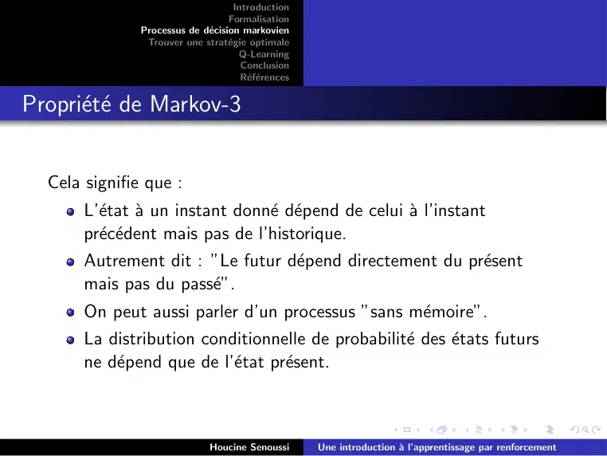

~~~text
                                    Introduction
                                   Formalisation
               Processus de décision markovien
                Trouver une stratégie optimale
                                     Q-Learning
                                      Conclusion
                                      Références

Propriété de Markov-3

  Cela signifie que :
       L’état à un instant donné dépend de celui à l’instant
       précédent mais pas de l’historique.
       Autrement dit : ”Le futur dépend directement du présent
       mais pas du passé”.
       On peut aussi parler d’un processus ”sans mémoire”.
       La distribution conditionnelle de probabilité des états futurs
       ne dépend que de l’état présent.

                               Houcine Senoussi      Une introduction à l’apprentissage par renforcement
~~~

## Page 19

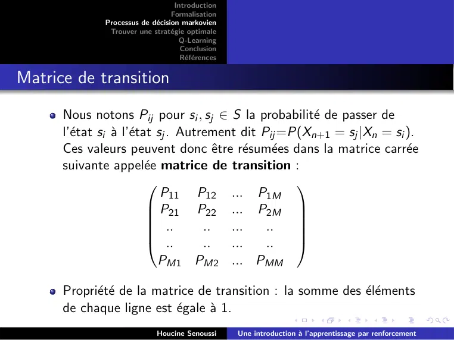

~~~text
                                   Introduction
                                  Formalisation
              Processus de décision markovien
               Trouver une stratégie optimale
                                    Q-Learning
                                     Conclusion
                                     Références

Matrice de transition
      Nous notons Pij pour si , sj ∈ S la probabilité de passer de
      l’état si à l’état sj . Autrement dit Pij =P(Xn+1 = sj |Xn = si ).
      Ces valeurs peuvent donc être résumées dans la matrice carrée
      suivante appelée matrice de transition :
                                                    
                             P11 P12 ... P1M
                           P21 P22 ... P2M 
                                                    
                           ..       ..  ...    ..   
                                                    
                           ..       ..  ...    ..   
                            PM1 PM2 ... PMM

      Propriété de la matrice de transition : la somme des éléments
      de chaque ligne est égale à 1.
                              Houcine Senoussi      Une introduction à l’apprentissage par renforcement
~~~

## Page 20

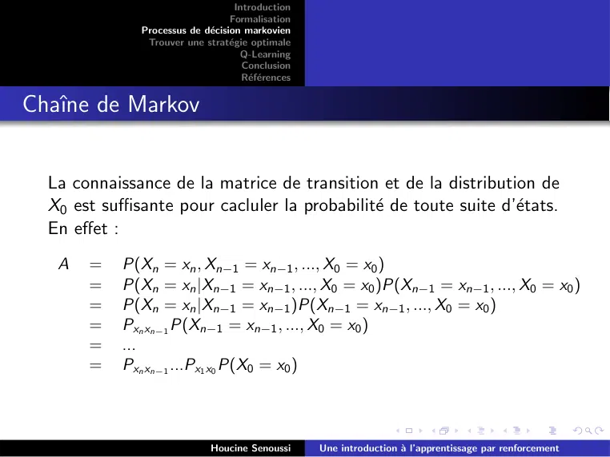

~~~text
                                    Introduction
                                   Formalisation
               Processus de décision markovien
                Trouver une stratégie optimale
                                     Q-Learning
                                      Conclusion
                                      Références

Chaı̂ne de Markov

  La connaissance de la matrice de transition et de la distribution de
  X0 est suffisante pour cacluler la probabilité de toute suite d’états.
  En effet :
   A   =    P(Xn = xn , Xn−1 = xn−1 , ..., X0 = x0 )
       =    P(Xn = xn |Xn−1 = xn−1 , ..., X0 = x0 )P(Xn−1 = xn−1 , ..., X0 = x0 )
       =    P(Xn = xn |Xn−1 = xn−1 )P(Xn−1 = xn−1 , ..., X0 = x0 )
       =    Pxn xn−1 P(Xn−1 = xn−1 , ..., X0 = x0 )
       =    ...
       =    Pxn xn−1 ...Px1 x0 P(X0 = x0 )

                               Houcine Senoussi      Une introduction à l’apprentissage par renforcement
~~~

## Page 21

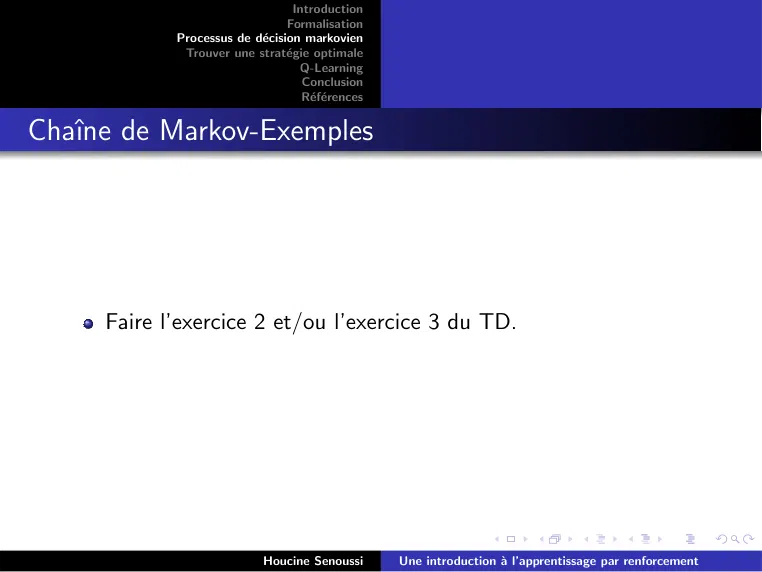

~~~text
                                 Introduction
                                Formalisation
            Processus de décision markovien
             Trouver une stratégie optimale
                                  Q-Learning
                                   Conclusion
                                   Références

Chaı̂ne de Markov-Exemples

     Faire l’exercice 2 et/ou l’exercice 3 du TD.

                            Houcine Senoussi      Une introduction à l’apprentissage par renforcement
~~~

## Page 22

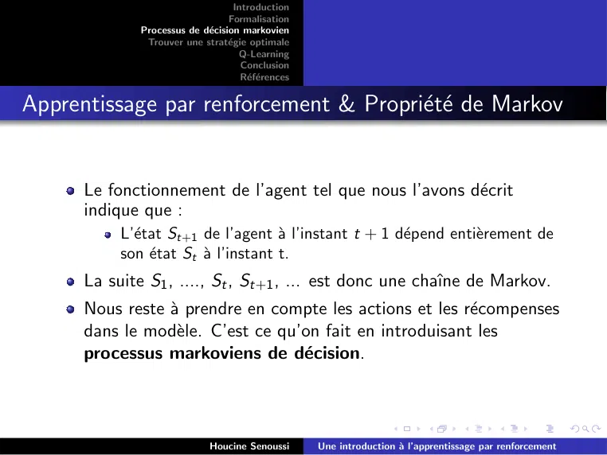

~~~text
                                   Introduction
                                  Formalisation
              Processus de décision markovien
               Trouver une stratégie optimale
                                    Q-Learning
                                     Conclusion
                                     Références

Apprentissage par renforcement & Propriété de Markov

      Le fonctionnement de l’agent tel que nous l’avons décrit
      indique que :
           L’état St+1 de l’agent à l’instant t + 1 dépend entièrement de
           son état St à l’instant t.
      La suite S1 , ...., St , St+1 , ... est donc une chaı̂ne de Markov.
      Nous reste à prendre en compte les actions et les récompenses
      dans le modèle. C’est ce qu’on fait en introduisant les
      processus markoviens de décision.

                              Houcine Senoussi      Une introduction à l’apprentissage par renforcement
~~~

## Page 23

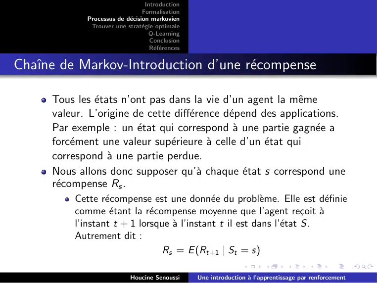

~~~text
                                  Introduction
                                 Formalisation
             Processus de décision markovien
              Trouver une stratégie optimale
                                   Q-Learning
                                    Conclusion
                                    Références

Chaı̂ne de Markov-Introduction d’une récompense

      Tous les états n’ont pas dans la vie d’un agent la même
      valeur. L’origine de cette différence dépend des applications.
      Par exemple : un état qui correspond à une partie gagnée a
      forcément une valeur supérieure à celle d’un état qui
      correspond à une partie perdue.
      Nous allons donc supposer qu’à chaque état s correspond une
      récompense Rs .
          Cette récompense est une donnée du problème. Elle est définie
          comme étant la récompense moyenne que l’agent reçoit à
          l’instant t + 1 lorsque à l’instant t il est dans l’état S.
          Autrement dit :
                                Rs = E (Rt+1 | St = s)

                             Houcine Senoussi      Une introduction à l’apprentissage par renforcement
~~~

## Page 24

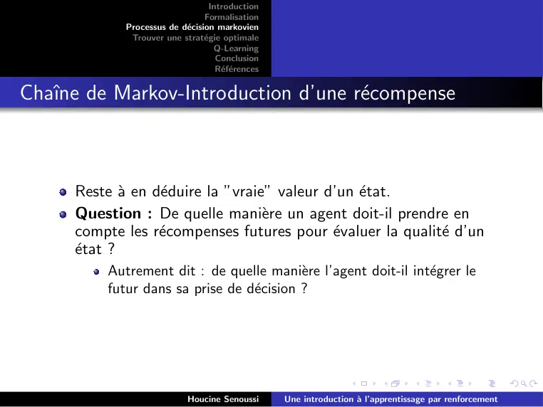

~~~text
                                  Introduction
                                 Formalisation
             Processus de décision markovien
              Trouver une stratégie optimale
                                   Q-Learning
                                    Conclusion
                                    Références

Chaı̂ne de Markov-Introduction d’une récompense

      Reste à en déduire la ”vraie” valeur d’un état.
      Question : De quelle manière un agent doit-il prendre en
      compte les récompenses futures pour évaluer la qualité d’un
      état ?
          Autrement dit : de quelle manière l’agent doit-il intégrer le
          futur dans sa prise de décision ?

                             Houcine Senoussi      Une introduction à l’apprentissage par renforcement
~~~

## Page 25

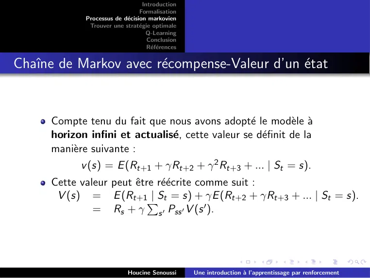

~~~text
                                  Introduction
                                 Formalisation
             Processus de décision markovien
              Trouver une stratégie optimale
                                   Q-Learning
                                    Conclusion
                                    Références

Chaı̂ne de Markov avec récompense-Valeur d’un état

      Compte tenu du fait que nous avons adopté le modèle à
      horizon infini et actualisé, cette valeur se définit de la
      manière suivante :
            v (s) = E (Rt+1 + γRt+2 + γ 2 Rt+3 + ... | St = s).
      Cette valeur peut être réécrite comme suit :
       V (s) = E (Rt+1P      | St = s) + γE (Rt+2 + γRt+3 + ... | St = s).
               = Rs + γ s 0 Pss 0 V (s 0 ).

                             Houcine Senoussi      Une introduction à l’apprentissage par renforcement
~~~

## Page 26

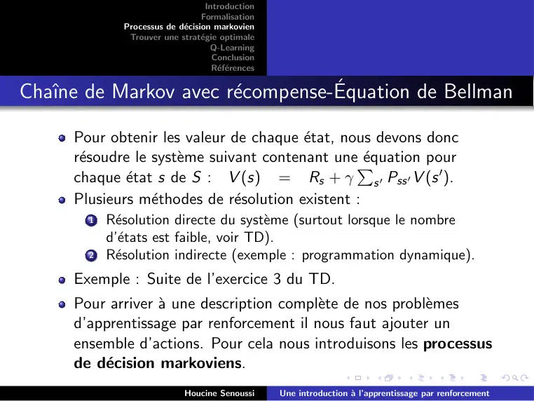

~~~text
                                   Introduction
                                  Formalisation
              Processus de décision markovien
               Trouver une stratégie optimale
                                    Q-Learning
                                     Conclusion
                                     Références

Chaı̂ne de Markov avec récompense-Équation de Bellman

      Pour obtenir les valeur de chaque état, nous devons donc
      résoudre le système suivant contenant uneP  équation pour
      chaque état s de S : V (s) = Rs + γ s 0 Pss 0 V (s 0 ).
      Plusieurs méthodes de résolution existent :
        1   Résolution directe du système (surtout lorsque le nombre
            d’états est faible, voir TD).
        2   Résolution indirecte (exemple : programmation dynamique).
      Exemple : Suite de l’exercice 3 du TD.
      Pour arriver à une description complète de nos problèmes
      d’apprentissage par renforcement il nous faut ajouter un
      ensemble d’actions. Pour cela nous introduisons les processus
      de décision markoviens.
                              Houcine Senoussi      Une introduction à l’apprentissage par renforcement
~~~

## Page 27

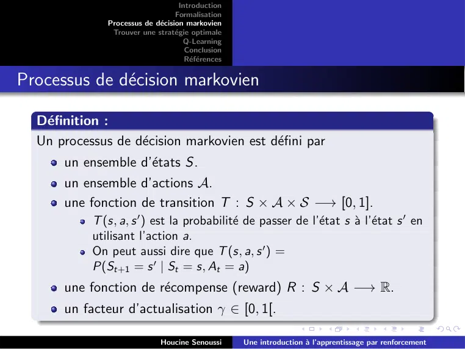

~~~text
                                   Introduction
                                  Formalisation
              Processus de décision markovien
               Trouver une stratégie optimale
                                    Q-Learning
                                     Conclusion
                                     Références

Processus de décision markovien

  Définition :
  Un processus de décision markovien est défini par
      un ensemble d’états S.
      un ensemble d’actions A.
      une fonction de transition T : S × A × S −→ [0, 1].
           T (s, a, s 0 ) est la probabilité de passer de l’état s à l’état s 0 en
           utilisant l’action a.
           On peut aussi dire que T (s, a, s 0 ) =
           P(St+1 = s 0 | St = s, At = a)
      une fonction de récompense (reward) R : S × A −→ R.
      un facteur d’actualisation γ ∈ [0, 1[.

                              Houcine Senoussi      Une introduction à l’apprentissage par renforcement
~~~

## Page 28

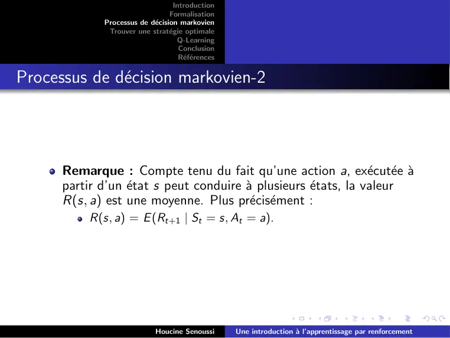

~~~text
                                  Introduction
                                 Formalisation
             Processus de décision markovien
              Trouver une stratégie optimale
                                   Q-Learning
                                    Conclusion
                                    Références

Processus de décision markovien-2

      Remarque : Compte tenu du fait qu’une action a, exécutée à
      partir d’un état s peut conduire à plusieurs états, la valeur
      R(s, a) est une moyenne. Plus précisément :
          R(s, a) = E (Rt+1 | St = s, At = a).

                             Houcine Senoussi      Une introduction à l’apprentissage par renforcement
~~~

## Page 29

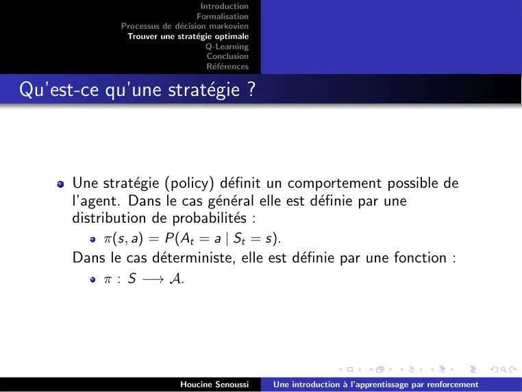

~~~text
                                  Introduction
                                 Formalisation
             Processus de décision markovien
              Trouver une stratégie optimale
                                   Q-Learning
                                    Conclusion
                                    Références

Qu’est-ce qu’une stratégie ?

      Une stratégie (policy) définit un comportement possible de
      l’agent. Dans le cas général elle est définie par une
      distribution de probabilités :
           π(s, a) = P(At = a | St = s).
      Dans le cas déterministe, elle est définie par une fonction :
           π : S −→ A.

                             Houcine Senoussi      Une introduction à l’apprentissage par renforcement
~~~

## Page 30

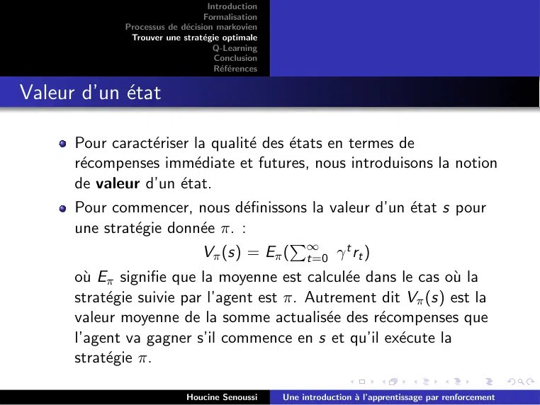

~~~text
                                  Introduction
                                 Formalisation
             Processus de décision markovien
              Trouver une stratégie optimale
                                   Q-Learning
                                    Conclusion
                                    Références

Valeur d’un état

      Pour caractériser la qualité des états en termes de
      récompenses immédiate et futures, nous introduisons la notion
      de valeur d’un état.
      Pour commencer, nous définissons la valeur d’un état s pour
      une stratégie donnée π. :
                         Vπ (s) = Eπ ( ∞     t
                                      P
                                       t=0 γ rt )
      où Eπ signifie que la moyenne est calculée dans le cas où la
      stratégie suivie par l’agent est π. Autrement dit Vπ (s) est la
      valeur moyenne de la somme actualisée des récompenses que
      l’agent va gagner s’il commence en s et qu’il exécute la
      stratégie π.

                             Houcine Senoussi      Une introduction à l’apprentissage par renforcement
~~~

## Page 31

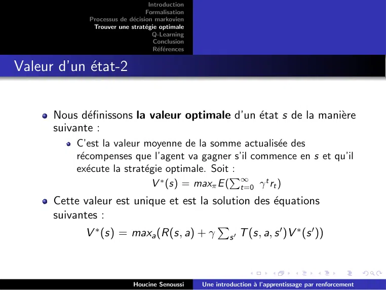

~~~text
                                   Introduction
                                  Formalisation
              Processus de décision markovien
               Trouver une stratégie optimale
                                    Q-Learning
                                     Conclusion
                                     Références

Valeur d’un état-2

      Nous définissons la valeur optimale d’un état s de la manière
      suivante :
           C’est la valeur moyenne de la somme actualisée des
           récompenses que l’agent va gagner s’il commence en s et qu’il
           exécute la stratégie optimale. Soit :
                                                P∞
                              V ∗ (s) = maxπ E ( t=0 γ t rt )
      Cette valeur est unique et est la solution des équations
      suivantes :
            V ∗ (s) = maxa (R(s, a) + γ s 0 T (s, a, s 0 )V ∗ (s 0 ))
                                         P

                              Houcine Senoussi      Une introduction à l’apprentissage par renforcement
~~~

## Page 32

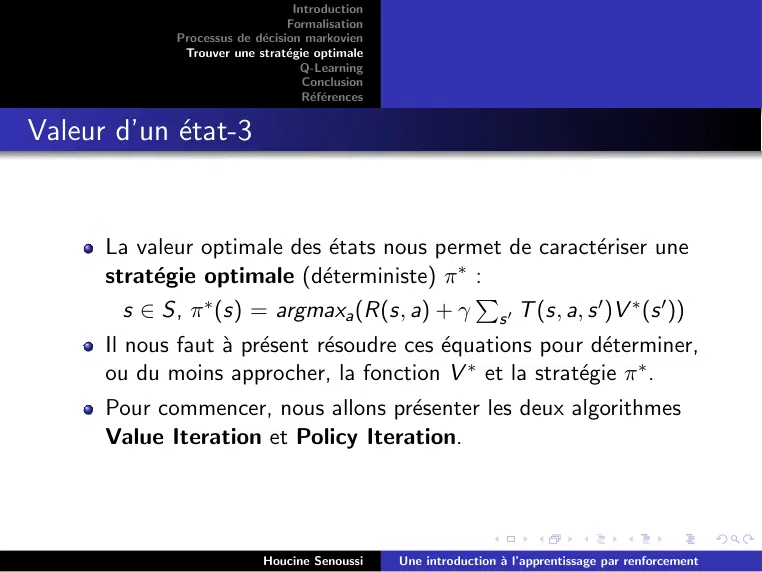

~~~text
                                   Introduction
                                  Formalisation
              Processus de décision markovien
               Trouver une stratégie optimale
                                    Q-Learning
                                     Conclusion
                                     Références

Valeur d’un état-3

      La valeur optimale des états nous permet de caractériser une
      stratégie optimale (déterministe) π ∗ :
        s ∈ S, π ∗ (s) = argmaxa (R(s, a) + γ s 0 T (s, a, s 0 )V ∗ (s 0 ))
                                              P

      Il nous faut à présent résoudre ces équations pour déterminer,
      ou du moins approcher, la fonction V ∗ et la stratégie π ∗ .
      Pour commencer, nous allons présenter les deux algorithmes
      Value Iteration et Policy Iteration.

                              Houcine Senoussi      Une introduction à l’apprentissage par renforcement
~~~

## Page 33

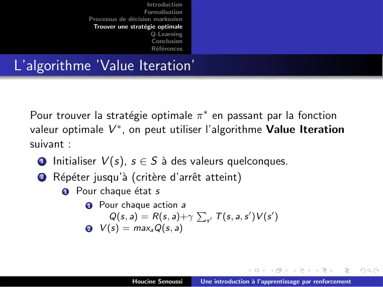

~~~text
                                     Introduction
                                    Formalisation
                Processus de décision markovien
                 Trouver une stratégie optimale
                                      Q-Learning
                                       Conclusion
                                       Références

L’algorithme ’Value Iteration’

  Pour trouver la stratégie optimale π ∗ en passant par la fonction
  valeur optimale V ∗ , on peut utiliser l’algorithme Value Iteration
  suivant :
    1   Initialiser V (s), s ∈ S à des valeurs quelconques.
    2   Répéter jusqu’à (critère d’arrêt atteint)
          1   Pour chaque état s
                1   Pour chaque action a P
                      Q(s, a) = R(s, a)+γ s 0 T (s, a, s 0 )V (s 0 )
                2   V (s) = maxa Q(s, a)

                                Houcine Senoussi      Une introduction à l’apprentissage par renforcement
~~~

## Page 34

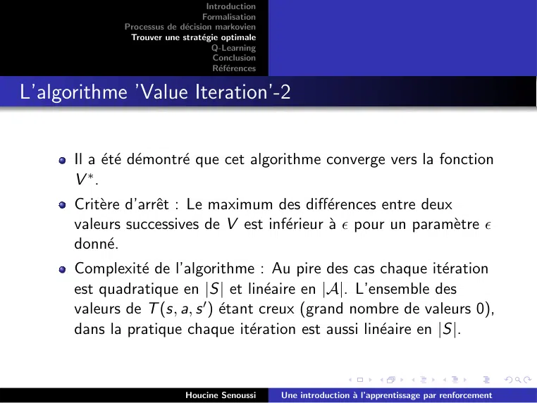

~~~text
                                  Introduction
                                 Formalisation
             Processus de décision markovien
              Trouver une stratégie optimale
                                   Q-Learning
                                    Conclusion
                                    Références

L’algorithme ’Value Iteration’-2

      Il a été démontré que cet algorithme converge vers la fonction
      V ∗.
      Critère d’arrêt : Le maximum des différences entre deux
      valeurs successives de V est inférieur à  pour un paramètre 
      donné.
      Complexité de l’algorithme : Au pire des cas chaque itération
      est quadratique en |S| et linéaire en |A|. L’ensemble des
      valeurs de T (s, a, s 0 ) étant creux (grand nombre de valeurs 0),
      dans la pratique chaque itération est aussi linéaire en |S|.

                             Houcine Senoussi      Une introduction à l’apprentissage par renforcement
~~~

## Page 35

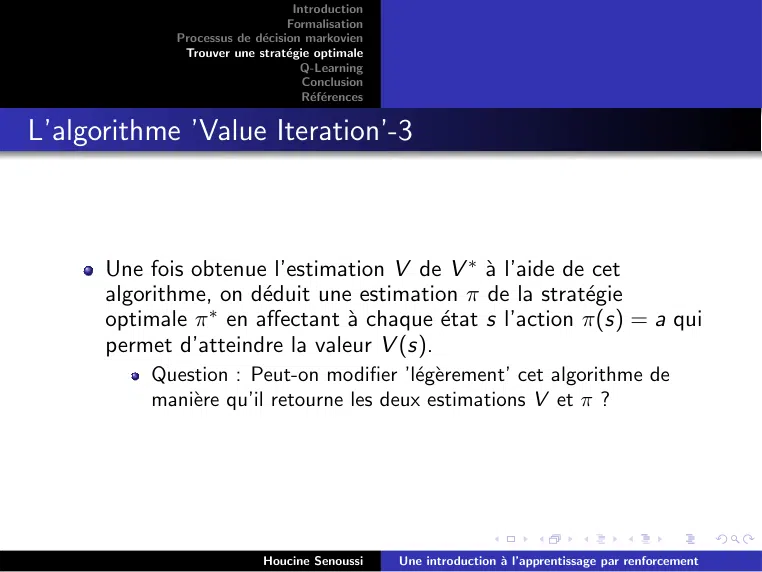

~~~text
                                  Introduction
                                 Formalisation
             Processus de décision markovien
              Trouver une stratégie optimale
                                   Q-Learning
                                    Conclusion
                                    Références

L’algorithme ’Value Iteration’-3

      Une fois obtenue l’estimation V de V ∗ à l’aide de cet
      algorithme, on déduit une estimation π de la stratégie
      optimale π ∗ en affectant à chaque état s l’action π(s) = a qui
      permet d’atteindre la valeur V (s).
          Question : Peut-on modifier ’légèrement’ cet algorithme de
          manière qu’il retourne les deux estimations V et π ?

                             Houcine Senoussi      Une introduction à l’apprentissage par renforcement
~~~

## Page 36

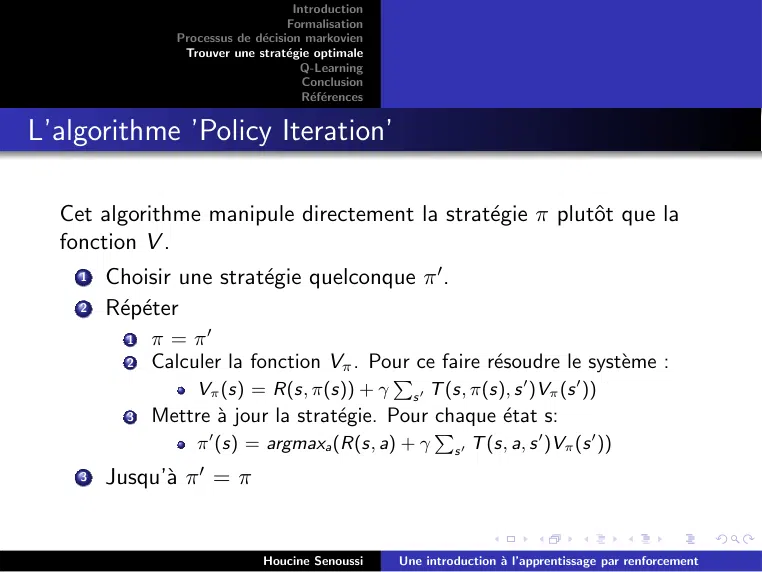

~~~text
                                      Introduction
                                     Formalisation
                 Processus de décision markovien
                  Trouver une stratégie optimale
                                       Q-Learning
                                        Conclusion
                                        Références

L’algorithme ’Policy Iteration’

  Cet algorithme manipule directement la stratégie π plutôt que la
  fonction V .
    1   Choisir une stratégie quelconque π 0 .
    2   Répéter
          1   π = π0
          2   Calculer la fonction Vπ . Pour ce faire résoudre le système :
                                                       P                  0      0
                    Vπ (s) = R(s, π(s)) + γ              s 0 T (s, π(s), s )Vπ (s ))
          3   Mettre à jour la stratégie. Pour chaque état s:
                    π 0 (s) = argmaxa (R(s, a) + γ                             0      0
                                                             P
                                                                 s 0 T (s, a, s )Vπ (s ))

    3   Jusqu’à π 0 = π

                                 Houcine Senoussi      Une introduction à l’apprentissage par renforcement
~~~

## Page 37

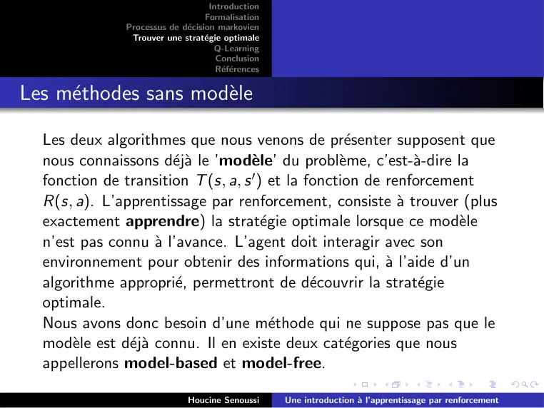

~~~text
                                   Introduction
                                  Formalisation
              Processus de décision markovien
               Trouver une stratégie optimale
                                    Q-Learning
                                     Conclusion
                                     Références

Les méthodes sans modèle

  Les deux algorithmes que nous venons de présenter supposent que
  nous connaissons déjà le ’modèle’ du problème, c’est-à-dire la
  fonction de transition T (s, a, s 0 ) et la fonction de renforcement
  R(s, a). L’apprentissage par renforcement, consiste à trouver (plus
  exactement apprendre) la stratégie optimale lorsque ce modèle
  n’est pas connu à l’avance. L’agent doit interagir avec son
  environnement pour obtenir des informations qui, à l’aide d’un
  algorithme approprié, permettront de découvrir la stratégie
  optimale.
  Nous avons donc besoin d’une méthode qui ne suppose pas que le
  modèle est déjà connu. Il en existe deux catégories que nous
  appellerons model-based et model-free.

                              Houcine Senoussi      Une introduction à l’apprentissage par renforcement
~~~

## Page 38

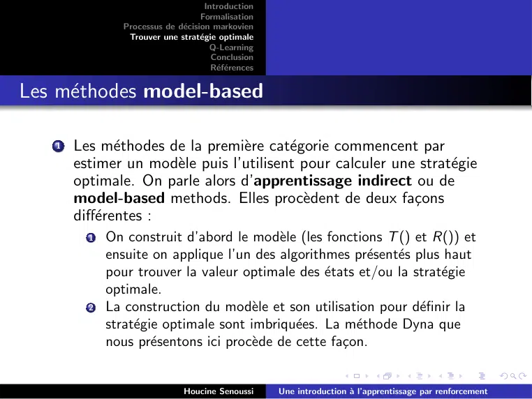

~~~text
                                    Introduction
                                   Formalisation
               Processus de décision markovien
                Trouver une stratégie optimale
                                     Q-Learning
                                      Conclusion
                                      Références

Les méthodes model-based

   1   Les méthodes de la première catégorie commencent par
       estimer un modèle puis l’utilisent pour calculer une stratégie
       optimale. On parle alors d’apprentissage indirect ou de
       model-based methods. Elles procèdent de deux façons
       différentes :
         1   On construit d’abord le modèle (les fonctions T () et R()) et
             ensuite on applique l’un des algorithmes présentés plus haut
             pour trouver la valeur optimale des états et/ou la stratégie
             optimale.
         2   La construction du modèle et son utilisation pour définir la
             stratégie optimale sont imbriquées. La méthode Dyna que
             nous présentons ici procède de cette façon.

                               Houcine Senoussi      Une introduction à l’apprentissage par renforcement
~~~

## Page 39

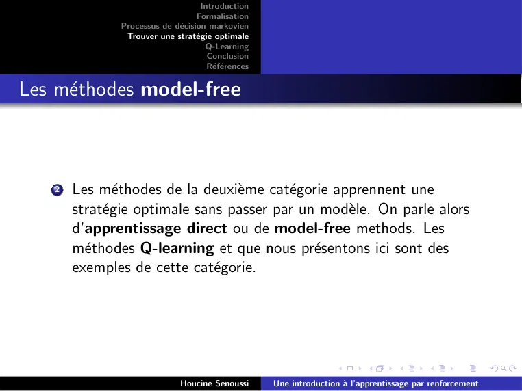

~~~text
                                   Introduction
                                  Formalisation
              Processus de décision markovien
               Trouver une stratégie optimale
                                    Q-Learning
                                     Conclusion
                                     Références

Les méthodes model-free

   2   Les méthodes de la deuxième catégorie apprennent une
       stratégie optimale sans passer par un modèle. On parle alors
       d’apprentissage direct ou de model-free methods. Les
       méthodes Q-learning et que nous présentons ici sont des
       exemples de cette catégorie.

                              Houcine Senoussi      Une introduction à l’apprentissage par renforcement
~~~

## Page 40

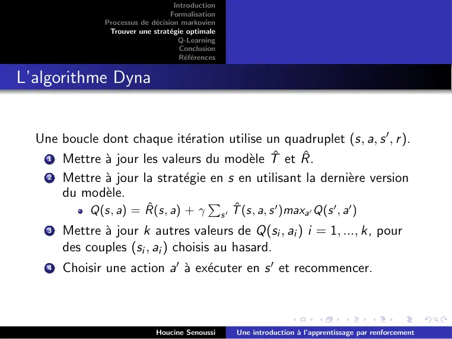

~~~text
                                     Introduction
                                    Formalisation
                Processus de décision markovien
                 Trouver une stratégie optimale
                                      Q-Learning
                                       Conclusion
                                       Références

L’algorithme Dyna

  Une boucle dont chaque itération utilise un quadruplet (s, a, s 0 , r ).
    1   Mettre à jour les valeurs du modèle T̂ et R̂.
    2   Mettre à jour la stratégie en s en utilisant la dernière version
        du modèle.
                                                                     0         0 0
                                                P
             Q(s, a) = R̂(s, a) + γ                   s 0 T̂ (s, a, s )maxa Q(s , a )
                                                                           0

    3   Mettre à jour k autres valeurs de Q(si , ai ) i = 1, ..., k, pour
        des couples (si , ai ) choisis au hasard.
    4   Choisir une action a0 à exécuter en s 0 et recommencer.

                                Houcine Senoussi         Une introduction à l’apprentissage par renforcement
~~~

## Page 41

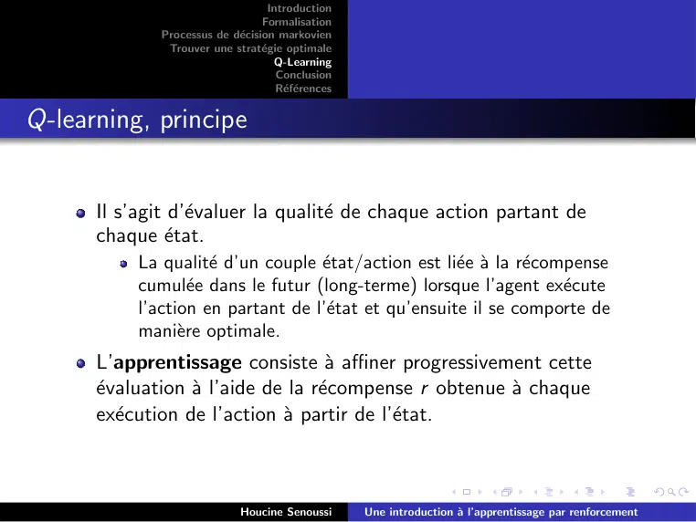

~~~text
                                   Introduction
                                  Formalisation
              Processus de décision markovien
               Trouver une stratégie optimale
                                    Q-Learning
                                     Conclusion
                                     Références

Q-learning, principe

      Il s’agit d’évaluer la qualité de chaque action partant de
      chaque état.
           La qualité d’un couple état/action est liée à la récompense
           cumulée dans le futur (long-terme) lorsque l’agent exécute
           l’action en partant de l’état et qu’ensuite il se comporte de
           manière optimale.
      L’apprentissage consiste à affiner progressivement cette
      évaluation à l’aide de la récompense r obtenue à chaque
      exécution de l’action à partir de l’état.

                              Houcine Senoussi      Une introduction à l’apprentissage par renforcement
~~~

## Page 42

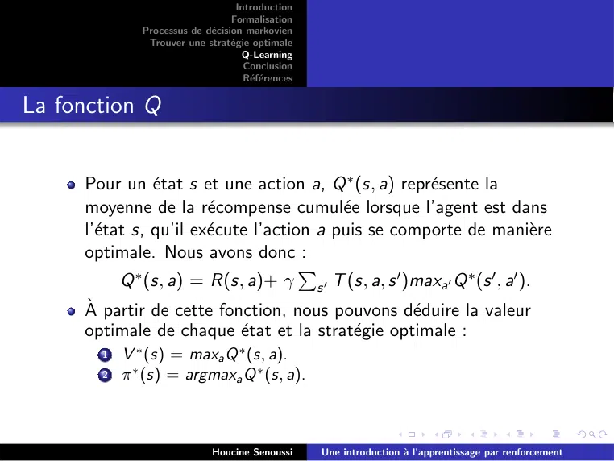

~~~text
                                   Introduction
                                  Formalisation
              Processus de décision markovien
               Trouver une stratégie optimale
                                    Q-Learning
                                     Conclusion
                                     Références

La fonction Q

     Pour un état s et une action a, Q ∗ (s, a) représente la
     moyenne de la récompense cumulée lorsque l’agent est dans
     l’état s, qu’il exécute l’action a puis se comporte de manière
     optimale. Nous avons donc :
           Q ∗ (s, a) = R(s, a)+ γ s 0 T (s, a, s 0 )maxa0 Q ∗ (s 0 , a0 ).
                                      P

     À partir de cette fonction, nous pouvons déduire la valeur
     optimale de chaque état et la stratégie optimale :
       1   V ∗ (s) = maxa Q ∗ (s, a).
       2   π ∗ (s) = argmaxa Q ∗ (s, a).

                              Houcine Senoussi      Une introduction à l’apprentissage par renforcement
~~~

## Page 43

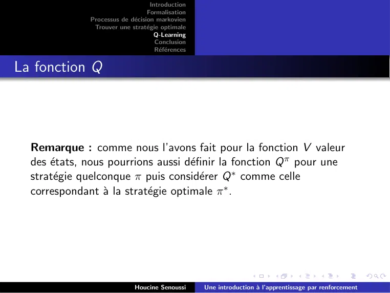

~~~text
                                   Introduction
                                  Formalisation
              Processus de décision markovien
               Trouver une stratégie optimale
                                    Q-Learning
                                     Conclusion
                                     Références

La fonction Q

  Remarque : comme nous l’avons fait pour la fonction V valeur
  des états, nous pourrions aussi définir la fonction Q π pour une
  stratégie quelconque π puis considérer Q ∗ comme celle
  correspondant à la stratégie optimale π ∗ .

                              Houcine Senoussi      Une introduction à l’apprentissage par renforcement
~~~

## Page 44

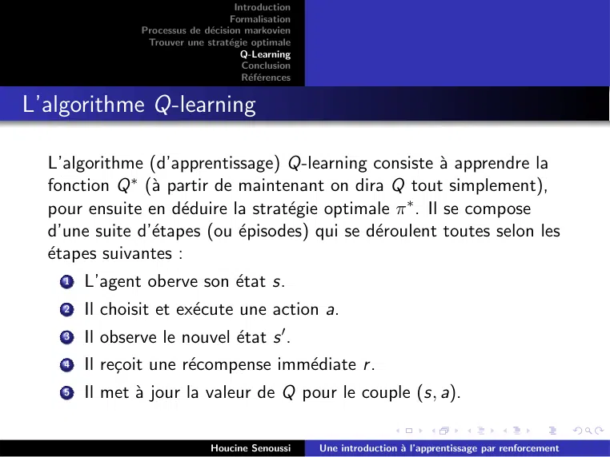

~~~text
                                     Introduction
                                    Formalisation
                Processus de décision markovien
                 Trouver une stratégie optimale
                                      Q-Learning
                                       Conclusion
                                       Références

L’algorithme Q-learning

  L’algorithme (d’apprentissage) Q-learning consiste à apprendre la
  fonction Q ∗ (à partir de maintenant on dira Q tout simplement),
  pour ensuite en déduire la stratégie optimale π ∗ . Il se compose
  d’une suite d’étapes (ou épisodes) qui se déroulent toutes selon les
  étapes suivantes :
    1   L’agent oberve son état s.
    2   Il choisit et exécute une action a.
    3   Il observe le nouvel état s 0 .
    4   Il reçoit une récompense immédiate r .
    5   Il met à jour la valeur de Q pour le couple (s, a).

                                Houcine Senoussi      Une introduction à l’apprentissage par renforcement
~~~

## Page 45

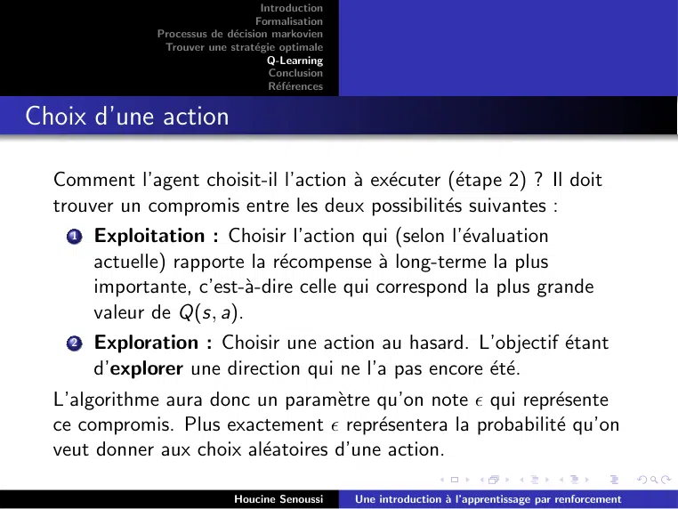

~~~text
                                    Introduction
                                   Formalisation
               Processus de décision markovien
                Trouver une stratégie optimale
                                     Q-Learning
                                      Conclusion
                                      Références

Choix d’une action

  Comment l’agent choisit-il l’action à exécuter (étape 2) ? Il doit
  trouver un compromis entre les deux possibilités suivantes :
    1   Exploitation : Choisir l’action qui (selon l’évaluation
        actuelle) rapporte la récompense à long-terme la plus
        importante, c’est-à-dire celle qui correspond la plus grande
        valeur de Q(s, a).
    2   Exploration : Choisir une action au hasard. L’objectif étant
        d’explorer une direction qui ne l’a pas encore été.
  L’algorithme aura donc un paramètre qu’on note  qui représente
  ce compromis. Plus exactement  représentera la probabilité qu’on
  veut donner aux choix aléatoires d’une action.

                               Houcine Senoussi      Une introduction à l’apprentissage par renforcement
~~~

## Page 46

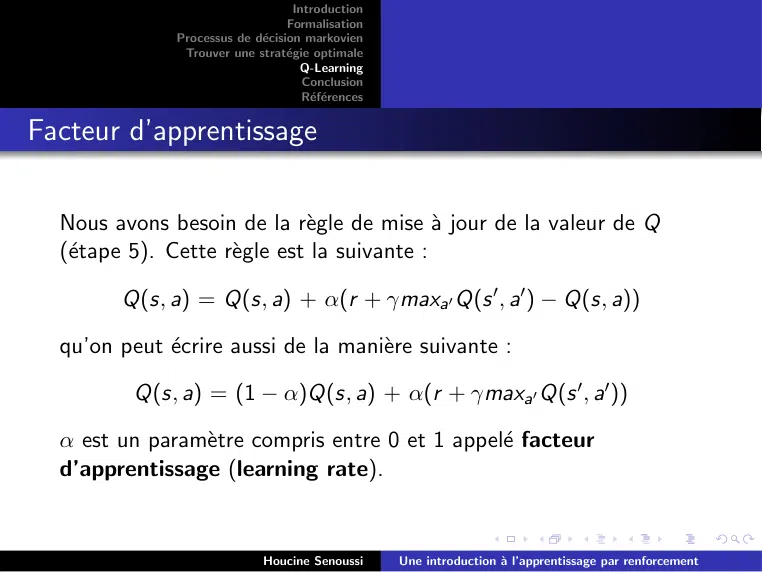

~~~text
                                   Introduction
                                  Formalisation
              Processus de décision markovien
               Trouver une stratégie optimale
                                    Q-Learning
                                     Conclusion
                                     Références

Facteur d’apprentissage

  Nous avons besoin de la règle de mise à jour de la valeur de Q
  (étape 5). Cette règle est la suivante :

        Q(s, a) = Q(s, a) + α(r + γmaxa0 Q(s 0 , a0 ) − Q(s, a))

  qu’on peut écrire aussi de la manière suivante :

          Q(s, a) = (1 − α)Q(s, a) + α(r + γmaxa0 Q(s 0 , a0 ))

  α est un paramètre compris entre 0 et 1 appelé facteur
  d’apprentissage (learning rate).

                              Houcine Senoussi      Une introduction à l’apprentissage par renforcement
~~~

## Page 47

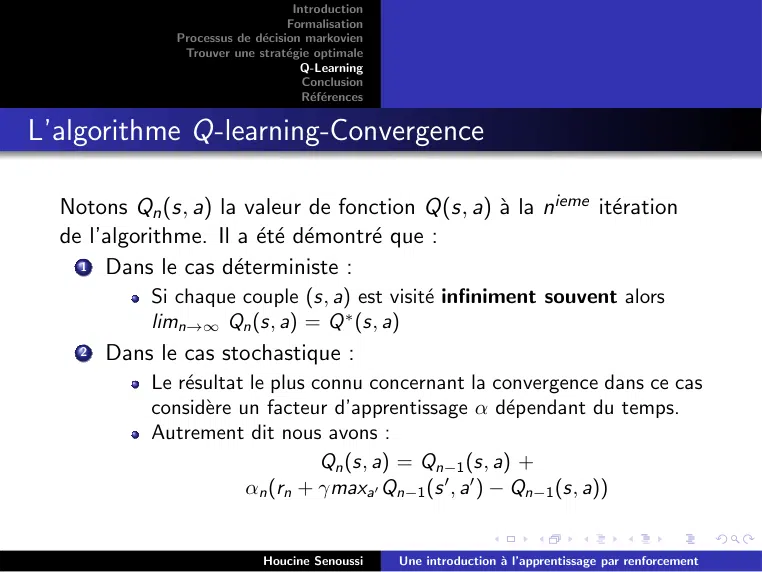

~~~text
                                    Introduction
                                   Formalisation
               Processus de décision markovien
                Trouver une stratégie optimale
                                     Q-Learning
                                      Conclusion
                                      Références

L’algorithme Q-learning-Convergence

  Notons Qn (s, a) la valeur de fonction Q(s, a) à la nieme itération
  de l’algorithme. Il a été démontré que :
    1 Dans le cas déterministe :

            Si chaque couple (s, a) est visité infiniment souvent alors
            limn→∞ Qn (s, a) = Q ∗ (s, a)
    2   Dans le cas stochastique :
            Le résultat le plus connu concernant la convergence dans ce cas
            considère un facteur d’apprentissage α dépendant du temps.
            Autrement dit nous avons :
                                  Qn (s, a) = Qn−1 (s, a) +
                        αn (rn + γmaxa0 Qn−1 (s 0 , a0 ) − Qn−1 (s, a))

                               Houcine Senoussi      Une introduction à l’apprentissage par renforcement
~~~

## Page 48

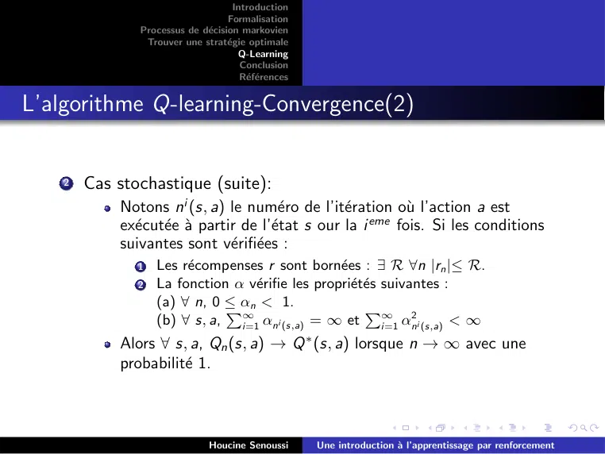

~~~text
                                    Introduction
                                   Formalisation
               Processus de décision markovien
                Trouver une stratégie optimale
                                     Q-Learning
                                      Conclusion
                                      Références

L’algorithme Q-learning-Convergence(2)

    2   Cas stochastique (suite):
            Notons ni (s, a) le numéro de l’itération où l’action a est
            exécutée à partir de l’état s our la i eme fois. Si les conditions
            suivantes sont vérifiées :
               1   Les récompenses r sont bornées : ∃ R ∀n |rn |≤ R.
               2   La fonction α vérifie les propriétés suivantes :
                   (a) ∀ n, 0 ≤
                              Pαn < 1.
                   (b) ∀ s, a, ∞
                                                       P∞ 2
                                i=1 αni (s,a) = ∞ et       i=1 αni (s,a) < ∞
            Alors ∀ s, a, Qn (s, a) → Q ∗ (s, a) lorsque n → ∞ avec une
            probabilité 1.

                               Houcine Senoussi      Une introduction à l’apprentissage par renforcement
~~~

## Page 49

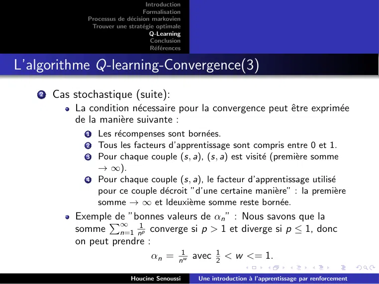

~~~text
                                    Introduction
                                   Formalisation
               Processus de décision markovien
                Trouver une stratégie optimale
                                     Q-Learning
                                      Conclusion
                                      Références

L’algorithme Q-learning-Convergence(3)
    2   Cas stochastique (suite):
            La condition nécessaire pour la convergence peut être exprimée
            de la manière suivante :
               1   Les récompenses sont bornées.
               2   Tous les facteurs d’apprentissage sont compris entre 0 et 1.
               3   Pour chaque couple (s, a), (s, a) est visité (première somme
                   → ∞).
               4   Pour chaque couple (s, a), le facteur d’apprentissage utilisé
                   pour ce couple décroit ”d’une certaine manière” : la première
                   somme → ∞ et ldeuxième somme reste bornée.
            ExemplePde ”bonnes valeurs de αn ” : Nous savons que la
                      ∞
            somme n=1 n1p converge si p > 1 et diverge si p ≤ 1, donc
            on peut prendre :
                              αn = n1w avec 12 < w <= 1.

                               Houcine Senoussi      Une introduction à l’apprentissage par renforcement
~~~

## Page 50

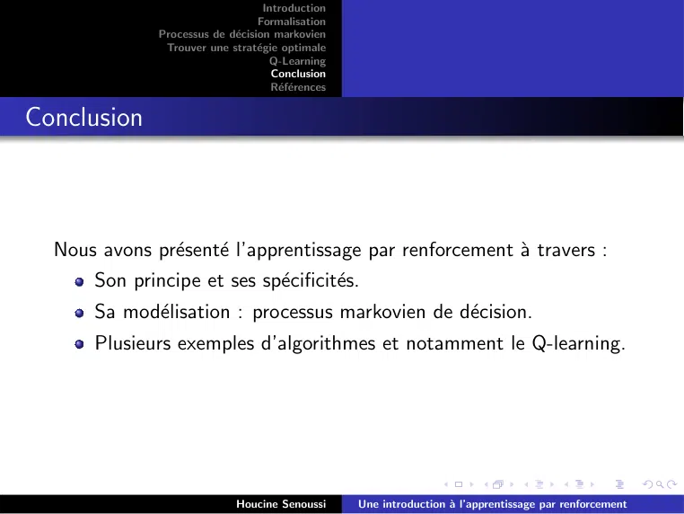

~~~text
                                   Introduction
                                  Formalisation
              Processus de décision markovien
               Trouver une stratégie optimale
                                    Q-Learning
                                     Conclusion
                                     Références

Conclusion

  Nous avons présenté l’apprentissage par renforcement à travers :
      Son principe et ses spécificités.
      Sa modélisation : processus markovien de décision.
      Plusieurs exemples d’algorithmes et notamment le Q-learning.

                              Houcine Senoussi      Une introduction à l’apprentissage par renforcement
~~~

## Page 51

~~~text
                                    Introduction
                                   Formalisation
               Processus de décision markovien
                Trouver une stratégie optimale
                                     Q-Learning
                                      Conclusion
                                      Références

Références

       Reinforcement Learning : A Survey. L.P. Kaebling et al.
       Initiation aux probabilités. Sheldon M. Ross.
       Q-learning. Technical note. C. Watkins.
       Cours de David Silver à l’UCL. http://www0.cs.ucl.ac.
       uk/staff/d.silver/web/Teaching.html

                               Houcine Senoussi      Une introduction à l’apprentissage par renforcement
~~~
