# Intro_IA_slides1.pdf

[Ouvrir l’original](https://drive.google.com/open?id=1CRhQwX8v8yIx7yaBNlBDeVW3dWK_0L5R) · Les deux lectures automatiques du PDF divergent sur les pages indiquées. Leur fac-similé accompagne le texte.

**Pages présentant un écart entre les deux extractions** — 1–27.

## Page 1

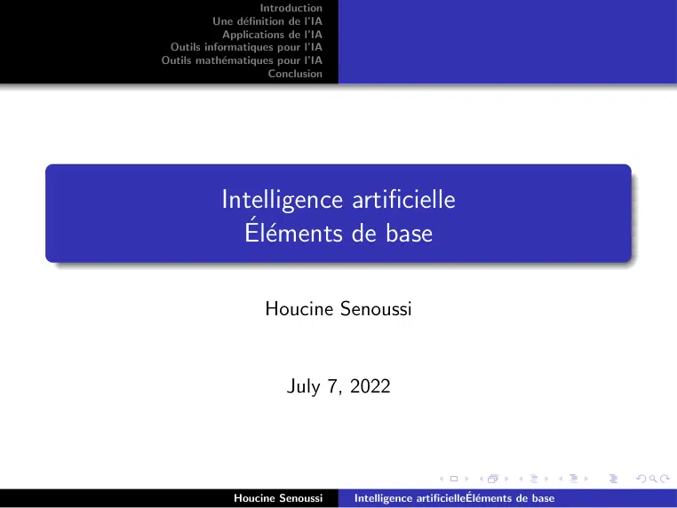

~~~text
                    Introduction
          Une définition de l’IA
            Applications de l’IA
 Outils informatiques pour l’IA
Outils mathématiques pour l’IA
                      Conclusion

            Intelligence artificielle
              Éléments de base

                     Houcine Senoussi

                         July 7, 2022

              Houcine Senoussi      Intelligence artificielleÉléments de base
~~~

## Page 2

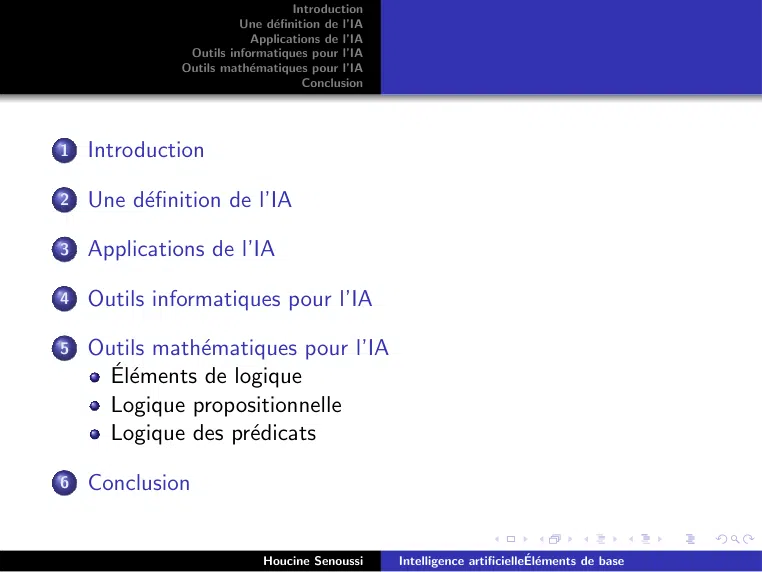

~~~text
                                  Introduction
                        Une définition de l’IA
                          Applications de l’IA
               Outils informatiques pour l’IA
              Outils mathématiques pour l’IA
                                    Conclusion

1   Introduction

2   Une définition de l’IA

3   Applications de l’IA

4   Outils informatiques pour l’IA

5   Outils mathématiques pour l’IA
      Éléments de logique
      Logique propositionnelle
      Logique des prédicats

6   Conclusion

                            Houcine Senoussi      Intelligence artificielleÉléments de base
~~~

## Page 3

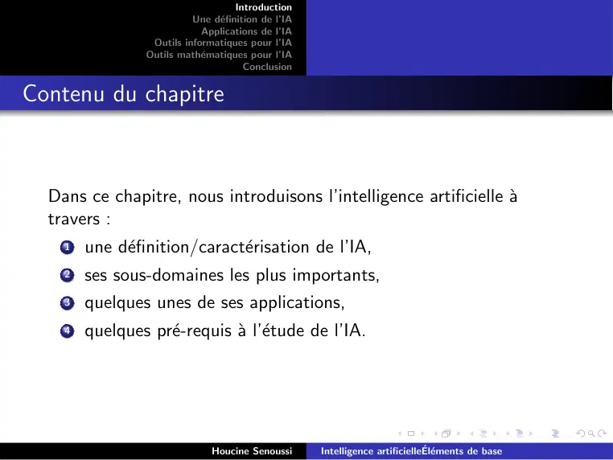

~~~text
                                    Introduction
                          Une définition de l’IA
                            Applications de l’IA
                 Outils informatiques pour l’IA
                Outils mathématiques pour l’IA
                                      Conclusion

Contenu du chapitre

  Dans ce chapitre, nous introduisons l’intelligence artificielle à
  travers :
    1   une définition/caractérisation de l’IA,
    2   ses sous-domaines les plus importants,
    3   quelques unes de ses applications,
    4   quelques pré-requis à l’étude de l’IA.

                              Houcine Senoussi      Intelligence artificielleÉléments de base
~~~

## Page 4

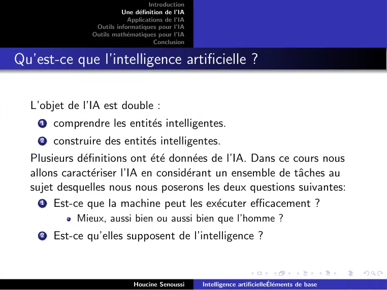

~~~text
                                    Introduction
                          Une définition de l’IA
                            Applications de l’IA
                 Outils informatiques pour l’IA
                Outils mathématiques pour l’IA
                                      Conclusion

Qu’est-ce que l’intelligence artificielle ?

  L’objet de l’IA est double :
    1   comprendre les entités intelligentes.
    2   construire des entités intelligentes.
  Plusieurs définitions ont été données de l’IA. Dans ce cours nous
  allons caractériser l’IA en considérant un ensemble de tâches au
  sujet desquelles nous nous poserons les deux questions suivantes:
     1 Est-ce que la machine peut les exécuter efficacement ?

             Mieux, aussi bien ou aussi bien que l’homme ?
    2   Est-ce qu’elles supposent de l’intelligence ?

                              Houcine Senoussi      Intelligence artificielleÉléments de base
~~~

## Page 5

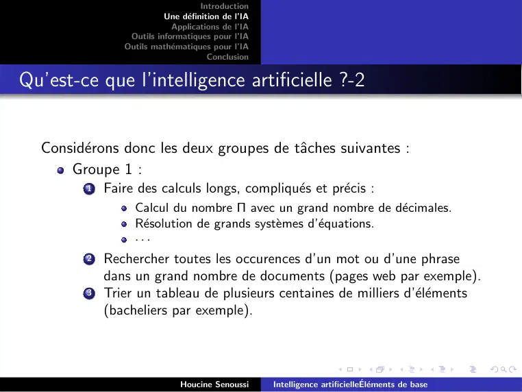

~~~text
                                    Introduction
                          Une définition de l’IA
                            Applications de l’IA
                 Outils informatiques pour l’IA
                Outils mathématiques pour l’IA
                                      Conclusion

Qu’est-ce que l’intelligence artificielle ?-2

  Considérons donc les deux groupes de tâches suivantes :
      Groupe 1 :
         1   Faire des calculs longs, compliqués et précis :
                  Calcul du nombre Π avec un grand nombre de décimales.
                  Résolution de grands systèmes d’équations.
                  ···
         2   Rechercher toutes les occurences d’un mot ou d’une phrase
             dans un grand nombre de documents (pages web par exemple).
         3   Trier un tableau de plusieurs centaines de milliers d’éléments
             (bacheliers par exemple).

                              Houcine Senoussi      Intelligence artificielleÉléments de base
~~~

## Page 6

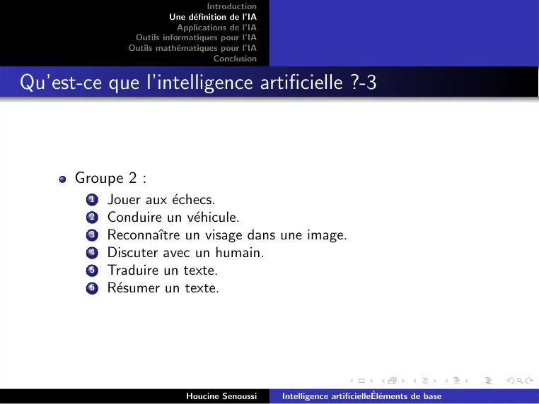

~~~text
                                   Introduction
                         Une définition de l’IA
                           Applications de l’IA
                Outils informatiques pour l’IA
               Outils mathématiques pour l’IA
                                     Conclusion

Qu’est-ce que l’intelligence artificielle ?-3

      Groupe 2 :
        1   Jouer aux échecs.
        2   Conduire un véhicule.
        3   Reconnaı̂tre un visage dans une image.
        4   Discuter avec un humain.
        5   Traduire un texte.
        6   Résumer un texte.

                             Houcine Senoussi      Intelligence artificielleÉléments de base
~~~

## Page 7

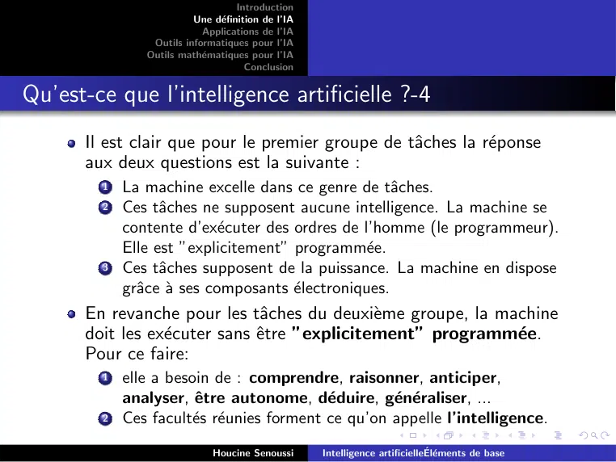

~~~text
                                   Introduction
                         Une définition de l’IA
                           Applications de l’IA
                Outils informatiques pour l’IA
               Outils mathématiques pour l’IA
                                     Conclusion

Qu’est-ce que l’intelligence artificielle ?-4
      Il est clair que pour le premier groupe de tâches la réponse
      aux deux questions est la suivante :
        1   La machine excelle dans ce genre de tâches.
        2   Ces tâches ne supposent aucune intelligence. La machine se
            contente d’exécuter des ordres de l’homme (le programmeur).
            Elle est ”explicitement” programmée.
        3   Ces tâches supposent de la puissance. La machine en dispose
            grâce à ses composants électroniques.
      En revanche pour les tâches du deuxième groupe, la machine
      doit les exécuter sans être ”explicitement” programmée.
      Pour ce faire:
        1   elle a besoin de : comprendre, raisonner, anticiper,
            analyser, être autonome, déduire, généraliser, ...
        2   Ces facultés réunies forment ce qu’on appelle l’intelligence.
                             Houcine Senoussi      Intelligence artificielleÉléments de base
~~~

## Page 8

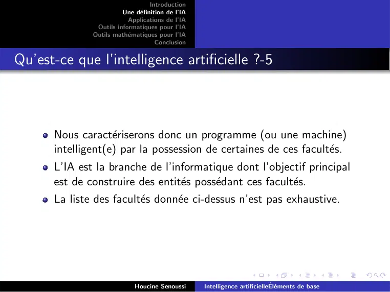

~~~text
                                  Introduction
                        Une définition de l’IA
                          Applications de l’IA
               Outils informatiques pour l’IA
              Outils mathématiques pour l’IA
                                    Conclusion

Qu’est-ce que l’intelligence artificielle ?-5

      Nous caractériserons donc un programme (ou une machine)
      intelligent(e) par la possession de certaines de ces facultés.
      L’IA est la branche de l’informatique dont l’objectif principal
      est de construire des entités possédant ces facultés.
      La liste des facultés donnée ci-dessus n’est pas exhaustive.

                            Houcine Senoussi      Intelligence artificielleÉléments de base
~~~

## Page 9

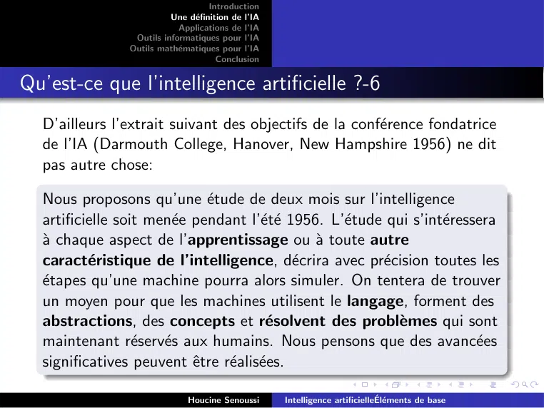

~~~text
                                    Introduction
                          Une définition de l’IA
                            Applications de l’IA
                 Outils informatiques pour l’IA
                Outils mathématiques pour l’IA
                                      Conclusion

Qu’est-ce que l’intelligence artificielle ?-6
  D’ailleurs l’extrait suivant des objectifs de la conférence fondatrice
  de l’IA (Darmouth College, Hanover, New Hampshire 1956) ne dit
  pas autre chose:

  Nous proposons qu’une étude de deux mois sur l’intelligence
  artificielle soit menée pendant l’été 1956. L’étude qui s’intéressera
  à chaque aspect de l’apprentissage ou à toute autre
  caractéristique de l’intelligence, décrira avec précision toutes les
  étapes qu’une machine pourra alors simuler. On tentera de trouver
  un moyen pour que les machines utilisent le langage, forment des
  abstractions, des concepts et résolvent des problèmes qui sont
  maintenant réservés aux humains. Nous pensons que des avancées
  significatives peuvent être réalisées.

                              Houcine Senoussi      Intelligence artificielleÉléments de base
~~~

## Page 10

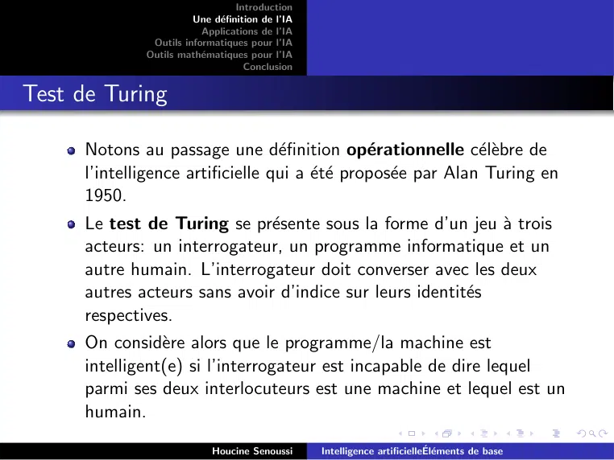

~~~text
                                  Introduction
                        Une définition de l’IA
                          Applications de l’IA
               Outils informatiques pour l’IA
              Outils mathématiques pour l’IA
                                    Conclusion

Test de Turing

      Notons au passage une définition opérationnelle célèbre de
      l’intelligence artificielle qui a été proposée par Alan Turing en
      1950.
      Le test de Turing se présente sous la forme d’un jeu à trois
      acteurs: un interrogateur, un programme informatique et un
      autre humain. L’interrogateur doit converser avec les deux
      autres acteurs sans avoir d’indice sur leurs identités
      respectives.
      On considère alors que le programme/la machine est
      intelligent(e) si l’interrogateur est incapable de dire lequel
      parmi ses deux interlocuteurs est une machine et lequel est un
      humain.

                            Houcine Senoussi      Intelligence artificielleÉléments de base
~~~

## Page 11

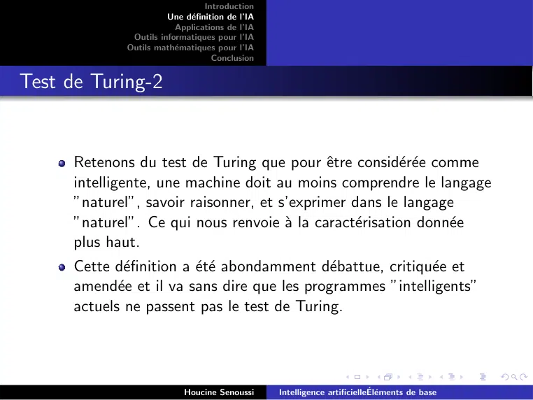

~~~text
                                  Introduction
                        Une définition de l’IA
                          Applications de l’IA
               Outils informatiques pour l’IA
              Outils mathématiques pour l’IA
                                    Conclusion

Test de Turing-2

      Retenons du test de Turing que pour être considérée comme
      intelligente, une machine doit au moins comprendre le langage
      ”naturel”, savoir raisonner, et s’exprimer dans le langage
      ”naturel”. Ce qui nous renvoie à la caractérisation donnée
      plus haut.
      Cette définition a été abondamment débattue, critiquée et
      amendée et il va sans dire que les programmes ”intelligents”
      actuels ne passent pas le test de Turing.

                            Houcine Senoussi      Intelligence artificielleÉléments de base
~~~

## Page 12

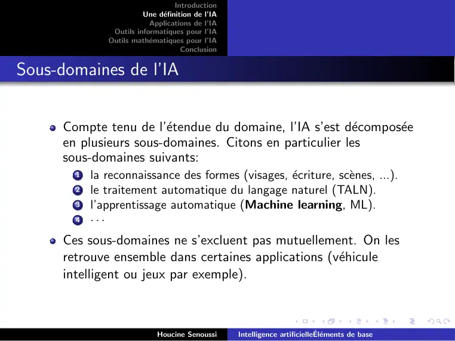

~~~text
                                   Introduction
                         Une définition de l’IA
                           Applications de l’IA
                Outils informatiques pour l’IA
               Outils mathématiques pour l’IA
                                     Conclusion

Sous-domaines de l’IA

      Compte tenu de l’étendue du domaine, l’IA s’est décomposée
      en plusieurs sous-domaines. Citons en particulier les
      sous-domaines suivants:
        1   la reconnaissance des formes (visages, écriture, scènes, ...).
        2   le traitement automatique du langage naturel (TALN).
        3   l’apprentissage automatique (Machine learning, ML).
        4   ···
      Ces sous-domaines ne s’excluent pas mutuellement. On les
      retrouve ensemble dans certaines applications (véhicule
      intelligent ou jeux par exemple).

                             Houcine Senoussi      Intelligence artificielleÉléments de base
~~~

## Page 13

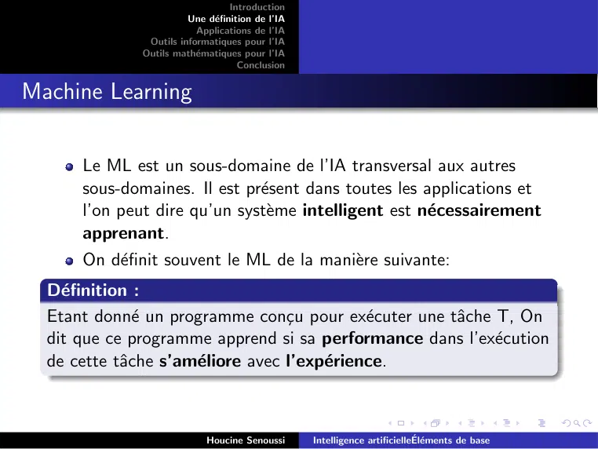

~~~text
                                  Introduction
                        Une définition de l’IA
                          Applications de l’IA
               Outils informatiques pour l’IA
              Outils mathématiques pour l’IA
                                    Conclusion

Machine Learning

      Le ML est un sous-domaine de l’IA transversal aux autres
      sous-domaines. Il est présent dans toutes les applications et
      l’on peut dire qu’un système intelligent est nécessairement
      apprenant.
      On définit souvent le ML de la manière suivante:
  Définition :
  Etant donné un programme conçu pour exécuter une tâche T, On
  dit que ce programme apprend si sa performance dans l’exécution
  de cette tâche s’améliore avec l’expérience.

                            Houcine Senoussi      Intelligence artificielleÉléments de base
~~~

## Page 14

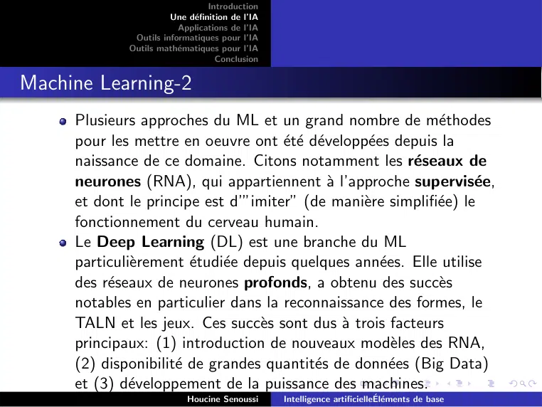

~~~text
                                 Introduction
                       Une définition de l’IA
                         Applications de l’IA
              Outils informatiques pour l’IA
             Outils mathématiques pour l’IA
                                   Conclusion

Machine Learning-2
     Plusieurs approches du ML et un grand nombre de méthodes
     pour les mettre en oeuvre ont été développées depuis la
     naissance de ce domaine. Citons notamment les réseaux de
     neurones (RNA), qui appartiennent à l’approche supervisée,
     et dont le principe est d’”imiter” (de manière simplifiée) le
     fonctionnement du cerveau humain.
     Le Deep Learning (DL) est une branche du ML
     particulièrement étudiée depuis quelques années. Elle utilise
     des réseaux de neurones profonds, a obtenu des succès
     notables en particulier dans la reconnaissance des formes, le
     TALN et les jeux. Ces succès sont dus à trois facteurs
     principaux: (1) introduction de nouveaux modèles des RNA,
     (2) disponibilité de grandes quantités de données (Big Data)
     et (3) développement de la puissance des machines.
                           Houcine Senoussi      Intelligence artificielleÉléments de base
~~~

## Page 15

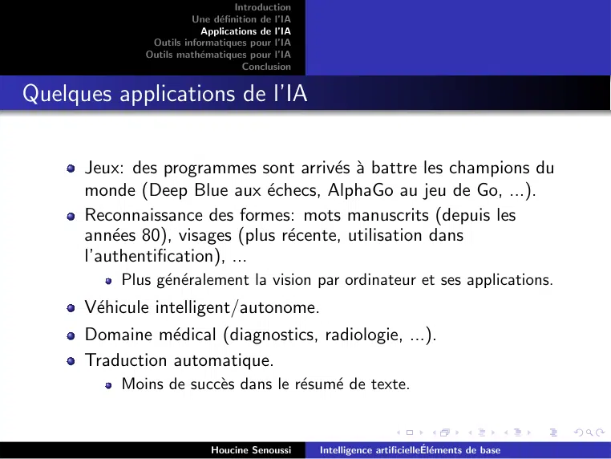

~~~text
                                  Introduction
                        Une définition de l’IA
                          Applications de l’IA
               Outils informatiques pour l’IA
              Outils mathématiques pour l’IA
                                    Conclusion

Quelques applications de l’IA

      Jeux: des programmes sont arrivés à battre les champions du
      monde (Deep Blue aux échecs, AlphaGo au jeu de Go, ...).
      Reconnaissance des formes: mots manuscrits (depuis les
      années 80), visages (plus récente, utilisation dans
      l’authentification), ...
           Plus généralement la vision par ordinateur et ses applications.
      Véhicule intelligent/autonome.
      Domaine médical (diagnostics, radiologie, ...).
      Traduction automatique.
           Moins de succès dans le résumé de texte.

                            Houcine Senoussi      Intelligence artificielleÉléments de base
~~~

## Page 16

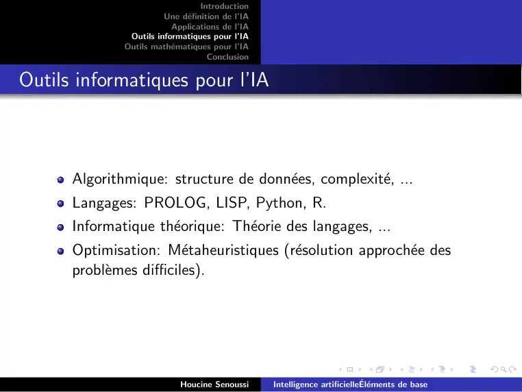

~~~text
                                  Introduction
                        Une définition de l’IA
                          Applications de l’IA
               Outils informatiques pour l’IA
              Outils mathématiques pour l’IA
                                    Conclusion

Outils informatiques pour l’IA

      Algorithmique: structure de données, complexité, ...
      Langages: PROLOG, LISP, Python, R.
      Informatique théorique: Théorie des langages, ...
      Optimisation: Métaheuristiques (résolution approchée des
      problèmes difficiles).

                            Houcine Senoussi      Intelligence artificielleÉléments de base
~~~

## Page 17

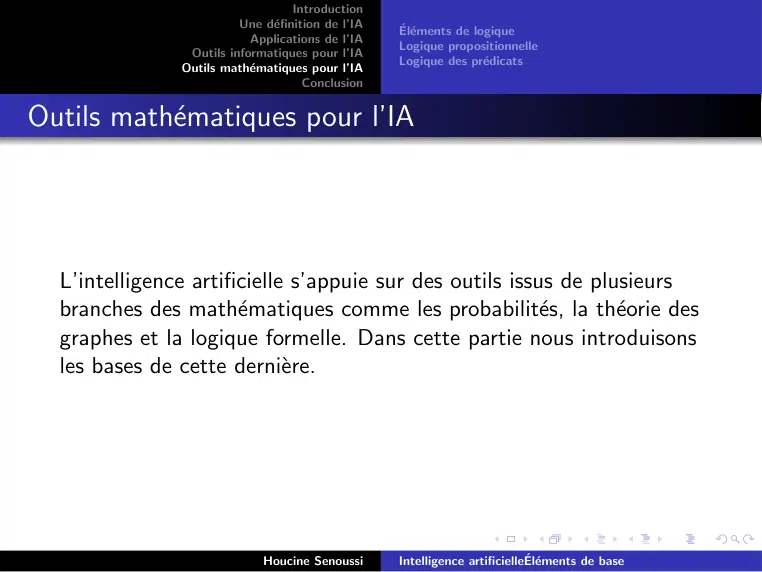

~~~text
                                   Introduction
                         Une définition de l’IA
                                                   Éléments de logique
                           Applications de l’IA
                                                   Logique propositionnelle
                Outils informatiques pour l’IA
                                                   Logique des prédicats
               Outils mathématiques pour l’IA
                                     Conclusion

Outils mathématiques pour l’IA

  L’intelligence artificielle s’appuie sur des outils issus de plusieurs
  branches des mathématiques comme les probabilités, la théorie des
  graphes et la logique formelle. Dans cette partie nous introduisons
  les bases de cette dernière.

                             Houcine Senoussi      Intelligence artificielleÉléments de base
~~~

## Page 18

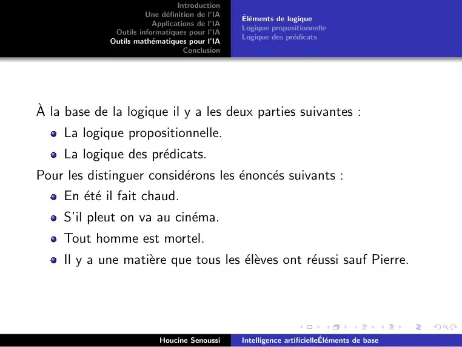

~~~text
                                  Introduction
                        Une définition de l’IA
                                                  Éléments de logique
                          Applications de l’IA
                                                  Logique propositionnelle
               Outils informatiques pour l’IA
                                                  Logique des prédicats
              Outils mathématiques pour l’IA
                                    Conclusion

À la base de la logique il y a les deux parties suivantes :
     La logique propositionnelle.
     La logique des prédicats.
Pour les distinguer considérons les énoncés suivants :
     En été il fait chaud.
     S’il pleut on va au cinéma.
     Tout homme est mortel.
     Il y a une matière que tous les élèves ont réussi sauf Pierre.

                            Houcine Senoussi      Intelligence artificielleÉléments de base
~~~

## Page 19

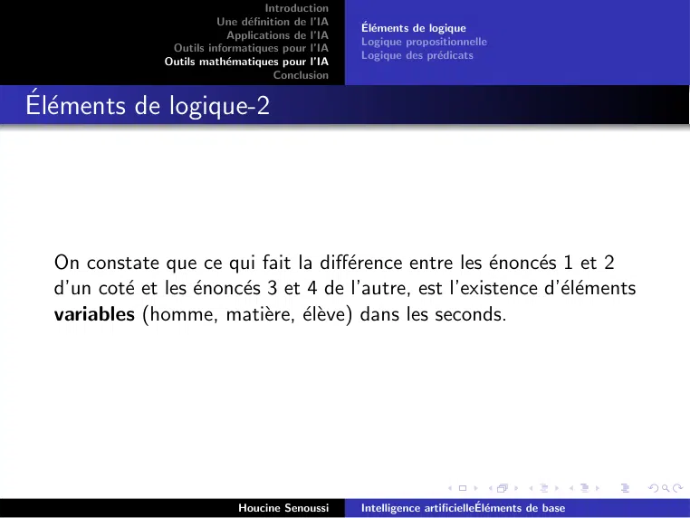

~~~text
                                    Introduction
                          Une définition de l’IA
                                                    Éléments de logique
                            Applications de l’IA
                                                    Logique propositionnelle
                 Outils informatiques pour l’IA
                                                    Logique des prédicats
                Outils mathématiques pour l’IA
                                      Conclusion

Éléments de logique-2

  On constate que ce qui fait la différence entre les énoncés 1 et 2
  d’un coté et les énoncés 3 et 4 de l’autre, est l’existence d’éléments
  variables (homme, matière, élève) dans les seconds.

                              Houcine Senoussi      Intelligence artificielleÉléments de base
~~~

## Page 20

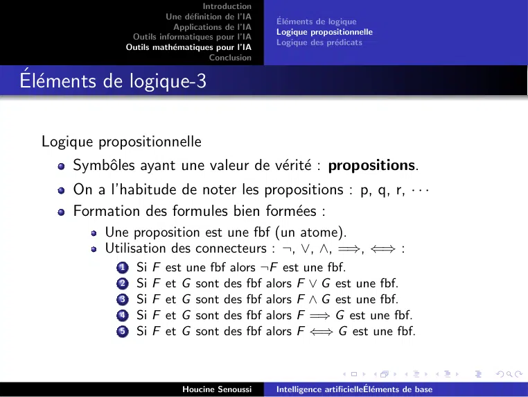

~~~text
                                     Introduction
                           Une définition de l’IA
                                                     Éléments de logique
                             Applications de l’IA
                                                     Logique propositionnelle
                  Outils informatiques pour l’IA
                                                     Logique des prédicats
                 Outils mathématiques pour l’IA
                                       Conclusion

Éléments de logique-3

  Logique propositionnelle
      Symbôles ayant une valeur de vérité : propositions.
      On a l’habitude de noter les propositions : p, q, r, · · ·
      Formation des formules bien formées :
           Une proposition est une fbf (un atome).
           Utilisation des connecteurs : ¬, ∨, ∧, =⇒, ⇐⇒ :
             1     Si F est une fbf alors ¬F est une fbf.
             2     Si F et G sont des fbf alors F ∨ G est une fbf.
             3     Si F et G sont des fbf alors F ∧ G est une fbf.
             4     Si F et G sont des fbf alors F =⇒ G est une fbf.
             5     Si F et G sont des fbf alors F ⇐⇒ G est une fbf.

                               Houcine Senoussi      Intelligence artificielleÉléments de base
~~~

## Page 21

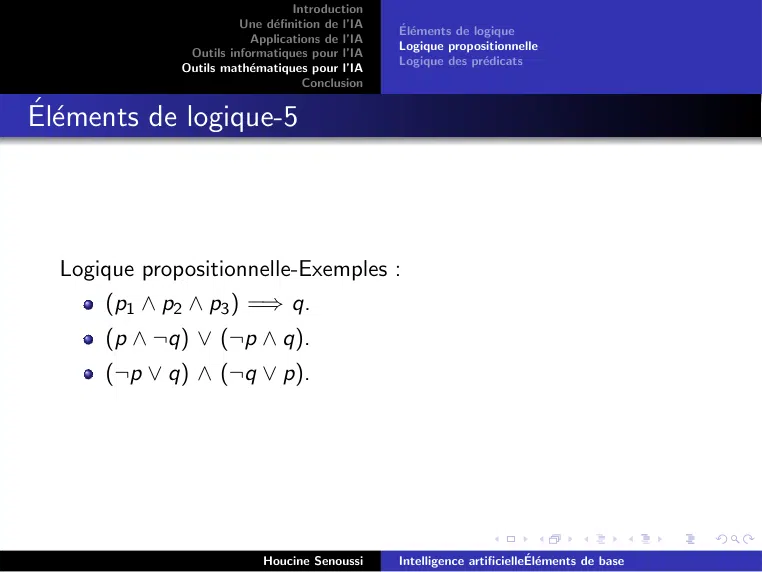

~~~text
                                  Introduction
                        Une définition de l’IA
                                                  Éléments de logique
                          Applications de l’IA
                                                  Logique propositionnelle
               Outils informatiques pour l’IA
                                                  Logique des prédicats
              Outils mathématiques pour l’IA
                                    Conclusion

Éléments de logique-5

  Logique propositionnelle-Exemples :
      (p1 ∧ p2 ∧ p3 ) =⇒ q.
      (p ∧ ¬q) ∨ (¬p ∧ q).
      (¬p ∨ q) ∧ (¬q ∨ p).

                            Houcine Senoussi      Intelligence artificielleÉléments de base
~~~

## Page 22

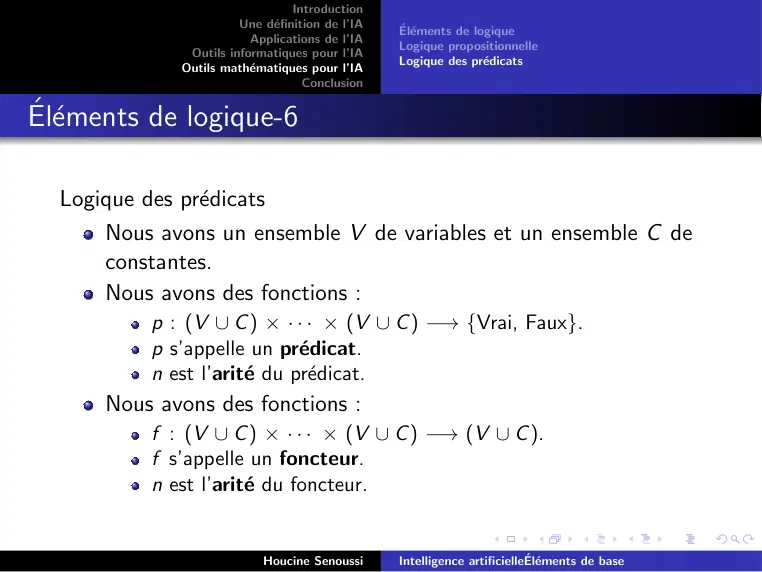

~~~text
                                   Introduction
                         Une définition de l’IA
                                                   Éléments de logique
                           Applications de l’IA
                                                   Logique propositionnelle
                Outils informatiques pour l’IA
                                                   Logique des prédicats
               Outils mathématiques pour l’IA
                                     Conclusion

Éléments de logique-6

  Logique des prédicats
      Nous avons un ensemble V de variables et un ensemble C de
      constantes.
      Nous avons des fonctions :
           p : (V ∪ C ) × · · · × (V ∪ C ) −→ {Vrai, Faux}.
           p s’appelle un prédicat.
           n est l’arité du prédicat.
      Nous avons des fonctions :
           f : (V ∪ C ) × · · · × (V ∪ C ) −→ (V ∪ C ).
           f s’appelle un foncteur.
           n est l’arité du foncteur.

                             Houcine Senoussi      Intelligence artificielleÉléments de base
~~~

## Page 23

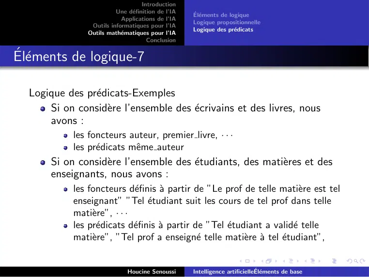

~~~text
                                   Introduction
                         Une définition de l’IA
                                                   Éléments de logique
                           Applications de l’IA
                                                   Logique propositionnelle
                Outils informatiques pour l’IA
                                                   Logique des prédicats
               Outils mathématiques pour l’IA
                                     Conclusion

Éléments de logique-7

  Logique des prédicats-Exemples
      Si on considère l’ensemble des écrivains et des livres, nous
      avons :
            les foncteurs auteur, premier livre, · · ·
            les prédicats même auteur
       Si on considère l’ensemble des étudiants, des matières et des
       enseignants, nous avons :
            les foncteurs définis à partir de ”Le prof de telle matière est tel
            enseignant” ”Tel étudiant suit les cours de tel prof dans telle
            matière”, · · ·
            les prédicats définis à partir de ”Tel étudiant a validé telle
            matière”, ”Tel prof a enseigné telle matière à tel étudiant”,

                             Houcine Senoussi      Intelligence artificielleÉléments de base
~~~

## Page 24

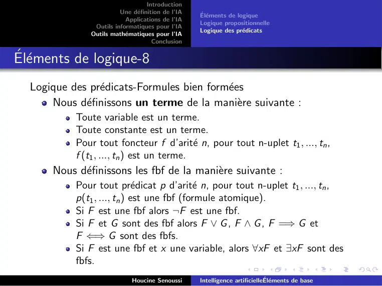

~~~text
                                  Introduction
                        Une définition de l’IA
                                                  Éléments de logique
                          Applications de l’IA
                                                  Logique propositionnelle
               Outils informatiques pour l’IA
                                                  Logique des prédicats
              Outils mathématiques pour l’IA
                                    Conclusion

Éléments de logique-8
  Logique des prédicats-Formules bien formées
      Nous définissons un terme de la manière suivante :
           Toute variable est un terme.
           Toute constante est un terme.
           Pour tout foncteur f d’arité n, pour tout n-uplet t1 , ..., tn ,
           f (t1 , ..., tn ) est un terme.
      Nous définissons les fbf de la manière suivante :
           Pour tout prédicat p d’arité n, pour tout n-uplet t1 , ..., tn ,
           p(t1 , ..., tn ) est une fbf (formule atomique).
           Si F est une fbf alors ¬F est une fbf.
           Si F et G sont des fbf alors F ∨ G , F ∧ G , F =⇒ G et
           F ⇐⇒ G sont des fbfs.
           Si F est une fbf et x une variable, alors ∀xF et ∃xF sont des
           fbfs.
                            Houcine Senoussi      Intelligence artificielleÉléments de base
~~~

## Page 25

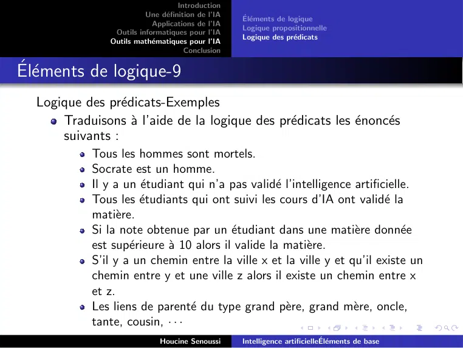

~~~text
                                   Introduction
                         Une définition de l’IA
                                                   Éléments de logique
                           Applications de l’IA
                                                   Logique propositionnelle
                Outils informatiques pour l’IA
                                                   Logique des prédicats
               Outils mathématiques pour l’IA
                                     Conclusion

Éléments de logique-9
  Logique des prédicats-Exemples
      Traduisons à l’aide de la logique des prédicats les énoncés
      suivants :
            Tous les hommes sont mortels.
            Socrate est un homme.
            Il y a un étudiant qui n’a pas validé l’intelligence artificielle.
            Tous les étudiants qui ont suivi les cours d’IA ont validé la
            matière.
            Si la note obtenue par un étudiant dans une matière donnée
            est supérieure à 10 alors il valide la matière.
            S’il y a un chemin entre la ville x et la ville y et qu’il existe un
            chemin entre y et une ville z alors il existe un chemin entre x
            et z.
            Les liens de parenté du type grand père, grand mère, oncle,
            tante, cousin, · · ·
                             Houcine Senoussi      Intelligence artificielleÉléments de base
~~~

## Page 26

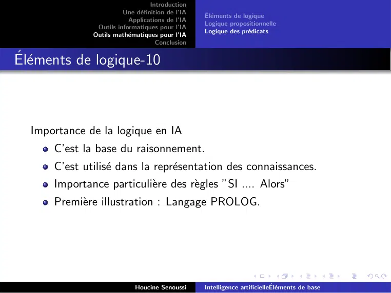

~~~text
                                  Introduction
                        Une définition de l’IA
                                                  Éléments de logique
                          Applications de l’IA
                                                  Logique propositionnelle
               Outils informatiques pour l’IA
                                                  Logique des prédicats
              Outils mathématiques pour l’IA
                                    Conclusion

Éléments de logique-10

  Importance de la logique en IA
      C’est la base du raisonnement.
      C’est utilisé dans la représentation des connaissances.
      Importance particulière des règles ”SI .... Alors”
      Première illustration : Langage PROLOG.

                            Houcine Senoussi      Intelligence artificielleÉléments de base
~~~

## Page 27

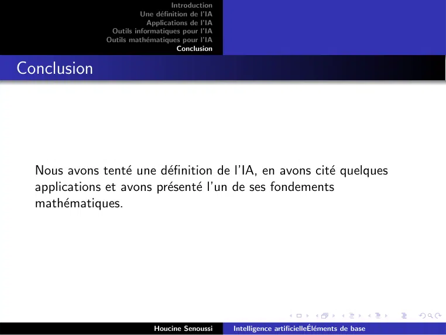

~~~text
                                   Introduction
                         Une définition de l’IA
                           Applications de l’IA
                Outils informatiques pour l’IA
               Outils mathématiques pour l’IA
                                     Conclusion

Conclusion

  Nous avons tenté une définition de l’IA, en avons cité quelques
  applications et avons présenté l’un de ses fondements
  mathématiques.

                             Houcine Senoussi      Intelligence artificielleÉléments de base
~~~
