# Intro_IA_slides2.pdf

[Ouvrir l’original](https://drive.google.com/open?id=1A1MHvpUTstLTMMHRTC6yCtAyH0TymF_z) · Les deux lectures automatiques du PDF divergent sur les pages indiquées. Leur fac-similé accompagne le texte.

**Pages présentant un écart entre les deux extractions** — 1–21.

## Page 1

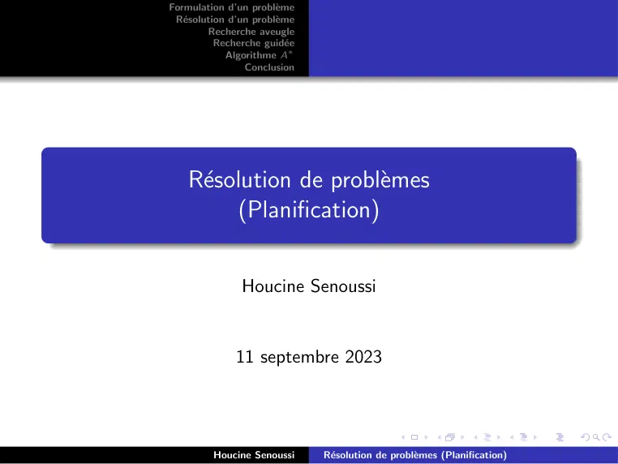

~~~text
Formulation d’un problème
 Résolution d’un problème
        Recherche aveugle
          Recherche guidée
            Algorithme A∗
                Conclusion

    Résolution de problèmes
         (Planification)

               Houcine Senoussi

              11 septembre 2023

         Houcine Senoussi     Résolution de problèmes (Planification)
~~~

## Page 2

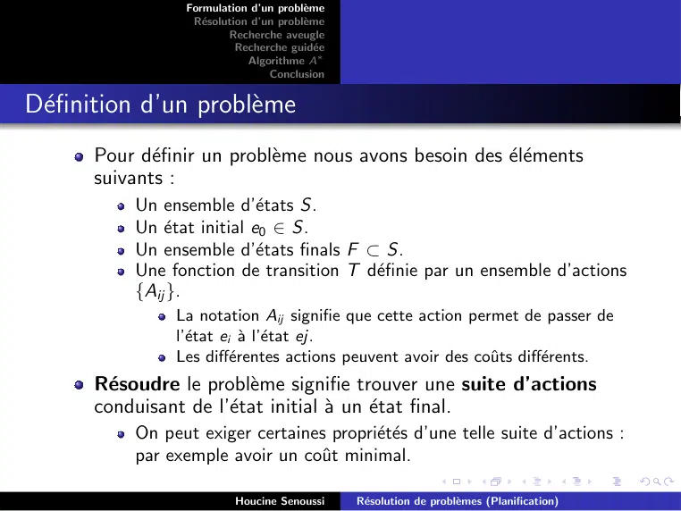

~~~text
                 Formulation d’un problème
                  Résolution d’un problème
                         Recherche aveugle
                           Recherche guidée
                             Algorithme A∗
                                 Conclusion

Définition d’un problème
      Pour définir un problème nous avons besoin des éléments
      suivants :
          Un ensemble d’états S.
          Un état initial e0 ∈ S.
          Un ensemble d’états finals F ⊂ S.
          Une fonction de transition T définie par un ensemble d’actions
          {Aij }.
               La notation Aij signifie que cette action permet de passer de
               l’état ei à l’état ej.
               Les différentes actions peuvent avoir des coûts différents.
      Résoudre le problème signifie trouver une suite d’actions
      conduisant de l’état initial à un état final.
          On peut exiger certaines propriétés d’une telle suite d’actions :
          par exemple avoir un coût minimal.

                          Houcine Senoussi     Résolution de problèmes (Planification)
~~~

## Page 3

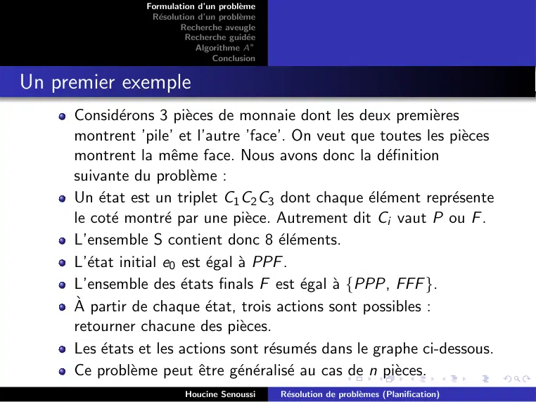

~~~text
                Formulation d’un problème
                 Résolution d’un problème
                        Recherche aveugle
                          Recherche guidée
                            Algorithme A∗
                                Conclusion

Un premier exemple
     Considérons 3 pièces de monnaie dont les deux premières
     montrent ’pile’ et l’autre ’face’. On veut que toutes les pièces
     montrent la même face. Nous avons donc la définition
     suivante du problème :
     Un état est un triplet C1 C2 C3 dont chaque élément représente
     le coté montré par une pièce. Autrement dit Ci vaut P ou F .
     L’ensemble S contient donc 8 éléments.
     L’état initial e0 est égal à PPF .
     L’ensemble des états finals F est égal à {PPP, FFF }.
     À partir de chaque état, trois actions sont possibles :
     retourner chacune des pièces.
     Les états et les actions sont résumés dans le graphe ci-dessous.
     Ce problème peut être généralisé au cas de n pièces.
                         Houcine Senoussi     Résolution de problèmes (Planification)
~~~

## Page 4

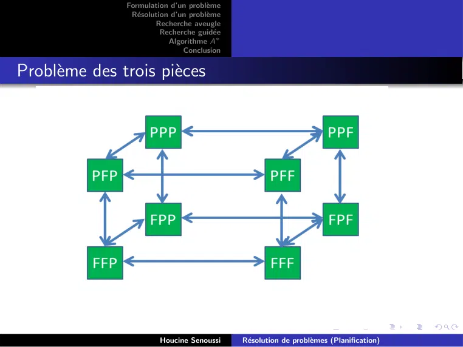

~~~text
               Formulation d’un problème
                Résolution d’un problème
                       Recherche aveugle
                         Recherche guidée
                           Algorithme A∗
                               Conclusion

Problème des trois pièces

                        Houcine Senoussi     Résolution de problèmes (Planification)
~~~

## Page 5

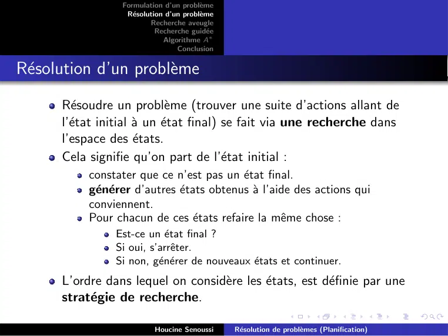

~~~text
                  Formulation d’un problème
                   Résolution d’un problème
                          Recherche aveugle
                            Recherche guidée
                              Algorithme A∗
                                  Conclusion

Résolution d’un problème
      Résoudre un problème (trouver une suite d’actions allant de
      l’état initial à un état final) se fait via une recherche dans
      l’espace des états.
      Cela signifie qu’on part de l’état initial :
           constater que ce n’est pas un état final.
           générer d’autres états obtenus à l’aide des actions qui
           conviennent.
           Pour chacun de ces états refaire la même chose :
                Est-ce un état final ?
                Si oui, s’arrêter.
                Si non, générer de nouveaux états et continuer.
      L’ordre dans lequel on considère les états, est définie par une
      stratégie de recherche.

                           Houcine Senoussi     Résolution de problèmes (Planification)
~~~

## Page 6

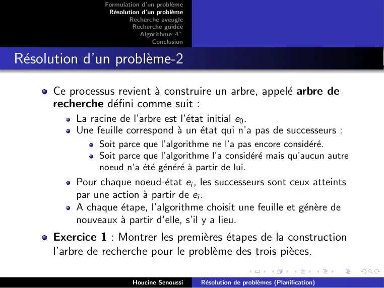

~~~text
                 Formulation d’un problème
                  Résolution d’un problème
                         Recherche aveugle
                           Recherche guidée
                             Algorithme A∗
                                 Conclusion

Résolution d’un problème-2

      Ce processus revient à construire un arbre, appelé arbre de
      recherche défini comme suit :
          La racine de l’arbre est l’état initial e0 .
          Une feuille correspond à un état qui n’a pas de successeurs :
               Soit parce que l’algorithme ne l’a pas encore considéré.
               Soit parce que l’algorithme l’a considéré mais qu’aucun autre
               noeud n’a été généré à partir de lui.
          Pour chaque noeud-état ei , les successeurs sont ceux atteints
          par une action à partir de ei .
          A chaque étape, l’algorithme choisit une feuille et génère de
          nouveaux à partir d’elle, s’il y a lieu.
      Exercice 1 : Montrer les premières étapes de la construction
      l’arbre de recherche pour le problème des trois pièces.

                          Houcine Senoussi     Résolution de problèmes (Planification)
~~~

## Page 7

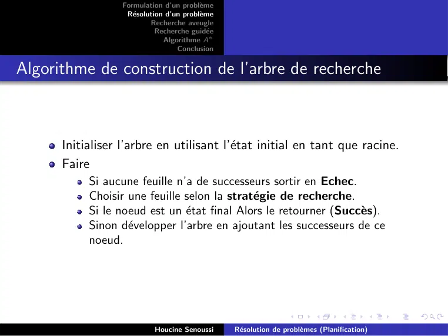

~~~text
                  Formulation d’un problème
                   Résolution d’un problème
                          Recherche aveugle
                            Recherche guidée
                              Algorithme A∗
                                  Conclusion

Algorithme de construction de l’arbre de recherche

      Initialiser l’arbre en utilisant l’état initial en tant que racine.
      Faire
           Si aucune feuille n’a de successeurs sortir en Echec.
           Choisir une feuille selon la stratégie de recherche.
           Si le noeud est un état final Alors le retourner (Succès).
           Sinon développer l’arbre en ajoutant les successeurs de ce
           noeud.

                           Houcine Senoussi     Résolution de problèmes (Planification)
~~~

## Page 8

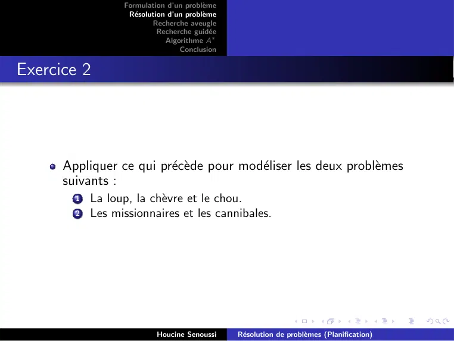

~~~text
                  Formulation d’un problème
                   Résolution d’un problème
                          Recherche aveugle
                            Recherche guidée
                              Algorithme A∗
                                  Conclusion

Exercice 2

      Appliquer ce qui précède pour modéliser les deux problèmes
      suivants :
        1   La loup, la chèvre et le chou.
        2   Les missionnaires et les cannibales.

                           Houcine Senoussi     Résolution de problèmes (Planification)
~~~

## Page 9

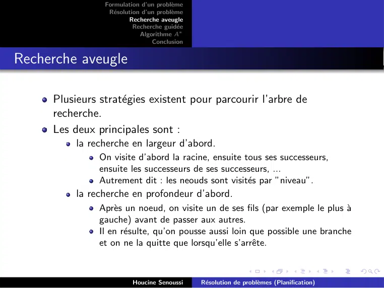

~~~text
                Formulation d’un problème
                 Résolution d’un problème
                        Recherche aveugle
                          Recherche guidée
                            Algorithme A∗
                                Conclusion

Recherche aveugle

     Plusieurs stratégies existent pour parcourir l’arbre de
     recherche.
     Les deux principales sont :
          la recherche en largeur d’abord.
               On visite d’abord la racine, ensuite tous ses successeurs,
               ensuite les successeurs de ses successeurs, ...
               Autrement dit : les neouds sont visités par ”niveau”.
          la recherche en profondeur d’abord.
               Après un noeud, on visite un de ses fils (par exemple le plus à
               gauche) avant de passer aux autres.
               Il en résulte, qu’on pousse aussi loin que possible une branche
               et on ne la quitte que lorsqu’elle s’arrête.

                         Houcine Senoussi     Résolution de problèmes (Planification)
~~~

## Page 10

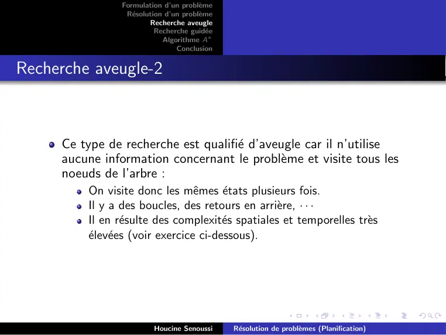

~~~text
                Formulation d’un problème
                 Résolution d’un problème
                        Recherche aveugle
                          Recherche guidée
                            Algorithme A∗
                                Conclusion

Recherche aveugle-2

     Ce type de recherche est qualifié d’aveugle car il n’utilise
     aucune information concernant le problème et visite tous les
     noeuds de l’arbre :
         On visite donc les mêmes états plusieurs fois.
         Il y a des boucles, des retours en arrière, · · ·
         Il en résulte des complexités spatiales et temporelles très
         élevées (voir exercice ci-dessous).

                         Houcine Senoussi     Résolution de problèmes (Planification)
~~~

## Page 11

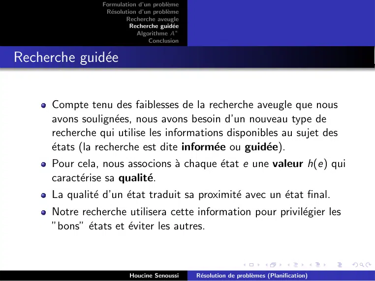

~~~text
                 Formulation d’un problème
                  Résolution d’un problème
                         Recherche aveugle
                           Recherche guidée
                             Algorithme A∗
                                 Conclusion

Recherche guidée

      Compte tenu des faiblesses de la recherche aveugle que nous
      avons soulignées, nous avons besoin d’un nouveau type de
      recherche qui utilise les informations disponibles au sujet des
      états (la recherche est dite informée ou guidée).
      Pour cela, nous associons à chaque état e une valeur h(e) qui
      caractérise sa qualité.
      La qualité d’un état traduit sa proximité avec un état final.
      Notre recherche utilisera cette information pour privilégier les
      ”bons” états et éviter les autres.

                          Houcine Senoussi     Résolution de problèmes (Planification)
~~~

## Page 12

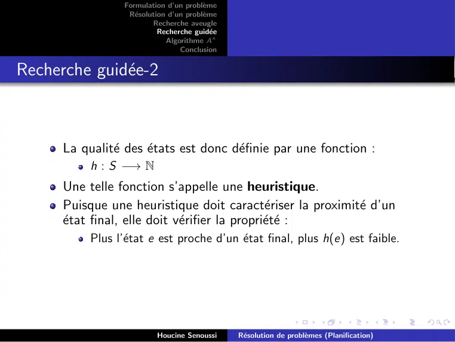

~~~text
                  Formulation d’un problème
                   Résolution d’un problème
                          Recherche aveugle
                            Recherche guidée
                              Algorithme A∗
                                  Conclusion

Recherche guidée-2

      La qualité des états est donc définie par une fonction :
           h : S −→ N
      Une telle fonction s’appelle une heuristique.
      Puisque une heuristique doit caractériser la proximité d’un
      état final, elle doit vérifier la propriété :
           Plus l’état e est proche d’un état final, plus h(e) est faible.

                           Houcine Senoussi     Résolution de problèmes (Planification)
~~~

## Page 13

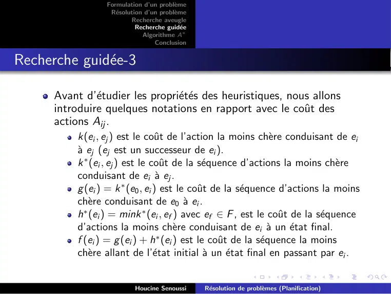

~~~text
                  Formulation d’un problème
                   Résolution d’un problème
                          Recherche aveugle
                            Recherche guidée
                              Algorithme A∗
                                  Conclusion

Recherche guidée-3

      Avant d’étudier les propriétés des heuristiques, nous allons
      introduire quelques notations en rapport avec le coût des
      actions Aij .
           k(ei , ej ) est le coût de l’action la moins chère conduisant de ei
           à ej (ej est un successeur de ei ).
           k ∗ (ei , ej ) est le coût de la séquence d’actions la moins chère
           conduisant de ei à ej .
           g (ei ) = k ∗ (e0 , ei ) est le coût de la séquence d’actions la moins
           chère conduisant de e0 à ei .
           h∗ (ei ) = mink ∗ (ei , ef ) avec ef ∈ F , est le coût de la séquence
           d’actions la moins chère conduisant de ei à un état final.
           f (ei ) = g (ei ) + h∗ (ei ) est le coût de la séquence la moins
           chère allant de l’état initial à un état final en passant par ei .

                           Houcine Senoussi     Résolution de problèmes (Planification)
~~~

## Page 14

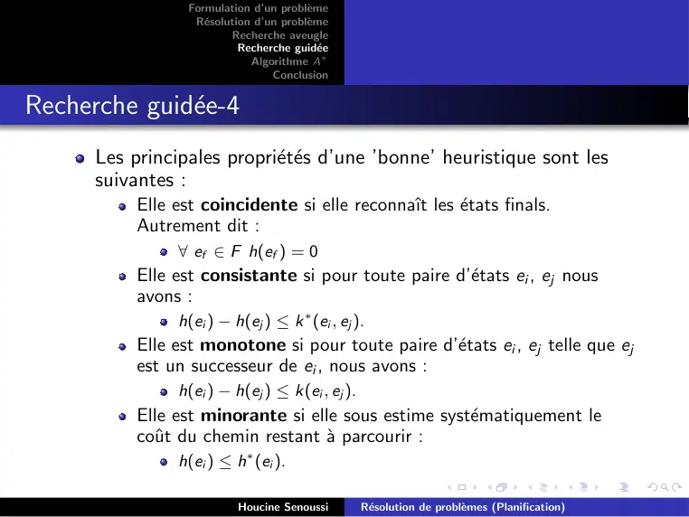

~~~text
                  Formulation d’un problème
                   Résolution d’un problème
                          Recherche aveugle
                            Recherche guidée
                              Algorithme A∗
                                  Conclusion

Recherche guidée-4
      Les principales propriétés d’une ’bonne’ heuristique sont les
      suivantes :
           Elle est coincidente si elle reconnaı̂t les états finals.
           Autrement dit :
                ∀ ef ∈ F h(ef ) = 0
           Elle est consistante si pour toute paire d’états ei , ej nous
           avons :
                h(ei ) − h(ej ) ≤ k ∗ (ei , ej ).
           Elle est monotone si pour toute paire d’états ei , ej telle que ej
           est un successeur de ei , nous avons :
                h(ei ) − h(ej ) ≤ k(ei , ej ).
           Elle est minorante si elle sous estime systématiquement le
           coût du chemin restant à parcourir :
                h(ei ) ≤ h∗ (ei ).

                           Houcine Senoussi      Résolution de problèmes (Planification)
~~~

## Page 15

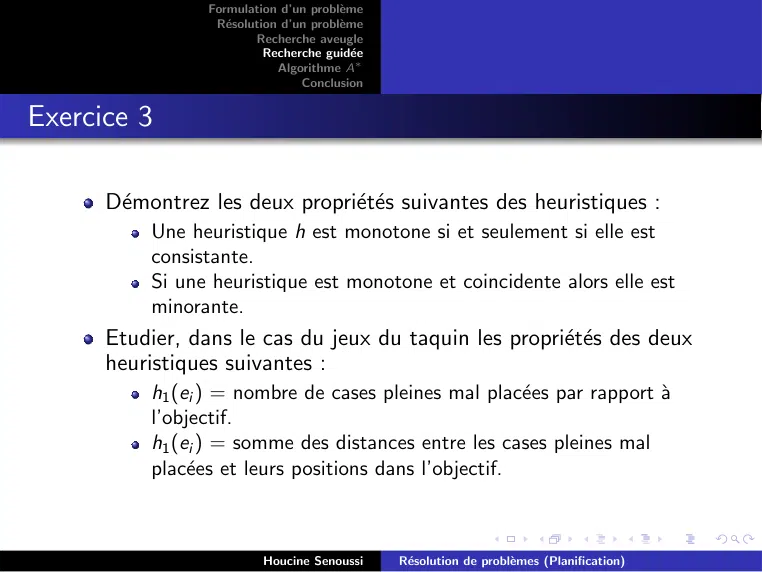

~~~text
                 Formulation d’un problème
                  Résolution d’un problème
                         Recherche aveugle
                           Recherche guidée
                             Algorithme A∗
                                 Conclusion

Exercice 3

      Démontrez les deux propriétés suivantes des heuristiques :
           Une heuristique h est monotone si et seulement si elle est
           consistante.
           Si une heuristique est monotone et coincidente alors elle est
           minorante.
      Etudier, dans le cas du jeux du taquin les propriétés des deux
      heuristiques suivantes :
           h1 (ei ) = nombre de cases pleines mal placées par rapport à
           l’objectif.
           h1 (ei ) = somme des distances entre les cases pleines mal
           placées et leurs positions dans l’objectif.

                          Houcine Senoussi     Résolution de problèmes (Planification)
~~~

## Page 16

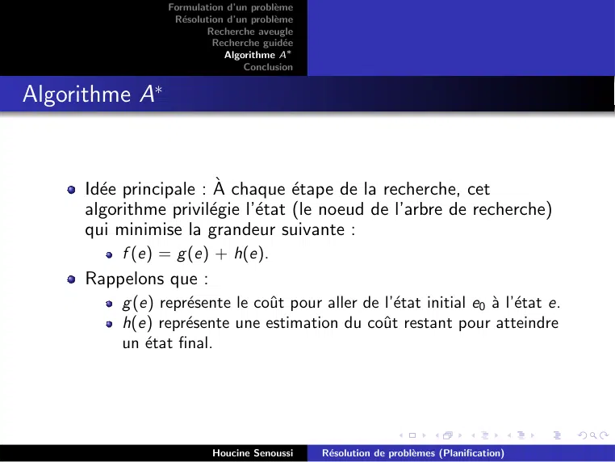

~~~text
                 Formulation d’un problème
                  Résolution d’un problème
                         Recherche aveugle
                           Recherche guidée
                             Algorithme A∗
                                 Conclusion

Algorithme A∗

     Idée principale : À chaque étape de la recherche, cet
     algorithme privilégie l’état (le noeud de l’arbre de recherche)
     qui minimise la grandeur suivante :
          f (e) = g (e) + h(e).
     Rappelons que :
          g (e) représente le coût pour aller de l’état initial e0 à l’état e.
          h(e) représente une estimation du coût restant pour atteindre
          un état final.

                          Houcine Senoussi     Résolution de problèmes (Planification)
~~~

## Page 17

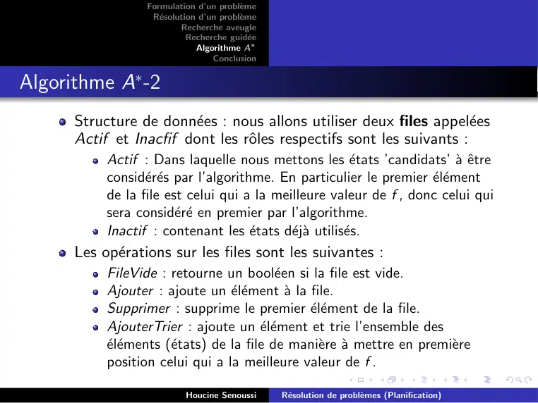

~~~text
                  Formulation d’un problème
                   Résolution d’un problème
                          Recherche aveugle
                            Recherche guidée
                              Algorithme A∗
                                  Conclusion

Algorithme A∗ -2
      Structure de données : nous allons utiliser deux files appelées
      Actif et Inacfif dont les rôles respectifs sont les suivants :
           Actif : Dans laquelle nous mettons les états ’candidats’ à être
           considérés par l’algorithme. En particulier le premier élément
           de la file est celui qui a la meilleure valeur de f , donc celui qui
           sera considéré en premier par l’algorithme.
           Inactif : contenant les états déjà utilisés.
      Les opérations sur les files sont les suivantes :
           FileVide : retourne un booléen si la file est vide.
           Ajouter : ajoute un élément à la file.
           Supprimer : supprime le premier élément de la file.
           AjouterTrier : ajoute un élément et trie l’ensemble des
           éléments (états) de la file de manière à mettre en première
           position celui qui a la meilleure valeur de f .

                           Houcine Senoussi     Résolution de problèmes (Planification)
~~~

## Page 18

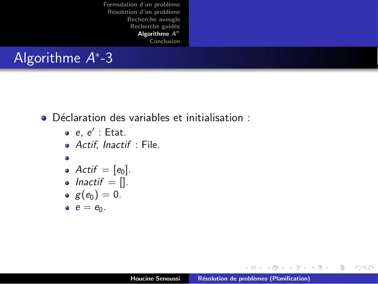

~~~text
                  Formulation d’un problème
                   Résolution d’un problème
                          Recherche aveugle
                            Recherche guidée
                              Algorithme A∗
                                  Conclusion

Algorithme A∗ -3

      Déclaration des variables et initialisation :
           e, e ′ : Etat.
           Actif, Inactif : File.

           Actif = [e0 ].
           Inactif = [].
           g (e0 ) = 0.
           e = e0 .

                           Houcine Senoussi     Résolution de problèmes (Planification)
~~~

## Page 19

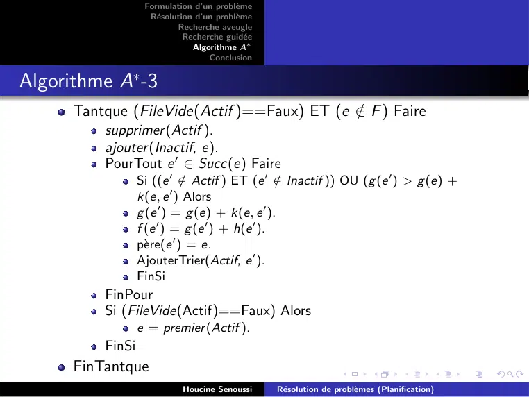

~~~text
                   Formulation d’un problème
                    Résolution d’un problème
                           Recherche aveugle
                             Recherche guidée
                               Algorithme A∗
                                   Conclusion

Algorithme A∗ -3
      Tantque (FileVide(Actif )==Faux) ET (e ∈
                                             / F ) Faire
          supprimer (Actif ).
          ajouter (Inactif, e).
          PourTout e ′ ∈ Succ(e) Faire
                  Si ((e ′ ∈ / Actif ) ET (e ′ ∈ / Inactif )) OU (g (e ′ ) > g (e) +
                           ′
                  k(e, e ) Alors
                  g (e ′ ) = g (e) + k(e, e ′ ).
                  f (e ′ ) = g (e ′ ) + h(e ′ ).
                  père(e ′ ) = e.
                  AjouterTrier(Actif, e ′ ).
                  FinSi
          FinPour
          Si (FileVide(Actif)==Faux) Alors
                  e = premier (Actif ).
          FinSi
      FinTantque
                            Houcine Senoussi     Résolution de problèmes (Planification)
~~~

## Page 20

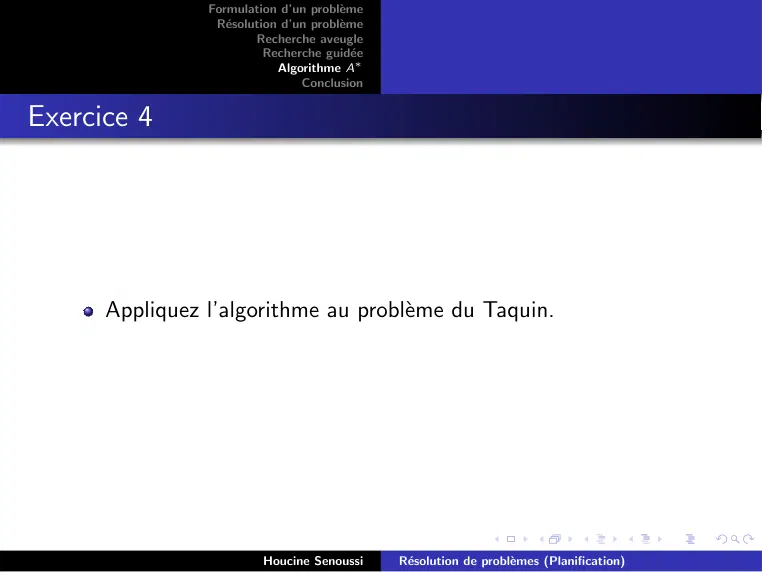

~~~text
                Formulation d’un problème
                 Résolution d’un problème
                        Recherche aveugle
                          Recherche guidée
                            Algorithme A∗
                                Conclusion

Exercice 4

      Appliquez l’algorithme au problème du Taquin.

                         Houcine Senoussi     Résolution de problèmes (Planification)
~~~

## Page 21

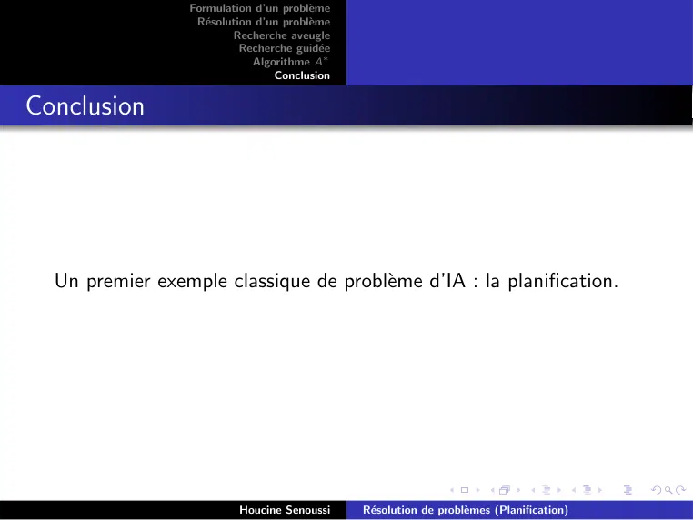

~~~text
                 Formulation d’un problème
                  Résolution d’un problème
                         Recherche aveugle
                           Recherche guidée
                             Algorithme A∗
                                 Conclusion

Conclusion

  Un premier exemple classique de problème d’IA : la planification.

                          Houcine Senoussi     Résolution de problèmes (Planification)
~~~
