# Jeux_IA_slides.pdf

[Ouvrir l’original](https://drive.google.com/open?id=1-wc6f9FkRPWigHeOv2TWqh3ksQNMIvPi) · Les deux lectures automatiques du PDF divergent sur les pages indiquées. Leur fac-similé accompagne le texte.

**Pages présentant un écart entre les deux extractions** — 3–7, 9, 12–13, 15, 17–18.

## Page 1

~~~text
                  Introduction
        Modélisation d’un jeu
        L’algorithme Minimax
                    Conclusion

Une Introduction aux Jeux en Intelligence
               Artificielle

                  Houcine Senoussi

                   August 28, 2023

            Houcine Senoussi     Une Introduction aux Jeux en Intelligence Artificielle
~~~

## Page 2

~~~text
                             Introduction
                   Modélisation d’un jeu
                   L’algorithme Minimax
                               Conclusion

1   Introduction

2   Modélisation d’un jeu

3   L’algorithme Minimax

4   Conclusion

                       Houcine Senoussi     Une Introduction aux Jeux en Intelligence Artificielle
~~~

## Page 3

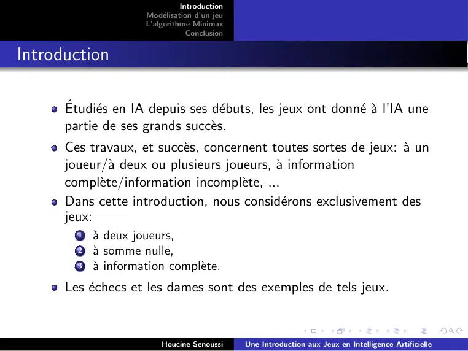

~~~text
                                Introduction
                      Modélisation d’un jeu
                      L’algorithme Minimax
                                  Conclusion

Introduction

      Étudiés en IA depuis ses débuts, les jeux ont donné à l’IA une
      partie de ses grands succès.
      Ces travaux, et succès, concernent toutes sortes de jeux: à un
      joueur/à deux ou plusieurs joueurs, à information
      complète/information incomplète, ...
      Dans cette introduction, nous considérons exclusivement des
      jeux:
        1   à deux joueurs,
        2   à somme nulle,
        3   à information complète.
      Les échecs et les dames sont des exemples de tels jeux.

                          Houcine Senoussi     Une Introduction aux Jeux en Intelligence Artificielle
~~~

## Page 4

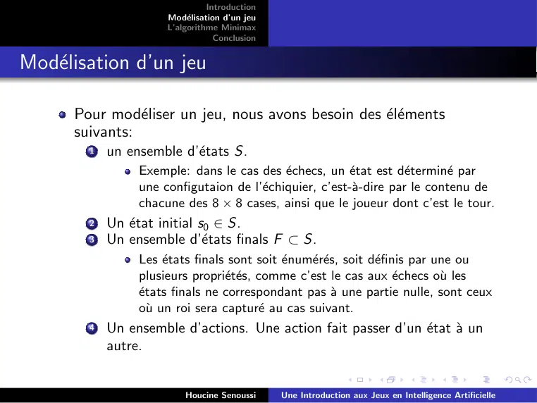

~~~text
                                Introduction
                      Modélisation d’un jeu
                      L’algorithme Minimax
                                  Conclusion

Modélisation d’un jeu

      Pour modéliser un jeu, nous avons besoin des éléments
      suivants:
        1   un ensemble d’états S.
                 Exemple: dans le cas des échecs, un état est déterminé par
                 une configutaion de l’échiquier, c’est-à-dire par le contenu de
                 chacune des 8 × 8 cases, ainsi que le joueur dont c’est le tour.
        2   Un état initial s0 ∈ S.
        3   Un ensemble d’états finals F ⊂ S.
                 Les états finals sont soit énumérés, soit définis par une ou
                 plusieurs propriétés, comme c’est le cas aux échecs où les
                 états finals ne correspondant pas à une partie nulle, sont ceux
                 où un roi sera capturé au cas suivant.
        4   Un ensemble d’actions. Une action fait passer d’un état à un
            autre.

                          Houcine Senoussi     Une Introduction aux Jeux en Intelligence Artificielle
~~~

## Page 5

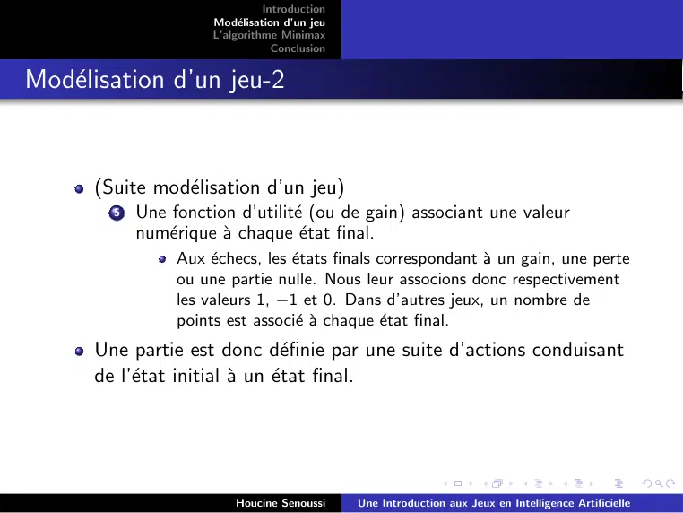

~~~text
                                Introduction
                      Modélisation d’un jeu
                      L’algorithme Minimax
                                  Conclusion

Modélisation d’un jeu-2

      (Suite modélisation d’un jeu)
        5   Une fonction d’utilité (ou de gain) associant une valeur
            numérique à chaque état final.
                 Aux échecs, les états finals correspondant à un gain, une perte
                 ou une partie nulle. Nous leur associons donc respectivement
                 les valeurs 1, −1 et 0. Dans d’autres jeux, un nombre de
                 points est associé à chaque état final.
      Une partie est donc définie par une suite d’actions conduisant
      de l’état initial à un état final.

                          Houcine Senoussi     Une Introduction aux Jeux en Intelligence Artificielle
~~~

## Page 6

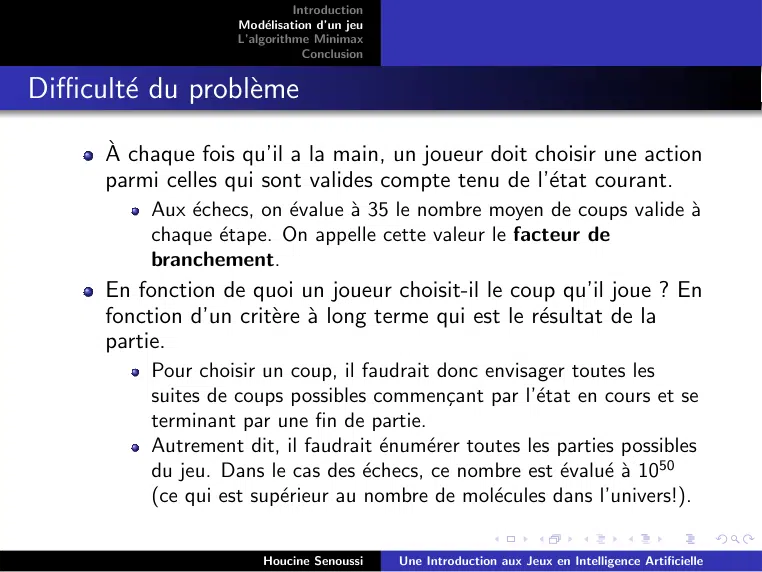

~~~text
                              Introduction
                    Modélisation d’un jeu
                    L’algorithme Minimax
                                Conclusion

Difficulté du problème

      À chaque fois qu’il a la main, un joueur doit choisir une action
      parmi celles qui sont valides compte tenu de l’état courant.
          Aux échecs, on évalue à 35 le nombre moyen de coups valide à
          chaque étape. On appelle cette valeur le facteur de
          branchement.
      En fonction de quoi un joueur choisit-il le coup qu’il joue ? En
      fonction d’un critère à long terme qui est le résultat de la
      partie.
          Pour choisir un coup, il faudrait donc envisager toutes les
          suites de coups possibles commençant par l’état en cours et se
          terminant par une fin de partie.
          Autrement dit, il faudrait énumérer toutes les parties possibles
          du jeu. Dans le cas des échecs, ce nombre est évalué à 1050
          (ce qui est supérieur au nombre de molécules dans l’univers!).

                        Houcine Senoussi     Une Introduction aux Jeux en Intelligence Artificielle
~~~

## Page 7

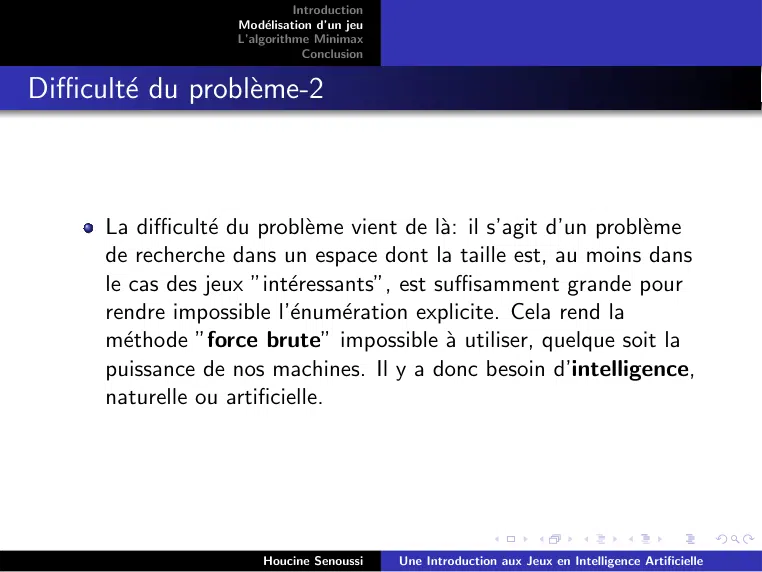

~~~text
                              Introduction
                    Modélisation d’un jeu
                    L’algorithme Minimax
                                Conclusion

Difficulté du problème-2

      La difficulté du problème vient de là: il s’agit d’un problème
      de recherche dans un espace dont la taille est, au moins dans
      le cas des jeux ”intéressants”, est suffisamment grande pour
      rendre impossible l’énumération explicite. Cela rend la
      méthode ”force brute” impossible à utiliser, quelque soit la
      puissance de nos machines. Il y a donc besoin d’intelligence,
      naturelle ou artificielle.

                        Houcine Senoussi     Une Introduction aux Jeux en Intelligence Artificielle
~~~

## Page 8

~~~text
                            Introduction
                  Modélisation d’un jeu
                  L’algorithme Minimax
                              Conclusion

Exercice

      Donnez une modélisation du jeu du Morpion (Tic-Tac-Toe)
      ainsi qu’une majoration du nombre d’états.

                      Houcine Senoussi     Une Introduction aux Jeux en Intelligence Artificielle
~~~

## Page 9

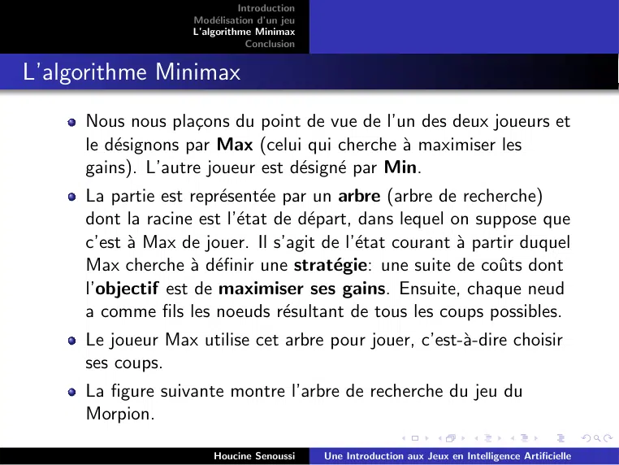

~~~text
                              Introduction
                    Modélisation d’un jeu
                    L’algorithme Minimax
                                Conclusion

L’algorithme Minimax
     Nous nous plaçons du point de vue de l’un des deux joueurs et
     le désignons par Max (celui qui cherche à maximiser les
     gains). L’autre joueur est désigné par Min.
     La partie est représentée par un arbre (arbre de recherche)
     dont la racine est l’état de départ, dans lequel on suppose que
     c’est à Max de jouer. Il s’agit de l’état courant à partir duquel
     Max cherche à définir une stratégie: une suite de coûts dont
     l’objectif est de maximiser ses gains. Ensuite, chaque neud
     a comme fils les noeuds résultant de tous les coups possibles.
     Le joueur Max utilise cet arbre pour jouer, c’est-à-dire choisir
     ses coups.
     La figure suivante montre l’arbre de recherche du jeu du
     Morpion.

                        Houcine Senoussi     Une Introduction aux Jeux en Intelligence Artificielle
~~~

## Page 10

~~~text
                         Introduction
               Modélisation d’un jeu
               L’algorithme Minimax
                           Conclusion

Morpion-Arbre de recherche

                   Houcine Senoussi     Une Introduction aux Jeux en Intelligence Artificielle
~~~

## Page 11

~~~text
                               Introduction
                     Modélisation d’un jeu
                     L’algorithme Minimax
                                 Conclusion

L’algorithme Minimax-2

     L’algorithme Minimax se compose des étapes suivantes:
       1   Générer l’arbre. Cet arbre comporte donc des niveaux Max et
           des niveaux Min. La racine est un noeud Max.
       2   Donner des valeurs aux feuilles. Pour ce faire, nous disposons
           de la fonction d’utilité si la construction de l’arbre est poussée
           jusqu’aux états finals.
       3   En allant des feuilles vers la racine, calculer les valeurs de
           chaque noeud de la manière suivante:
                La valeur d’un noeud Max = maximum(valeurs de ses fils).
                La valeur d’un noeud Min = minimum(valeurs de ses fils).
       4   Utilisation de l’arbre: jouer un coup conduisant à un fils dont
           la valeur est la plus grande du niveau.

                         Houcine Senoussi     Une Introduction aux Jeux en Intelligence Artificielle
~~~

## Page 12

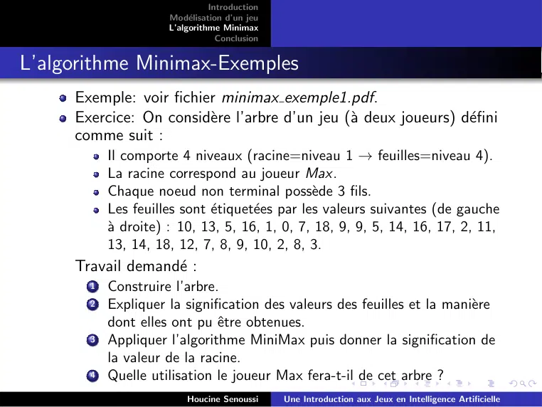

~~~text
                               Introduction
                     Modélisation d’un jeu
                     L’algorithme Minimax
                                 Conclusion

L’algorithme Minimax-Exemples
     Exemple: voir fichier minimax exemple1.pdf.
     Exercice: On considère l’arbre d’un jeu (à deux joueurs) défini
     comme suit :
           Il comporte 4 niveaux (racine=niveau 1 → feuilles=niveau 4).
           La racine correspond au joueur Max.
           Chaque noeud non terminal possède 3 fils.
           Les feuilles sont étiquetées par les valeurs suivantes (de gauche
           à droite) : 10, 13, 5, 16, 1, 0, 7, 18, 9, 9, 5, 14, 16, 17, 2, 11,
           13, 14, 18, 12, 7, 8, 9, 10, 2, 8, 3.
     Travail demandé :
       1   Construire l’arbre.
       2   Expliquer la signification des valeurs des feuilles et la manière
           dont elles ont pu être obtenues.
       3   Appliquer l’algorithme MiniMax puis donner la signification de
           la valeur de la racine.
       4   Quelle utilisation le joueur Max fera-t-il de cet arbre ?
                         Houcine Senoussi     Une Introduction aux Jeux en Intelligence Artificielle
~~~

## Page 13

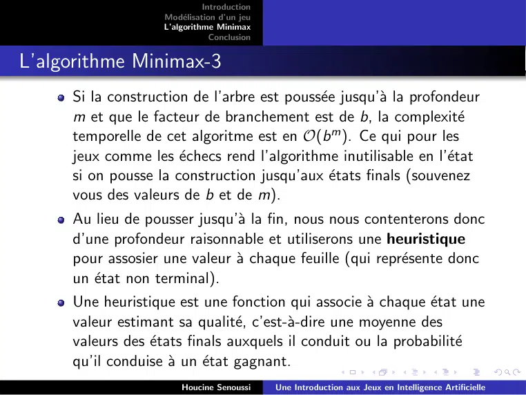

~~~text
                             Introduction
                   Modélisation d’un jeu
                   L’algorithme Minimax
                               Conclusion

L’algorithme Minimax-3
     Si la construction de l’arbre est poussée jusqu’à la profondeur
     m et que le facteur de branchement est de b, la complexité
     temporelle de cet algoritme est en O(b m ). Ce qui pour les
     jeux comme les échecs rend l’algorithme inutilisable en l’état
     si on pousse la construction jusqu’aux états finals (souvenez
     vous des valeurs de b et de m).
     Au lieu de pousser jusqu’à la fin, nous nous contenterons donc
     d’une profondeur raisonnable et utiliserons une heuristique
     pour assosier une valeur à chaque feuille (qui représente donc
     un état non terminal).
     Une heuristique est une fonction qui associe à chaque état une
     valeur estimant sa qualité, c’est-à-dire une moyenne des
     valeurs des états finals auxquels il conduit ou la probabilité
     qu’il conduise à un état gagnant.
                       Houcine Senoussi     Une Introduction aux Jeux en Intelligence Artificielle
~~~

## Page 14

~~~text
                            Introduction
                  Modélisation d’un jeu
                  L’algorithme Minimax
                              Conclusion

L’algorithme Minimax-3

     Exercice: Comment peut-on définir une heuristique dans le
     cas des échecs ?

                      Houcine Senoussi     Une Introduction aux Jeux en Intelligence Artificielle
~~~

## Page 15

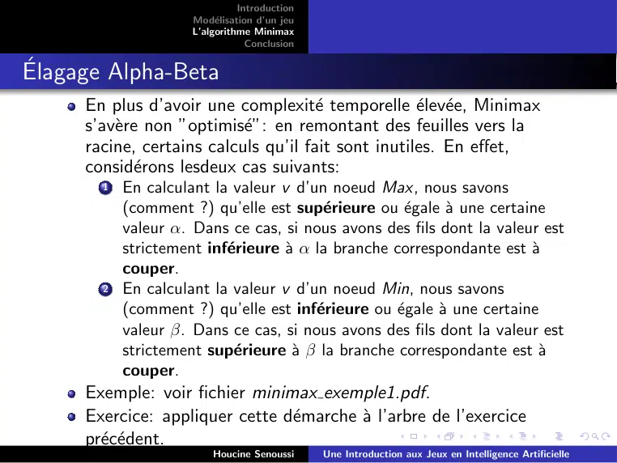

~~~text
                                Introduction
                      Modélisation d’un jeu
                      L’algorithme Minimax
                                  Conclusion

Élagage Alpha-Beta
      En plus d’avoir une complexité temporelle élevée, Minimax
      s’avère non ”optimisé”: en remontant des feuilles vers la
      racine, certains calculs qu’il fait sont inutiles. En effet,
      considérons lesdeux cas suivants:
        1   En calculant la valeur v d’un noeud Max, nous savons
            (comment ?) qu’elle est supérieure ou égale à une certaine
            valeur α. Dans ce cas, si nous avons des fils dont la valeur est
            strictement inférieure à α la branche correspondante est à
            couper.
        2   En calculant la valeur v d’un noeud Min, nous savons
            (comment ?) qu’elle est inférieure ou égale à une certaine
            valeur β. Dans ce cas, si nous avons des fils dont la valeur est
            strictement supérieure à β la branche correspondante est à
            couper.
      Exemple: voir fichier minimax exemple1.pdf.
      Exercice: appliquer cette démarche à l’arbre de l’exercice
      précédent.
                          Houcine Senoussi     Une Introduction aux Jeux en Intelligence Artificielle
~~~

## Page 16

~~~text
                          Introduction
                Modélisation d’un jeu
                L’algorithme Minimax
                            Conclusion

Coupes α et β

                    Houcine Senoussi     Une Introduction aux Jeux en Intelligence Artificielle
~~~

## Page 17

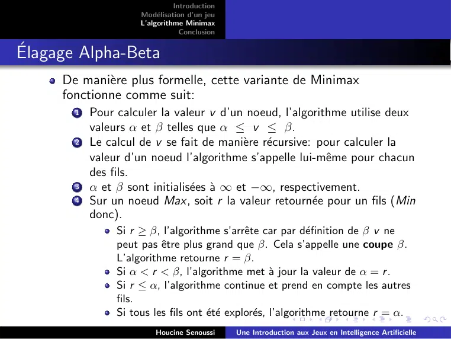

~~~text
                                Introduction
                      Modélisation d’un jeu
                      L’algorithme Minimax
                                  Conclusion

Élagage Alpha-Beta
      De manière plus formelle, cette variante de Minimax
      fonctionne comme suit:
        1   Pour calculer la valeur v d’un noeud, l’algorithme utilise deux
            valeurs α et β telles que α ≤ v ≤ β.
        2   Le calcul de v se fait de manière récursive: pour calculer la
            valeur d’un noeud l’algorithme s’appelle lui-même pour chacun
            des fils.
        3   α et β sont initialisées à ∞ et −∞, respectivement.
        4   Sur un noeud Max, soit r la valeur retournée pour un fils (Min
            donc).
                 Si r ≥ β, l’algorithme s’arrête car par définition de β v ne
                 peut pas être plus grand que β. Cela s’appelle une coupe β.
                 L’algorithme retourne r = β.
                 Si α < r < β, l’algorithme met à jour la valeur de α = r .
                 Si r ≤ α, l’algorithme continue et prend en compte les autres
                 fils.
                 Si tous les fils ont été explorés, l’algorithme retourne r = α.
                          Houcine Senoussi     Une Introduction aux Jeux en Intelligence Artificielle
~~~

## Page 18

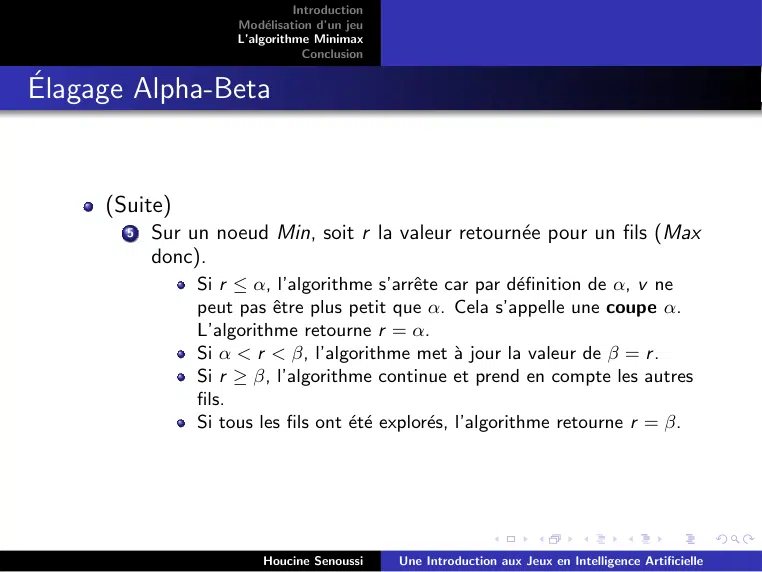

~~~text
                                Introduction
                      Modélisation d’un jeu
                      L’algorithme Minimax
                                  Conclusion

Élagage Alpha-Beta

      (Suite)
        5   Sur un noeud Min, soit r la valeur retournée pour un fils (Max
            donc).
                 Si r ≤ α, l’algorithme s’arrête car par définition de α, v ne
                 peut pas être plus petit que α. Cela s’appelle une coupe α.
                 L’algorithme retourne r = α.
                 Si α < r < β, l’algorithme met à jour la valeur de β = r .
                 Si r ≥ β, l’algorithme continue et prend en compte les autres
                 fils.
                 Si tous les fils ont été explorés, l’algorithme retourne r = β.

                          Houcine Senoussi     Une Introduction aux Jeux en Intelligence Artificielle
~~~

## Page 19

~~~text
                            Introduction
                  Modélisation d’un jeu
                  L’algorithme Minimax
                              Conclusion

Conclusion

     Dans ce chapitre nous avons introduit les jeux en intelligence
     artificielle à travers notamment l’algorithme MiniMax et sa
     variante AlphaBeta.
     Cet algorithme est utilisé dans les programmes de jeux où il
     collabore avec d’autres algorithmes et méthode comme Monte
     Carlo, l’apprentissage par renforcement

                      Houcine Senoussi     Une Introduction aux Jeux en Intelligence Artificielle
~~~
