# Logique_slides.pdf

[Ouvrir l’original](https://drive.google.com/open?id=1MR3U7YmO9VCfwlGZELK5KF97mpHHW0kw) · Les deux lectures automatiques du PDF divergent sur les pages indiquées. Leur fac-similé accompagne le texte.

**Pages présentant un écart entre les deux extractions** — 1–23.

## Page 1

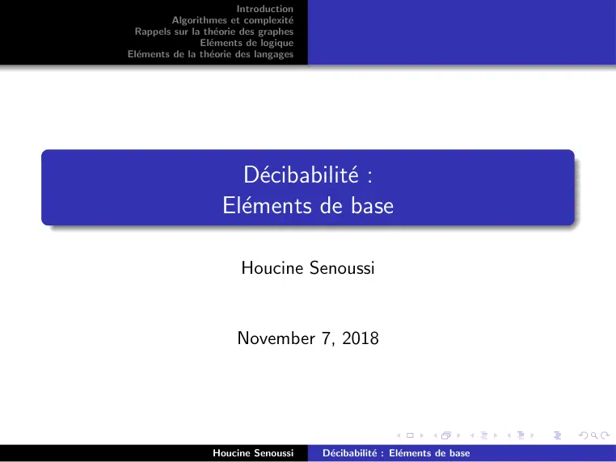

~~~text
                         Introduction
          Algorithmes et complexité
 Rappels sur la théorie des graphes
                Eléments de logique
Eléments de la théorie des langages

                       Décibabilité :
                     Eléments de base

                         Houcine Senoussi

                        November 7, 2018

                  Houcine Senoussi      Décibabilité : Eléments de base
~~~

## Page 2

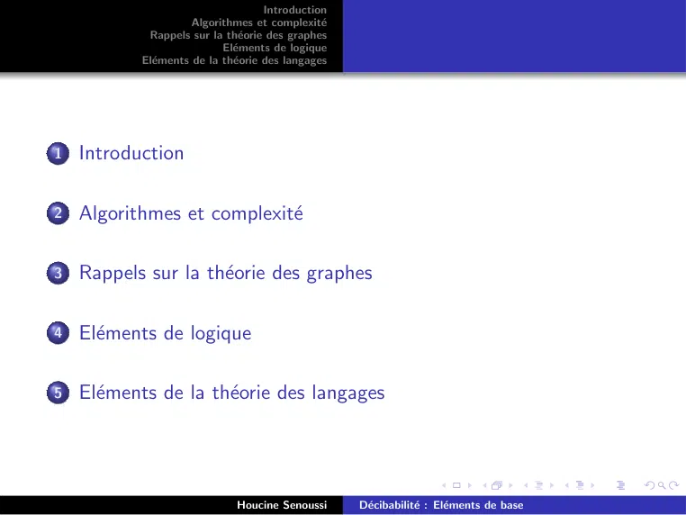

~~~text
                                    Introduction
                     Algorithmes et complexité
            Rappels sur la théorie des graphes
                           Eléments de logique
           Eléments de la théorie des langages

1   Introduction

2   Algorithmes et complexité

3   Rappels sur la théorie des graphes

4   Eléments de logique

5   Eléments de la théorie des langages

                             Houcine Senoussi      Décibabilité : Eléments de base
~~~

## Page 3

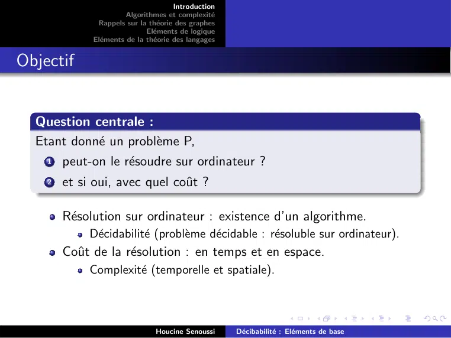

~~~text
                                      Introduction
                       Algorithmes et complexité
              Rappels sur la théorie des graphes
                             Eléments de logique
             Eléments de la théorie des langages

Objectif

  Question centrale :
  Etant donné un problème P,
    1   peut-on le résoudre sur ordinateur ?
    2   et si oui, avec quel coût ?

        Résolution sur ordinateur : existence d’un algorithme.
             Décidabilité (problème décidable : résoluble sur ordinateur).
        Coût de la résolution : en temps et en espace.
             Complexité (temporelle et spatiale).

                               Houcine Senoussi      Décibabilité : Eléments de base
~~~

## Page 4

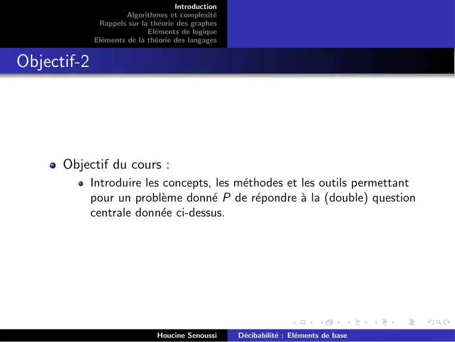

~~~text
                                      Introduction
                       Algorithmes et complexité
              Rappels sur la théorie des graphes
                             Eléments de logique
             Eléments de la théorie des langages

Objectif-2

      Objectif du cours :
             Introduire les concepts, les méthodes et les outils permettant
             pour un problème donné P de répondre à la (double) question
             centrale donnée ci-dessus.

                               Houcine Senoussi      Décibabilité : Eléments de base
~~~

## Page 5

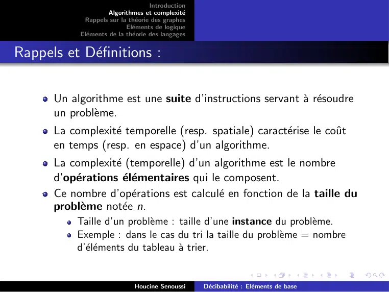

~~~text
                                    Introduction
                     Algorithmes et complexité
            Rappels sur la théorie des graphes
                           Eléments de logique
           Eléments de la théorie des langages

Rappels et Définitions :

      Un algorithme est une suite d’instructions servant à résoudre
      un problème.
      La complexité temporelle (resp. spatiale) caractérise le coût
      en temps (resp. en espace) d’un algorithme.
      La complexité (temporelle) d’un algorithme est le nombre
      d’opérations élémentaires qui le composent.
      Ce nombre d’opérations est calculé en fonction de la taille du
      problème notée n.
           Taille d’un problème : taille d’une instance du problème.
           Exemple : dans le cas du tri la taille du problème = nombre
           d’éléments du tableau à trier.

                             Houcine Senoussi      Décibabilité : Eléments de base
~~~

## Page 6

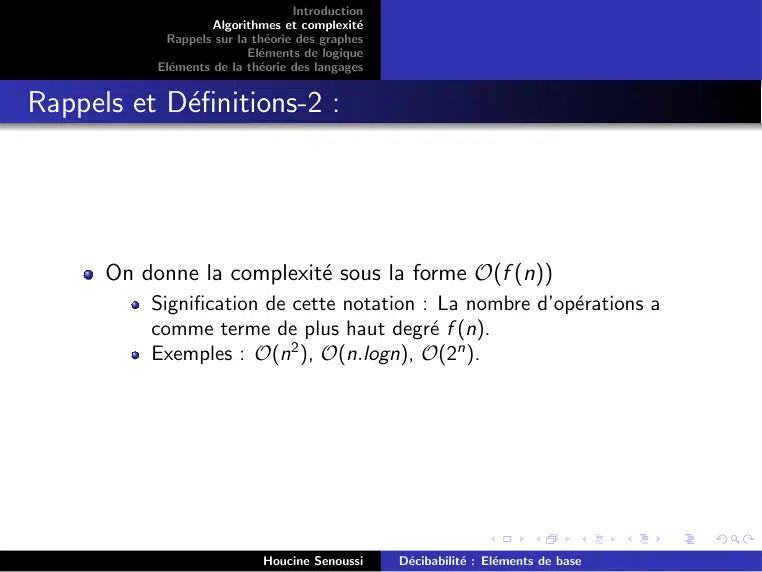

~~~text
                                    Introduction
                     Algorithmes et complexité
            Rappels sur la théorie des graphes
                           Eléments de logique
           Eléments de la théorie des langages

Rappels et Définitions-2 :

      On donne la complexité sous la forme O(f (n))
          Signification de cette notation : La nombre d’opérations a
          comme terme de plus haut degré f (n).
          Exemples : O(n2 ), O(n.logn), O(2n ).

                             Houcine Senoussi      Décibabilité : Eléments de base
~~~

## Page 7

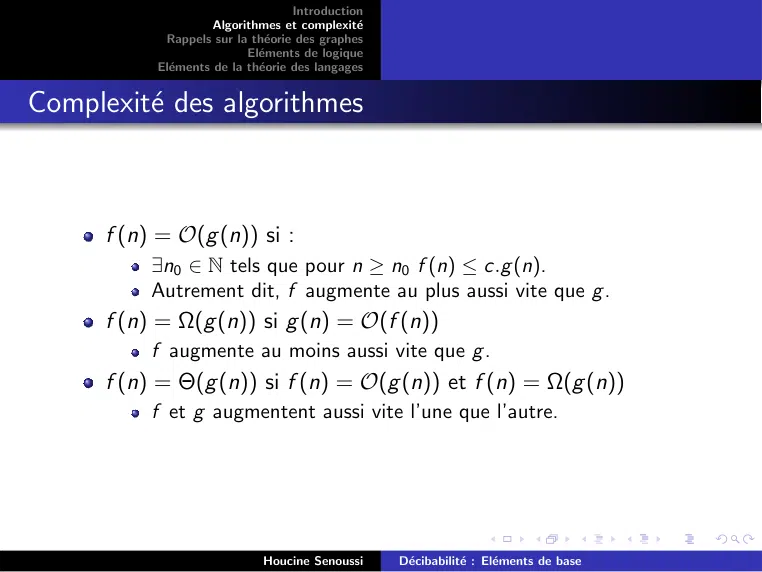

~~~text
                                    Introduction
                     Algorithmes et complexité
            Rappels sur la théorie des graphes
                           Eléments de logique
           Eléments de la théorie des langages

Complexité des algorithmes

      f (n) = O(g (n)) si :
           ∃n0 ∈ N tels que pour n ≥ n0 f (n) ≤ c.g (n).
           Autrement dit, f augmente au plus aussi vite que g .
      f (n) = Ω(g (n)) si g (n) = O(f (n))
           f augmente au moins aussi vite que g .
      f (n) = Θ(g (n)) si f (n) = O(g (n)) et f (n) = Ω(g (n))
           f et g augmentent aussi vite l’une que l’autre.

                             Houcine Senoussi      Décibabilité : Eléments de base
~~~

## Page 8

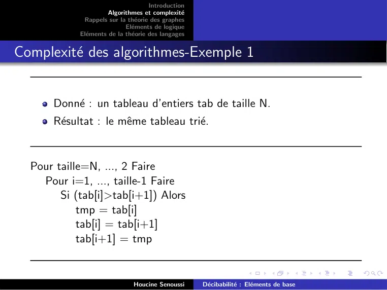

~~~text
                                     Introduction
                      Algorithmes et complexité
             Rappels sur la théorie des graphes
                            Eléments de logique
            Eléments de la théorie des langages

Complexité des algorithmes-Exemple 1

      Donné : un tableau d’entiers tab de taille N.
      Résultat : le même tableau trié.

  Pour taille=N, ..., 2 Faire
    Pour i=1, ..., taille-1 Faire
        Si (tab[i]>tab[i+1]) Alors
            tmp = tab[i]
            tab[i] = tab[i+1]
            tab[i+1] = tmp

                              Houcine Senoussi      Décibabilité : Eléments de base
~~~

## Page 9

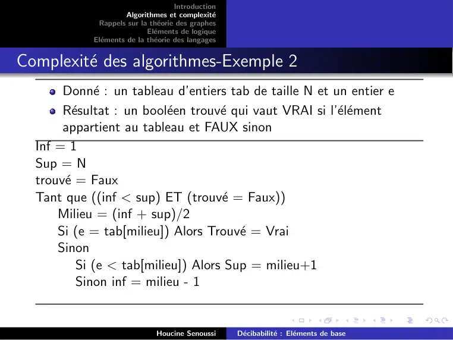

~~~text
                                     Introduction
                      Algorithmes et complexité
             Rappels sur la théorie des graphes
                            Eléments de logique
            Eléments de la théorie des langages

Complexité des algorithmes-Exemple 2
       Donné : un tableau d’entiers tab de taille N et un entier e
       Résultat : un booléen trouvé qui vaut VRAI si l’élément
       appartient au tableau et FAUX sinon
  Inf = 1
  Sup = N
  trouvé = Faux
  Tant que ((inf < sup) ET (trouvé = Faux))
      Milieu = (inf + sup)/2
      Si (e = tab[milieu]) Alors Trouvé = Vrai
      Sinon
          Si (e < tab[milieu]) Alors Sup = milieu+1
          Sinon inf = milieu - 1

                              Houcine Senoussi      Décibabilité : Eléments de base
~~~

## Page 10

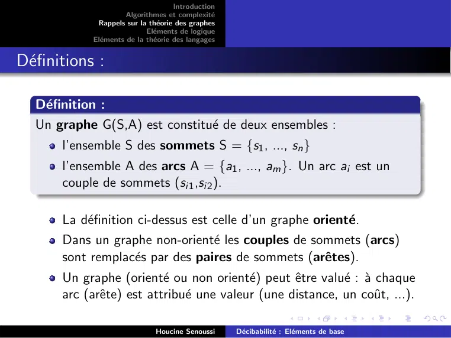

~~~text
                                     Introduction
                      Algorithmes et complexité
             Rappels sur la théorie des graphes
                            Eléments de logique
            Eléments de la théorie des langages

Définitions :

  Définition :
  Un graphe G(S,A) est constitué de deux ensembles :
       l’ensemble S des sommets S = {s1 , ..., sn }
       l’ensemble A des arcs A = {a1 , ..., am }. Un arc ai est un
       couple de sommets (si1 ,si2 ).

       La définition ci-dessus est celle d’un graphe orienté.
       Dans un graphe non-orienté les couples de sommets (arcs)
       sont remplacés par des paires de sommets (arêtes).
       Un graphe (orienté ou non orienté) peut être valué : à chaque
       arc (arête) est attribué une valeur (une distance, un coût, ...).

                              Houcine Senoussi      Décibabilité : Eléments de base
~~~

## Page 11

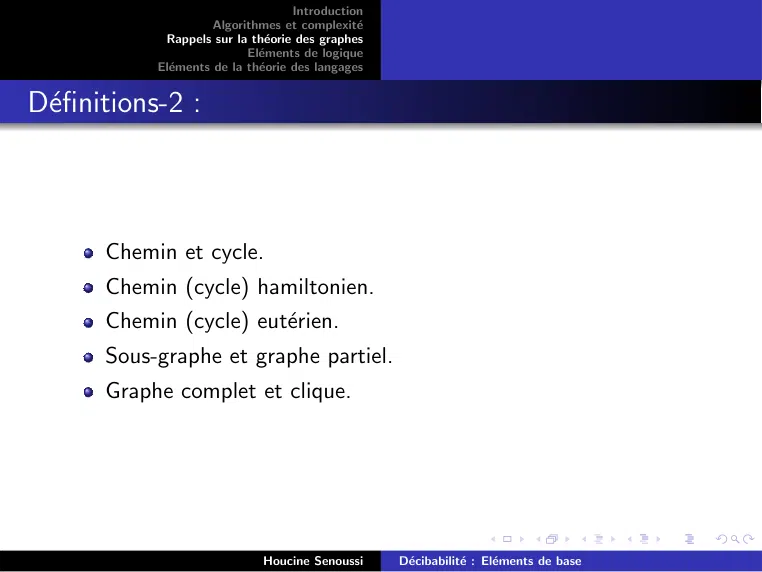

~~~text
                                     Introduction
                      Algorithmes et complexité
             Rappels sur la théorie des graphes
                            Eléments de logique
            Eléments de la théorie des langages

Définitions-2 :

       Chemin et cycle.
       Chemin (cycle) hamiltonien.
       Chemin (cycle) eutérien.
       Sous-graphe et graphe partiel.
       Graphe complet et clique.

                              Houcine Senoussi      Décibabilité : Eléments de base
~~~

## Page 12

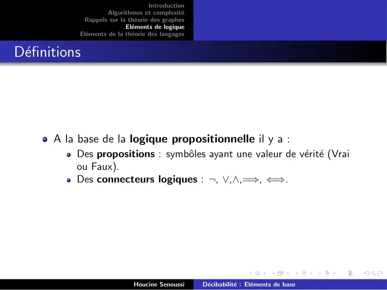

~~~text
                                     Introduction
                      Algorithmes et complexité
             Rappels sur la théorie des graphes
                            Eléments de logique
            Eléments de la théorie des langages

Définitions

       A la base de la logique propositionnelle il y a :
           Des propositions : symbôles ayant une valeur de vérité (Vrai
           ou Faux).
           Des connecteurs logiques : ¬, ∨,∧,=⇒, ⇐⇒.

                              Houcine Senoussi      Décibabilité : Eléments de base
~~~

## Page 13

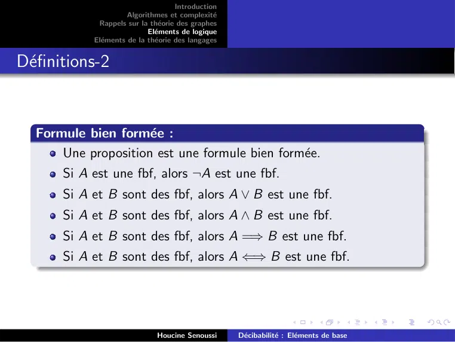

~~~text
                                     Introduction
                      Algorithmes et complexité
             Rappels sur la théorie des graphes
                            Eléments de logique
            Eléments de la théorie des langages

Définitions-2

  Formule bien formée :
      Une proposition est une formule bien formée.
      Si A est une fbf, alors ¬A est une fbf.
      Si A et B sont des fbf, alors A ∨ B est une fbf.
      Si A et B sont des fbf, alors A ∧ B est une fbf.
      Si A et B sont des fbf, alors A =⇒ B est une fbf.
      Si A et B sont des fbf, alors A ⇐⇒ B est une fbf.

                              Houcine Senoussi      Décibabilité : Eléments de base
~~~

## Page 14

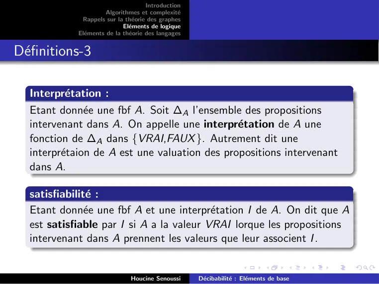

~~~text
                                     Introduction
                      Algorithmes et complexité
             Rappels sur la théorie des graphes
                            Eléments de logique
            Eléments de la théorie des langages

Définitions-3

  Interprétation :
  Etant donnée une fbf A. Soit ∆A l’ensemble des propositions
  intervenant dans A. On appelle une interprétation de A une
  fonction de ∆A dans {VRAI,FAUX }. Autrement dit une
  interprétaion de A est une valuation des propositions intervenant
  dans A.

  satisfiabilité :
  Etant donnée une fbf A et une interprétation I de A. On dit que A
  est satisfiable par I si A a la valeur VRAI lorque les propositions
  intervenant dans A prennent les valeurs que leur associent I .

                              Houcine Senoussi      Décibabilité : Eléments de base
~~~

## Page 15

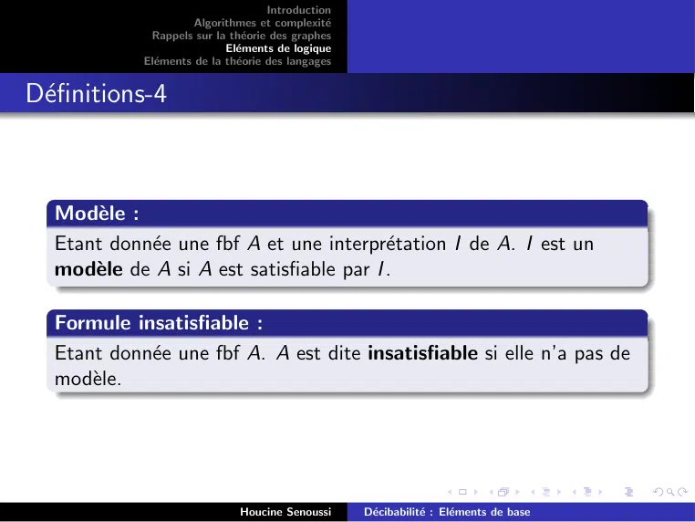

~~~text
                                     Introduction
                      Algorithmes et complexité
             Rappels sur la théorie des graphes
                            Eléments de logique
            Eléments de la théorie des langages

Définitions-4

  Modèle :
  Etant donnée une fbf A et une interprétation I de A. I est un
  modèle de A si A est satisfiable par I .

  Formule insatisfiable :
  Etant donnée une fbf A. A est dite insatisfiable si elle n’a pas de
  modèle.

                              Houcine Senoussi      Décibabilité : Eléments de base
~~~

## Page 16

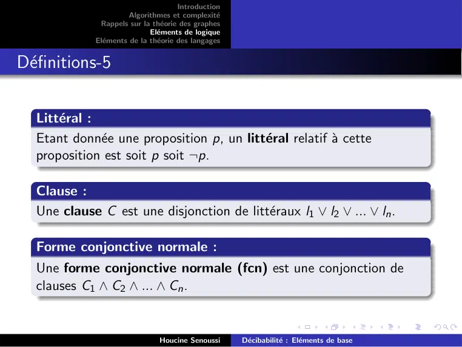

~~~text
                                      Introduction
                       Algorithmes et complexité
              Rappels sur la théorie des graphes
                             Eléments de logique
             Eléments de la théorie des langages

Définitions-5

  Littéral :
  Etant donnée une proposition p, un littéral relatif à cette
  proposition est soit p soit ¬p.

  Clause :
  Une clause C est une disjonction de littéraux l1 ∨ l2 ∨ ... ∨ ln .

  Forme conjonctive normale :
  Une forme conjonctive normale (fcn) est une conjonction de
  clauses C1 ∧ C2 ∧ ... ∧ Cn .

                               Houcine Senoussi      Décibabilité : Eléments de base
~~~

## Page 17

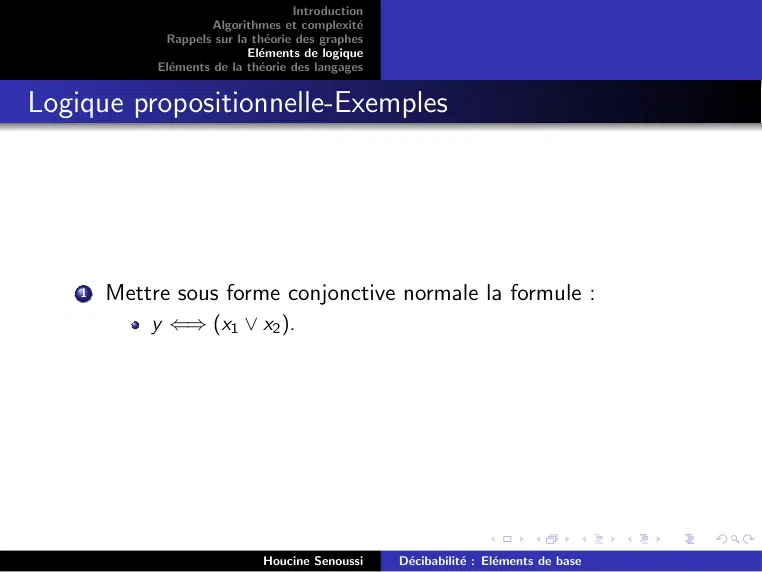

~~~text
                                      Introduction
                       Algorithmes et complexité
              Rappels sur la théorie des graphes
                             Eléments de logique
             Eléments de la théorie des langages

Logique propositionnelle-Exemples

    1   Mettre sous forme conjonctive normale la formule :
            y ⇐⇒ (x1 ∨ x2 ).

                               Houcine Senoussi      Décibabilité : Eléments de base
~~~

## Page 18

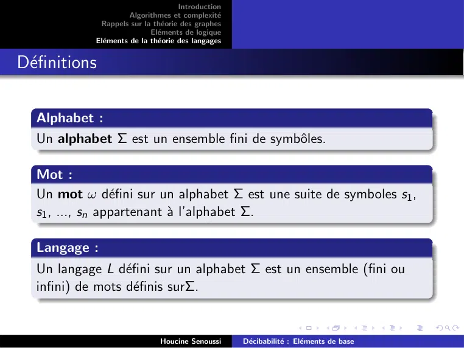

~~~text
                                     Introduction
                      Algorithmes et complexité
             Rappels sur la théorie des graphes
                            Eléments de logique
            Eléments de la théorie des langages

Définitions

  Alphabet :
  Un alphabet Σ est un ensemble fini de symbôles.

  Mot :
  Un mot ω défini sur un alphabet Σ est une suite de symboles s1 ,
  s1 , ..., sn appartenant à l’alphabet Σ.

  Langage :
  Un langage L défini sur un alphabet Σ est un ensemble (fini ou
  infini) de mots définis surΣ.

                              Houcine Senoussi      Décibabilité : Eléments de base
~~~

## Page 19

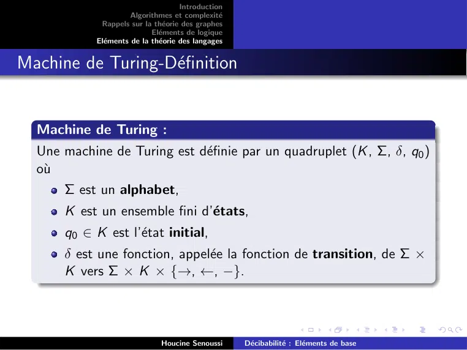

~~~text
                                     Introduction
                      Algorithmes et complexité
             Rappels sur la théorie des graphes
                            Eléments de logique
            Eléments de la théorie des langages

Machine de Turing-Définition

  Machine de Turing :
  Une machine de Turing est définie par un quadruplet (K , Σ, δ, q0 )
  où
      Σ est un alphabet,
      K est un ensemble fini d’états,
      q0 ∈ K est l’état initial,
      δ est une fonction, appelée la fonction de transition, de Σ ×
      K vers Σ × K × {→, ←, −}.

                              Houcine Senoussi      Décibabilité : Eléments de base
~~~

## Page 20

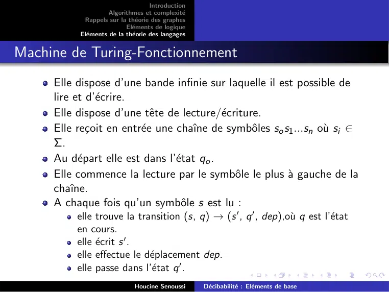

~~~text
                                    Introduction
                     Algorithmes et complexité
            Rappels sur la théorie des graphes
                           Eléments de logique
           Eléments de la théorie des langages

Machine de Turing-Fonctionnement
     Elle dispose d’une bande infinie sur laquelle il est possible de
     lire et d’écrire.
     Elle dispose d’une tête de lecture/écriture.
     Elle reçoit en entrée une chaı̂ne de symbôles so s1 ...sn où si ∈
     Σ.
     Au départ elle est dans l’état qo .
     Elle commence la lecture par le symbôle le plus à gauche de la
     chaı̂ne.
     A chaque fois qu’un symbôle s est lu :
          elle trouve la transition (s, q) → (s 0 , q 0 , dep),où q est l’état
          en cours.
          elle écrit s 0 .
          elle effectue le déplacement dep.
          elle passe dans l’état q 0 .
                             Houcine Senoussi      Décibabilité : Eléments de base
~~~

## Page 21

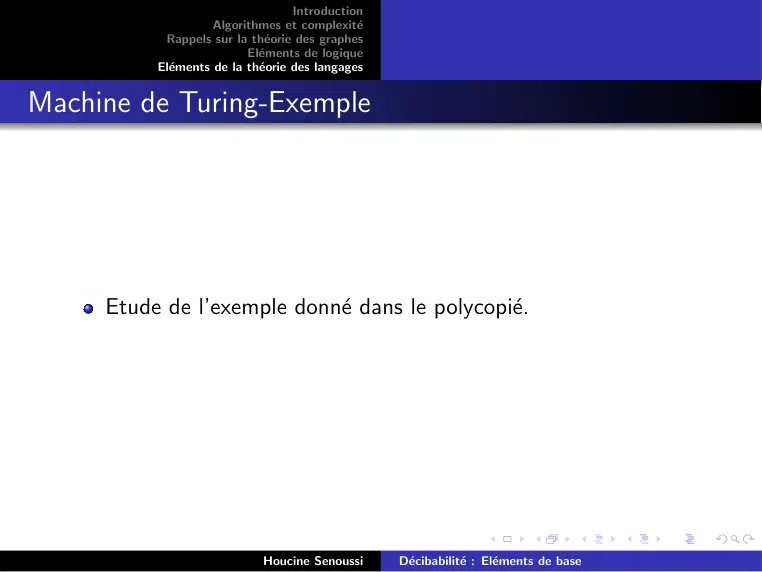

~~~text
                                   Introduction
                    Algorithmes et complexité
           Rappels sur la théorie des graphes
                          Eléments de logique
          Eléments de la théorie des langages

Machine de Turing-Exemple

     Etude de l’exemple donné dans le polycopié.

                            Houcine Senoussi      Décibabilité : Eléments de base
~~~

## Page 22

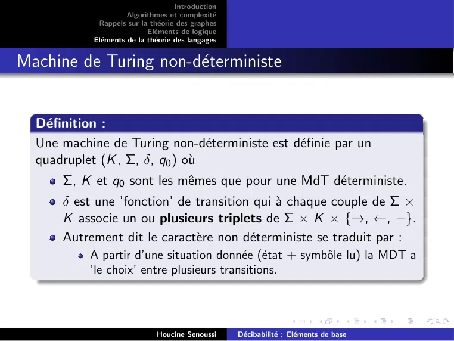

~~~text
                                     Introduction
                      Algorithmes et complexité
             Rappels sur la théorie des graphes
                            Eléments de logique
            Eléments de la théorie des langages

Machine de Turing non-déterministe

  Définition :
  Une machine de Turing non-déterministe est définie par un
  quadruplet (K , Σ, δ, q0 ) où
      Σ, K et q0 sont les mêmes que pour une MdT déterministe.
      δ est une ’fonction’ de transition qui à chaque couple de Σ ×
      K associe un ou plusieurs triplets de Σ × K × {→, ←, −}.
      Autrement dit le caractère non déterministe se traduit par :
           A partir d’une situation donnée (état + symbôle lu) la MDT a
           ’le choix’ entre plusieurs transitions.

                              Houcine Senoussi      Décibabilité : Eléments de base
~~~

## Page 23

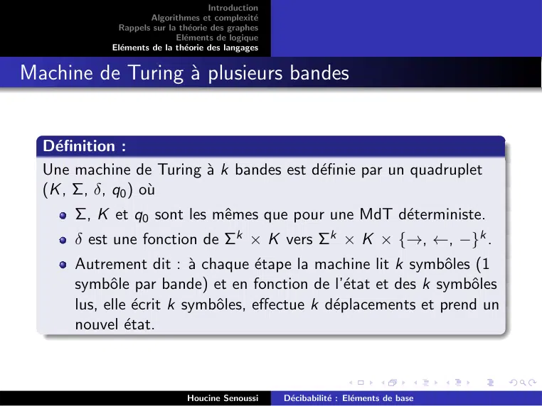

~~~text
                                     Introduction
                      Algorithmes et complexité
             Rappels sur la théorie des graphes
                            Eléments de logique
            Eléments de la théorie des langages

Machine de Turing à plusieurs bandes

  Définition :
  Une machine de Turing à k bandes est définie par un quadruplet
  (K , Σ, δ, q0 ) où
      Σ, K et q0 sont les mêmes que pour une MdT déterministe.
      δ est une fonction de Σk × K vers Σk × K × {→, ←, −}k .
      Autrement dit : à chaque étape la machine lit k symbôles (1
      symbôle par bande) et en fonction de l’état et des k symbôles
      lus, elle écrit k symbôles, effectue k déplacements et prend un
      nouvel état.

                              Houcine Senoussi      Décibabilité : Eléments de base
~~~
