# Logique_slides_2.pdf

[Ouvrir l’original](https://drive.google.com/open?id=1ABC_5KH0DQSME5quQ6tmyvQe-ohqRL6G) · Les deux lectures automatiques du PDF divergent sur les pages indiquées. Leur fac-similé accompagne le texte.

**Pages présentant un écart entre les deux extractions** — 1–21.

## Page 1

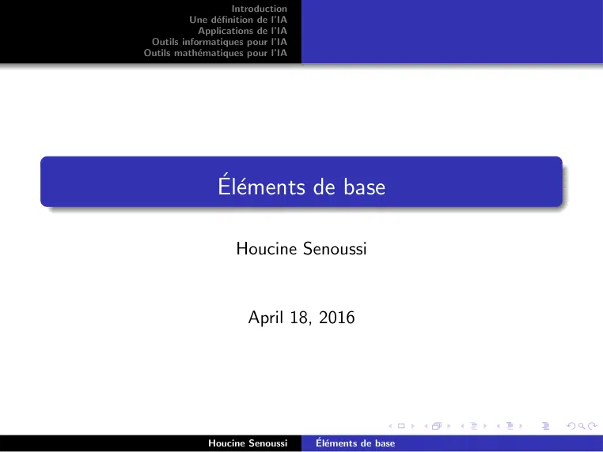

~~~text
                    Introduction
          Une définition de l’IA
            Applications de l’IA
 Outils informatiques pour l’IA
Outils mathématiques pour l’IA

                Éléments de base

                     Houcine Senoussi

                       April 18, 2016

              Houcine Senoussi      Éléments de base
~~~

## Page 2

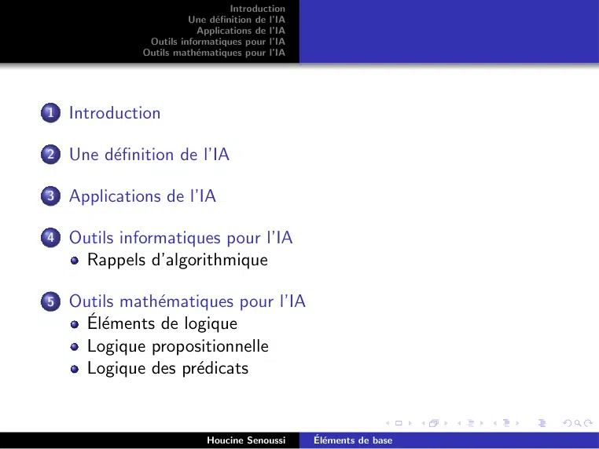

~~~text
                                  Introduction
                        Une définition de l’IA
                          Applications de l’IA
               Outils informatiques pour l’IA
              Outils mathématiques pour l’IA

1   Introduction

2   Une définition de l’IA

3   Applications de l’IA

4   Outils informatiques pour l’IA
      Rappels d’algorithmique

5   Outils mathématiques pour l’IA
      Éléments de logique
      Logique propositionnelle
      Logique des prédicats

                            Houcine Senoussi      Éléments de base
~~~

## Page 3

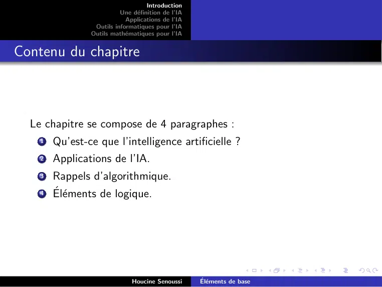

~~~text
                                    Introduction
                          Une définition de l’IA
                            Applications de l’IA
                 Outils informatiques pour l’IA
                Outils mathématiques pour l’IA

Contenu du chapitre

  Le chapitre se compose de 4 paragraphes :
    1   Qu’est-ce que l’intelligence artificielle ?
    2   Applications de l’IA.
    3   Rappels d’algorithmique.
    4   Éléments de logique.

                              Houcine Senoussi      Éléments de base
~~~

## Page 4

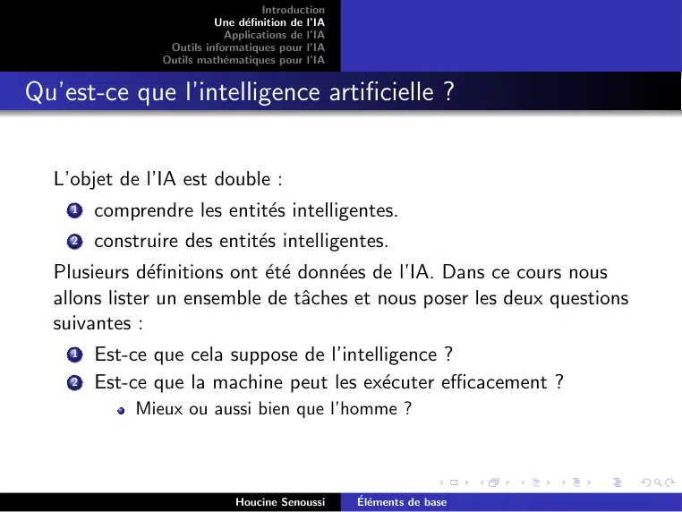

~~~text
                                    Introduction
                          Une définition de l’IA
                            Applications de l’IA
                 Outils informatiques pour l’IA
                Outils mathématiques pour l’IA

Qu’est-ce que l’intelligence artificielle ?

  L’objet de l’IA est double :
    1   comprendre les entités intelligentes.
    2   construire des entités intelligentes.
  Plusieurs définitions ont été données de l’IA. Dans ce cours nous
  allons lister un ensemble de tâches et nous poser les deux questions
  suivantes :
    1   Est-ce que cela suppose de l’intelligence ?
    2   Est-ce que la machine peut les exécuter efficacement ?
             Mieux ou aussi bien que l’homme ?

                              Houcine Senoussi      Éléments de base
~~~

## Page 5

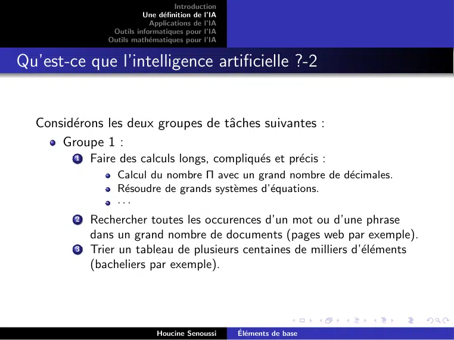

~~~text
                                    Introduction
                          Une définition de l’IA
                            Applications de l’IA
                 Outils informatiques pour l’IA
                Outils mathématiques pour l’IA

Qu’est-ce que l’intelligence artificielle ?-2

  Considérons les deux groupes de tâches suivantes :
      Groupe 1 :
         1   Faire des calculs longs, compliqués et précis :
                  Calcul du nombre Π avec un grand nombre de décimales.
                  Résoudre de grands systèmes d’équations.
                  ···
         2   Rechercher toutes les occurences d’un mot ou d’une phrase
             dans un grand nombre de documents (pages web par exemple).
         3   Trier un tableau de plusieurs centaines de milliers d’éléments
             (bacheliers par exemple).

                              Houcine Senoussi      Éléments de base
~~~

## Page 6

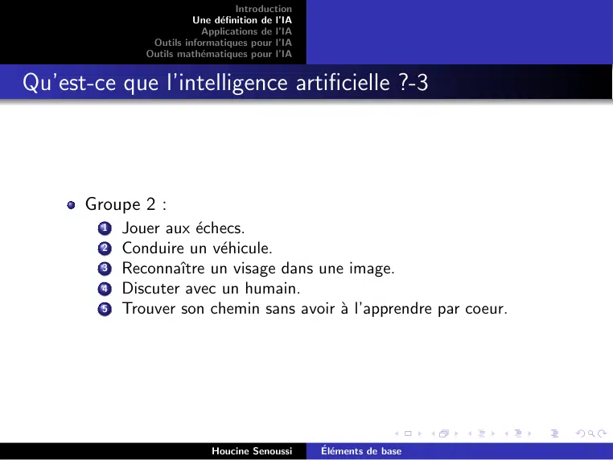

~~~text
                                   Introduction
                         Une définition de l’IA
                           Applications de l’IA
                Outils informatiques pour l’IA
               Outils mathématiques pour l’IA

Qu’est-ce que l’intelligence artificielle ?-3

      Groupe 2 :
        1   Jouer aux échecs.
        2   Conduire un véhicule.
        3   Reconnaı̂tre un visage dans une image.
        4   Discuter avec un humain.
        5   Trouver son chemin sans avoir à l’apprendre par coeur.

                             Houcine Senoussi      Éléments de base
~~~

## Page 7

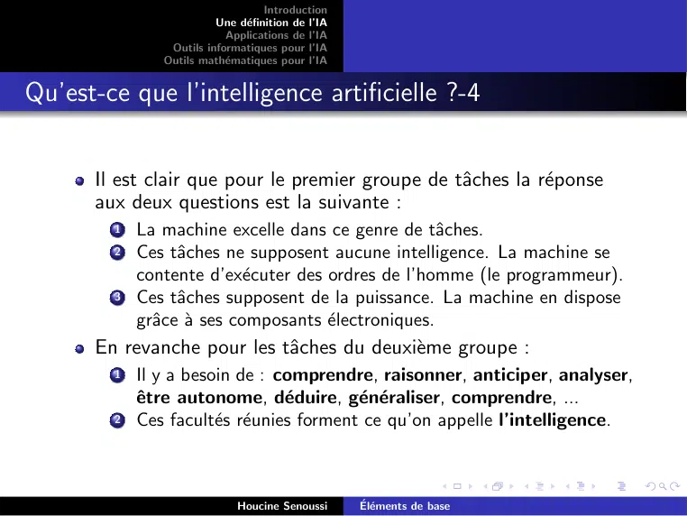

~~~text
                                   Introduction
                         Une définition de l’IA
                           Applications de l’IA
                Outils informatiques pour l’IA
               Outils mathématiques pour l’IA

Qu’est-ce que l’intelligence artificielle ?-4

      Il est clair que pour le premier groupe de tâches la réponse
      aux deux questions est la suivante :
        1   La machine excelle dans ce genre de tâches.
        2   Ces tâches ne supposent aucune intelligence. La machine se
            contente d’exécuter des ordres de l’homme (le programmeur).
        3   Ces tâches supposent de la puissance. La machine en dispose
            grâce à ses composants électroniques.
      En revanche pour les tâches du deuxième groupe :
        1   Il y a besoin de : comprendre, raisonner, anticiper, analyser,
            être autonome, déduire, généraliser, comprendre, ...
        2   Ces facultés réunies forment ce qu’on appelle l’intelligence.

                             Houcine Senoussi      Éléments de base
~~~

## Page 8

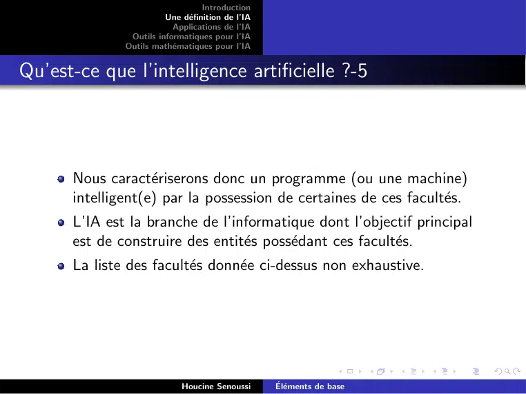

~~~text
                                  Introduction
                        Une définition de l’IA
                          Applications de l’IA
               Outils informatiques pour l’IA
              Outils mathématiques pour l’IA

Qu’est-ce que l’intelligence artificielle ?-5

      Nous caractériserons donc un programme (ou une machine)
      intelligent(e) par la possession de certaines de ces facultés.
      L’IA est la branche de l’informatique dont l’objectif principal
      est de construire des entités possédant ces facultés.
      La liste des facultés donnée ci-dessus non exhaustive.

                            Houcine Senoussi      Éléments de base
~~~

## Page 9

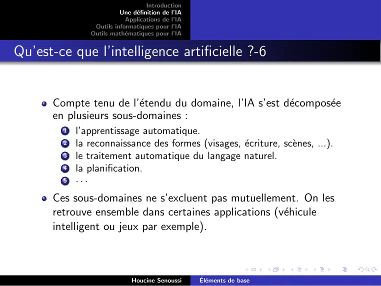

~~~text
                                   Introduction
                         Une définition de l’IA
                           Applications de l’IA
                Outils informatiques pour l’IA
               Outils mathématiques pour l’IA

Qu’est-ce que l’intelligence artificielle ?-6

      Compte tenu de l’étendu du domaine, l’IA s’est décomposée
      en plusieurs sous-domaines :
        1   l’apprentissage automatique.
        2   la reconnaissance des formes (visages, écriture, scènes, ...).
        3   le traitement automatique du langage naturel.
        4   la planification.
        5   ···
      Ces sous-domaines ne s’excluent pas mutuellement. On les
      retrouve ensemble dans certaines applications (véhicule
      intelligent ou jeux par exemple).

                             Houcine Senoussi      Éléments de base
~~~

## Page 10

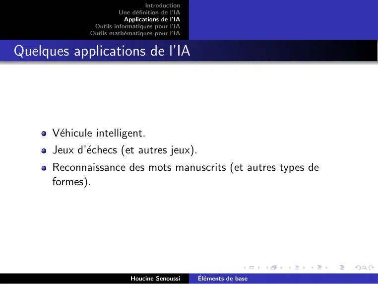

~~~text
                                  Introduction
                        Une définition de l’IA
                          Applications de l’IA
               Outils informatiques pour l’IA
              Outils mathématiques pour l’IA

Quelques applications de l’IA

      Véhicule intelligent.
      Jeux d’échecs (et autres jeux).
      Reconnaissance des mots manuscrits (et autres types de
      formes).

                            Houcine Senoussi      Éléments de base
~~~

## Page 11

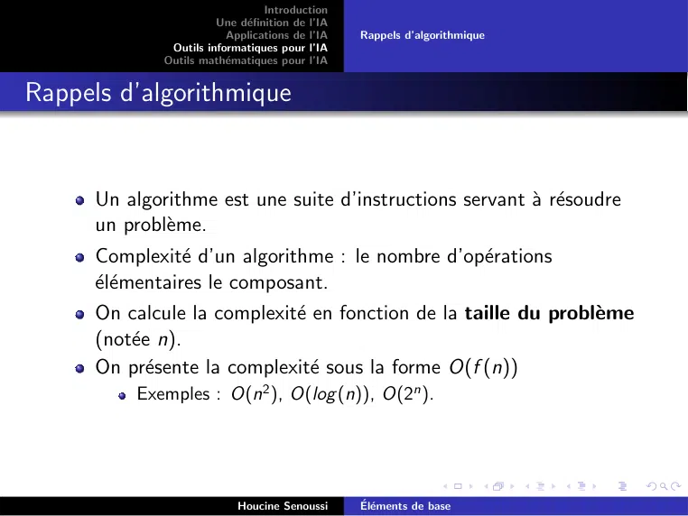

~~~text
                                  Introduction
                        Une définition de l’IA
                          Applications de l’IA    Rappels d’algorithmique
               Outils informatiques pour l’IA
              Outils mathématiques pour l’IA

Rappels d’algorithmique

      Un algorithme est une suite d’instructions servant à résoudre
      un problème.
      Complexité d’un algorithme : le nombre d’opérations
      élémentaires le composant.
      On calcule la complexité en fonction de la taille du problème
      (notée n).
      On présente la complexité sous la forme O(f (n))
          Exemples : O(n2 ), O(log (n)), O(2n ).

                            Houcine Senoussi      Éléments de base
~~~

## Page 12

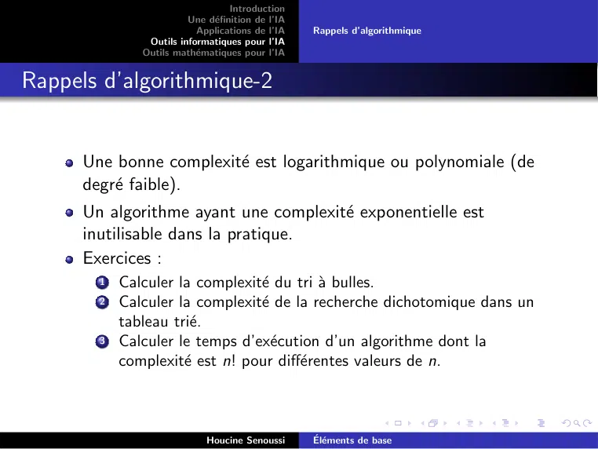

~~~text
                                   Introduction
                         Une définition de l’IA
                           Applications de l’IA    Rappels d’algorithmique
                Outils informatiques pour l’IA
               Outils mathématiques pour l’IA

Rappels d’algorithmique-2

      Une bonne complexité est logarithmique ou polynomiale (de
      degré faible).
      Un algorithme ayant une complexité exponentielle est
      inutilisable dans la pratique.
      Exercices :
        1   Calculer la complexité du tri à bulles.
        2   Calculer la complexité de la recherche dichotomique dans un
            tableau trié.
        3   Calculer le temps d’exécution d’un algorithme dont la
            complexité est n! pour différentes valeurs de n.

                             Houcine Senoussi      Éléments de base
~~~

## Page 13

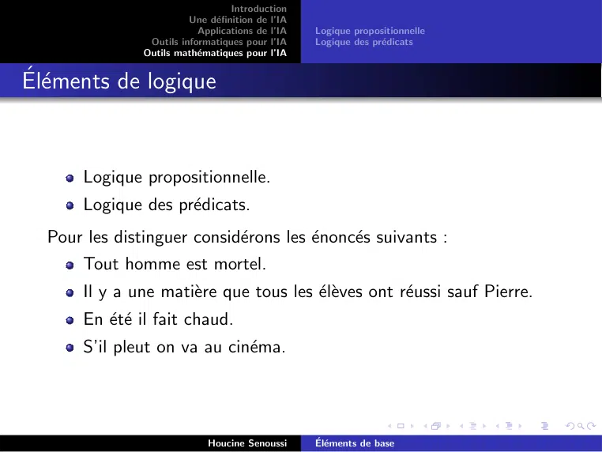

~~~text
                                    Introduction
                          Une définition de l’IA
                            Applications de l’IA    Logique propositionnelle
                 Outils informatiques pour l’IA     Logique des prédicats
                Outils mathématiques pour l’IA

Éléments de logique

       Logique propositionnelle.
       Logique des prédicats.
  Pour les distinguer considérons les énoncés suivants :
       Tout homme est mortel.
       Il y a une matière que tous les élèves ont réussi sauf Pierre.
       En été il fait chaud.
       S’il pleut on va au cinéma.

                              Houcine Senoussi      Éléments de base
~~~

## Page 14

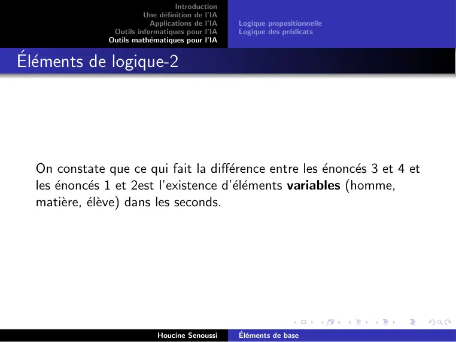

~~~text
                                   Introduction
                         Une définition de l’IA
                           Applications de l’IA    Logique propositionnelle
                Outils informatiques pour l’IA     Logique des prédicats
               Outils mathématiques pour l’IA

Éléments de logique-2

  On constate que ce qui fait la différence entre les énoncés 3 et 4 et
  les énoncés 1 et 2est l’existence d’éléments variables (homme,
  matière, élève) dans les seconds.

                             Houcine Senoussi      Éléments de base
~~~

## Page 15

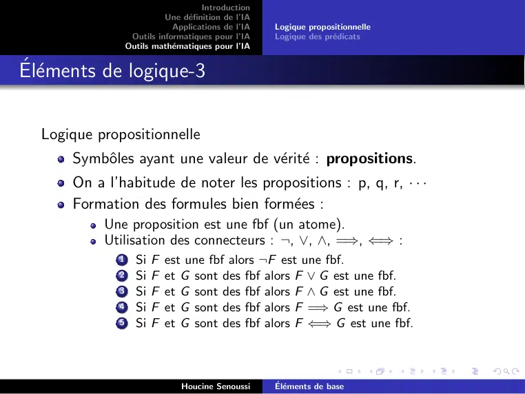

~~~text
                                     Introduction
                           Une définition de l’IA
                             Applications de l’IA    Logique propositionnelle
                  Outils informatiques pour l’IA     Logique des prédicats
                 Outils mathématiques pour l’IA

Éléments de logique-3

  Logique propositionnelle
      Symbôles ayant une valeur de vérité : propositions.
      On a l’habitude de noter les propositions : p, q, r, · · ·
      Formation des formules bien formées :
           Une proposition est une fbf (un atome).
           Utilisation des connecteurs : ¬, ∨, ∧, =⇒, ⇐⇒ :
             1     Si F est une fbf alors ¬F est une fbf.
             2     Si F et G sont des fbf alors F ∨ G est une fbf.
             3     Si F et G sont des fbf alors F ∧ G est une fbf.
             4     Si F et G sont des fbf alors F =⇒ G est une fbf.
             5     Si F et G sont des fbf alors F ⇐⇒ G est une fbf.

                               Houcine Senoussi      Éléments de base
~~~

## Page 16

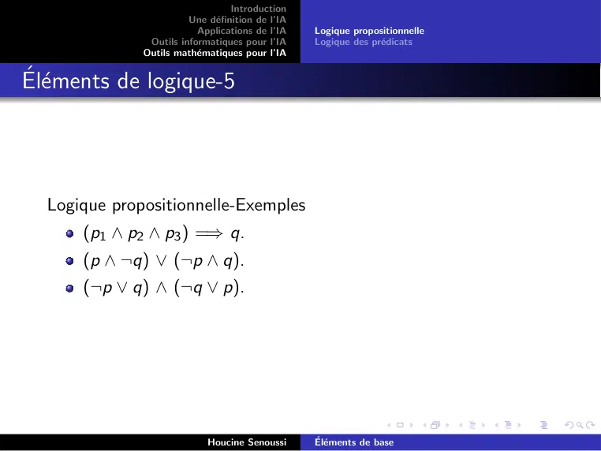

~~~text
                                  Introduction
                        Une définition de l’IA
                          Applications de l’IA    Logique propositionnelle
               Outils informatiques pour l’IA     Logique des prédicats
              Outils mathématiques pour l’IA

Éléments de logique-5

  Logique propositionnelle-Exemples
      (p1 ∧ p2 ∧ p3 ) =⇒ q.
      (p ∧ ¬q) ∨ (¬p ∧ q).
      (¬p ∨ q) ∧ (¬q ∨ p).

                            Houcine Senoussi      Éléments de base
~~~

## Page 17

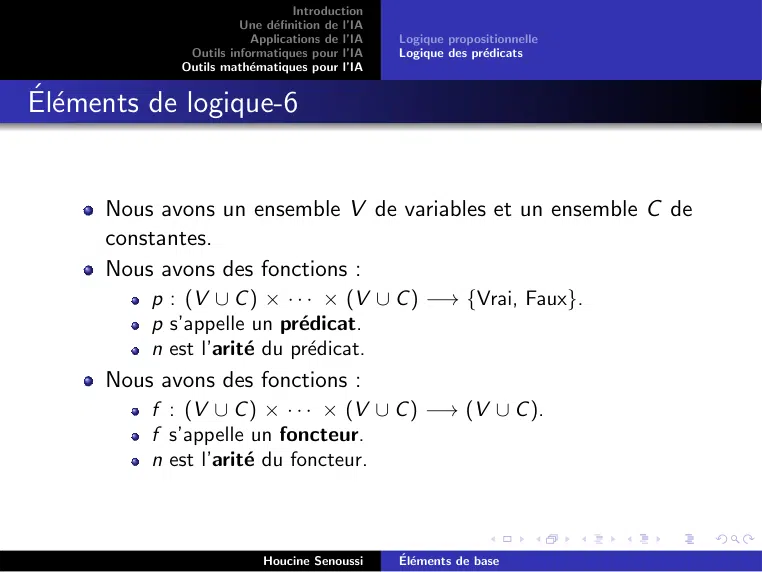

~~~text
                                 Introduction
                       Une définition de l’IA
                         Applications de l’IA    Logique propositionnelle
              Outils informatiques pour l’IA     Logique des prédicats
             Outils mathématiques pour l’IA

Éléments de logique-6

      Nous avons un ensemble V de variables et un ensemble C de
      constantes.
      Nous avons des fonctions :
          p : (V ∪ C ) × · · · × (V ∪ C ) −→ {Vrai, Faux}.
          p s’appelle un prédicat.
          n est l’arité du prédicat.
      Nous avons des fonctions :
          f : (V ∪ C ) × · · · × (V ∪ C ) −→ (V ∪ C ).
          f s’appelle un foncteur.
          n est l’arité du foncteur.

                           Houcine Senoussi      Éléments de base
~~~

## Page 18

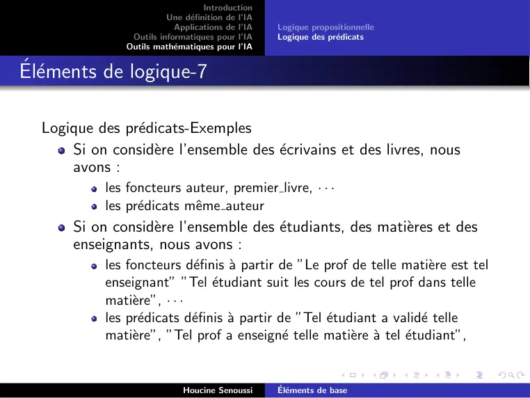

~~~text
                                   Introduction
                         Une définition de l’IA
                           Applications de l’IA    Logique propositionnelle
                Outils informatiques pour l’IA     Logique des prédicats
               Outils mathématiques pour l’IA

Éléments de logique-7

  Logique des prédicats-Exemples
      Si on considère l’ensemble des écrivains et des livres, nous
      avons :
            les foncteurs auteur, premier livre, · · ·
            les prédicats même auteur
       Si on considère l’ensemble des étudiants, des matières et des
       enseignants, nous avons :
            les foncteurs définis à partir de ”Le prof de telle matière est tel
            enseignant” ”Tel étudiant suit les cours de tel prof dans telle
            matière”, · · ·
            les prédicats définis à partir de ”Tel étudiant a validé telle
            matière”, ”Tel prof a enseigné telle matière à tel étudiant”,

                             Houcine Senoussi      Éléments de base
~~~

## Page 19

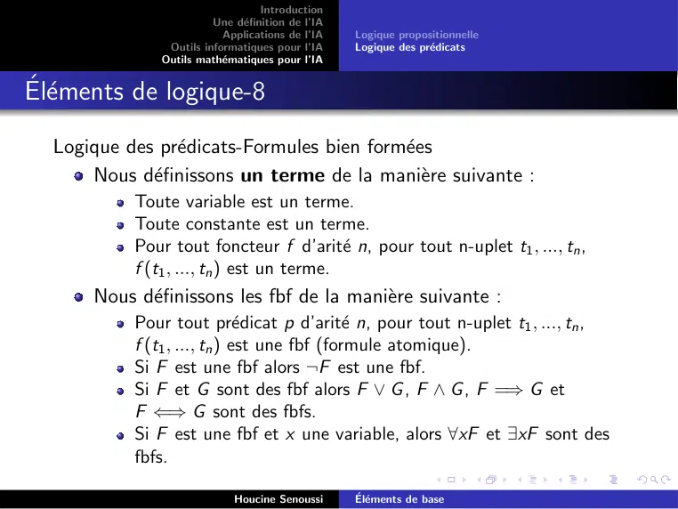

~~~text
                                  Introduction
                        Une définition de l’IA
                          Applications de l’IA    Logique propositionnelle
               Outils informatiques pour l’IA     Logique des prédicats
              Outils mathématiques pour l’IA

Éléments de logique-8
  Logique des prédicats-Formules bien formées
      Nous définissons un terme de la manière suivante :
           Toute variable est un terme.
           Toute constante est un terme.
           Pour tout foncteur f d’arité n, pour tout n-uplet t1 , ..., tn ,
           f (t1 , ..., tn ) est un terme.
      Nous définissons les fbf de la manière suivante :
           Pour tout prédicat p d’arité n, pour tout n-uplet t1 , ..., tn ,
           f (t1 , ..., tn ) est une fbf (formule atomique).
           Si F est une fbf alors ¬F est une fbf.
           Si F et G sont des fbf alors F ∨ G , F ∧ G , F =⇒ G et
           F ⇐⇒ G sont des fbfs.
           Si F est une fbf et x une variable, alors ∀xF et ∃xF sont des
           fbfs.

                            Houcine Senoussi      Éléments de base
~~~

## Page 20

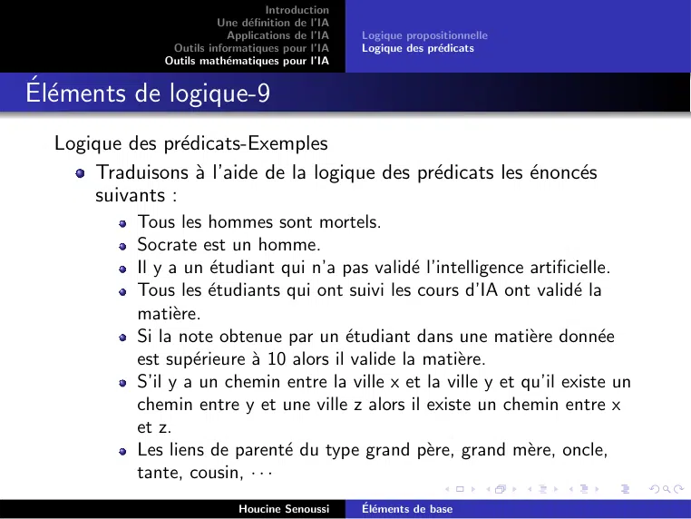

~~~text
                                   Introduction
                         Une définition de l’IA
                           Applications de l’IA    Logique propositionnelle
                Outils informatiques pour l’IA     Logique des prédicats
               Outils mathématiques pour l’IA

Éléments de logique-9
  Logique des prédicats-Exemples
      Traduisons à l’aide de la logique des prédicats les énoncés
      suivants :
            Tous les hommes sont mortels.
            Socrate est un homme.
            Il y a un étudiant qui n’a pas validé l’intelligence artificielle.
            Tous les étudiants qui ont suivi les cours d’IA ont validé la
            matière.
            Si la note obtenue par un étudiant dans une matière donnée
            est supérieure à 10 alors il valide la matière.
            S’il y a un chemin entre la ville x et la ville y et qu’il existe un
            chemin entre y et une ville z alors il existe un chemin entre x
            et z.
            Les liens de parenté du type grand père, grand mère, oncle,
            tante, cousin, · · ·
                             Houcine Senoussi      Éléments de base
~~~

## Page 21

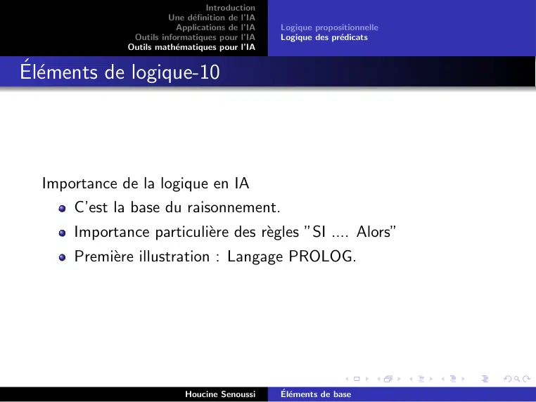

~~~text
                                  Introduction
                        Une définition de l’IA
                          Applications de l’IA    Logique propositionnelle
               Outils informatiques pour l’IA     Logique des prédicats
              Outils mathématiques pour l’IA

Éléments de logique-10

  Importance de la logique en IA
      C’est la base du raisonnement.
      Importance particulière des règles ”SI .... Alors”
      Première illustration : Langage PROLOG.

                            Houcine Senoussi      Éléments de base
~~~
