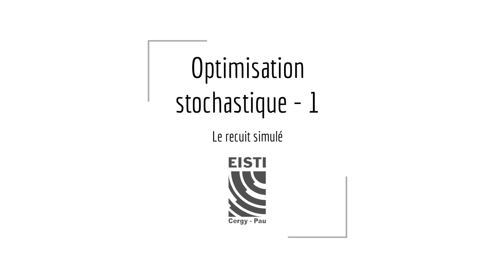
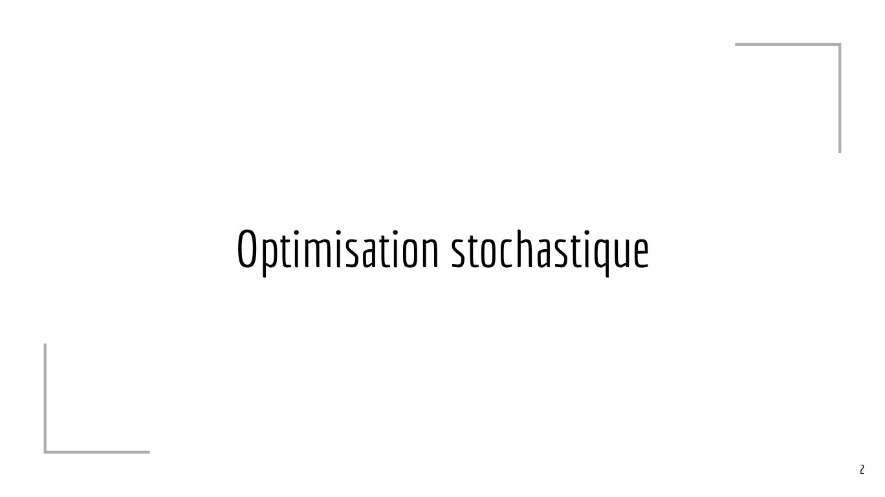
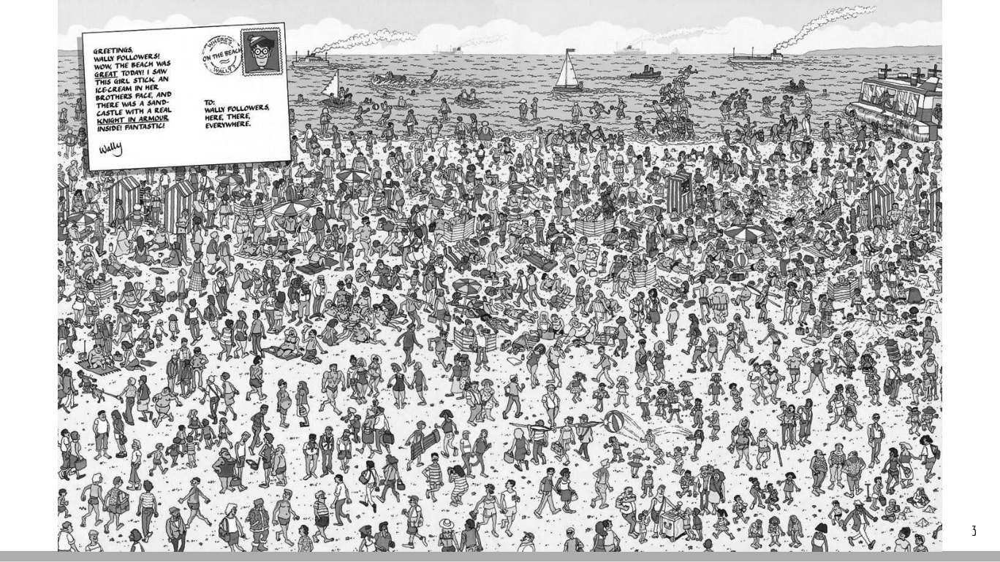
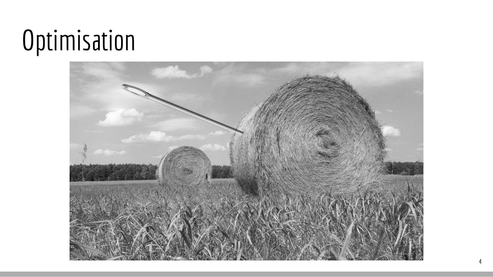
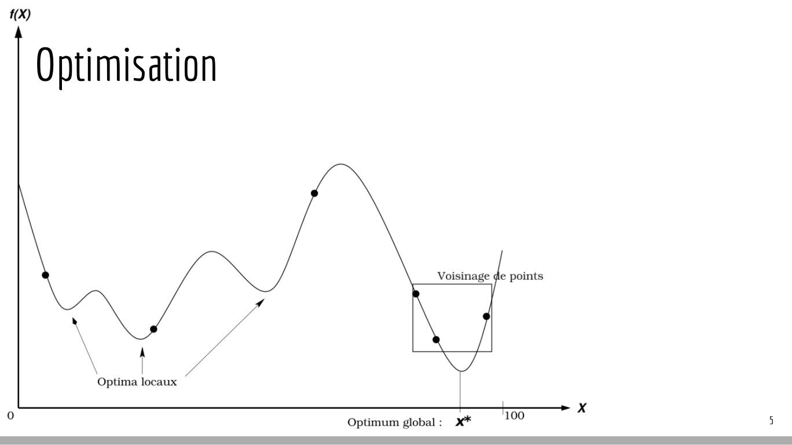
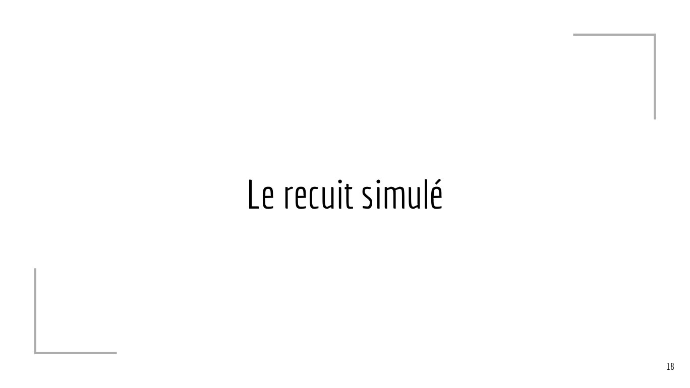
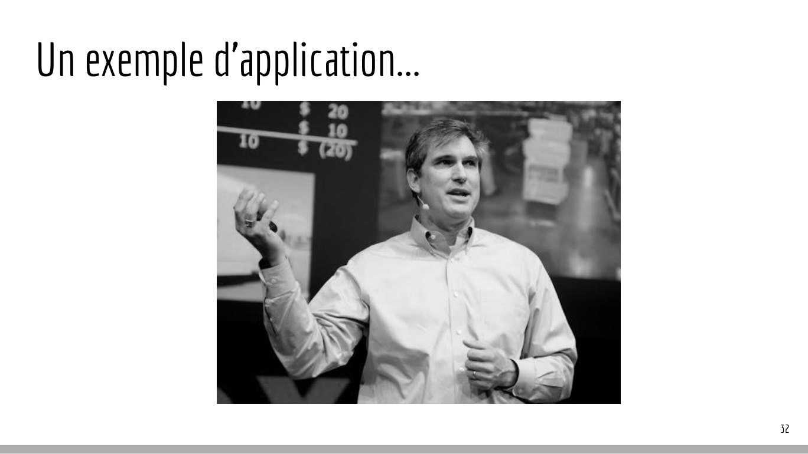

# Optimisationstochastique-1.pdf

[Ouvrir l’original](https://drive.google.com/open?id=1Jm5WARjKtzlGh7t5lh1POF7FBt5I1KIq) · Les pages signalées comprennent du texte reconnu automatiquement ou des éléments graphiques. Le fac-similé permet de vérifier chaque lecture.

**Pages avec fac-similé ou lecture OCR** — 1–5, 12–13, 18, 32–33.

## Page 1

~~~text
  Optimisation
stochastique - 1
    Le recuit simulé
~~~

**Lecture OCR à contrôler**

~~~text
Optimisation
stochastique - 1

Le recuit simulé

EISTI

Cergy - Pau
~~~

## Page 2

~~~text
Optimisation stochastique

                            2
~~~

**Lecture OCR à contrôler**

~~~text
Optimisation Stochastique
~~~

## Page 3

~~~text
3
~~~

## Page 4

~~~text
Optimisation

               4
~~~

**Lecture OCR à contrôler**

~~~text
Optimisation
~~~

## Page 5

~~~text
Optimisation

               5
~~~

**Lecture OCR à contrôler**

~~~text
1x)

Optimisation

Voisinage de points

Optima locaux

Optimum global : x*
~~~

## Page 6

~~~text
La malédiction de la dimension

http ://cleverowl.uk/2016/02/06/curse-of-dimensionality-explained/

                                                                     6
~~~

## Page 7

~~~text
                                                                     7
[Métaheuristiques pour l’optimisation difficile, P. Siarry et al.]
~~~

## Page 8

~~~text
Typologie de problèmes
●   Optimisation difficile;
●   Problème de minimisation / maximisation;
●   Problèmes mono-objectif, multi-objectifs, “many”-objectifs;
●   Problèmes à variables discrètes / continues / mixtes;
●   Problèmes sous contraintes;
●   Problèmes à grande dimension;
●   Problèmes dynamiques.

                                                                  8
~~~

## Page 9

~~~text
Typologie de problèmes à variables discrètes
●   Voyageur de commerce
●   Tournée de véhicules
●   Coloration de graphe
●   Sac à dos                                  gurobi.com
                         mathworks.com
●   Planification...

         3.dp.blogspot.com
                                                     9
~~~

## Page 10

~~~text
  Typologie de problèmes à variables continues
    ●       Fonction analytique (benchmarks) ;
    ●       Expression non analytique (code de calcul, problème inverse) ;
    ●       Autres problèmes variés (géométrie, chimie, physique)...
                                                                             urban&you

http://www.sfu.ca                                                                  10
~~~

## Page 11

~~~text
Métaheuristiques
Ce sont des méthodes :

●   globales;
●   stochastiques;
●   génériques même si dépendantes du contexte continu/discret;
●   qui ne garantissent pas l’optimalité;
●   basées sur des analogies avec la biologie, la physique, l’éthologie...

                                                                             11
~~~

## Page 12

~~~text
                       coucou !

Cherchez l’intrus...

                                  12
~~~

**Lecture OCR à contrôler**

~~~text
Cherchez l'intrus...
ie k ©

ve > 0! 0 %
.
~~~

## Page 13

~~~text
                       coucou !

Cherchez l’intrus...

                                  13
~~~

**Lecture OCR à contrôler**

~~~text
Cherchez l'intrus...
ie k ©

ve > 0! 0 %
.
~~~

## Page 14

~~~text
Éléments constitutifs et stratégies
Elles sont généralement composées de :

●   Une ou plusieurs (population) solutions initiales;
●   Une stratégie de génération de nouvelle solution basée sur l’aléatoire;
●   Un critère d’acceptation d’une nouvelle solution;
●   Des coefficients de contrôle de comportement de l’algorithme;
●   Le partage d’information, l’utilisation d’une mémoire de solutions
    explorées;
●   Un critère de convergence.
                                                                              14
~~~

## Page 15

~~~text
Initialisation
                              ?
●   Aléatoirement
●   Manière intelligente
     ○   sampling
     ○   hypercubes latins
     ○   séquence de Halton
     ○   ...

                                  15
~~~

## Page 16

~~~text
Recherche
                 lycee-delacroix-maisons-alfort.fr

  Exploration

      VS                                             www.ethos3.com

  Exploitation

                                                                      16
~~~

## Page 17

~~~text
Voisinage
●   Définition :
     ○   Cas des variables discrètes : décalage de composantes de la données,
     ○   Cas des variables continues : hyper(sphère|cube) centré autour de la donnée.

●   Stratégies
     ○   Voisinage géographique,
     ○   Voisinage social,
     ○   Voisinage aléatoire.

●   Méthodes du gradient, Newton-Raphson, dichotomie, polytope de
    Nelder-Mead…
●   Hybridation avec des méthodes de recherche locales
                                                                                        17
~~~

## Page 18

~~~text
Le recuit simulé

                   18
~~~

**Lecture OCR à contrôler**

~~~text
Le recuit simulé
~~~

## Page 19

~~~text
Pour l’histoire… un peu de physique !
Le recuit est une technique qui permet
d’améliorer la qualité d’un matériau selon
la méthode suivante :

●   On le porte à très haute température
    pour le liquéfier
●   On abaisse progressivement la
    température pour stabiliser la
    structure du matériau

                                                                                                                  19
                                             [Métaheuristiques pour l’optimisation difficile, P. Siarry et al.]
~~~

## Page 20

~~~text
Le recuit simulé (Simulated Annealing)

●   Métaheuristique variante de l’algorithme de Metropolis-Hastings (voir
    exemple ici) ;
●   Proposée en 83 par Kirkpatrick, Gelatt et Vecchi et en 85 par Cerny;
●   Première métaheuristique proposée;
●   Adaptée aux problèmes discrets (originellement au placement de
    composant électronique sur une plaque).

                                                                            20
~~~

## Page 21

~~~text
Le recuit simulé - l’analogie

●   La fonction f à minimiser est l’énergie du système;
●   Une solution X représente un état du matériau;
●   L’équilibre thermodynamique est atteint lors d’un palier de température;
●   À température T, une perturbation de la solution courante est acceptée
    avec de manière probabiliste basée sur le critère de Metropolis.

                                                                               21
~~~

## Page 22

~~~text
Critère de ....
critereMetropolis(Δf,T) :
    Si Δf ≤ 0 alors
         retourner VRAI
    sinon
         retourner aléa(0,1) <    e(-Δf/T)

●   Δf ≤ 0, le voisin est accepté;
●   Une petite variation a plus de chance
    d’être acceptée qu’une importante;
●   Cette fonction est stochastique.

                                             22
~~~

## Page 23

~~~text
Critère de ....
                 voisin accepté

   acceptation                        acceptation
      selon                              selon
      (-Δf/T)                            (-Δf/T)
    e                                  e

                                  X

                              ?
                                                    23
~~~

## Page 24

~~~text
Algorithme du recuit simulé
    X, une solution, f(X) énergie du système, T Température initiale
    fmin <- f(X)
    Xmin <- X
    Tant que T > Tmin ou non critèreConvergence()
          Tant que non équilibreThermodynamique()        // palier de température
               Xvois <- perturbation(X)
               Δf = f(Xvois ) - f(X)
               Si Δf < 0 ou acceptationCritèreMétropolis(Δf,T) alors
                     Si Δf < 0 et f(Xvois ) < fmin alors
                          fmin <- f(Xvois )
                          Xmin <- Xvois
                    Fin si
                   f(X) <- f(Xvois )
                   X <- Xvois
              Fin si
         Fin tant que
         T <- refroidissement(T)
    Fin tant que                                                                    24
~~~

## Page 25

~~~text
Recuit simulé : Critères de convergence
Permet de terminer l’algorithme selon plusieurs conditions :

●   La température atteint une valeur minimale;
●   Le nombre d’évaluations atteint une limite;
●   Il n’y a pas eu d’amélioration depuis un certain nombre d’itérations.

                                                                            25
~~~

## Page 26

~~~text
Recuit simulé : Équilibre thermodynamique
Permet de “fouiller” autour d’une bonne solution en cours :

●   Le nombre d’évaluations atteint une limite;
●   Il n’y a pas eu d’amélioration depuis un certain nombre d’itérations.

                                                                            26
~~~

## Page 27

~~~text
Recuit simulé : Refroidissement
Permet de diminuer la probabilité d’acceptation d’une solution non améliorante
selon le critère de Métropolis :

●   Une forte décroissance empêche une exploration convenable, l’algorithme
    converge rapidement vers un minimum local;
●   Une faible décroissance permet une forte exploration lors des premières
    itérations de l’algorithme et rend peu probable la sélection d’une solution
    dégradante;
●   À T=0, aucune solution dégradante n’est sélectionnée; à T=∞, toute solution
    est acceptée.                                                                 27
~~~

## Page 28

~~~text
    Recuit simulé : Refroidissement
●   À haute température, la valeur du critère de Métropolis est proche
    de 1, la plupart des solutions dégradantes sont acceptées :

         0                    acceptation                   1

                                                      e(-Δf/T)
●   À faible température, la valeur du critère de Métropolis tend vers
    0, la plupart des solutions dégradantes sont rejetées :

         0                       refus                      1

              e(-Δf/T)

                                                                                                  [Wikipedia]
                                                                         Espace de variation du
                                                                          critère de Métropolis            28
~~~

## Page 29

~~~text
Recuit simulé : Refroidissement
Différents schémas de réduction de la température :

●   Géométrique (si l’on ne considère pas les paliers…) : Tk+1 = α.Tk, le plus
    couramment utilisé;
●   Logarithmique : Tk = μ / log(1+k), où k : nb de paliers et μ une constante.
    Très coûteux en temps de calcul, peu utilisée;
●   Exponentiel : Tk = T0.exp(-k/τ), où k : nb de paliers et τ une constante;
●   Ésotérique : on peut remonter la température selon un critère particulier.

                                                                                  29
~~~

## Page 30

~~~text
Recuit simulé : Perturbation

●   Génère une nouvelle solution au voisinage de la solution en cours;
●   Influence de la distance entre ces deux solutions (hypervolume du
    voisinage);
●   Spécifique au problème à résoudre (discret/continu).

                                                                         30
~~~

## Page 31

~~~text
No free lunch theorem             [Wolpert and Macready]

Des restaurants (méthodes de résolution) possèdent un menu proposant des
plats (problèmes) à différents prix (performance de résolution). Chaque
restaurant propose les même plats mais à des prix différents.

              Il n’existe pas de menu parfait pour un omnivore.

                                                                           31
~~~

## Page 32

~~~text
Un exemple d’application...

                              32
~~~

**Lecture OCR à contrôler**

~~~text
Un exemple d'application...

_
~~~

## Page 33

~~~text
That’s all folks !
~~~

**Lecture OCR à contrôler**

~~~text
/ NN I
That's all folks !
~~~
