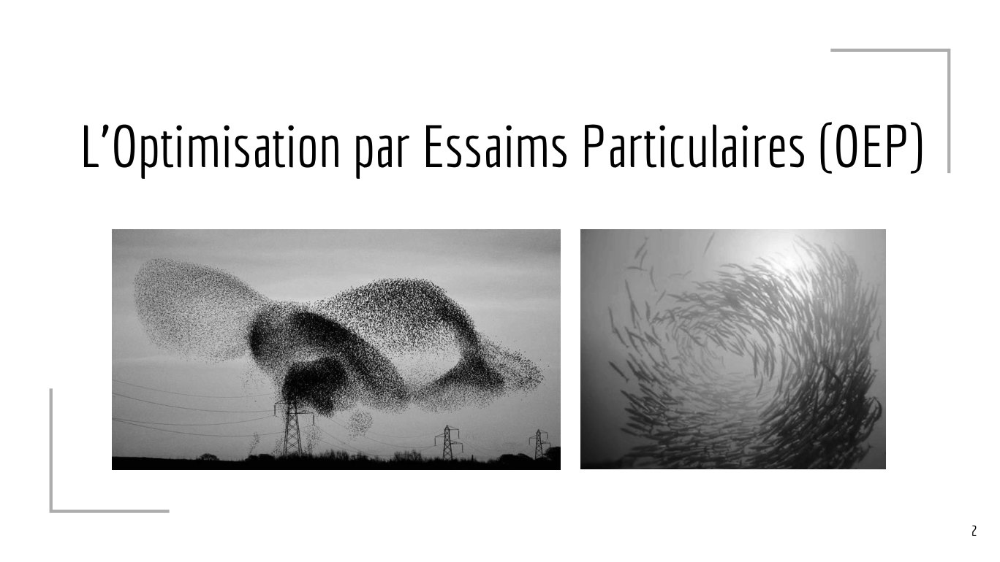

# Optimisationstochastique-3-PSO.pdf

[Ouvrir l’original](https://drive.google.com/open?id=1o-capYLq9M8glZsj3vJmwDu0RgADzTkM) · Les pages signalées comprennent du texte reconnu automatiquement ou des éléments graphiques. Le fac-similé permet de vérifier chaque lecture.

**Pages avec fac-similé ou lecture OCR** — 2, 20.

## Page 1

~~~text
     Optimisation
   stochastique - 3
L’Optimisation par Essaims Particulaires
~~~

## Page 2

~~~text
L’Optimisation par Essaims Particulaires (OEP)

                                                 2
~~~

**Lecture OCR à contrôler**

~~~text
L'Optimisation par Essaims Particulaires (OEP)
~~~

## Page 3

~~~text
Un peu d’histoire...
●   Proposée “par hasard” par James Kennedy (socio-psychologue) et Russel
    Eberhart (ingénieur en électricité) en 1995 ;
●   Algorithme multi-agents, adapté aux problèmes continus ;
●   Population d’individus peu intelligents (possédant une petite mémoire)
    mais fortement communicants ;
●   Basée sur l’imitation et non sur la sélection ;
●   http://www.swarmintelligence.org/, http://www.particleswarm.info/, un
    livre de Maurice Clerc sur le sujet.

                                                                             3
~~~

## Page 4

~~~text
Optimisation par Essaims particulaires - La particule
                                          vers ma meilleure
                                           position connue

                                 nouvelle position
           position                                           vers la meilleure
           actuelle                                           position de mes
                                                                informatrices

                      vitesse
                      actuelle

                                                                                  4
~~~

## Page 5

~~~text
OEP - La particule
Une particule connaît :

●   Sa position actuelle et son évaluation ;
●   Sa vitesse ;
●   La meilleure position par laquelle elle est passée et son évaluation ;
●   La composition de son voisinage d’informatrices ;
●   La meilleure position de son voisinage d’informatrices et son évaluation.

                                                                                5
~~~

## Page 6

~~~text
OEP - La métaphore détaillée
Les concepts sous-jacents de la métaphore :

●   Une particule : un candidat du problème et un peu plus... ;
●   L’essaim : la population de particules ;
●   La vitesse d’une particule : le vecteur de déplacement (perturbation du
    candidat) ;
●   Le voisinage d’une particule : ensemble des particules échangeant de
    l’information avec celle-ci.

                                                                              6
~~~

## Page 7

~~~text
OEP - Principe
L’algorithme s’articule autour de deux itérations, parallélisables :

●   Pour chaque particule, on met à jour les informations utiles au
    déplacement ;
●   Pour chaque particule, on calcule la nouvelle vitesse et on effectue le
    déplacement.

                                                                              7
~~~

## Page 8

~~~text
OEP - Algorithme
    initialisation de l’essaim de N particules
    Répéter
         iter + 1
         Pour chaque particule Faire
              maj de sa meilleure position
              maj de la meilleure position du voisinage
         Fin Pour
         Pour chaque particule Faire
              calcul de la nouvelle vitesse
              déplacement de la particule
              évaluation de la nouvelle position
         Fin Pour
         mise à jour de la meilleure position globale
    Jusqu’à critèreDArrêt()

                                                          8
~~~

## Page 9

~~~text
OEP - Vitesse et Déplacement
À chaque itération, on calcule la nouvelle vitesse Vk+1, compromis entre les 3
comportements et on déplace la particule Xk en fonction :

●   Vk+1 = ψ Vk + ρ1 (Xpbest − Xk) + ρ2 (Xvbest − Xk)
     ○   ψ : coefficient d'inertie, affine la convergence de la méthode ;

     ○   ρi : coefficients de confiance, modifient l'instinct de la particule, ρi = ri.ci, avec ri suit une loi
         uniforme sur [0,1] et c1 + c2 ≤ 4;

●   Xk+1 = Xk + Vk+1

                                                                                                                  9
~~~

## Page 10

~~~text
OEP - Coefficients
Définir des valeurs efficientes de coefficients est le paramétrage sensible de la
méthode. Ils définissent plusieurs types de comportement :

●   coefficient d’inertie : je fais confiance à mon déplacement ;
●   coefficient social : je fais confiance à mes informatrices ;
●   coefficient cognitif : je fais confiance à ma mémoire ;
●   facteur de contrition : coefficient introduit pour éviter la divergence hors
    de l’espace de recherche ;
●   Il existe de nombreux papiers de recherche sur ce thème.

                                                                                    10
~~~

## Page 11

~~~text
    OEP - Coefficients
    L’équation de la vitesse peut s’exprimer plus simplement sous la forme :

     ●       Vk+1 = ψ Vk + cmax*rand(0,1) (Xpbest − Xk) + cmax*rand(0,1) (Xvbest − Xk)
                ○      c1 = c2 = cmax

                ○      avec (ψ; cmax) = (0.7; 1.47) ou (0.8; 1.62) : valeurs performantes de couple

    En utilisant le facteur de contrition1, un calcul de vitesse faisant consensus :

     ●       Vk+1 = 0.7298844 Vk + 2.05*rand(0,1) (Xpbest − Xk) + 2.05*rand(0,1) (Xvbest − Xk)

1
Clerc et Kennedy. 2002, “The particle swarm - explosion, stability, and convergence in a multidimensional complex space”, Transactions on Evolutionary Computation, vol. 6, n o 1, p. 58–73.
                                                                                                                                                                                               11
~~~

## Page 12

~~~text
OEP - Caractéristiques de l’essaim
Le nombre de particules composant l’essaim et leur organisation en son sein
sont deux paramètres de la méthode :

●   Une taille d’essaim trop faible empêche une exploration convenable de
    l’espace de recherche ;
●   Une taille trop importante n’améliore pas nécessairement la convergence
    et augmente le temps de calcul ;

●   Une taille modérée, couplée à un nombre maximum d’itérations judicieux,
    conduit à un comportement efficace de l’algorithme ;

●   La taille du problème influe néanmoins sur le nombre de particules
    (10+2√D : SPSO 2006, SPSO 2007).                                          12
~~~

## Page 13

~~~text
OEP - Voisinage
Plusieurs questions à se poser :

●   Qui communique avec qui ?
●   Quelle information est échangée ?
●   Que faire de l’information ?
●   Quand intervient l‘échange ?

                                        13
~~~

## Page 14

~~~text
OEP - Topologie de voisinage
●   Voisinage global : toutes les particules communiquent entre elles ;
●   Voisinage “local/social” : chaque particule communique avec un
    sous-groupe, organisé en topologie particulière, par exemple :
                Topologies Gbest, en anneau, four-clusters, Von Neumann et pyramide

                                                                  [Kaveh, A. 2014, ≪ Particle swarm optimization ≫ , dans
                                                                  Advances in Metaheuristic Algorithms for Optimal Design
                                                                  of Structures, Springer]                                  14
~~~

## Page 15

~~~text
OEP - Initialisation de l’essaim
Une métaheuristique multi-agents nécessite une initialisation qui propose une
bonne couverture de l’espace de recherche :

●   Aléatoire : on initialise les particules par un tirage aléatoire de leur
    position sur l’espace de recherche (pseudorandom, chaotic...);
●   Guidée : il existe plusieurs stratégies pour “écarter” au maximum les
    solutions sur l’ensemble de l’espace de recherche:
     ○   division de l’espace de recherche ;
     ○   technique d’opposition-based learning
     ○   utilisation de séquences d’initialisation (Halton, Sobol…) ;
     ○   utilisation d’hypercubes latins ;
     ○   ….
                                                                                15
~~~

## Page 16

~~~text
OEP - Problème aux limites
Il existe plusieurs stratégies pour éviter de sortir des limites de l’espace de
recherche :

●   Limiteur : on introduit un paramètre Vmax qui contrôle le déplacement
    maximum de la vitesse ;
●   Ignorance : la particule est laissée hors de l’espace de recherche et son
    évaluation n’est pas réalisée (ou fortement pénalisée) ;
●   Stop : la particule est arrêtée aux limites de l’espace, on annule ou on
    oppose la vitesse ;
●   Rebond : la particule rebondit vers l’intérieur de l’espace de recherche.

                                                                                  16
~~~

## Page 17

~~~text
OEP - Critères d’arrêt

Permet de terminer l’algorithme selon plusieurs conditions :

●   Le nombre d’évaluations atteint une limite. Ce nombre peut être ajusté en
    fonction du nombre de particules composant l’essaim ;
●   Le temps d’exécution atteint une limite ;
●   Il n’y a pas eu d’amélioration depuis un certain nombre d’itérations.

                                                                                17
~~~

## Page 18

~~~text
OEP - Discrétisation
L’optimisation par essaims particulaires est une métaheuristique adaptée aux
problèmes continus. Néanmoins, elle est “adaptable” à des problèmes à
variables discrètes en résolvant les problématiques suivantes :

●   Comment définit-on une particule ?
●   Que représente la vitesse ?
●   Qu’est-ce que la distance entre deux particules ?
●   Que représentent les opérations *, +, - ?

                                                                               18
~~~

## Page 19

~~~text
OEP - Autres améliorations
Il existe de nombreuses améliorations de cet algorithme pour chacune de ses
caractéristiques, notamment :

●   TRIBES : l’essaim est divisé en sous-essaims communicants dont le
    nombre de particules les composant évolue au cours du temps ;
●   FIPS : Le déplacement prend en compte la position de l’ensemble des
    particules de l’essaim et non plus de la meilleure ;
●   Bare Bones PSO : Le déplacement est effectué selon une loi de probabilité
    suivant une distribution gaussienne dont les paramètres dépendent des
    meilleures valeurs personnelle et du voisinage ;
●   De nombreuses autres !
                                                                                19
~~~

## Page 20

~~~text
That’s all folks !
~~~

**Lecture OCR à contrôler**

~~~text
That's all folks !
~~~
