# Methodes Agile_v1.pdf

[Ouvrir l’original](https://drive.google.com/open?id=1Mq2UgOncXHKyzOJRaJJpO_2EAbCNzrSc) · Les pages signalées comprennent du texte reconnu automatiquement ou des éléments graphiques. Le fac-similé permet de vérifier chaque lecture.

**Pages avec fac-similé ou lecture OCR** — 7, 24–25, 40–41, 44, 48, 57, 59, 62, 70, 82, 91–93, 99.

## Page 1

~~~text
        Introduction aux
        Méthodes Agiles

Inès ALAYA avec la collaboration de Taisa GUIDINI

                                              1
~~~

## Page 2

~~~text
       Agile VS Méthodes classiques
                 Scrum?
Plan
              Scrum Roles
           Scrum Evènements
             Scrum Artefacts
                                      2
~~~

## Page 3

~~~text
Agile vs Méthodes Classiques

La gestion de projet est l'application de
connaissances,      de     compétences,
d'outils et de techniques aux activités du
projet afin de répondre aux exigences de
celui-ci.

                                             3
~~~

## Page 4

~~~text
                     Méthodes Classiques
               Modèle en Cascade (Waterfall)
Le premier modèle / la première approche utilisée pour le développement de logiciels.
Dans un modèle en cascade, chaque phase doit être achevée avant que la phase
suivante puisse commencer. Il n'y a pas de chevauchement entre les phases.

                Besoins

                          Spécifications

                                           Conception

                                                        Code

                                                               Test
                                                                                 4
~~~

## Page 5

~~~text
                    Méthodes Classiques
                               Le Cycle en V
Le cycle en V définit les approches d'assurance qualité à mettre en œuvre et détaille

la manière dont les différentes phases doivent interagir les unes avec les autres.

                                                                                     5
~~~

## Page 6

~~~text
                         Les constats
• Les meilleures idées ne viennent pas forcément au début du projet.

• Il est plus facile de construire par étape que tout imaginer dès le début.

• Les besoins peuvent évoluer pendant le projet.

• Le formalisme n’est pas naturel.

• « Chiffrages » et « Reste à faire » sont difficiles à évaluer.

                                                                         6
~~~

## Page 7

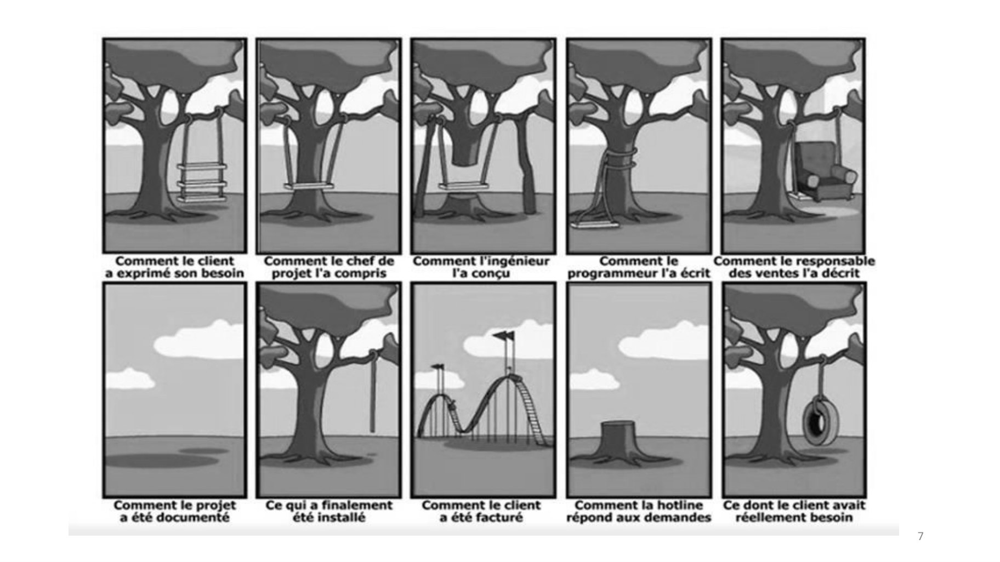

~~~text
7
~~~

## Page 8

~~~text
 Dépassement des délais et des coûts
• En mars 1993, la bourse de Londres a renoncé au projet informatique Taurus
  qui devait assurer complètement le suivi de l’exécution des transactions. Le
  système avait coûté directement 60 millions de livres et les opérateurs sur le
  marché avait dépensé 400 millions de livres pour y adapter leurs propres
  logiciels.

• Toujours en 1993, en Californie, le DMV a renoncé au projet informatique
  démarré 6 ans plus tôt qui devait intégrer les systèmes d’information destinés
  à gérer les immatriculations et les permis. Les coûts étaient de 6,5 fois ceux
  prévus initialement et la date de livraison probable avait été reportée à 1998.

       Source : http://www.dil.univ-mrs.fr/~novelli/GL/COURS/01_Genie_Logiciel.pdf

                                                                                     8
~~~

## Page 9

~~~text
Principales causes de dérives d’un projet
 • Plusieurs incertitudes au lancement d’un projet :
    ▪ Complexité réelle
    ▪ Difficulté et efficacité des technique à mettre en œuvre
    ▪ Charges et budgets estimés
    ▪ Productivité et délais prévisionnels

 • Dérives sont liées à :
    ▪ Mauvaise visibilité
    ▪ Spécifications pas complètes/exhaustives
    ▪ Mauvaise estimation des charges
    ▪ Mauvaise gestion des risques
    ▪ Engagement insuffisant des parties prenantes
    ▪ Exploitation insuffisante des informations remontées

                                                                 9
~~~

## Page 10

~~~text
                          C’est quoi Agile ?

La    méthodologie    agile     est   un   type   de
processus de gestion de projet, principalement
utilisé pour le développement de logiciels. Les
demandes et les solutions évoluent grâce à
l'effort   de   collaboration    d'équipes    auto-
organisées et interfonctionnelles et de leurs
clients.

                                                       10
~~~

## Page 11

~~~text
                     C’est quoi Agile ?

• Approche réactive et itérative d’organisation de travail.

• Focalisée sur la fonctionnalité et satisfaction du client.

• Construit en adéquation avec les capacités et limites humaines.

                                                                    11
~~~

## Page 12

~~~text
     Historique des méthodes agiles
• Années 90
   ▪ Réaction contre les grosses méthodes.
   ▪ Prise en compte de facteurs liés au développement logiciel.

• Fin des années 90
   • Des pratiques liées à des consultants, puis des livres
   • Méthodes / Méthodologies : XP (Extreme Programming), Kanban, Scrum,
     FDD, …

• 2001
   • Manifeste Agile (Agile Manifesto)

• Depuis
   • Les projets « Agiles » mixent des éléments des principales méthodes.
                                                                            12
~~~

## Page 13

~~~text
                   Manifeste Agile
• Texte (l’Agile manifesto) rédigé par 17 experts en 2001 du
  développement d'applications informatiques sous la forme de
  plusieurs méthodes dites agiles.

• Experts estimaient que le traditionnel cycle de développement
  en cascade ne correspondait plus aux contraintes et aux
  exigences des organisations en évolution rapide.

• Les valeurs et principes du Manifeste agile sont défendus par
  l'Agile Alliance.

                                                              13
~~~

## Page 14

~~~text
  Manifeste Agile
Individus et interactions plutôt que Processus et
outils

  Logiciel   opérationnel        plutôt        que
  Documentation exhaustive

  Collaboration avec le      client   plutôt   que
  Négociation du contrat

Réaction au changement plutôt que le suivi d’un
plan
                                               14
~~~

## Page 15

~~~text
                         Manifeste Agile
Individus et interactions : l'auto-organisation et la motivation sont importantes,
tout comme les interactions telles que la colocation et la programmation en
binôme.

Logiciel de travail : un logiciel de travail est plus utile et bienvenu que la simple
présentation de documents aux clients lors de réunions.

Collaboration avec le client : les exigences ne peuvent pas être entièrement
collectées au début du cycle de développement du logiciel, c'est pourquoi la
participation continue du client ou des parties prenantes est très importante.

Réaction au changement : les méthodes agiles sont axées sur les réponses
rapides au changement et le développement continu.
~~~

## Page 16

~~~text
    Manifeste Agile – Les 12 Principes
1. Priorité à la satisfaction du client
L'objectif principal est de livrer rapidement et en continu des solutions qui répondent aux besoins
des clients.
2. Livraison fréquente et incrémentale
Plutôt que de livrer un produit final en une seule fois, les équipes agiles travaillent par itérations
courtes (sprints en Scrum) et livrent des versions fonctionnelles à intervalles réguliers.
3. Collaboration avec les parties prenantes
Le client et les utilisateurs finaux sont impliqués tout au long du projet pour s'assurer que les besoins
sont bien compris et que les ajustements nécessaires sont réalisés.
4. Accueil du changement
Les exigences peuvent évoluer en cours de projet. Agile encourage l’adaptation et l’amélioration
continue en intégrant les feedbacks.
5. Travail en équipe autonome et pluridisciplinaire
Les équipes sont auto-organisées et disposent de toutes les compétences nécessaires pour
développer le produit sans dépendre excessivement d’autres équipes.
6. Communication directe et efficace
Les échanges en face-à-face et les discussions directes sont privilégiés pour éviter les malentendus
et favoriser une meilleure coordination.

                                                                                                      16
~~~

## Page 17

~~~text
    Manifeste Agile – Les 12 Principes
7. Produit fonctionnel comme principal indicateur de progrès
Plutôt que de mesurer l’avancement avec des documents ou des plannings rigides, Agile considère
qu’un produit partiellement opérationnel est un meilleur indicateur de progression.
8. Rythme soutenable et équilibré
L’équipe doit pouvoir travailler à un rythme constant et soutenable à long terme, sans surcharge de
travail, pour garantir une productivité durable.
9. Recherche de l’excellence technique
L’amélioration continue de la qualité du code et des pratiques de développement (tests automatisés,
refactoring, intégration continue) est essentielle pour assurer un produit fiable et évolutif.
10. Simplicité et optimisation
Agile encourage à faire simple et efficace en développant uniquement ce qui est nécessaire, sans
alourdir inutilement le produit.
11. Amélioration continue
Les équipes pratiquent des rétrospectives après chaque cycle pour identifier ce qui fonctionne bien
et ce qui doit être amélioré.
12. Responsabilité et engagement
Les équipes sont responsabilisées sur leurs décisions et participent activement à l’évolution du
projet, ce qui renforce leur motivation et leur engagement.

                                                                                                17
~~~

## Page 18

~~~text
Processus de développement logiciel

                 Expression des besoins

                      Conception

                    Développement

                Tests, recette & debugage
~~~

## Page 19

~~~text
Les solutions agiles - Processus de
      développement logiciel

                         Expression de besoins

                              Conception

                            Développement

                       Tests, recette & debuggage

        i1   i2   i3                                in
~~~

## Page 20

~~~text
Les solutions agiles - Processus de
      développement logiciel
• Toujours focalisées sur le produit final
   ▪ Une vision commune pour l’équipe
       ➢   la satisfaction du client

• Découper le projet autrement
   ▪   par fonctionnalité

• Organiser en cycles de développement réduits
   ▪   itérations
~~~

## Page 21

~~~text
Les solutions agiles - Processus de
      développement logiciel
• Collaboration avec le client
  ▪   Pourquoi on veut des contrats ?
      ➢ Instaurer la confiance autrement
      ➢ Eviter les effets pervers d’un contrat

• Adaptables
  ▪   Réactives aux nouveaux besoins
  ▪   Réceptives aux nouvelles solutions

      ➢ Prendre les décisions définitives le plus tard possible
      ➢ De courtes itérations permettent de changer de direction sans
        laisser des éléments à moitié fait.
~~~

## Page 22

~~~text
 Les solutions agiles - Processus de
       développement logiciel

• L’estimation de charge est difficile, mais les courtes
  itérations nous aident
  ➢ On est plus précis sur les petites tâches
  ➢ Feedback très rapide
  ➢ Plus facile à s’adapter face aux dérives, surprises
~~~

## Page 23

~~~text
                Agile ne signifie pas…
• Pas de planning
• Pas de cahier des charges
• Pas de gestion de projet
• Pas d’attention à la qualité
• Coding pur et dur
• Quick and dirty

   Méthodes Agiles mettent l’accent sur :
• Client
• Rapidité
• Changement
                                         23
~~~

## Page 24

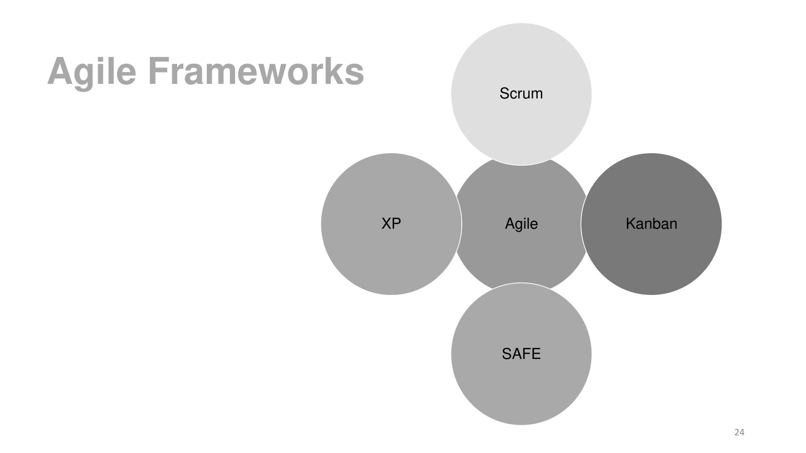

~~~text
Agile Frameworks        Scrum

                   XP   Agile   Kanban

                        SAFE

                                         24
~~~

**Lecture OCR à contrôler**

~~~text
Agile Frameworks

Scrum
~~~

## Page 25

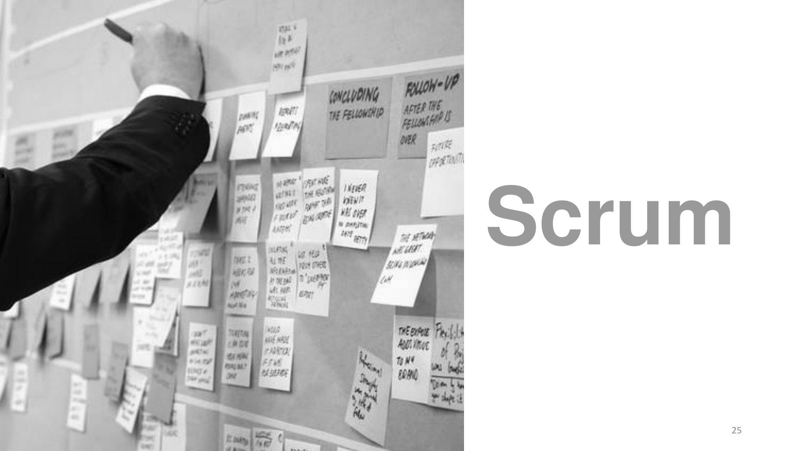

~~~text
Scrum

    25
~~~

## Page 26

~~~text
Quelle est la signification du mot "Scrum" ?
Le mot Scrum est dérivé de l'équipe de rugby.
L'équipe de rugby s'appelle Scrum.
Les membres de l'équipe travaillent ensemble vers un certain objectif,
ils sont regroupés, rassemblés, travaillent dans la même direction, avec
une vision très claire.

Le ballon est lancé en avant, en arrière,
et en travers entre toute l'équipe pour
marquer un but.

                                                                    26
~~~

## Page 27

~~~text
                                        Scrum
Scrum est un framework qui aide les
équipes   à     travailler    ensemble.       Scrum
encourage les équipes à apprendre par
l'expérience, à s'auto-organiser lorsqu'elles
travaillent sur un problème et à réfléchir à
leurs   gains    et   à      leurs   pertes    pour
s'améliorer en permanence.

                                                      27
~~~

## Page 28

~~~text
                          Scrum

Framework de gestion de projet agile et
léger, principalement utilisé pour le
développement de logiciels.

Il décrit une approche itérative     et
incrémentale du travail de projet.

                                          28
~~~

## Page 29

~~~text
        Théorie Scrum
Scrum est fondé sur la théorie du contrôle
empirique des processus, ou empirisme.

L'empirisme affirme que la connaissance
provient de l'expérience et de la prise de
décisions basées sur ce qui est connu. Scrum
utilise une approche itérative et incrémentale
pour optimiser la prévisibilité et contrôler le
risque.

Les piliers de Scrum soutiennent chaque mise
en œuvre du contrôle empirique des
processus : Transparence, Inspection et
Adaptation.
                                                  29
~~~

## Page 30

~~~text
                          Piliers de Scrum
Transparence
Les aspects significatifs du processus doivent être visibles pour les personnes
responsables du résultat. Aspects définis par une norme commune Les observateurs
partagent une compréhension commune de ce qui est vu.
Exemple : L'incrément résultant doit partager une définition commune de "Done".

Inspection
Les utilisateurs de Scrum doivent fréquemment inspecter les artefacts de Scrum et la
progression vers un objectif de sprint afin de détecter les écarts indésirables.

Adaptation
Si des aspects d'un processus s'écartent des limites acceptables, et que le produit qui
en résulte sera inacceptable. Le processus ou le matériel traité doit être ajusté. Un
ajustement doit être effectué dès que possible afin de minimiser toute déviation
supplémentaire.
                                                                                   30
~~~

## Page 31

~~~text
Valeurs de Scrum
        •   Les membres de l'équipe Scrum ont le courage de faire ce
            qu'il faut et de travailler sur des problèmes difficiles.

        •   Chacun se concentre sur le travail du sprint et sur les
            objectifs de l'équipe Scrum.

        •   Les personnes s'engagent personnellement à atteindre les
            objectifs de l'équipe de mêlée et à se soutenir
            mutuellement.

        •   Les membres de l'équipe Scrum se respectent
            mutuellement en tant que personnes compétentes et
            indépendantes.

        •   L'équipe Scrum et les parties prenantes conviennent de
            faire preuve d'ouverture à l'égard de l'ensemble du travail et
            des difficultés rencontrées dans l'exécution de ce travail.
~~~

## Page 32

~~~text
      Principaux composants de Scrum
Roles
▪   Product owner
▪   ScrumMaster
▪   Developers

                    Events
                    ▪   Sprint planning
                    ▪   Sprint review
                    ▪   Sprint retrospective
                    ▪   Daily scrum meeting

                                           Artifacts
                                          ▪    Product backlog
                                          ▪    Sprint backlog
                                          ▪    Increment
                                                                 32
~~~

## Page 33

~~~text
     Processus logiciel Scrum

• Une phase d’idéation
• Une succession de sprints de taille fixe
• Chaque sprint produit un logiciel fonctionnel
• Chaque sprint réalise toutes les activités de
  développement logiciel
• Les sprints sont groupés en Releases (de taille fixe)

                                                          33
~~~

## Page 34

~~~text
                                  Sprint

• Un sprint se décompose en un ensemble de tâches
• Un sprint est une période de développement de taille fixe (en moyenne 2 à
  4 semaines)
    • Durée fixe, équipe stable
• Chaque release est décomposée en sprints au cours de l’activité de
  planification de la release (la première fois « sprint zéro »)
• Mêlée journalière : réunion d’équipe pour faire le point sur le travail réalisé
  depuis le début du sprint et le travail à réaliser avant la fin du sprint
• Chaque sprint termine par :
   • une revue du produit
   • une rétrospective sur le processus
                                                                               34
~~~

## Page 35

~~~text
            Périodes d’une Release

• La période avant le premier sprint de développement, appelée
  « sprint zéro » : planification de la release en plusieurs sprints
• La période des sprints (de développement)
• La période après le dernier sprint et avant la fin de la release

                                                                       35
~~~

## Page 36

~~~text
Processus logiciel Scrum
                                                                                       Client- User
 Projet
                       Vision/Idéation            Sprint 0

                                                                                         Manager
 Release

              Planification         Solidification             Validation
              de la release         d’une release            d’une release
                                                                                       Product owner

     Sprint

                                                                                        Scrum master
   Planification          Exécution                 Revue              Rétrospective
    d’un sprint           d’un sprint             d’un sprint           d’un sprint

                                        2-4 semaines
                                                                                        Développeur

                                                                                                       36
~~~

## Page 37

~~~text
Release Scrum vs. Release traditionnelle
            sprint 1        sprint 2       sprint 3      sprint 4        sprint 5
              Besoin         Besoins        Besoins        Besoins         Besoins
              Analyse        Analyse        Analyse        Analyse         Analyse
            Codification   Codification   Codification   Codification    Codification
               Tests          Tests          Tests          Tests           Tests

                                 Cycle SCRUM

       Besoins         Analyse            Codification                  Tests

                                  Cycle séquentiel

                                                                                        37
~~~

## Page 38

~~~text
Release Scrum vs. Release traditionnelle
• Traditionnellement, une release (livrable) correspond à une nouvelle
  version d’un logiciel
   • Incrément fonctionnel (une release correspond à la réalisation d’un objectif
     fonctionnel)
   • Evolution technique

• SCRUM
   • Une release :
      • correspond à la livraison d’une feature (fonctionnalité)
      • travail réalisé pendant une période de temps fixe qui comprend plusieurs sprints
      • pour faire coïncider ces deux objectifs, on décompose/regroupe les features
   • Mais une nouvelle version du produit (livrable) peut-être produite à la fin de
     n’importe quel sprint

                                                                                           38
~~~

## Page 39

~~~text
                                            Sprint

Backlog : carnet, liste ordonnée de « choses » à faire (user stories, tâches)
                                                                                39
~~~

## Page 40

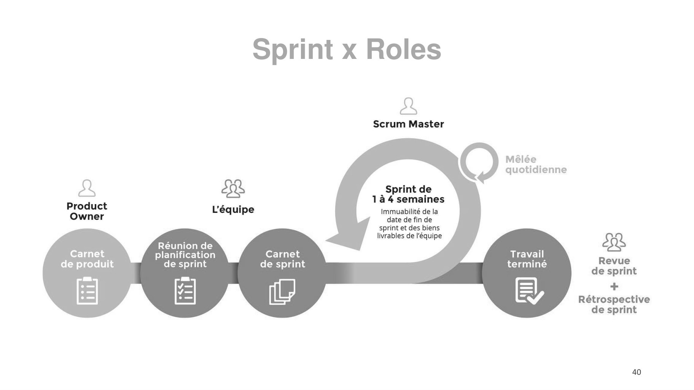

~~~text
Sprint x Roles

                 40
~~~

**Lecture OCR à contrôler**

~~~text
Sprint x Roles

&

Scrum Master

Mêlée
quotidienne

Sprint de
1 à 4 semaines
Immuabilité de la
date de fin de
sprint et des biens
livrables de l'équipe

2 BR
Product ré
ee kéquipe

SR

Travail
Revue

Réunion de

F br HEUNENE RE ail
e produit e sprin e sprint terminé de sprint
*
E, Rétrospective
de sprint

40
~~~

## Page 41

~~~text
Scrum
Roles
        41
~~~

**Lecture OCR à contrôler**

~~~text
Roles
~~~

## Page 42

~~~text
    Principaux composants de Scrum
Roles
▪ Product owner
▪ ScrumMaster
▪ Developers
                  Events
                  ▪   Sprint planning
                  ▪   Sprint review
                  ▪   Sprint retrospective
                  ▪   Daily scrum meeting

                                     Artifacts
                                    ▪ Product backlog
                                    ▪ Sprint backlog
                                    ▪ Increment
~~~

## Page 43

~~~text
Scrum Roles : Acteurs
                        Parties prenantes

                                            Developers   43
~~~

## Page 44

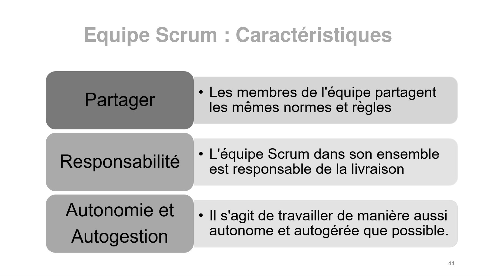

~~~text
Equipe Scrum : Caractéristiques

                                  44
~~~

**Lecture OCR à contrôler**

~~~text
Equipe Scrum : Caractéristiques

* Les membres de l'équipe partagent
les mêmes normes et règles

¢ L'équipe Scrum dans son ensemble
est responsable de la livraison

* Il s'agit de travailler de manière aussi
autonome et autogérée que possible.

44
~~~

## Page 45

~~~text
   Principaux composants de Scrum
Roles
▪ Product owner
▪ ScrumMaster
▪ Developers
                  Events
                  ▪   Sprint planning
                  ▪   Sprint review
                  ▪   Sprint retrospective
                  ▪   Daily scrum meeting

                                         Artifacts
                                        ▪ Product backlog
                                        ▪ Sprint backlog
                                        ▪ Increment
~~~

## Page 46

~~~text
   Scrum Roles : Product Owner
Qui ?
L'unique personne responsable de la gestion du Backlog de produit
Il est UNE PERSONNE / Équipe

Attentes :
Agir comme le propriétaire ultime du produit. Même le plus haut dirigeant de
l'entreprise doit soutenir le Product Owner dans son rôle de propriétaire du produit.

Maximiser la valeur du produit en collaborant constamment avec les parties
prenantes et en définissant les besoins du produit.

                                                                                        46
~~~

## Page 47

~~~text
        Scrum Roles : Product Owner

•   Porteur de la vision globale du produit
•   Gère le Backlog du Produit
•   Défini des priorités
•   Accepte ou Rejette les livrables
~~~

## Page 48

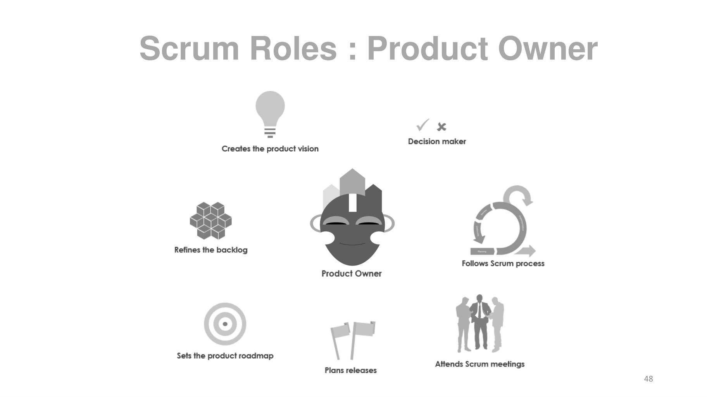

~~~text
Scrum Roles : Product Owner

                              48
~~~

**Lecture OCR à contrôler**

~~~text
Scrum Roles : Product Owner
~~~

## Page 49

~~~text
     Principaux composants de Scrum
Roles
▪ Product owner
▪ ScrumMaster
▪ Developers
                  Events
                  ▪   Sprint planning
                  ▪   Sprint review
                  ▪   Sprint retrospective
                  ▪   Daily scrum meeting

                                         Artifacts
                                        ▪ Product backlog
                                        ▪ Sprint backlog
                                        ▪ Increment
~~~

## Page 50

~~~text
  Scrum Roles : Scrum master
En gros, le Scrum Master a pour mission de veiller à ce que l'équipe de développement
adhère à la théorie, aux pratiques et aux règles de Scrum.
Le Scrum Master fait partie de l'équipe Scrum et agit comme un leader serviteur pour
l'équipe Scrum.

Le Scrum Master aide les personnes extérieures à l'équipe Scrum à comprendre
quelles interactions avec l'équipe Scrum sont utiles et lesquelles ne le sont pas.

Comme il est crucial que la confiance règne entre le Scrum Master et les autres
membres de l'équipe, l'idéal serait que l'équipe de développement choisisse elle-même
le Scrum Master. Cependant, dans la réalité, c'est le plus souvent la direction qui choisit
le Scrum Master.
~~~

## Page 51

~~~text
  Scrum Roles : Scrum master
Le Scrum Master a plusieurs responsabilités importantes :

 • Protéger l'équipe de développement contre les demandes et les perturbations
   externes.
 • Agir en tant qu'agent de changement et adapter les processus pour maximiser la
   productivité de l'équipe.
 • coacher l'équipe de développement
 • Supprimer les obstacles pour l'équipe de développement
 • Assurer une communication efficace entre l'équipe de développement et le Product
   Owner de Scrum.
 • Faciliter les différents événements Scrum

Afin d'accomplir efficacement ces tâches, un certain nombre de compétences sont utiles :

 • Modération
 • Coaching
 • Savoir-faire en matière de développement
~~~

## Page 52

~~~text
    Principaux composants de Scrum
Roles
▪ Product owner
▪ ScrumMaster
▪ Developers
                  Events
                  ▪   Planification du sprint
                  ▪   Réunion quotidienne de la mêlée
                  ▪   Revue du sprint
                  ▪   Rétrospective du sprint

                                        Artifacts
                                        ▪ Product backlog
                                        ▪ Sprint backlog
                                        ▪ Increment
~~~

## Page 53

~~~text
                Scrum Roles : Développeurs

Une équipe chargée d'effectuer tout le travail pour
produire    une     ou     plusieurs     tranches     de
fonctionnalité du produit fonctionnel à chaque
sprint, y compris la conception, le développement,
l'intégration et les tests de cette fonctionnalité.

                                                           53
~~~

## Page 54

~~~text
        Scrum Roles : Développeurs
L’équipe :

  • 5 à 8 personnes
  • Autogérée ; les décisions sont prises collectivement
  • Contient toutes les compétences nécessaires pour terminer le sprint
  • Ne change pas pendant un Sprint

                                                                          54
~~~

## Page 55

~~~text
Scrum Roles : Développeurs

               Dans Scrum, tout le travail fourni au
               client est effectué par des équipes
               de développement spécialisées.

               Une équipe de développement est
               un ensemble d'individus travaillant
               ensemble pour livrer les incréments
               de produit demandés et engagés.
~~~

## Page 56

~~~text
           Scrum Roles : Développeurs

        Autogestion :                      Transversale :
Ils décident en interne de qui       Les membres ont toutes les
fait quoi, quand et comment.       compétences nécessaires pour
                                 créer de la valeur à chaque Sprint.

                                                               56
~~~

## Page 57

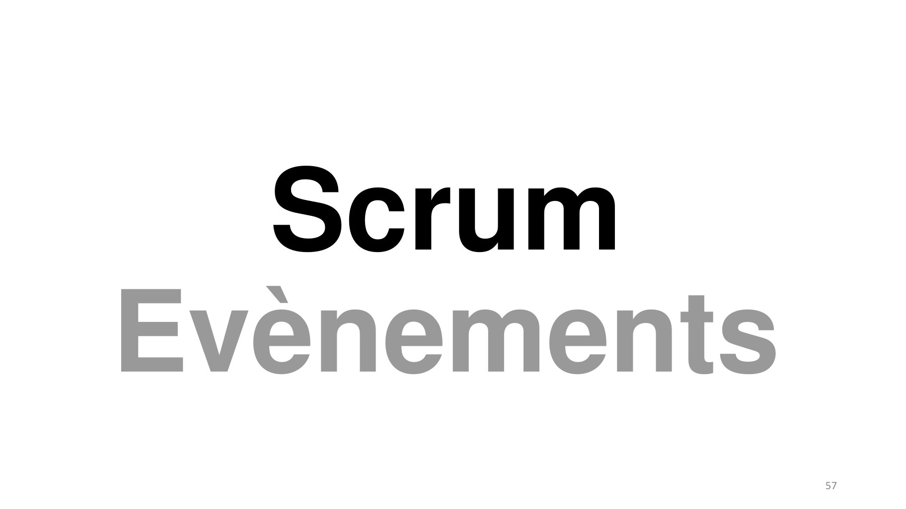

~~~text
  Scrum
Evènements
             57
~~~

**Lecture OCR à contrôler**

~~~text
Scrum
Evènements
~~~

## Page 58

~~~text
   Principaux composants de Scrum
Roles
▪ Product owner
▪ ScrumMaster
▪ Developers
                  Events
                  ▪   Planification du sprint
                  ▪   Réunion quotidienne
                  ▪   Revue du sprint
                  ▪   Rétrospective du sprint

                                                Artifacts
                                                ▪ Product backlog
                                                ▪ Sprint backlog
                                                ▪ Increment
~~~

## Page 59

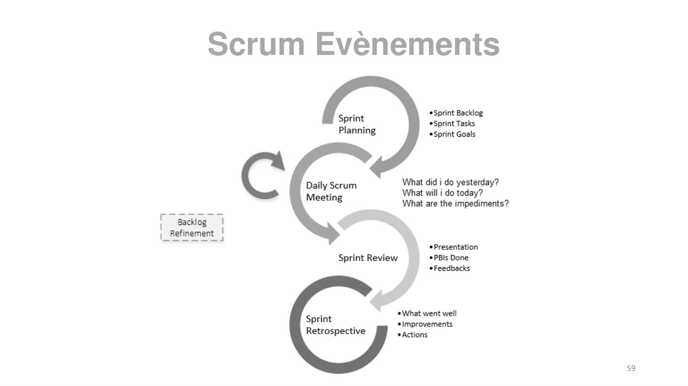

~~~text
Scrum Evènements

                   59
~~~

**Lecture OCR à contrôler**

~~~text
Scrum Evènements

. «Sprint Backlog
Sprint «Sprint Tasks
Planning *Sprint Goals

What did i do yesterday?
What will i do today?
What are the impediments?

Daily Scrum
Meeting

a Backlog |
\_Refinement |
«Presentation
Sprint Review *PBis Done
*Feedbacks
Sprint + What went well
pan s *Improvements
Retrospective Actions

59
~~~

## Page 60

~~~text
                                            Sprint ?
• Le sprint est le cœur de Scrum.

• Le sprint est limité dans le temps : il ne
  peut pas durer plus d'un mois.

• Un incrément est livré à la fin de chaque
  sprint.

• Seul le propriétaire du produit peut
  annuler un sprint (généralement lorsque
  l'objectif du sprint devient obsolète).

• Le sprint comprend tous les événements
  et le travail de développement.
                                                       60
~~~

## Page 61

~~~text
         La réunion de planification du Sprint
• La planification d'un sprint est limitée à un maximum de huit
  heures pour un sprint d'un mois.
• Pour les Sprints plus courts, l'événement est généralement
  plus court.

• La réunion est composée de 3 sujets :
 Pourquoi, Quoi et Comment.

• Toute l'équipe Scrum est invitée à y participer.

• Les membres extérieurs à l'équipe peuvent y participer, à la
  demande d'un membre de l'équipe de Scrum.                       61
~~~

## Page 62

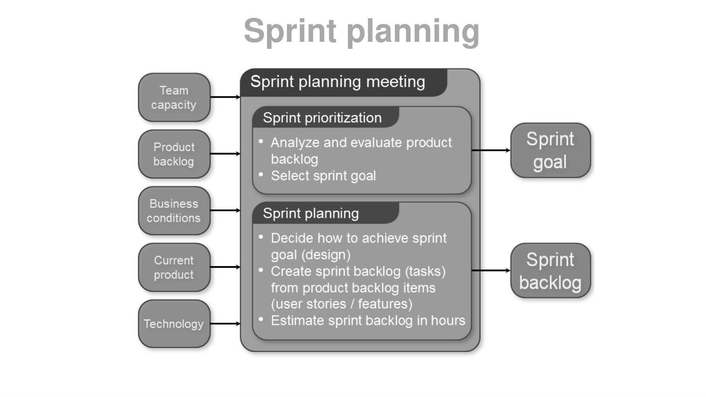

~~~text
Sprint planning
~~~

**Lecture OCR à contrôler**

~~~text
Sprint planning

Sprint planning meeting

Team
capacity
Sprint prioritization
PIOOICE * Analyze and evaluate product

backlog backlog
* Select sprint goal

Business : :
none Sprint planning
* Decide how to achieve sprint
Conent goal (design) Sprint
* Create sprint backlog (tasks) F
from product backlog items backlog
(user stories / features)

* Estimate sprint backlog in hours

product

Technology
~~~

## Page 63

~~~text
                                   The Sprint Backlog
Le Sprint Backlog est un artefact dynamique et est mis à
jour quotidiennement.

Si un membre de l'équipe commence à travailler sur une
activité, son nom est enregistré dans le backlog du sprint.

À la fin de la journée, tous les efforts restants sont mis à jour
et cela définit la quantité de travail restant jusqu'à ce que
l'objectif du sprint soit atteint.

La définition de ce qui est fait est utilisée pour décider si un
élément est fait ou non.

Le Sprint Backlog peut être conservé électroniquement, par
exemple dans une feuille Excel, ou avec des cartes sur un
tableau de tâches. Cette dernière solution présente certains
avantages (transparence et facilité d'accès) mais ajoute une
complexité supplémentaire si l'équipe de développement est
répartie sur plusieurs sites.
~~~

## Page 64

~~~text
     Principaux composants de Scrum
Roles
▪ Product owner
▪ ScrumMaster
▪ Developers
                  Events
                  ▪   Planification du sprint
                  ▪   Réunion Scrum quotidienne
                  ▪   Revue du sprint
                  ▪   Rétrospective du sprint

                                          Artifacts
                                          ▪ Product backlog
                                          ▪ Sprint backlog
                                          ▪ Increment
~~~

## Page 65

~~~text
                  Réunion Scrum quotidienne

La réunion quotidienne de Scrum est une réunion quotidienne de 15 minutes.

Pour réduire la complexité, elle se tient à la même heure et au même endroit.

Chaque membre de l'équipe qui travaille à l'achèvement d'un sprint donné doit y participer.

Le scrum master peut assister à la réunion quotidienne pour s'assurer que les développeurs ont la réunion et
la maintenir dans les 15 minutes.

Au cours de cette réunion, chaque développeur doit répondre brièvement aux trois questions suivantes :
1. Qu'est-ce que j'ai fait hier qui a aidé les développeurs à atteindre l'objectif du sprint ?
2. Que vais-je faire aujourd'hui pour aider les développeurs à atteindre l'objectif du sprint ?
3. Est-ce que je vois un obstacle qui m'empêche ou empêche les développeurs d'atteindre l'objectif du
    sprint ?
~~~

## Page 66

~~~text
        Principaux composants de Scrum
Roles
▪ Product owner
▪ ScrumMaster
▪ Developers
                  Events
                  ▪   Planification du sprint
                  ▪   Réunion Scrum quotidienne
                  ▪   Revue du sprint
                  ▪   Rétrospective du sprint

                                           Artifacts
                                           ▪ Product backlog
                                           ▪ Sprint backlog
                                           ▪ Increment
~~~

## Page 67

~~~text
                            Revue du sprint
• Une réunion qui a lieu à la fin du sprint.

• Une réunion de 4 heures pour un sprint
  qui dure un mois.

• Une réunion à laquelle les parties
  prenantes et l'équipe Scrum sont
  tenues d'assister.

• Pendant cette réunion, l'équipe de
  Scrum et les parties prenantes
  inspectent ce qui a été fait et
  déterminent ce qu'il faut faire ensuite.
                                               67
~~~

## Page 68

~~~text
    Principaux composants de Scrum
Roles
▪ Product owner
▪ ScrumMaster
▪ Developers
                  Events
                  ▪   Planification du sprint
                  ▪   Réunion Scrum quotidienne
                  ▪   Revue du sprint
                  ▪   Rétrospective du sprint

                                                  68
~~~

## Page 69

~~~text
                          Sprint Retrospective
• La rétrospective du sprint est une occasion
  formelle où l'équipe Scrum s'inspecte et crée
  un plan d'amélioration pour le prochain sprint.

• Il s'agit d'une réunion de trois heures pour les
  Sprints d'un mois. Pour les Sprints plus courts,
  l'événement est généralement plus court.

• Le Scrum Master encourage l'équipe Scrum à
  améliorer son processus et ses pratiques de
  développement.

                                                     69
~~~

## Page 70

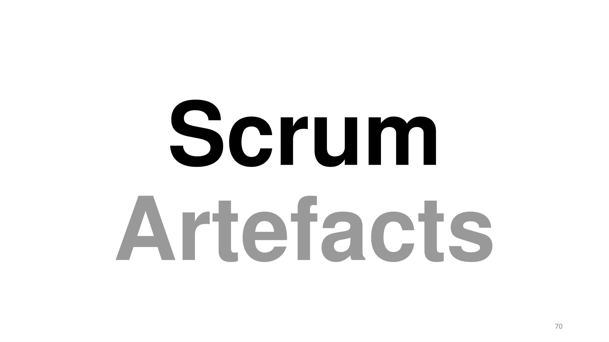

~~~text
 Scrum
Artefacts
            70
~~~

**Lecture OCR à contrôler**

~~~text
Scrum
Artefacts
~~~

## Page 71

~~~text
                        Scrum Artefacts

Les artefacts de Scrum représentent le
travail ou la valeur afin de fournir une
transparence      et   des    possibilités
d'inspection et d'adaptation.

Les artefacts définis par Scrum sont
spécifiquement conçus pour maximiser
la transparence des informations clés
afin que tout le monde ait la même
compréhension de l'artefact.

                                             71
~~~

## Page 72

~~~text
    Principaux composants de Scrum
Roles
▪ Product owner
▪ ScrumMaster
▪ Developers
                  Events
                  ▪   Sprint planning
                  ▪   Daily scrum meeting
                  ▪   Sprint review
                  ▪   Sprint retrospective

                                             Artefacts
                                             ▪ Product backlog
                                             ▪ Sprint backlog
                                             ▪ Increment
~~~

## Page 73

~~~text
          Scrum Artefacts : Product Backlog
• Le Backlog de produit est une liste ordonnée
  de tout ce qui est connu pour être
  nécessaire dans le produit.

• Il s'agit de la source unique d'exigences
  pour toute modification à apporter au
  produit.

•     Le Product Owner est responsable du
    Product Backlog, y compris de son contenu,
    de    sa   disponibilité   et   de     son
    ordonnancement.

                                                 73
~~~

## Page 74

~~~text
        Affinement du Backlog de produit
Le affinement du Backlog de produit est l'acte d'ajouter des détails, des estimations et un ordre aux
éléments du Backlog de produit.

Il s'agit d'un processus continu dans lequel le Product Owner et les développeurs collaborent sur
les détails des éléments du Product Backlog.

Les développeurs sont responsables de toutes les estimations. Le Product Owner peut influencer
les développeurs en les aidant à comprendre et à choisir les compromis, mais ce sont les
personnes qui effectueront le travail qui font l'estimation finale.

L'équipe Scrum décide comment et quand le raffinement est effectué. Cependant, les éléments du
Backlog de produit peuvent être mis à jour à tout moment par le propriétaire du produit.

Le raffinement ne consomme généralement pas plus de 10 % de la capacité des développeurs.

Les éléments du Product Backlog de rang supérieur sont généralement plus clairs et plus détaillés
que ceux de rang inférieur.
~~~

## Page 75

~~~text
    Principaux composants de Scrum
Roles
▪ Product owner
▪ ScrumMaster
▪ Developers
                  Events
                  ▪   Sprint planning
                  ▪   Daily scrum meeting
                  ▪   Sprint review
                  ▪   Sprint retrospective

                                             Artifacts
                                             ▪ Product backlog
                                             ▪ Sprint backlog
                                             ▪ Increment
~~~

## Page 76

~~~text
      Scrum Artefacts : Sprint Backlog

• Le Sprint Backlog est l'ensemble des éléments
  du Product Backlog sélectionnés pour le Sprint,
  plus un plan pour livrer l'incrément de produit et
  réaliser l'objectif du Sprint.

• Le Sprint Backlog est une prévision par les
  développeurs de la fonctionnalité qui sera dans
  le prochain incrément et le travail nécessaire
  pour livrer cette fonctionnalité dans un incrément
  "fait".

                                                       76
~~~

## Page 77

~~~text
           Scrum Artefacts : Sprint Backlog
Dans le sprint Backlog, toutes les activités requises
pour compléter les entrées engagées du Product
backlog Scrum sont stockées.

Toutes les entrées doivent être estimées sur une
base d'heures-personnes afin de suivre les progrès et
les efforts restants.

Le Sprint Backlog est un artefact dynamique et est
mis à jour quotidiennement.

Si un membre de l'équipe commence à travailler sur
une activité, son nom est enregistré dans le sprint     Tableau de tâches
Backlog.
~~~

## Page 78

~~~text
           Scrum Artefacts : Sprint Backlog
À la fin de la journée, tous les efforts restants sont
mis à jour et cela définit la quantité de travail restant
jusqu'à ce que l'objectif du sprint soit atteint.

La définition de ce qui est fait est utilisée pour décider
si un élément est fait ou non.

Le Sprint Backlog peut être conservé sous forme
électronique (exemple : dans une feuille Excel ou
sous forme de cartes sur un tableau de tâches –
outils: Trello, Notion, Teams, etc).

Cette dernière solution présente certains avantages
                                                             Tableau de tâches
(transparence et facilité d'accès) mais ajoute une
complexité    supplémentaire      si   l'équipe  de
développement est répartie sur plusieurs sites.
~~~

## Page 79

~~~text
    Principaux composants de Scrum
Roles
▪ Product owner
▪ ScrumMaster
▪ Developers
                  Events
                  ▪   Sprint planning
                  ▪   Daily scrum meeting
                  ▪   Sprint review
                  ▪   Sprint retrospective

                                             Artifacts
                                             ▪ Product backlog
                                             ▪ Sprint backlog
                                             ▪ Increment
~~~

## Page 80

~~~text
                Scrum Artefacts : Increment
• L'incrément est la somme de tous les
  éléments du product Backlog achevés
  pendant un Sprint et la valeur des
  incréments de tous les Sprints précédents.

• L'incrément doit être dans un état
  utilisable, que le Product Owner décide ou
  non de le livrer.

• Le travail ne peut être considéré comme
  faisant partie d'un incrément que s'il
  répond à la définition de Done.

                                               80
~~~

## Page 81

~~~text
                           Définition de Done

• DoD est l'engagement pour l'incrément.

• La DoD est une check liste des types de travaux
  que l'équipe est censée terminer avec succès
  avant de pouvoir déclarer son travail comme
  potentiellement expédiable.

• Dans une définition de Done, les conditions sont
  exprimées par le besoin d'être satisfait pour un
  incrément de produit afin qu'il soit "expédiable".

                                                       81
~~~

## Page 82

~~~text
 Feature
User Story
             82
~~~

**Lecture OCR à contrôler**

~~~text
Feature
User Story
~~~

## Page 83

~~~text
               Fonctionalité (Feature)

• Une feature (fonctionalité) est un service ou une fonctionnalité du produit
  à développer.

• Elle se décompose en stories (histoires) de tailles différentes. On
  distingue :
   • Les stories complexes (épiques) qui seront affinées en stories plus simples.
   • Les stories atomiques qui ne se décomposent pas et sont réalisées dans les
     sprints.

                                                                                    83
~~~

## Page 84

~~~text
      Workflow d’une feature
opportunité   prévue pour la release      en affinage   minimisée   testée   déployée

                                       Tableau des features

                                                                                        84
~~~

## Page 85

~~~text
                 Workflow d’une feature
• Opportunité : idée de feature qui présente une opportunité pour le produit.

• Prévue pour la release : l’étude d’opportunité a abouti, et la feature est prévue
  pour la release en cours.

• En affinage : initialement sous forme d’épique, est décomposée en stories.

• Minimisée : Minimal Maketable Feature.

• Testée : … avec des stories finies.

• Déployée : utilisable par des utilisateurs qui peuvent fournir du feedback.

                                                                                 85
~~~

## Page 86

~~~text
Story map : Décomposition d’une feature
               en stories

                                                   Séquence d’usage

                   Feature 1                           Feature 2               Feature 3
     Nécessité

                 Story A       Story B   Story C    Story G        Story I   Story H       Story J   Story K

                 Story O       Story P              Story D                  Story E       Story F

                 Story R                            Story S        Story Q

                                                                                                               86
~~~

## Page 87

~~~text
Exemple : Créer le prochain email de client concurrent

   http://winnipegagilist.blogspot.com/2012/03/how-to-create-user-story-map.html   87
~~~

## Page 88

~~~text
                               User Story
• Définition (User-story)
Une user-story (récit utilisateur) est une phrase simple décrivant une
fonctionnalité du logiciel à développer.

• Idéalement, la phrase contient trois éléments descriptifs :
   ▪ qui ? quoi ? et pourquoi ?
   ▪ En tant que < qui >, je veux < quoi > afin de < pourquoi >.

• Exemple (User-story) :
  En tant qu’utilisateur, je veux pouvoir taper un mot clé afin d’obtenir
                          une liste de pages web.

                                                                        88
~~~

## Page 89

~~~text
                            User Story

Les user stories sont des descriptions courtes
et simples d'une fonctionnalité racontée du
point de vue de la personne qui désire cette
nouvelle fonctionnalité, généralement un
utilisateur ou un client du système. Elles
suivent généralement un modèle simple :

             En tant que < rôle >,
               je veux < besoin >
            de façon à < bénéfice >.

                                                 89
~~~

## Page 90

~~~text
                                User Story
• Ecrites par le Product Owner.

• Très simples.

• Focalisées sur l'utilisateur final
   ▪ valeur métier apportée.

• Critères d'acceptations
   ▪ testable, définit le « Done ».

• Laisse place à la discussion pour les détails
   ▪ individus et interactions : une user story est une promesse d’une rencontre
      future.

                                                                                   90
~~~

## Page 91

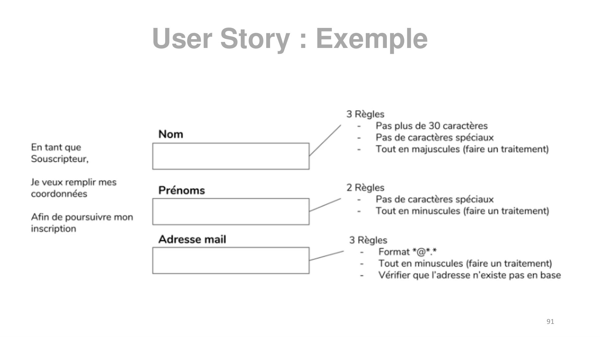

~~~text
User Story : Exemple

                       91
~~~

**Lecture OCR à contrôler**

~~~text
En tant que
Souscripteur,

Je veux remplir mes
coordonnées

Afin de poursuivre mon
inscription

User Story : Exemple

3 Règles
- Pas plus de 30 caractères
Nom - Pas de caractères spéciaux
- Tout en majuscules (faire un traitement)

Prénoms 2 Règles
- Pas de caractères spéciaux
EE oe - Tout en minuscules (faire un traitement)
Adresse mail 3 Règles
- Format *@*.*

- Tout en minuscules (faire un traitement)
- Vérifier que l'adresse n'existe pas en base

91
~~~

## Page 92

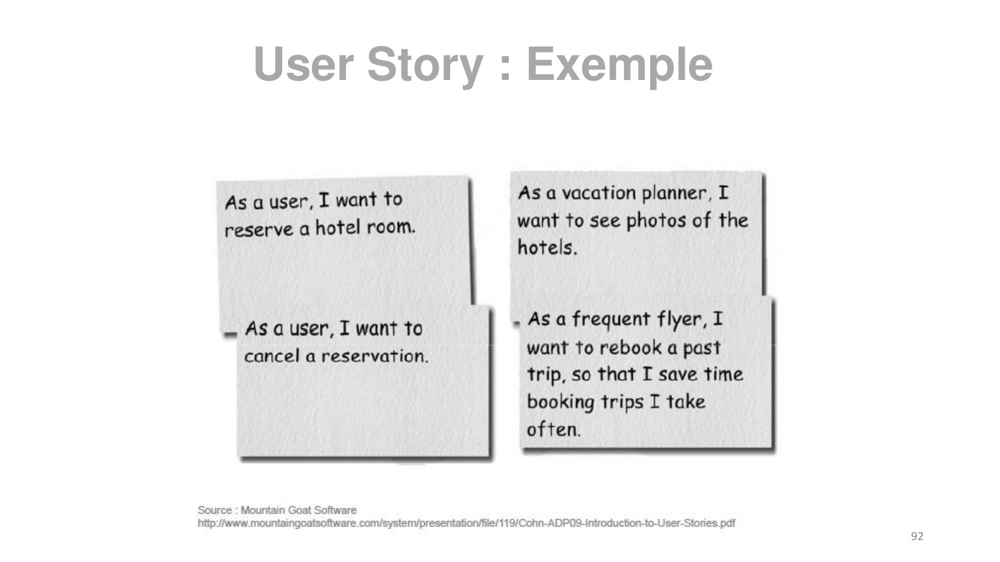

~~~text
User Story : Exemple

                       92
~~~

**Lecture OCR à contrôler**

~~~text
User Story : Exemple

As a vacation planner, I
want to see photos of the

hotels.

As a user, I want to
reserve a hotel room.

_ AS a user, I want to ~ As a frequent flyer, I
cancel a reservation. want to rebook a past
trip, so that I save time
booking trips I take
often.

Source : Mountain Goat Software
http://www.mountaingoatsoftware.com/systenyv/presentation/file/119/Cohn-ADP03-introduction-to-User-Stones.pdf

92
~~~

## Page 93

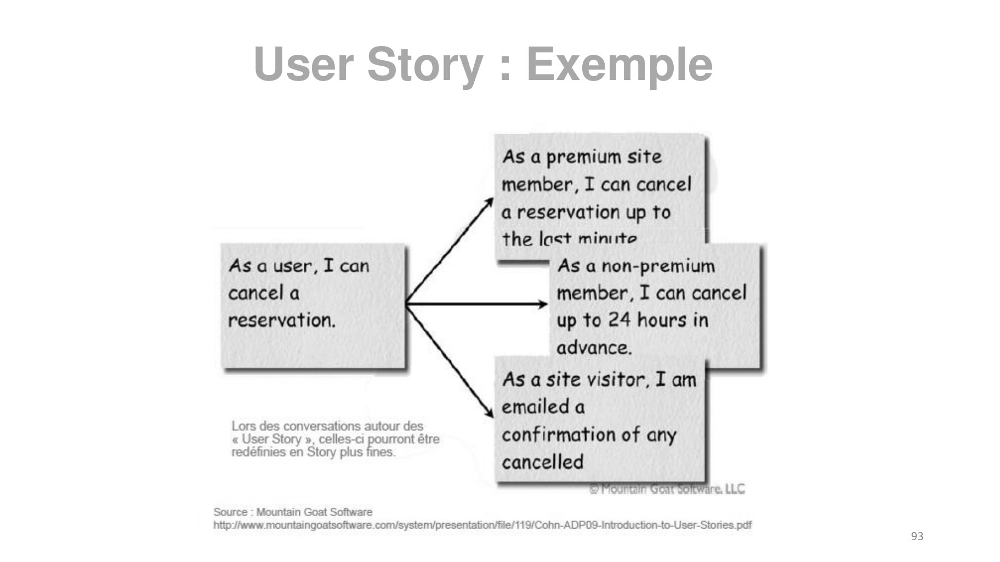

~~~text
User Story : Exemple

                       93
~~~

**Lecture OCR à contrôler**

~~~text
User Story : Exemple

As a premium site
member, I can cancel

a reservation up to

the last minute

mrs As a non-premium

As a user, I can

cancel a member, I can cancel
reservation. up to 24 hours in
advance.

As a site visitor, I am
emailed a

Mg Serve, caloee penne eh confirmation of any

redéfinies en Story plus fines.
cancelled

are, LLC

Source : Mountain Goat Software
http//www.mountaingoatsoftware com/system/presentationffile/119/Cohn-ADP09-Introduction-to-User-Stories.pdf

93
~~~

## Page 94

~~~text
                       User Story

• Une bonne user story sera : compacte, testable, estimable,
  portera de la valeur, négociable, indépendante.

• Elle sera comprise par toute la population qui gravite autour et
  dans le projet.

• Les User Story encouragent à ne pas entrer dans le détail tant
  que cela n'est pas nécessaire.

                                                                     94
~~~

## Page 95

~~~text
                              User Story
• Une user story se passe avec le Product Owner, seul ou en équipe.

• La richesse du modèle: on travaille sur deux Axes :
   ▪ l’axe horizontal, l’axe USAGE (temporel) fondée sur l’analyse de l’activité et
     l’analyse fonctionnelle ;
   ▪ l’axe vertical, l’axe PRIORITE, qui servira à décortiquer les activités, en
     stories, plus ou moins détaillées et rangées par ordre d’importance pour
     l’activité.

• La User Story la plus nécessaire à la réalisation de son Activité est
  placée le plus haut, les autres suivront par ordre d’importance.

                                                                                      95
~~~

## Page 96

~~~text
                       User Story

La rédaction d’une User Story se fait en trois étapes
incrémentales appelées les 3C (Card, Conversation and
Confirmation), et assurent :

• Une description du besoin ;
• Une négociation en vue d’une définition du besoin ;
• Une définition des critères d’acceptabilité.

                                                        96
~~~

## Page 97

~~~text
                                         User Story
• Plan type
    ▪ En tant que <acteur>, je veux <un but> [afin de <une justification>]
         En tant que client, je veux pourvoir accéder au site de ma banque afin de gérer mon compte sur Internet.

• Priorité

• Nombre de points
   ▪ Représente le niveau de difficulté intrinsèque, en fonction de la taille et de la valeur métier
        ✓ Corrélées en moyenne, mais pas toujours (en fonction d’une forte valeur métier, de la réutilisation
          possible de composants …)

• Conditions d’acceptation
   ▪ Etant donné <le contexte> quand je <événement> alors <résultat>
           Etant donné que je suis sur la page de connexion et que j’ai entré un login et un mot de passe dans le
         formulaire et que le login et le mot de passe correspondent à un utilisateur enregistré, quand je clique sur
                             le bouton “Se connecter” alors j’arrive sur la page d’accueil du site.

                                                                                                                97
~~~

## Page 98

~~~text
Post-it complet de story

                                           Numéro des stories
Numéro de story                            pré-requises

                                           Importance
                                           pour le client (/5)
 Durée estimée

                  Points/Difficulté (/5)

                                                                 98
~~~

## Page 99

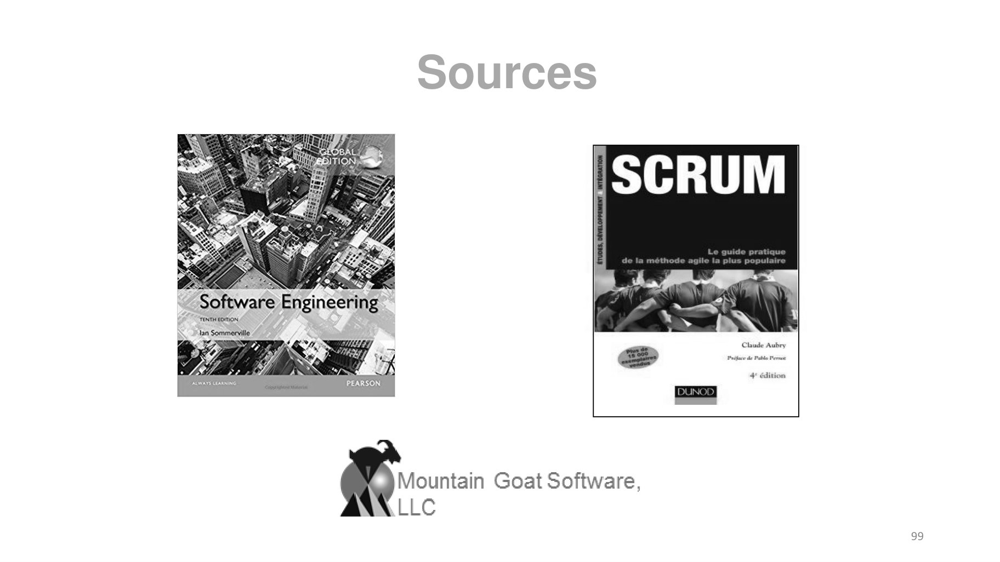

~~~text
Sources

          99
~~~

**Lecture OCR à contrôler**

~~~text
Mountain Goat Software,
LLC

99
~~~

## Page 100

~~~text
                            Liens utiles
Agile glossary :
https://www.volkerdon.com/pages/agile-glossary

Scrum :
https://www.scrum.org/

Scrum Guide : https://scrumguides.org/docs/scrumguide/v2020/2020-Scrum-
Guide-French.pdf

Scrum Quiz:
https://mlapshin.com/index.php/scrum-quizzes/
https://www.scrum.org/open-assessments/scrum-open
                                                                          100
~~~
