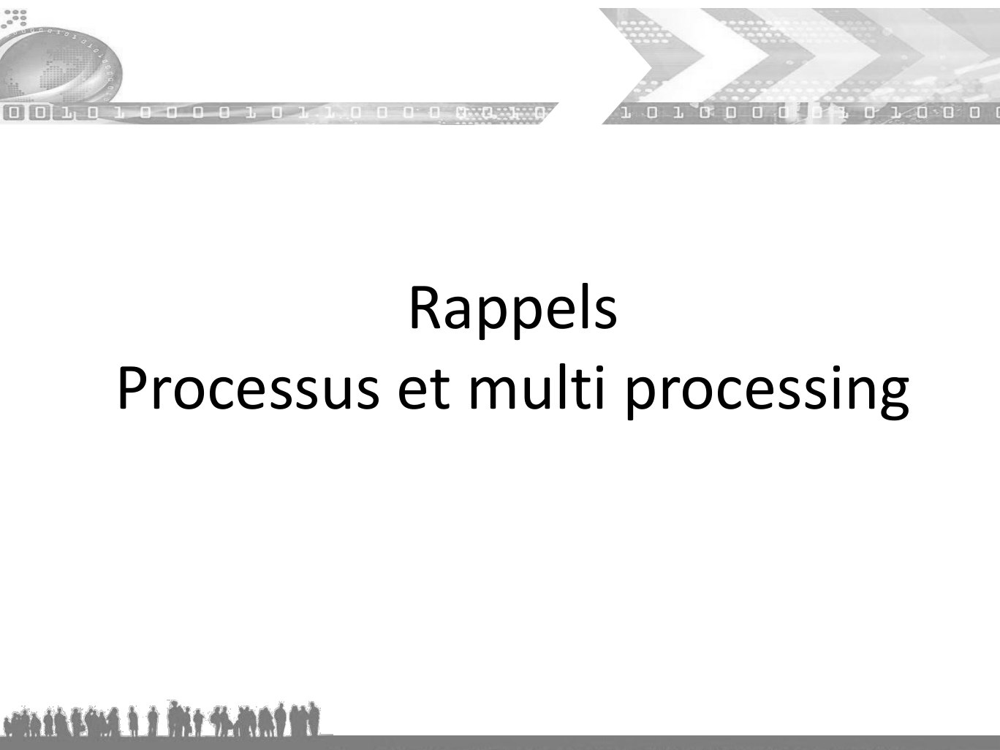
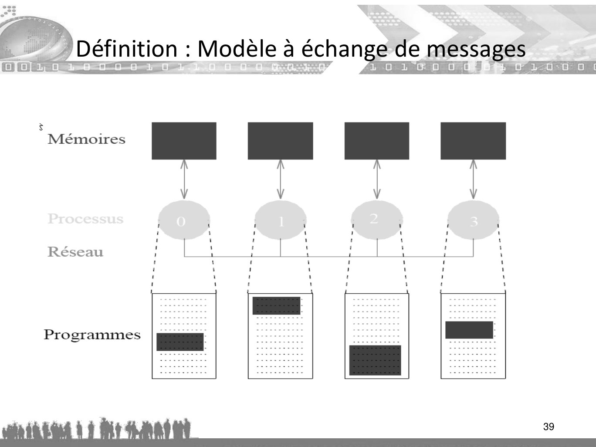
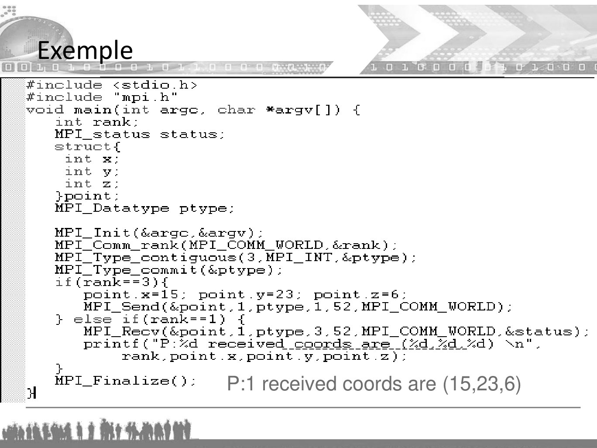

# cours-MPI.pdf

[Ouvrir l’original](https://drive.google.com/open?id=1JX2C3DOo0bq0KMu0u3gi7fH4n7-3jfPj) · Les pages signalées comprennent du texte reconnu automatiquement ou des éléments graphiques. Le fac-similé permet de vérifier chaque lecture.

**Pages avec fac-similé ou lecture OCR** — 2–3, 36, 39, 41, 47, 58, 81, 108, 139, 149, 166–168.

## Page 1

~~~text
Algorithme et programmation parallèle
   Message Passing Interface (MPI)

                                  1
~~~

## Page 2

~~~text
          Rappels
Processus et multi processing
~~~

## Page 3

~~~text
Processus
~~~

## Page 4

~~~text
                              Processus

• Un programme produit par compilation et édition de lien est un objet inerte
  correspondant au contenu d’un fichier sur disque de nom par défaut a.out
• Un processus est un objet dynamique correspondant à l’exécution des
  instruction d’un programme
• Le processus est l’entité d’exécution dans le système linux
• Dans le système linux, il existe deux types de processus :
   – Processus système
        • swapper
        • crons
        • getty
   – Processus utilisateur qui correspondant à l’éxécution :
        • d’une commande
        • d’une application
~~~

## Page 5

~~~text
            Arborescence des processus dans linux

                                        Processus init

       swaper        cron     ……….            getty           getty         getty

      Processus système                     login
                              exec
                                         shell

                              emacs       netscape       ……. shell
la commande shell :
pstree : affiche l’arborescence des processus
ps [option] : (Processus Status) donne la liste des processus actifs selon certains critères
~~~

## Page 6

~~~text
                               Processus

• Lors de l’initialisation du système linux, un premier processus, nommé init
  est créé avec un PID = 1
• Chaque processus est identifié par un numéro unique (PID)
• La commande ps donne la liste des procesus
• La création d’un processus se fait par duplication
• Un processus peut demander au système sa duplication en utilisant la
  primitive fork()
• On appelle le processus créateur le processus père. Le processus créé est
  appelé processus fils
• Le système crée une copie exacte du processus original avec un PID
  différent
• Le numéro du processus père est noté PPID
• Le processus fils peut executer un nouveau code à l’aide des primitives EXEC
~~~

## Page 7

~~~text
Execution d’une commande par un shell

• Le shell se duplique (fork); on donc 2 processus shell identiques
• Le père se met en attente de la fin du fils (wait)
• Le shell fils remplace son exécutable par celui de la commande compress
• La commande compress s’exécute et compacte le fichier toto ; lorsqu’elle
  termine, le processus fils disparait
• Le père est alors réactivé, et affiche le prompt suivant
                   Processus en cours d’exécution

                                   fork()
                 Processus père
                                        exec (compress, toto)
                       wait()

                 synchronisation   exit()           Processus fils
~~~

## Page 8

~~~text
Exécution d’une commande par un shell

                            Lecture de la commande suivante
                                (par défaut, sur clavier)

                                 Analyse de la syntaxe           Ecrire un message
                                                                   sur la console

                                       erreur

                                  commande interne
                                   de l’interpréteur

                                                                fork
      Exécuter la routine
        correspondant à
                                      Attendre la fin du fils          Création d’un processus fils
     la commande interne
                                                                                   EXEC

                                                                       Signaler la fin du processus
~~~

## Page 9

~~~text
                 Espace d’adressage d’un processus

• Tout processus linux a un espace d’adressage constitué de 3 segments :
        RAM
                                                       Le code correspond aux instructions, en langage
                                 Code
                                                      d’assemblage, du programme à exécuter.
                               Données                 La zone de données contient les variables globales
                                                      ou statiques du programme ainsi que les allocations
                                                      dynamiques de mémoire.
                           Pile d’exécution

                                                       Enfin, les appels de fonctions, avec leurs
                                                      paramètres et leurs variables locales, viennent
                                                      s’empiler sur la pile.

•   Contexte d’un processus
     – Le contenu de son espace d’adressage
     – Le contenu des registres matériels
     – Le compteur ordinal
     – Les variables
     – Les structure de données du noyaux qui ont un rapport avec le processus
~~~

## Page 10

~~~text
                       Vie d'un processus

• Appel système fork par le père. Le processus père continue son
  exécution en arrière plan.
   – Appel système exec par le processus fils.
   – Déroulement du programme.
   – Fin du programme, envoi du code retour.
• Récupération du processus fils à l'état zombie par le processus père.
• Si le processus père à fini son exécution avant le processus fils, le
  processus fils à l’état zombi est "rattaché" au processus originel. Son
  PPID est alors le PID de init.
• Tout processus linux qui se termine possède une valeur retour
  appelée code de retour (exit status) à laquelle le père peut accéder
~~~

## Page 11

~~~text
Etats des processus

• Le processus peut être dans un certain nombre d’états connus : c’est
  un automate.
• L'ordonnanceur gère l'allocation du temps CPU aux processus.

                  nouveau                                       terminé
                                        ordonnancement
           admission          1                                           sortie
                                             2

  Processus possède         Prêt                         En cours       Processus possède
 toutes les ressources   (éligible)           3      d'exécution (elu) toutes les ressources
      Sauf l’UC                          interruption
                                                         4

                 Fin d’E/S
                                  5                          appel système
                                           Bloqué              bloquant
                normale ou
                                           Attente               (E/S)
                faute d’E/S
                                         Attente d’un
                                      événement extérieur
~~~

## Page 12

~~~text
             Caractéristiques d'un processus

• PID
• PPID (PID du père)
• Etat (O/S/R/Z/T)
• Priorité
• Zone de code executable
• Zone de données
  manipulées
• Repertoire courant
• Table des descripteurs
  (fichiers ouverts)
~~~

## Page 13

~~~text
Caractéristiques d'un processus
 • Tout processus possède à sa création 3 descripteurs de fichiers:
    – 0 : stdin (entrée standard)
    – 1 : stdout (sortie standard)
    – 2 : stderr (sortie erreur)

         Flux en sortie                             Flux en sortie
                                  0         1    Sortie standard
                entrée standard
                                                     stdout
                     stdin                  2
                                                   Sortie d’erreur standard
                                                            stderr
 • Par défaut ces trois descripteurs sont reliés au terminal
   correspondant à la session
~~~

## Page 14

~~~text
                           Redirection

• Redirection de l’entrée standard
    - commande < nom_de_fichier
• Redirection de la sortie standard
  - commande > nom_de_fichier
  - commande >> nom_de_fichier (redirection sans écrasement)
• Redirection de la sortie en erreur standard
   - commande 2> nom_de_fichier (en Bourne Shell)
   - commande >& nom_de_fichier (en c-shell)
~~~

## Page 15

~~~text
                Programmation sous LINUX II
void main (int argc, char * argv[], char **arge)
 argc : nombre de paramètres passés plus le nom de l’executable
 argv : tableau contenant les paramètres passés
 arge : tableau contenant les variables d’environnements

Exemple : On lance un programme en C sous un shell en récupérant l’environnement de ce shell
$set HOME =/home/ing1/dupond
    PATH=../usr/bin/
    LOGNAME=dupond
$prog param1 param2
 argc    3
 argv[0] prog             arge[0] “HOME =/home/ing1/dupond”
 argv[1] param1            arge[1] “PATH=../usr/bin/”
 argv[2] param2            arge[2] “LOGNAME=dupond”
~~~

## Page 16

~~~text
              Manipulation des fichiers en C (open)

• Les fichiers seront toujours manipulés avec des
  primitives bas niveau (non bufferisées) :
 #include <sys/types.h>
 #include <sys/stat.h>
 #include <fcntl.h>
 int desc;
 int open (const char * ref, int mode_ouverture, mode_t droits);
 //demande une nouvelle entrée dans la table des des fichiers ouverts du système

 desc = open(ref, mode_ouverture, droits);
~~~

## Page 17

~~~text
             Paramètre mode_ouverture

Le paramètre mode_ouverture est construit par disjonction bit à bit
des constantes définies dans fcntl.h

      O_RDONLY           En lecture
      O_WRONLY           En écriture
      O_RDWR             En lecture et en écriture
      O_NONBLOCK         Ouverture dans un mode non bloquant
      O_APPEND           En ajout à la fin du fichier
      O_CREAT            Crée fichier s’il n’existe pas
      O_TRUNC            Remet le fichier à 0 s’il existe
      O_EXCL             Echoue si le fichier existe
~~~

## Page 18

~~~text
            Manipulation des fichiers en C (close)

Les fichiers seront toujours manipulés avec des primitives bas niveau (non
bufferisées) :
  #include <unistd.h>
  Cette primitive permet de libérer un descripteur dans la table des descripteurs
  int close (int desc)

 Cette primitive permet la lecture dans un fichier de descripteur desc
  ssize_t read (int desc, void *ptr, size_t nb_octets)
 nb_octets : le nombre (int) d'octets que l'utilisateur voudrait lire
 ssize_t : reçoit le nombre d'octets réellement lus
 la fonction read détecte la fin de fichier et renvoie -1.

  Cette primitive permet l’écriture dans un fichier de descripteur desc
 ssize_t write (int desc, void *ptr, size_t nb_octets)

  Modifier l’offset par rapport à une origine dans le fichier de descripteur desc
 off_t lseek (int desc, off_t offset, int origine)
~~~

## Page 19

~~~text
        Multitâches

Création et contrôle de plusieurs
           processus
       MULTIPROCESSING
~~~

## Page 20

~~~text
                            Définition

• On appelle multiprocessing le fait de pouvoir faire traiter une tâche
  complexe par une seule machine en utilisant plusieurs processeurs en
  même temps.
• On va donc s'intéresser à des processus gérés par le même système
  d'exploitation, s'exécutant en parallèle, s'échangeant et partageant
  des données et se synchronisant.
~~~

## Page 21

~~~text
          Avantages / Inconvénients

• Gain de temps de traitement
• Meilleure utilisation d'une machine multiprocesseurs
• Problèmes d'accès concurrents (synchronisation,
  interblocages, verrous…)
~~~

## Page 22

~~~text
                          Primitive fork

• L'appel de la primitive fork demande au système d'effectuer une
  copie exacte du processus en cours d'exécution.
• Si cette primitive a réussi, un nouveau processus est créé et exécute
  le même programme.
• Il hérite de la pile d'exécution et donc ce nouveau processus
  "débute" par le retour de la primitive fork
• Dans le processus père, fork() retourne le PID du processus fils crée
• Dans le processus fils, fork() retourne la valeur 0
• Si echec de fork(), alors pas de fils créé et fork retourne -1.
~~~

## Page 23

~~~text
                       Création d'un nouveau processus
       prog1.c                 P0 père (PID = 187)

•      Appel de la primitive fork :
                                                                                  P1 fils (PID = 1235)
    #include <unistd.h>
       void main()                                                            #include <unistd.h>
       {                                                                     void main()
         pid_t m_pid;                                                        {
         m_pid = fork(); //return PID du fils qui vient d’etre créé (1235)     pid_t m_pid;
         printf("Retour de la fonction fork : %d\n", m_pid);                   m_pid = fork(); //return 0
                                                                               printf("Retour de la fonction fork
      getpid();                                                              : %d\n", m_pid);
        getppid();                                                             getpid();
}                                                                              getppid();
                                                                             }

Le père et le fils exécutent l’instruction en rouge ./prog
~~~

## Page 24

~~~text
                 Caractéristiques héritées

• UID, identifiant du ou des propriétaires
• GID, identifiant du groupe
• Toutes les valeurs des variables…

#include <unistd.h>
getpid(); retourne le PID du processus appelant
getppid(); retourne le PID du père de processus
char * getcwd(char * buf, size_t taille);

La référence absolue du repertoire de travail d’un processus peut être
obtenue dans la chaine buf de taille taille
~~~

## Page 25

~~~text
       Caractéristiques non héritées

• PID
• PPID
• Temps d'exécutions (initialisés à zéro)
• Les signaux pendants
• La priorité d'exécution si elle a été modifiée
• Les verrous sur fichiers
~~~

## Page 26

~~~text
              Cas spécifique des
            descripteurs de fichiers

• Après un fork, les entrées de la table des
  descripteurs pointent sur la même entrée de la
  table des fichiers ouverts.
• Le nombre de descripteurs de la table des
  fichiers ouverts est incrémenté.
• L'offset est commun aux deux processus.
~~~

## Page 27

~~~text
          Fin de vie d'un processus
              et synchronisation

• Rappel : tout processus passe en état
  zombie lorsque son exécution est terminée.
• Un processus zombie occupe une entrée
  dans la table des processus (le nombre est
  limité ! )
• Le processus père peut alors accéder aux
  informations relatives à cette terminaison
~~~

## Page 28

~~~text
            Primitives lancées à partir de C

• Il est possible depuis un programme C de lancer une commande
   qui sera interprétée par le shell
  #include <stdlib.h>
  int system (const char * commande)

• La primitive exit() est une autre fonction qui ne retourne aucune
   valeur, puisqu’elle termine le processus qui l’appelle
  #include <stdlib.h>
  void exit (int status)
  L’argument status est un entier qui indique au shell (ou au père
   de façon générale) qu’une erreur s’est produite. On laisse à zéro
   pour indiquer une fin normale.
~~~

## Page 29

~~~text
                 Primitives sleep

• La primitive sleep() est similaire à la commande
  shell sleep. Le processus est bloqué durant le
  nombre de secondes spécifié, sauf s’il reçoit
  entre temps un signal.
  #include <unistd.h>
  int sleep (int secondes)
~~~

## Page 30

~~~text
             Primitives de recouvrement exec

• La primitive execlp() permet le recouvrement d’un processus par un
   autre exécutable
void, char *arg, …., NULL)
cmd : est une chaîneexeclp(char * cmd de caractère qui indique la
   commande à exécuter
arg : spécifie les arguments de cette commande (argv) et les points de
   suspension peuvent être vus comme des arg0, arg1, ..., argn.

Exemple : execution de ls –l /usr
execlp(“ls”, “ls”, “-l”, “/usr”, NULL)
• La primitive execlp() retourne –1 en cas d’erreur, sinon rien si tout se
  passe bien
~~~

## Page 31

~~~text
                   Recouvrement avec la famille execv

Les primitives du type execv permettent de passer les arguments au programme sous la forme d'un tableau.
#include <stdio.h>
int execv(const char *path, const char *argv[ ])
int execvp(const char *file, const char *argv[ ])
Les paramètres passés sont :
- le nom du fichier exécutable (avec son chemin d'accès pour execv)
- le tableau des arguments
Exemple d'utilisation :
char *arg[ ];
arg[0] = "myprog";
arg[1] = "toto";
arg[2] = "tata";
arg[3] = "titi";
execv("/home/ing1/dupond/myprog",arg);
execvp("myprog",arg);
La fonction execvp cherche de même automatiquement le chemin d'accès au programme dans le PATH.
~~~

## Page 32

~~~text
                    Primitives wait, waitpid

La primitive wait permet de récupérer les informations de
terminaison et de supprimer les processus zombie.

– Si l'appelant possède au moins un fils non zombie l'appel est bloquant
– Si l'appelant ne possède aucun fils (ni en exécution ni zombie) le retour
est immédiat et vaut –1

 #include <sys/types.h>
 #include <sys/wait.h>
 pid_t wait(int * status);
 Le retour est le PID du processus fils qui a été récupéré.
~~~

## Page 33

~~~text
                  Exemple d’utilisation
Exemple calcul du produit matriciel :
~~~

## Page 34

~~~text
                         Synchronisation

• L’effet de sleep est très différent de celui de wait:
  wait bloque jusqu’à ce qu’une condition précise soit
  verifiée ( exemple la mort d’un fils), alors que sleep
  attend pendant une durée fixe

    sleep ne doit jamais être utilisé pour tenter de synchroniser deux processus
~~~

## Page 35

~~~text
 processus père             Multiprocessing
#include <stdio.h>                                    Création d’un
#include <unistd.h>
                                                      processus fils
#include <stdlib.h>
                                                       #include<stdio.h>
#include <sys/wait.h>
                                                       #include<unistd.h>
void main(void){                                       #include<stdlib.h>
                                                       #include<sys/wait.h>
    pid_t m_pid;//PID du processus fils                void main(void){
                                           Compteur
    m_pid = fork();                        ordinal         pid_t m_pid;
                                                           m_pid = fork();
    switch(m_pid){                                         switch(m_pid){
    case –1 :                                          .
                                                       }
                printf(“Erreur: echec de fork \n”);
    case 0 :
                printf(“ Processus fils : pid = %d\n”, getpid())
                exit(0) fin du processus fils
                break;
    default :
          printf(“Ici le pere, le fils a un PID : %d\n", m_pid);
          wait(0);// attente la fin du fils
    }
}
~~~

## Page 36

~~~text
Introduction
     MPI
~~~

**Lecture OCR à contrôler**

~~~text
ee Ace s Te

Introduction
MPI
~~~

## Page 37

~~~text
     Définition : Modèle séquentiel
• Le modèle de programmation séquentiel :
  – le programme est exécuté par un et un seul processus ;
  – toutes les variables et constantes du programme sont allouées
    dans la mémoire centrale allouée au processus ;
  – un processus s’exécute sur un processeur physique de la
    machine.

                                                             37
~~~

## Page 38

~~~text
       Définition

• Le modèle de programmation par échange de messages :
  – le programme est écrit dans un langage classique (Fortran, C/C++) ;
  – chaque processus exécute éventuellement des parties différentes
    d’un programme ;
  – toutes les variables du programme sont privées et résident dans la
    mémoire locale allouée à chaque processus ;
  – une donnée est échangée entre deux ou plusieurs processus via un
    appel, dans le programme, à des sous-programmes particuliers.

                                                                 38
~~~

## Page 39

~~~text
Définition : Modèle à échange de messages

                                            39
~~~

**Lecture OCR à contrôler**

~~~text
À Définition :

ETL_O0. enr

i
Réseau : ‘ F | h H H A
| ;

Programmes
~~~

## Page 40

~~~text
      Définition : Le modèle d’exécution SPMD
• Single Program, Multiple Data ;
  – le même programme est exécuté par tous les processus
    ;

                                                    40
~~~

## Page 41

~~~text
Introduction MPI

                   41
~~~

**Lecture OCR à contrôler**

~~~text
ve

> Le
SSeS UC 0 1 0 0 Ge eas

Introduction MPI
~~~

## Page 42

~~~text
     Avant Propos
Message Passing Interface Standard (MPI) est une bibliothèque
standard de transmission de messages basée sur le consensus du
Forum MPI, qui compte plus de 40 organisations participantes, y
compris les fournisseurs, les chercheurs, les développeurs de
bibliothèques logiciels, et des utilisateurs. Le but du Message
Passing Interface est d'établir un standard portable , efficace et
flexible pour la transmission de messages qui seront largement
utilisés pour l'écriture de programmes par échange de messages.

                                                                42
~~~

## Page 43

~~~text
      Introduction
• Le but de ce tutoriel est de voir comment élaborer et exécuter des
programmes parallèles selon la norme MPI.

• Concepts basés sur l’échange de messages

                                                                43
~~~

## Page 44

~~~text
       C’est quoi MPI?
•M P I = Message Passing Interface

•MPI est une spécification pour les développeurs et les
utilisateurs des bibliothèques d’échange de messages. En soi,
ce n'est pas une bibliothèque - mais plutôt la spécification de ce
que cette bibliothèque devrait être.

•En termes simples, le but de la Message Passing Interface est
de fournir un standard largement utilisé pour écrire des
programmes d’échange de messages. L'interface se veut
   pratique
   portable
   efficace
   flexible
                                                              44
~~~

## Page 45

~~~text
        Raisons de l'utilisation MPI:
• Normalisation - MPI est la seule bibliothèque d’échange de message, qui peut
  être considérée comme une norme. Elle est supportée sur toutes les
  plateformes HPC. En pratique, il a remplacé toutes les anciennes bibliothèques
  d’échange de messages.
• Portabilité - Il n'est pas nécessaire de modifier le code source lorsque vous
  porter votre application sur une autre plate-forme qui supporte le standard MPI.
• Opportunité de rendement - implémentations des fournisseurs devraient être
  en mesure d'exploiter les fonctionnalités matérielles natives pour optimiser les
  performances. Pour plus d'informations sur les performances MPI voir le tutoriel
  sur les performance MPI.
• Fonctionnalité - Plus de 115 routines sont définies dans MPI-1 seul.
• Disponibilité - Une variété d'implémentations sont disponibles, à la fois
  commerciale et open source

                                                                            45
~~~

## Page 46

~~~text
       Programming Model:
• A l'origine, MPI a été conçu pour les architectures à mémoire
  distribuée, qui devenaient de plus en plus populaire à cette
  époque.
• Comme les tendances d'architecture ont changé, les mémoires
  partagées ont été combinées sur de réseaux créant des systèmes
  hybrides mémoire distribuée / systèmes de mémoire partagée. Les
  fournisseur de MPI ont adapté leurs bibliothèques pour gérer les
  deux types d'architectures de mémoire sous-jacents de façon
  transparente.
• Aujourd'hui, MPI fonctionne sur pratiquement toute plate-forme
  matérielle:
   – Mémoire distribuée
   – Mémoire partagée
   – hybride
                                                              46
~~~

## Page 47

~~~text
Environnement
~~~

## Page 48

~~~text
       Structure d’un programme MPI
• Utilisation de la bibliothèque MPI :
   – Enrollement dans MPI
   – Quitter MPI proprement
       ...
       #include <mpi.h>
          ...
          main (int argc, char *argv []) {
          ...
          MPI_Init (&argc, &argv) ;
          ...
          MPI_Finalize () ;
          ...
       }

                                             48
~~~

## Page 49

~~~text
        Environnement
#include <mpi.h>
#include <stdio.h>
int main(int argc, char** argv)
{
  MPI_Init(&argc, &argv);
     printf("Sup.\n");
  MPI_Finalize();
  return 0;
}

Tout programme faisant appel à MPI doit :
• inclure <mpi.h>,
• initialiser l'environnement avec MPI_Init,
• désactiver l'environnement avec MPI_Finalize.
                                                  49
~~~

## Page 50

~~~text
     Environnement MPI

• L’environnement MPI est initialisé lors de l’appel à la
  fonction MPI_INIT() et désactivé par l’appel à la
  fonction MPI_FINALIZE().Une fois cet environnement
  MPI initialisé, on dispose d’un ensemble de processus
  actifs et d’un espace de communication au sein duquel
  on va pouvoir effectuer des opérations MPI.
• Ce couple (processus actifs, espace de communication)
  est appelé communicateur.
• Le communicateur par défaut est MPI_COMM_WORLD
  et comprend tous les processus actifs.
                                                      50
~~~

## Page 51

~~~text
         Compilation et exécution

• Pour compiler les programmes utilisant la bibliothèque Open MPI, il
  suffit d’utiliser le compilateur fourni par Open MPI : mpicc. Un
  exemple est fourni ci-dessous . Les paramètres sont similaires à ceux
  de gcc.
                                mpicc hello_c.c -o hello_exe

• L’exécution de programme MPI est réalisée à l’aide du programme
  mpirun. Un exemple est fourni ci-dessous.
                       mpirun -hostfile hosts -nolocal -np 3 hello_exe

• Les principaux paramètres de mpirun sont présentés ci-dessous.
 – -np <#> : indique le nombre de processus à utiliser
 – -hostfile <path> : indique le chemin vers le fichier contenant les liste des hotes
 – -nolocal : indique a MPI de ne pas lancer de processus sur la machine locale
                                                                                  51
~~~

## Page 52

~~~text
       Qui (rank)?
• Dans un communicateur, chaque processus a son propre
  identificateur unique, entier attribué par le système lors de
  l'initialisation du processus. Un rang est parfois aussi appelé «ID
  de la tâche". Les rangs sont contiguës et commencent à zéro.

• Utilisé par le programmeur pour spécifier la source et la
  destination des messages. Souvent utilisé conditionnellement par
  l'application pour contrôler l'exécution du programme (si rang = 0
  faire / si rang = 1 faire).

• Qui suis-je ?
int MPI_Comm_rank (MPI_Comm comm, int *rank) ;
   – Communicateur : collection de processus pouvant communiquer
   – Communicateur MPI_COMM_WORLD prédéfini : tous les processus
                                                                   52
~~~

## Page 53

~~~text
      Combien(size)?
• Combien sommes-nous ?
On peut connaître le nombre de processus actifs
gérés par un communicateur avec la fonction int
int MPI_Comm_size (MPI_Comm comm, int *nb_procs) ;

• comm (< in >) est en entier désignant le communicateur,
• nb_procs (< out >) est en entier donnant le nombre de processus,
• rank (< out >) est un entier indiquant le rang du processus.

                                                              53
~~~

## Page 54

~~~text
      Gestion d’erreur
• La plupart des routines MPI retourne un code d'erreur.

• Toutefois, selon la norme MPI, le comportement par
  défaut de l'appel MPI est d'interrompre en cas d'erreur.
  Cela signifie que vous ne sera probablement pas en
  mesure de saisir un code retour d’erreur autre que
  MPI_SUCCESS (zéro).

• Les types d'erreurs affichés à l'utilisateur sont dépendant
  de l'implémentation.

                                                         54
~~~

## Page 55

~~~text
       Routines de gestion de l'environnement
• Routines gestion de l'environnement MPI sont utilisées pour
  différentes raisons, telles que l'initialisation et de terminaison de
  l'environnement MPI, l'interrogation de l'environnement et de
  l'identité, etc. La plupart de ceux couramment utilisées sont
  décrites ci-dessous.

• l’initialisation de l’environnement via l’appel à la fonction
  MPI_INIT(code). Cette fonction retourne une valeur dans la
  variable code. Si l’initialisation s’est bien passée, la valeur de code
  est égale à celle dans MPI_SUCCESS.

• La désactivation de l’environnement via l’appel à la fonction
  MPI_FINALIZE (code). L’oublie de cette fonction provoque une
  erreur.
                                                                     55
~~~

## Page 56

~~~text
        Exemple source.c
#include <mpi.h>                        mpicc source.c -o source
                                        mpirun -np 4 source
#include <stdio.h>
int main(int argc, char** argv)        Rang 2 sur 4.
                                       Rang 0 sur 4.
{                                      Rang 3 sur 4.
                                       Chaque processus de rang ≠1 appelle printf
  MPI_Init(&argc, &argv);              (une seule fois) avec son rang.
  int world_size;                      L'ordre de sortie est indéfini.

  MPI_Comm_size(MPI_COMM_WORLD, &world_size);
  int wrank;
  MPI_Comm_rank(MPI_COMM_WORLD, &wrank);
   if (wrank!=1)
   printf("Rang %d sur %d.\n", wrank, world_size);
   MPI_Finalize();
   return 0;
}                                                                            56
~~~

## Page 57

~~~text
         Exemple 1 :Hello world distribué
#include <mpi.h>                                mpicc helloword.c -o helloword
#include <stdio.h>                              mpirun –np 3 helloword
void main(int argc, char *argv[])
                                               Hello, world. I am 1 of 3
{                                              Hello, world. I am 0 of 3
  int rank;                                    je suis le proc : 1 parmi 3
  int nprocs;                                  Hello, world. I am 2 of 3
                                               fin Hello, world
    MPI_Init(&argc, &argv);
    MPI_Comm_size(MPI_COMM_WORLD, &nprocs);
    MPI_Comm_rank(MPI_COMM_WORLD,&rank);
    printf("Hello, world. I am %d of %d\n", rank, nprocs);

if(rank ==1) printf("je suis le proc : %d parmi %d", rank, nprocs))

    fflush(stdout);
    MPI_Finalize();
    printf("fin Hello, world");
}                                                                                 57
~~~

## Page 58

~~~text
Communication point à point
~~~

## Page 59

~~~text
          Communication point à point

• La communication point à point est une communication entre deux processus. L’un
  d’eux envoie un message (c’est l’émetteur), l’autre le reçoit (c’est le récepteur).
• Ce message doit contenir un certain nombre d’informations pour assurer une
  bonne réception et interprétation par le récepteur, à savoir :
~~~

## Page 60

~~~text
     Communication point à point (suite)

• Plusieurs modes de transfert sont possibles pour échanger des
  messages.
• On décrit ici des fonctions MPI de communication en mode
  bloquant, qui laisse la main une fois que le message est bien
  reçu. C’est le mode à utiliser quand on commence à paralléliser
  un code.
• On peut ensuite passer à un autre mode de transfert pour
  optimiser le temps de communication (détail plus tard).
~~~

## Page 61

~~~text
Communication bufferisée

     Le message est copié dans un buffer
     Expéditeur                                      Receveur /Destinataire

                             S.O.             S.O.
             Send()                                          Recv()

                      copy
              data           data

                                                      copy
                                              data            data

     Il peut s'agir d'opérations bloquantes ou non bloquantes

                                                                              61
~~~

## Page 62

~~~text
       Communication point à point (suite)
• L’émetteur et le récepteur sont identifiés par leur rang dans le
  communicateur.
• Ce que l’on appelle l’enveloppe d’un message est constituée :
   – du rang du processus émetteur ;
   – du rang du processus récepteur ;
   – de l’étiquette (tag) du message ;
   – du nom du communicateur qui définira le contexte de communication de
     l’opération.
• Les données échangées sont typées (entiers, réels, etc. ou types
  dérivés personnels).
• Il existe dans chaque cas plusieurs modes de transfert, faisant
  appel à des protocoles différents
~~~

## Page 63

~~~text
     Un message = données + enveloppe
• Fonctions de base d’émission (MPI_Send ()) et de
  réception (MPI_Recv ()) de messages
• Enveloppe : informations nécessaires
   – Rang du receveur (pour une émission)
   – Rang de l’émetteur (pour une réception)
   – Un tag (int)
      •  Distinguer les messages d’un même couple émetteur/receveur
   – Un communicateur (MPI_Comm)
      •  Distinguer les couples de processus

                                                                       63
~~~

## Page 64

~~~text
       Envoi de messages

• Emission d’un message (bloquant ou non bloquant)
  int MPI_Send(void * message,
              int count,
              MPI_Datatype datatype,
              int dest, int tag, MPI_Comm comm);
~~~

## Page 65

~~~text
    MPI_Send (description)
• Message =
  – Enveloppe
     • dest : rang du processus destinataire
     • tag : étiquette (numéro de message pour différencier les messages d’un
       même couple émetteur/receveur).
     • comm : handler communicator

  – données :
     • message : tableau de type ``datatype ``, bloc de mémoire d’adresse
       message
     • count : taille du message
     • MPI_Datatype : type datatype
~~~

## Page 66

~~~text
       Réception de messages
Reception d’un message
int MPI_Recv(void * message, int count, MPI_Datatype
                datatype, int source, int tag,
                MPI_Comm comm, MPI_Status *status)
• Attente de la réception d’un message de "source''. Elle est
   bloquante.
• "source'' peut avoir la valeur MPI_ANY_SOURCE (n'importe
   quelle source).
• '' tag'' peut avoir la valeur MPI_ANY_TAG (n'importe quelle
   étiquette).
~~~

## Page 67

~~~text
      MPI_Recv (description)

• status : identificateur de l'émetteur et du message reçu.
   status.MPI_SOURCE : source
   status.MPI_TAG : tag
   status.ERROR : erreur
• "status'' contient l'information sur la taille du message.
• Pour cela, on appelle la fonction :
    int MPI_Get_count(MPI_Status *status,
        MPI_Datatype datatype, int *nbre)
~~~

## Page 68

~~~text
        Exemple
#include <mpi.h>
#include <stdlib.h>                   > mpicc point_a_point.c - o point_a_point
#include <stdio.h>                    > mpirun -np 4 point_a_point
#define ETIQUETTE 100                 Hello, world. I am 0
                                      Hello, world. I am 2
int main(int argc, char *argv[]) {    Moi, processus 3 , j’ai recu 1000 du processus 2
                                      Hello, world. I am 3
  int rang, valeur;                   Hello, world. I am 1
  MPI_Status status;
  MPI_Init (&argc,&argv);
  MPI_Comm_rank ( MPI_COMM_WORLD , &rang);
  if (rang == 2) {
         valeur=1000;
         MPI_Send (&valeur, 1, MPI_INT , 3, ETIQUETTE, MPI_COMM_WORLD );
  } else if (rang == 3) {
     MPI_Recv (&valeur, 1, MPI_INT , 2, ETIQUETTE, MPI_COMM_WORLD , &status);
      printf("Moi, processus rang, j’ai recu %d du processus 2.\n", valeur);
  }
  printf("Hello, world. I am %d \n", rank);
  MPI_Finalize ();
  return(0);
}
~~~

## Page 69

~~~text
   Ordre de réception des messages

Si deux processus A et B envoient un message
 à un autre processus C, l'ordre d'arrivé des
 messages n'est pas déterminé.

Si un processus envoie un message m1 à C
 ensuite envoie un message m2 à C, alors m1
 sera reçu avant m2.
~~~

## Page 70

~~~text
                       Exemple
                  P0
                                  Affichage

 bonjour de 1!
P1
                  bonjour de 2!
                 P2
                                  …    bonjour de 7!
                                      P7
~~~

## Page 71

~~~text
        Hello world (initialisation)
#include <stdio.h>
#include <string.h>
#include <mpi.h>
void main(int argc, char* argv[]) {
  int    my_rank;          /* rang du processus   */
  int    p;                /* nombre de processus */
  int    source;           /* rang de l'émetteur  */
  int    dest;             /* rang du récepteur   */
  int    tag = 10;          /* étiquette           */
  char message[100]; /* pour stocker le message */
  MPI_Status status;       /* status du message   */

  MPI_Init(&argc, &argv); /* Démarrer MPI */
  MPI_Comm_rank(MPI_COMM_WORLD, &my_rank);
  MPI_Comm_size(MPI_COMM_WORLD, &p);
~~~

## Page 72

~~~text
          Hello world (corps)
if (my_rank != 0) { /* si je ne suis pas le processus racine*/
   /Creation du message */
   sprintf(message, "Bonjour de %d!", my_rank);
   dest = 0;
    /* Utiliser strlen+1 pour que '\0' soit transmis! */
   MPI_Send(message, strlen(message)+1, MPI_CHAR, dest, tag, MPI_COMM_WORLD);
    }
 else { /* my_rank == 0 */
      for (source = 1; source < p; source++) {
       MPI_Recv(message, 100, MPI_CHAR, source, tag, MPI_COMM_WORLD, &status);
       printf(" la source %d, message : %s\n", source, message);
      }
    }
    MPI_Finalize(); /* Quitter MPI */
} /* fin de la fonction main */
~~~

## Page 73

~~~text
      Constantes : Type MPI_Datatype
• datatype : type des données. Les types prédéfinies sont
   MPI_CHAR                  MPI_UNSIGNED_CHAR           MPI_FLOAT
   MPI_SHORT                 MPI_UNSIGNED_SHORT          MPI_DOUBLE
   MPI_INT                   MPI_UNSIGNED                MPI_LONG_DOUBLE
   MPI_LONG                  MPI_UNSIGNED_LONG           MPI_PACKED/MPI_BYTE

• Correspondance des MPI_Datatype avec les types du C :
    MPI_CHAR              signed char       MPI_SHORT      signed short int
    MPI_INT               signed int        MPI_LONG       signed long int
    ……                                      ……..
    MPI_FLOAT             float             MPI_DOUBLE     double
    MPI_LONG_DOUBLE       Long double       MPI_PACKED     <<struct>>

• Types particuliers :
   – MPI_BYTE Pas de conversion
   – MPI_PACKED Types construits (cf. infra)                                   73
~~~

## Page 74

~~~text
       Constantes : Jokers
• Message reçu d’un processus source quelconque
   – Joker pour source : MPI_ANY_SOURCE
• On peut communiquer avec un processus fictif de rang
   – MPI_PROC_NULL.
• Message reçu de tag quelconque
   – Joker : MPI_ANY_TAG
• MPI_STATUS_IGNORE le status ne nous intéresse pas
• Accès au tag et à l’émetteur : status dans mpi.h :
   typedef struct {
     int MPI_SOURCE;
     int MPI_TAG;
   } MPI_Status;                                         74
~~~

## Page 75

~~~text
     Autre possibilité de communication PaP
• Il existe des variantes syntaxiques,
  MPI_Sendrecv() etMPI_Sendrecv_replace(), qui
  enchaînent un envoi et une réception.

          P1                        P2

                                              75
~~~

## Page 76

~~~text
      MPI_Sendrecv

MPI_Sendrecv(val_emis, taille_emis, type_emis, rang_proc_dest,
tag_emis, val_recu, taille_recu, type_recu, rang_proc_source,
tag_recu, comm, statut)

Pour l’envoi et la réception de messages. Attention, si on utilise la
même variable pour l’envoi et la réception (val_emis = val_recu), il y
a écrasement.

rang_proc_source (< in >) est un entier indiquant le rang du
processus qui a émis le message

                                                                  76
~~~

## Page 77

~~~text
       MPI_Sendrecv_Replace

MPI_Sendrecv_Replace(val_emis_recu, taille_emis_recu,
type_emis_recu, rang_proc_dest, tag_emis, rang_proc_source,
tag_recu, comm, statut)

Pour l’envoi et la reception de messages en utilisant le même
variable val_emis_recu pour l’envoi et la réception.
Cette fois-ci il n’y a pas d’écrasement.

                                                                77
~~~

## Page 78

~~~text
         Exemple de programme sendrecv.c
#include <mpi.h>        > mpirun -np 2 sendrecv
#include <stdlib.h> processus 1 , envoye 1001 au processus 0 et recoit 1000 du processus 0
#include <stdio.h> processus 0 , envoye 1000 au processus 1 et recoit 1001 du processus 1
#define ETIQUETTE 100
int main(int argc, char *argv[]) {
    int rang, valeur, x, num_proc;
    MPI_Status statut;
    MPI_Init (&argc,&argv);
    MPI_Comm_rank ( MPI_COMM_WORLD , &rang);
    /* On suppose avoir exactement 2 processus */
    num_proc=(rang+1)%2;
    valeur=rang+1000;
    MPI_Sendrecv (&valeur, 1, MPI_INT , num_proc, ETIQUETTE, &x, 1,
                      MPI_INT , num_proc, ETIQUETTE, MPI_COMM_WORLD , &statut);
    /* MPI_Sendrecv_replace(&valeur, 1, MPI_INT, num_proc, ETIQUETTE,
                                num_proc, ETIQUETTE, MPI_COMM_WORLD, &statut); */
    printf("processus %d, envoye %d au processus %d et recoit %d du processus %d.\n", rang,
    valeur, num_proc, x, num_proc);
    MPI_Finalize ();
                                                                                    78
    return(0);
~~~

## Page 79

~~~text
       Mesure du temps de communication
...
//traitement sequentiel par le processus principal
MPI_Init (&argc,&argv);
double temps_debut= MPI_Wtime ();

...///traitement parallèle

double temps_fin= MPI_Wtime ();
MPI_Finalize ();
……///traitement sequentiel processus principal
printf("... en %8.6f secondes.",temps_fin-temps_debut);
...
                                                          79
~~~

## Page 80

~~~text
      Envoi/réception non bloquant
• int MPI_Isend(void* buf, int count,
              MPI_Datatype datatype,
               int dest, int tag,
               MPI_Comm comm,
                MPI_Request *request)

• int MPI_Irecv(void* buf,
                     int count,
                      MPI_Datatype datatype,
                      int source,
                       int tag,
                      MPI_Comm comm,
                      MPI_Request *request)
~~~

## Page 81

~~~text
Communications collectives
~~~

## Page 82

~~~text
     Introduction
• Elles permettent de communiquer en un seul appel avec
  tous les processus d’un communicateur. Ce sont des
  fonctions bloquantes, c’est à dire que le système ne
  rend la main à un processus qu’une fois qu’il a terminé
  la tache collective.

• Pour ce type de communication, les étiquettes sont
  automatiquement gérées par le système.

• On détaille quelques fonctions de communication
  collective.
                                                       82
~~~

## Page 83

~~~text
                 Notions générales
• Il y a trois types de fonctions :
      – celui qui assure les synchronisations globales : MPI_Barrier().
      – ceux qui ne font que transférer des données :
           • diffusion globale de données : MPI_Bcast() ;
           • diffusion sélective de données : MPI_Scatter() ;
           • collecte de données réparties : MPI_Gather() ;
           • collecte par tous les processus de données réparties : MPI_Allgather() ;
           • diffusion sélective, par tous les processus, de données réparties :
             MPI_Alltoall().
      – ceux qui, en plus de la gestion des communications, effectuent
        des opérations sur les données transférées :
           • opérations de réduction, qu’elles soient d’un type prédéfini (somme, produit,
             maximum, minimum, etc.) ou d’un type personnel : MPI_Reduce() ;
           • opérations de réduction avec diffusion du résultat (il s’agit en fait d’un
             MPI_Reduce() suivi d’un MPI_Bcast() : MPI_Allreduce().                     83
•   LABORATOIRE D’INFORMATIQUE
~~~

## Page 84

~~~text
     Synchronisation globale : MPI_Barrier()

• int MPI_Barrier(MPI_Comm comm)
                                             int code;
                                             MPI_Comm comm;

                                             code= MPI_Barrier (comm);

  – Synchronisation ou rendez-vous
  – Pas d'échange d'informations
  – Tous les processus sont assurés que tous ont ralliés le point de
    synchronisation
~~~

## Page 85

~~~text
      Diffusion générale : MPI_Bcast()

• int MPI_Bcast(void *buff, int count, MPI_Datatype
            datatype, int root, MPI_Comm comm)

• Appel par tous les processus du communicateur comm
  avec la même valeur de root, count, datatype.

• La valeur détenue par le processus root sera émise et
  rangée chez chacun des autres processus.
~~~

## Page 86

~~~text
    Diffusion générale suite: MPI_Bcast()

• Un même processus P2 envoie une même valeur à
  tous les processus d'un communicateur y compris
  à lui-même .
     Données
                                  A0
                                  A0
                    MPI_Bcast()
   A0                             A0
                                  A0
                                  A0
~~~

## Page 87

~~~text
        Exemple de code source
#include <mpi.h>
#include <stdlib.h>
#include <stdio.h>                     > mpirun -np 4 bcast
                                       Moi, processus 2 , j’ai recu 1002 du processus 2
int main(int argc, char *argv[])
                                       Moi, processus 0 , j’ai recu 1002 du processus 2
{                                      Moi, processus 1 , j’ai recu 1002 du processus 2
    int rang, valeur;                  Moi, processus 3 , j’ai recu 1002 du processus 2

    MPI_Init (&argc,&argv);
    MPI_Comm_rank ( MPI_COMM_WORLD , &rang);

    if (rang == 2) valeur=rang+1000;
    MPI_Bcast (&valeur,1, MPI_INT , 2, MPI_COMM_WORLD );

    printf("Moi, processus %d, j’ai recu %d du processus 2\n",rang, valeur);
    MPI_Finalize ();
    return(0);
}
                                                                                   87
~~~

## Page 88

~~~text
     Diffusion sélective : MPI_Scatter()

• int MPI_Scatter(void *sendbuf, int sendcount,
  MPI_Datatype sendtype, void *recvbuf, int recvcount,
  MPI_Datatype recvtype , int root, MPI_Comm comm)

• Cette fonction permet à un processus de diffuser des
  données aux processus du communicateur indiqué de
  façon sélective. En fait le processus émetteur dispose de
  données qu’il répartit. Chaque processus ( émetteur
  même compris) reçoit un paquet de données différent

                                                       88
~~~

## Page 89

~~~text
     Diffusion sélective suite : MPI_Scatter()
• Le processus P2 diffuse ses données A0,..., A3 (stockées
  dans sa mémoire) à tous les processus P0 à P4 de façon
  répartie.
• Distribution d'un message personnalisé aux autres
  processus (One-to-All)
       Données
                                        A0
                                        A1
                          MPI_Scatter()
     A0 A1 A2 A3 A4                     A2
                                        A3
                                        A4
~~~

## Page 90

~~~text
          Exemple de code source
#include <mpi.h>
#include <stdlib.h>                              > mpirun -np 4 scatter
#include <stdio.h>                               Moi, processus 0 , j’ai recu 1000. à 1031. du processus 2
#define NB_VALEURS 128                           Moi, processus 1 , j’ai recu 1032. à 1063. du processus 2
int main(int argc, char *argv[]) {               Moi, processus 3 , j’ai recu 1096. à 1127. du processus 2
    int rang, nb_procs, longueur_tranche, i; Moi, processus 2 , j’ai recu 1064. à 1095. du processus 2
    float *valeurs, *donnees;
    MPI_Init (&argc,&argv);
    MPI_Comm_size ( MPI_COMM_WORLD , &nb_procs);
    MPI_Comm_rank ( MPI_COMM_WORLD , &rang);
    longueur_tranche=NB_VALEURS/nb_procs;
    donnees=(float*)malloc(longueur_tranche*sizeof(float));
    if (rang == 2) {
            valeurs=(float*) malloc(NB_VALEURS*sizeof(float));
            for (i=0; i<NB_VALEURS; i++) valeurs[i]=(float)(1000+i);
    }
    MPI_Scatter (valeurs,longueur_tranche, MPI_FLOAT ,donnees,longueur_tranche,
    MPI_FLOAT ,2, MPI_COMM_WORLD );
    printf("Moi, processus %d, j’ai recu %.0f à %.0f du processus 2\n",
            rang, donnees[0], donnees[longueur_tranche-1]);
     if (rang == 2) free(valeurs); free(donnees); MPI_Finalize (); return(0);
 }                                                                                                   90
~~~

## Page 91

~~~text
    Collecte : MPI_Gather()
• int MPI_Gather(void *sendbuf, int sendcount,
  MPI_Datatype sendtype, void *recvbuf,int
  recvcount, MPI_Datatype recvtype , int root,
  MPI_Comm comm)

• Cette fonction permet au processus récepteur de
  collecter les données provenant de tous les
  processus (lui-même compris). Attention, le
  résultat n’est connu que par le processus
  récepteur
                                                 91
~~~

## Page 92

~~~text
   Collecte suite : MPI_Gather()
• Le processus P2 collecte les données A0,..., A4
  provenant des processus P0 à P4
• La mise bout à bout des messages de chacun
  des processus.
    Données
  A0
  A1
                     MPI_Gather()
  A2                                A0 A1 A2 A3 A4
  A3
  A4
                                                92
~~~

## Page 93

~~~text
          Exemple de code source
#include <mpi.h>
#include <stdlib.h>                            > mpirun -np 4 gather
#include <stdio.h>                             Moi, processus 2 , j’ai recu 1000. ... 1032. ... 1127.
#define NB_VALEURS 128
int main(int argc, char *argv[]) {
    int rang, nb_procs, longueur_tranche, i;
    float *valeurs, donnees[NB_VALEURS];

    MPI_Init (&argc,&argv);
    MPI_Comm_size ( MPI_COMM_WORLD , &nb_procs);
    MPI_Comm_rank ( MPI_COMM_WORLD , &rang);
    longueur_tranche=NB_VALEURS/nb_procs;
    valeurs=(float *)malloc(longueur_tranche*sizeof(float));
    for (i=0; i<longueur_tranche; i++)
            valeurs[i]=(float)(1000+rang*longueur_tranche+i);
    MPI_Gather (valeurs,longueur_tranche, MPI_FLOAT , donnees,longueur_tranche,
    MPI_FLOAT ,2, MPI_COMM_WORLD );

    if (rang == 2) printf("Moi, processus 2, j’ai recu %.0f, ..., %.0f, ..., %.0f\n",
                        donnees[0], donnees[longueur_tranche], donnees[NB_VALEURS-1]);
    free(valeurs); MPI_Finalize (); return(0);
}                                                                                                 93
~~~

## Page 94

~~~text
    Collecte générale : MPI_Allgather()

• int MPI_Allgather(void *sendbuf, int
  sendcount, MPI_Datatype sendtype, void
  *recvbuf, int recvcount, MPI_Datatype
  recvtype MPI_Comm comm)

• Cette fonction effectue la même chose que la
  fonction MPI_Gather, excepté que le résultat
  de la collecte est connu de tous les processus
  du communicateur. Ce serait l’équivalent d’un
  MPI_Gather suivi d’un MPI_Bcast.
                                                   94
~~~

## Page 95

~~~text
    Collecte générale suite : MPI_Allgather()
• Le processus P2 collecte les données A0,..., A4
  provenant des processus P0 à P4 et les diffuse à
  tous les processus.
• La mise bout à bout des messages de chacun des
  processus.
      Données
    A0                                A0   A1   A2   A3   A4
    A1                                A0   A1   A2   A3   A4
                      MPI_Allgather()
    A2                                A0   A1   A2   A3   A4
    A3                                A0   A1   A2   A3   A4
    A4                                A0   A1   A2   A3   A4
                                                          95
~~~

## Page 96

~~~text
        Exemple de code source
#include <mpi.h>
#include <stdlib.h>
#include <stdio.h>                                > mpirun -np 4 allgather
#define NB_VALEURS 128                            Moi, processus 1 , j’ai recu 1000. . 1032. .. 1127.
int main(int argc, char *argv[]) {                Moi, processus 3 , j’ai recu 1000. . 1032. ... 1127.
    int rang, nb_procs, longueur_tranche, i; Moi, processus 2 , j’ai recu 1000. . 1032. ... 1127.
                                                  Moi, processus 0 , j’ai recu 1000. . 1032. ... 1127.
    float *valeurs, donnees[NB_VALEURS];
    MPI_Init (&argc,&argv);
    MPI_Comm_size ( MPI_COMM_WORLD , &nb_procs);
    MPI_Comm_rank ( MPI_COMM_WORLD , &rang);
    longueur_tranche=NB_VALEURS/nb_procs;
    valeurs=(float*)malloc(longueur_tranche*sizeof(float));
    for (i=0; i<longueur_tranche; i++)
         valeurs[i]=(float)(1000+rang*longueur_tranche+i);
    MPI_Allgather(valeurs, longueur_tranche, MPI_FLOAT , donnees,
                     longueur_tranche, MPI_FLOAT , MPI_COMM_WORLD );
    printf("Moi, processus %d, j’ai recu %.0f, ..., %.0f, %0f,..., %.0f\n", rang,
    donnees[0], donnees[longueur_tranche], donnees[2*longueur_tranche],
    donnees[NB_VALEURS-1]);
    free(valeurs); MPI_Finalize (); return(0);
}                                                                                                 96
~~~

## Page 97

~~~text
   Echanges croisés : MPI Alltoall()
• int MPI_Alltoall(void *sendbuf, int sendcount,
  MPI_Datatype sendtype, void *recvbuf, int
  recvcount, MPI_Datatype recvtype,
  MPI_Comm comm)

                                               97
~~~

## Page 98

~~~text
Echanges croisés suite : MPI Alltoall()

 Données
A0 A1 A2 A3 A4                    A0 B0 C0 D0 E0
B0 B1 B2 B3 B4                    A1 B1 C1 D1 E1
                 MPI_Alltoall()
C0 C1 C2 C3 C4                    A2 B2 C2 D2 E2
D0 D1 D2 D3 D4                    A3 B3 C3 D3 E3
E0 E1 E2 E3 E4                    A4 B4 C4 D4 E4

                                              98
~~~

## Page 99

~~~text
             Exemple de code source
#include <mpi.h>
#include <stdlib.h>
#include <stdio.h>                                  > mpirun -np 4 alltoall
#define NB_VALEURS 128                              Moi, processus 0 , j’ai recu 1000. ... 1128. ... 1415.
int main(int argc, char *argv[]) {                  Moi, processus 2 , j’ai recu 1064. ... 1192. ... 1479.
    int rang, nb_procs, longueur_tranche, i;        Moi, processus 1 , j’ai recu 1032. ... 1160. ... 1447.
    float valeurs[NB_VALEURS], donnees[NB_VALEURS]; Moi, processus 3 , j’ai recu 1096. ... 1224. ... 1511.

    MPI_Init (&argc,&argv);
    MPI_Comm_size ( MPI_COMM_WORLD , &nb_procs);
    MPI_Comm_rank ( MPI_COMM_WORLD , &rang);

    for (i=0; i<NB_VALEURS; i++)
            valeurs[i]=(float)(1000+rang*NB_VALEURS+i);
    longueur_tranche=NB_VALEURS/nb_procs;

    MPI_Alltoall (valeurs,longueur_tranche, MPI_FLOAT ,donnees,longueur_tranche,
    MPI_FLOAT , MPI_COMM_WORLD );
    printf("Moi, processus %d, j’ai recu %.0f, ..., %.0f, ..., %.0f\n", rang, donnees[0],
            donnees[longueur_tranche], donnees[NB_VALEURS-1]);
    MPI_Finalize (); return(0);
}                                                                                                 99
~~~

## Page 100

~~~text
      Reduction : MPI_Reduce()
• int MPI_Reduce (void *sendbuf, void *recvbuf, int
  count, MPI_Datatype datatype, MPI_Op operation,
  int root, MPI_Comm comm)
• Collecte et réduction par un processus d'un
  ensemble de valeurs détenues par tous les
  processus.
• Une réduction consiste à appliquer une opération
  à un ensemble d’éléments pour obtenir un
  scalaire. Cela peut être la somme des éléments
  d’un vecteur ou la valeur maximale d’un vecteur
                                               100
~~~

## Page 101

~~~text
    Reduction suite : MPI_Reduce()

• Le processus P1 collecte les données A0,..., A4
  provenant des processus P0 à P3 et fait une
  opération de réduction.
    Données
   A0                                A0+B0+C0+D0+E0
   B0
                      MPI_Reduce()
   C0
   D0
   E0
~~~

## Page 102

~~~text
           Exemple de code source
#include <mpi.h>
#include <stdlib.h>                        > mpirun -np 7 reduce
#include <stdio.h>                         Moi, processus 0 , j’ai pour valeur de la somme globale 1021

int main(int argc, char *argv[]) {
    int rang, valeur, somme;

    MPI_Init (&argc,&argv);
    MPI_Comm_rank ( MPI_COMM_WORLD , &rang);

    if (rang == 0) valeur=1000;
    else valeur=rang;

    MPI_Reduce (&valeur,&somme,1, MPI_INT , MPI_SUM ,0, MPI_COMM_WORLD );

    if (rang == 0)
    printf("Moi, processus 0, j’ai pour valeur de la somme globale %d\n",somme);
    MPI_Finalize (); return(0);
}

                                                                                                102
~~~

## Page 103

~~~text
   Réduction suite

• Appel par tous les processus du communicateur
  comm avec une même valeur de count,
  datatype, MPI_OP.
• Seul le processus root détient le résultat.
~~~

## Page 104

~~~text
       Constantes : les opérations MPI (MPI_OP)
• Les opérations MPI supportées sont les suivantes :
   – MPI_MAX : Maximum
   – MPI_MIN : Minimum
   – MPI_SUM : Somme
   – MPI_PROD : Produit
   – MPI_LAND : ET logique (AND)
   – MPI_BAND : ET bit à bit (AND)
   – MPI_LOR : OU logique (OR)
   – MPI_BOR : OU bit à bit (OR)
   – MPI_LXOR : OU Exclusif logique (XOR)
   – MPI_BXOR : OU Exclusif bit à bit (XOR)
                                                       104
~~~

## Page 105

~~~text
      Réduction généralisée : MPI_Allreduce()
• int MPI_Allreduce (void *sendbuf, void *recvbuf, int
  count, MPI_Datatype datatype, MPI_Op operation,
  MPI_Comm comm)

• Permet de faire les mêmes opérations de réduction
  que MPI_Reduce(). La différence est que le résultat
  de l’opération de réduction est connu de tous les
  processus d’un même communicateur.
~~~

## Page 106

~~~text
   Reduction généralisée suite : MPI_Allreduce()

• Opération de réduction et diffusion du résultat à
  l’ensemble des processus.
   Données
  A0                                  A0+B0+C0+D0+E0
  B0                                  A0+B0+C0+D0+E0
                    MPI_Allreduce()
  C0                                  A0+B0+C0+D0+E0
  D0                                  A0+B0+C0+D0+E0
  E0                                  A0+B0+C0+D0+E0

                                                  106
~~~

## Page 107

~~~text
       Exemple de code source
#include <mpi.h>
#include <stdlib.h>                     mpirun -np 4 allreduce
#include <stdio.h>
                                       Moi, processus 1 , j’ai pour valeur de la somme globale 1006
int main(int argc, char *argv[]) {     Moi, processus 0 , j’ai pour valeur de la somme globale 1006
    int rang, valeur, somme;           Moi, processus 2, j’ai pour valeur de la somme globale 1006
                                       Moi, processus 3, j’ai pour valeur de la somme globale 1006
    MPI_Init (&argc,&argv);
    MPI_Comm_rank ( MPI_COMM_WORLD , &rang);

    if (rang == 0) valeur=1000;
    else valeur=rang;

    MPI_Allreduce (&valeur,&somme,1, MPI_INT , MPI_SUM , MPI_COMM_WORLD );

    printf("Moi, processus %d, j’ai pour valeur de la somme globale %d\n", rang, somme);
    MPI_Finalize (); return(0);
}

                                                                                           107
~~~

## Page 108

~~~text
Environnement et Communicateurs

                                  108
~~~

**Lecture OCR à contrôler**

~~~text
LE

Environnement et Communicateurs
~~~

## Page 109

~~~text
        Environnement
#include <mpi.h>
#include <stdio.h>
int main(int argc, char** argv)
{
  MPI_Init(&argc, &argv);
  printf("Sup.\n");
   MPI_Finalize();
  return 0;
}

Tout programme faisant appel à MPI doit :
• inclure <mpi.h>,
• initialiser l'environnement avec MPI_Init,
• désactiver l'environnement avec MPI_Finalize.
                                                  109
~~~

## Page 110

~~~text
        Comparaison avec OpenMP
OpenMP
• Une seule instance du programme est exécutée : il n'y a qu'un seul processus.
• Le processus se divise en plusieurs threads exécutés en parallèle.
• Les parties parallèles sont délimités par des directives pré-processeurs
  (#pragma).

MPI
• Plusieurs instances du programme sont exécutées en même temps :
   plusieurs processus sont créés.
• Chaque processus exécute l'intégralité du programme, et les processus
  s'exécutent en parallèle.
• MPI_Init et MPI_Finalize ne correspondent pas aux début et fin de la partie
  parallélisée.

                                                                            110
~~~

## Page 111

~~~text
      Communicateur par défaut
Les processus lancés par mpirun doivent pouvoir communiquer entre
eux.
• Tous les processus sont reliés par le communicateur par défaut
   MPI_COMM_WORLD.
• MPI_COMM_WORLD est créé par MPI_Init et détruit par
   MPI_Finalize.
• Chaque processus a un rang qui l'identifie dans
   MPI_COMM_WORLD.
• C'est grâce à ce rang qu'on effectue le partage des tâches.
• Toutes les communications entre processus passent par un
   communicateur.

                                                             111
~~~

## Page 112

~~~text
       Partitionner un communicateur
int MPI_Comm_split(MPI_Comm comm, int color, int key, MPI_Comm *newcomm)

• Tous les processus d'une même couleur se retrouvent dans le même
  communicateur.
• La variable newcomm a le même nom pour tous les processus, mais sa
  définition diffère : pour le processus X, le newcomm ne contient que les
  processus de même couleur que X.
• Chaque processus a un rang dans le nouveau communicateur ; celui-ci
  peut différer du rang dans MPI_COMM_WORLD.
• Les rangs du nouveau communicateur vont de 0 à # processus - 1.
• L'argument key permet de contrôler les nouveaux rangs : si le processus X
  a une key inférieure à celle du processus Y (pour une même couleur), le
  rang de X dans le nouveau communicateur sera inférieur à celui de Y .

                                                                     112
~~~

## Page 113

~~~text
            Exemple : source.c
#include <mpi.h>
#include <stdio.h>                                          mpirun -np 4 source
int main(int argc, char** argv)
{                                                          world : 1, new : 1, witness : 300
  MPI_Init (NULL, NULL);                                   world : 3, new : 0, witness : 300
  int wrank;                                               world : 0, new : 2, witness : 300
  MPI_Comm_rank(MPI_COMM_WORLD, &wrank);                   world : 2, new : 0, witness : 200.

  int colors[4] = {11, 11, 10, 11};
  MPI_Comm new_comm;
  MPI_Comm_split(MPI_COMM_WORLD, colors[wrank], -wrank, &new_comm);

  int nrank;
  MPI_Comm_rank(new_comm, &nrank);

  int witness = 100*wrank;
 MPI_Bcast(&witness, 1, MPI_INT, 0, new_comm);
 printf("world: %d, new: %d, witness: %d\n", wrank, nrank, witness);

 MPI_Finalize();
 return 0;
}                                                                                               113
~~~

## Page 114

~~~text
       Suite
                                  mpirun -np 4 source

                                 world : 1, new : 1, witness : 300
                                 world : 3, new : 0, witness : 300
                                 world : 0, new : 2, witness : 300
                                 world : 2, new : 0, witness : 200.

• Les processus de wrank 0; 1; 3 ont même couleur, et le processus
  de wrank 2 est tout seul.
• L'argument key étant -wrank, les rangs dans le nouveaux
  communicateurs se retrouvent dans l'ordre inverse de
  MPI_WORLD_COMM.
• Le broadcast ne s'effectue effectivement qu'à l'intérieur du
  nouveau communicateur.

                                                                      114
~~~

## Page 115

~~~text
            Types de données dérivés

•   Introduction
•   Extraction contiguë : MPI_Type_contiguous
•   Extraction à pas constant : MPI_Type_vector
•   Extraction à pas variable : MPI_Type_indexed
•   Padding
•   Structure de données MPI_Type_create_struct
~~~

## Page 116

~~~text
          Introduction
• Il est possible de créer ses propres types de données MPI.
• Le type créé sera de type MPI_Datatype.
• Tout type créé destiné à être utilisé pour une communication doit être enregistré à
  l'aide de la fonction MPI_Type_commit.
                   int MPI_Type_commit(MPI_Datatype *datatype)
• Tout type créé avec un MPI_Type_commit doit être libéré par un MPI_Type_free
  (surtout si on veut réutiliser le nom).
                     int MPI_Type_free(MPI_Datatype *datatype)
• Deux sortes de types peuvent être créés :
    – extraction de données d'un tableau (MPI_Type_vector, MPI_Type_indexed),
    – des types utilisés pour faire passer les structures qu'on définit
       (MPI_Type_create_struct).

                                                                              116
~~~

## Page 117

~~~text
•   Comment envoyer uniquement les éléments rouges de V en une seule communication?

     V(0) V(1) V(2) V(3) V(4) V(5) V(6) V(7) V(8) V(9)

                                                       Cette méthode nécessite
                     T(0) T(1) T(2)    MPI_Send        une copie efficace
                                                       des données non contiguës

     Une possibilité, copier ces éléments dans un tableau
                temporaire avant de l'envoyer.
~~~

## Page 118

~~~text
    Extraction contiguë : MPI_Type_contiguous

•   Construit un type consistant à la réplication d'un type de données dans des
    emplacements continus.

                  int MPI_Type_contiguous( int count,
                       MPI_Datatype old_type,
                       MPI_Datatype *newtype)

                               x compteur =
                                   (4)
                  Vieux type                         Nouveau type

          constructeur de données avec MPI_Type_contiguous
~~~

## Page 119

~~~text
         Extraction contiguë : MPI_Type_contiguous

         MPI_Type_contiguous(int count,
                                 MPI_Datatype old_type,
                                 MPI_Datatype *newtype);

                                    count

• Le nombre total d'éléments de type oldtype contenu dans *newtype est count.

                                                                         119
~~~

## Page 120

~~~text
          Exemple : source.c
#include <mpi.h>
#include <stdio.h>
int main(int argc, char** argv)
{
    int wrank;
   int data[24];
   int tag =2;
   for (int i=0; i<24; ++i) data[i] = 0;
   MPI_Init(&argc, &argv);
   MPI_Comm_rank(MPI_COMM_WORLD, &wrank);
   MPI_Datatype CType;
   MPI_Type_contiguous(8, MPI_INT, &CType);
   MPI_Type_commit(&CType);
   if (wrank==0)
  {
      for (int i=0; i < 24; i++) data[i] = i;
      MPI_Send(data+10, 1, CType, 1, tag, MPI_COMM_WORLD);
}
                                                             120
~~~

## Page 121

~~~text
         Exemple suite : source.c
else if (wrank==1)
{
   MPI_Recv(data, 1, CType, 0, tag, MPI_COMM_WORLD, MPI_STATUS_IGNORE);
   for (int i=0; i < 8; i++)
      printf("%d ", data[i]);                mpirun -np 2 source
    printf(".\n");
}                                           10 11 12 13 14 15 16 17.
MPI_Type_free(&CType);
MPI_Finalize();
return 0;
}

                                                                          121
~~~

## Page 122

~~~text
Extraction contiguë : MPI_Type_contiguous

                       •   Si nous créons une matrice avec l'allocation de mémoire
                           statique, nous pouvons dire que les données de la matrice
                           seront en mémoire contiguë.
double A[3][3];
   A       A     A
 (0,0)   (0,1) (0,2)
                                                    Dans la mémoire
                              A       A       A       A       A       A     A       A       A
   A       A     A
                            (0,0)   (0,1)   (0,2)   (1,0)   (1,1)   (1,2) (2,0)   (2,1)   (2,2)
 (1,0)   (1,1) (1,2)
   A       A     A             compteur    =3
 (2,0)   (2,1) (2,2)
                               old_type =MPI_DOUBLE
                               new_type =rowtype

            MPI_Type_contiguous(int count,
                                        MPI_Datatype old_type,
                                        MPI_Datatype *newtype);
~~~

## Page 123

~~~text
 Extraction à pas constant : MPI_Type_vector

MPI_Type_vector(int count, int blocklength, int stride,
MPI_Datatype old_type,MPI_Datatype *new_type);

                  •   Semblable à contigu mais permet des en jambées régulières
                      (foulée) dans les déplacements.

       old type             (MPI_INT)

       new type

                      longueurBloc=3

                      foulée=5

                      compteur=2

                  Constructeur de données avec MPI_Type_vector.
~~~

## Page 124

~~~text
       Exemple : source.c
#include <mpi.h>
#include <stdio.h>
int main(int argc, char** argv)
{
   int wrank;
   int data[24];
   int tag = 2;
  for (int i=0; i<24; ++i) data[i] = 0;
  MPI_Init(&argc, &argv);
  MPI_Comm_rank(MPI_COMM_WORLD, &wrank);
  MPI_Datatype VType;
  MPI_Type_vector(4, 2, 6, MPI_INT, &VType);
  MPI_Type_commit(&VType);
 if (wrank==0)
 {
     for (int i=0; i < 24; i++)
     data[i] = i;
     MPI_Send(data, 1, VType, 1, tag, MPI_COMM_WORLD);
}                                                        124
~~~

## Page 125

~~~text
            Exemple suite : source.c
    else if (wrank==1)
    {
      MPI_Recv(data, 1, VType, 0, tag, MPI_COMM_WORLD, MPI_STATUS_IGNORE);
      for (int i=0; i < 24; i++)
        printf("%d ", data[i]);               mpirun -np 2 source
      printf("\n");
    }                                        0 1 0 0 0 0 6 7 0 0 0 0 12 13 0 0 0 0 18 19 0 0 0 0.
    MPI_Type_free(&VType);
    MPI_Finalize();
    return 0;
}

                                                                                          125
~~~

## Page 126

~~~text
         Exemple suite
• Le processus récepteur peut aussi réorganiser les données
  reçues, par exemple au début du tableau.
• Il faut faire attention au nombre de données effectivement
  reçues (ici 8 éléments de types MPI_INT).

else if (wrank==1)
{
  MPI_Recv(data, 8, MPI_INT, 0, tag, MPI_COMM_WORLD, MPI_STATUS_IGNORE);
  for (int i=0; i < 8; i++)
     printf("%d ", data[i]);                           mpirun -np 2 source
     printf(".\n");
}                                                     0 1 6 7 12 13 18 19.

                                                                              126
~~~

## Page 127

~~~text
Extraction à pas constant : MPI_Type_vector

                  •
               Si nous créons une matrice avec l'allocation de mémoire statique,
               nous pouvons dire que les données de la matrice seront en
               mémoire contiguë.
            • Supposons que nous voulons envoyer des colonnes à la chaque
               tâche, au lieu de lignes.
double A[3][3];
   A       A     A
 (0,0)   (0,1) (0,2)                               Dans la mémoire
   A       A     A           A       A       A       A       A       A     A       A       A
 (1,0)   (1,1) (1,2)       (0,0)   (0,1)   (0,2)   (1,0)   (1,1)   (1,2) (2,0)   (2,1)   (2,2)
   A       A     A
                          Nous pouvons utiliser, MPI_Type_vector pour
 (2,0)   (2,1) (2,2)
                            créer le type vecteur de données (foulée).
~~~

## Page 128

~~~text
Extraction à pas constant : MPI_Type_vector

 double A[3][3];
    A       A     A
  (0,0)   (0,1) (0,2)                          Dans la mémoire
    A       A     A       A       A       A     A       A       A     A       A       A
  (1,0)   (1,1) (1,2)   (0,0)   (0,1)   (0,2) (1,0)   (1,1)   (1,2) (2,0)   (2,1)   (2,2)
    A       A     A
  (2,0)   (2,1) (2,2)

                                 LongueurBloc=1

                                 foulée=3

                                 compteur=3
~~~

## Page 129

~~~text
Extraction à pas constant : MPI_Type_vector

                V(0) V(1) V(2) V(3) V(4) V(5) V(6) V(7) V(8) V(9)

              • Envoyer les rouges
vType                                   blocklength = 1
                                        stride      =2
                longeurBloc= ?1
                                        count       =3
                foulée= ?2
                                        old_type    = MPI_DOUBLE
                compteur= 3             new_type   = vtype

 MPI_Type_vector( count, blocklength, stride, old_type, &vType);

 MPI_Send(&V[2], 1, vType, dest, tag, MPI_COMM_WORLD);
~~~

## Page 130

~~~text
Extraction à pas variable : MPI_Type_indexed

   old type

              assemblage[0]= 2   assemblage[1]= 3           assemblage[2]= 1

   new type

                  indices[0]=0   indices[1]=3       indices[2]=8

                                 compteur= 3
~~~

## Page 131

~~~text
    Extraction à pas variable : MPI_Type_indexed

                  int MPI_Type_indexed( int count,
                                               int blocklength[],
                                               int indices[],
                                               MPI_Datatype old_type,
                                               MPI_Datatype *newtype )

•   count       : nombre de blocs, taille de blocklength et indices
•   blocklength : nombre d’élements dans chaque bloc
•   indices     : displacement pour chaque bloc, mesuré comme nombre d’élements
~~~

## Page 132

~~~text
       Exemple : source.c
#include <mpi.h>
#include <stdio.h>
int main(int argc, char** argv)
{
  int wrank;
  int data[24];
 for (int i=0; i<24; ++i) data[i] = 0;
MPI_Init(&argc, &argv);
MPI_Comm_rank(MPI_COMM_WORLD, &wrank);
int blengths[] = {2, 3, 4, 2};
int disp[] = {1, 7, 12, 19};
MPI_Datatype IType;
MPI_Type_indexed(4, blengths, disp, MPI_INT, &IType);
MPI_Type_commit(&IType);
                                                        132
~~~

## Page 133

~~~text
          Exemple suite : source.c
if (wrank==0)
{
    for (int i=0; i < 24; i++) data[i] = i;
    MPI_Send(data, 1, IType, 1, 28, MPI_COMM_WORLD);
}
else if (wrank==1)
{
   MPI_Recv(data, 1, Type, 0, 28, MPI_COMM_WORLD, MPI_STATUS_IGNORE);
   for (int i=0; i < 24; i++)
        printf("%d ", data[i]);
    printf("\n");                            mpirun -np 2 source
}
                                            0 1 2 0 0 0 0 7 8 9 0 0 12 13 14 15 0 0 0 19 20 0 0 0.
MPI_Type_free(&IType);
MPI_Finalize();
return 0;
}
                                                                                               133
~~~

## Page 134

~~~text
      Exemple suite : source.c

• On peut également réorganiser les données reçues.

 else if (wrank==1)
 {
   MPI_Recv(data, 11, MPI_INT, 0, 28, MPI_COMM_WORLD, MPI_STATUS_IGNORE);
   for (int i=0; i < 11; i++)
     printf("%d ", data[i]);
    printf(".\n");
 }
                                               mpirun -np 2 source

                                              1 2 7 8 9 12 13 14 15 19 20.

                                                                             134
~~~

## Page 135

~~~text
Extraction à pas variable : MPI_Type_indexed

         • constructeur indexé permet de spécifier
           un agencement de données non
           contiguës où les déplacements entre les
           blocs successifs ne doivent pas être
           égaux.
                                 A       A       A       A
                               (0,0)   (0,1)   (0,2)   (0,3)
                                 A       A       A       A
             double A[4][4];   (1,0)   (1,1)   (1,2)   (1,3)
                                 A       A       A       A
                               (2,0)   (2,1)   (2,2)   (2,3)
                                 A       A       A       A
                               (3,0)   (3,1)   (3,2)   (3,3)
~~~

## Page 136

~~~text
Extraction à pas variable : MPI_Type_indexed

     • Ceci permet:
        • Rassembler des entrées arbitraires
          d'un tableau et de les envoyer dans un
          message, ou
        • Réception d'un message et la diffusion
          du message reçu des entrées dans
          des emplacements arbitraires dans un
          tableau.
~~~

## Page 137

~~~text
Extraction à pas variable : MPI_Type_indexed

• Sopposons que nous avons une matrice A(4x4)
• Nous voulons envoyer la matrice triangulaire suppérieure

          double A[4][4];
          A       A       A       A     old type      =
        (0,0)   (0,1)   (0,2)   (0,3)
          A       A       A       A     new type      =
        (1,0)   (1,1)   (1,2)   (1,3)
          A       A       A       A     count         =
        (2,0)   (2,1)   (2,2)   (2,3)
          A       A       A       A     blocklen[ ]   =
        (3,0)   (3,1)   (3,2)   (3,3)
                                        indices[ ]    =
~~~

## Page 138

~~~text
 Extraction à pas variable : MPI_Type_indexed

                 •      Sopposons que nous avons une matrice A(4x4)
                 •      Nous voulons envoyer la matrice triangulaire suppérieure
          double A[4][4];
          A       A        A       A       old type= MPI_DOUBLE
        (0,0)   (0,1)    (0,2)   (0,3)
          A       A        A       A       new type = upper
        (1,0)   (1,1)    (1,2)   (1,3)
          A       A        A       A       count       =4
        (2,0)   (2,1)    (2,2)   (2,3)
          A       A        A       A       blocklen[ ]         =        (4, 3, 2, 1)
        (3,0)   (3,1)    (3,2)   (3,3)
                                           indices[ ] = (0, 5, 10, 15)

MPI_Type_indexed(count, blocklen, indices, MPI_DOUBLE, upper )
~~~

## Page 139

~~~text
Exemple

                ----------------------------
          P:1 received coords are (15,23,6)
~~~

**Lecture OCR à contrôler**

~~~text
“exemple

Finclude <stdis. h>
#include "mpi.h"
void mainfint argo, char *argyv[]} {
int rank:
HPI_status status:
etruct{
int x:
int ¥;
int, =:
point:
HPI_Datatype ptype:

HET_Initiéargc, &argwi:

HPI_Comm_rank(MPI_COMM_WORLD. érank ) :

HPI_ Type contiquous(3, MEI INT, éptypei:

HPI Type commiti{éptypei:

ifirank==31{
point.æx=1S: point .y=2#3: point .==6:
HPI_Send(éipoint.1,ptype.1,52,MPI_COMM WORLD):

+ else iffrank==1) {
HPL eh ea pace 1 ptype.3.52.HPI_ COMM WORLD. soe
printf ("P: xd received coords are (hd sd Xd) “n"

ane Point .H. point .y.point.=);

3
y MT-Finalize():  P'1 received coords are (15,23,6)
~~~

## Page 140

~~~text
   Structure de données MPI_Type_create_struct
int MPI_Type_create_struct(int count,
                           const int *array_of_blocklengths[],
                           const MPI_Aint *array_of_displacements[],
                           const MPI_Datatype *array_of_types[],
                           MPI_Datatype *newtype)

• count : le nombre de champs de la structure.
• array_of_blocklengths : tableau de taille count. Chaque élément du tableau est le
  nombre d'éléments du champ associé (1 pour les types primitifs, taille_du_tableau
  pour les tableaux).
• array_of_displacements : tableau de taille count. Chaque élément du tableau est
  l'adresse du champ dans la structure.
• array_of_types : tableau de taille count contenant les types de chaque champs.
• newtype : l'adresse du type créé par la fonction.
~~~

## Page 141

~~~text
        Exemple : source.c
      • La fonction offsetof de stddef.h permet de remplir
        array_of_displacements.
      • L'exemple suivant est à compiler avec l'option -lm pour
        l'utilisation du cos.
#include <math.h>
#include <mpi.h>
#include <stddef.h>
#include <stdio.h>
#define FIELDS 3
#define TRACKS 14
typedef struct
{
  int track_count;
  double lengths[TRACKS];
  double total;
} album;
                                                                  141
~~~

## Page 142

~~~text
         Exemple : source.c
int main(int argc, char** argv)
{
  MPI_Init(NULL, NULL);
  int wrank;
  MPI_Comm_rank(MPI_COMM_WORLD, &wrank);
  int blocklengths[FIELDS] = {1, TRACKS, 1};
  MPI_Aint displacements[FIELDS];
  displacements[0] = offsetof(album, track_count);
 displacements[1] = offsetof(album, lengths);
 displacements[2] = offsetof(album, total);
 MPI_Datatype types[FIELDS] = {MPI_INT, MPI_DOUBLE, MPI_DOUBLE};
 MPI_Datatype mpi_album;
 MPI_Type_create_struct(FIELDS, blocklengths, displacements, types, &mpi_album);
MPI_Type_commit(&mpi_album);
                                                                           142
~~~

## Page 143

~~~text
           Exemple : source.c
 album silence;
 if (wrank==0)
 {
      silence.track_count = TRACKS;
      silence.total = 0;
      for (int i=0; i<TRACKS; ++i)
     {
        silence.lengths[i] = fabs(5*cos(i));
        silence.total += silence.lengths[i];
     }
    MPI_Send(&silence, 1, mpi_album, 1, 28, MPI_COMM_WORLD);
}

                                                               143
~~~

## Page 144

~~~text
             Exemple : source.c
  else if (wrank==1)
  {
    MPI_Recv(&silence, 1, mpi_album, 0, 28, MPI_COMM_WORLD, MPI_STATUS_IGNORE);
    printf("track_count: %d\nlengths:", silence.track_count);
    for (int i=0; i<TRACKS; ++i) printf(" %.2f", silence.lengths[i]);
    printf("\ntotal: %.2f\n", silence.total);
  }
  MPI_Type_free(&mpi_album);
 MPI_Finalize();                           mpirun -np 2 source
  return 0;
                                          track_count : 14
}                                         lengths : 5.00 2.70 2.08 4.95 3.27 1.42 4.80 3.77 0.73
                                        4.56 4.20 0.02 4.22 4.54
                                        total : 46.25

                                                                                             144
~~~

## Page 145

~~~text
        Types STRUCT (hétérogènes)

Le sous-programme MPI_TYPE_STRUCT() est le constructeur de types le plus
général. Il a les mêmes fonctionnalités que MPI_TYPE_INDEXED() mais permet en
plus la réplication de blocs de données de types différents.
 Les paramètres de MPI_TYPE_STRUCT() sont les mêmes que ceux de
MPI_TYPE_INDEXED() avec en plus :
   –le champ anciens types est maintenant un vecteur de types de données MPI ;
   –compte tenu de l’hétérogénéité des données et de leur alignement en mémoire,
le calcul du déplacement entre deux éléments repose sur la différence de leurs
adresses.
MPI, via MPI_ADDRESS(), fournit un sous-programme portable qui permet de
retourner l’adresse d’une variable.
~~~

## Page 146

~~~text
•   Engage (commits) nouveau type de données dans le système.
•   Obligatoire pour tous types de données (dérivés) construit de
    l’utilisateur.

int MPI_Type_commit( MPI_Datatype *datatype )
~~~

## Page 147

~~~text
•   Desallouer les objets data type spécifiés.
•   L'utilisation de cette routine est particulièrement important
    pour éviter l'épuisement de mémoire si beaucoup d’objets de
    data type sont créés , comme dans une boucle

int MPI_Type_free( MPI_Datatype *datatype )
~~~

## Page 148

~~~text
 Exemple

P:1 my a is
6 3.140000 0.000000 1.000000 2.000000 3.000002
~~~

## Page 149

~~~text
149
~~~

## Page 150

~~~text
•   Sometimes, users need to send non-contiguous data in a
    single package.
•   MPI allows them to
     • explicitly pack data into a contiguous buffer before
         sending it, and
     • unpack it from a contiguous buffer after receiving.
•   Several messages can be successively packed into one
    packing unit.
~~~

## Page 151

~~~text
                                                   data to be buffered
                int MPI_Pack ( void *packdata,
                              int count,
      number of input data items
                                 MPI_Datatype datatype,
  datatype of each input data item
             output buffer startvoid *buffer,
         size of buffer, in bytesint size,
                                int *position,
 current position in buffer, in bytes
                                 MPI_Comm comm )
communicator for packed message
~~~

## Page 152

~~~text
            char:                        integer:
           (1 Byte)                      (4 Byte)

                                                                           char array with
char c[25]: T o d a y       i s    a     wo n d e r f u l        d a y !     25 element

                                          integer array with 3
int date[3]:   18       7         2007
                                               elements

buffer
~~~

## Page 153

~~~text
buffer   T o d a y   i s    a   wo n d e r f u l   d a y !   18   7   2007

            • At the beginning position=0
            MPI_Pack(c, 25, MPI_CHAR,
                     buffer, 37, &position, MPI_Comm
             • position
            comm )      value is updated by MPI_Pack as posit
             MPI_Pack(date, 3, MPI_INT,
                           buffer, 37, &position, MPI_Comm comm )

             • position value is updated by MPI_Pack as posit
~~~

## Page 154

~~~text
buffer   T o d a y   i s    a   wo n d e r f u l   d a y !   18   7   2007

            • At the beginning position=0
            call MPI_PACK(c, 25, MPI_CHARACTER,
                      buffer, 37, &position, MPI_Comm
             • position)value is updated by MPI_Pack as posit
            comm,ierr
             MPI_Pack(date, 3, MPI_INTEGER,
                           buffer, 37, &position, MPI_Comm comm,ierr )

             • position value is updated by MPI_Pack as posit
~~~

## Page 155

~~~text
•   MPI_Send function used to send packed data,
•   MPI_PACKED type is used as datatype.
•   Size of the data must be specified in Bytes.
•   Now, buffer size is 37 Bytes
~~~

## Page 156

~~~text
                            char:                  integer:
                           (1 Byte)                (4 Byte)

buffer   T o d a y   i s   a   wo n d e r f u l   d a y !     18   7   2007

              MPI_Send( buffer,
                           position,
                           MPI_PACKED,
                           dest,
                           tag,
                           MPI_Comm comm);
~~~

## Page 157

~~~text
                            char:                  integer:
                           (1 Byte)                (4 Byte)

buffer   T o d a y   i s   a   wo n d e r f u l   d a y !     18   7   2007

             call MPI_SEND( buffer,
                                position,
                                MPI_PACKED,
                                dest,
                                tag,
                                MPI_Comm comm,ierr)
~~~

## Page 158

~~~text
•   MPI_Recv function used to receive packed data,
•   MPI_PACKED type is used as datatype.
•   Size of the data must be specified in Bytes.
~~~

## Page 159

~~~text
                      MPI_Recv( Rbuffer,
                                37,
                                MPI_PACKED,
                                source,
                                tag,
                                comm,
                                &status);

Rbuffer   T o d a y   i s   a   wo n d e r f u l   d a y !   18   7   2007
~~~

## Page 160

~~~text
                      MPI_RECV( Rbuffer,
                                37,
                                MPI_PACKED,
                                source,
                                tag,
                                comm,
                                status,ierr);

Rbuffer   T o d a y   i s   a   wo n d e r f u l   d a y !   18   7   2007
~~~

## Page 161

~~~text
                                                  input buffer start
               int MPI_Unpack(void *buffer,

         size of buffer, in bytesint size,
                                 int *position,
 current position in buffer, in bytes
             output buffer startvoid *packdata,
  number of items to be unpacked int count,
                               MPI_Datatype datatype,
 datatype of each output data item
                               MPI_Comm comm )
communicator for packed message
~~~

## Page 162

~~~text
•   The output buffer can be any communication buffer allowed
    in MPI_Recv.
•   The buffer is a contiguous storage area containing size
    bytes, starting at address buffer.
•   The value of position is the first location in the buffer
    occupied by the packed message.
•   position is incremented by the size of the packed
    message, so that the output value of position is the first
    location in the buffer after the locations occupied by the
    message that was unpacked.
~~~

## Page 163

~~~text
             MPI_Unpack( buffer,
                         37,
First value position=0 &position,
                         &Rc,
Updated to position=25
                         25,
                         MPI_CHAR,
                         MPI_Comm comm);

     char Rc[25]: T o d a y   i s   a   wo n d e r f u l   d a y !
~~~

## Page 164

~~~text
             MPI_Unpack( buffer,
                         37,
First value position=25&position,
                         &Rdate,
Updated to position=37
                         3,
                         MPI_INT,
                         MPI_Comm comm);

              int Rdate[3]:   18   7   2007
~~~

## Page 165

~~~text
Writing parallel MPI codes using following routines
     – Contiguous
     – Indexed
     – Vector
     – Pack-unpack
~~~

## Page 166

~~~text
166
~~~

## Page 167

~~~text
167
~~~

## Page 168

~~~text
168
~~~

## Page 169

~~~text
      Compactage/décompactage
• Les fonctions MPI_Pack et MPI_Unpack,
  compactent et décompactent différents données
  destinées à être envoyées.
• int MPI_Pack(void *buf, int count, MPI_Datatype
  dtype, void *packbuf, int packsize, int *packpos,
  MPI_Comm comm)

• int MPI_Unpack(void* inbuf, int insize, int
  *position, void *outbuf, int outcount,
  MPI_Datatype datatype, MPI_Comm comm)
~~~

## Page 170

~~~text
  Exemple

#define COM MPI_COMM_WORLD
  if (my_rank == root){
     printf("Donner a, b, et n\ n");
     scanf("% f %f %d", a, b, n);
     /* compactage des données dans le buffer */
     position = 0;
     /* On commence au début du buffer */
     MPI_ Pack( a, 1, MPI_ FLOAT, buffer, 100, &position, COM);
     /* position a été incrémenté de sizeof(float) bytes */
     MPI_ Pack( b, 1, MPI_ FLOAT, buffer, 100, &position,);
     MPI_ Pack( n, 1, MPI_ INT, buffer, 100, &position, COM);
     /* Diffusion du contenu du buffer */
     MPI_Bcast( buffer, 100, MPI_PACKED, root, COM);
}
~~~

## Page 171

~~~text
       exemple (suite)
else {
  MPI_Bcast( buffer, 100, MPI_PACKED, root, COM);
  /* Unpack des données depuis le buffer */
  position = 0;
  MPI_ Unpack( buffer, 100, &position, a, 1, MPI_FLOAT, COM);
  /* De même, position a été incrémenté de sizeof( float) bytes */
  MPI_Unpack( buffer, 100, &position, b, 1, MPI_FLOAT, COM);
  MPI_Unpack( buffer, 100, &position, n, 1, MPI_INT, COM);
}
~~~
