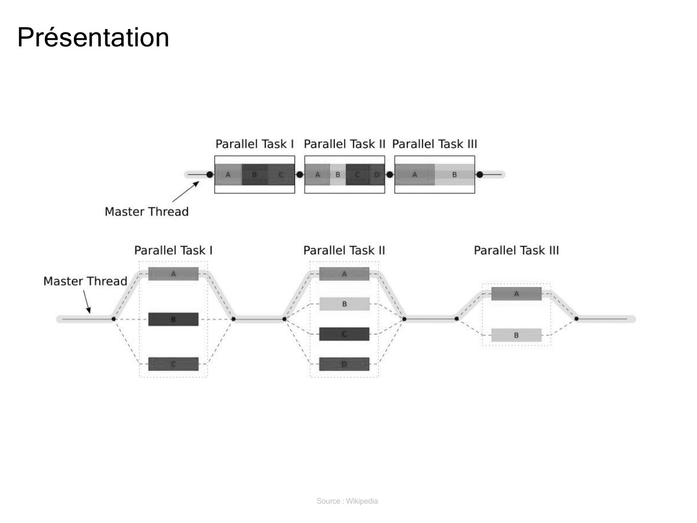
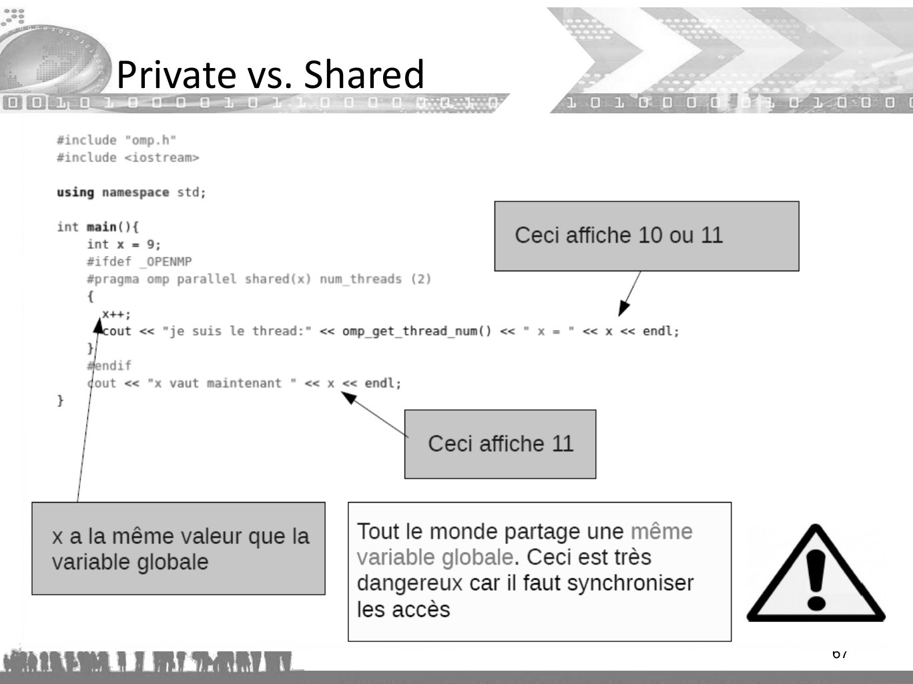
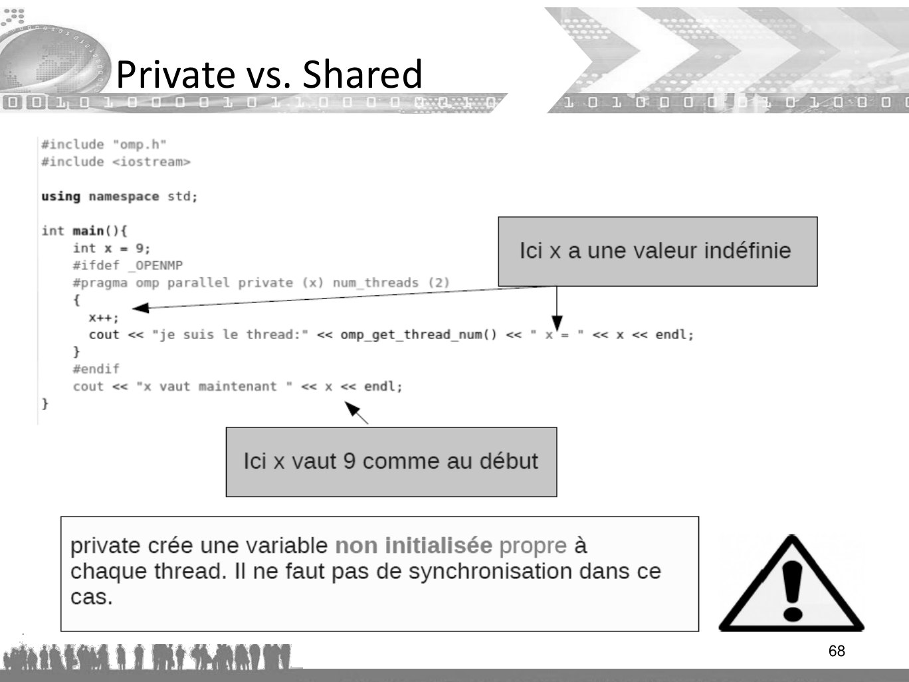
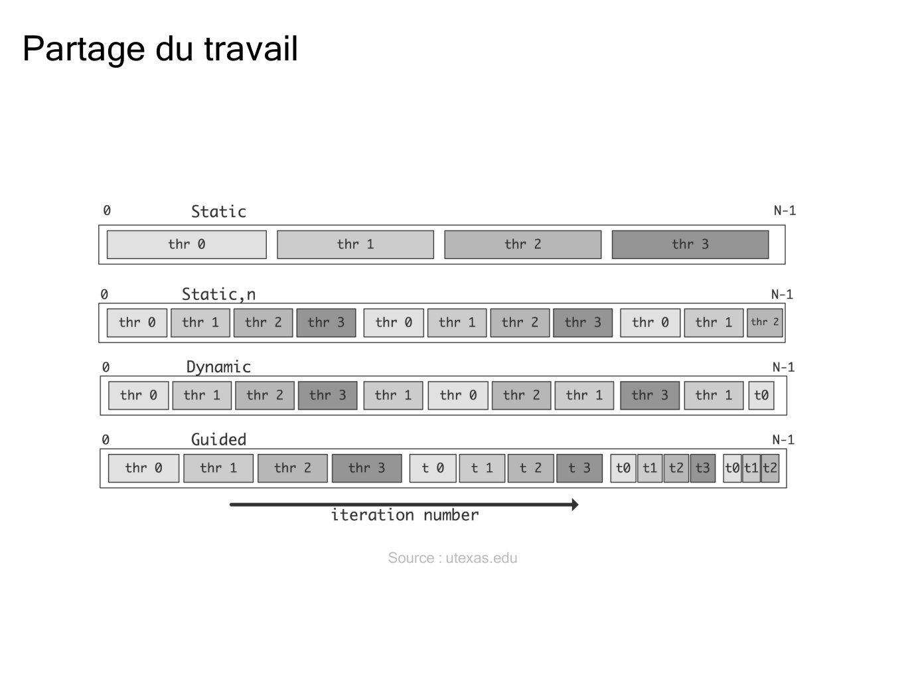
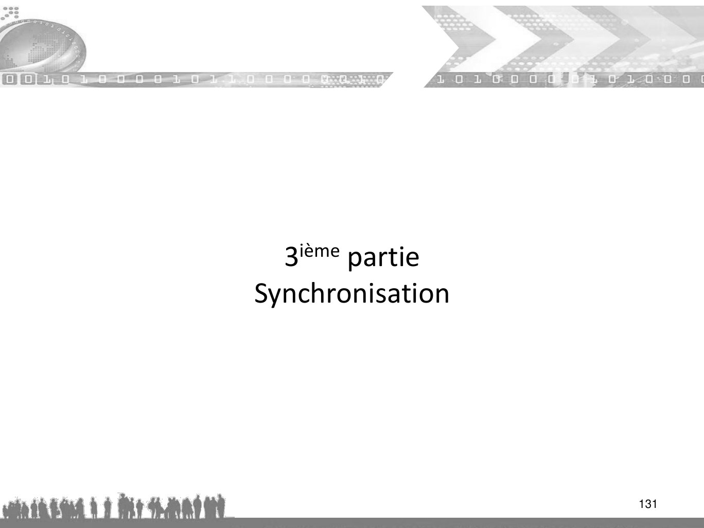

# course-OpenMP_final.pdf

[Ouvrir l’original](https://drive.google.com/open?id=1wvh7Rh7x-muPn7fxghA-qdEVknbh-bj8) · Les pages signalées comprennent du texte reconnu automatiquement ou des éléments graphiques. Le fac-similé permet de vérifier chaque lecture.

**Pages avec fac-similé ou lecture OCR** — 20, 67–68, 90, 106, 131.

## Page 1

~~~text
Algorithme et programmation parallèle
              Open MP
           clauses en bleu
         directives en rouge
     Extraits tirés du cours de Blaise Barney

                                                1
~~~

## Page 2

~~~text
   Bibliographie
• Le site officiel du standard OpenMP (en Anglais)
http://www.openmp.org

Le site microsoft France (en Français)
http://msdn.microsoft.com/fr-
  fr/library/tt15eb9t.aspx

• Les cours de l’IDRIS (en Français)
http://www.idris.fr/data/cours/parallel/openmp/

                                               2
~~~

## Page 3

~~~text
   Avant Propos
• OpenMP est une interface standard de haut niveau pour une
  programmation parallèle de type SPMD(Single Program Multiple
  Data) sur machine à mémoire partagée ou au moins
  virtuellement partagée(SGI O200).
• Basée sur les techniques du multithreading, on peut considérer
  OpenMP comme l’un des grands standards au service du calcul
  scientifique.

                                                           3
~~~

## Page 4

~~~text
Mémoire partagée avec OpenMP
• Introduction
   – Introduction
   – Architecture
   – Directive et clause
   – Parallélisme et multithread
• Bibliothèque Runtime
• Variables d’environnement
• Variables partagées et privées
• Directives
• Clauses
~~~

## Page 5

~~~text
Shared-memory programming

 Parallel programming

 A program is split in processes or threads that cooperate and coordinate together.

                                      Source : Wikipedia
~~~

## Page 6

~~~text
 Parallel programming

A program is split in processes or threads that cooperate and coordinate together.

       Shared-memory programming
       Based on the notion of threads
       Coordination and cooperation are done by writing and reading shared
       variables and by using synchronisation variables
       ►Low level: barriers, locks, critical sections, semaphores...
       ►High level: compilation directives (OpenMP).
~~~

## Page 7

~~~text
    Introduction

• Il s’agit d’un ensemble identifié de procédures et de
  directives de compilation par un mot clef initial #pragma
  visant à réduire le temps de restitution lors de l’exécution
  d’un programme sans en changer la sémantique.
   – Standard "industriel" basé sur une API pour
       • la portabilité d’applications multithreadées,
       • sur machines à mémoire partagée ou à mémoire virtuellement partagée.
   – Standardisation de la parallélisation
       • à grain fin (sur des boucles),
       • à gros grain (exemple : décomposition de domaines).

                                                                           7
~~~

## Page 8

~~~text
     Terminologie
• Il existe un vocabulaire de base propre à OpenMP
  – compliant : conforme,
  – team : équipe (sous-entendu de tâches),
  – construct : région, zone ou construction,
  – extent : littéralement extension ou terme de portée,
  – statements : instructions,
  – binding : relation de parenté,
  – nesting : nidification (imbrication),
  – orphaning : orphelinat,
  – scheduling : ordonnancement,
  – chunk : paquet ou taille du paquet
                                                           8
~~~

## Page 9

~~~text
      Architectures d’OpenMP
                           Routines de
                            la librairie
                              Runtime
                Directives et              Variable
                   clauses             d’environnement

• Les directives et leurs clauses sont de 3 types :
   partage du travail (work-sharing),
   partage des données,
   synchronisation.

• La Runtime Library et les variables d’environnement
  permettent de contrôler l’environnement d’exécution comme
  par exemple le nombre de threads                       9
~~~

## Page 10

~~~text
     Les objets d’OpenMP

• clauses : firstprivate, lastprivate, copyprivate, copyin,...
• directives : threadprivate, ...
• fonctions (Runtime): omp_set_num_threads, omp_get_wtime,
  omp_get_num_threads, omp_get_thread_num, ...
• variables d'environnement : OMP_NUM_THREADS,
  OMP_SCHEDULE, OMP_DYNAMIC, ...
• Un fichier d’entête pour le C/C++ omp.h, permet de définir les
  prototypes des fonctions OpenMP

                                                              10
~~~

## Page 11

~~~text
    Les routines de la bibliothèque Runtime

• gestion de verrous
• gestion de l’environnement d’exécution
   – modification/vérification du nombre de processus légers
   – test de région parallèle
   – nombre de processeurs dans le système
   – dynamicité du nombre de processus légers
   – création de nouveaux processus légers lors de l’imbrication
     de régions parallèles
• priorité par rapport aux variables d’environnement
  mais pas par rapport aux directives
                                                              11
~~~

## Page 12

~~~text
         Les routines de la bibliothèque Runtime

• L'API OpenMP inclut un nombre sans cesse croissant de routines de
  la bibliothèque Runtime.
• Ces routines sont utilisées pour des fins très variées:
   – getter et setter du nombre de threads
   – getter de l’identifiant du thread, de celui de son ancêtre, de la taille du pool de
     threads
   – getter et setter des caractéristiques du thread dynamique
   – demander si on est une région parallèle, et à quel niveau d’imbrication
   – setter et setter du parallélisme imbriqué
   – initialisation et de terminaison de verrous et verrous imbriqués
   – getter du temps et de la durée de résolution

                                                                                 12
~~~

## Page 13

~~~text
      Les routines de la bibliothèque Runtime

• Pour le C / C + +, toutes les routines de la bibliothèque Runtime
  sont des fonctions ou des procédures.
   #include <omp.h>

   //demander le nombre de threads de l’équipe
    int omp_get_num_threads(void)

   //demander l ’id du thread courant, le thread maitre porte le numéro 0
   int omp_get_thread_num (void)

   //retourne le nombre maximal de threads qui vont exécuter la prochaine
  région parallèle
   int omp_get_max_threads()

                                                                            13
~~~

## Page 14

~~~text
       Variables d’environnement
– Contrôle de l’ordonnancement « runtime » : OMP_SCHEDULE
– Nombre de processus légers à utiliser : OMP_NUM_THREADS
– Dynamicité du nombre de processus légers : OMP_DYNAMIC
– Contrôler la taille de la pile d’exécution des threads OMP_STACKSIZE
– Création de nouveaux threads lors de l’imbrication de régions
  parallèles : OMP_NESTED
– Spécifiant comment les itérations des boucles ont divisés
– Liaison des threads au processeur
– Activation / désactivation de parallélisme imbriqué; fixation des
  niveaux maximum d’imbrication
– Réglage de la taille de pile de thread

                                                                 14
~~~

## Page 15

~~~text
      Variable d’environnement
• Définition des variables d'environnement OpenMP se fait de la
  même manière lorsque vous définissez n’import quelle autre
  variable d'environnement, et dépend du shell que vous utilisez.

• OMP_NUM_THREADS
   – setenv OMP_NUM_THREADS 8         !--- csh/tcsh
   – export OMP_NUM_THREADS=8         !--- sh/bash

• Si le mode dynamique est désactivé, elle fixe le nombre de tâches
  de toutes les régions parallèles.
• Si le mode dynamique est activé, elle fixe le nombre maximum de
  tâches que peut comporter l’équipe de chaque région parallèle.

                                                               15
~~~

## Page 16

~~~text
   Variable d’environnement

• OMP_SCHEDULE
  – export OMP_SCHEDULE="GUIDED,256” !--- En ksh
  – export OMP_SCHEDULE="dynamic”    !--- En ksh
  – export OMP_SCHEDULE="static ”    !--- En ksh

• OMP_DYNAMIC
  – export OMP_DYNAMIC=FALSE           !--- En ksh
  – setenv OMP_DYNAMIC FALSE           !--- En csh

• OMP_NESTED
  – export OMP_NESTED=TRUE            !--- En ksh
  – setenv OMP_NESTED TRUE            !--- En csh

                                                     16
~~~

## Page 17

~~~text
     La Run-time Library d’OpenMP

• Les procédures ou fonctions de la Run-time
  Library ayant un équivalent parmi les variables
  d’environnement sont prioritaires localement.
  – Les omp_set_* sont des procédures à appeler en
    général dans les régions séquentielles.
  – Les omp_get_* sont des fonctions à appeler en
    général dans les régions parallèles et renvoient des
    int ou booléen .

                                                       17
~~~

## Page 18

~~~text
Programmation en mémoire partagée

              OpenMP est basé sur la notion de threads

   Rappel: Threads.

    Les threads sont comme des processus, sauf que les threads peuvent
     partager de la mémoire entre eux (tout en ayant une mémoire privée)
    Les données partagées sont accessibles par tous les threads
    Les données privées ne sont accessibles que par le thread propriétaire
    Différents threads peuvent suivre différents flux de contrôle via le même
     programme
    Exécutez généralement un thread par processeur (mais pourrait être plus)
     Définitions :
    Équipe de thread : ensemble de threads qui coopèrent sur une tâche.
    Thread master est responsable de la coordination de l'équipe.
~~~

## Page 19

~~~text
Programmation en mémoire partagée

 Thread communication:
~~~

## Page 20

~~~text
Présentation

               Source : Wikipedia
~~~

**Lecture OCR à contrôler**

~~~text
Présentation

Parallel Task | Parallel Task Il Parallel Task III

Re me de

Master Thread

Parallel Task | Parallel Task II Parallel Task III

Master Thread _-
~~~

## Page 21

~~~text
Directives Open MP

 Directives OpenMP les plus pertinentes
      Parallel regions construction
        ► parallel
      Work sharing
        ► for, sections, single.
      Synchronisation
        ► master, critical, atomic, barrier.
      Task management
        ► task, taskwait.
 There are more...
~~~

## Page 22

~~~text
      Directives
• Règles générales :
   – sensible à la casse
   – Directives suivent les conventions de C / C + + standard pour
     les directives de compilation
   – Seul un nom de directive peut être spécifié par la directive
   – Chaque directive s'applique au plus à l’instruction suivante, qui
     doit être un bloc structuré.
   – Les directives longues peuvent être "poursuivies" sur les lignes
     suivantes en échappant par le caractère de nouvelle ligne avec
     une barre oblique inverse ("\") à la fin d'une ligne directive

                                                                 22
~~~

## Page 23

~~~text
        Les directives OPENMP
#pragma omp directive [ clause [ clause ] . . . ]
• Formées de quatres parties :
   1 La sentinelle : #pragma omp
   2 Un nom de directive valide
   3 Une liste de clauses optionnelles (infos supplémentaires)
   4 Un retour à la ligne
• Règles générales :
   – Attention à respecter la casse
   – Une directive s’applique sur le bloc de code suivant
   – Les directives longues peuvent se poursuivre à la ligne en
   – utilisant le caractère antislash « \ » en fin de ligne

                                                                  23
~~~

## Page 24

~~~text
       Directives

• Les directives ne sont que des commentaires activables par le
  compilateur grâce une option adéquate.
• Un compilateur ne supportant pas OpenMP les ignorera.
• Permet de garantir
   – la portabilité des codes OpenMP,
   – la maintenance d’une version unique, séquentielle et parallèle,
     du code
• exemple

                                                               24
~~~

## Page 25

~~~text
     Directive: parallel
• Une région parallèle est délimitée par les directives suivantes :
   #pragma omp parallel { région parallèle }

• Les directives de début et de fin de région parallèle doivent
  figurer dans le même sous-programme.

• Cela signifie qu'il faut attendre que tous les threads doivent
  avoir exécuté leurs instructions pour pouvoir sortir de la région
  parallèle. Dès lors que tous les threads ont exécuté leurs tâches,
  les processus légers fils meurent et le processus maître exécute
  l'instruction qui suit directement la fin de région parallèle.

                                                                  25
~~~

## Page 26

~~~text
    Directive: parallel (suite)
• Une région parallèle est un bloc de code qui sera exécuté
  par plusieurs threads. C'est la construction fondamentale
  parallèle d’OpenMP.
• Au début de cette région parallèle, le code est dupliqué
  et tous les thread exécutent le même code
• Il existe une barrière implicite à la fin d'une section
  parallèle. Seul le thread principal continue l'exécution
  après ce point.
• La construction et la destruction d'une région parallèle
  ayant un coût, il est intéressant de construire une région
  parallèle sous certaines conditions, exemple si le nombre
  d’itérations est suffisamment important
                                                          26
~~~

## Page 27

~~~text
     Directive : parallel (suite)
• Le nombre de threads dans une région parallèle est
  déterminé par les facteurs suivants, par ordre de
  préséance:
   – Réglage de la clause num_threads(n)
   – Fonction de bibliothèque Utiliser des omp_set_num_threads (n)
   – Réglage de la variable d'environnement OMP_NUM_THREADS
   – Défaut de mise en œuvre - le plus souvent le nombre de CPU sur un
     nœud, mais il pourrait être dynamique (voir point suivant).
• Les threads sont numérotés de 0 (thread maître) à N-1
• L’ordonnancement des threads peut être statique ou
  dynamique

                                                                         27
~~~

## Page 28

~~~text
   Directive : parallel (suite)
• Thread dynamique
  – Utilisez la routine omp_get_dynamic () de la
    bibliothèque afin de déterminer si les threads
    dynamiques sont activés.
  – Si elle est supportée, les deux méthodes disponibles
    pour permettre les discussions dynamiques sont les
    suivants:
     • La routine de bibliothèque omp_set_dynamic ()
        – void omp_set_dynamic( int val );
     • Réglage de la variable d'environnement OMP_DYNAMIC à
       TRUE
                                                       28
~~~

## Page 29

~~~text
Régions parallèle

                                            Source : Wikipedia
  Un programme commence son exécution sur un seul thread (le thread maître).
  Lorsque la première région parallèle est rencontrée, le thread maître crée une équipe de
  threads (modèle fork/join).
  Chaque thread exécute les instructions qui se trouvent à l'intérieur de la région parallèle.
  À la fin de la région parallèle, le thread maître attend la fin des autres threads et continue
  d'exécuter les instructions suivantes.
~~~

## Page 30

~~~text
Régions parallèle

                                        Source : Wikipedia

    Dans une région parallèle, les variables peuvent être soit partagées (tous les threads
    voient la même copie), soit privées (chaque thread a sa propre copie).
    Tous les threads voient la même copie des variables partagées.
    Tous les threads peuvent lire ou écrire des variables partagées.
    Chaque thread peut avoir ses propres variables privées, invisibles pour les autres threads.
    Une variable privée ne peut être lue ou écrite que par son thread propriétaire.
    Barrière implicite à la fin de la région parallèle.
~~~

## Page 31

~~~text
   Parallélisme et multithread

• La parallélisation se fait en insérant des
  directives dans le code séquentiel pour
  construire des régions parallèles

                                               31
~~~

## Page 32

~~~text
Régions parallèle

      OpenMP example:
      1#include <omp. h>
      2#include <stdio . h>
      3
      4 int main ( ) {
      5
      6      int sharedvar = 1 ;
      7      printf ( " Hola! I am the master thread :-) \n" ) ;
      8
      9      #pragma omp parallel
     10      {
     11      int i d = omp_get_thread_num ( ) ;
     12      printf ( "I am thread %d. sharedvar = %d\n" , id , sharedvar ) ;
     13      }
     14
     15      printf ( " The master thread ends... \n" ) ;
     16      return 0 ;
     17 }

  Compilation:
         gcc -fopenmp -Wall -Wextra -o example01 example01.c
~~~

## Page 33

~~~text
Régions parallèle

                                        Source : Wikipedia

 Notez que les variables définies dans la section séquentielle sont partagées à l'intérieur
 de la région parallèle.
 Les variables définies à l'intérieur de la région parallèle sont privées pour chaque thread.
 Si la région parallèle contient des appels de fonction, les variables locales de la fonction
 seront privées.
~~~

## Page 34

~~~text
       Parallélisme et multithread
• Un programme OpenMP est exécuté par un processus lourd
  unique.
• Ce processus lourd active des processus légers (threads) à l’entrée
  d’une région parallèle.
• Chaque thread accède à toutes les ressources (mémoires,
  descripteurs de fichiers, ...) du processus.
• Chaque thread exécute une tâche composée d’un ensemble
  d’instructions différentes grâce à sa propre pile(stack).
• Un programme OpenMP est une alternance de régions
  séquentielles et de régions parallèles.
• Les threads sont identifiés par leur rang, et celui du thread maitre
  est 0
• Une région séquentielle est toujours exécutée par le thread maître
  34
~~~

## Page 35

~~~text
         Parallélisme et multithread

• OpenMP correspond plutôt à un parallélisme de contrôle qu‘à un
  parallélisme de données. Pendant l’exécution d’une tâche par un
  thread, une variable peut être lue et/ou modifiée en mémoire.
      – Elle peut être définie dans la pile (stack) (espace mémoire local) d’un
        processus léger ; on parle alors de variable privée.
      – Elle peut être définie dans un espace mémoire partagé par tous les
        processus légers ; on parle alors de variable partagée

 35
~~~

## Page 36

~~~text
       Parallélisme et multithread
OpenMP est un ensemble de constructions parallèles, basé sur des
directives de compilation pour architecture à mémoire partagée.

• Il est basé sur le principe du fork and join
• Le programme est séquentiel
• Un seul thread(tâche) maître s’exécute jusqu’à la 1ère région
  parallèle
• Ce thread crée une équipe de threads dont il est maître
• Son effectif est contrôlé par variable d'environnement ou appel
  librairie
• Après la région parallèle toutes les tâches se synchronisent
• Seul le thread maître poursuit son exécution et l'exécution
  redevient séquentielle
                                                                36
~~~

## Page 37

~~~text
   Exemple de la structure d’un code source OpenMP
#include <omp.h>
main () {
int var1, var2, var3;
//code serie.
//Début d’une section parallèle. Création du pool de threads.
//Spécifiez la portée des variables
#pragma omp parallel private(var1, var2) shared(var3)
{
     Section parallèle exécutée par tous les threads.
    Autre directive OpenMP.
    Appel la librairie Run-time.
    Tous les threads rejoignent le thread principal pour qu’ils soient démantelés
}
//Reprise du code série.
}                                                                             37
~~~

## Page 38

~~~text
      exemple

int main(){
                             ● Bloc 1 sera exécuté par tous les
#pragma omp parallel           threads
// bloc 1                        ● On verra comment ce
#pragma omp parallel                nombre par défaut est défini
   omp_num_threads(2)        ● Bloc 2 sera exécuté par une
// bloc 2                       équipe de 2 threads
                             ● Uniquement le thread principal
#pragma omp parallel if(0)
                               va exécuter le Bloc 3
// bloc 3                        ● 0 = faux!
}                                ● Si on aurait mis if (1) ça serait
                                   équivalent au premier pragma

                                                                38
~~~

## Page 39

~~~text
     Directive : parallel (suite)

• Régions parallèles imbriquées
  – Utilisez la fonction de bibliothèque omp_get_nested() pour
    déterminer si le parallélisme imbriqué est activé.
  – Les deux méthodes disponibles pour permettre aux régions
    parallèles imbriquées (si supporté) sont les suivants:
     • La routine de bibliothèque omp_set_nested ()
     • Réglage de la variable d'environnement OMP_NESTED à TRUE
  – Si ce n'est pas pris en charge, une région parallèle imbriquée
    dans une autre région résulte en parallèle à la création d'une
    nouvelle équipe, composée d'un thread, par défaut
    (traitement séquentiel).

                                                                  39
~~~

## Page 40

~~~text
    Directive : parallel (suite)

• Restrictions
  – Il est illégal de brancher (goto) dans ou hors d'une
    région parallèle
  – Seule une seule clause IF est autorisée
  – Seule une seule clause NUM_THREADS est autorisée

                                                     40
~~~

## Page 41

~~~text
    La portée d’une région parallèle
   – Les directives de début et de fin d’une région parallèle
     doivent être dans le même sous-programme.
   – Les branchements hors d’une région parallèle sont illégaux
     (i.e. le constructeur doit les repérer et les interdire).
• La portée lexicale d’une région parallèle
   – Elle inclut les instructions comprises entre les directives de
     début et de fin de cette région
• La portée dynamique
   – Elle est constituée par la portée lexicale et les sous-
     programmes (et les sous-sous-programmes) appelés au
     sein de cette portée lexicale.

                                                                 41
~~~

## Page 42

~~~text
        Exemple : omp_set_dynamic.c

#include <stdio.h>
#include <omp.h>
                               Le nombre de threads ne dépasse jamais la valeur définie
                               par omp_set_num_threads ou par OMP_NUM_THREADS.
int main()
{                               gcc -fopenmp omp_set_dynamic.c -o omp_set_dynamic
                                ./omp_set_dynamic
  omp_set_dynamic(9);
  omp_set_num_threads(4);
  printf("%d\n", omp_get_dynamic( ));
  #pragma omp parallel
     #pragma omp master
     {
       printf("%d\n", omp_get_dynamic( ));
     }
}
1
1
                                                                                 42
~~~

## Page 43

~~~text
        Exemple : omp_set_nested.c
#include <stdio.h>
#include <omp.h>
                                         Le nombre de threads augmente de façon
int main( )                              exponentielle en imbriquant les régions parallèles
{
  omp_set_nested(1);                      gcc -fopenmp omp_set_nested.c -o omp_set_nested
  omp_set_num_threads(4);                 ./omp_set_nested
  printf("%d\n", omp_get_nested( ));
  #pragma omp parallel
     #pragma omp master
     {
       printf("%d\n", omp_get_nested( ));
     }
}
1
1
                                                                                     43
~~~

## Page 44

~~~text
     Portée d’une région parallèle
int main(){
 #pragma omp parallel
  {
    !--- bloc1          • La portée lexicale couvre les
    appel sub1()        blocs 1, 2, 3.
    !--- bloc2
    appel sub2()

  }
    !--- bloc3
                        • La portée dynamique est
}// fin de main         constituée de ses 3 blocs mais
                        aussi de sub1, sub2, sub3.
procedure sub1(){ }
procedure sub3(){ }

procedure sub2(){
  call sub3()
}
~~~

## Page 45

~~~text
           Directive orpheline
#include <stdio.h>
#define SIZE 1024
void init ( int * vec ) {          L’influence d’une région parallèle
   int i ;                         porte sur le bloc de code qui la suit
   #pragma omp for                 directement (étendue statique) et
   for ( i = 0; i < SIZE ; i ++)   sur les fonctions appelées dedans
    vec [ i ] = 0;                 (étendue dynamique)
}                                  • Directives en dehors de l’étendue
int main ( ) {                        statique dites « orphelines »
int vec [SIZE] ;                   • Liées à la région parallèle qui les
#pragma omp parallel                  exécute immédiatement
init ( vec ) ;                     • Ignorées à l’exécution si non liées à
return 0;                             une région parallèle
}
                                                                         45
~~~

## Page 46

~~~text
Définir/obtenir le nombre de threads
  Définition du nombre de threads :
      En tant que variable d'environnement (bash/ksh):
        ► export OMP_NUM_THREADS=8
~~~

## Page 47

~~~text
Définir/obtenir le nombre de threads
     Définition du nombre de threads :
     En tant que variable d'environnement (bash/ksh):
     ►export OMP_NUM_THREADS=8
     1   # ! / bin / bash

     2
     3 export OMP_NUM_THREADS=4

     . / example01
~~~

## Page 48

~~~text
Définir/obtenir le nombre de threads

     Définition du nombre de threads :
     En tant que variable d'environnement (bash/ksh):
     ►export OMP_NUM_THREADS=8
     Dans le code du programme:
     ►void omp_set_num_threads(num_threads);
         1 #include <omp. h>
         2 #include <stdio . h>
         3
         4 i n t main ( ) {
          5      omp_set_num_threads ( 8 ) ;
          6
          7      printf ( " Hola! I am the master thread :-) \n" ) ;
          8
          9      # pragma omp parallel
         10      {
         11      int id = omp_get_thread_num ( ) ;
         12      printf ( "I am thread %d \n" , id ) ;
         13      }
         14
         15       printf ( " The master thread ends... \n" ) ;
         16       return 0 ;
         17 }
~~~

## Page 49

~~~text
Définir/obtenir le nombre de threads
  Définition du nombre de threads :
      En tant que variable d'environnement (bash/ksh):
        ► export OMP_NUM_THREADS=8
      Dans le code du programme:
        ► void omp_set_num_threads(num_threads);
      À l'intérieur de la région parallèle:
        ► #pragma omp parallel num_threads(num_threads)
~~~

## Page 50

~~~text
Définir/obtenir le nombre de threads
  Définition du nombre de threads :
  En tant que variable d'environnement (bash/ksh):
  ►export OMP_NUM_THREADS=8
  Dans le code du programme:
  ►void omp_set_num_threads(num_threads);
  À l'intérieur de la région parallèle:
  ►#pragma omp parallel num_threads(num_threads)
             1 #include <omp.h>
             2 #include <stdio.h>
             3
             4 int main ( ) {
             5     printf ( " Hola! I am the master thread :-) \n" ) ;
             6
             7     # pragma omp parallel num_threads ( 8 )
             8     {
             9     int id = omp_get_thread_num ( ) ;
            10      printf ( "I am thread %d \n" , i d ) ;
            11     }
            12
            13      printf ( " The master thread ends... \n" ) ;
            14      return 0 ;
            15 }
~~~

## Page 51

~~~text
Définir/obtenir le nombre de threads
  Obtenir le nombre de threads (à l'intérieur du programme):
      Nombre de threads en cours d'exécution dans l'équipe.
        ► int omp_get_num_threads();
      Thread id
        ► int omp_get_thread_num();
        ► Between 0 and omp_get_num_threads() -1
~~~

## Page 52

~~~text
Définir/obtenir le nombre de threads
  Obtenir le nombre de threads (à l'intérieur du programme):
      Nombre de threads en cours d'exécution dans l'équipe.
        ► int omp_get_num_threads();
      Id du thread
        ► int omp_get_thread_num();
        ► Between 0 and omp_get_num_threads() -1
~~~

## Page 53

~~~text
Définir/obtenir le nombre de threads
  Obtenir le nombre de threads (à l'intérieur du programme):
  Nombre de threads en cours d'exécution dans l'équipe.
  ►int omp_get_num_threads();
  Id du thread
  ►int omp_get_thread_num();
  ►Entre 0 et omp_get_num_threads() -1
             1 #include <omp. h>
             2 #include <stdio.h>
             3
             4 int main ( ) {
             5
             6   omp_set_num_threads ( 8 ) ;
             7   printf ( "How many threads (master): %d \n" , omp_get_num_threads ( ) ) ;
             8
             9   #pragma omp parall l num_threads ( 4 )
            10   {
            11   int id = omp_get_thread_num ( ) ;
            12   printf ( "I am thread %d \n" , i d ) ;
            13   printf ( "How many threads in the parallel region (%d): %d \n\n" , id,omp_get_num_threads ( ) ) ;
            14   }
            15
            16   printf ( " The master thread ends... \n" ) ;
            17   return 0 ;
            18   }
~~~

## Page 54

~~~text
Définir/obtenir le nombre de threads
     Obtenir le nombre de threads (à l'intérieur du programme):
     Nombre de threads en cours d'exécution dans l'équipe.
     ►int omp_get_num_threads();
     Id du thread
     ►int omp_get_thread_num();
     ►Entre [0 et (omp_get_num_threads()-1)]

     Autres :
     int omp_get_max_threads();
     int omp_get_num_procs();
     int omp_in_parallel();
     Il y en a d'autres...
~~~

## Page 55

~~~text
            Directives
• Format des directives
sentinelle nom-directive [clause,...] newline
#pragma omp parallel default(shared) private(beta, pi)
int nbth = omp_get_num_threads();
Où :

   #pragma omp        obligatoire comme préfixe des directives.
   parallel           est une directive.
       [clause,...]   sont les clauses, optionnelles, qui permettent de décrire la
                      visibilité des variables

                                                                                     55
~~~

## Page 56

~~~text
Région parallèle
    Syntaxe:
    #omp parallel [ clause [ clause ] ]
    {
    / / Parallel region
    }
    •   Nous pouvons contrôler l'état du partage de données
    •   Quelles données des sections séquentielles sont transférées dans des régions
        parallèles et comment
    •   Quelles données seront visibles par tous les threads ou privées pour chaque thread

    Clauses permises dans la région parallèle
    if(logical expression)
    num_threads(integer)
    private(list of variables)
    shared(list of variables)
    default(shared | none)
    firstprivate(list of variables)
    reduction(operator: list of variables)
    copyin(list of variables uniquement avec threadprivate)
~~~

## Page 57

~~~text
      Compilation conditionnelle par sentinelle ou par
      macro

Une ligne de code peut être compilée
conditionnellement de 3 façons :
  – grâce à la parallélisation conditionnelle avec la clause if,
  – si elle est précédée d’une sentinelle de compilation
    conditionnelle
     • les sentinelles possibles sont : !$, C$, *$ ;
     C$ Boolean=omp_in_parallel();
  – grâce à la macro de préprocessing _OPENMP prédéfinie,
     #ifdef _OPENMP
             #pragma omp parallel default(shared) private(beta, pi)
     #endif
~~~

## Page 58

~~~text
      Directive : région parallèle conditionnelle
• i f ( / Expression scalaire / )
• Si elle est présente, elle doit évaluer la valeur non-zéro (C / C + +)
   pour créer une équipe de threads, sinon, la région est exécutée
   séquentiellement par le thread maître.
#include < stdio.h>
#define PARALLEL 1 / / 0 pour sé quent iel , != 0 pour parallèle
int main ( ) {
  #pragma omp parallel if (PARALLEL)
  p r i n t f ( " Hello , openMP\ n " ) ;
  return 0;
}

                                                                    58
~~~

## Page 59

~~~text
Région parallèle

     #omp parallel if(expression logique)
     Création d'un thread team lorsque l'expression logique est différente de 0. Dans le
     cas contraire, l'exécution sera séquentielle.
     1 #include <omp.h>
     2 #include <stdio.h>
     3 #include <stdlib.h>
     4
     5 int main ( int argc , char * argv [ ] )   {
     6
     7 omp_set_num_threads ( 4 ) ;
     8
     9 if (argc ! = 3 ) {
    10 printf ( "Wrong number of parameters\n" ) ;
    11 exit ( 0 ) ;
    12 }
    13
    14 int a = atoi ( argv [ 1 ] ) ;
    15 int b = atoi ( argv [ 2 ] ) ;
    16
    17 #pragma omp parallel i f ( a > b )
    18 {
    19 int i d = omp_get_thread_num ( ) ;
    20 printf ( "I am thread %d\n" , i d ) ;
    21 return 0;
    22 }
    23 }
~~~

## Page 60

~~~text
Région parallèle

     #omp parallel num_threads(integer)
     Création d'une équipe thread qui animera la région parallèle.
     Déjà vu.
~~~

## Page 61

~~~text
Parallel region
  #omp parallel private(list of variables)
      Les variables de la liste sont déclarées privées pour chaque thread.
        ► Chaque thread aura une copie locale de la variable.
        ► Les variables ne sont pas définies avant et après la région parallèle.

  #omp parallel shared(list of variables)
      Les variables de la liste sont partagées par tous les threads.
        ► Il existe un risque d'accès simultané.
        ► Les variables partagées sont utilisées lorsque:
                 Il existe des variables en lecture seule que nous souhaitons partager.
                 Chaque thread accède à une partie différente de la variable (par exemple des
                 tableaux). Nous voulons communiquer une valeur à tous les threads.

  #omp parallel default(shared | none)

      shared : Toutes les variables de la région parallèle seront partagées (partagées)
      none
      - Pas de statut par défaut
      - Il faut préciser le statut de toutes les variables.
~~~

## Page 62

~~~text
Région parallèle
     Examples (I) :
     1 #include <omp. h>
     2 #include <stdio . h>
     3
     4
     5 int main ( ) { / / This code i s wrong ! !
     6 omp_set_num_threads ( 4 ) ;
     7
     8      int a = 2 ;
     9      int b = 3 ;
    10
    11      #pragma omp parallel private ( a ) shared ( b )
    12      {
    13            int id = omp_get_thread_num ( ) ;
    14            #pragma omp critical      / / Ignore t h i s pragma f o r now
    15            {
    16                printf ( "Thread %d. Before modification a: %d, b: %d\n" , id , a , b ) ;
    17
    18                a++;
    19                b++;
    20                printf ( "Thread %d. After modification a: %d, b: %d\n" , id , a , b ) ;
    21
    22                }
    23        }
    24     printf ( "Master thread. a: %d. b: %d\n" , a , b ) ;
    25     return 0 ;
    26
    27 } // fin de main
~~~

## Page 63

~~~text
     La primitive omp_set_dynamic
void omp_set_dynamic(int dynamic_threads);

  – dynamic_threads ≠ 0 alors le nombre de threads utilisés pour
    exécuter les régions parallèles suivantes peut être ajusté au
    mieux par le système
  – dynamic_threads = 0 la modification dynamique est désactivé.

                                                             63
~~~

## Page 64

~~~text
         Clauses de statut des variables
OpenMP cible les architectures de mémoire partagée ; la plupart des variables sont
partagées par défaut

Nous pouvons contrôler l'état du partage de données
• Quelles données des sections séquentielles sont transférées dans des régions
   parallèles et comment
• Quelles données seront visibles par tous les threads ou privées pour chaque
   thread
Principales clauses permises dans une region parallèle:
    – private : définit une liste de variables privées
    – firstprivate : privé avec initialisation automatique
    – lastprivate : privé avec mise à jour automatique
    – shared : définit une liste de variables partagées
    – par défaut : modifier le statut par défaut
    – réduction : définit une liste de variables à réduire
                                                                             64
~~~

## Page 65

~~~text
    Déclaration du statut d'une variable
Le statut d'une variable utilisée à l'intérieur d'une région
parallèle est soit partagé, soit privé.
• Si une variable est partagée, elle figure dans la
  mémoire globale. Chaque thread peut y accéder et
  modifier son contenu.
• Si une variable est privée, cette variable figure dans la
  pile de chaque thread et sa valeur est indéfinie en
  entrée de région parallèle. Un thread ne peut alors
  accéder qu'au contenu de la variable figurant dans sa
  pile, et lui seul peut la modifier.

                                                         65
~~~

## Page 66

~~~text
       Clause de déclaration du statut d’une variable
• Par défaut dans les régions parallèles, toutes les variables
  sont partagées (ou publiques).
• La déclaration se fait avec la clause PRIVATE ou SHARED.

• PRIVATE (liste_de_variables) pour des variables privées
• SHARED (liste_de_variables) pour des variables partagées

                                                           66
~~~

## Page 67

~~~text
Private vs. Shared

                     67
~~~

**Lecture OCR à contrôler**

~~~text
#include “omp.h"
#include <iostream>

using namespace std;

int main(){

int: x2 9; Ceci affiche 10 ou 11
#ifdef _OPENMP
#pragma omp parallel shared(x) num threads (2)
/
xe;
out << "je suis le thread:" << omp_get_thread_num() << " x = " << x << endl;
}
endif
out << "x vaut maintenant " << x << endl;
}
Ceci affiche 11

x a la même valeur que la
variable globale

Tout le monde partage une même
variable globale. Ceci est très
dangereux car il faut synchroniser
les accès

or
~~~

## Page 68

~~~text
Private vs. Shared

                     68
~~~

**Lecture OCR à contrôler**

~~~text
Private vs. Shared is
ite D 06 Oh : Bae. D 1-0-0 0 1

La Sere

#include “omp.h"
#include <iostream>

using namespace std;

int main(){
mix Ici x a une valeur indéfinie
#ifdef _OPENMP
#pragma omp parallel private (x) num threads (2)
{ +
X++;
cout << "je suis le thread:" << omp get thread num() << “ x = " << x << endl;
}
#endif
cout << "x vaut maintenant " << x << endl;

, LS

Ici x vaut 9 comme au début

private crée une variable non initialisée propre a
chaque thread. II ne faut pas de synchronisation dans ce
cas.

68
~~~

## Page 69

~~~text
    Autres modificateurs d’accès

• default (private | shared | none) pour spécifier un
  statut par défaut
• Si la clause default (none) est spécifiée, toute
  variable de la région parallèle devra avoir
  explicitement le statut private ou shared.
• Une variable privée peut recevoir la valeur qu'elle
  avait juste avant la région parallèle. Cette variable se
  verra attribuer le statut privé grâce à la clause
  firstprivate (private avec initialisation automatique)
• lastprivate private avec mise à jour automatique)
                                                        69
~~~

## Page 70

~~~text
           Exemple d’utilisation de la clause private
#include <stdio.h>
#include <unistd.h>
#include <stdlib.h>
int main( ) {
 int val ;                             •    Compilez et exécutez ce code avec et sans private(val)
 #pragma omp parallel                  •    Qu’observez-vous et pourquoi ?
 // private (val)                      •    Est-ce risqué même avec la clause private ?
 {
    val = rand( ) ;
    sleep ( 1 ) ;
    printf ( "My val : %d \ n " , val ) ;
 }
 return 0 ;
}

                                                                                             70
~~~

## Page 71

~~~text
Région parallèle

    Exmple (I) :
    1 #include <omp.h>
    2 #include < stdio.h>
    3
    4 int main( ) {
    5 omp_set_num_threads ( 4 ) ;
    6
    7 int nthreads , tid ;
    8
    9 #pragma omp parallel private ( nthreads , tid )
    10 {
    11       tid = omp_get_thread_num ( ) ;
    12       printf ( "Hola! I am thread = %d\n" , tid ) ;
    13
    14       if    ( tid == 0 ) / /   If   I am the master
    15       {
    16            nthreads = omp_get_num_threads ( ) ;
    17            printf ( "Number of threads = %d\n" , nthreads ) ;
    18       }
    19   }
    20 }
~~~

## Page 72

~~~text
Région parallèle

  Examples (II) :
      1 # i n c l u d e <omp . h>
      2# i n c l u d e < s t d i o . h> 3
      4 i n t main ( ) {
      5omp_set_num_threads ( 4 ) ; 6
      7   i n t nthreads , t i d ;
      8
      9 #pragma omp p a r a l l e l p r i v a t e ( nthreads , t i d )
     10   {

     11       t i d = omp_get_thread_num ( ) ;
     12       p r i n t f ( "Hola! I am thread = %d\n" , t i d ) ;
     13
     14       if    ( t i d == 0 ) / /   If   I am the master
     15       {
     16            nthreads = omp_get_num_threads ( ) ;
     17            p r i n t f ( "Number of threads = %d\n" , nthreads ) ;
     18       }
     19   }
     20 }
~~~

## Page 73

~~~text
 Région parallèle
Examples (III) :
1# i n c l u d e <omp. h>
2# i n c l u d e < s t d i o . h>
3 #define N 12
4
5 int fillArray ( i n t , i n t * ) ;
                                                     27
6
                                                     28 int fillArray (int tid , int * array )
7 i n t main ( ) {                                   29 {
8    omp_set_num_threads ( 4 ) ;
                                                     30i n t begin , end , nth , chunk ;
9    i n t id , i ;
                                                     31nth = omp_get_max_threads ( ) ;
10 i n t A [ N ] ;
                                                     32chunk = N/nth ;
11     f o r ( i = 0 ; i <N; i ++) A [ i ] = 12 ;
                                                     33      / / integer di vision ( on purpose )
12
                                                     34
13 #pragma omp parallel private (i d ) shared ( A)            printf ( "Thread %d. Chunk: %d\n" , tid , chunk ) ;
                                                     35
14 {
                                                     36
15 i d =omp_get_thread_num ( ) ;
                                                     37begin = t i d * chunk ;
16 fillArray ( id , A) ;
                                                     38      end = begin + chunk ;
17 }
18                                                   39
                                                     40       f o r ( i n t i =begin ; i <end ; i ++)
19     printf ( "|" ) ;
                                                     41              array [ i ] = t i d ; 42
20     for (i = 0 ; i <N; i ++) 21 {
                                                     43       return 0;
22 printf ( "%d |" ,A [ i ] ) ;                      44 }
23 }
24     printf ( "\n" ) ; 25
26     return 0 ;
27 }
~~~

## Page 74

~~~text
       clause firstprivate
• Variables initialisées à partir de variables partagées
• Les objets C++ sont construits par copie

incr = 0;
#pragma omp parallel for firstprivate(incr) num_threads(2)
for (i = 0; i <= MAX; i++) {
if ((i%2)==0) incr++;
A[i] = incr;
}                               Chaque thread prend sa propre copie
                                de incr avec une valeur initiale à 0

                                                                       74
~~~

## Page 75

~~~text
Region Parallèle
     #omp parallel firstprivate(list of variables)
     En général, les variables privées ne sont pas initialisées au début de la région
     parallèle.
     Cependant, les variables de la liste des firstprivate sont initialisées.
     1 #include <omp. h>
     2 #include < stdio.h>
     3
     4 int main( ) {
     5 omp_set_num_threads ( 4 ) ;
     6
     7 int a = 2 ;
     8 int b = 3 ;
     9
     10 #pragma omp paralel firstprivate ( a ) shared ( b )
     11 {
     12     int i d = omp_get_thread_num ( ) ;
     13     printf ( "Thread %d. a: %d. b: %d\n" , id , a , b ) ;
     14     a++;
     15     b++;
     16     printf ( "Thread %d. a++: %d. b++: %d\n" , id , a , b ) ;
     17 }
     18
     19 printf ( "Master. a: %d. b: %d\n" , a , b ) ;
     20
     21    return 0 ;
     22 }
~~~

## Page 76

~~~text
       clause lastprivate
• La variable met à jour des variables partagées en utilisant la
  valeur de la dernière itération
• Les objets C++ sont mis à jour comme si par affectation
void sq2(int n, double *lastterm)
{
   double x; int i;
  #pragma omp parallel for lastprivate(x)
  for (i = 0; i < n; i++){
    x = a[i]*a[i] + b[i]*b[i];
    b[i] = sqrt(x);
                                      “x” a la valeur qu'elle détenait
  }                                   pour la "dernière itération séquentielle"
  *lastterm = x;                      itération (i.e., for i=(n-1))
}

                                                                              76
~~~

## Page 77

~~~text
       Directive threadprivate
#pragma omp threadprivate(list)
• Rendre des variables globales privées au fichier et persistantes au
  thread à travers l'exécution de plusieurs régions parallèles
    C/C++ : variable globales, statiques, membre statique d’une classe
    list : une liste avec la virgule comme séparateur des variables que vous
     souhaitez rendre exclusives à un thread.
• Différent de les considérer comme PRIVATE
    Avec PRIVATE les variables globales sont masquées.
    THREADPRIVATE préserve la portée globale à l’intérieur de chaque thread
• Les variables threadprivate peuvent être initialisées en utilisant la
  clause COPYIN
• Restrictions
    Le nombre de threads ne doit pas varier (omp_dynamic = false)
    La directive doit suivre la déclaration.                                   77
~~~

## Page 78

~~~text
       La directive threadprivate (suite)
• La directive doit apparaître après la déclaration de la liste des
  variables globales ou statiques concernées.
• Chaque thread reçoit sa propre copie de variable, afin que la
  donnée écrite par un thread ne soit pas visibles aux autres
  threads.
• La valeur des variables n’est pas spécifiée dans la première région
  parallèle sauf si la clause copyin est utilisée
• Ensuite, les variables sont préservées
• Le nombre de threads doit être fixe (omp_set_dynamic(0))
• Clauses possibles : aucune

                                                                  78
~~~

## Page 79

~~~text
      La directive threadprivate (exemple1)

• Créer un compteur privé dans chaque thread.
int counter = 0;
#pragma omp threadprivate(counter)
int increment_counter()
{
counter++;
return (counter);
}

                                                79
~~~

## Page 80

~~~text
          La   directive
#include <omp.h>
                         threadprivate (exemple2)
int a, b, i, tid;
float x;
#pragma omp threadprivate(a, x)
main () {
printf("1st Parallel Region:\n");
#pragma omp parallel private(b, tid)
{ tid = omp_get_thread_num();
a = tid ; b = tid; x = 1.1 * tid +1.0;
printf("Thread %d: a,b,x= %d %d %f\n",tid,a,b,x);
} /* end of parallel section */
printf("************************************\n");
printf("Master thread doing serial work here\n");
printf("************************************\n");
printf("2nd Parallel Region:\n");
#pragma omp parallel private(tid)
{ tid = omp_get_thread_num();
printf("Thread %d: a,b,x= %d %d %f\n",tid,a,b,x);
} /* end of parallel section */
                                                    80
~~~

## Page 81

~~~text
     La directive threadprivate (exemple2 suite)
% export OMP_NUM_THREADS=4
% ./a.out
1st Parallel Region:
Thread 0: a,b,x= 0 0 1.000000
Thread 1: a,b,x= 1 1 2.100000
Thread 2: a,b,x= 2 2 3.200000
Thread 3: a,b,x= 3 3 4.300000
************************************
Master thread doing serial work here
************************************
2nd Parallel Region:
Thread 0: a,b,x= 0 0 1.000000
Thread 3: a,b,x= 3 0 4.300000
Thread 1: a,b,x= 1 0 2.100000
Thread 2: a,b,x= 2 0 3.200000

                                                   81
~~~

## Page 82

~~~text
                 La directive threadprivate (exemple3)
#include <stdio.h>
#include <omp.h>
int tid , tprivate , rprivate ;
#pragma omp threadprivate ( tprivate )
int main ( ) {
  // On interdit explicitement les threads dynamiques
  omp_set_dynamic (0) ;
  printf ( "Région parallèle 1\ n " ) ;
  #pragma omp parallel private ( tid, rprivate )
  {
      tid = omp_get_thread_num( ) ;
      tprivate = tid ;
      rprivate = tid ;
      printf ( "Thread %d : tprivate=%d rprivate=%d \ n " , tid , tprivate , rprivate ) ;
  }
  printf ( "Région parallèle 2\ n " ) ;
  #pragma omp parallel private ( tid , rprivat e)
  {
    tid = omp_get_thread_num( ) ;
    printf ( " Thread %d : tprivate=%d rprivate=%d \ n " , tid , tprivate , rprivate ) ;
  }
  return 0;
}
                                                                                            82
~~~

## Page 83

~~~text
     La clause copyin

copyin (list)
• donne un moyen d’assigner la même valeur aux
  variables threadprivate pour tous les threads.
• La variable du thread master est utilisée comme
  valeur à copier
• Les commons privés (thread) sont initialisés par la
  valeur du thread maître.

                                                 83
~~~

## Page 84

~~~text
     Clause copyin
• La clause copyin fournit un moyen pour affecter
  la même valeur aux variables threadprivate pour
  tous les threads de l'équipe.
• copyin(var)
• copyin s'applique aux directives suivantes :
  – parallel
  – for (OpenMP)
  – sections (OpenMP)

                                              84
~~~

## Page 85

~~~text
   Statut d'une variable d'un sous-programme

• Dans un sous-programme appelé dans une
  région parallèle, toute variable locale est
  implicitement privée pour chaque thread

                                                85
~~~

## Page 86

~~~text
   Statut d'une variable transmise par argument

• A l'intérieur d'une procédure ou d'une fonction
  appelée dans une région parallèle, toute
  variable passée par argument hérite du statut
  qu'elle avait dans la portée lexicale de la région
  parallèle

                                                86
~~~

## Page 87

~~~text
     Statut d'une variable de type tableau dynamique

• Un tableau dynamique est implicitement partagé
  s'il est alloué en dehors de toute région parallèle.

• Un tableau dynamique aura le statut privé soit s'il
  reçoit explicitement ce statut dans la portée
  lexicale via la clause PRIVATE, soit s'il reçoit
  implicitement ce statut dans un sous-programme
  appelé dans une région parallèle.

                                                  87
~~~

## Page 88

~~~text
     Autres modificateurs d’accès

• Les variables private et firstprivate ont une adresse unique dans
  chaque thread parallèle : elles sont dupliquées.
• Elles ne sont pas accessibles en dehors de leur région parallèle.
• Seules, celles déclarées comme firstprivate sont initialisées au
  début de la région.
• Les variables privées qui conservent leur valeur d'une région
  parallèle à une autre sont appelées threadprivate.
• Les variables threadprivate peuvent être initialisées par le
  thread master au travers de la clause copyin.
• Exemples : indices de boucle (par défaut), variables locales,
  tableaux automatiques, ...

                                                               88
~~~

## Page 89

~~~text
OpenMP directives

 Most relevant OpenMP directives
    Parallel regions construction
       ► parallel
     Work sharing
       ► for, sections, single.
     Synchronisation
       ► master, critical, atomic, barrier.
     Task management
       ► task, taskwait.
 There are more...
~~~

## Page 90

~~~text
 2ième partie
Work sharing

                90
~~~

**Lecture OCR à contrôler**

~~~text
2ième partie

Work sharing
~~~

## Page 91

~~~text
      Directive de partage du travail
OpenMP dispose de deux directives permettant de
répartir le travail sur les threads :

• la directive for pour répartir les itérations d'une boucle
  sur les threads SPMD/SIMD.
• les directives sections / section / …/ permettant
  d'exécuter des portions de code en concurrence sur
  plusieurs threads. Programmation MPMD/MIMD

Ces directives devront figurer à l'intérieur d'une région
parallèle

                                                            91
~~~

## Page 92

~~~text
     Directive for
• La directive for précise que les itérations de la boucle
  immédiatement après doivent être exécutées en
  parallèle par l'équipe de processeurs.
• Cela suppose une région parallèle a déjà été entamée,
  sinon la boucle est exécutée en série sur un seul
  processeur.

                                                         92
~~~

## Page 93

~~~text
Partage du travail

 #pragma omp for
 Syntaxe:

 #pragma omp for [ clauses ]
    for loop

  Une boucle for parallèle divise les itérations de la boucle entre les threads.
  Sans clauses supplémentaires, la directive for partitionnera généralement les
   itérations aussi également que possible entre les threads.
  Les itérations de la boucle seront exécutées en parallèle par l'équipe du thread.
   La variable d'index de boucle parallèle est privée.
  Aucun nouveau thread n'est créé : les itérations de la boucle sont réparties entre
   les threads existants de l'équipe du thread.
  Barrière implicite à la fin de la boucle sauf si la clause nowait a été utilisée.
~~~

## Page 94

~~~text
     Directive for (Boucle parallèle)

• Diviser les indices d'une boucle for entre les
  threads disponibles
• Peut être utilisée avec la directive parallel pour
  exécuter en parallèle les parties de la boucle
Il faut que le calcul dans la boucle soit indépendant des
   résultats précédents
                 x = 0;
                 for ( i = 0 ; i < n ; i ++ ) {
                   v[ i ] = x; // chaque v[i] dépend du x précédent!
                   x += dx ;
                 }

                                                                       94
~~~

## Page 95

~~~text
Partage du travail

  #pragma omp for
  Syntaxe :
  #pragma omp for [ clauses ]
        for loop

  Clauses permises:
        private(list of variables)
        firstprivate(list of variables)
        lastprivate(list of variables)
        reduction(operator: list of variables)
        schedule(type[,block size])
        ordered
        collapse(positive value)
        nowait
~~~

## Page 96

~~~text
Partage du travail
   #pragma omp for
 1 # i n c l u d e <omp. h>
 2 # i n c l u d e < s t d i o . h>            1 # i n c l u d e <omp. h>
 3                                             2 # i n c l u d e < s t d i o . h>
 4 i n t main ( ) {                            3
 5                                             4 i n t main ( ) {
 6    int i ,id;                               5
 7    const i n t SIZE = 12 ;                  6 int i ,id;
 8    i n t A [ SIZE ] ;                       7 const i n t SIZE = 12 ;
 9                                             8 i n t A [ SIZE ] ;
 10    omp_set_num_threads ( 4 ) ;             9
 11                                           10 omp_set_num_threads ( 4 ) ;
 12 #pragma omp p a r a l l e l               11
 13 {                                         12 #pragma omp p a r a l l e l f o r p r i v a t e ( i d )
 14 #pragma omp f o r p r i v a t e ( i d )   13 f o r ( i = 0 ; i <SIZE ; i ++)
 15 f o r ( i = 0 ; i <SIZE ; i ++)           14 {
 16 {                                         15 i d =omp_get_thread_num ( ) ;
 17 i d =omp_get_thread_num ( ) ;             16 A [ i ] = i d ;
 18 A [ i ] = i d ;                           17 }
 19 }                                         18
 20 }                                         19
 21                                           20 f o r ( i = 0 ; i <SIZE ; i ++) {
 22    f o r ( i = 0 ; i <SIZE ; i ++) {      21 p r i n t f ( " | %d" ,A [ i ] ) ;
 23 p r i n t f ( " | %d" ,A [ i ] ) ;        22 }
 24 }                                         23 p r i n t f ( " | \n" ) ;
 25 p r i n t f ( " | \n" ) ;                 24
 26                                           25 r e t u r n 0 ;
 27 r e t u r n 0 ;                           26 }
 28 }
~~~

## Page 97

~~~text
Partage du travail

  #pragma omp for
  Quelle est la différence entre ces deux programmes?
  1 #include <omp.h>
                                                        1 #include <omp. h>
  2 #include <stdio.h>
                                                        2 #include <stdio.h>
  3
  4 int main ( )
                                                        4 i n t main ( )
  5{
                                                        5{
  6 int tid ;                                           6    int tid ;
  7 omp_set_num_threads ( 4 ) ;                         7    omp_set_num_threads ( 4 ) ;
  8                                                     8
  9 #pragma omp parallel private (tid)                  9 #pragma omp parallel for private (tid )
  10 {
 11   for ( int i =0; i <10; i ++)                      10 for ( int i = 0 ; i <10; i ++)
 12   {                                                 11 {
 13     tid = omp_get_thread_num ( ) ;                  12 tid = omp_get_thread_num ( ) ;
 14     printf ( "Thread %d i = %d\n" , t i d , i ) ;   13 printf ( "Thread %d i = %d\n" , t i d , i ) ;
 15   }                                                 14 }
 16 }                                                   15
 17 return 0 ;                                          16    return 0 ;
 18 }                                                   17 }
~~~

## Page 98

~~~text
Partage du travail

  #pragma omp for private(list of variables)
  #pragma omp for firstprivate(list of variables)

  Déjà vu dans la section Région parallèle.
~~~

## Page 99

~~~text
Partage du travail

  #pragma omp for lastprivate(list of variables)

   Les variables de la liste sont déclarées privées.
          Rappel : les variables privées ne sont pas définies avant et après la boucle
            for parallèle.
   Les variables de la liste sont mises à jour avec leur dernière valeur à la fin de la
    région parallèle.
   Cette dernière valeur est la valeur donnée par le thread qui a exécuté la dernière
    itération de la boucle.
~~~

## Page 100

~~~text
Partage du travail

#pragma omp for lastprivate(list of variables)
Example:
   1.   #include <omp. h>
   2.   #include <stdio.h>                           20. int show ( int id , int a )
   3.   int show (int , int ) ;                      21. {
   4.   int main( ) {                                22. / / ignore t h i s pragma f o r now
   5.   int a = 2 ;                                  23.
   6.   int tid ;                                    24. #pragma omp critical
   7.                                                25. {
   8.   omp_set_num_threads ( 4 ) ;                  26.     printf ( "Thread %d. a: %d\n" , id , a ) ;
                                                     27. }
   9. #pragma omp parallel for                       28. return 0 ;
   10. firstprivate(a) lastprivate(a) private(tid)   29. }
   11. For (int i = 0 ; i < 5 ; i ++)
   12. {
   13. tid = omp_get_thread_num ( ) ;
   14. a++;
   15. show ( tid , a ) ;
   16. }
   17. printf ( "Master. a: %d\n" , a ) ;
   18. return 0 ;
   19. }
~~~

## Page 101

~~~text
Partage du travail
clause schedule : Comment diviser les indices?

  #pragma omp for schedule(type[,block size])

  • Si on parallélise la boucle for, on donne des indices à chaque thread
  • Offre une variété d'options pour spécifier quelles itérations de boucles sont
    exécutées par quel thread.
  • Important à des fins d’équilibrage de charge (c’est-à-dire les performances).
  • Les types :
  ►schedule(static[,chunk])
  ►schedule(dynamic[,chunk])
  ►schedule(guided[,chunk])
  ►schedule(runtime)
  ►schedule(auto)
~~~

## Page 102

~~~text
    Partage du travail
    clause schedule : option static

#pragma omp for schedule(static[,chunk])

• Itérations de la boucle sont divisées en morceaux de taille
  chunk, puis attribuées cycliquement à chaque thread.
• Si la taille chunk n’est pas spécifiée, les itérations sont
  régulièrement (si possible) divisées par bloc contigus et
  attribuées au thread.

                                                                102
~~~

## Page 103

~~~text
    Partage du travail
    clause schedule : option dynamic

#pragma omp for schedule(dynamic[,chunk])

• Itérations de la boucle sont divisées en morceaux de taille
  chunk (comme dans le cas static), puis attribuées
  statiquement au threads, puis les fragments suivants sont
  attribués aux threads selon le principe du premier arrivé,
  premier servi;
• lorsqu'un thread termine un morceau, il lui est attribué
  dynamiquement un autre morceau.

                                                                103
~~~

## Page 104

~~~text
         Partage du travail
         clause schedule : option guided
#pragma omp for schedule(guided[,chunk])

• Itérations sont affectées dynamiquement à des threads jusqu’à ce jusqu'à ce qu'il
  ne reste aucun bloc à attribuer.

• Semblable à DYNAMIC sauf que la taille du bloc diminue chaque fois qu’une
  parcelle de travail est confiée à un thread afin d’occuper tous les threads.

• La taille du bloc initial est proportionnelle à:
                      number_of_iterations / number_of_threads

•   Les sous blocs suivants sont proportionnels à :
    number_of_iterations_remaining / number_of_threads

• Si la division n’est pas parfaire, on prend la valeur entière supérieure
• Le paramètre morceau définit la taille minimale du bloc. La taille de bloc par
  défaut est 1.                                                                104
~~~

## Page 105

~~~text
        Partage du travail clause
        schedule : option runtime ou auto

#pragma omp for schedule(runtime)
RUNTIME
  La décision d'ordonnancement est différée jusqu'à l'exécution de la
  variable d’environnement OMP_SCHEDULE. Il est illégal de spécifier
  une taille de bloc de cette clause.
   export OMP_SCHEDULE = “guided,4”

#pragma omp for schedule(auto)
AUTO
  La décision d'ordonnancement est déléguée au compilateur et / ou
  système d'exécution.

                                                                 105
~~~

## Page 106

~~~text
Partage du travail

                     Source : utexas.edu
~~~

**Lecture OCR à contrôler**

~~~text
Partage du travail

a Static N-1
( Static,n N-1
la CCE
© Dynamic N-1
thr @ || thr 2 [thr 2 | ERE] [ene 2 thr 0 [thr 2 |] the 2 || thr 1 || to
] Guided N-1
oe Loe EE TOC CES:

iteration number

Source : utexas.edu
~~~

## Page 107

~~~text
Partage du travail

Comment choisir le type de l’ordonnanceur ?

Static est la meilleure solution pour les boucles déjà chargées et équilibrées (moins
de surcharge).
Static, n convient aux boucles présentant un déséquilibre de charge léger ou
régulier, mais peut induire un faux partage (à voir dans les exercices).
Dynamic La dynamique est utile si les itérations ont des charges très variables, mais
détruit la localisation des données.
Guided est souvent moins cher que Dynamique, mais attention aux boucles où les
premières itérations sont les plus coûteuses.
Runtime peut être utilisé pour expérimenter facilement les différentes techniques
de planification.
~~~

## Page 108

~~~text
   clauses : ordered

• ordered : Indique que les itérations de la
  boucle doivent être exécutées comme ils le
  seraient dans un programme séquentiel.

                                               108
~~~

## Page 109

~~~text
Partage du travail

#pragma omp for collapse(positive value)
• Indique le nombre de boucles dans un ensemble de boucles imbriquées qui
  doivent être regroupées en une seule itération.
• Lorsque nous avons des boucles parfaitement imbriquées, nous pouvons réduire
  les boucles internes.
• Réduire une boucle :
• La boucle doit être parfaitement imbriquée.
• Rend l'espace d'itération plus grand : les itérations de toutes les boucles sont
  regroupées pour créer un seul espace d'itération qui sera partagé entre les
  threads.
• Moins de synchronisation nécessaire que les boucles parallèles imbriquées.

    #pragma omp for collapse ( 2 )
    for ( i = 0 ; i <10; i ++)              ⇔            #pragma omp for
                                          (similar to)
                                                         for ( i =0; i <100; i ++)
      for ( j = 0 ; j <10; j ++)
                                                              myfunct ion ( i / 1 0 , i %10) ;
            myfunction ( i , j ) ;
~~~

## Page 110

~~~text
Partage du travail
    #pragma omp for nowait
         Directive de synchronisation pour supprimer les barrières implicites à
         la fin des directive for, sections et single (les barrières coûtent cher).
      1 #include <omp. h>
      2 #include <stdio.h>
      3                                   23
      4 int main ( ) {                    24 #pragma omp parallel private( i ) shared ( A, B, C, D)
      5                                   25
       6 int i ;                          26   #pragma omp for nowait
       7 const int SIZE = 12 ;            27   for ( i = 0 ; i < SIZE − 1 ; i ++)
       8 int A [ SIZE ] ;                 28   {
       9 int B [ SIZE ] ;                 29    B[i] = (A[i] + A[i+1])/2;
      10 int C[ SIZE ] ;                  30   }
      11 int D[ SIZE ] ;                  31
      12                                  32   #pragma omp for
      13 omp_set_num_threads ( 4 ) ;      33   for ( i = 0 ; i < SIZE ; i ++)
      14                                  34   {
      15 / / Initialisation               35    D[ i ] = 1 /C[ i ] ;
      16 for ( i = 0 ; i < SIZE ; i ++)   36   }
      17 {                                37 }
      18 A [ i ] = 100 ;                  38
      19 B [ i ] = 100 ;                  39 return 0 ;
      20 C[ i ] = 100 ;                   40 }
      21 D[ i ] = 100 ;
      22 }
~~~

## Page 111

~~~text
     Partage du travail clause reduction

• La clause REDUCTION effectue une réduction sur les
  variables qui apparaissent dans la liste.
• Une copie privée pour chaque variable de la liste est
  créée pour chaque thread. À la fin du bloc de réduction,
  la réduction de la variable est appliquée à toutes les
  copies privées de la variable partagée, et le résultat
  final est écrit dans la variable partagée globale.
              reduction (operator: list)
• La variable reduction doit être declarée shared dans le
  contexte
                                                      111
~~~

## Page 112

~~~text
      Partage du travail clause reduction
• La clause de réduction est conçue pour être utilisée sur
  une construction de partage de tâches, dans laquelle la
  variable de réduction x est utilisée uniquement dans des
  situations qui ont une des formes suivantes :
  x = x op expr
  x = expr op x (sauf une soustraction pour op)
  x binop = expr
  x++
  ++x      x est une variable scalaire dans la liste
  x--      expr est une expression scalaire qui ne fait pas reference à x
  --x      op n’est pas surchargé et il peut être : +, *, -, /, &, ^, |, &&, ||
            binop n’est pas surchargé et il peut être : +, *, -, /, &, ^, |

                                                                              112
~~~

## Page 113

~~~text
    Partage du travail Example: for et reduce
• On va calculer la somme des composantes d'un
  vecteur

                                                113
~~~

## Page 114

~~~text
Partage du travail Région parallèle
 #omp parallel reduction(operator : list of variables)
 Produit une valeur unique à partir d'opérations associatives(+,*,max,min,and,or).
 1 #include <omp. h>
 2 #include < stdio.h>
 3 #define R 2
 4 #define C 3
 5
 6 int main ( ) {
 7 int b = 0 ;       / / Try with b = 100 instead !
 8 int a [ R ] [ C] = { { 1 , 2 , 3 } , { 4 , 5 , 6 } } ;
 9
 10    omp_set_num_threads ( 2 ) ;
 11
 12 #pragma omp parallel reduction ( + : b )
 13 {
 14        int id = omp_get_thread_num ( ) ;
 15        / / Try here setting b = 100
 16
 17              for ( int i = 0 ; i < C; i ++) {
 18                                 b = b + a[id][ i ];
 19              }
 20              printf ( "Thread %d working on line %d of a. b = %d\n" , id , id , b ) ;
 21 }
 22
 23 printf ( "Back to master. b = %d\n" , b ) ;
 24 return 0;
 25 }
~~~

## Page 115

~~~text
      Variables partagées
• Toutes les threads accèdent à la même instance de la variable
  (attention aux conflits !).
• Certaines variables doivent être partagées, comme les variables
  des opérations de réduction, i.e. opérations associatives usuelles
  (produit scalaire, maximum, somme, ET logique).

                                                                115
~~~

## Page 116

~~~text
Partage du travail : Section

  #pragma omp sections
  Syntaxe:

       #pragma omp s e c t i o n s [ clauses ]
       {
          #pragma omp s e c t i o n
              s t r u c t u r e d block
          #pragma omp s e c t i o n
              s t r u c t u r e d block
          ...
       }

     Permet d'exécuter des blocs de code séparés en parallèle (par
     exemple plusieurs sous-programmes indépendants)
     Barrière implicite à la fin, sauf si nowait est spécifié..
     Rarement utilisé, sauf avec le parallélisme imbriqué.
~~~

## Page 117

~~~text
Partage du travail : Section

 #pragma omp sections
 Syntaxe:
      #pragma omp s e c t i o n s [ clauses ]

       {
           #pragma omp s e c t i o n
              s t r u c t u r e d block
           #pragma omp s e c t i o n
              s t r u c t u r e d block
           ...
       }
   Clauses permise:
    private(liste de variables)
    firstprivate(liste de variables)
    lastprivate(liste de variables)
    Reduction(liste de variables)
    nowait
~~~

## Page 118

~~~text
       Directive : sections
• La directive sections est une construction de non-itérative travail
  partagé.
• Il précise que les sections ci-joints de code doivent être réparties
  entre les threads de l'équipe.
• Les directives section indépendentes sont imbriquées dans une
  directive sections.
• Chaque section définie par section est exécutée une fois par un
  thread dans l'équipe.
• Les différentes sections peuvent être exécutées par des threads
  différents.
• Il est possible pour un thread d’exécuter plus d'une section si il est
  assez rapide et si l’implémentation le permet.
~~~

## Page 119

~~~text
      Directive : sections

• Il y a une barrière implicite à la fin d'une directive
  sections, sauf si la clause nowait est utilisée.

                                                     119
~~~

## Page 120

~~~text
      Partage du travail
#pragma omp parallel shared(n,a,b,c,d) private(i)
{
#pragma omp sections nowait {
   #pragma omp section
    for (i=0; i<n; i++)
        d[i] = 1.0/c[i];
   #pragma omp section
    for (i=0; i<n-1; i++)
        b[i] = (a[i] + a[i+1])/2;
 } /*-- End of sections --*/
} /*-- End of parallel region

                                                    120
~~~

## Page 121

~~~text
          Directive sections /section
#include <stdio.h>
#include <omp.h>
int main(){
 #pragma omp parallel num_threads(4)
 {
    #pragma omp sections
   {
        #pragma omp section
        {
              printf ("id = %d, \n", omp_get_thread_num());
          }
        #pragma omp section
      {
            printf ("id = %d, \n", omp_get_thread_num());
      }
   }//sections
  }// parallel
}// main
Par défaut, il y a une «barrier» à la fin du bloc section. La clause “nowait” élimine la barrière
                                                                                           121
~~~

## Page 122

~~~text
    Question

Qu'advient-il si on a :
• Plus de threads que de sections
  – Certains threads définis par le système ne vont pas
    exécuter de section, et les threads qui exécutent des
    sections varient d’une exécution à l’autre
• Moins de threads que de sections
  – L’implémentation va définir comment le surplus de
    sections sera exécuté

                                                      122
~~~

## Page 123

~~~text
        Directive single
#pragma omp single
Syntax:
    #pragma omp single [ clauses ]
    { Bloc structuré
    }

• La directive single précise que le code doit être exécuté par un seul
  thread dans l'équipe (celui qui atteint le premier cette directive
  single), pas nécessairement le thread principal.
• Threads dans l'équipe qui n'exécutent pas la directive single,
  attendent à la fin du bloc de code, à moins qu'une clause nowait
  est spécifiée.
  => Il y a une barrière implicite associée à cette directive
                                                                   123
~~~

## Page 124

~~~text
     Directive single

• La directive single prend en charge les clauses
  suivantes OpenMP :
  – copyprivate
     – A la fin de la directive single, la valeur de la ou des variables privées est copiée dans la ou
       les variables privées des autres threads.
     – Incompatible avec nowait.

  – firstprivate
  – nowait
  – private

                                                                                               124
~~~

## Page 125

~~~text
         La clause copyprivate
Utilisé avec une région single pour diffuser les valeurs des privates
d’un thread membre de l’équipe au reste du l'équipe
#include <omp.h>
void input_parameters (int, int); // chercher les valeurs des paramètres d'entrée
void do_work(int, int);
void main()
{
    int Nsize, choice;
   #pragma omp parallel private (Nsize, choice)
  {
     #pragma omp single copyprivate (Nsize, choice)
     input_parameters (Nsize, choice);
     do_work(Nsize, choice);
  }
}
                                                                                    125
~~~

## Page 126

~~~text
     La clause copyprivate
• Demande la copie des valeurs des variables
  privées d’un thread dans les variables privées
  correspondantes des autres threads d’une
  même équipe
• Utilisable seulement avec la directive single
• Ne peut être utilisée en conjonction avec la
  clause nowait

                                                   126
~~~

## Page 127

~~~text
        La clause copyprivate
copyprivate(list)
• Pour diffuser une variable privée dans une variable globale ou un pointer
   - list ne doit pas avoir le statut de PRIVATE, FIRSTPRIVATE
   - uniquement après la directive SINGLE

float x, y;
#pragma omp threadprivate(x, y)
void init(float a, float b)
{
    #pragma omp single copyprivate(a,b,x,y)
   {
     get_values(a,b,x,y);
  }
}
                                                                              127
~~~

## Page 128

~~~text
     clauses : nowait
• nowait: Si elle est spécifiée, les threads ne se
  synchronisent pas à la fin de la boucle parallèle.
• Elle s'applique aux directives suivantes :
  – for
  – sections
  – single

                                                   128
~~~

## Page 129

~~~text
     Résumé : Clauses / Directives
Le tableau ci-dessous résume les clauses acceptés
sur les directives d’OpenMP

                                               129
~~~

## Page 130

~~~text
OpenMP directives

 Most relevant OpenMP directives
    Parallel regions construction
       ► parallel
     Work sharing
       ► for, sections, single.
     Synchronisation
       ► master, critical, atomic, barrier,lock.
     Task management
       ► task, taskwait.
 There are more...

                                                   1
~~~

## Page 131

~~~text
  3ième partie
Synchronisation

                  131
~~~

**Lecture OCR à contrôler**

~~~text
3ième partie
Synchronisation
~~~

## Page 132

~~~text
   Synchronisation

● L'une des faiblesses d‘OpenMP
  – Besoin d'ordonner les actions

                                    132
~~~

## Page 133

~~~text
       Directive de Synchronisation

• Considérons deux threads sur deux processeurs différents
  qui vont tous les deux essayer d’incrémenter une variable
  x en même temps (en supposant que x est initialement 0)
                         int x = 0;
     THREAD 1:                 THREAD 2:
     increment(x)               increment(x)
     {                         {
       x = x + 1;                x = x + 1;
     }                         }
     THREAD 1:                 THREAD 2:
     10 LOAD R1, @x            10 LOAD R1, @x
     20 ADD R1, 1              20 ADD R1, 1
     30 STORE R1, @x           30 STORE R1, @x

                                                       133
~~~

## Page 134

~~~text
         Directive de Synchronisation
• Une séquence d'exécution possible:
  Thread 1 charge la valeur de l'emplacement x dans le registre R1.
  Thread 2 charges la valeur de l'emplacement x dans le registre R1.
  Thread 1 ajoute 1 au registre R1
  Thread 2 ajoute 1 au registre R1
  Thread 1 enregistre le contenu du registre R1 à l'emplacement x
  Thread 2 enregistre le contenu du registre R1 à l'emplacement x
• La valeur résultante de x sera de 1, pas 2 comme il se doit
• Pour éviter une telle situation, l'incrémentation de x doit être
  synchronisée entre les deux threads afin de s'assurer du bon résultat.
• OpenMP offre une variété de moyens de synchronisation qui
  contrôlent l'exécution de chaque thread par rapport à d'autres
  threads du pool

                                                                       134
~~~

## Page 135

~~~text
      Directive master
• La directive MASTER spécifie une région qui doit
  être exécutée uniquement par le thread maître de
  l'équipe. Tous les autres threads de l'équipe
  ignorent cette section de code
=> Il n'y a pas de barrière implicite associée à cette directive
#pragma omp master
{
   bloc structuré
}
                                                           135
~~~

## Page 136

~~~text
   Directive critical

• La directive critical spécifie que seulement un
  thread peut entrer et travailler dans une zone
  dite critique

#pragma omp critical [ name ]
structured_block

                                                136
~~~

## Page 137

~~~text
     Directive critical (suite)
• Si un thread est en cours d'exécution à l'intérieur
  d'une région critique et un autre thread atteint
  cette région critique et tente de l'exécuter, il sera
  bloqué jusqu'à ce que le premiers thread sort de
  cette région critique.
• Le nom, optionnel, permet à plusieurs différentes
  régions critiques d'exister:
  – Différentes régions CRITIQUES portant le même nom sont
    considérées comme une même région.
  – Toutes les sections critiques qui sont sans nom, sont traitées
    comme la même section
                                                                137
~~~

## Page 138

~~~text
      Directive critical (exemple)
#include <omp.h>
main()
{
   int x;
   x = 0;
   #pragma omp parallel shared(x)
   {
         #pragma omp critical
       {
           x = x + 1;
       }
   } /* end of parallel section */
}                                    138
~~~

## Page 139

~~~text
      Directive atomic
• La directive atomic précise qu'un emplacement de
  mémoire spécifique doit être mis à jour de façon
  atomique, plutôt que de laisser plusieurs threads tentent
  d‘y écrire. Essentiellement, cette directive prévoit une
  section mini-critique.
• Exécuter une expression atomique (simple) sur une
  variable sensible
     #pragma omp atomic
                    variable := expression;
• Plus efficace que la directive critical dans ce cas
• Clauses possibles : aucune
                                                       139
~~~

## Page 140

~~~text
      Directive atomic (exemple)
#include <omp.h>
main()
{
   int x;
   x = 0;
   #pragma omp parallel shared(x)
   {
         #pragma omp atomic
           x = x + 1;
   } /* end of parallel section */
}

                                     140
~~~

## Page 141

~~~text
    Directive barrier
Arrête les threads jusqu'à ce que tout le monde ait fini son
traitement courant
#pragma omp parallel
{                         la directive parallèle appelle
  f( ) ;                  implicitement une barrière à la fin
  g( ) ;                  du bloc
}

#pragma omp parallel
{                          Avec la directive barrier, tous
  f( ) ;                   les threads doivent finir avec la
  #pragma omp barrier      fonction f() avant de
  g( ) ;
}
                           pouvoir exécuter la fonction g()
                                                                141
~~~

## Page 142

~~~text
          Les verrous
•   Deux types de verrous et leurs fonctions associées :
     – omp_lock_t pour les verrous simples
     – omp_nest_lock_t pour les verrous à tours, pouvant être verrouillés plusieurs fois par un
       même thread et devant être déverrouillés autant de fois par ce thread pour être levés
•   Alternatives plus flexibles à atomic et critical
•   Préférer comme même atomic ou critical aux verrous quand c’est possible
•   Verrous portables entre Unix et Windows
•   Attention à bien les initialiser avec les fonctions adaptées
•   Attention à ne pas verrouiller plusieurs fois un verrou simple

                                                                                                  142
~~~

## Page 143

~~~text
               Exemple d’utilisation d’un verrou
#include <stdio.h> #include <omp.h> #define MAX 10
int main () {
  int i;
  omp_lock_t locka, lockb;
  omp_init_lock(&locka); omp_init_lock(&lockb);
  #pragma omp parallel sections private(i)
  {
      #pragma omp section
     for (i = 0; i < MAX; i++) {
         omp_set_lock(&locka);
         printf("Thread A: locked work\n");
         omp_unset_lock(&locka);
      }
      #pragma omp section
     for (i = 0; i < MAX; i++) {
         if (omp_test_lock(&lockb)) {
               printf("Thread B: locked work\n");
                omp_unset_lock(&lockb);
         } else { printf("Thread B: alternative work\n"); }
     }
   }
omp_destroy_lock(&locka); omp_destroy_lock(&lockb);
return 0;
}
                                                              143
~~~

## Page 144

~~~text
          Erreur type : data race
#include <stdio.h>
                                      À l’exécution du programme ci-contre, la
#define MAX 1000                      valeur affichée peut être inférieure à MAX :
int main( ) {                         • Accès concurrents à n
int i , n = 0;                        • Incrémentation non atomique
#pragma omp parallel for              • Incrémentations « perdues »
for ( i = 0; i < MAX; i ++)           Thread A             Thread B
   n++;                               load R1, @n          load R1, @n
p r i n t f ( "n = %d \ n " , n ) ;   add R1, 1            add R1, 1
return 0;                             store @n, R1         store @n, R1
}
                                      Le thread B interrompt le thread A
                                      Le thread A écrase la valeur écrite par B

                                                                              144
~~~

## Page 145

~~~text
             Erreur type : défaut de cohérence
#include <stdio.h>
int main ( ) {
                                         À l’exécution du programme ci-contre,
int fin = 0;                             «Pas fini» peut être affiché après
 #pragma omp parallel sections           «Fini» :
 {
    #pragma omp section
                                         • Interruption de la première section
    {                                        entre l’évaluation de fin et
       while ( ! fin )                       l’affichage (data race)
          printf ( "Pas fini \ n " ) ;
    }
                                         • Utilisation d’une vue temporaire
   #pragma omp section                       obsolète de la mémoire partagée
   {                                         par le thread exécutant la première
     fin = 1;                                section (défaut de cohérence)
     printf ( "Fini \ n " ) ;
   }
 }
 return 0;
}
                                                                                   145
~~~

## Page 146

~~~text
        Erreur type : non synchronisation
#include <stdio.h>
#include <omp.h>
int main( ) {
double total , part1 , part2 ;
#pragma omp parallel num_threads(2)
{
    int tid ;
   tid = omp_get_thread_num( ) ;
  if ( tid == 0)
      part1 = 25;                   À l’exécution du programme ci-contre, la
  if ( tid == 1)                    valeur affiché peut être différente de 42
     part2 = 17;
  if ( tid == 0) {                  • Le thread 0 n’attend pas le thread 1
     total = part1 + part2 ;            pour faire le calcul et l’affichage
     printf ( "%g \ n " , total ) ;
  }
 }
 return 0;
}                                                                           146
~~~

## Page 147

~~~text
          Mécanismes de synchronisation
•   Barrière pour attendre que tous les threads aient atteint un point donné de l’exécution
    avant de continuer
     – Implicite en fin de construction OpenMP (hors nowait)
     – Directive barrier
•   Ordonnancement pour garantir un ordre global d’exécution
     – Clause ordered
•   Exclusion mutuelle pour assurer qu’une seule tâche à la fois exécute une certaine partie
    de code
     – Directive critical
     – Directive atomic
•   Attribution pour affecter un traitement à un thread donné
     – Directive master
•   Verrou pour ordonner l’exécution d’au moins deux threads
     – Fonctions de la bibliothèque OpenMP

                                                                                       147
~~~

## Page 148

~~~text
       Directive barrier
• Synchronisation entre tous les threads d’une équipe
• Quand un thread arrive à la directive barrier il attend que tous
  les autres threads y soient arrivés ; quand cela arrive, les threads
  poursuivent leur exécution en parallèle
• Doit être rencontrée par tous les threads ou aucun : attention
  aux deadlocks
• Clauses possibles : aucune

                                                                  148
~~~

## Page 149

~~~text
      Clause ordered
#pragma omp ordered
{
  / / Bloc
}
• Spécifie que les exécutions du bloc suivant la directive devront
   respecter l’ordre séquentiel
• Les threads s’attendent si besoin pour respecter cet ordre
• Les parties de la boucle parallèle non gardées par cette directive
   peuvent s’exécuter en parallèle
• Il faut aussi indiquer la clause ordered à la construction for

                                                                 149
~~~

## Page 150

~~~text
        Directive flush
#pragma omp flush [(var)]
var est facultatif (toute la mémoire partagée)
• La directive FLUSH identifie un point de synchronisation où la mise
   en œuvre doit fournir une vue cohérente de la mémoire.
• Spécifie que tous les threads ont le même point de vue de la
   mémoire pour tous les objets partagés.
• Implicite après une région parallèle, un partage de travail (hors
   nowait ), une section critique ou un verrou
• À faire après écriture dans un thread et avant lecture dans un autre
   pour partager une variable de manière cohérente
• Indispensable même sur un système à cohérence de cache
• Clauses possibles : aucune
                                                                 150
~~~

## Page 151

~~~text
     Directive flush

• Utilisation de flush correctement est difficile et
  sujette à des bugs subtils
• Ne l'utilisez pas, sauf si vous êtes sûr à 100% que
  vous savez ce que vous faites!

                                                  151
~~~

## Page 152

~~~text
            Directive flush
#include <stdio.h>
#include <omp.h>
int main()
{
    int rang, nb_taches, synch=0;                       Elle est utile dans une région parallèle pour rafraichir
    #pragma omp parallel private(rang,nb_taches)        la valeur d'une variable partagée en mémoire
    {
                                                        globale.
        rang=omp_get_thread_num();
        nb_taches=omp_get_num_threads();
        if (rang == 0) {
             #pragma omp flush(synch)                   Elle est d'autant plus utile que la mémoire d'une
             while(synch != nb_taches-1);               machine est hiérarchisée.
        }
        else {
           #pragma omp flush(synch)
                                                        Elle peut servir à mettre en place un mécanisme de
           while(synch != rang-1);
        }
                                                        point de synchronisation entre les tâches.
       printf("Rang : %d ; synch : %d\n",rang,synch);
       synch=rang;
       #pragma omp flush(synch)
   }
  return 0;
}
                                                                                                        152
~~~

## Page 153

~~~text
   Exercice

• Corriger les codes donnés en exemple des
  erreurs type :
• Data race
• Défaut de cohérence
• Défaut de synchronisation

                                             153
~~~

## Page 154

~~~text
OpenMP tasks (d'après A. Duran, Tasking in OpenMP)
• Pourquoi des tâches ?
       Exemple : parcours de liste en parallèle avec OpenMP 2.5

                                          void parcours_liste(liste l){
                                            element e = l → first;
                                            #pragma omp parallel firstprivate(e)
     •   Peu naturel                          while (e != NULL){
     •   Mauvaises performances                   #pragma omp single nowait
                                                  traiter(e) ;
     •   Peu composable                           e = e → next;
                                              }
                                          }

                                                                                   154
~~~

## Page 155

~~~text
    Pourquoi des tâches
void parcours_arbre (arbre *a){
  #pragma omp parallel sections
  {
     #pragma omp section
     if (a → gauche)
             parcours_arbre ( a → gauche) ;
     #pragma omp section
     if ( a → droit)
             parcours_arbre ( a → droit) ;
   }
   traiter (a) ;
}

   trop de régions parallèles : surcoûts, synchronisations supplémentaires,
   pas toujours bien supporté par l'implémentation .

                                                                              155
~~~

## Page 156

~~~text
       Gestion des tâches (openmp version 3)
#pragma omp task : déclaration d’une tâche fille

• Crée une nouvelle tâche composée du bloc d’instruction suivant la
  directive et de l’environnement de données au moment de la
  création de la tâche
• La tâche créée est soit exécutée immédiatement par le thread qui
  l’a créée (voir clauses), soit ajoutée au pool (différée)
• Hautement composable : imbrication possible dans des
   – régions parallèles
   – d'autres tâches
   – des directives « omp for », « omp sections », « omp single »

                                                                    156
~~~

## Page 157

~~~text
      OpenMP tasks : portée des variables
      et synchronisations
• Privilégier : firstprivate (attention aux pointeurs...)
• Attention aux variables (non firstprivate ) dans la pile :
   – La tâche mère ne doit pas les rendre invalides avant que les tâches filles ne
     s'en servent...
   – Solutions possibles :
       • Utiliser firstprivate
       • Déplacer les variables dans le tas (mais quand les «désallouer » ?)
       • Introduire des synchronisations

• Barrières OpenMP (#pragma omp barrier) → toutes les tâches
  créées par un thread de la team courante sont terminées à la
  sortie de la barrière
• Barrière de tâche : #pragma omp taskwait → La tâche courante
  attend alors la complétion de toutes ses tâches filles (seulement «
  filles directes », pas descendants)
                                                                               157
~~~

## Page 158

~~~text
      Gestion des tâches (openmp version 3)
#pragma omp taskwait : attente de la fin des tâches filles

• Spécifie un point d’attente de la terminaison de toutes
  les sous-tâches créées par le thread rencontrant la
  directive
• Il s’agît d’une barrière spécifique aux tâches
• Clauses possibles : aucune

                                                         158
~~~

## Page 159

~~~text
        Parcours de liste en OpenMP 3.0

void parcours_liste(liste l) {
  element e = l → first;
  while (e != NULL) {
     #pragma omp task firstprivate(e)
     traiter(e) ;
     e = e →next;
  }
  #pragma omp taskwait
  // garantie ici la terminaison du parcours
}

                                               159
~~~

## Page 160

~~~text
               Exercice : affichages possibles ?
#include <stdio.h>                  #include <stdio.h>
int main () {                       int main () {
  #pragma omp parallel                #pragma omp parallel
 {                                    {
     #pragma omp single                  #pragma omp single
    {                                     {
      printf("Hello ,\n");                    #pragma omp task
      printf("world !\n");                    printf("Hello ,\n");
    }                                         #pragma omp task
  }                                           printf("world !\n");
return 0;                                }
}                                      }
                                    return 0;
                                    }
#include <stdio.h>                  #include <stdio.h>
int main () {                       int main () {
  #pragma omp parallel                #pragma omp parallel
  {                                   {
     #pragma omp single                  #pragma omp single
     {                                   {
       #pragma omp task                    #pragma omp task
       printf("Hello ,\n");                printf("Hello ,\n");
       #pragma omp task                    #pragma omp task
       printf("world !\n");                printf("world !\n");
       printf("Bye\n");                    #pragma omp taskwait
     }                                     printf("Bye\n");
  }                                      }
return 0;                              }
}                                   return 0;
                                    }                                160
~~~

## Page 161

~~~text
          Exercice paralleliser ce code
#include <stdio.h>
#include <stdlib.h>
int fib (int n) {              • Parallélisez ce code de calcul des nombres de Fibonacci
  i f ( n < 2)                 • Comparez les performances avec le code séquentiel
     return n ;
  return fib(n-1) + fib(n-2);
}
int main ( int argc , char argv [ ] ) {
 int n = atoi ( argv [ 1 ] ) ;
 printf ( "fibo (%d ) = %d \ n ", n, fib(n) ) ;
 return 0;
                         La fonction fib () doit être appelée à l'intérieur d'une région parallèle
}                        pour les différentes tâches spécifiques à exécuter en parallèle.
                         En outre, un seul thread de la région parallèle devrait appeler fib () à
                         moins que plusieurs calculs de Fibonacci simultanés sont souhaités.

                                                                                           161
~~~

## Page 162

~~~text
       Exemple suite de fibonacci
       (pattern diviser pour regner)
int fib (int n)
{
   int x,y;                   La variable n est privée dans les tâches
  if ( n < 2 ) return n;
                                      x est une variable privée
  #pragma omp task                    y est une variable privée
   x = fib(n-1);
  #pragma omp task
  y = fib(n-2);
  #pragma omp taskwait
  return x+y                           Qu’est ce qui est faux ici ?
}                        Des variables privées des tâches sont
                         indéfinies à l’extérieur de la tâche
                                                                 162
~~~

## Page 163

~~~text
      Exemple suite de fibonacci
      (pattern diviser pour regner)
int fib ( int n )
{
  int x,y;               La variable n est privée dans les tâches
  if ( n < 2 ) return n;
  #pragma omp task shared(x)
  x = fib(n-1);
  #pragma omp task shared(y)
  y = fib(n-2);
  #pragma omp taskwait        x & y sont partagées
                              Bonne solution
  return x+y;                 Nous avons besoin des deux
}                             valeurs pour calculer la somme
                                                            163
~~~

## Page 164

~~~text
      Conclusion : Principales directives OpenMP

• Construction de régions parallèles
   – parallel : crée une région parallèle sur le modèle fork-join
• Partage du travail
   – for : partage des itérations d’une boucle parallèle
   – sections : définit des blocs à exécuter en parallèle
   – single : déclare un bloc à exécuter par un seul thread
• Synchronisation
   – master : déclare un bloc à exécuter par le thread maître
   – critical : bloc à n’exécuter qu’un thread à la fois
   – atomic : instruction dont l’écriture mémoire est atomique
   – barrier : attente que tous les threads arrivent à ce point
• Gestion de tâches
   – task : déclaration d’une tâche fille
   – taskwait : attente de la fin des tâches filles
                                                                    164
~~~

## Page 165

~~~text
       Résumé des directives de synchronisation
Il y a plusieurs constructions qui permettent de restreindre ou spécifier
l'ordre d'accès à des données partagées
• directive master
    accès pour le thread de rang 0 uniquement
• directive single [nowait]
  accès pour un seul thread, non déterminé à l'avance
• directive atomic
  section critique formée d'une seule instruction
• section critical
  accès à un bloc d’instructions pour un seul thread à la fois
• verrou lock
• directive barrier
  barrière de synchronisation globale                              165
~~~

## Page 166

~~~text
       Résumé : Clauses / Directives
• Les directives OpenMP suivantes n'acceptent pas les
  clauses:
   – MASTER
   – CRITIQUE
   – BARRIÈRE
   – ATOMIQUE
   – FLUSH
   – ORDONNÉ
   – THREADPRIVATE
• Les implémentations peuvent différer du standard

                                                        166
~~~

## Page 167

~~~text
          Exemple : producteur/consomateur
flag = 0;
#pragma omp parallel
{
    #pragma omp section
                                • First flush assure le drapeau est
    {
       fillrand(N,A );
                                  écrit après A
       #pragma omp flush
                                • Second flush assure drapeau est
       flag = 1;                  écrit à la mémoire
      #pragma omp flush(flag)
   }
  #pragma omp section
                                • Première flush assure que le
 {                                drapeau est lu à partir de la
     while (!flag)                mémoire
     #pragma omp flush(flag)    • Second flush assure le bon ordre
     #pragma omp flush            des flush
     sum = sum_array(N,A)
 );
}                                                                     167
}
~~~
