# metriques_Loi_Amdahl.pdf

[Ouvrir l’original](https://drive.google.com/open?id=1DXdgCpp1FBeCEFjHoHnO3d1xdXEY2LVf) · Les pages signalées comprennent du texte reconnu automatiquement ou des éléments graphiques. Le fac-similé permet de vérifier chaque lecture.

**Pages avec fac-similé ou lecture OCR** — 32, 36, 45–49, 51–52, 58, 62.

## Page 1

~~~text
  Algorithme et programmation
              parallèle
            Introdution
Métrique de mesure de performance
   Extrait du livre SCHAUM'S, "Architecture de l'ordinateur", Nicolas P. Carter

                           R. Chelouah

                                                                                  1
~~~

## Page 2

~~~text
Introduction à la programmation parallèle
                 distribuée

                                        2
~~~

## Page 3

~~~text
                       Plan

• Introduction à la programmation parallèle
• Multithreading
• OpenMP
• Multiprocessing
• MPI
• Architecture repartie-distribuée

                                              3
~~~

## Page 4

~~~text
   Architectures Parallèles
   Pourquoi?

• Approche classique : diminuer le temps de
  calcul en effectuant plus vite chaque
  ensemble d'opération(s)

• En calcul parallèle : diminuer le temps de
  calcul en exécutant simultanément plusieurs
  opérations (tâches)

                                                4
~~~

## Page 5

~~~text
     LAN + PC versus ensemble de PC
     indépendants : avantages
• Logiciel
  – Réalisation difficile
  – Quel langage faut-il pour l'application?
  – Jusqu'à quel point, l'usager doit-il être conscient que son
  application est répartie ?
• Fiabilité du réseau
  – Perte de messages
  – Saturation en trafic
• Données partagées
  – Cohérence des données
  – Protection et sécurité des données
                                                                  5
~~~

## Page 6

~~~text
       Avantage -Inconvénients

Avantages
  • amélioration des performances de calcul
  • accroissement de la taille des problèmes à résoudre
  • Résolution de nouveaux problèmes

Problèmes
   • La remise en question des concepts d'algorithmique classique
   basés sur le principe de la machine séquentielle.
   • Diversité des modèles d'architectures parallèles
   • Difficulté de la programmation des machines parallèles (échange
   de données, synchronisation, ..).
                                                                6
~~~

## Page 7

~~~text
   Taxonomie de Flynn

• Formalisme de 1969
• Classification des architectures de calcul
  intensif
• Très légèrement étendue depuis 2002
  (nouveaux types de matériels)

                                               7
~~~

## Page 8

~~~text
   Taxonomie de Flynn

SISD
• Single Instruction, Single Data stream
• Une séquence d'instructions, une zone de
  données
 architecture de Von Neumann
 programmation séquentielle classique

                                             8
~~~

## Page 9

~~~text
      SISD
– Cette catégories correspond aux machines séquentielles
conventionnelles, pour lesquelles chaque opération s’effectue sur une
donnée à la fois

Architecture SISD. L’unité de contrôle (UC), recevant son flot
d’instructions (FI) de l’unité mémoire (UM), envoie les instructions à
l’unité de traitement (UT), qui effectue ses opérations sur le flot de
données (FD) provenant de l’unité
Mémoire. catégorie

                                                                 9
~~~

## Page 10

~~~text
   Taxonomie de Flynn
   SIMD

• Single Instruction, Multiple Data streams
• Une séquence d'instructions, plusieurs zones
  de données
exploration multi-paramètres

                                                 10
~~~

## Page 11

~~~text
        SIMD
Dans cette classe d’architectures, les processeurs sont fortement
synchronisés, et exécutent au même instant la même instruction, chacune
sur des données différentes. Des informations de contexte (bits de
masquage) permettent d’inhiber l’exécution d’une instruction sur une
partie des processeurs.

Ces machines sont adaptées aux traitements réguliers, comme le calcul
matriciel sur matrices pleines ou le traitement d’images.
                                                                  11
~~~

## Page 12

~~~text
   Taxonomie de Flynn
   MISD

• MISD (« Multiple Instruction stream, Single
  Data stream »).
• Plusieurs séquences d'instructions, une zone
  de données
peu utilisé en pratique
 fiabilité des résultats (plusieurs machines
  doivent donner la même réponse)

                                                 12
~~~

## Page 13

~~~text
        MISD
• Cette catégorie regroupe les machines spécialisées de type «
  systolique », dont les processeurs, arrangés selon une topologie fixe,
  sont fortement synchronisés

                                                                    13
~~~

## Page 14

~~~text
   Taxonomie de Flynn
   MIMD

• Multiple Instruction, Multiple Data streams
• Plusieurs séquences d'instructions et zones de
  données
utilisé dans l'immense majorité des
  supercalculateurs
programmation parallèle en mémoire
  partagée ou non

                                              14
~~~

## Page 15

~~~text
   Taxonomie de Flynn
   MIMD

• Deux sous-ensembles de l'architecture MIMD
  – MIMD à mémoire partagée
     • Threading
     • OpenMP
     • PRAM (Parallel Random Access Machine)
  – MIMD à mémoire distribuée
     • PVM (Parallel Virtual Machine)
     • MPI (Message Passing Interface)
• On regroupe souvent MPI et PVM dans la catégorie
  SPMD (Simple Program, Multiple Data streams) qui
  ne fait pas partie de la taxonomie de Flynn.
                                               15
~~~

## Page 16

~~~text
      MIMD
Cette classe comprend les machines multi-processeurs, où chaque
processeur exécute son propre code de manière asynchrone et
indépendante.

On distingue habituellement deux sous-classes :

   mémoire partagée                      mémoire distribuée

                                                              16
~~~

## Page 17

~~~text
    Survol architectural : Le matériel
• Classification
  La classification de Flynn (1972) répartit les
  machines en 4 catégories selon les flots de
  données et de contrôles :

                                                   17
~~~

## Page 18

~~~text
   Accès aux ressources
   Synchronisation

• Problèmes si non synchronisation des
  données
  – incohérence des résultats
  – incohérence de l'affichage
  – incohérence de la sauvegarde
• Mise en place d'une section critique (exclusion
  mutuelle)
  – mutex
  – sémaphores

                                               18
~~~

## Page 19

~~~text
   Accès aux ressources
   Synchronisation

• Attention à l'interblocage (mutex 1 qui attend le
  mutex 2 qui attend la liberation du mutex 1).
• Trop de sections critiques
  – code séquentielle
  – famine

                                                19
~~~

## Page 20

~~~text
   Accès aux ressources
   Famine

• Famine = trop de processus en attente de
  ressources
  – réduire les sections critiques
  – utiliser des sémaphores pour gérer la le d'attente
  – changer d'algorithme (ex tri fusion à la place de tri
    rapide)
  – choisir le mode producteur-consommateur

                                                       20
~~~

## Page 21

~~~text
            Accès aux ressources,
            Producteur-consommateur
• Producteur-consommateur
  – on dispose de N processeurs qu'on repartit en
     • P producteurs
     • C consommateurs
     • ou N = P + C
• Les P ne font que produire, les C ne font que
  consommer
  – simplification de l'ordonnancement
  – réduction du code de chaque processus
• Chaque consommateur détruit la donnée utilisée
                                                    21
~~~

## Page 22

~~~text
          Accès aux ressources
          Lecteur-Rédacteur

• Même fonctionnement que producteur-
  consommateur
• Les données ne sont pas détruites une fois
  lues
schéma le plus facile à mettre en place

                                               22
~~~

## Page 23

~~~text
   Accès aux ressources
   Barrière de synchronisation

• Base sur le schéma lecteur-rédacteur
• Un processus principal rédacteur
• Plusieurs sous-processus lecteurs
• Le processus principal attend la fin de tous les
  sous-processus
=> schéma classique avec OpenMP

                                                 23
~~~

## Page 24

~~~text
   Accès de synchronisation
   Ecluse de synchronisation

• quasi identique à la barrière de synchronisation
• aucun sous-processus ne peut sortir de la
  barrière tant que tous les sous-processus ne
  sont pas entrés

                                               24
~~~

## Page 25

~~~text
   Programmation distribuée
   Introduction

• Mémoire partagée
  – problème de synchronisation des données
     • tous les processus peuvent tout modifier et tout lire en
       même temps
• Mémoire distribuée
  – problème de synchronisation des données
     • aucun processus ne peut voir les données d'un autre
       processus

                                                             25
~~~

## Page 26

~~~text
   Programmation distribuée
   Introduction
• Les messages vont transmettre les données,
  uniquement celles nécessaires
• Lorsqu'un processus a terminé un calcul, il
  renvoie le résultat
• Chaque processus peut faire des choses très
  proches ou très différentes
• Chaque processus gère lui-même son système
  d'attente, il attend simplement de recevoir
  une donnée pour la traiter
                                            26
~~~

## Page 27

~~~text
       Programmation distribuée
       Machine à mémoire partagée

• mémoire commune (shared memory): plusieurs
  processeurs se partagent une même mémoire
• Technologie bien maîtrisée
• Programmation concurrente (pas de distribution de données)
• Etranglement de la mémoire (nombre élevé de processeurs)
  Limitation à quelques dizaines de processeurs

                                                               27
~~~

## Page 28

~~~text
     Programmation distribuée
     Machine à mémoire distribuée
• à mémoire distribuée : chaque processeur possède
  sa propre mémoire et peut communiquer avec les
  autres processeurs.

                                               28
~~~

## Page 29

~~~text
    Programmation distribuée
    Machines hybrides

• hybrides : mémoire commune / mémoire partagée

                                           29
~~~

## Page 30

~~~text
    Programmation distribuée
    Topologie

• Topologie réelle
  – les cœurs de calcul sont reliés
     • sur le même processeur (multi-cœurs, hyper-threading,
       etc.)
     • sur la même carte mère (bi-procs)
     • dans la même salle machine (reliés par le réseau)
     • dans le monde entier (reliés par Internet)

                                                          30
~~~

## Page 31

~~~text
   Programmation distribuée
   Topologie virtuelle
– en ligne
      – type liste doublement chaînée, chaque cœur ne voit que celui
        d'avant ou d'après
– en anneau
      – comme la structure en ligne, mais circulaire (aucun cœur ne
        représente le début ou la fin)
– en grille
      – chaque cœur peut avoir jusqu‘à 4 connexions
– en tores
      – interconnexion d'anneaux
– en hypercube de dimension N
      – chaque cours possède exactement N connexions avec N autres
        cœurs
– en graphe
      – chaque cœur ne voit que certains voisins                       31
~~~

## Page 32

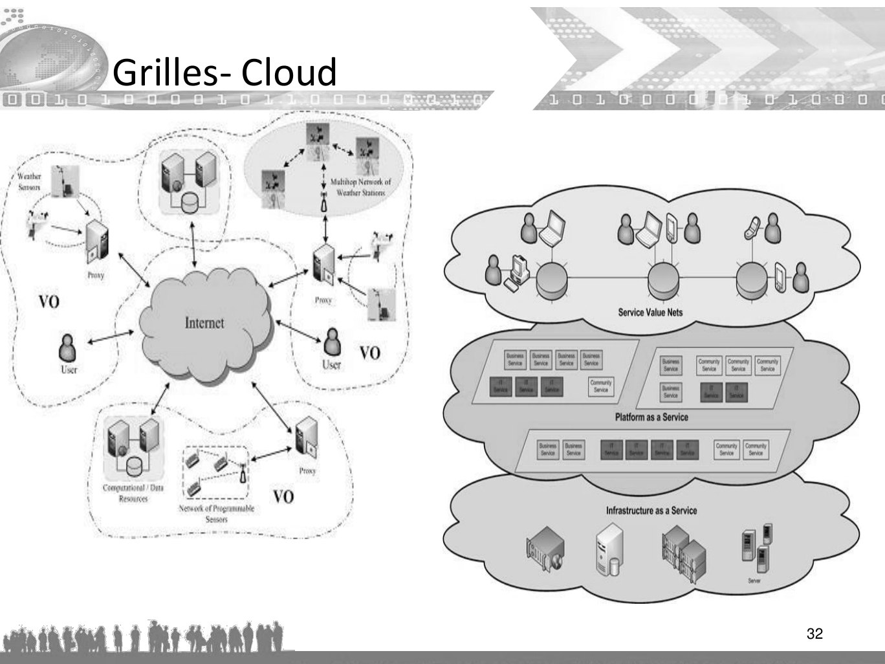

~~~text
Grilles- Cloud

                 32
~~~

## Page 33

~~~text
   Dépendance des données

• Un calcul qui dépend du résultat d'un calcul
  préalable doit être exécuté séquentiellement
  (chemin critique)
• Un des gains de performance dû au
  parallélisme se trouve donc dans l'exécution
  de calculs indépendants et des chemins non
  critiques en simultané

                                                 33
~~~

## Page 34

~~~text
      Conditions de Bernstein de non dépendance
      des données

• Soit Pi et Pj deux fragments de programme.
• Pi : Ii les variables d'entrées et
       Oi les variables de sorties
• Pi et Pj sont indépendants s'ils satisfont les
  conditions suivantes :
 – Ij  Oi = i (sinon dépendance des flux entrée et sortie)
 – Ii  Oj = i (sinon antidépendance, le premier fragment
                 écrase une variable utilisée par le second)
 – Oj  Oi = i (sinon les deux fragments écrivent une même
                  donnée)
                                                               34
~~~

## Page 35

~~~text
       Algorithme itératif
• En général, on peut toujours paralléliser une boucle
• Si appel de fonctions récursives dans la boucle  création de
  dépendance (parallélisme impossible avec ou sans synchronisation)
• Exemple calcul de la suite de Fibonacci
       PREV1 := 0
       PREV2 := 1
       do:
           CUR := PREV1 + PREV2
           PREV1 := PREV2
           PREV2 := CUR
       while (CUR < 10)
• Ce n’est toujours pas le cas des algorithmes récursifs

                                                              35
~~~

## Page 36

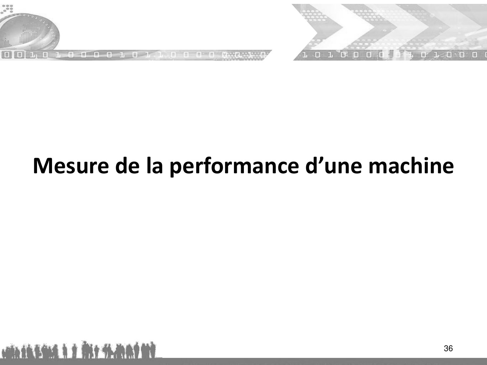

~~~text
Mesure de la performance d’une machine

                                     36
~~~

**Lecture OCR à contrôler**

~~~text
Mesure de la performance d’une machine
~~~

## Page 37

~~~text
        Mesure de la performance
• La performance des ordinateurs s’est améliorée au fil du temps.
• La performance est un terme très vague lorsqu’il est utilisé pour
  parler des systèmes informatiques en général.
• Le plus souvent ce terme désigne la rapidité avec laquelle un
  système donné peut exécuter un ou plusieurs programmes. Les
  systèmes qui exécutent les programmes dans un délai plus court
  sont dits plus performants que les autres.
• La meilleure mesure de performance qui peut être faite d’un
  ordinateur consiste à calculer le temps d’exécution du ou des
  programmes que l’utilisateur souhaite utiliser avec cette machine.
• Pour résoudre ce problème, les architectes d’ordinateurs ont
  développé un grand nombre de méthodes de calcul visant à décrire
  la performance des ordinateurs.
                                                                37
~~~

## Page 38

~~~text
       MIPS (millions d’instructions par seconde)
• L’un des premiers indicateurs de la performance des ordinateurs a été la
  vitesse à laquelle une machine donnée pouvait exécuter des instructions.
• On calculait cette vitesse en divisant le nombre d’instructions traitées
  lors de l’exécution d’un programme par le temps requis pour faire
  tourner ce programme.
• Le plus souvent, la valeur obtenue était mesurée MIPS.
• L’unité MIPS est tombée hors d’usage pour la mesure des performances
  d’ordinateurs, principalement parce qu’elle ne tient pas compte du fait
  que différents systèmes requièrent souvent un nombre différent
  d’instructions pour faire tourner un programme.
• La vitesse en MIPS n’indique pas combien d’instructions sont requises
  pour effectuer une tâche donnée et s’avère donc moins pertinente que
  d’autres techniques de mesure pour comparer la performance de
  différents systèmes.
                                                                     38
~~~

## Page 39

~~~text
        CPI/IPC (Cycles Par instruction)
• Un autre système de mesure utilisé pour décrire la performance des
  ordinateurs consiste à évaluer le nombre de cycles d’horloge requis pour
  exécuter chaque instruction.
• On appelle cet indice de performance le CPI (Cycles Par instruction).
• Le CPI d’un programme donné sur un système donné est calculé en
  divisant le nombre de cycles d’horloge requis pour exécuter le
  programme par le nombre d’instructions exécutées pour le faire tourner.
• Pour les systèmes qui peuvent exécuter plus d’une instruction par cycle,
  on fait appel à l’IPC (Instructions exécutées Par Cycle) au lieu du CPI.
• L’IPC est calculé en divisant le nombre d’instructions exécutées pour faire
  tourner le programme par le nombre de cycles d’horloge requis pour son
  exécution. C’est donc l’inverse du CPI.

                                                                        39
~~~

## Page 40

~~~text
        CPI/IPC
• L’IPC et le CPI fournissent la même information et le choix de l’un ou
  l’autre indice se fait généralement en considérant lequel des deux fournit
  une valeur supérieur à 1.
• Un indice IPC élevé est généralement significatif d’un haut niveau de
  performance, tandis qu’un CPI élevé désigne un faible niveau de
  performance.
• Exemple : un programme donné est constitué d’une boucle de 100
  instructions qui s’exécutent 42 fois de suite. S’il faut 16000 cycles pour
  exécuter le programme sur un système donné, quelles sont les valeurs de
  CPI et d’IPC pour ce programme ?
• Nombre total d’instructions : 42 x 100 = 4200 instructions
• Nombre de cycle requis pour exécuter le programme : 16000 cycles
    – CPI = 16000 / 4200 = 3.81
    – IPC = 4200 / 16000 = 0,26
                                                                       40
~~~

## Page 41

~~~text
        CPI/IPC
• En général, l’IPC et le CPI sont des mesures encore moins utiles pour évaluer la
  performance des systèmes actuels que ne l’est le nombre de MIPS, parce que
  ces indicateurs ne contiennent aucune information concernant la fréquence de
  l’horloge du système ou le nombre d’instructions que le système requiert pour
  accomplir une tâche donnée.
• Si vous connaissez le nombre de MIPS d’un système pour un programme donné,
  vous pouvez le multiplier par le nombre d’instructions exécutées pour faire
  tourner le programme afin de déterminer le temps d’exécution du programme.
            Temps d’exécution d’un programme = MIPS x nombre d’instructions exécutées
• Si vous connaissez le CPI d’un programme donné, vous pouvez le multiplier par
  le nombre d’instructions dans le programme afin d’obtenir le nombre de cycles
  requis pour son exécution.
                       Nombre de cycles = CPI x nombre d’instructions
• Le CPI et l’IPC sont rarement utilisés pour comparer les systèmes informatiques
  actuels

                                                                                        41
~~~

## Page 42

~~~text
        Bancs d’essai (Benchmarks)
• Les MIPS et les CPI/IPC restent des indices de mesure de performance
  sérieusement limités. Les bancs d’essais constituent une troisième méthode de
  mesure des performances système. Ils ont été développés pour répondre aux
  limites des unités MIPS et CPI/IPC.
• Les bancs d’essai regroupent une série de programmes considérés être
  représentatifs de ceux qui tourneront sur le système testé. La note d’évaluation
  du système soumis à la suite de tests est calculée en considérant le temps requis
  par le système pour exécuter tous les programmes du banc d’essai.
• De nombreux bancs d’essais ont été mis au point pour estimer les performances
  d’un système avec différents types d’applications.
• L’un des bancs d’essais les plus connus est celui de la SPEC (Standard
  Performance Evaluation Corporation).
• Les bancs d’essais offrent un grand nombre d’avantage. Tout d’abord, les
  résultats de performance reposent sur des temps d’exécution totale et non sur
  une vitesse d’exécution de l’instruction. Ensuite, ils opèrent une moyenne des
  performances système sur plusieurs programmes différents afin d’estimer une
  vitesse moyenne de traitement.                                              42
~~~

## Page 43

~~~text
         Bancs d’essai (Benchmarks)
• Les données globales d’un banc d’essai constituent donc un indicateur plus
  fiable de la performance générale d’un système que ses résultats en MIPS
  obtenus sur tel ou tel programme.
• En outre, de nombreux bancs d’essais requièrent que les fabricants publient les
  résultats de leur système pour chacun des programmes inclus dans le banc
  d’essai, aussi devient-il possible d’établir des comparaisons directes de résultats
  lorsque vous savez par avance qu’un système sera utilisé pour un type
  d’application particulier.
• MFLOPS (Million Floating point Operations per Second) : est la mesure
  traditionnelle utilisée pour décrire la vitesse d’un superordinateur. La mesure
  MFLOPS est basée sur la normalisation du moment de l’exécution d’une
  instruction de l’ordinateur à une quantité constante de temps lorsque toutes
  les instructions ne s’exécutent pas en même temps.
• La variation dans le temps d'une instruction peut varier entre 29 et 600 cycles
  horloge. La mesure MFLOP est une bonne approximation de la vitesse d'un
  superordinateur tant que les données de référence communes pour l’exécution
  d’une instruction sont bien publiés ce qui permet une bonne comparaison entre
                                                                                43
  deux superordinateurs concurrents.
~~~

## Page 44

~~~text
       Bancs d’essai (Benchmarks)
• Pour calculer le MFLOPS d’une machine il faut suivre les consignes
  suivantes :
• si y (cycles/instruction) est le nombre de cycles nécessaire pour
  exécuter une instruction ;
• et x = vitesse d’exécution du processeur en cycles/seconde, cette
  information peut être obtenue à partir de la documentation
  fournie avec le processeur ou à l’aide des programmes d’un banc
  d’essais disponible (par exemple, la vitesse d’exécution d’un
  processeur Macintosh IIx est de 15.5572 m cycles/seconde).
• Vitesse du processeur en MFLOPS = x / y.

                                                                44
~~~

## Page 45

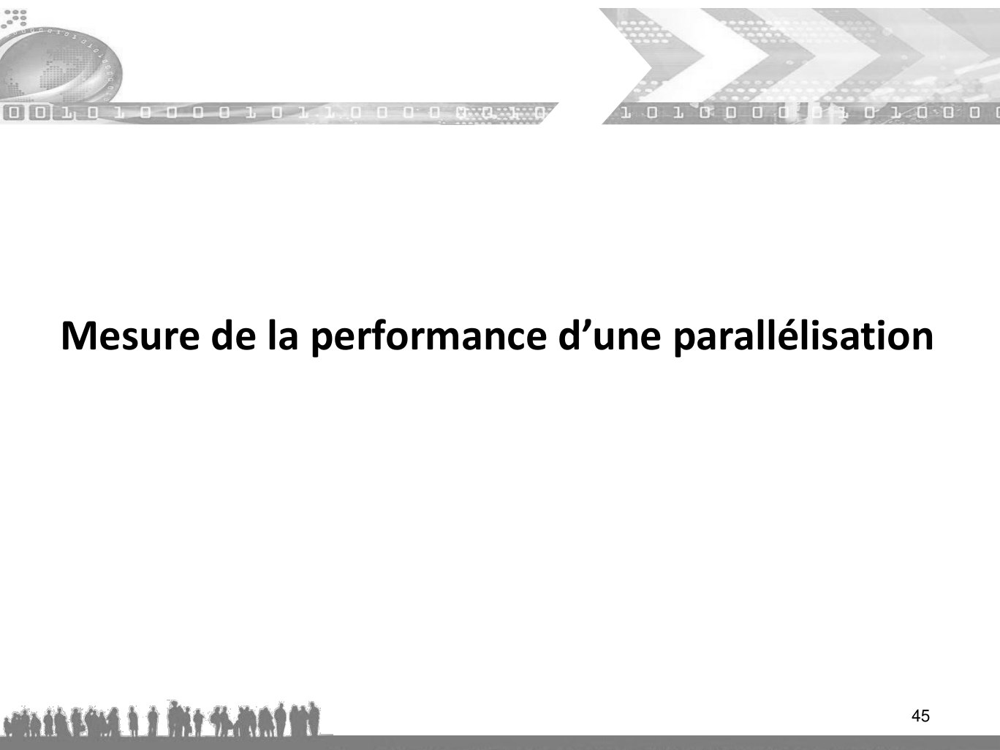

~~~text
Mesure de la performance d’une parallélisation

                                            45
~~~

**Lecture OCR à contrôler**

~~~text
Mesure de la performance d’une parallélisation
~~~

## Page 46

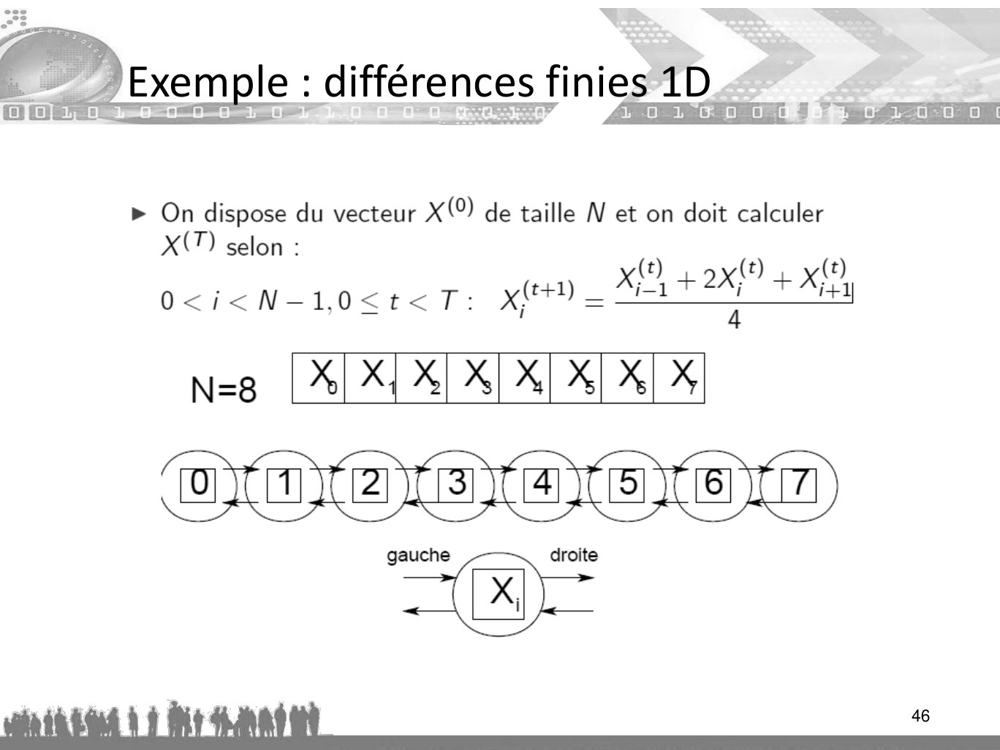

~~~text
Exemple : différences finies 1D

                                  46
~~~

**Lecture OCR à contrôler**

~~~text
ences finies 1D
ae rool oe

> On dispose du vecteur X(0) de taille N et on doit calculer

x

O<i<N-1,0<t<T: XI 2

fo

T) selon :

x, + 2x{9 + x
4

N=8 |%| X{ X] X] X] X] X] X

cocccc

sx)

gauche x droite

aihiut U1 i bain -
~~~

## Page 47

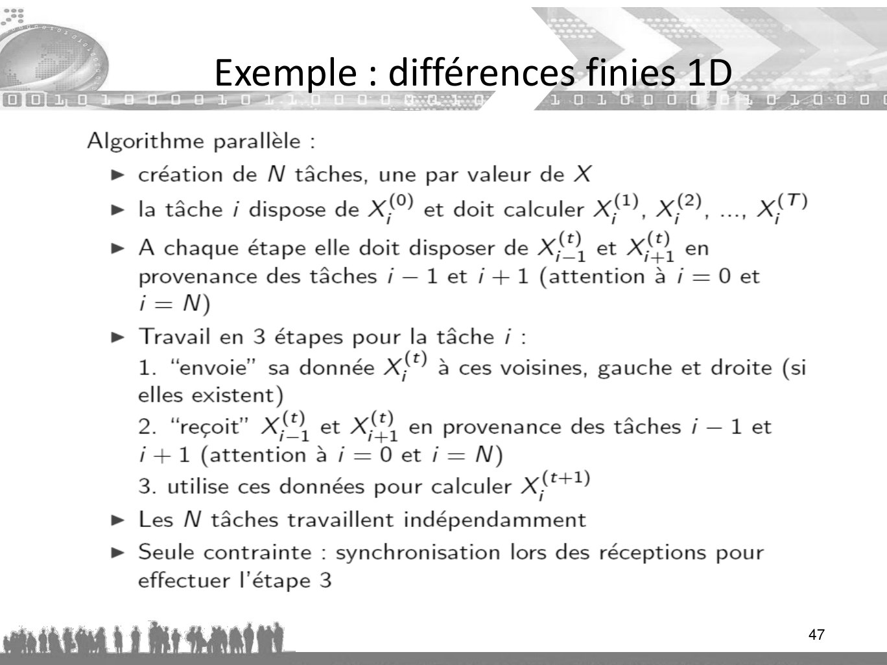

~~~text
Exemple : différences finies 1D

                                  47
~~~

**Lecture OCR à contrôler**

~~~text
Exemple : différences finies 1D

D D Det RER F1 O0 1 © “ER © 1-00 0 |

De

Toyo) io

Algorithme parallèle :
> création de WN tâches, une par valeur de X
> la tâche ; dispose de x{0) et doit calculer xX, x), ceey x

> A chaque étape elle doit disposer de x, et x en

provenance des tâches / — 1 et / + 1 (attention à / = 0 et
i=N)
> Travail en 3 étapes pour la tâche / :
1. “envoie” sa donnée xt) a ces voisines, gauche et droite (si
elles existent)
2. “reçoit” xO, et x en provenance des tâches / — 1 et
i+1 (attention à aj=Oeti=N)
3. utilise ces données pour calculer pal
> Les N tâches travaillent indépendamment
> Seule contrainte : synchronisation lors des réceptions pour
effectuer l'étape 3

alt à Lt de :
~~~

## Page 48

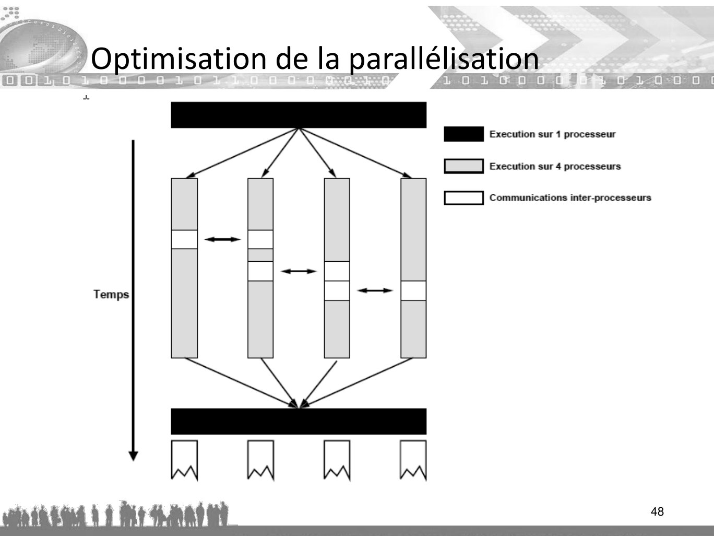

~~~text
Optimisation de la parallélisation

                                     48
~~~

**Lecture OCR à contrôler**

~~~text
Optimisation de la parallélisation

a
| Execution sur 1 processeur
| Execution sur 4 processeurs

| Communications inter-processeurs

Temps
~~~

## Page 49

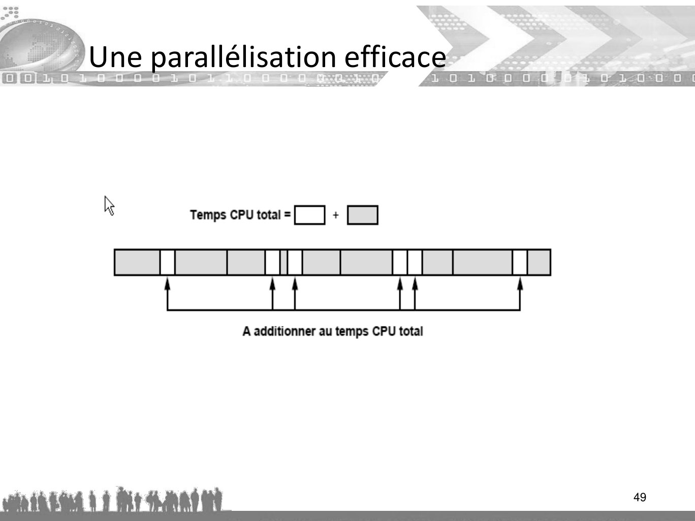

~~~text
Une parallélisation efficace

                               49
~~~

**Lecture OCR à contrôler**

~~~text
U

oem wo

ne parallélisation efficace

F1 0 1 & O0.

À Temps CPU total=[ | +[ ]

a | Z

A additionner au temps CPU total
~~~

## Page 50

~~~text
      Accélération
• Les architectes d’ordinateurs utilisent souvent le terme
  d’accélération pour décrire la manière dont la
  performance d’une architecture se modifie lorsque
  différentes améliorations lui sont apportées.

• L’accélération correspond simplement au rapport :

   Accélération = Temps d’exécutionavant / Temps d’exécutionaprès

                                                                50
~~~

## Page 51

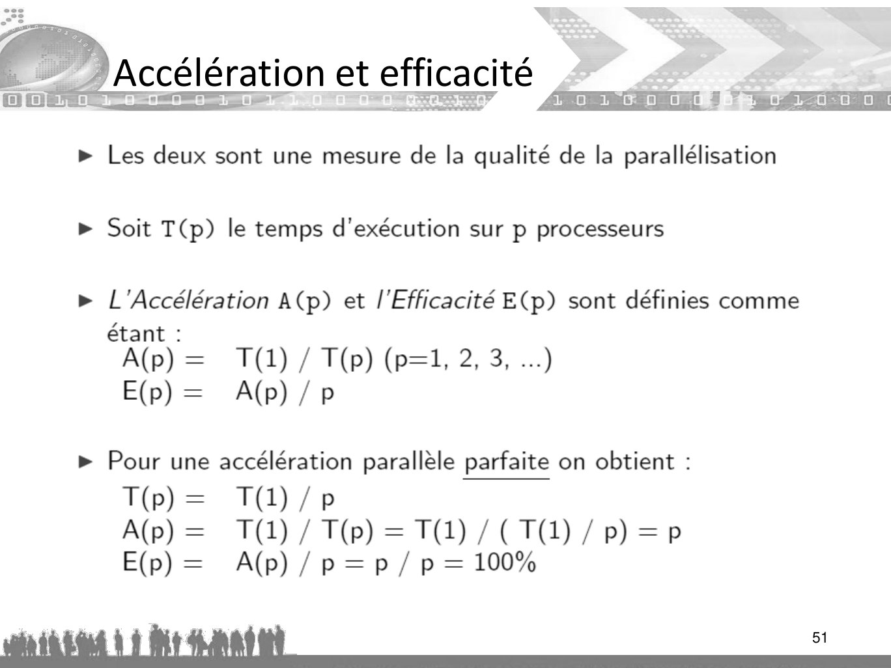

~~~text
Accélération et efficacité

                             51
~~~

**Lecture OCR à contrôler**

~~~text
Accélération et efficacité

> Les deux sont une mesure de la qualité de la parallélisation
> Soit T(p) le temps d'exécution sur p processeurs

> L Acceleration A(p) et l'Efficacité E(p) sont définies comme

étan
Alp) = T(1) / T(p) (p=1, 2, 3, ...)
E(p)= A(p)/p

> Pour une accélération parallèle parfaite on obtient :
T(p)= T(1)/p
A(p) = (1) / T(p) = T1) /(T0)/ Pp) =P
E(p) = A(p)/p=p/ p= 100%

alt à en :
~~~

## Page 52

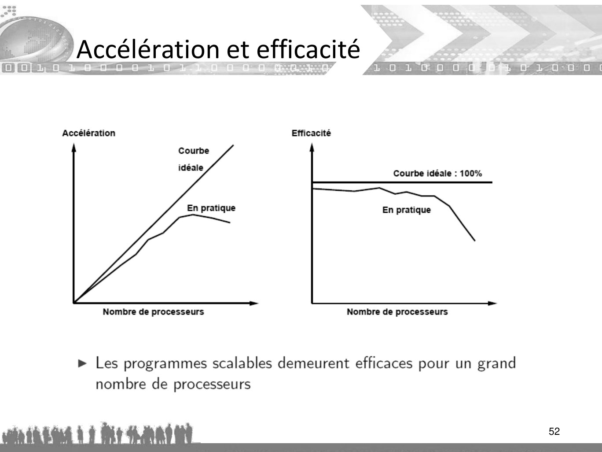

~~~text
Accélération et efficacité

                             52
~~~

**Lecture OCR à contrôler**

~~~text
Accélération Efficacité

Courbe idéale : 100%

En pratique En pratique

Nombre de processeurs Nombre de processeurs

> Les programmes scalables demeurent efficaces pour un grand
nombre de processeurs

win iad 1 Bi nnd x
~~~

## Page 53

~~~text
           La loi d’Amdahl

• La règle la plus importante pour la conception de systèmes
  informatiques à haute performance consiste à tenter
  d’accélérer avant tout, les tâches les plus courantes.

• Quantitativement, cette règle a été définie par la loi d’Amdahl :
Temps d’exécutionnouveau=Temps d’exécutionancien x [Fracinutilisée + (Fracutilisée / Accélérationutilisée)]

•   Noter que Fracinutilisée correspond à la fraction de temps (et non d’instructions) durant
    laquelle l’amélioration n’est pas exploitée

•   La loi d’Amdahl peut être réécrite en intégrant la définition de l’accélération :
•   Accélération = 1/[Fracinutilisée + (Fracutilisée / Accélérationutilisée)]

                                                                                                  53
~~~

## Page 54

~~~text
    Programmation distibuée

Loi d'Amdahl (plus une règle qu’une loi) indique le gain
de temps que va apporter un système multiprocesseur
en fonction :
   – du nombre de processeurs p
   – de la proportion d'activité parallélisable s

                                  1
• La loi a la forme :   A
                             1  s   s
                                       p
                                                            1
• Avec p tendant vers l'infini, on obtient :        A
                                                         1  s 

                                                                    54
~~~

## Page 55

~~~text
   Programmation distibuée

Loi d'Amdahl
• La formule ne prend pas en compte
  – le délai de transmission des messages
  – la surcharge de ressources due à la parallélisation
• Il faut estimer le meilleur gain
  – en fonction du nombre de processeurs
  – de leur types (multi-coeurs ou machines distantes)
  – des topologies virtuelles envisageables

                                                      55
~~~

## Page 56

~~~text
     Exemple où tous les processeurs sont
     consacrés au même utilisateur

• Rendement intéressant
  – Le traitement d'image tire un très bon parti du
    parallélisme (la valeur de s voisine de 0,95).
  – Analyse numérique, la méthode de Jacobi converge
    lentement mais parallélisable
• Rendement pas intéressant
  – Pour une valeur de s= 0,5 le passage au biprocesseur
    fait gagner 25% de temps et le passage à 12
    processeurs ne fait gagner que 45% de temps

                                                      56
~~~

## Page 57

~~~text
   Exemple

• Prenons un exemple avec une parallélisation de
  l’ordre de 80% du code
     T(1) = T(parallèle) + T(séquentiel) = 80 + 20
• Sur p processeurs, on obtient : T(p) = 80/p + 20
• Quel que soit p, T(p) > 20
• A(p) = T(1)/T(p) = 100 / (20 + 80/p) < 5

                            p   +
• E(p) = (A(p)/p) < (5/p)            0!
                                               57
~~~

## Page 58

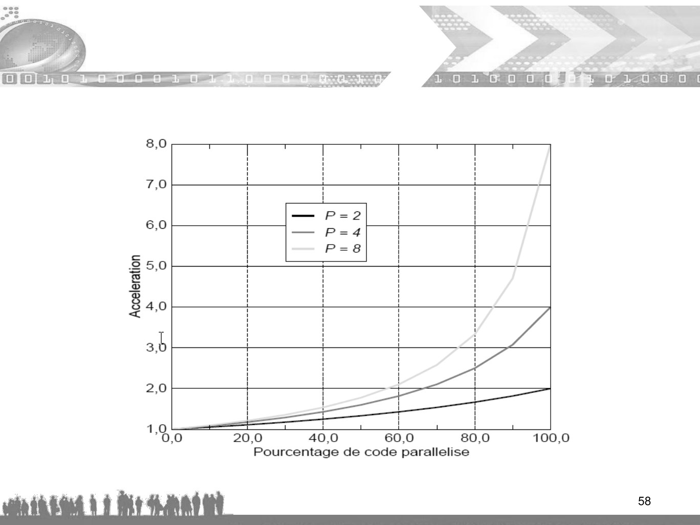

~~~text
58
~~~

**Lecture OCR à contrôler**

~~~text
ie)

fo)
6
=
o
ae ee DS eee 8
©
©.
D) oo een ene S
&
F NY ©
Hout .
aaa i
=e ony ON Eee =
| | à
oa
a meen ene encene =
a
o
e] o o o © 0 e] oo
Ce] N o re] + Le) oi =

UO|}18[800\

Pourcentage de code parallelise
~~~

## Page 59

~~~text
Amdahl’s Law

Dans de nombreuses applications, la partie séquentielle est inférieure à 0,1 %
~~~

## Page 60

~~~text
Loi de Gustafson

Semblable à la loi d’Amdahl, mais elle considère un temps fixe. Besoin de problèmes plus
importants pour un plus grand nombre de processeurs. La parallélisation augmente plutôt la
taille du problème.
     La plupart des gens ne se soucient pas d'une minute.
     Un algorithme séquentiel résout un problème en 1 minute.
     La version parallèle de l'algorithme résout le problème en 1 minute.
     Mais l’algorithme parallèle peut mieux résoudre le problème, avec plus de
     détails.

                                       Source : EPCC
~~~

## Page 61

~~~text
Loi de Gustafson

Equation

La loi de Gustafson peut être formulée de la façon suivante :

                                Slatency (s) = (1 − Fp ) + s · Fp
                                            = 1 + (s − 1) · Fp
où
     Slatence est l'accélération théorique de l'exécution de la tâche avec parallélisme
     (accélération mise à l'échelle)
     s est l'accélération de la partie de la tâche qui bénéficie de ressources système
     améliorées (le nombre de processeurs utilisés)
     Fp est la proportion de la charge d'exécution de l'ensemble de la tâche concernant
     la partie qui bénéficie de l'amélioration des ressources (parallélisation) du système
     avant l'amélioration
~~~

## Page 62

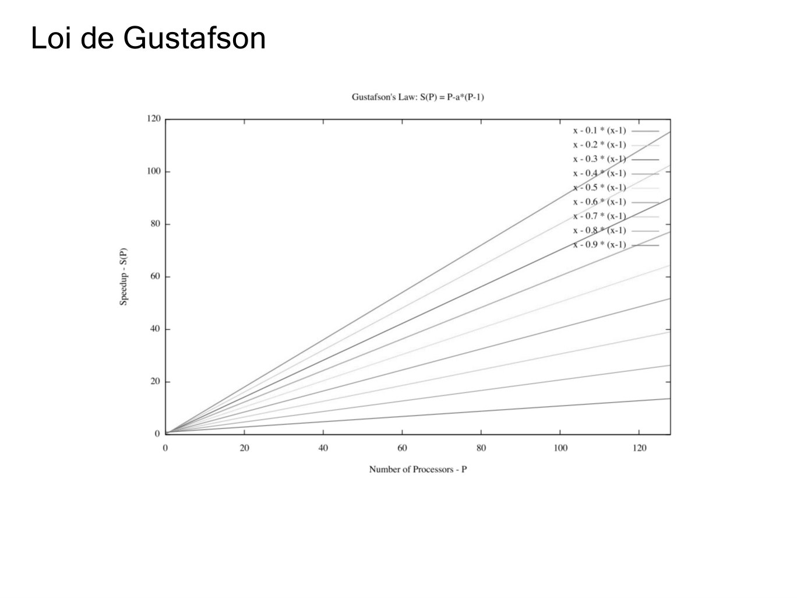

~~~text
Loi de Gustafson
~~~

**Lecture OCR à contrôler**

~~~text
Loi de Gustafson

Gustafson's Law: S(P) = P-a*(P-1)

120 T T T T T T
x- 0.1 * (x-1) ——
x-0.2* (x-1)
X-0.3 * (x

100}
x-0.6* (x-1)
x-0.7 *(x-1

80 + 4

=0.9 * (x-1) —<—

Speedup - S(P)

20

0
0 20 40 60 80 100 120

Number of Processors - P
~~~
