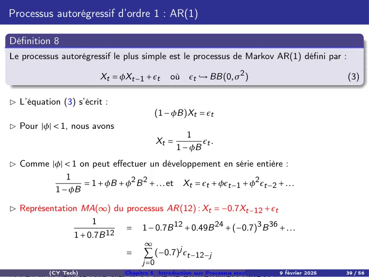

# CH5-Slides-Intro-Processus-STAT2025.pdf

[Ouvrir l’original](https://drive.google.com/open?id=1mhm4cFoCnnmRsXeh52lLZxYGW91xr0Yx) · Les deux lectures automatiques du PDF divergent sur les pages indiquées. Leur fac-similé accompagne le texte.

**Pages présentant un écart entre les deux extractions** — 39.

## Page 1

~~~text
Chapitre 5. Introduction aux Processus stochastiques stationnaires

                                   CY Tech

                              9 février 2025

   (CY Tech)       Chapitre 5. Introduction aux Processus stochastiques stationnaires
                                                                           9 février 2025   1 / 56
~~~

## Page 2

~~~text
Plan

1   Processus stochastique et série temporelle

2   Processus stationnaire

3   Indices de dépendances : Fonctions d’autocovariances et d’autocorrélations

4   Processus auto-régressifs

5   Processus moyenne mobile MA

           (CY Tech)            Chapitre 5. Introduction aux Processus stochastiques stationnaires
                                                                                        9 février 2025   2 / 56
~~~

## Page 3

~~~text
Introduction : Processus stochastique et série temporelle

(CY Tech)      Chapitre 5. Introduction aux Processus stochastiques stationnaires
                                                                       9 février 2025   3 / 56
~~~

## Page 4

~~~text
Introduction : Processus stochastique et série temporelle

    Jusqu’à présent, nous avons effectué des prévisions sans supposer aucun modèle au
    préalable.

    Cependant, cette méthode se révèle insuffisante pour prédire des séries financières et
    économiques.

    Une meilleure approche consiste à proposer un modèle capable de reproduire le
    "comportement" des données.

    Les travaux de Box et Jenkins dans les années 1970 ont introduit une hypothèse
    clé : à un instant t, la valeur xt est une réalisation d’une variable aléatoire.

    Cela conduit à définir une famille de variables aléatoires indexées par le temps,
    dont :
                  - le nom général est processus aléatoire,
                     - et dont chaque chronique xt est appelée échantillon ou trajectoire
                       du processus.

         (CY Tech)             Chapitre 5. Introduction aux Processus stochastiques stationnaires
                                                                                       9 février 2025   4 / 56
~~~

## Page 5

~~~text
Processus stochastique et série temporelle

▷ Formalisation :

    Les données observées x1 , x2 , . . . , xn sont considérées comme un extrait d’une
    trajectoire d’un processus stochastique (Xt (ω))t ∈Z .
    Autrement dit, il existe un élément ω tel que :

                                (x1 , . . . , xn ) = (X1 (ω), . . . , Xn (ω)).

    Chaque donnée de la série est une réalisation d’une des variables aléatoires
    composant le processus stochastique.

▷ Objectif : Proposer un modèle pour le processus {Xt }, qui sera pertinent uniquement
si :

    Le processus est stationnaire, c’est-à-dire qu’il présente une uniformité structurelle
    par rapport au temps.
    Dans ce cas, deux caractéristiques essentielles peuvent être associées au processus :
                 - La fonction d’autocorrélation,
                 - et la fonction d’autocorrélation partielle.
         (CY Tech)            Chapitre 5. Introduction aux Processus stochastiques stationnaires
                                                                                      9 février 2025   5 / 56
~~~

## Page 6

~~~text
              Processus stationnaire

(CY Tech)   Chapitre 5. Introduction aux Processus stochastiques stationnaires
                                                                    9 février 2025   6 / 56
~~~

## Page 7

~~~text
Processus strictement stationnaire

Définition 1
Un processus Xt , avec t ∈ T , est dit strictement (fortement) stationnaire si :
     ∀ t1 < t2 < . . . < tn , avec ti ∈ T ,
     et ∀ h ∈ T , tel que ti + h ∈ T ,
     on a :
                       - La loi conjointe des variables aléatoires décalées reste inchangée,
                         c’est-à-dire :

                                              L (Xt1 +h , . . . , Xtn +h ) = L (Xt1 , . . . , Xtn ).

▷ La stationnarité stricte est une condition très restrictive, car elle exige que la série soit
totalement invariante dans le temps.

     Cette condition implique que toutes les lois conjointes des variables aléatoires sont
     identiques, quel que soit le décalage temporel.
     En pratique, on préfère souvent utiliser une notion moins stricte : la stationnarité au
     second ordre (ou faible stationnarité).

           (CY Tech)               Chapitre 5. Introduction aux Processus stochastiques stationnaires
                                                                                           9 février 2025   7 / 56
~~~

## Page 8

~~~text
Processus faiblement stationnaire ou stationnarité au second ordre

Définition 2 (Faible stationnarité ou stationnarité au second ordre)
▷ Un processus Xt , avec t ∈ T , est dit faiblement stationnaire (ou du second ordre) si :
    E(Xt ) = µ < ∞, constante indépendante de t, pour tout t ∈ T ,
    Var(Xt ) < ∞, indépendante du temps,
    Cov(Xt , Xt +h ) = γ(h), pour tout t ∈ T et tout h ∈ T , dépendant uniquement de h.
    Cela équivaut à :

                      Cov(X1 , X1+h ) = Cov(X2 , X2+h ) = . . . = Cov(Xt , Xt +h ).

▷ La covariance dépend uniquement du décalage temporel h et non de l’instant t.
▷ La stationnarité est alors résumée par :

              * les deux premiers moments (moyenne et covariance),
              * ce qui est particulièrement pertinent pour des processus Gaussiens

          (CY Tech)             Chapitre 5. Introduction aux Processus stochastiques stationnaires
                                                                                        9 février 2025   8 / 56
~~~

## Page 9

~~~text
Processus faiblement stationnaire : Considérations pratiques

□ Appréciation de la stationnarité :
▷ Si l’on dispose d’une série {xt } et que l’on souhaite évaluer sa stationnarité, les critères
suivants doivent être vérifiés :

     La moyenne et la variance de la série doivent être constantes dans le temps.
     Cela se traduit par :
                   - Un graphique montrant un niveau moyen à peu près constant au fil
                     du temps,
                      - Des fluctuations de même amplitude autour de la moyenne, quelle
                        que soit la période étudiée.

          (CY Tech)             Chapitre 5. Introduction aux Processus stochastiques stationnaires
                                                                                        9 février 2025   9 / 56
~~~

## Page 10

~~~text
Considérations pratique pour apprécier la stationnarité : Exemple

            - Moyenne et variance ne sont pas constantes
            - Évolution générale : le nombre de passages augmente au cours du temps
            - Évolution au cours de l’année : le nombre de passages est plus important
              l’été et pendant les vacances de Noël
            - On constate des irrégularités

        (CY Tech)          Chapitre 5. Introduction aux Processus stochastiques stationnaires
                                                                                   9 février 2025   10 / 56
~~~

## Page 11

~~~text
Exemples des processus stationnaires : Bruit blanc

▷ Un processus stationnaire particulièrement simple est le processus purement aléatoire,
appelé bruit blanc, constitué d’une suite de v.a. indépendante

Définition 3
(ϵt , t ∈ Z) est dit bruit blanc
(i) [faible] si
     E(ϵt ) = 0 (moyenne nulle)
     E(ϵt ϵt −h ) = 0 pour tout t et h ̸= 0 (non corrélées et pas nécessairement
     indépendantes) ⇔          γ(h) = 0, h ̸= 0
     Var (ϵt ) = σ2 = γ(0) (de même variance)
     On note ϵt ,→ BB(0, σ2 ). C’est une série faiblement stationnaire.
(ii) [fort] lorsque les variables (ϵt )t ∈Z sont indépendantes.
(iii) [très fort] lorsque les variables (ϵt )t ∈Z sont i.i.d.
(iv) [gaussien], si ϵ = (ϵt )t ∈Z sont i.i.d. de loi N (0, σ2 ), on note BBN(0, σ2 ).
C’est une série strictement stationnaire.

Les trajectoires des bruits blancs peuvent avoir des formes très variées.

           (CY Tech)               Chapitre 5. Introduction aux Processus stochastiques stationnaires
                                                                                           9 février 2025   11 / 56
~~~

## Page 12

~~~text
Simulation d’un BBN(0, 1)

Création d’une série mensuelle, à partir de janvier 1950 bbg =
ts(rnorm(150,0,1),start=c(1950,1),frequency=12)
plot.ts(bbg,xlab=’temps’,ylab=’valeur’)

                                     Figure – Réalisation d’un bruit blanc

                               2
                               1
                      valeur

                               0
                               −1
                               −2

                                    1950   1952   1954     1956    1958    1960    1962

                                                           temps

          (CY Tech)                   Chapitre 5. Introduction aux Processus stochastiques stationnaires
                                                                                              9 février 2025   12 / 56
~~~

## Page 13

~~~text
              Indices de dépendances :
  Fonctions d’autocovariances et d’autocorrélations

(CY Tech)     Chapitre 5. Introduction aux Processus stochastiques stationnaires
                                                                      9 février 2025   13 / 56
~~~

## Page 14

~~~text
Indices de dépendances

Ces notions, plus spécifiques à l’étude de série temporelle, renseignent sur la dépendance
entre les données xt .

Définition 4 (Fonctions d’autocovariances)
La fonction
                         h 7→ γ(h) = Cov(Xt , Xt +h )         ∀t ∈ T , h ∈ Z,
 est appelée fonction d’auto-covariance d’ordre (ou de décalage) h (lag-h autocovariance).
Elle apporte de l’information sur la variabilité de la série et sur les liaisons temporelles.
Elle vérifie :
    γ(0) = Var(Xt ) : un processus stationnaire a une variance constante

    |γ(h)| ≤ γ(0), ∀h.

    γ(h) = γ(−h), ∀h. On ne la représente que pour h = 0, 1, . . ..

          (CY Tech)            Chapitre 5. Introduction aux Processus stochastiques stationnaires
                                                                                       9 février 2025   14 / 56
~~~

## Page 15

~~~text
Coefficient d’autocorrélation et Fonction d’autocorrélation

Définition 5
i) Le coefficient d’autocorrélation (théorique) d’ordre h est

                                                        γ(h)
                                              ρ (h) =
                                                        γ(0)

C’est le coefficient linéare simple calculé entre la série et cette même série décalée de h
périodes de temps.

ii) La fonction d’autocorrélation (théorique) de {Xt } est :

                                                           Cov(Xt , Xt −h )             γ(h)
                   h 7→ ρ (h) = Corr(Xt , Xt −h ) = p                               =
                                                                                        γ(0)
                                                                   p
                                                          V (Xt ) V (Xt −h )
ρ (·) est à valeurs dans [−1, +1], et ρ (0) = 1.

           (CY Tech)             Chapitre 5. Introduction aux Processus stochastiques stationnaires
                                                                                         9 février 2025   15 / 56
~~~

## Page 16

~~~text
Fonction d’autocorrélation (suite)

▷ ρ (h) mesure la corrélation entre Xt et Xt −h , puisque par stationnarité

                          Cov (Xt , Xt −h )             γ(h)     γ(h)
                                                    =p         =
                                                      γ(0) γ(0) γ(0)
                      p          p                        p
                        Var (Xt ) Var (Xt −h )

    ρ (0) = 1
    ρ mesure le degré de dépendance à la date t de ce qui s’est passé à la date t − h.
    La représentation graphique de ρ (h) est appelée corrélogramme (théorique), on note
    FAC ou ACF (sortie de R).
                  - C’est une représentation graphique de la "mémoire" du processus,
                    qui montre dans quelle mesure ses réalisations courantes sont
                    influencées par ses réalisations passées.
    Le concept de corrélogramme n’a de sens que pour un processus stationnaire.

          (CY Tech)           Chapitre 5. Introduction aux Processus stochastiques stationnaires
                                                                                      9 février 2025   16 / 56
~~~

## Page 17

~~~text
Fonction d’autocorrélation-Exemples

Exemples de corrélogrammes
Les exemples suivants permettent de vérifier que la FAC joue le rôle de décomposition
temporelle de la série.

                  X 1t   =   ϵt         ϵt : v.a. gaussienne
                  X2t    =   a t + b + ϵt        t = 1, . . . , n   (t = tandance)
                  X3t    =   St + ϵt       (St = saisonnalité de quatre période)
                  X3t    =   a t + b + St + ϵ t

    Les termes du corrélogramme de X1t sont tous faibles à l’exception d’un seul, ceci
    est le cas d’une v.a. de type bruit blanc
    Le corrélogramme de X2t avec une décroissance lente de ses termes est spécifique
    d’une série affectée d’une tendance.
    Les termes très élevés (4, 8, 12 et 16) du corrélogramme de X3t révèlent la
    saisonnalité de quatre périodes
    Le corrélogramme de X4t est une combinaison des trois précédents.

          (CY Tech)               Chapitre 5. Introduction aux Processus stochastiques stationnaires
                                                                                          9 février 2025   17 / 56
~~~

## Page 18

~~~text
Exemples de corrélogrammes

                   Figure – Représentation des processus analysés

       (CY Tech)          Chapitre 5. Introduction aux Processus stochastiques stationnaires
                                                                                  9 février 2025   18 / 56
~~~

## Page 19

~~~text
Fonction d’autocorrélation : Exemples

▷ Exemple 1.
Soit (ϵt )t un processus de bruit blanc de variance σ2 .
On considère le processus stationnaire X définie par :

                                   Xt = ϵt − ϵt −12 ,       t ∈ Z.

▷ La fonction d’autocovariance est

                                           2
                                       2σ               si h = 0
                                      

                               γ(h) =   −σ2            si h = ±12
                                      
                                               0          sinon

▷ La fonction d’autocorrélation est

                                               1        si h = 0
                                          
                                          
                                ρ (h) =        1
                                              −2      si h = ±12
                                          
                                               0         sinon

          (CY Tech)           Chapitre 5. Introduction aux Processus stochastiques stationnaires
                                                                                      9 février 2025   19 / 56
~~~

## Page 20

~~~text
            Fonction d’autocorrélation partielle

(CY Tech)       Chapitre 5. Introduction aux Processus stochastiques stationnaires
                                                                        9 février 2025   20 / 56
~~~

## Page 21

~~~text
Fonction d’autocorrélation partielle (PACF) d’ordre h, notée : r (h)

    r (h) mesure l’intensité de la relation directe entre Xt et Xt −h
                   - en éliminant l’effet des variables intermédiaires
                     {Xt −1 , Xt −2 , . . . , Xt −h+1 }.
    Par construction,
         ρ (1) = r (1) car il n’existe aucune variable intermédiaire entre Xt et Xt −1 .
    r (h) = r (−h),   ∀h ̸= 0
    Si (Xt ) est stationnaire, r (h) ne dépend que de la distance h.
    L’estimation de r (h) aide à identifier combien de retards il est nécessaire de
    considérer pour capturer une information originale sur Xt .

    Si à partir d’une valeur h donné le corrélogramme de r (h) est nul, c’est qu’il inutile
    de rechercher plus loin dans le passé une explication linéaire du présent.
    Ainsi, un processus stationnaire centré est un bruit blanc si et seulement si son
    corrélogramme est nul (r (1) mis à part, qui vaut toujours 1).

          (CY Tech)             Chapitre 5. Introduction aux Processus stochastiques stationnaires
                                                                                        9 février 2025   21 / 56
~~~

## Page 22

~~~text
Fonction d’autocorrélation partielle (PACF)-Définition Formelle

Définition 6
La fonction d’autocorrélation partielle (PACF) pour un retard h est définie comme :
                      La corrélation entre (Xt − Xt∗ ) et (Xt −h − Xt∗−h ), où :

  - Xt∗ est la régression de Xt sur les (h − 1) valeurs précédentes
    {Xt −1 , Xt −2 , . . . , Xt −h+1 },

    Formellement, cela donne :
                                                        ³                        ´
                                                    Cov Xt − Xt∗ , Xt −h − Xt∗−h
          r (h) = Corr Xt − Xt∗ , Xt −h − Xt∗−h = q
                          ¡                    ¢
                                                                 q                    .
                                                   Var(Xt − Xt∗ ) Var(Xt −h − Xt∗−h )

    Avec les régressions suivantes :
                                       −1
                                      hX                                 −1
                                                                        hX
                              Xt∗ =          ak Xt −k   et    Xt∗−h =          bk Xt −k ,
                                      k =1                              k =1

    où les coefficients ak et bk sont ceux des régressions respectives.

          (CY Tech)               Chapitre 5. Introduction aux Processus stochastiques stationnaires
                                                                                          9 février 2025   22 / 56
~~~

## Page 23

~~~text
Différence entre le PACF et l’ACF (Autocorrélation Fonctionnelle)

   L’ACF mesure la corrélation brute entre Xt et Xt −h .
   La PACF, en revanche,
                 se concentre sur la corrélation directe entre Xt et Xt −h après avoir
                 éliminé l’influence des termes intermédiaires.

   Cela permet de mieux identifier les dépendances significatives dans les séries
   temporelles.

        (CY Tech)           Chapitre 5. Introduction aux Processus stochastiques stationnaires
                                                                                    9 février 2025   23 / 56
~~~

## Page 24

~~~text
Différence entre ACF et PACF : Exemple

Considérons une série générée par un processus AR(2) (auto-régressif d’ordre 2) :

                                    Xt = 0.6Xt −1 − 0.3Xt −2 + εt ,

avec εt un bruit blanc (moyenne nulle et variance constante).
▷ Interprétation du modèle

    Xt dépend directement de Xt −1 et Xt −2 .
    Les retards supérieurs à 2 (par exemple Xt −3 ) n’ont pas d’influence directe sur Xt
    mais peuvent montrer une corrélation indirecte via Xt −1 et Xt −2 .

    L’ACF mesure la corrélation entre Xt et Xt −h , en tenant compte de toutes les
    corrélations, directes ou indirectes, à travers les variables intermédiaires
         Pour un processus AR(2), Xt dépend directement de Xt −1 et Xt −2 .
               Si on calcule la corrélation entre Xt et Xt −3 , celle-ci inclut des effets transmis
               indirectement via Xt −1 et Xt −2 .
               Donc, toute corrélation observée dans l’ACF pour h > 2 provient d’effets indirects passant
               par Xt −1 et Xt −2

          (CY Tech)               Chapitre 5. Introduction aux Processus stochastiques stationnaires
                                                                                          9 février 2025   24 / 56
~~~

## Page 25

~~~text
Autocorrélation partielle (PACF)

    La PACF isole uniquement l’effet direct entre Xt et Xt −h , en supprimant toutes les
    influences transmises par des retards intermédiaires.

         Pour processus AR(2), la PACF pour h > 2 est nulle, car Xt dépend uniquement de
         Xt −1 et Xt −2 .
         Il n’y a pas de dépendance directe entre Xt et Xt −h pour h > 2.

         Ainsi, pour h = 3, r (3) mesure la corrélation directe entre Xt et Xt −3 , tout en retirant
         les effets transmis via Xt −1 et Xt −2 .

                         - Or dans un AR(2) : il n’existe aucune corrélation directe entre Xt et
                           Xt −3 , uniquement des corrélations indirectes, donc r (3) = 0.

Conclusion :
    ACF :
         Mesure la corrélation brute entre Xt et Xt −h pour un retard h.
         Affiche des corrélations non nulles pour des retards supérieurs à 2, dues aux relations
         indirectes.
    PACF :
         Mesure uniquement la corrélation directe entre Xt et Xt −h en supprimant l’effet des
         retards intermédiaires.
         Montre des valeurs significatives uniquement pour h = 1 et h = 2.

         (CY Tech)              Chapitre 5. Introduction aux Processus stochastiques stationnaires
                                                                                        9 février 2025   25 / 56
~~~

## Page 26

~~~text
Illustration des valeurs

      Retard h                 ACF ρ (h)                                PACF r (h)
       h=1             Corrélation significative             Corrélation significative (directe)
       h=2             Corrélation significative             Corrélation significative (directe)
       h=3           Corrélation faible (indirecte)                  Corrélation nulle
       h=4              Corrélation très faible                      Corrélation nulle

Les graphiques ci-dessous montrent la différence entre l’ACF et la PACF pour un
processus AR(2) simulé.

         (CY Tech)              Chapitre 5. Introduction aux Processus stochastiques stationnaires
                                                                                        9 février 2025   26 / 56
~~~

## Page 27

~~~text
Explication

    L’ACF montre une décroissance progressive après le retard 2, ce qui reflète des
    corrélations indirectes.
    La PACF, en revanche, identifie clairement les retards h = 1 et h = 2 comme
    significatifs, confirmant que le processus est d’ordre 2.
    Ces outils sont essentiels pour :
       - Identifier l’ordre p des modèles AR.
       - Isoler les relations directes entre les observations.

▷ Code R pour simuler un processus AR(2) et calculer l’ACF et la PACF :

# Simuler un processus AR(2)
library(forecast)
set.seed(123)
n <- 200
ar2_process <- arima.sim(model = list(ar = c(0.6, -0.3)), n = n)

# Calculer et afficher l’ACF et la PACF
par(mfrow = c(1, 2))
acf(ar2_process, main = "ACF du processus AR(2)")
pacf(ar2_process, main = "PACF du processus AR(2)")
         (CY Tech)              Chapitre 5. Introduction aux Processus stochastiques stationnaires
                                                                                        9 février 2025   27 / 56
~~~

## Page 28

~~~text
            Fonction d’autocorrélation empirique

(CY Tech)        Chapitre 5. Introduction aux Processus stochastiques stationnaires
                                                                         9 février 2025   28 / 56
~~~

## Page 29

~~~text
Fonction d’autocorrélation empirique

Définition 7
i) Xt une série observée, t = 1, . . . , n. L’autocovariance empirique d’ordre h :
                Pn
                          (Xt − X )(Xt −h − X )                        1 X n
                 t =h+1
         γ
         bh =                                           où     X=             Xt ,   0 ≤ h ≤ n − 1.           (1)
                               n−h                                     n t =1

ii) Le coefficient d’autocorrélation empirique d’ordre h est
                               Pn
                           n     t =h+1
                                          (Xt − X )(Xt −h − X )
                 ρbh =                  Pn                              ,   0 ≤ h ≤ n − 1.                    (2)
                         n−h
                                          t =1
                                                 (Xt − X )2

iii) La fonction h 7→ ρbh , h = 0, 1, . . . est la fonction d’autocorrélation empirique, son
graphique, noté ACF, est le corrélogramme empirique.

▷ Il n’existe pas de forme simple des estimateurs des r (h) : les autocorrélations partielles
sont généralement estimées par récurrence. On a

                                                           ρb2 − ρb2
                                                                   1
                                                 rb(2) =
                                                           1 − −ρb21
           (CY Tech)                 Chapitre 5. Introduction aux Processus stochastiques stationnaires
                                                                                             9 février 2025   29 / 56
~~~

## Page 30

~~~text
Propriétés de la fonction d’autocorrélation

Propriété 1
ρbh est un estimateur convergent de ρ h quand n → ∞.

Remarque. En pratique on utilise ces quantités que lorsque n > 50 et h ≤ n/4.
▷ Loi approximative de ρbh

Propriété 2
Si Xt , t = 1, . . . , n est une observation d’une suite de v.a. i.i.d. avec E(Xt2 ) < ∞, les ρbh sont
approximativement indépendants et
                                                            1
                                            ρbh ,→ N (0,      ).
                                                            n

           (CY Tech)             Chapitre 5. Introduction aux Processus stochastiques stationnaires
                                                                                         9 février 2025   30 / 56
~~~

## Page 31

~~~text
Propriétés de la fonction d’autocorrélation : Remarques

  1   Si {Xt } est une suite de v.a. i.i.d., alors les ρbh doivent se trouver dans des intervalles
      contenant 0.
  2   Une série stationnaire présente souvent une corrélation à court terme, une valeur
      élevée de ρ (1) suivie de quelques corrélations plus petites qui deviennent ensuite de
      plus en plus petites.
  3   Dans une série alternée, ρbk alterne des valeurs positives et négatives. Un exemple
      typique d’une telle série est le modèle AR (1) avec un coefficient négatif,

                                             Yt = −φYt −1 + ϵt ,

      où φ est un paramètre positif et ϵt sont des variables aléatoires i.i.d.
  4   Si le caractère saisonnier existe dans la série, cela sera reflété dans ACF.
      En particulier, si

                       Xt = a cost ω,         on peut montrer que              ρbk ≃ cosk ω

  5   Dans le cas des séries non stationnaires, ρbk ne diminue pas pour les grandes valeurs
      de k.
      Ceci est une indication de non-stationnarité et peut être causé par de nombreux
      facteurs.
           (CY Tech)             Chapitre 5. Introduction aux Processus stochastiques stationnaires
                                                                                         9 février 2025   31 / 56
~~~

## Page 32

~~~text
Analyse des fonctions d’autocorrélations

▷ L’objectif de l’étude précédente était d’obtenir une série stationnaire

▷ L’étape suivante est de modéliser cette série

▷ La première chose à faire est de tester s’il y a dépendance entre ces termes

▷ Si ce n’est pas le cas, on dit que la série est un bruit blanc, il n’est pas donc utile d’aller
plus loin dans la modélisation si ce n’est d’estimer la moyenne et variance du bruit blanc

▷ Quelles sont les termes ρbh qui sont significativement différents de 0 ?

▷ Si aucun terme n’est significativement différent de 0, on en conclure que le processus
étudié est sans mémoire et donc qu’à ce titre il n’est affecté ni de tendance ni de
saisonnalité.

           (CY Tech)            Chapitre 5. Introduction aux Processus stochastiques stationnaires
                                                                                        9 février 2025   32 / 56
~~~

## Page 33

~~~text
            Test sur la série résiduelle

(CY Tech)   Chapitre 5. Introduction aux Processus stochastiques stationnaires
                                                                    9 février 2025   33 / 56
~~~

## Page 34

~~~text
Test sur la série résiduelle : Test simple

Il n’est pas toujours facile de vérifier si une série est formée de v.a. i.i.d. Main on peut
tester la nullité de coefficients d’autocorrélations, ρ h (objectif du test du portemanteau).
On aimerait savoir si on est en présence d’un bruit blanc.

Proposition 1
Si (ϵk )k ≥1 est un bruit blanc, alors ses fonctions d’auto-corrélation empiriques vérifient
                          p
                            nρb(h) ,→ N (0, 1),        n → ∞,        ∀h ∈ N∗
De plus, les (ρb(h))h≥1 sont asymptotiquement indépendant (quand n → ∞).

A. Test d’hypothèses simple.
On veut tester
(H0) Les (ϵk ) forment un bruit blanc.
contre
(H1) Les (ϵk ) ne forment pas un bruit blanc.

          (CY Tech)            Chapitre 5. Introduction aux Processus stochastiques stationnaires
                                                                                       9 février 2025   34 / 56
~~~

## Page 35

~~~text
Test sur la série résiduelle : Test simple (suite)

▷ La statistique de test utilisée est ρb(1)
▷ . Si α = 0, 05. La Proposition précédente nous dit que, si (H0) est vraie,

                   p
                 P( nρb(1) ∈ [−1.96, 1.96]) −→ P(Z ∈ [−1.96, 1.96]) = 0.05
avec Z ,→ N (0, 1).
▷ Règle de décision :
                      p            p
- si ρb(1) ∈ [−1.96/ n, 1.96// n] alors on considère que (H0) est vraie,
- dans le cas contraire, on considère que (H0) n’est pas vraie.
▷ Si (H0) est vraie, la probabilité de rejeter (H0) à tort est

                          P(rejeter (H0)|(H0)) ≃ P(Z ∉ [−1.96, 1.96]) = 0.05

▷ Pour avoir un bruit blanc, il est nécessaire qu’aucune valeur de l’autocorrélogramme ne
soit significativement non-nulle.

          (CY Tech)                Chapitre 5. Introduction aux Processus stochastiques stationnaires
                                                                                           9 février 2025   35 / 56
~~~

## Page 36

~~~text
Test de Box-Pierce, ou test de "portmanteau"

▷ Dans la pratique, on utilise des statistiques plus compliquées
▷ Le test de Box-Pierce permet d’identifier les processus bruit blanc :
             cov (ϵt , ϵt −h ) = 0     pour tout h, soit            ρ (h) = 0      pour tout h.
▷ Ce qui est équivaut à tester :
                      H0 : ρ 1 = ρ 2 = . . . = ρ h = 0      contre     H1 : ∃ ρ i ̸= 0.

▷ Statistique de test de Box-Pierce (ou du portmanteau) :
                                              h                  bk − 0 2
                                                              n µρ     ¶
                                                     ρb2
                                              X              X
                                 Q(h) = n              k=          p
                                              k =1          k =1 1 n
où h=nombre de retards ( ou décalages)
ρbk = autocorrélation empirique d’ordre k.

                                     Sous      H0           Q ,→      χ2
                                                                       h

▷ On rejette l’hypothèse de bruit blanc, au seuil α, si Q > qα quantile de χ2h au seuil 1 − α
          (CY Tech)               Chapitre 5. Introduction aux Processus stochastiques stationnaires
                                                                                          9 février 2025   36 / 56
~~~

## Page 37

~~~text
Test de Box-Pierce, ou test "portmanteau" (suite)

▷ Pour des petits échantillons, on utilise la statistique de Lung-Box :
▷ On peut aussi utiliser la statistique de Ljung zt Box :

                                                         h      ρb2
                                                                  k
                                 Q ∗ (h) = n(n + 2)
                                                         X

                                                        k =1 n − k

▷ Elle a une distribution de probabilité mieux approchée par un χ2 que la statistique de
Box-Pierce.
▷ Quand le test est appliqué non sur des v.a. indépendantes, mais sur les résidus d’un
ajustement estimant q paramètres, la loi sous H0 est un χ2h−q .

          (CY Tech)           Chapitre 5. Introduction aux Processus stochastiques stationnaires
                                                                                      9 février 2025   37 / 56
~~~

## Page 38

~~~text
                              Processus auto-régressifs

Dans l’étude d’une série chronologique, il est naturel de penser que la valeur de la série à
la date t peut dépendre des valeurs prises aux dates précédentes :

                                   Xt = f (Xt −1 , Xt −2 , . . .).

Il n’est généralement pas nécessaire de prendre en compte tout le passé de la série et on
peut le plus souvent se limiter à p valeurs :

                               Xt = f (Xt −1 , Xt −2 , Xt −p ) + ϵt

          (CY Tech)           Chapitre 5. Introduction aux Processus stochastiques stationnaires
                                                                                      9 février 2025   38 / 56
~~~

## Page 39

~~~text
Processus autorégressif d’ordre 1 : AR(1)

Définition 8
Le processus autorégressif le plus simple est le processus de Markov AR(1) défini par :

                         Xt = φXt −1 + ϵt        où    ϵt ,→ BB(0, σ2 )                                  (3)

▷ L’équation (3) s’écrit :
                                          (1 − φB)Xt = ϵt
▷ Pour |φ| < 1, nous avons
                                                       1
                                             Xt =          ϵt .
                                                    1 − φB
▷ Comme |φ| < 1 on peut effectuer un développement en série entière :
            1
                 = 1 + φB + φ2 B 2 + . . . et Xt = ϵt + φϵt −1 + φ2 ϵt −2 + . . .
         1 − φB

▷ Représentation MA(∞) du processus AR(12) : Xt = −0.7Xt −12 + ϵt
                    1
                           = 1 − 0.7B 12 + 0.49B 24 + (−0.7)3 B 36 + . . .
               1 + 0.7B 12
                                      ∞
                                             (−0.7)j ϵt −12−j
                                      X
                                 =
                                      j =0
           (CY Tech)            Chapitre 5. Introduction aux Processus stochastiques stationnaires
                                                                                        9 février 2025   39 / 56
~~~

## Page 40

~~~text
            Propriétés du processus AR(1)

(CY Tech)     Chapitre 5. Introduction aux Processus stochastiques stationnaires
                                                                      9 février 2025   40 / 56
~~~

## Page 41

~~~text
Propriétés du processus AR(1) : Développement

    Le caractère récursif de la définition de Xi permet de réaliser le développement
    suivant :

                       Xi   =        ρ Xi −1 + ϵi
                            =        ρ (ρ Xi −2 + ϵi −1 ) + ϵi
                            =        ρ 2 Xi −2 + ρϵi −1 + ϵi
                            =        ρ 2 (ρ Xi −3 + ϵi −2 ) + ρϵi −1 + ϵi
                            =        ρ 3 Xi −3 + ρ 2 ϵi −2 + ρϵi −1 + ϵi
                             ..
                              .
                                                    −1
                                                   jX
                            =        ρ j Xi −j +          ρ k ϵi −k ,   avec    j >0                       (4)
                                                   k =0
                             ..
                              .
                                      ∞
                                            ρ k ϵi −k .
                                      X
                            =
                                     k =0

• On peut alors calculer l’espérance :

          (CY Tech)               Chapitre 5. Introduction aux Processus stochastiques stationnaires
                                                                                          9 février 2025   41 / 56
~~~

## Page 42

~~~text
Propriétés du processus AR(1) : Espérance et variance

                                                                   −1
                                                                  jX
                                               Ã                                      !
                              E(Xi )    =    E ρj X      i −j +         ρk ϵ   i −k
                                                                  k =0
                                                                    −1
                                                                   jX
                                        =    ρ j E(Xi −j ) +             ρ k j E(ϵi −k )
                                                                  k =0
                                        =    ρ j E(Xi −j )

• Si |ρ | < 1, alors en faisant tendre j vers l’infini, on obtient
                                   E(Xi ) =        lim ρ j E(Xi −j ) = 0
                                              j −→+∞

• On peut également calculer la variance :
                                                                 −1
                                                                jX
                                                     Ã                                    !
                       σ2
                        X = Var (Xi )   =     Var ρ j Xi −j +        ρ k ϵi −k
                                                                k =0
                                                                    −1
                                                                   jX
                                        =     ρ 2j Var (Xi −j ) +      ρ 2k Var (ϵi −k )
                                                                  k =0
                                                                      1 − ρ 2j
                                        =     ρ 2j Var (Xi −j ) + σ2ϵ        2  1−ρ
           (CY Tech)              Chapitre 5. Introduction aux Processus stochastiques stationnaires
                                                                                          9 février 2025   42 / 56
~~~

## Page 43

~~~text
Propriétés du processus AR(1) : Covariance

• Si |ρ | < 1, alors en faisant tendre j vers l’infini, on obtient

                                                              1 − ρ 2j       σ2
                                       Ã                               !
                                          2 j               2                 ϵ
                     Var (Xi ) = lim ρ Var (Xi −j ) + σ                  =
                                j −→+∞                        1 − ρ2       1 − ρ2

• Ensuite, on peut calculer l’autocovariance en repartant de l’expression (4) :

                                                            −1
                                                           jX
                                             Ã                                        !
               cov (Xi , Xi −j )   =    cov ρ j Xi −j +           ρ k ϵi −k , Xi −j
                                                           k =0
                                             ³                    ´    −1
                                                                      jX         ³                   ´
                                   =    cov ρ j Xi −j , Xi −j +              cov ρ k ϵi −k , Xi −j
                                                                      k =0
                                                             −1
                                                            jX
                                        ρ j var Xi −j +         ρ k cov ϵi −k , Xi −j
                                               ¡     ¢                 ¡              ¢
                                   =
                                                           k =0     |      {z         }
                                                                            0
                                        ρ j var Xi −j
                                               ¡      ¢
                                   =
                                        ρ j σ2
                                             ϵ
                                   =                pour tout j > 0
                                        1 − ρ2

           (CY Tech)               Chapitre 5. Introduction aux Processus stochastiques stationnaires
                                                                                           9 février 2025   43 / 56
~~~

## Page 44

~~~text
Propriétés du processus AR(1) : Calcule l’autocorrélation :

                                                                             σ2
                                       cov (Xi , Xi −j )               ρj     ϵ
                                                                            1−ρ 2
                Corr(Xi , Xi −j ) = q                      =r                         = ρj
                                     var (Xi )var (Xi −j )    σ2
                                                               ϵ             σ2
                                                                              ϵ
                                                                      1−ρ 2 1−ρ 2

▷Conclusion

    La série temporelle Xi est donc homoscédastique.
        En effet, sa variance ne dépend pas de i.
        De plus, l’autocorrélation entre Xi et Xj ne dépend que la différence entre i et j.

         (CY Tech)            Chapitre 5. Introduction aux Processus stochastiques stationnaires
                                                                                      9 février 2025   44 / 56
~~~

## Page 45

~~~text
 Visualisation de la fonction d’autocorrélation d’un AR(1)

(CY Tech)       Chapitre 5. Introduction aux Processus stochastiques stationnaires
                                                                        9 février 2025   45 / 56
~~~

## Page 46

~~~text
Visualisation de la fonction d’autocorrélation d’un AR(1)

On peut visualiser cette autocorrélation sur les nuages de points (Xt −1 , Xt ), (Xt −2 , Xt ),
etc, pour un processus AR(1) avec φ > 0.
X=arima.sim(n = 240, list(ar = 0.8),sd = 1)
plot(X)

                                          Figure – Graphe de AR(1)

                               2
                               0
                           X

                               −2
                               −4

                                      0       50      100          150   200

                                                            Time

           (CY Tech)                Chapitre 5. Introduction aux Processus stochastiques stationnaires
                                                                                            9 février 2025   46 / 56
~~~

## Page 47

~~~text
Visualisation de la fonction d’autocorrélation d’un AR(1)

X=arima.sim(n = 240, list(ar = 0.8),sd = 1)
plot(X) n=240 ; h=1
plot(X[1 :(n-h)],X[(1+h) :n])
library(ellipse)
lines(ellipse(0.8h ), type =’l’,col="red")

                     Figure – Graphe de la fonction d’autocorrélation

         (CY Tech)          Chapitre 5. Introduction aux Processus stochastiques stationnaires
                                                                                    9 février 2025   47 / 56
~~~

## Page 48

~~~text
Processus AR(1) : A retenir

Un processus AR(1) : Xt = φXt −1 + ϵt sera :

    auto-corrélé positivement si 0 < φ < 1,
    et autocorrélé négativement si −1 < φ < 0.
    Cette série va osciller autour de 0, en s’en écartant suivant la valeur ϵt du processus
    d’innovation (si −1 < φ < +1)
    Si φ = +1, on obtient une marche aléatoire,
    et si φ > +1 ou φ < −1 le processus n’est pas stationnaire, et on obtient un modèle
    qui explosera (à moyen terme).
    La valeur φ, dans le cas ou le processus est stationnaire, est la corrélation entre deux
    dates consécutives φ = corr (Xt , Xt −1 )

                                                              φ>0
                                                          ½
                                                                      décroissance exponentielle
          
                         Fonction d’autocorélation
                                                              φ<0
          
          
                                                                           sinusoïde amortie
AR(1) :
                                                                  première non nulle (signe = signe de ρ )
                                                          ½
           Fonction d’autocorrélation partielle
          
          
                                                                             toutes nulles après

              (CY Tech)            Chapitre 5. Introduction aux Processus stochastiques stationnaires
                                                                                           9 février 2025   48 / 56
~~~

## Page 49

~~~text
Processus AR(1) : A retenir(suite)

Exemple. Considérons un processus AR(1) stationnaire avec φ1 = 0.6.
X=arima.sim(n = 2400, list(ar = 0.6),sd = 1)
plot(X)
plot(acf(X),lwd=5,col="red")
plot(pacf(X),lwd=5,col="red")

         (CY Tech)          Chapitre 5. Introduction aux Processus stochastiques stationnaires
                                                                                    9 février 2025   49 / 56
~~~

## Page 50

~~~text
                       Modèle moyenne mobile MA
Le terme ϵt est souvent présenté comme un choc (une innovation pour les
économètres) :
    il rend compte d’un élément nouveau dans l’évolution du processus.

    On peut envisager que ces chocs (non-correlés et d’espérances nulles) aient des effets
    sur l’évolution du processus non seulement à la date à laquelle ils se produisent mais
    aussi à des dates ultérieures.

     (CY Tech)           Chapitre 5. Introduction aux Processus stochastiques stationnaires
                                                                                 9 février 2025   50 / 56
~~~

## Page 51

~~~text
Processus moyenne mobile MA(1)

▷ Un processus moyenne mobile d’ordre 1, noté MA(1), est un processus stationnaire de
la forme
                                  Xt = ϵt + θϵt −1
où (ϵt ) est un bruit blanc de variance σ2 .
▷ Pour un tel processus, on a

                        E(Xt )      =    E(ϵt ) + θ E(ϵt −1 ) = 0,
                       V(Xt )       =    V(ϵt ) + θ 2 V(ϵt −1 ) = (1 + θ 2 )σ2

▷ Autocorrélation : On a

          γ1 = Cov(Xt , Xt −1 ) = Cov(ϵt + θϵt −1 ϵt −1 + θϵt −2 ) = θ V(ϵt −1 ) = θσ2

▷ Le coefficient d’autocorrélation d’ordre 1 vaut donc
                                     γ      θσ2         θ
                                 ρ1 = 1 =           =
                                     γ0 (1 + θ 2 )σ2 1 + θ 2

          (CY Tech)              Chapitre 5. Introduction aux Processus stochastiques stationnaires
                                                                                         9 février 2025   51 / 56
~~~

## Page 52

~~~text
Processus moyenne mobile MA(1)

▷ Pour h > 1, on a

                 ρ h = Cov(Xt , Xt −h ) = Cov(ϵt + θϵt −1 ϵt −h + θϵt −h−1 ) = 0

donc les coefficients d’autocorrélations d’ordre supérieur à 1 sont nuls :

                                   h>1           =⇒       ρ (h) = 0.

▷ Si on inverse la formule de ρ 1 , on obtient

                          (1 + θ 2 )ρ 1 = θ    ⇐⇒        θ2 ρ 1 − θ − ρ 1 = 0

équation en θ qui n’admet de solution que si

                                                             1                     1
                       ∆ = 1 − 4ρ 2 > 0       ⇐⇒      ρ2
                                                       1<          ⇐⇒ |ρ 1 | <
                                                             4                     2

          (CY Tech)            Chapitre 5. Introduction aux Processus stochastiques stationnaires
                                                                                       9 février 2025   52 / 56
~~~

## Page 53

~~~text
            Processus MA(1)-Résumé

(CY Tech)   Chapitre 5. Introduction aux Processus stochastiques stationnaires
                                                                    9 février 2025   53 / 56
~~~

## Page 54

~~~text
Processus MA(1)-Résumé

Un processus MA (1) est : Xt = ϵt + θϵt −1 ,           pour tout t ∈ Z,        ϵt ,→ BB(0, σ2 ).

     Les autocorrélations sont données par
                                       θ
                           ρ (1) =            ,   et     ρ (h) = 0,    pour h ≥ 2.
                                     1 + θ2

     On montre que :
                                                  |ρ (1)| ≤ 1/2
          les modèles MA (1) ne peuvent avoir de fortes autocorrélations à l’ordre 1.

     L’autocorrélation partielle à l’ordre h est donnée par

                                                  (−1)h θ h (θ 2 − 1)
                                       r (h) =                          ,
                                                       1 − θ 2(h+1)
▷ On peut visualiser cette autocorrélation sur les nuages de points (Xt −1 , Xt ), (Xt −2 , Xt),
etc, pour un processus MA(1) avec θ > 0.

          (CY Tech)            Chapitre 5. Introduction aux Processus stochastiques stationnaires
                                                                                       9 février 2025   54 / 56
~~~

## Page 55

~~~text
Processus MA(1)-Résumé

X=arima.sim(n = 240, list(ma = 0.8),sd =                             1)
plot(X)
n=240;h=1
plot(X[1:(n-h)],X[(1+h):n])
library(ellipse)
lines(ellipse(.8/(1+.8^2)),type=’l’,col="red")

▷ A retenir.

                                         première non nulle (signe = signe de θ )
                                      ½
          
           Fonction d’autocorrélation
          
                                                     toutes nulles après
  MA(1) :
                                                   θ > 0décroissance exponentielle
                                                 ½
           Fonction d’autocorrélation partielle
          
          
                                                       θ < 0 sinusoïde amortie

         (CY Tech)          Chapitre 5. Introduction aux Processus stochastiques stationnaires
                                                                                    9 février 2025   55 / 56
~~~

## Page 56

~~~text
Processus MA(2)

Le processus MA (2) est : Xt = ϵt + θ1 ϵt −1 + θ2 ϵt −2 .
▷ La fonction d’autocorrélation est donnée par

                                            θ (1+θ )
                                              1      2
                                                                h=1
                                             1+θ12 +θ22 )
                                           
                                           
                                           
                                           
                                           
                                           
                                           
                                           
                                 ρ (h) =             θ2
                                                                h=2
                                           
                                           
                                            1+θ12 +θ22 )
                                           
                                           
                                           
                                           
                                           
                                                     0          h≥3
Les configurations possibles sont données dans les 2 exemples ci-dessous

X=arima.sim(n = 2400, list(ma = c(0.7,0.9)),sd = 1)
par(mfrow = c(1,2)) #Afficher les deux graoiques sur la même fenêtre
plot(acf(X),lwd=5,col="red")
plot(pacf(X),lwd=5,col="red")

X=arima.sim(n = 2400, list(ma                    =    c(0.7,-0.9)),sd               =    1)
par(mfrow = c(1,2))
plot(acf(X),lwd=5,col="red")
plot(pacf(X),lwd=5,col="red")
           (CY Tech)            Chapitre 5. Introduction aux Processus stochastiques stationnaires
                                                                                        9 février 2025   56 / 56
~~~
