# TD-TP1bis-SerTempo-2024-25Corrige.pdf

[Ouvrir l’original](https://drive.google.com/open?id=1M1BzrRW52nsr1r0hN6BuinbsnSnwdMq_) · Les deux lectures automatiques du PDF divergent sur les pages indiquées. Leur fac-similé accompagne le texte.

**Pages présentant un écart entre les deux extractions** — 1–13.

## Page 1

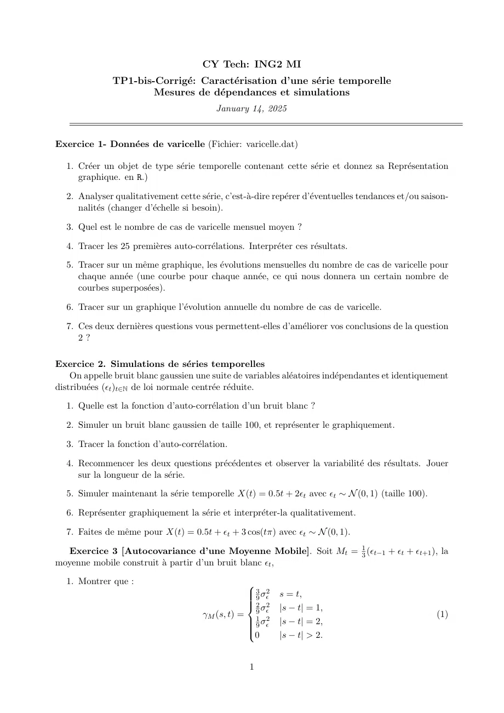

~~~text
                                      CY Tech: ING2 MI
              TP1-bis-Corrigé: Caractérisation d’une série temporelle
                      Mesures de dépendances et simulations
                                          January 14, 2025

Exercice 1- Données de varicelle (Fichier: varicelle.dat)

  1. Créer un objet de type série temporelle contenant cette série et donnez sa Représentation
     graphique. en R.)

  2. Analyser qualitativement cette série, c’est-à-dire repérer d’éventuelles tendances et/ou saison-
     nalités (changer d’échelle si besoin).

  3. Quel est le nombre de cas de varicelle mensuel moyen ?

  4. Tracer les 25 premières auto-corrélations. Interpréter ces résultats.

  5. Tracer sur un même graphique, les évolutions mensuelles du nombre de cas de varicelle pour
     chaque année (une courbe pour chaque année, ce qui nous donnera un certain nombre de
     courbes superposées).

  6. Tracer sur un graphique l’évolution annuelle du nombre de cas de varicelle.

  7. Ces deux dernières questions vous permettent-elles d’améliorer vos conclusions de la question
     2?

Exercice 2. Simulations de séries temporelles
    On appelle bruit blanc gaussien une suite de variables aléatoires indépendantes et identiquement
distribuées (ϵt )t∈N de loi normale centrée réduite.

  1. Quelle est la fonction d’auto-corrélation d’un bruit blanc ?

  2. Simuler un bruit blanc gaussien de taille 100, et représenter le graphiquement.

  3. Tracer la fonction d’auto-corrélation.

  4. Recommencer les deux questions précédentes et observer la variabilité des résultats. Jouer
     sur la longueur de la série.

  5. Simuler maintenant la série temporelle X(t) = 0.5t + 2ϵt avec ϵt ∼ N (0, 1) (taille 100).

  6. Représenter graphiquement la série et interpréter-la qualitativement.

  7. Faites de même pour X(t) = 0.5t + ϵt + 3 cos(tπ) avec ϵt ∼ N (0, 1).

  Exercice 3 [Autocovariance d’une Moyenne Mobile]. Soit Mt = 13 (ϵt−1 + ϵt + ϵt+1 ), la
moyenne mobile construit à partir d’un bruit blanc ϵt ,

  1. Montrer que :                               
                                                   3 2
                                                   9 σϵ    s = t,
                                                 
                                                 
                                                 
                                                  2 σ2
                                                 
                                                           |s − t| = 1,
                                      γM (s, t) = 19 ϵ2                                              (1)
                                                 
                                                 
                                                  9 σϵ    |s − t| = 2,
                                                 
                                                 0        |s − t| > 2.

                                                   1
~~~

## Page 2

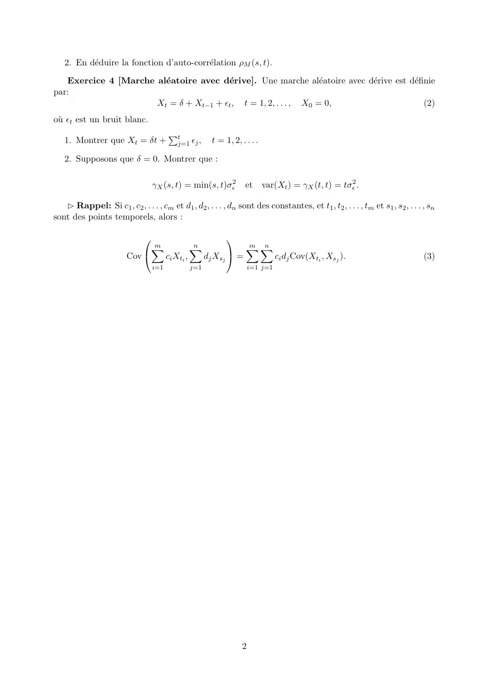

~~~text
   2. En déduire la fonction d’auto-corrélation ρM (s, t).

   Exercice 4 [Marche aléatoire avec dérive]. Une marche aléatoire avec dérive est définie
par:
                      Xt = δ + Xt−1 + ϵt , t = 1, 2, . . . , X0 = 0,                        (2)
où ϵt est un bruit blanc.
                                       Pt
   1. Montrer que Xt = δt +               j=1 ϵj ,   t = 1, 2, . . . .

   2. Supposons que δ = 0. Montrer que :

                                 γX (s, t) = min(s, t)σϵ2        et      var(Xt ) = γX (t, t) = tσϵ2 .

    Rappel: Si c1 , c2 , . . . , cm et d1 , d2 , . . . , dn sont des constantes, et t1 , t2 , . . . , tm et s1 , s2 , . . . , sn
sont des points temporels, alors :

                                                 
                             Xm          n
                                         X            m X
                                                      X n
                        Cov    ci Xti ,   dj Xsj  =     ci dj Cov(Xti , Xsj ).                                             (3)
                                 i=1          j=1                   i=1 j=1

                                                                2
~~~

## Page 3

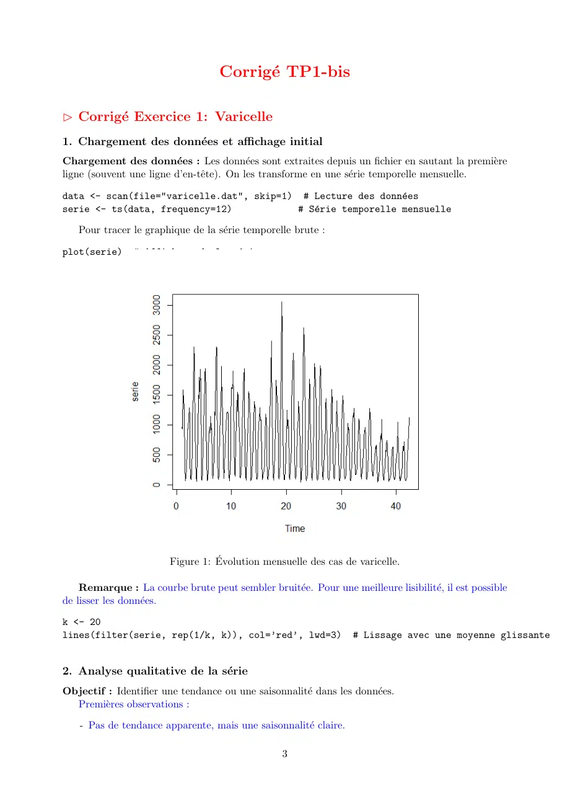

~~~text
                                   Corrigé TP1-bis

 Corrigé Exercice 1: Varicelle
1. Chargement des données et affichage initial
Chargement des données : Les données sont extraites depuis un fichier en sautant la première
ligne (souvent une ligne d’en-tête). On les transforme en une série temporelle mensuelle.

data <- scan(file="varicelle.dat", skip=1) # Lecture des données
serie <- ts(data, frequency=12)           # Série temporelle mensuelle

   Pour tracer le graphique de la série temporelle brute :

plot(serie)     # Affichage de la série

                        Figure 1: Évolution mensuelle des cas de varicelle.

    Remarque : La courbe brute peut sembler bruitée. Pour une meilleure lisibilité, il est possible
de lisser les données.

k <- 20
lines(filter(serie, rep(1/k, k)), col=’red’, lwd=3)              # Lissage avec une moyenne glissante

2. Analyse qualitative de la série
Objectif : Identifier une tendance ou une saisonnalité dans les données.
  Premières observations :

   - Pas de tendance apparente, mais une saisonnalité claire.

                                                 3
~~~

## Page 4

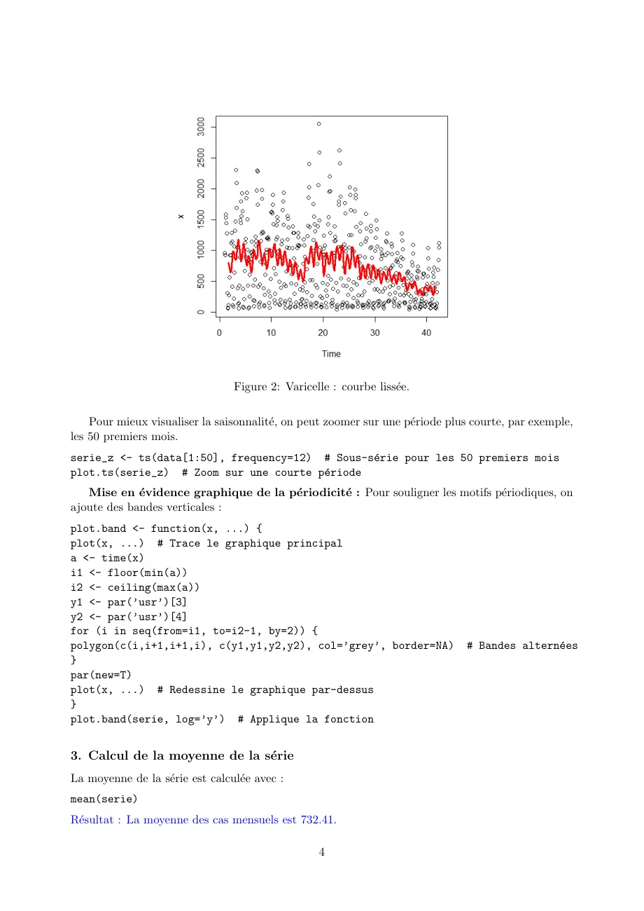

~~~text
                                 Figure 2: Varicelle : courbe lissée.

    Pour mieux visualiser la saisonnalité, on peut zoomer sur une période plus courte, par exemple,
les 50 premiers mois.
serie_z <- ts(data[1:50], frequency=12) # Sous-série pour les 50 premiers mois
plot.ts(serie_z) # Zoom sur une courte période
   Mise en évidence graphique de la périodicité : Pour souligner les motifs périodiques, on
ajoute des bandes verticales :
plot.band <- function(x, ...) {
plot(x, ...) # Trace le graphique principal
a <- time(x)
i1 <- floor(min(a))
i2 <- ceiling(max(a))
y1 <- par(’usr’)[3]
y2 <- par(’usr’)[4]
for (i in seq(from=i1, to=i2-1, by=2)) {
polygon(c(i,i+1,i+1,i), c(y1,y1,y2,y2), col=’grey’, border=NA)                 # Bandes alternées
}
par(new=T)
plot(x, ...) # Redessine le graphique par-dessus
}
plot.band(serie, log=’y’) # Applique la fonction

3. Calcul de la moyenne de la série
La moyenne de la série est calculée avec :
mean(serie)
Résultat : La moyenne des cas mensuels est 732.41.

                                                  4
~~~

## Page 5

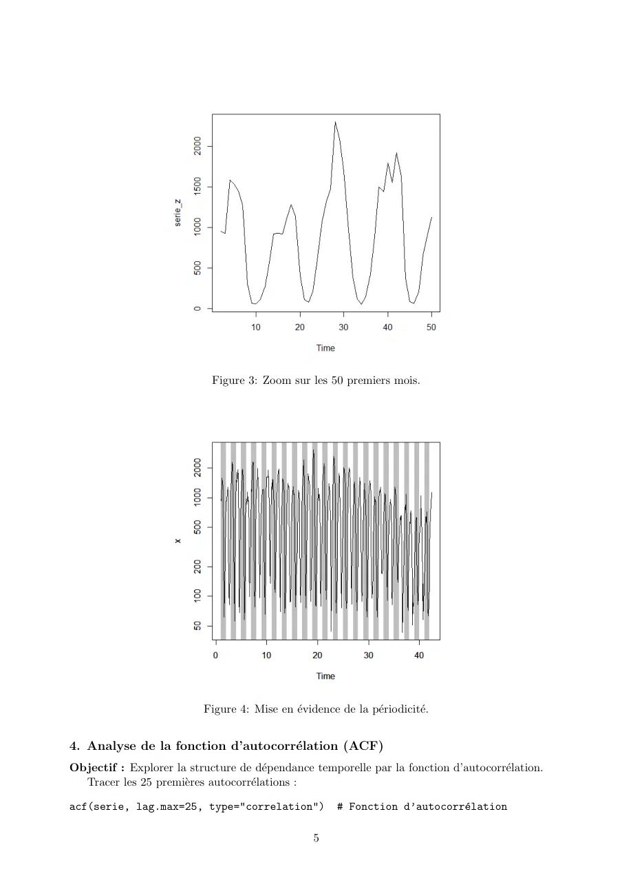

~~~text
                            Figure 3: Zoom sur les 50 premiers mois.

                          Figure 4: Mise en évidence de la périodicité.

4. Analyse de la fonction d’autocorrélation (ACF)
Objectif : Explorer la structure de dépendance temporelle par la fonction d’autocorrélation.
  Tracer les 25 premières autocorrélations :

acf(serie, lag.max=25, type="correlation")            # Fonction d’autocorrélation

                                                 5
~~~

## Page 6

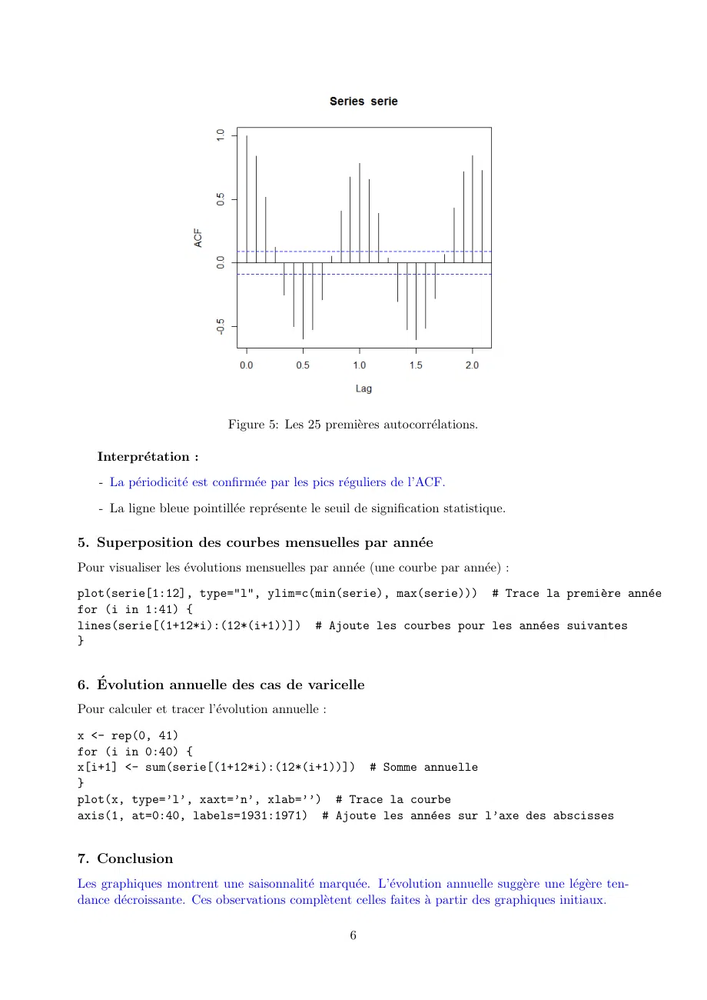

~~~text
                             Figure 5: Les 25 premières autocorrélations.

   Interprétation :
    - La périodicité est confirmée par les pics réguliers de l’ACF.

    - La ligne bleue pointillée représente le seuil de signification statistique.

5. Superposition des courbes mensuelles par année
Pour visualiser les évolutions mensuelles par année (une courbe par année) :
plot(serie[1:12], type="l", ylim=c(min(serie), max(serie))) # Trace la première année
for (i in 1:41) {
lines(serie[(1+12*i):(12*(i+1))]) # Ajoute les courbes pour les années suivantes
}

6. Évolution annuelle des cas de varicelle
Pour calculer et tracer l’évolution annuelle :
x <- rep(0, 41)
for (i in 0:40) {
x[i+1] <- sum(serie[(1+12*i):(12*(i+1))]) # Somme annuelle
}
plot(x, type=’l’, xaxt=’n’, xlab=’’) # Trace la courbe
axis(1, at=0:40, labels=1931:1971) # Ajoute les années sur l’axe des abscisses

7. Conclusion
Les graphiques montrent une saisonnalité marquée. L’évolution annuelle suggère une légère ten-
dance décroissante. Ces observations complètent celles faites à partir des graphiques initiaux.

                                                    6
~~~

## Page 7

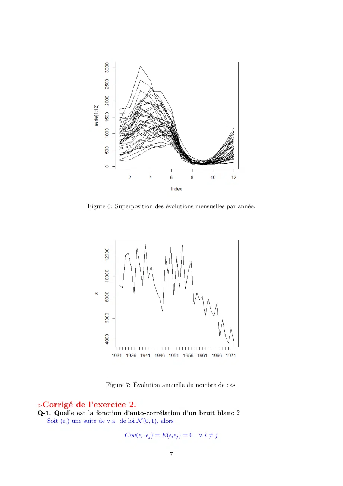

~~~text
                Figure 6: Superposition des évolutions mensuelles par année.

                      Figure 7: Évolution annuelle du nombre de cas.

Corrigé de l’exercice 2.
Q-1. Quelle est la fonction d’auto-corrélation d’un bruit blanc ?
   Soit (ϵi ) une suite de v.a. de loi N (0, 1), alors

                             Cov(ϵi , ϵj ) = E(ϵi ϵj ) = 0 ∀ i ̸= j

                                               7
~~~

## Page 8

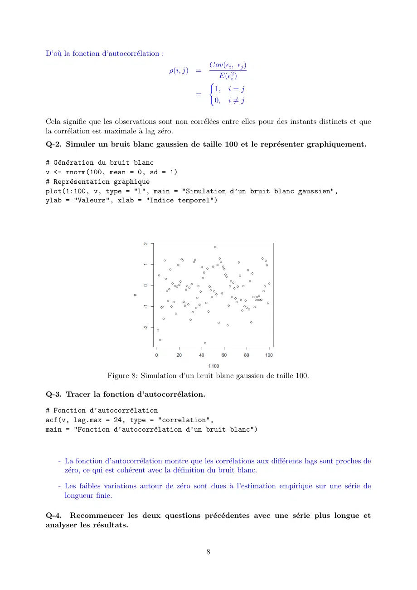

~~~text
D’où la fonction d’autocorrélation :
                                                  Cov(ϵi , ϵj )
                                         ρ(i, j) =
                                                    E(ϵ2i )
                                                  (
                                                   1, i = j
                                                =
                                                   0, i ̸= j

Cela signifie que les observations sont non corrélées entre elles pour des instants distincts et que
la corrélation est maximale à lag zéro.
Q-2. Simuler un bruit blanc gaussien de taille 100 et le représenter graphiquement.

# Génération du bruit blanc
v <- rnorm(100, mean = 0, sd = 1)
# Représentation graphique
plot(1:100, v, type = "l", main = "Simulation d’un bruit blanc gaussien",
ylab = "Valeurs", xlab = "Indice temporel")

                   Figure 8: Simulation d’un bruit blanc gaussien de taille 100.

Q-3. Tracer la fonction d’autocorrélation.

# Fonction d’autocorrélation
acf(v, lag.max = 24, type = "correlation",
main = "Fonction d’autocorrélation d’un bruit blanc")

    - La fonction d’autocorrélation montre que les corrélations aux différents lags sont proches de
      zéro, ce qui est cohérent avec la définition du bruit blanc.

    - Les faibles variations autour de zéro sont dues à l’estimation empirique sur une série de
      longueur finie.

Q-4. Recommencer les deux questions précédentes avec une série plus longue et
analyser les résultats.

                                                     8
~~~

## Page 9

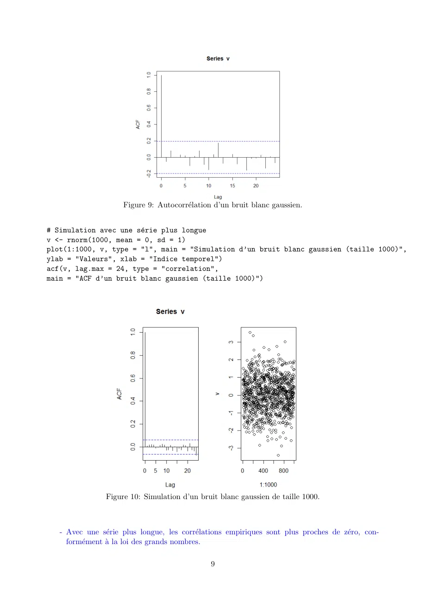

~~~text
                     Figure 9: Autocorrélation d’un bruit blanc gaussien.

# Simulation avec une série plus longue
v <- rnorm(1000, mean = 0, sd = 1)
plot(1:1000, v, type = "l", main = "Simulation d’un bruit blanc gaussien (taille 1000)",
ylab = "Valeurs", xlab = "Indice temporel")
acf(v, lag.max = 24, type = "correlation",
main = "ACF d’un bruit blanc gaussien (taille 1000)")

                Figure 10: Simulation d’un bruit blanc gaussien de taille 1000.

   - Avec une série plus longue, les corrélations empiriques sont plus proches de zéro, con-
     formément à la loi des grands nombres.

                                              9
~~~

## Page 10

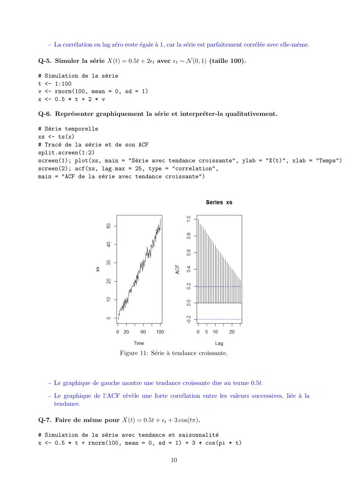

~~~text
   - La corrélation en lag zéro reste égale à 1, car la série est parfaitement corrélée avec elle-même.

Q-5. Simuler la série X(t) = 0.5t + 2ϵt avec ϵt ∼ N (0, 1) (taille 100).

# Simulation de la série
t <- 1:100
v <- rnorm(100, mean = 0, sd = 1)
x <- 0.5 * t + 2 * v

Q-6. Représenter graphiquement la série et interpréter-la qualitativement.

# Série temporelle
xs <- ts(x)
# Tracé de la série et de son ACF
split.screen(1:2)
screen(1); plot(xs, main = "Série avec tendance croissante", ylab = "X(t)", xlab = "Temps")
screen(2); acf(xs, lag.max = 25, type = "correlation",
main = "ACF de la série avec tendance croissante")

                                Figure 11: Série à tendance croissante.

   - Le graphique de gauche montre une tendance croissante due au terme 0.5t.

   - Le graphique de l’ACF révèle une forte corrélation entre les valeurs successives, liée à la
     tendance.

Q-7. Faire de même pour X(t) = 0.5t + ϵt + 3 cos(tπ).

# Simulation de la série avec tendance et saisonnalité
x <- 0.5 * t + rnorm(100, mean = 0, sd = 1) + 3 * cos(pi * t)

                                                     10
~~~

## Page 11

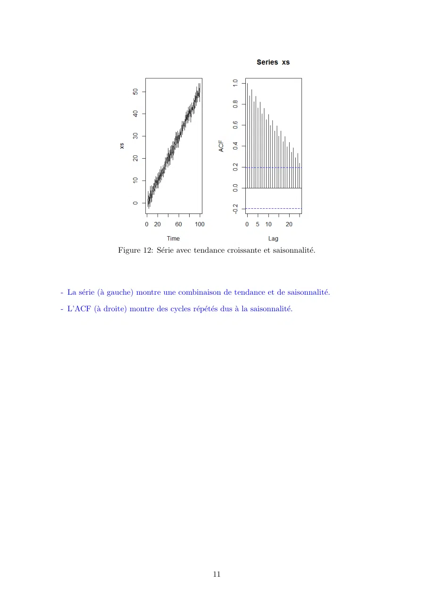

~~~text
                  Figure 12: Série avec tendance croissante et saisonnalité.

- La série (à gauche) montre une combinaison de tendance et de saisonnalité.

- L’ACF (à droite) montre des cycles répétés dus à la saisonnalité.

                                               11
~~~

## Page 12

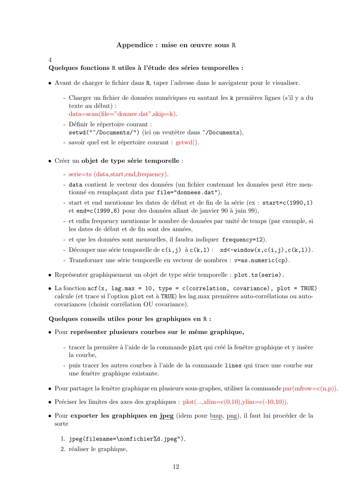

~~~text
                         Appendice : mise en œuvre sous R

4
Quelques fonctions R utiles à l’étude des séries temporelles :

• Avant de charger le fichier dans R, taper l’adresse dans le navigateur pour le visualiser.

     - Charger un fichier de données numériques en sautant les k premières lignes (s’il y a du
       texte au début) :
       data=scan(file=”donnee.dat”,skip=k).
     - Définir le répertoire courant :
       setwd("~/Documents/") (ici on veutêtre dans ~/Documents),
     - savoir quel est le répertoire courant : getwd().

• Créer un objet de type série temporelle :

     - serie=ts (data,start,end,frequency).
     - data contient le vecteur des données (un fichier contenant les données peut être men-
       tionné en remplaçant data par file="donnees.dat"),
     - start et end mentionne les dates de début et de fin de la série (ex : start=c(1990,1)
       et end=c(1999,6) pour des données allant de janvier 90 à juin 99),
     - et enfin frequency mentionne le nombre de données par unité de temps (par exemple, si
       les dates de début et de fin sont des années,
     - et que les données sont mensuelles, il faudra indiquer frequency=12).
     - Découper une série temporelle de c(i,j) à c(k,l) :     xd<-window(x,c(i,j),c(k,l)).
     - Transformer une série temporelle en vecteur de nombres : v=as.numeric(cp).

• Représenter graphiquement un objet de type série temporelle : plot.ts(serie).

• La fonction acf(x, lag.max = 10, type = c(correlation, covariance), plot = TRUE)
  calcule (et trace si l’option plot est à TRUE) les lag.max premières auto-corrélations ou auto-
  covariances (choisir corrélation OU covariance).

Quelques conseils utiles pour les graphiques en R :

• Pour représenter plusieurs courbes sur le même graphique,

     - tracer la première à l’aide de la commande plot qui créé la fenêtre graphique et y insère
       la courbe,
     - puis tracer les autres courbes à l’aide de la commande lines qui trace une courbe sur
       une fenêtre graphique existante.

• Pour partager la fenêtre graphique en plusieurs sous-graphes, utiliser la commande par(mfrow=c(n,p)).

• Préciser les limites des axes des graphiques : plot(...,xlim=c(0,10),ylim=c(-10,10)).

• Pour exporter les graphiques en jpeg (idem pour bmp, png), il faut lui procéder de la
  sorte

    1. jpeg(filename=\nomfichier%d.jpeg"),
    2. réaliser le graphique,

                                               12
~~~

## Page 13

~~~text
       3. la commande dev.off() permet enfin de rediriger le dernier graphique tracé vers le
          fichier nomfichier1.jpeg, et ainsi de suite après chaque graphique. Le nom de fichier
          sera automatiquement incrémenté.

   Simulation de variables normales indépendantes : x¡-rnorm(n,mean=0,sd=1) renvoie une suite
de variables normales indépendantes de moyenne 0 et d’écart-type 1.

                                              13
~~~
