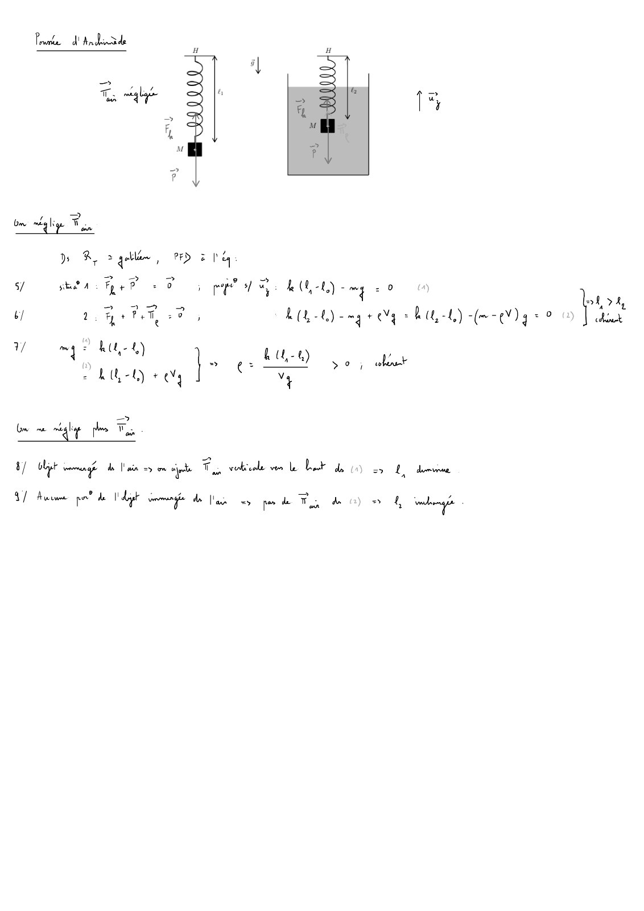

# CC2-2023-2024-Correction_Mecanique-du-point-CC_P1S2_DPhysique.pdf

[Ouvrir l’original](https://drive.google.com/open?id=12V6U7KvIDv4NdMFRt58aiHeMnBIMuLWZ) · Les pages signalées comprennent du texte reconnu automatiquement ou des éléments graphiques. Le fac-similé permet de vérifier chaque lecture.

**Pages avec fac-similé ou lecture OCR** — 9.

## Page 1

~~~text
                                              Catalogue

                               Mécanique du point matériel
                                   PI1-MI/GC — CC2 — 2023/2024

                                Durée : 1h30’ (2h en cas de tiers-temps)

Sont interdits :
  — les documents ;
  — tous les objets électroniques (calculatrice, téléphone, tablette, ordinateur...) de même que les
      montres connectées ;
  — les déplacements et les échanges.

Consignes :
Seules les dernières feuilles doivent être rendues :
    1. la feuille-réponse du QCM :
      (a) y indiquer vos nom, prénom et groupe dès le début officiel de l’épreuve ;
      (b) remplir complètement au stylo noir la case correspondant à la bonne réponse
          (une case simplement cochée ne sera pas comptabilisée) ;
      (c) chaque question ne comporte qu’une seule réponse correcte ;
      (d) il n’y a pas de point négatif pour une réponse incorrecte ;
    2. le cas échéant, les feuilles de réponses aux questions ouvertes (icône ♣).

Le cas échéant, vos réponses doivent être justifiées.
Une attention particulière sera portée à la qualité et au soin de la rédaction.

Vérifier que ce document comporte 8 pages et 16 questions.

                 Le barème est donné à titre indicatif et est susceptible d’être modifié.
~~~

## Page 2

~~~text
                                              Catalogue

                         Considérations générales (4 points)
Question 1 [CgTEC] ♣ (1 point)
Énoncer le théorème de l’énergie cinétique.
Question 2 [CgDimP] (1 point)
La dimension physique d’une puissance est :
   A M L2 T´3
   B M L2 T´1
   C M L´2 T´3
   D Aucune des réponses précédentes n’est correcte.
Question 3 [CgdW] (1 point)
                                      #»                    # »
Le travail élémentaire δW d’une force F sur un déplacement dOM est égal à :
       #» # »
    A F ¨ dOM
       #»     # »
    B F ^ dOM
       #» # »
    C F { dOM
   D Aucune des réponses précédentes n’est correcte.
Question 4 [CgW] (1 point)
                                         #»
Le travail WAÑB d’une force conservative F entre deux points A et B est tel que :
    A WAÑB “ ´WBÑA
   B WAÑB “ WBÑA
   C WAÑB “ 0 @ A et B
   D Aucune des réponses précédentes n’est correcte.
~~~

## Page 3

~~~text
                                                   Catalogue

                             Poussée d’Archimède (5 points)
Dans le référentiel terrestre RT , approximé galiléen, on considère la situation suivante :
un ressort de raideur k et longueur à vide ℓ0 est attaché verticalement en un point H immobile.
À l’autre extrémité est attaché un objet de masse m et volume V , de centre d’inertie M.
L’ensemble est plongé dans le champ de pesanteur terrestre #» g , de norme g.
Dans un premier temps, on néglige la poussée d’Archimède due à l’air.
Dans la situation 1 (à gauche ci-dessous), la longueur du ressort à l’équilibre est ℓ1 .
Dans la situation 2 (à droite ci-dessous), l’objet est immergé dans un fluide de masse volumique ρ et
la longueur du ressort à l’équilibre est ℓ2 .
                                          H                         H
                                                     ⃗g

                                              ℓ1                          ℓ2

                                                               M

                                      M

Question 5 [PbPouQ0] (1 point)
Dans la situation 1, on a :
   A kpℓ1 ´ ℓ0 q ´ mg “ 0                                  C k ℓ1 ´ mg “ 0
    B kpℓ1 ´ ℓ0 q ` mg “ 0                                 D Aucune des réponses précédentes n’est cor-
                                                             recte.
Question 6 [PbPouQ1] (1 point)
Dans la situation 2, on a :
   A kpℓ2 ´ ℓ0 q ´ pm ´ ρV qg “ 0                          C kpℓ2 ´ ℓ0 q ´ mg “ 0
    B kpℓ2 ´ ℓ0 q ` pm ´ ρV qg “ 0                         D Aucune des réponses précédentes n’est cor-
                                                             recte.
Question 7 [PbPouQ2] (1 point)
On déduit des questions précédentes que ρ est égale à :
      kpℓ1 ´ ℓ2 q                                                  k ℓ0
   A                                                       C
         Vg                                                        Vg

    B
         Vg                                                D Aucune des réponses précédentes n’est cor-
      kpℓ1 ´ ℓ2 q                                            recte.
Dans les deux questions suivantes, on ne néglige plus la poussée d’Archimède due à l’air sur l’objet.
Question 8 [PbPouQ3]      (1 point)
Dans ce cas, ℓ1 :
   A diminue                                               C est inchangée
    B augmente                                             D Aucune des réponses précédentes n’est cor-
                                                             recte.
Question 9 [PbPouQ4]      (1 point)
Dans ce cas, ℓ2 :
   A est inchangée                                         C diminue
    B augmente                                             D Aucune des réponses précédentes n’est cor-
                                                             recte.
~~~

## Page 4

~~~text
                                                Catalogue

                                     Oscilloscope (9 points)
Un oscilloscope analogique permet de mesurer (et visualiser) une tension électrique grâce à la déviation
d’un faisceau d’électrons. Dans cet exercice on se propose d’en étudier le principe.
Dans le référentiel terrestre RT , approximé galiléen, on considère la situation suivante (fig. ci-dessous) :
                                            #»
un champ électrique uniforme et constant E “ E #»    u y règne entre deux armatures parallèles
(0 ď x ď D et ´d{2 ď y ď `d{2). Le champ est nul en dehors de cette zone.
Un électron de masse m et charge q arrive à t0 en O (origine du repère), avec une vitesse
v 0 “ v0 #»
#»       u x pv0 ą 0q.
L’électron sort de la zone entre les armatures à t1 , puis percute un écran fluorescent à t2 .
On néglige toute force autre que l’interaction électrostatique.
Les résultats sont à exprimer en fonction des données de l’énoncé.

                                                                            y

                                            ⃗
                                            E       d
                                       O                                         x

                                            D                L
                                                                         écran

Mouvement de l’électron entre les armatures (t0 ď t ď t1 ).
Question 10 [PbOscQ0] ♣ (0.5 point)
                                  #»
Exprimer la force électrostatique F e ressentie par l’électron.
                                                     #»         #»
Aide : analogie électrostatique Ø gravitation : tq ; Eu Ø tm ; Gu

Question 11 [PbOscQ1] ♣ (3.5 points)
Déterminer les équations horaires du mouvement de l’électron.

Question 12 [PbOscQ2] ♣ (0.5 point)
                                                              qE
En déduire que l’équation de sa trajectoire s’écrit : y “           x2
                                                            2 m v02

Question 13 [PbOscQ3] ♣ (2 points)
Déterminer les vecteurs position et vitesse de l’électron à t1 .

Mouvement de l’électron après les armatures (t1 ď t ď t2 ).
Question 14 [PbOscQ4] ♣ (1 point)
Quelle est la nature du mouvement de l’électron ?

Question 15 [PbOscQ5] ♣ (0.5 point)
                                                                                                 qED
En déduire que l’angle α entre l’axe x et la trajectoire de l’électron est tel que : tanpαq “
                                                                                                 m v02

Question 16 [PbOscQ6] ♣ (1 point)
En déduire ypt2 q, ordonnée du point d’impact de l’électron sur l’écran.
~~~

## Page 5

~~~text
                                                      Catalogue

    Mécanique du point matériel - PI1-MI/GC - CC2 - 2023/2024

NOM : . . . . . . . . . . . . . . . . . . . . . . . . . . . . . . . . . . . . . . . . . . . . . . . . . . . . . . . . . . . . . . . . . . . . . . . . .

Prénom : . . . . . . . . . . . . . . . . . . . . . . . . . . . . . . . . . . . . . . . . . . . . . . . . . . . . . . . . . . . . . . . . . . . . . .

Groupe : . . . . . . . . . . . . . . . . . . . . . . . . . . . . . . . . . . . . . . . . . . . . . . . . . . . . . . . . . . . . . . . . . . . . . . .

                          codage du n˝ étudiant
                     (colorier complètement les cases)

                                       0      0      0      0      0      0       0      0
                                       1      1      1      1      1      1       1      1
                                       2      2      2      2      2      2       2      2
                                       3      3      3      3      3      3       3      3
                                       4      4      4      4      4      4       4      4
                                       5      5      5      5      5      5       5      5
                                       6      6      6      6      6      6       6      6
                                       7      7      7      7      7      7       7      7
                                       8      8      8      8      8      8       8      8
                                       9      9      9      9      9      9       9      9
                                           sens de remplissage
~~~

## Page 6

~~~text
                                     Catalogue

Les réponses au QCM ne doivent être apportées que sur cette feuille.
La copie ne sera corrigée que si :
  — elle comporte vos nom, prénom et groupe ;
  — les cases sont complètement coloriées avec un stylo noir ;
  — la feuille-réponse ne comporte pas de ratures.

Question 2 A    B   C D
Question 3 A    B   C D
Question 4 A    B   C D
Question 5 A    B   C D
Question 6 A    B   C D
Question 7 A    B   C D
Question 8 A    B   C D
Question 9 A    B   C D

Question 1                                      TEC .5 .5 Réservé à l’enseignant(e)
~~~

## Page 7

~~~text
                    Catalogue

                                   #»
Question 10                        F e .5 Réservé à l’enseignant(e)

Question 11   Équations horaires .5 1   2 Réservé à l’enseignant(e)

Question 12       Équation trajectoire .5 Réservé à l’enseignant(e)
~~~

## Page 8

~~~text
                 Catalogue

                # »
Question 13           v à t1 .5 .5 1 Réservé à l’enseignant(e)
                OM et #»

Question 14   Nature mouvement .5 .5 Réservé à l’enseignant(e)

Question 15                        α .5 Réservé à l’enseignant(e)

Question 16                  ypt2 q .5 .5 Réservé à l’enseignant(e)
~~~

## Page 9

**Lecture OCR à contrôler**

~~~text
Ponte d'indiide

D OR salée, PED lu
5/ phon Fe PD pep a a kk) mg 0

2 > hot

0 2 BrP ee LOL) mgr ge RU) (ee) g = 0 Vos

3/ ms ht) }- ps & (,-&) po; alor
v
+

AUD +0

be oe “ag je F.

8) tt de lis > om jte Fu coke ve le Let de 0) cy Ldn
47 Aus pon? de I dap seman dla ype de Th À

“ io
~~~
