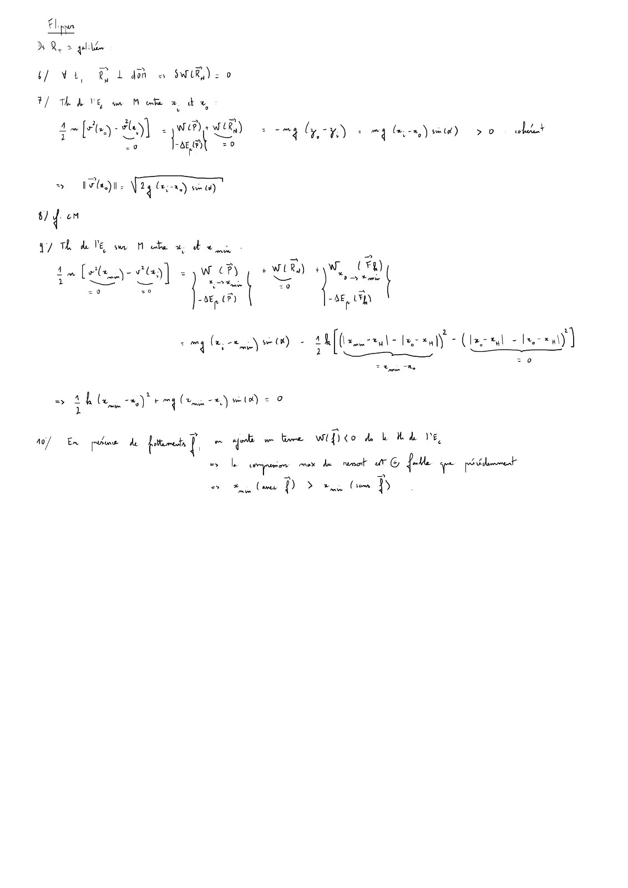

# CC3-2023-2024-Correction_Mecanique-du-point-CC_P1S2_DPhysique.pdf

[Ouvrir l’original](https://drive.google.com/open?id=1vY6-9z9kTHH7sCMIjfbbJzs8-L2RKKTs) · Les pages signalées comprennent du texte reconnu automatiquement ou des éléments graphiques. Le fac-similé permet de vérifier chaque lecture.

**Pages avec fac-similé ou lecture OCR** — 9.

## Page 1

~~~text
                                              Catalogue

                               Mécanique du point matériel
                                PI1-MI/GC/GCA — CC3 — 2023/2024

                                Durée : 1h30’ (2h en cas de tiers-temps)

Sont interdits :
  — les documents ;
  — tous les objets électroniques (calculatrice, téléphone, tablette, ordinateur...) de même que les
      montres connectées ;
  — les déplacements et les échanges.

Consignes :
Seules les dernières feuilles doivent être rendues :
    1. la feuille-réponse du QCM :
      (a) y indiquer vos nom, prénom et groupe dès le début officiel de l’épreuve ;
      (b) remplir complètement au stylo noir la case correspondant à la bonne réponse
          (une case simplement cochée ne sera pas comptabilisée) ;
      (c) chaque question ne comporte qu’une seule réponse correcte ;
      (d) il n’y a pas de point négatif pour une réponse incorrecte ;
    2. le cas échéant, les feuilles de réponses aux questions ouvertes (icône ♣).

Le cas échéant, vos réponses doivent être justifiées.
Une attention particulière sera portée à la qualité et au soin de la rédaction.

Vérifier que ce document comporte 8 pages et 16 questions.

                 Le barème est donné à titre indicatif et est susceptible d’être modifié.
~~~

## Page 2

~~~text
                                               Catalogue

                          Considérations générales (5 points)
Dans un référentiel galiléen, on considère le mouvement unidimensionnel (selon x) d’un point matériel
M soumis à une force conservative dérivant d’une énergie potentielle Ep .
Question 1 [CgEq]      (1 point)
                                                   dEp
Si xeq est une position d’équilibre de M , alors       pxeq q :
                                                    dx
    A “0                                                    C ą0
    B ă0                                                    D On ne peut pas conclure.

Question 2 [CgEqSt]       (1 point)
                                              d 2 Ep
Si xeq est une position d’équilibre de M et          pxeq q ą 0, alors cet équilibre est :
                                               dx2
    A stable                                                C ni stable, ni instable
    B instable                                              D On ne peut pas conclure.

Question 3 [CgHa] (1 point)
L’approximation harmonique est réalisable au voisinage :
    A d’une position d’équilibre stable uniquement
    B d’une position d’équilibre instable uniquement
    C de toute position d’équilibre
    D de toute position
    E Aucune des réponses précédentes n’est correcte.

La figure ci-dessous représente Ep en fonction de x, ainsi que l’énergie mécanique Em de M (tirets).
                              Ep

                                      x1            x2
                                                                             x

                              Em

Question 4 [CgLie] (1 point)
D’après la figure, M se trouve dans un état :
    A lié                                                   C de désintégration
    B de diffusion (ou non-lié)                             D On ne peut pas conclure.

Question 5 [CgEc] (1 point)
L’énergie cinétique de M en x1 et x2 est :
    A nulle                                                 C strictement négative
    B strictement positive                                  D On ne peut pas conclure.
~~~

## Page 3

~~~text
                                                  Catalogue

                                         Flipper (5 points)
Dans le référentiel terrestre RT , approximé galiléen, on considère la situation suivante (fig. ci-dessous) :
le système de lancement d’un flipper est assimilé à un plan incliné d’angle α par rapport à l’horizontale,
en bas duquel se trouve un ressort idéal de raideur k et longueur à vide ℓ0 dont l’extrémité H est fixe.

Un joueur vient de rater le lancer de sa bille, qui n’a pas pu entrer en jeu. La bille, assimilée à un point
matériel M de masse m, se trouve à l’instant initial à la position xi avec une vitesse nulle. On note g
la norme du champ de pesanteur et on néglige tout frottement.

                                                                 M
                                                                         x
                                                                  xi
                                                                              sens croissant
                               ℓ0                                             des angles

                                             x0

                                    α                                          ⃗g
                     H

Question 6 [PbFliQ0] (1 point)
Au cours du mouvement de M , le travail de la réaction normale du support est :
    A nul                                                  C strictement positif
    B strictement négatif                                  D On ne peut pas conclure.

Question 7 [PbFliQ1] (1 point)
La vitesse ∥ #»
             v px0 q∥ de la bille atteignant l’extrémité supérieure du ressort est égale à :
       a                                                         a
   A      2 g pxi ´ x0 q sinpαq                             D 2 g pxi ´ x0 q sinpαq
       a
    B     2 g px0 ´ xi q cospαq                             E Aucune des réponses précédentes n’est cor-
       a                                                       recte.
    C     2 g px ´ x q cospαq
               i     0

Question 8 [PbFliQ2] (1 point)
L’énergie potentielle élastique d’un ressort de raideur k, longueur à vide ℓ0 et longueur ℓ, est égale à :
    A   1
        2 k pℓ ´ ℓ0 q ` constante
                     2                                     C ´ 12 k pℓ ´ ℓ0 q2 ` constante
    B   1
        2 k ℓ ` constante
             2                                             D Aucune des réponses précédentes n’est cor-
                                                             recte.
Question 9 [PbFliQ3] (1 point)
Soit xmin la position minimale atteinte par M au cours de son mouvement. On a alors :
    A 12 k pxmin ´ x0 q2 ` m g pxmin ´ xi q sinpαq “ 0
    B   1
        2 k pxmin ´ x0 q ` m g pxmin ´ x0 q sinpαq “ 0
                        2

    C   1
        2 k pxmin ´ x0 q ` m g pxmin ´ x0 q cospαq “ 0
                        2

    D   1
        2 k pxmin ´ x0 q ´ m g pxmin ´ xi q cospαq “ 0
                        2

    E Aucune des réponses précédentes n’est correcte.

Question 10 [PbFliQ4] (1 point)
En présence de frottements, la nouvelle position xmin serait, par rapport au cas sans frottement :
    A strictement supérieure                               C égale
    B strictement inférieure                               D On ne peut pas conclure.
~~~

## Page 4

~~~text
                                                     Catalogue

                                          Pendule (8 points)
Dans le référentiel terrestre RT , approximé galiléen, on considère la situation suivante (fig. ci-dessous) :
un point matériel M de masse m, attaché à un fil idéal de longueur ℓ dont l’autre extrémité est fixe
en O, oscille sur une trajectoire circulaire dans le plan vertical pOxyq.
On note θ l’angle d’inclinaison du fil par rapport à la verticale à l’instant t et g la norme du champ de
pesanteur. On néglige tout frottement.
Les résultats sont à exprimer en fonction des données de l’énoncé.
                                                           y

                                                       O           z
                                                                                  x

                                   sens croissant
                                   des angles
                                                               θ
                                                                       ℓ
                                   ⃗g

                                                                           M

Question 11 [PbPenQ0] ♣ (1.5 point)
         #»
Exprimer L O pM q, moment cinétique de M par rapport à O.

Question 12 [PbPenQ1] ♣ (1 point)
Énoncer le théorème du moment cinétique (sous sa forme générale).

Question 13 [PbPenQ2] ♣ (2.5 points)
En déduire que l’équation du mouvement de M selon la direction orthoradiale peut s’écrire :
                                                        g
                                                    θ: ` sinpθq “ 0
                                                        ℓ
Question 14 [PbPenQ3] ♣ (1 point)   ” π πı
Déterminer la (les) valeur(s) de θ P ´ ;   telle(s) que l’accélération angulaire s’annule.
                                      2 2

                                                                                     #»
                                                                                            u x dans
Un dispositif permet maintenant d’appliquer un champ électrique uniforme et constant E “ E #»
tout l’espace. M porte une charge q et on suppose que sa trajectoire demeure circulaire dans le plan
pOxyq.
Question 15 [PbPenQ4] ♣ (1 point)
Établir la nouvelle équation du mouvement de M selon la direction orthoradiale.

Question 16 [PbPenQ5] ♣ (1 point)
                                                                           qE
En déduire que l’accélération angulaire s’annule pour tanpθq “                .
                                                                           mg
Ce résultat est-il en accord avec celui obtenu à la question 14 ?
~~~

## Page 5

~~~text
                                                      Catalogue

Mécanique du point matériel - PI1-MI/GC/GCA - CC3 - 2023/2024

NOM : . . . . . . . . . . . . . . . . . . . . . . . . . . . . . . . . . . . . . . . . . . . . . . . . . . . . . . . . . . . . . . . . . . . . . . . . .

Prénom : . . . . . . . . . . . . . . . . . . . . . . . . . . . . . . . . . . . . . . . . . . . . . . . . . . . . . . . . . . . . . . . . . . . . . .

Groupe : . . . . . . . . . . . . . . . . . . . . . . . . . . . . . . . . . . . . . . . . . . . . . . . . . . . . . . . . . . . . . . . . . . . . . . .

                          codage du n˝ étudiant
                     (colorier complètement les cases)

                                       0      0      0      0      0      0       0      0
                                       1      1      1      1      1      1       1      1
                                       2      2      2      2      2      2       2      2
                                       3      3      3      3      3      3       3      3
                                       4      4      4      4      4      4       4      4
                                       5      5      5      5      5      5       5      5
                                       6      6      6      6      6      6       6      6
                                       7      7      7      7      7      7       7      7
                                       8      8      8      8      8      8       8      8
                                       9      9      9      9      9      9       9      9
                                           sens de remplissage
~~~

## Page 6

~~~text
                                     Catalogue

Les réponses au QCM ne doivent être apportées que sur cette feuille.
La copie ne sera corrigée que si :
  — elle comporte vos nom, prénom et groupe ;
  — les cases sont complètement coloriées avec un stylo noir ;
  — la feuille-réponse ne comporte pas de ratures.

Question 1 A    B   C D
Question 2 A    B   C D
Question 3 A    B   C D    E
Question 4 A    B   C D
Question 5 A    B   C D
Question 6 A    B   C D
Question 7 A    B   C D    E
Question 8 A    B   C D
Question 9 A    B   C D    E
Question 10 A   B   C D
~~~

## Page 7

~~~text
                      Catalogue

                              #»
Question 11                   L O pM q .5 1 Réservé à l’enseignant(e)

                                   #»
Question 12                    Th. L .5 .5 Réservé à l’enseignant(e)

Question 13   Équation du mvmt p1q .5 1   1 Réservé à l’enseignant(e)
~~~

## Page 8

~~~text
                    Catalogue

Question 14             θpθ: “ 0q p1q .5 .5 Réservé à l’enseignant(e)

Question 15   Équation du mvmt p2q .5 .5 Réservé à l’enseignant(e)

Question 16             θpθ: “ 0q p2q .5 .5 Réservé à l’enseignant(e)
~~~

## Page 9

**Lecture OCR à contrôler**

~~~text
6) Wi, RL dm à SWiR): 0

F/ Th bk VE om M uke a da,

=o

DONNE TETE CCR
20 LA

> IP). Way Gy ee)
4 om

G7 Th de Ne su Mob x, ob x

m (le ye vay) = Bye WER) ay WL #4)
ea] pen phy
. “ “dE CPD

-AE UY
PA

cr) ee ew) -

ble, ay np ling pate @

10) Em péus de post moet bre wifico dk bb Ve

ss fb pee me dn wnat dt @ {ote qe pééeet
ot Cou D > mu Cum D

hat
~~~
