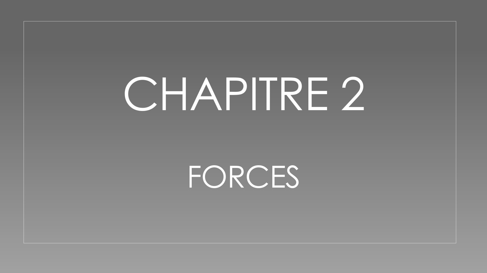
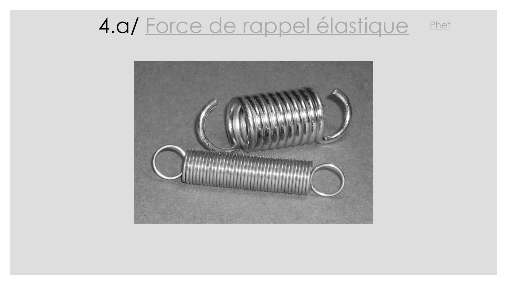
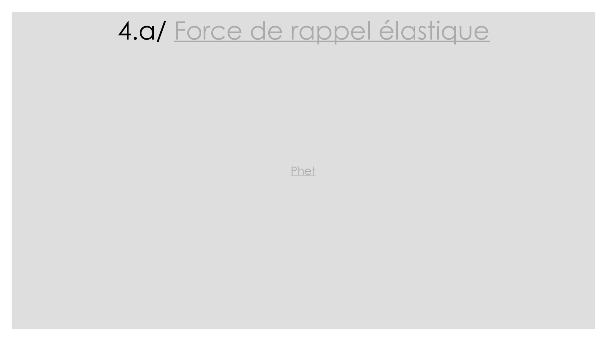
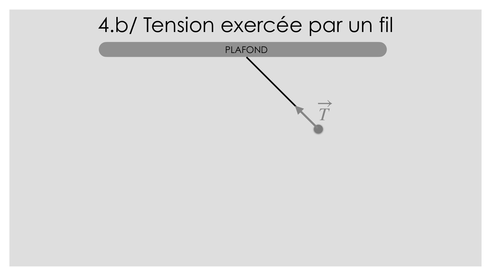
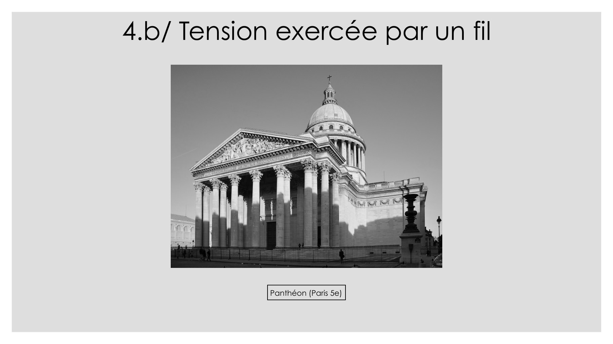
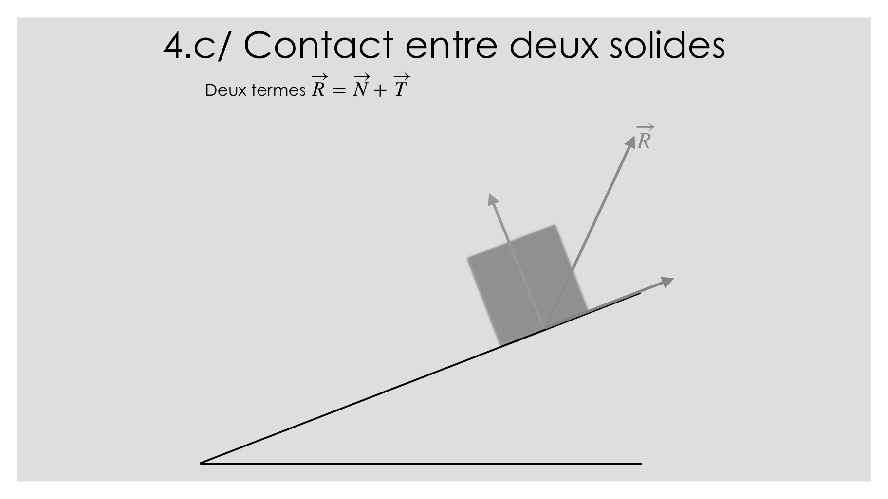

# CM-Mecanique-du-point_2023-2024_Mecanique-du-point_P1S2_PAkridas.pdf

[Ouvrir l’original](https://drive.google.com/open?id=1kAx-V0aDR-KfSJcYHgp8h3VDhb23_1y0) · Les pages signalées comprennent du texte reconnu automatiquement ou des éléments graphiques. Le fac-similé permet de vérifier chaque lecture.

**Pages avec fac-similé ou lecture OCR** — 1, 4–5, 16–17, 20, 23, 26–27.

## Page 1

~~~text
MÉCANIQUE DU POINT
    TEAMS : 16VU7L1
~~~

**Lecture OCR à contrôler**

~~~text
MÉCANIQUE DU POINT
TEAMS : TéVU7LI
~~~

## Page 2

~~~text
                   MÉCANIQUE DU POINT
                            COMMUNICATION
• mail : pakridas@cyu.fr (Signature Nom, Prénom, PréIng1, groupe et
  chargé de TD)
• Questions générales : Teams
• Bureau : Cauchy 308

                                    TD
• Mis à jour toutes les semaines
• Consulter : onglet Fichiers > TD
• Si erreur dans le TD : envoyer un mail !
~~~

## Page 3

~~~text
     MÉCANIQUE DU POINT
          BIBLIOGRAPHIE SUCCINCTE

PAS À LA BU.     A LA BU
~~~

## Page 4

Illustration de transition : un pissenlit dont les graines se dispersent. Aucun texte.

## Page 5

~~~text
CHAPITRE 2
  FORCES
~~~

**Lecture OCR à contrôler**

~~~text
CHAPITRE 2
~~~

## Page 6

~~~text
      Chapitre 2 – Forces

1. Généralités
2. Forces à distance
3. Forces de contacts avec un fluide
4. Forces de contacts avec un solide
~~~

## Page 7

~~~text
        Chapitre 2 – Forces
1. Généralités
2. Forces à distance
   a. Force d’interaction gravitationnelle
   b. Force d’interaction électrostatique
   c. Force de Lorentz
3. Forces de contacts avec un fluide
4. Forces de contacts avec un solide
~~~

## Page 8

~~~text
       2. Forces à distance
 a. Force d’interaction gravitationnelle

                      r = ∥M1M2∥
                                           M2

M1
           ·  M1M2
     u 1→2 =
             ∥M1M2∥
~~~

## Page 9

~~~text
             2. Forces à distance
     a. Force d’interaction gravitationnelle

                                               M2
         u 1→2
    M1

                             m1m2
                 F 1→2 = −        u 1→2
                              r 2
𝒢
~~~

## Page 10

~~~text
             2. Forces à distance
     a. Force d’interaction gravitationnelle

                                               M2
         u 1→2
    M1

                             m1m2
                 F 1→2 = −        u 1→2
                              r 2
𝒢
~~~

## Page 11

~~~text
         2. Forces à distance
 b. Force d’interaction électrostatique

                                          M2
     u 1→2
M1

                        1 q1q2
             F 1→2 = +          u 1→2
                       4πε0 r 2
~~~

## Page 12

~~~text
        Chapitre 2 – Forces

1. Généralités
2. Forces à distance
3.Forces de contacts avec un fluide
   a.Poussée d’Archimède
   b.Objet en mouvement
4. Forces de contacts avec un solide
~~~

## Page 13

~~~text
          3.a/ Poussée d’Archimède
                       QCM 1
Un bateau flotte sur un lac. Le capitaine fait descendre
l’ancre dans le lac sans que celle-ci ne touche le fond.
                   Que se passe-t-il ?

A.Le bateau s’enfonce
B. Le bateau remonte
C. Le bateau ne bouge pas
~~~

## Page 14

~~~text
          3.a/ Poussée d’Archimède
                         QCM 2
    Pour deux objets de même volume, mais de
compositions différentes, totalement immergés dans un
       liquide, la poussée d’Archimède sera :

A. Plus importante pour l’objet le plus lourd
B. La même pour les deux objets
C. Plus importante pour l’objet le plus léger
~~~

## Page 15

~~~text
       Chapitre 2 – Forces

1. Généralités
2. Forces à distance
3.Forces de contacts avec un fluide
4.Forces de contacts avec un solide
   a.Force de rappel élastique
   b.Tension d’un fil
   c.Contact entre deux solides
~~~

## Page 16

~~~text
4.a/ Force de rappel élastique   Phet
~~~

**Lecture OCR à contrôler**

~~~text
B

4.a/ Force de rappel élastique © 2!

& co
~~~

## Page 17

~~~text
4.a/ Force de rappel élastique

             Phet
~~~

## Page 18

~~~text
      4.b/ Tension exercée par un fil

Source : https://en.wikipedia.org/wiki/Sling_(weapon)   Source : https://tintinomania.com/
~~~

## Page 19

~~~text
          4.b/ Tension exercée par un fil
                                      Modèle :
- fil inextensible
- fil de masse nulle

                                       PLAFOND

                    FIL
       (inextensible et sans masse)

                                                 OBJET
~~~

## Page 20

~~~text
4.b/ Tension exercée par un fil
             PLAFOND

                       T
~~~

**Lecture OCR à contrôler**

~~~text
4.b/ Tension exercée par un fil

N
~~~

## Page 21

~~~text
4.b/ Tension exercée par un fil
                          PLAFOND

                            u ext

                                        T = − T u ext

  u ext vecteur
  - unitaire (norme 1 et sans dimension)
  - Dirigé le long du fil ;
  - Orienté du « plafond » vers l’objet en mouvement

  T : norme de la force
~~~

## Page 22

~~~text
4.b/ Tension exercée par un fil
                 PLAFOND

                    u ext

                                   T = − T u ext

                Remarque
      T (norme de la tension) inconnue
~~~

## Page 23

~~~text
4.b/ Tension exercée par un fil

            Panthéon (Paris 5e)
~~~

**Lecture OCR à contrôler**

~~~text
4.b/ Tension exercée par un fil
~~~

## Page 24

~~~text
4.c/ Contact entre deux solides
  Force R résultant du contact entre deux solides (bloc et support)

                                                       R
~~~

## Page 25

~~~text
                   4.c/ Contact entre deux solides
       Deux composantes :
           R=N+T                             R
- N composante normale             N
  =empêche le bloc de
  s’enfoncer
-   T composante tangentielle
    = force de frottement
                                                 T
    Absence de frottement
             T= 0
= le bloc glisse
~~~

## Page 26

~~~text
4.c/ Contact entre deux solides
  Deux termes R = N + T

                          R
~~~

**Lecture OCR à contrôler**

~~~text
4.c/ Contact entre deux solides

= =
Deux termes R=N+T

—
R
~~~

## Page 27

~~~text
CHAPITRE 3
LOIS DE NEWTON
~~~

**Lecture OCR à contrôler**

~~~text
CHAPITRE 3
~~~

## Page 28

~~~text
  Chapitre 3 – Lois de Newton

1. Généralités
2. 1re loi : principe d’inertie
3. 2e loi ou principe fondamental de la dynamique
4. 3e loi : loi des actions réciproques
~~~

## Page 29

~~~text
  Chapitre 3 – Lois de Newton

1. Généralités
2. 1re loi : principe d’inertie
3. 2e loi ou principe fondamental de la dynamique
4. 3e loi : loi des actions réciproques
~~~
