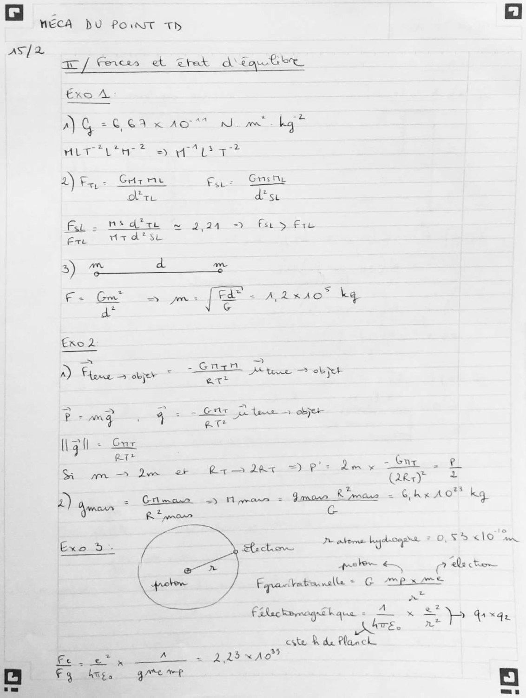
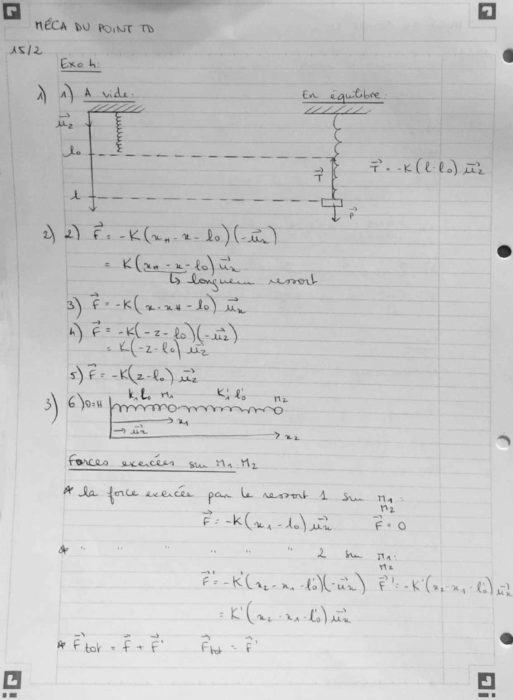
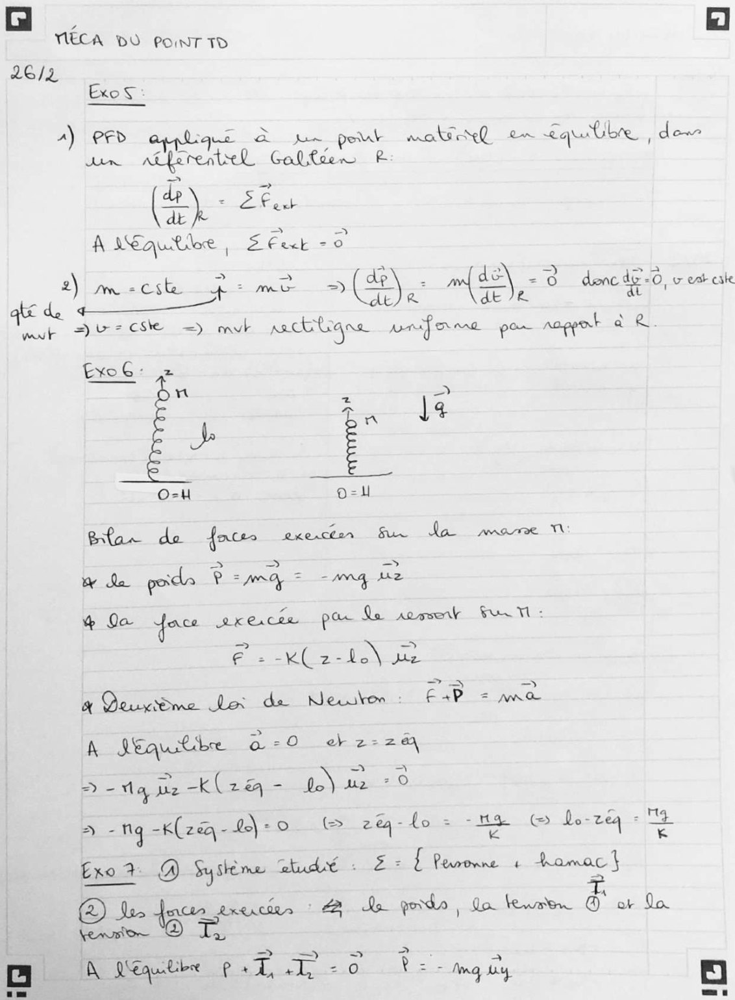
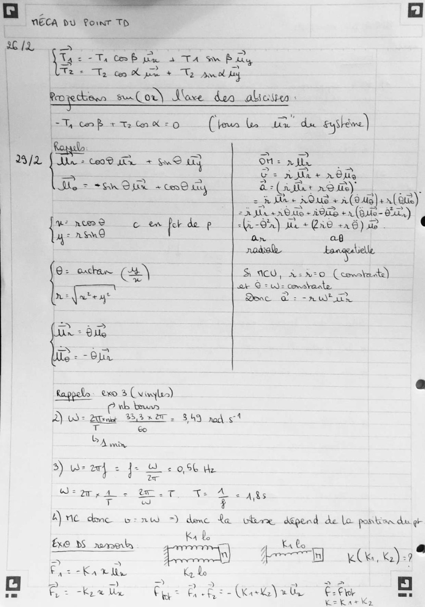
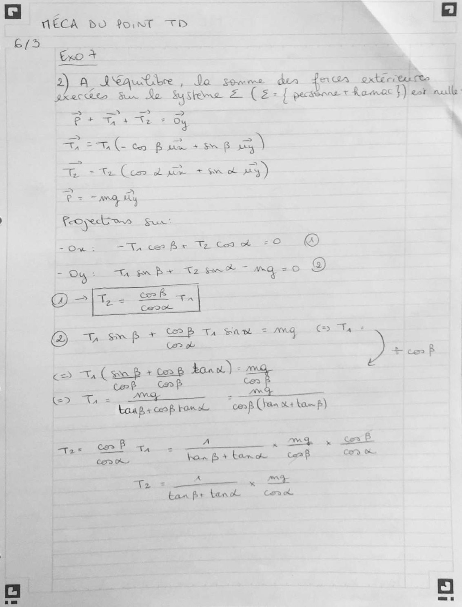
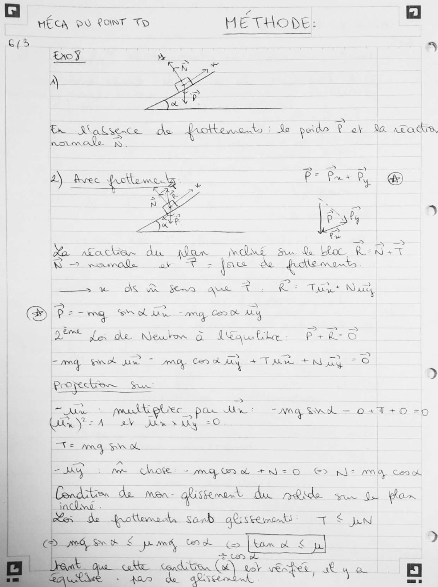
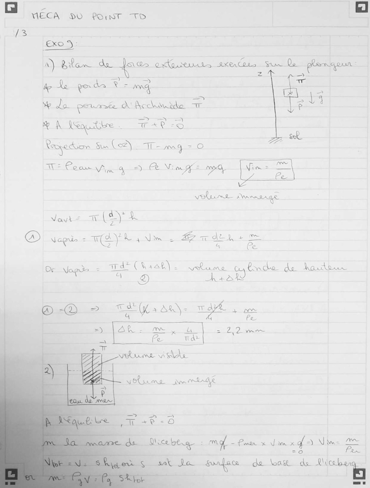
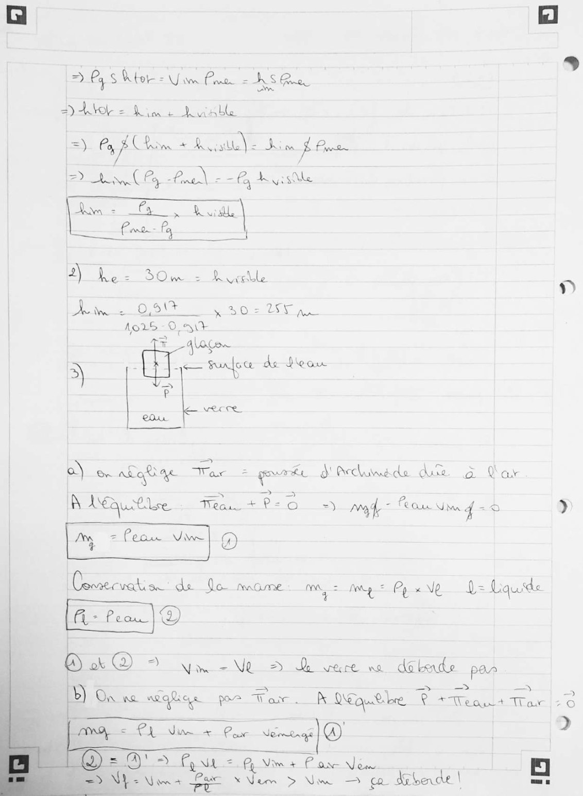
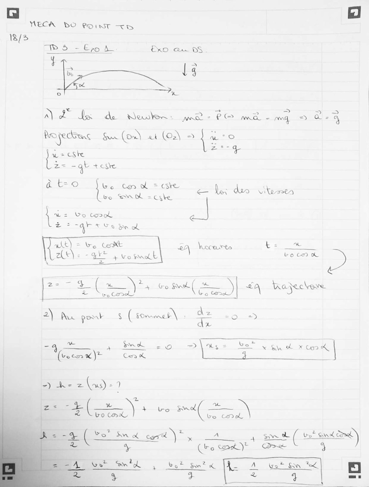
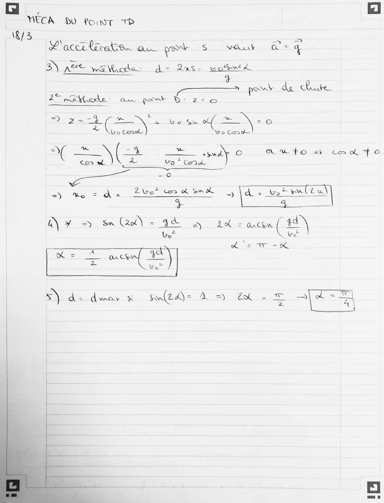

# TD2-(+ex1-TD3)-Correction_2023-2024_Mecanique-du-point_P1S2_ABoumiz_HafsaF.pdf

[Ouvrir l’original](https://drive.google.com/open?id=1B-JgqOQhrSRbTwONHoPJuaF9vnDBUvID) · Les pages signalées comprennent du texte reconnu automatiquement ou des éléments graphiques. Le fac-similé permet de vérifier chaque lecture.

**Pages avec fac-similé ou lecture OCR** — 1–10.

## Page 1

**Lecture OCR à contrôler**

~~~text
AS/2

MÉCA DU Point Th

ac / ren et chat d'état
Exo A

AG +003 x AO Nm kg”

-2

HA UE MES et

2) ea . Chine UE Gnsni
Ore dist

Fr: ws dite © 9,04 > fa 5 fr

(Bap ict Ole Sle

3) nn d ae
fect Rosie kg

F = Gra* D rns =

dt

Exod

n =
-Gnyzn
à) Flame = objet 4 eee Mme > objet

Pong Gs Es Pte ae
(NaS
gill - Gur
{2 si " = ;
= = Va “+ REA oe © €
Si mm im er Rx — 28+ Dae. x er £
2) = Gilman =) Mars = mon À mans = Chx AO kg
nor Aaa Cc
Exo 3. oa Bhatt 2e atome hydrogre = 0, 55 FANS el à
get <— 7 Le te
EE Fapacivatonnelle + (CAT en
aa Fakectamagneh
F pehque = — x & ax
eet — oa we 4X42
este R de Planck
fo a 15x40"
Egy lcs meme Vie Mas nal
~~~

## Page 2

**Lecture OCR à contrôler**

~~~text
# Ja. dete ace me Te te

F: Klan. BIEN Ie es rey
te a 2 £ mn n

2 as a:
Me

KO, GE eee Gla ay
= a le

= a a 5, a
R Fbo = £ + € Fe = F
~~~

## Page 3

**Lecture OCR à contrôler**

~~~text
ECA DO PONT TD
26/2

Exos

4) PFD Teal eet pte petal woe Se Poe dow
in At eM PTT MOT |

CES
A IEAQUE Me, Sheek - 0
2) m = CSke + = me =) ae ra eave. donc de -0, v est cak
Se :

dE de
alae av=csle =) mvt necbbiqne pore Rene poe roppork ak
ExoG: >
n À
5 e =
O-u Oo=1

Bas de {aces Bete on. Ma core Th
we Sa pode CETTE ~ ong, ine
% Qa fou nreicie pa Le Aessent RAN:
@ = -KC2-4e\
by DeunSme Por da Newton FAP = mae
A Jéautbe Do -0 2-24
> -ta pe -K(28 - FAN
a -Ng -K(2@q- 2-0 (> 2%-4o = - Be © do-zéq +
Exo? QB) Systeme audi : E= { Reno + Kamac}
FE) Mee jaetui Jo gordo, to lewater @ oF Do
(ESA Tes

rc À QSquctibre 5 |
~~~

## Page 4

**Lecture OCR à contrôler**

~~~text
NECA DU Point TD

ET

=
15 =: - Ti Crab je

_
a TA Su Puy

Tes Te coy hye + Te pmol ay

| |= Ta cor B + TC À = O
| |

29/2 BL + uO
we = *Sn Ome + CO ity

| Rogectionr su Cor) Marve don alcire :
(four Le un du syshène)

= =

On: rir

=> ts pa
= ra + x OU

a: (ir ro its)”

= e+ AOUS + À (94e )+ NET]

= 3 Ja +0 + A008 +1 (ous- 65)

vw: num 2 c en for de p s(v-G'r) J + Qn® +r 6) ae - (
4° rASnd On af
node Loaguabelle
9: oxha (22) S$ ACU,- 2220) (cet)
ok @ = = Constante

ne ate yt Dnc à : nu
Dn: ig
ie « - Bn
Rappelo exo 3 Cvinyles) -
À) LI = 2e 33220 - 849 pod st

Tt Go

Nee
3) W= a4 = fe Be 0,96 He
Ness LT T=: 2 ARs

4) ne dmc vs nw =) denc a

ÿ
Exe DS romerty EE
=> = =)
LE aca Sov Bal Pos
ie, > Ki ie

yw Qo
>

ee

ASIA |

ER: (ala

chere dépend de lo portion du gr

2 EX bo
bo] nk, Ke "à
té =C

as
~~~

## Page 5

**Lecture OCR à contrôler**

~~~text
6/5

|
|
|
|

MÉCA DO Point TD

txo +
2) AL JD<equtibre , do somme den fern PR:
Axker Re Bn Le Sy Sone aan oe { pecdsnne t Ramac 3) est null:

= a _ >

PS ser ou

=

1 ies Bw +80 8 ao

ee ee, PRIE ES TE à

a = mail,
Foye ows Sur’

204 FO eat ene: @

= Oy +— Ta ES Se — NO ®

@ 2fe eet +.

CRIB Ta Sn wh = M4 (EVA PTE |

Oa Je | |

Core doa) -
Car

p> ia tosh
Cah ie
fe>_ ie eye wees “cops (han ot Law p)

Ces

PL Can bu tar A a MB x ES É.
fon Bartana cf Sep. On

Cor A
Ta see OE
tan fr tank Cork
~~~

## Page 6

**Lecture OCR à contrôler**

~~~text
a HÉCA OY LAWT To MÉTHODE: D
G(s

KOU

sae ea ea)
= Bel 8

Ne acts du LE due Su & L Rahat

BW > emma of a = jac oo je

ee OS a Se ae T4 CZ Te Nu
Ee ce = mg So ae = ang Ca ot re

De Li de Neue à JÆautle. P+ eS

= = = a. =>
= mg Rat un 7 mg Cort My + TA + Ny = ©

D
Propre Su

Eu. : matt etiec pas ne AM EN EL — Oo +4 +0 -0
EVA av Jin x thy =O

ae AAG Sn OL
ime chore =O, Cen + Ni = © E> N= MY Coa oh
de man- qisterant du nûtde me pl an
i Sanb ae js JN

Spr sendy ten oh Bren Lom © < ?
q uk He cdi Ga)” Rov = st 4 eu. | 23 |
~~~

## Page 7

**Lecture OCR à contrôler**

~~~text
MÉCA SO POINT TD

LS
&xo 5:
f it de XX C Qo
v) Rika " JAR> ox ra MS
bo Le gorda Fs ma vr
We do poumée Acide TT ot
A ote aT 
 sir. ré

+ o>
Pe
AR Se 2 | 7 po
= (6 URS

NRE vi de

weno don mLge

BeDiscelet a: mol = Pour x Jim xf 9 Nees =
D tx lo suaface do bag ds Rica
~~~

## Page 8

**Lecture OCR à contrôler**

~~~text
D LS Ko = Yim Pan NT
DA = Le Dual

=) Fa Ca HUE Sim À Bore
Sd ae ae eee

ia La |
Pme fa {

M hes 30m 2 Buell N

| De. 06 ee ae
| hers -O AT

+ gages
3 aie Burfoce do Do our

vec
COAL

o\ on a£aû qe sre z gré § Accluindde du & ar
À Leur Ti+ P= =) Ma" Peau diam g =o 9

| M = feu View| @)

Ce de Go mome MA, = Ag + Py xNe d= Liquide
[a Feo)

ee) Dy 5 Dee deen par
= Te

B) On ne mg pe War. A OG he À Teas Tar |: 0

[Ar = PL Vim Por vos) © he

=

CSN Sine tC on slew a |
+ Ne
NY = Wane “Ege XNem > Um > ça dE ben de \ aus
~~~

## Page 9

**Lecture OCR à contrôler**

~~~text
NECA DO POINT +

\8/3
IS 5 = Ex A

Sere = = = =
Bo = PO ma - rong.

Vc Re nwa Soe
Reo jecbanc Sur (on at (o2\ =) Caer

ee cS he
z= =aË + este

60 = Penal Spi de tee

bo SM =cyle
‘ba Lo Cook |

a
ae

mit e CRE 2À hocares t=
ae). “a + Vo it bo CH & >
=

= À a + Go St ( (Aa. <A Wajeckeve
ay ie poor Ss ( fomenet\ oP aes

ins ee SE À mp

-3 ee à Ssh : 0
(ocnw) Cen & Ae

-) he z(as)-1
: a

le
\ es — eS \
Lo Col

Lo Carol

É- ( Vo” Sn À cor ) me ae sons ( Gee =

= ¥
Mice C2 [RL A Lee a |
4 + 2 Gi Cr
~~~

## Page 10

**Lecture OCR à contrôler**

~~~text
NECA DU font TP
\R/3

P'accrtirats. au prb Ss vOut a> 4 .
3) AEE wa Wicko: d- Qas- potwed

pow LE TES
27 2 nee aù pont D: 2-0

ir + mee \ 0
> \Gocenck o Con

es Ne PEN) A w+o et ce ol fo
Ceo wh Lo * Cod
…
=) Vo = aq Zor = ~) \d = wirimltu

A) # => Sn Ge a= 3 Lol = axceu ( $4)
Ur”

EE)

à dd do. oS NQGAE WS) TR Æ — =

his ok
~~~
