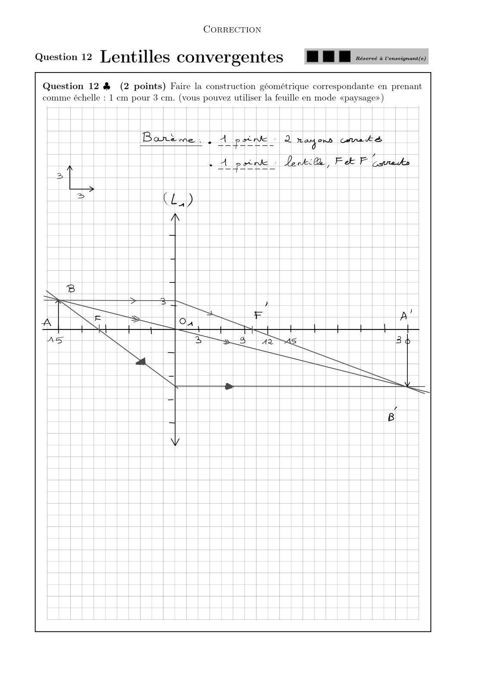
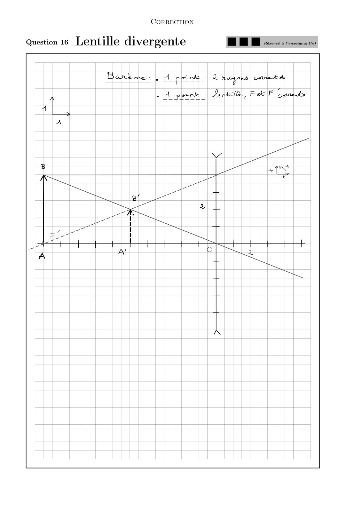
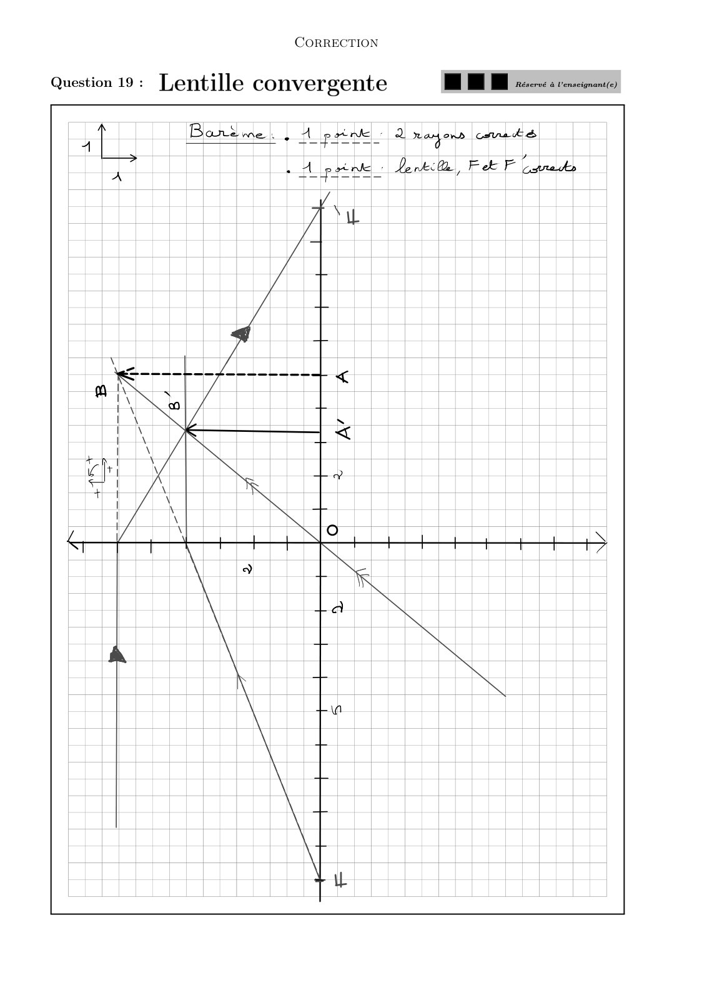
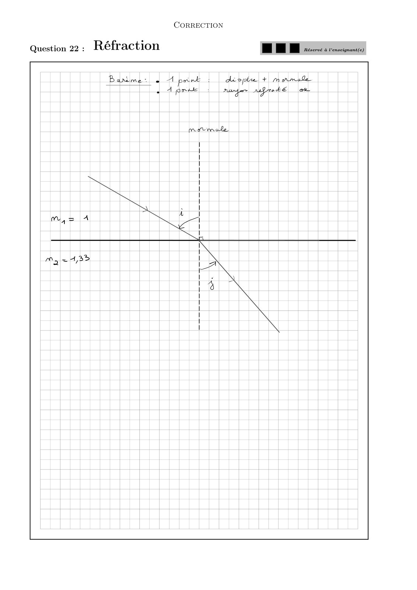

# CC2-2022-2023-Correction_Physique1-CC_P1S1_DPhysique.pdf

[Ouvrir l’original](https://drive.google.com/open?id=19AT9mOwHjqqDebst1-l0MTyW3JlSOeKR) · Les pages signalées comprennent du texte reconnu automatiquement ou des éléments graphiques. Le fac-similé permet de vérifier chaque lecture.

**Pages avec fac-similé ou lecture OCR** — 10–13.

## Page 1

~~~text
                                         Correction

                                            CC2
                                 Panorama sur la physique
                               01 Décembre 2022 — PréIng1

                           Durée : 1h (1h20 en cas de tiers temps)
Sont interdits :
  — les documents ;
  — tous les objets électroniques (téléphone, tablette, ordinateur...) de même que les montres
      connectées ;
  — les déplacements et les échanges.
Consignes :
   1. Vérifiez que le sujet est composé de 14 pages et 25 questions ;
   2. Seules les dernières feuilles doivent être rendues ;
   3. Les questions à rédiger, sur les dernières feuilles, sont indiquées par une icône ♣ ;
   4. Remplir complètement au stylo noir la case correspondant à la bonne réponse ;
   5. Complétez avec vos nom, prénom et groupe cette dernière feuille dès le début officiel de
      l’épreuve ;
   6. Chaque question ne comporte qu’une seule réponse ;
   7. Il n’y a pas de point négatif pour une mauvaise réponse ;
   8. Une case simplement cochée ne sera pas comptabilisée.

             Seule une calculatrice collège est autorisée
                            Le barème est donné à titre indicatif.
~~~

## Page 2

~~~text
                                          Correction

                        Questions de cours (5 points)
Question 1 (0.5 point) L’indice de réfraction n d’un matériau transparent homogène a
toujours une valeur :

    A 0ănă1                                           D nă1
    B n ă 1 ou n ą 1 selon le matériau.               E Aucune de ces réponses n’est correcte.
    C ną1
Question 2 (1 point) On considère deux milieux d’indices n1 et n2 séparés par un dioptre
plan. Les angles incident et réfracté sont respectivement i1 et i2 .
Comment s’exprime la loi de Snell-Descartes pour la réfraction ?
        sin i1   n1
    A          “    et le rayon réfracté se trouve dans le plan contenant le rayon incident et la
        sin i2   n2
       normale («plan d’incidence»).
    B n1 sin i1 “ n2 sin i2 et le rayon réfracté se trouve dans le plan contenant le rayon incident
      et la normale («plan d’incidence»).
    C n2 sin i1 “ n1 sin i2 et le rayon réfracté se trouve dans le plan contenant le rayon incident
      et la normale («plan d’incidence»).
    D Aucune de ces réponses n’est correcte.
Question 3 (0.5 point) Pour se placer dans l’approximation de Gauss,
  A la hauteur d’incidence des faisceaux doit être grande et les angles d’incidences grands.
    B la hauteur d’incidence des faisceaux doit être grande et les angles d’incidences petits.
    C la hauteur d’incidence des faisceaux doit être faible et les angles d’incidences grands.
    D la hauteur d’incidence des faisceaux doit être faible et les angles d’incidences petits.
    E Aucune de ces réponses n’est correcte.
Question 4      (0.5 point) Le grandissement transversal γ pour un objet AB et une image
A1 B 1 est :

    A γ “ A1 B 1 ˆ AB                                       AB
                                                      C γ“
            A1 B 1                                          A1 B 1
    B γ“
            AB                                        D Aucune de ces réponses n’est correcte.
Question 5 (0.5 point) L’image A1 de l’objet A donnée par un miroir plan, où H est le
projeté orthogonal de A sur le miroir, est telle que :
                                                                    1
    A HA “ HA1 .                                      D HA “ HA
                                                              2
    B HA “ 2HA1                                       E Aucune de ces réponses n’est correcte.
    C HA “ ´HA1 .
~~~

## Page 3

~~~text
                                      Correction

Question 6    (1 point) Les distances focales OF “ f et OF 1 “ f 1 sont telles que pour une
lentille :

   A convergente f 1 ą 0 et pour une diver-      C convergente f 1 ă 0 et pour une diver-
     gente f 1 ă 0.                                gente f 1 ą 0.
   B convergente f ą 0 et pour une diver-        D Aucune de ces réponses n’est correcte.
     gente f ă 0.
Question 7 (1 point) Pour une lentille mince, la formule de conjugaison de Descartes, avec
origine au centre, est donnée par :
      1      1    1                                 1      1      1
   A      ´    “                                 C      ´     “
     OA 1   OA   OF                                OA 1   OA     OF 1
      1      1    1                              D Aucune de ces réponses n’est correcte.
   B      `    “
     OA1 OA      OF 1
~~~

## Page 4

~~~text
                                           Correction

                      Lentilles convergentes (7 points)
On dispose d’un objet lumineux AB de hauteur AB “ `3, 5 cm, d’une lentille convergente L1
de centre O1 , de distance focale f11 “ 10, 0 cm, d’une lentille L2 de centre O2 , de distance focale
f21 inconnue et d’un écran.
Le point objet A est situé sur l’axe optique et l’objet AB est perpendiculaire à l’axe optique.

Question 8 (1 point) L’objet lumineux réel est placé à une distance de 15, 0 cm de la
lentille L1 . L’écran est placé à la distance O1 A1 afin de visualiser une image nette de AB à
travers la lentille L1 .
O1 A1 vaut donc :

    A ´6, 0 cm                                         D ´30, 0 cm
    B 30, 0 cm                                         E Aucune de ces réponses n’est correcte.
    C 6, 0 cm
Question 9      (1 point) Dans ces conditions, la valeur du grandissement de la lentille L 1 est :

    A γ “ ´2, 0                                        D γ “ ´0, 4
    B γ “ `2, 0                                        E Aucune de ces réponses n’est correcte.
    C γ “ `0, 4
Question 10 (1 point) L’image donnée par la lentille L1 a alors pour caractéristique :
  A L’image est droite et est plus petite que l’objet.
    B L’image est renversée et est plus petite que l’objet.
    C L’image est droite et est plus grande que l’objet.
    D L’image est renversée et est plus grande que l’objet.
    E Aucune de ces réponses n’est correcte.

Question 11      (1 point) L’image A1 B 1 a pour dimension :

    A ´1, 4 cm                                         D `7, 0 cm
    B ´7, 0 cm                                         E Aucune de ces réponses n’est correcte.
    C `1, 4 cm
Question 12 ♣ (2 points) Faire la construction géométrique correspondante en prenant
comme échelle : 1 cm pour 3 cm. (vous pouvez utiliser la feuille en mode «paysage»)
Question 13 (1 point) On remplace la lentille L1 par une lentille convergente L2 de vergence
V2 inconnue. L’objet réel est placé à 40, 0 cm de la lentille. On visualise une image nette lorsque
l’écran se situe 66, 7 cm derrière la lentille. La vergence V2 de la lentille vaut donc :

    A ´1, 0 δ                                          D `1, 0 δ
    B ´4, 0 δ                                          E Aucune de ces réponses n’est correcte.
    C `4, 0 δ
~~~

## Page 5

~~~text
                                        Correction

                       Lentille divergente (4 points)
On considère une lentille mince divergente L de distance focale f 1 “ ´10 cm. On note son
centre optique O.
On place un objet réel AB de taille AB “ `4 cm, à la distance de 10 cm de la lentille. On
cherche alors la position et la taille de l’image A1 B 1 donnée par la lentille L.

Question 14 (1 point) La position de l’image A1 B 1 par rapport à la lentille est telle que :
  A OA1 “ `10 cm
   B OA1 “ ´10 cm
   C OA1 “ `5 cm
   D OA1 “ ´5 cm
   E Aucune de ces réponses n’est correcte.

Question 15     (1 point) La taille de l’image A1 B 1 est alors de :

   A A1 B 1 “ ´2 cm
   B A1 B 1 “ ´4 cm
   C A1 B 1 “ `4 cm
   D A1 B 1 “ `2 cm
   E Aucune de ces réponses n’est correcte.
Question 16 ♣ (2 points) Faire la construction géométrique correspondante en prenant
comme échelle : 1 cm pour 1 cm. (vous pouvez utiliser la feuille en mode «paysage»)
~~~

## Page 6

~~~text
                                        Correction

                      Lentille convergente (4 points)
On considère une lentille mince convergente L de distance focale f 1 “ `10 cm. On note son
centre optique O.
On place un objet virtuel AB de taille AB “ 6 cm, à la distance de 5 cm de la lentille. On
cherche alors la position et la taille de l’image A1 B 1 donnée par la lentille L.

Question 17 (1 point) La position de l’image A1 B 1 par rapport à la lentille est telle que :
  A OA1 “ `10 cm
   B OA1 “ ´3, 33 cm
   C OA1 “ `3, 33 cm
   D OA1 “ ´10 cm
   E Aucune de ces réponses n’est correcte.

Question 18     (1 point) La taille de l’image A1 B 1 est alors de :

   A A1 B 1 “ ´4 cm
   B A1 B 1 “ ´3 cm
   C A1 B 1 “ `3 cm
   D A1 B 1 “ `4 cm
   E Aucune de ces réponses n’est correcte.
Question 19 ♣ (2 points) Faire la construction géométrique correspondante en prenant
comme échelle : 1 cm pour 1 cm. (vous pouvez utiliser la feuille en mode «paysage»)
~~~

## Page 7

~~~text
                                      Correction

                            Réfraction (4 points)
Un rayon lumineux issu de l’air, d’indice n1 “ 1, 00 arrive sur une étendue d’eau, d’indice
n2 “ 1, 33, avec un angle d’incidence i “ 60o .
Question 20 (1 point) L’angle de réfraction vaut :
  A j “ 21.7o
   B j “ 40.6o
   C j “ 10.3o
   D Aucune de ces réponses n’est correcte.
Question 21 (1 point) La déviation angulaire D entre le rayon incident et le rayon réfracté
a pour valeur :
    A D “ 81.7o
   B D “ 49.7o
   C D “ 19.4o
   D Aucune de ces réponses n’est correcte.
Question 22 ♣ (2 points) Faire la construction géométrique correspondante.
~~~

## Page 8

~~~text
                                        Correction

                 Longueur d’onde dans l’eau (3 points)
Dans l’air (assimilable au vide), un poisson est rouge avec une longueur d’onde λ 0 “ 700 nm.

Question 23 (1 point) La longueur d’onde λ dans un matériau d’indice n est liée à la
longueur d’onde dans le vide λ0 par la relation :
         λ0
   A λ“
         n2
   B λ “ λ0 n 2
         λ0
   C λ“
          n
          λ
   D λ0 “
          n
   E Aucune de ces réponses n’est correcte.
Question 24 (1 point) Sachant que l’indice de l’eau vaut neau “ 1, 33, la longueur d’onde
λ dans l’eau vaut alors :
   A λ “ 395, 73 nm
   B λ “ 1238, 23 nm
   C λ “ 526, 32 nm
   D λ “ 931 nm
   E Aucune de ces réponses n’est correcte.
Question 25 (1 point) Quelque soit le milieu, le poisson est toujours perçu comme rouge
car l’œil est sensible à :

   A la fréquence.
   B la vitesse.
   C la longueur d’onde.
   D l’indice.
   E Aucune de ces réponses n’est correcte.
~~~

## Page 9

~~~text
                                      Correction

            Nom et prénom :

             ................................................................ ..........

             ................................................................ ..........

             Groupe :

Les réponses ne doivent être apportées que sur cette feuille.
La copie ne sera corrigée que si :
  — elle comporte vos nom, prénom et groupe ;
  — les cases sont complètement coloriées avec un stylo noir ;
  — la feuille réponse ne comporte pas de ratures.

Question 1 : A    B     C D   E
Question 2 : A    B     C D
Question 3 : A    B     C D   E
Question 4 : A    B     C D
Question 5 : A    B     C D   E
Question 6 : A    B     C D
Question 7 : A    B     C D
Question 8 : A    B     C D   E
Question 9 : A    B     C D   E
Question 10 : A    B    C D     E
Question 11 : A    B    C D     E
Question 13 : A    B    C D     E
Question 14 : A    B    C D     E
Question 15 : A    B    C D     E
Question 17 : A    B    C D     E
Question 18 : A    B    C D     E
Question 20 : A    B    C D
Question 21 : A    B    C D
Question 23 : A    B    C D     E
Question 24 : A    B    C D     E
Question 25 : A    B    C D     E
~~~

## Page 10

~~~text
                Correction

Question 12 :                .5 .5 1   Réservé à l’enseignant(e)
~~~

**Lecture OCR à contrôler**

~~~text
CORRECTION

Question 12 Lentilles convergentes MR:

à Venseignant(e)

Question 12 & (2 points) Faire la construction géométrique correspondante en prenant
comme échelle : 1 em pour 3 cm. (vous pouvez utiliser la feuille en mode «paysage»)

Bahtule | | A pin : 2 rayons cont es

A pro Danke, Fk F Capra ck
~~~

## Page 11

~~~text
                Correction

Question 16 :                .5 .5 1   Réservé à l’enseignant(e)
~~~

**Lecture OCR à contrôler**

~~~text
CORRECTION

Question 16 : Lentille divergente BEE.

‘enseignant(e)

Barème. A prince 2 rayons crté
~~~

## Page 12

~~~text
                Correction

Question 19 :                .5 .5 1   Réservé à l’enseignant(e)
~~~

**Lecture OCR à contrôler**

~~~text
CORRECTION

Question 19: Lentille convergente BR :......0

Bars me |
~~~

## Page 13

~~~text
                Correction

Question 22 :                .5 .5 1   Réservé à l’enseignant(e)
~~~

**Lecture OCR à contrôler**

~~~text
CORRECTION

Question 22 : Réfraction = H | | érares à Venseteriaat(a)

Bañme: à A perk : | despéu + mamue
«dame Paper regroté oe
~~~

## Page 14

~~~text
                           Correction

Feuille supplémentaire - (indiquer le numéro de la question rédigée)
~~~
