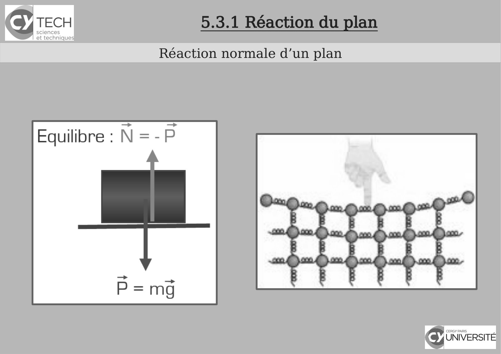

# CM-BIS-Chapitre5-Mecanique_2024-2025_Physique1_P1S1_EDupont.pdf

[Ouvrir l’original](https://drive.google.com/open?id=1seeDaXzDIvGC5YBhLvSu18zKZkZ-Fl_d) · Les pages signalées comprennent du texte reconnu automatiquement ou des éléments graphiques. Le fac-similé permet de vérifier chaque lecture.

**Pages avec fac-similé ou lecture OCR** — 5.

## Page 1

~~~text
                                        Panorama sur la Physique

                                                   Chapitre 5 – Mécanique
                                                              5.3 Forces de contact

               I Physique - 2024-2025

Présentation rédigée par Émilie Dupont (Cergy) : emilie.dupont@cyu.fr, CY308
~~~

## Page 2

~~~text
                Programme de Panorama sur la Physique

●   Chapitre 1 - Introduction
●   Chapitre 2 - Introduction à la pensée scientifique
●   Chapitre 3 - Optique : l’étude de la lumière
●   Chapitre 4 – Cinématique : la description du mouvement
●   Chapitre 5 - Mécanique
~~~

## Page 3

~~~text
                Programme de Panorama sur la Physique

●   Chapitre 1 - Introduction
●   Chapitre 2 - Introduction à la pensée scientifique
●   Chapitre 3 - Optique : l’étude de la lumière
●   Chapitre 4 – Cinématique : la description du mouvement
●   Chapitre 5 - Mécanique
~~~

## Page 4

~~~text
                          5.3.1 Réaction du plan
                          Bilan des forces

Une caisse est au repos sur une surface lisse.
Quel schéma décrit le mieux les forces qui agissent sur la caisse ?
Chaque flèche rouge correspond à une force. Prenez en compte
leur sens et leur nombre, mais ignorez leur longueur.
~~~

## Page 5

~~~text
     5.3.1 Réaction du plan
Réaction normale d’un plan
~~~

**Lecture OCR à contrôler**

~~~text
Icy TECH

sciences
et techniques

Réaction normale d’un plan

Equilibre : N=-P

Grice
~~~

## Page 6

~~~text
                           5.3.1 Réaction du plan
                          Bilan des forces

La même caisse avance à vitesse constante vers la droite sur une
surface lisse.
Quel schéma décrit le mieux les forces qui agissent sur la caisse ?
~~~

## Page 7

~~~text
                           5.3.1 Réaction du plan
               Vers la définition de nouvelles forces !

La même caisse avance à vitesse constante vers la droite sur une
surface rugeuse.
Quel schéma décrit le mieux les forces qui agissent sur la caisse ?
~~~

## Page 8

~~~text
5.3.2 Frottement solide statique et dynamique
          Frottement statique
~~~

## Page 9

~~~text
             5.3.2 Frottement solide statique et dynamique
                         Frottement statique

force de frottement statique
 qui s’oppose au glissement

                               • force maximum de frottement statique
                               • μ0 coefficient de frottement statique
~~~

## Page 10

~~~text
5.3.2 Frottement solide statique et dynamique
  Frottement statique : détermination de μ0
~~~

## Page 11

~~~text
5.3.2 Frottement solide statique et dynamique
          Frottement cinétique
                      en mouvement :
~~~

## Page 12

~~~text
5.3.2 Frottement solide statique et dynamique
           Frottement cinétique

    • μ coefficient de frottement cinétique < μ0
    • valeur indépendante de la vitesse
    • valeur proportionnelle à N
    • direction opposée à la vitesse
~~~

## Page 13

~~~text
                                    5.3.3 Frottement fluide
                              Force opposée au mouvement

Pas de frottement fluide statique : le fluide ne peut pas bloquer le mouvement
     I Physique - 2020-2021
~~~

## Page 14

~~~text
                     5.3.4 Exemple
      Chute d’une bille dans la glycérine

https://www.youtube.com/watch?v=19oRyCWQNDo&feature=emb_err
_woyt
~~~

## Page 15

~~~text
                                       5.3.4 Exemple
                         Chute d’une bille dans la glycérine

I Physique - 2020-2021
~~~

## Page 16

~~~text
                                       5.3.4 Exemple
                     Chute d’une bille dans la glycérine

https://www.youtube.com/watch?v=19oRyCWQNDo&feature=emb_err_woyt
~~~

## Page 17

~~~text
                                       5.3.4 Exemple
                         Chute d’une bille dans la glycérine

I Physique - 2020-2021
~~~

## Page 18

~~~text
                                      Bibliographie


    [1]Polycopié de cours


    [2] Maria Barbi - 1P001 Concepts et Methodes de la Physique - groupes MIPI


    [3] David Sénéchal - Mécanique I - D. Senechal -PHQ114


    [4] Claude Pasquier - Mécanique


    [5] pour la suite : Khan Academy , Unisciel etc...
~~~
