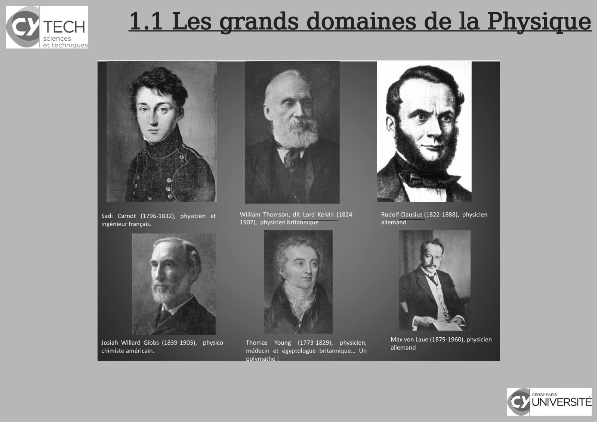
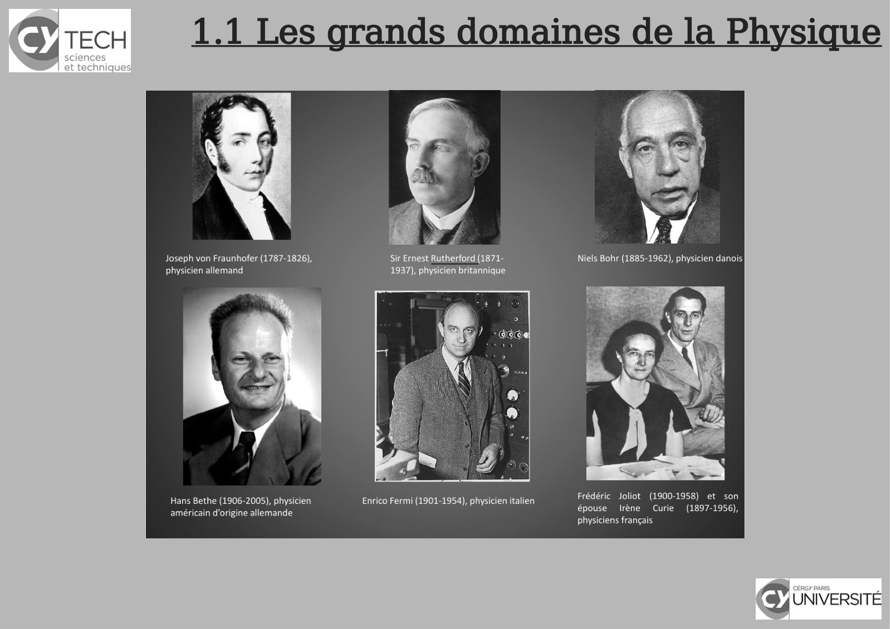
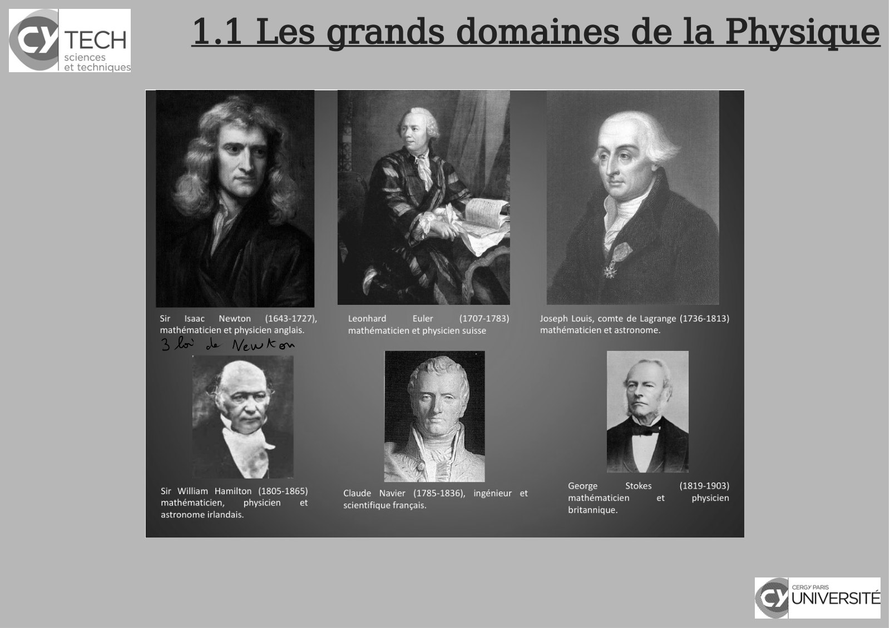
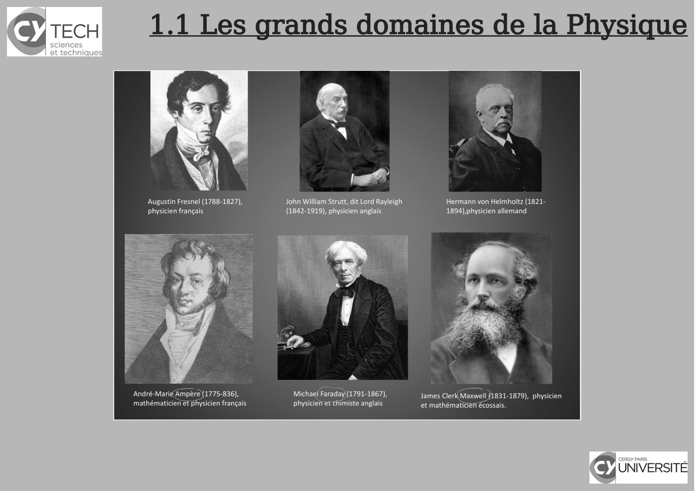
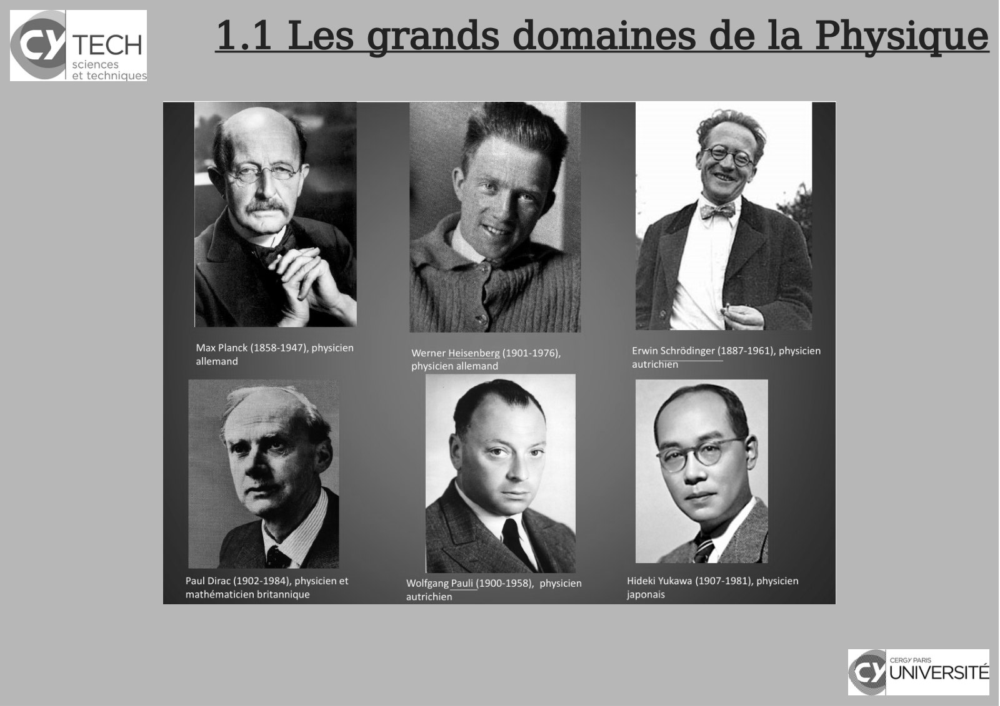
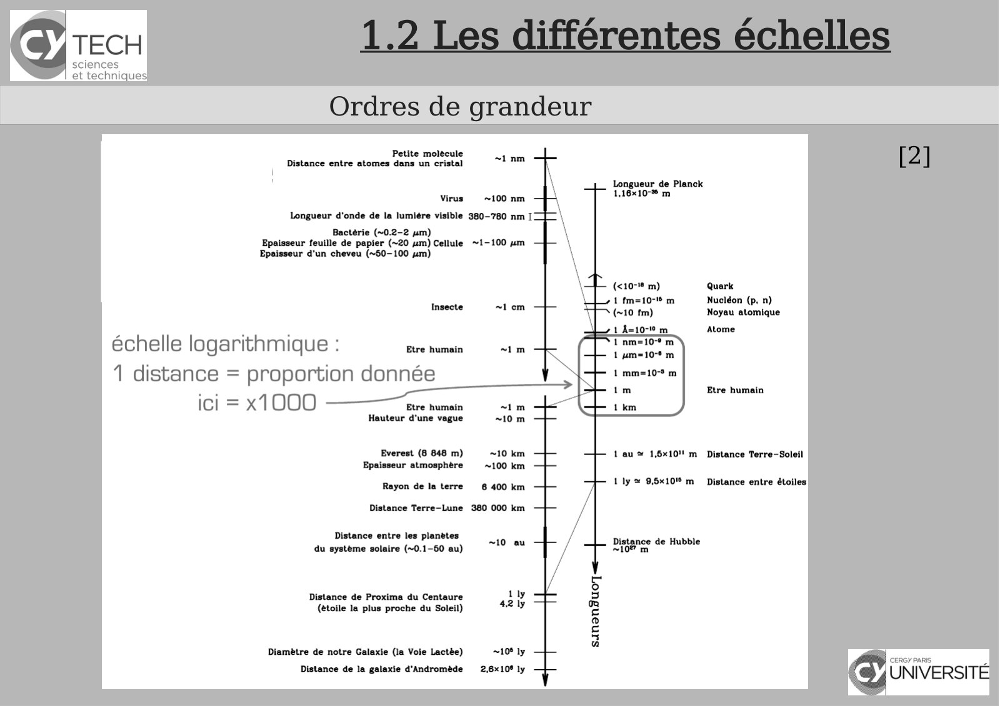
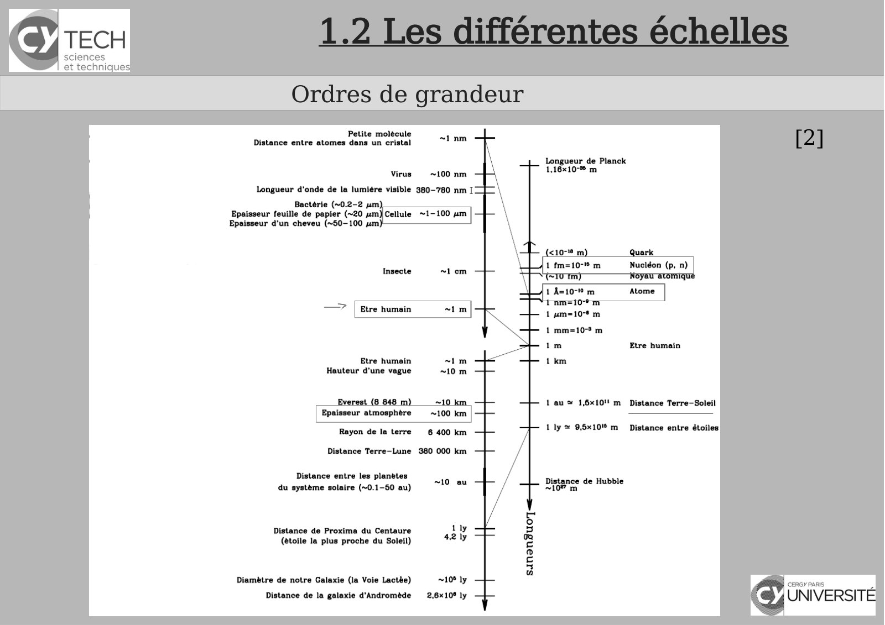
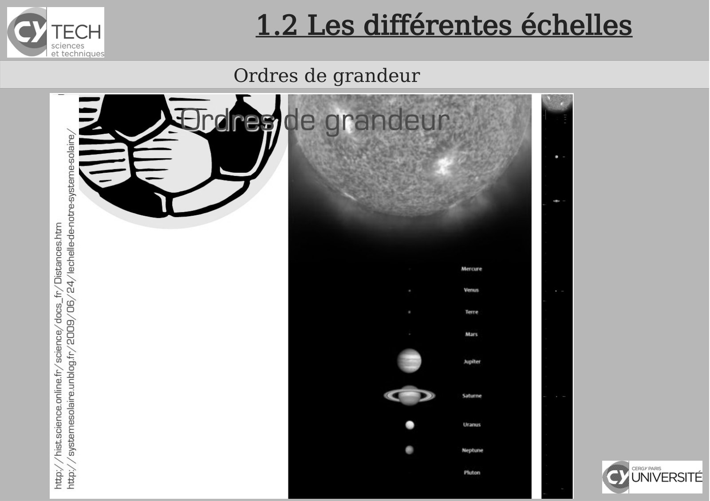

# CM-Chapitre1-Introduction_2023-2024_Physique1_P1S1_EDupont.pdf

[Ouvrir l’original](https://drive.google.com/open?id=1pBmRbEh8JmsscydiIdNIRz5DNDZapOgX) · Les pages signalées comprennent du texte reconnu automatiquement ou des éléments graphiques. Le fac-similé permet de vérifier chaque lecture.

**Pages avec fac-similé ou lecture OCR** — 10, 12, 14, 16, 18, 24–26.

## Page 1

~~~text
                                      Panorama sur la Physique

                                                 Chapitre 1 - Introduction

               Physique - 2023-2024

Présentation rédigée par Émilie Dupont (Cergy) : emilie.dupont@cyu.fr, CY308
~~~

## Page 2

~~~text
                  Programme de Panorama sur la Physique

                         Inscription sur Teams


    Consignes pour s’inscrire : Teams - Création compte étudiants


    Documents : lien vers le canal "Général" du cours


    Chaînes YouTube Panorama sur la Physique (à partir du Chapitre 3)

    et vidéo d'illustration
~~~

## Page 3

~~~text
                Programme de Panorama sur la Physique


    Chapitre 1 - Introduction


    Chapitre 2 - Introduction à la pensée scientifique


    Chapitre 3 - Optique : l’étude de la lumière


    Chapitre 4 – Cinématique : la description du mouvement


    Chapitre 5 - Mécanique
~~~

## Page 4

~~~text
               Programme de Panorama sur la Physique

                        Modalités d’évaluation


    3 CC toutes les 3 à 4 semaines : QCM avec ou sans questions

    ouvertes


    Coefficients proportionnels à la durée du CC


    Rattrapage si moyenne du module à 10 ou absence (justifiée ou non)
~~~

## Page 5

~~~text
                Programme de Panorama sur la Physique


    Chapitre 1 - Introduction


    Chapitre 2 - Introduction à la pensée scientifique


    Chapitre 3 - Optique : l’étude de la lumière


    Chapitre 4 – Cinématique : la description du mouvement


    Chapitre 5 - Mécanique
~~~

## Page 6

~~~text
               1.1 Les grands domaines de la Physique
                         Qu’est-ce que la Physique ?

Physique (grec Physiké) = « science de la Nature »

Phénomènes physiques : quantitatif => les mesurer

    Y aura t'il encore des physiciens en 2050 ? | Julien Bobroff | TEDxUTCompiègne
~~~

## Page 7

~~~text
     1.1 Les grands domaines de la Physique
             La Physique, science exacte ?

« les phénomènes naturels obéissent à des lois fixes ».

                                      représentations mathématiques

                                                objet mathématique
                                                    vs la réalité.

 Adéquation réalité physique / représentation mathématique ?
~~~

## Page 8

~~~text
1.1 Les grands domaines de la Physique
   Physique et les autres sciences
~~~

## Page 9

~~~text
                 1.1 Les grands domaines de la Physique
      Physique classique vs. Physique « moderne » 20ème - 21ème siècles

[3]
~~~

## Page 10

~~~text
1.1 Les grands domaines de la Physique
~~~

**Lecture OCR à contrôler**

~~~text
TECH

1.1 Les grands domaines de la Physique

Sadi Carnot (1796-1832), physicien et
ingénieur français.

Josiah Willard Gibbs (1839-1903),
chimiste américain

physico-

William Thomson, dit Lord Kelvin (1824-
1907), physicien britannique

Thomas Young (1773-1829), physicien,
médecin et égyptologue britannique... Un
polymathe |

Rudolf Clausius (1822-1888), physicien
allemand

Max von Laue (1879-1960), physicien
allemand

cy UNIVERSITÉ
~~~

## Page 11

~~~text
                 1.1 Les grands domaines de la Physique
      Physique classique vs. Physique « moderne » 20ème - 21ème siècles

[3]
~~~

## Page 12

~~~text
1.1 Les grands domaines de la Physique
~~~

**Lecture OCR à contrôler**

~~~text
Sy TECH 1.1 Les grands domaines de la Physique

Joseph von Fraunhofer (1787-1826), Sir Ernest Rutherford (1871-
physicien allemand 1937), physicien britannique

Frédéric Joliot (1900-1958) et son
épouse Irène Curie (1897-1956),
physiciens francais

Hans Bethe (1906-2005), physicien Enrico Fermi (1901-1954), physicien italien
américain d'origine allemande

cy UNIVERSITÉ
~~~

## Page 13

~~~text
                 1.1 Les grands domaines de la Physique
      Physique classique vs. Physique « moderne » 20ème - 21ème siècles

[3]
~~~

## Page 14

~~~text
1.1 Les grands domaines de la Physique
~~~

**Lecture OCR à contrôler**

~~~text
Sy TECH 1.1 Les grands domaines de la Physique

Sir Isaac Newton (1643-1727), Leonhard Euler (1707-1783) Joseph Louis, comte de Lagrange (1736-1813)
mathématicien et physicien anglais. mathématicien et physicien suisse mathématicien et astronome.

George Stokes (1819-1903)
mathématicien et physicien
britannique.

Sir William Hamilton (1805-1865) Claude Navier (1785-1836), ingénieur et
mathématicien, physicien et scientifique français.
astronome irlandais.

cy UNIVERSITÉ
~~~

## Page 15

~~~text
                 1.1 Les grands domaines de la Physique
      Physique classique vs. Physique « moderne » 20ème - 21ème siècles

[3]
~~~

## Page 16

~~~text
1.1 Les grands domaines de la Physique
~~~

**Lecture OCR à contrôler**

~~~text
cy TECH

1.1 Les grands domaines de la Physique

Augustin Fresnel (1788-1827), John William Strutt, dit Lord Rayleigh
physicien francais (1842-1919), physicien anglais

a

André-Marié Ampèr -836), Michael Faradayÿ (1791-1867),
physicien et chimiste anglais

Hermann von Helmholtz (1821-
1894),physicien allemand

James Clerk Maxwell (1831-1879), physicien
et mathématicien écossais.

cy UNIVERSITÉ
~~~

## Page 17

~~~text
                 1.1 Les grands domaines de la Physique
      Physique classique vs. Physique « moderne » 20ème - 21ème siècles

[3]
~~~

## Page 18

~~~text
1.1 Les grands domaines de la Physique
~~~

**Lecture OCR à contrôler**

~~~text
Sy TECH 1.1 Les grands domaines de la Physique

7
a

>

Max Planck (1858-1947), physicien Werner Heisenberg (1901-1976), Erwin Schrodinger (1887-1961), physicien
allemand physicien allemand autrichien

Paul Dirac (1902-1984), physicien et Wolfgang Pauli (1900-1958), physicien Hideki Yukawa (1907-1981), physicien
mathématicien britannique autrichien japonais

cy UNIVERSITÉ
~~~

## Page 19

~~~text
                 1.1 Les grands domaines de la Physique
      Physique classique vs. Physique « moderne » 20ème - 21ème siècles

[3]
~~~

## Page 20

~~~text
                 1.1 Les grands domaines de la Physique
      Physique classique vs. Physique « moderne » 20ème - 21ème siècles

[3]
~~~

## Page 21

~~~text
1.1 Les grands domaines de la Physique

   Symphony of Science - the Quantum World!
  Playlist Youtube : "Quantum Physics" - E. Dupont
~~~

## Page 22

~~~text
                 1.1 Les grands domaines de la Physique
      Physique classique vs. Physique « moderne » 20ème - 21ème siècles

[3]
~~~

## Page 23

~~~text
          1.2 Les différentes échelles
        Ordres de grandeur
                                         [2]

Video
~~~

## Page 24

~~~text
  1.2 Les différentes échelles
Ordres de grandeur
                                 [2]
~~~

**Lecture OCR à contrôler**

~~~text
TECH

sciences
et technique:

Ordres de grandeur

Petite molécule
Distance entre atomes dans un cristal
i)
Virus ~100 nm
Longueur d'onde de la lumiére visible 380-780 nm I
Bactérie (~0.
Epaisseur feuille de papier 20 im) Cellule ~1-100 um
Epaisseur d'un cheveu (~60-100 4m)

(<10-" m) Quark
1 fm=10- m Nucléon (p, n)
(~10 tm) Noyau atomique

1 A=10-1 m Atome

échelle logarithmique : Etre humain
1 distance = proportion donnée
ici = x1000 Etre humain im

Hauteur d'une vague 10 m

Etre humain

Everest (8 848 m) +10 km 1 au # 1,6x10!! m Distance Terre-Soleil
Epaisseur atmosphère — ~100 km
Rayon de la terre 6 400 km 1 ly ™ 96x10 m Distance entre étoiles

Distance Terre-Lune 380 000 km

Distance entre les planètes
du système solaire (~0.1-60 au) ‘1° Digne de Hubble

Distance de Proxima du Centaure
(etoile la plus proche du Soleil)

Diamètre de notre Galaxie (la Voie Lactée) 10 ly PF. Does
Distance de la galaxie d'Andromède 2.6x10 ly CY UNIVERSITÉ
~~~

## Page 25

~~~text
  1.2 Les différentes échelles
Ordres de grandeur
                                 [2]
~~~

**Lecture OCR à contrôler**

~~~text
TECH

sciences
et technique:

Ordres de grandeur

Petite molecule
Distance entre atomes dans un cristal

Longueur de Planck
1,16x10-% m

Virus ~100 nm
Longueur d'onde de la lumiére visible 380-780 nm [

Bactérie (~0.2-2 um)
Epaisseur feuille de papier (~20 um)
Epaisseur d'un cheveu (~60-100 sm!

1 fm=10-" m Nucléon (p. n)

1 mm=10 m
im

Etre humoin 1 km
Hauteur d'une vague

~ 1 au ~ 1,6x10" m Distance Terre-Soleil
Epaisseur atmosphere — ~100 km —

Rayon de la terre 6 400 km

1 ly = 95x10 m Distance entre étoiles
Distance Terre-Lune 380 000 km

Distance entre les planètes
du système solaire (-0.1-50 au)

Distance de Proxima du Centaure
(étoile la plus proche du Soleil)

Diamètre de notre Galaxie (la Voie Lactèe) 108 ly CERGY PARIS
Distance de la galaxie d'Andromède  2,8x109 ly UNIVERSITÉ]
~~~

## Page 26

~~~text
  1.2 Les différentes échelles
Ordres de grandeur
~~~

**Lecture OCR à contrôler**

~~~text
Ordres de grandeur

de grandeur...’

= sh

Dis:

fr/2009/06/24/1

fr/science/ docs_fr,

blog

BE

1.2 Les différentes échelles

cy UNIVERSITÉ
~~~

## Page 27

~~~text
     1.2 Les différentes échelles
Ordres de grandeur - Temps
                                    [2]
~~~

## Page 28

~~~text
     1.2 Les différentes échelles
Ordres de grandeur - Masses
                                    [2]
~~~

## Page 29

~~~text
                                               1.2 Les différentes échelles
                     Monde élémentaire : constituants et interactions
[2]
      
          Interaction gravitationnelle : attractive, proportionnelle aux masses, décroissante
          en 1/r2 (à longue portée) (intensité non négligeable seulement pour des grandes masses)
      
          Interaction       électrostatique         :    attractive      ou   répulsive   (charges   +   et   -),
          proportionnelle aux charges, décroissante en 1/r2 (prédominante au niveau des atomes,
          molécule, matière à notre échelle)

                                             Et dans le noyau atomique ?
      
          Interaction forte : assure la cohésion des nucléons (protons, neutrons, et même
          tous les hadrons) et du noyau atomique (très courte portée, 10 -15 m, mais force 100 à 1000
          fois supérieure à l’interaction électromag. à cette échelle)

                                                        quoi d’autre ?
      
          Interaction faible : intervient dans la radioactivité (portée 10-17 m, 10 -5 fois plus faible que
          l’interaction électromag.)
~~~

## Page 30

~~~text
               1.2 Les différentes échelles
Monde élémentaire : constituants et interactions
~~~

## Page 31

~~~text
                     1.2 Les différentes échelles
      Monde élémentaire : constituants et interactions
[2]
~~~

## Page 32

~~~text
                     1.2 Les différentes échelles
      Monde élémentaire : constituants et interactions
[2]
~~~

## Page 33

~~~text
                     1.2 Les différentes échelles
      Monde élémentaire : constituants et interactions
[2]
~~~

## Page 34

~~~text
              1.3 Les différentes « écoles de pensées »
              Antiquité, Renaissance vs. Physique « moderne »
THERMODYNAMIQUE
                                     Cycle de
                                     Carnot

Denis Papin
~~~

## Page 35

~~~text
          1.3 Les différentes « écoles de pensées »
          Antiquité, Renaissance vs. Physique « moderne »
OPTIQUE
~~~

## Page 36

~~~text
          1.3 Les différentes « écoles de pensées »
          Antiquité, Renaissance vs. Physique « moderne »
OPTIQUE
~~~

## Page 37

~~~text
          1.3 Les différentes « écoles de pensées »
          Antiquité, Renaissance vs. Physique « moderne »
OPTIQUE
~~~

## Page 38

~~~text
            1.3 Les différentes « écoles de pensées »
            Antiquité, Renaissance vs. Physique « moderne »
MÉCANIQUE
~~~

## Page 39

~~~text
             1.3 Les différentes « écoles de pensées »
            Antiquité, Renaissance vs. Physique « moderne »

ÉLECTRICITÉ -
Électromagnétisme

                               1861, 1ère photo couleur

                                                              Maxwel
                                                                l
~~~

## Page 40

~~~text
1.3 Les différentes « écoles de pensées »
Antiquité, Renaissance vs. Physique « moderne »

                                        Début XXème s.

                                    Chaos : attracteur de Lorentz
~~~

## Page 41

~~~text
1.3 Les différentes « écoles de pensées »
Le XXème fut celui de la mécanique quantique
~~~

## Page 42

~~~text
1.3 Les différentes « écoles de pensées »
     Énorme champ d’applications
~~~

## Page 43

~~~text
       1.3 Les différentes « écoles de pensées »
      Antiquité, Renaissance vs. Physique « moderne »

2018-quantum computers will finally beat ordinary machine

Engineering of a Swedish quantum computer set to start
~~~

## Page 44

~~~text
                                        Bibliographie


    [1]Polycopié de cours


    [2] Maria Barbi - 1P001 Concepts et Methodes de la Physique - groupes MIPI


    [3] Wikipédia


    [4] Encyclopédie Universalis


    [5] David Sénéchal - « Histoire des sciences » PHQ399 Université de Sherbrooke, QC


    [6] pour la suite : Khan Academy , Unisciel etc...
~~~
