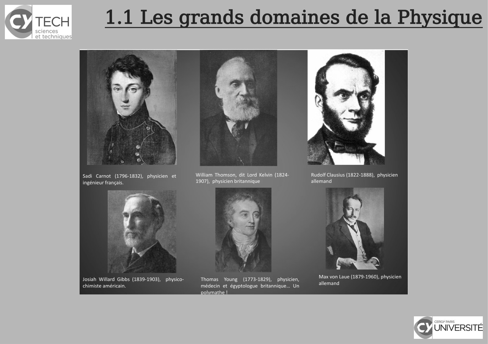
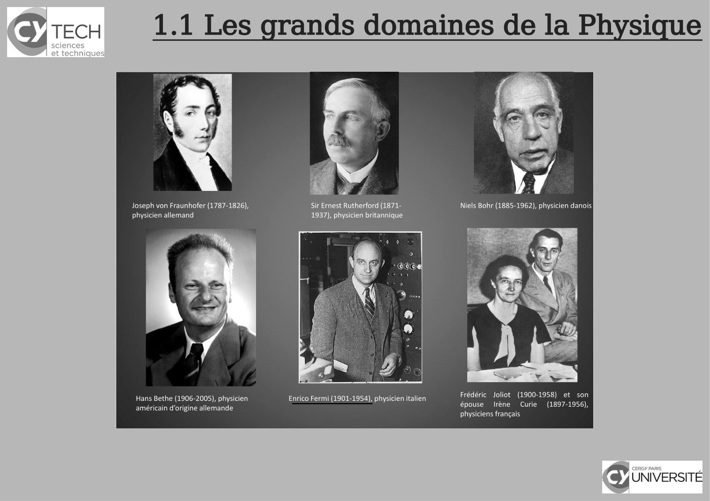
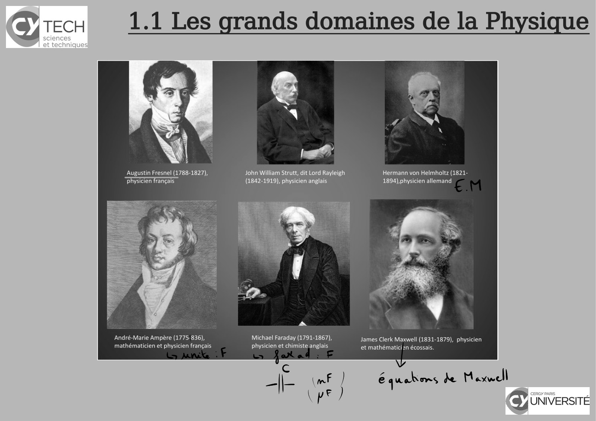
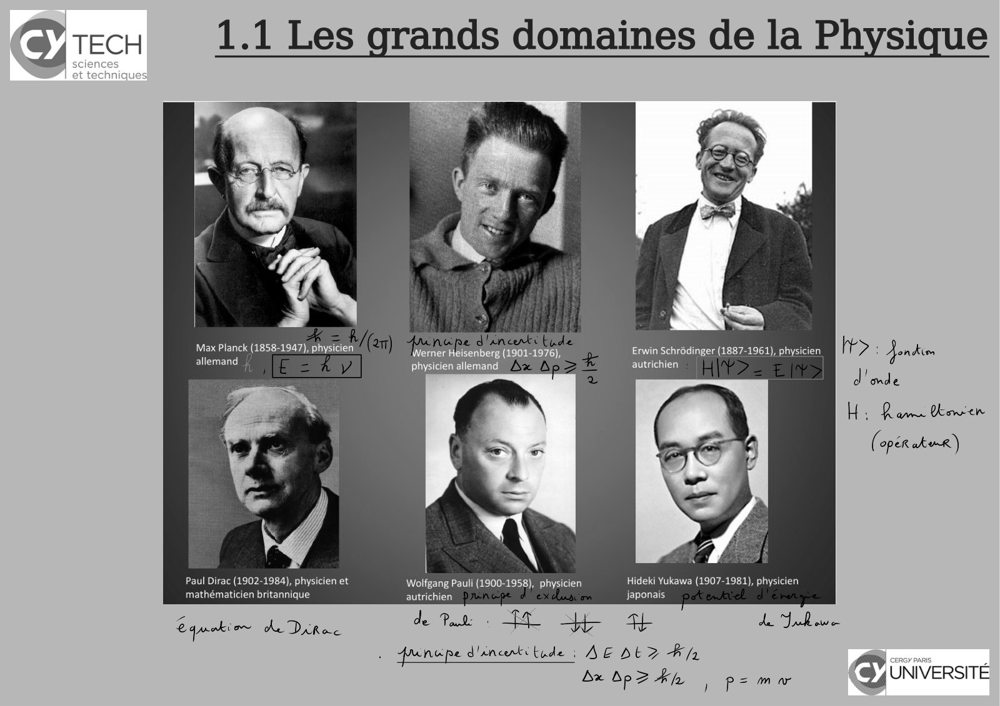
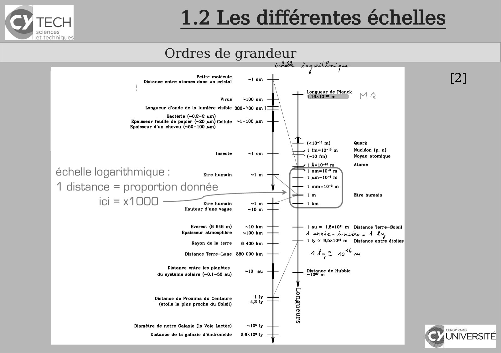
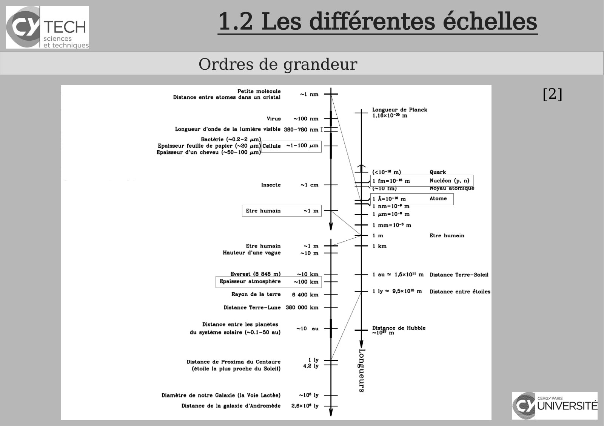
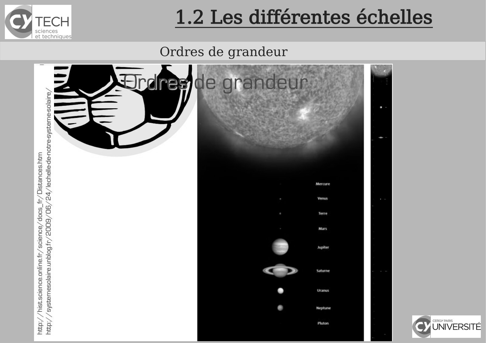

# CM-Chapitre1-Introduction_2024-2025_Physique1_P1S1_EDupont.pdf

[Ouvrir l’original](https://drive.google.com/open?id=1_Y6MuTQrHzxU4x9oaygKf8IhIVD3ncMt) · Les pages signalées comprennent du texte reconnu automatiquement ou des éléments graphiques. Le fac-similé permet de vérifier chaque lecture.

**Pages avec fac-similé ou lecture OCR** — 10, 12, 16, 18, 24–26.

## Page 1

~~~text
                                      Panorama sur la Physique

                                                 Chapitre 1 - Introduction

               Physique - 2024-2025

Présentation rédigée par Émilie Dupont (Cergy) : emilie.dupont@cyu.fr, CY308
~~~

## Page 2

~~~text
                 Programme de Panorama sur la Physique

                         Modalités d’évaluation


    3 CC toutes les 3 à 4 semaines : QCM avec ou sans questions ouvertes


    Rattrapage : conditions précisées précédemment


    Coefficients proportionnels à la durée du CC soit :

    CC1 : 0h45        coefficient = 0,75       (17/10/24)

    CC2 : 1h00        coefficient = 1          (21/11/24)

    CC3 : 1h30        coefficient = 1,5        (semaine du 13 Janvier 2025)

                   MOYENNE =
               
                               ( CC 1 x 0 ,75+CC 2 x 1+CC 3 x 1 ,5 )
                                            ( 0 ,75+1+1 ,5 )
~~~

## Page 3

~~~text
                Programme de Panorama sur la Physique

                            Aides


    Chaînes YouTube Panorama sur la Physique (à partir

    du Chapitre 3) et vidéo d'illustration
~~~

## Page 4

~~~text
                Programme de Panorama sur la Physique


    Chapitre 1 - Introduction


    Chapitre 2 - Introduction à la pensée scientifique


    Chapitre 3 - Optique : l’étude de la lumière


    Chapitre 4 – Cinématique : la description du mouvement


    Chapitre 5 - Mécanique
~~~

## Page 5

~~~text
                Programme de Panorama sur la Physique


    Chapitre 1 - Introduction


    Chapitre 2 - Introduction à la pensée scientifique


    Chapitre 3 - Optique : l’étude de la lumière


    Chapitre 4 – Cinématique : la description du mouvement


    Chapitre 5 - Mécanique
~~~

## Page 6

~~~text
               1.1 Les grands domaines de la Physique
                         Qu’est-ce que la Physique ?

Physique (grec Physiké) = « science de la Nature »

Phénomènes physiques : quantitatif => les mesurer

    Y aura t'il encore des physiciens en 2050 ? | Julien Bobroff | TEDxUTCompiègne
~~~

## Page 7

~~~text
     1.1 Les grands domaines de la Physique
             La Physique, science exacte ?

« les phénomènes naturels obéissent à des lois fixes ».

                                      représentations mathématiques

                                                objet mathématique
                                                    vs la réalité.

 Adéquation réalité physique / représentation mathématique ?
~~~

## Page 8

~~~text
1.1 Les grands domaines de la Physique
   Physique et les autres sciences
~~~

## Page 9

~~~text
                 1.1 Les grands domaines de la Physique
      Physique classique vs. Physique « moderne » 20ème - 21ème siècles

[3]
~~~

## Page 10

~~~text
1.1 Les grands domaines de la Physique
~~~

**Lecture OCR à contrôler**

~~~text
TECH 1.1 Les grands domaines de la Physique

Sadi Carnot (1796-1832), physicien et William Thomson, dit Lord Kelvin (1824- Rudolf Clausius (1822-1888), physicien
ingénieur français. 1907), physicien britannique allemand

Max von Laue (1879-1960), physicien

Josiah Willard Gibbs (1839-1903), physico- Thomas Young (1773-1829), physicien,
allemand

chimiste américain médecin et égyptologue britannique... Un
polymathe |
~~~

## Page 11

~~~text
                 1.1 Les grands domaines de la Physique
      Physique classique vs. Physique « moderne » 20ème - 21ème siècles

[3]
~~~

## Page 12

~~~text
1.1 Les grands domaines de la Physique
~~~

**Lecture OCR à contrôler**

~~~text
TECH

1.1 Les grands domaines de la Physique

Joseph von Fraunhofer (1787-1826), Sir Ernest Rutherford (1871-
physicien allemand 1937), physicien britannique

Frédéric Joliot (1900-1958) et son
épouse Irène Curie (1897-1956),
physiciens français

Hans Bethe (1906-2005), physicien Enrico Fermi (1901-1954), physicien italien
américain d'origine allemande

cy UNIVERSITÉ
~~~

## Page 13

~~~text
                 1.1 Les grands domaines de la Physique
      Physique classique vs. Physique « moderne » 20ème - 21ème siècles

[3]
~~~

## Page 14

~~~text
                                1.1 Les grands domaines de la Physique

Émilie
  Émiliedu
         duChâtelet
              Châtelet(17/12/1706
                       (17/12/1706- -10/09/1749)
                                       10/09/1749): :renommée
                                                       renomméepour  poursa
                                                                          satraduction
                                                                             traductionenenfrançais
                                                                                            françaisdes
                                                                                                      des
  Principia Mathematica de Newton, qui fait encore autorité aujourd'hui. Elle a aussi contribuéààdiffuser
Principia   Mathematica   de Newton,    qui fait encore  autorité  aujourd'hui. Elle a  aussi contribué     diffuseren
                                                                                                                     en
France
  Francel'œuvre
           l'œuvrephysique   deLeibniz,
                    physiquede  Leibniz,notamment
                                            notammenten   enprouvant
                                                              prouvantexpérimentalement
                                                                       expérimentalementsa    sathéorie
                                                                                                 théorieselon
                                                                                                         selonlaquelle
                                                                                                                 laquelle
  l'énergiecinétique
l'énergie    cinétique(appelée
                       (appeléeààl'époque
                                   l'époque««force
                                                 forcevive
                                                       vive»)»)est
                                                                estproportionnelle
                                                                    proportionnelleààlalamasse
                                                                                          masseetetau
                                                                                                    aucarré
                                                                                                        carréde
                                                                                                              delala
vitesse.
  vitesse.
~~~

## Page 15

~~~text
                 1.1 Les grands domaines de la Physique
      Physique classique vs. Physique « moderne » 20ème - 21ème siècles

[3]
~~~

## Page 16

~~~text
1.1 Les grands domaines de la Physique
~~~

**Lecture OCR à contrôler**

~~~text
CHE

1.1 Les grands domaines de la Physique

Augustin Fresnel (1788-1827), John William Strutt, dit Lord Rayleigh Hermann von Helmholtz (1821-
“physicien français | (1842-1919), physicien anglais 1894) physicien allemand

André-Marie Ampère (1775-836), Michael Faraday (1791-1867), James Clerk Maxwell (1831-1879), physicien
mathématicien et physicien français physicien et chimiste anglais anale) En écossais,

pre (mF ) é quahons ke Hexwoll
\pe/ (6) UNIVERSITE
~~~

## Page 17

~~~text
                 1.1 Les grands domaines de la Physique
      Physique classique vs. Physique « moderne » 20ème - 21ème siècles

[3]
~~~

## Page 18

~~~text
1.1 Les grands domaines de la Physique
~~~

**Lecture OCR à contrôler**

~~~text
CHE

1.1 Les grands domaines de la Physique

Max Planck (1858-1947), physicien Werner Heisenberg (1901-1976), Erwin Schrôdinger (1887-1961), physicien IF ?: Jenkin
allemand physicien allemand autrichien ,
donde
H ÿ Rigen Cowen
( oper akur)

|

Paul Dirac (1902-1984), physicien et Wolfgang Pauli (1900-1958), physicien Hideki Yukawa (1907-1981), physicien
mathématicien britannique autrichien japonais

équation dite Le. À JS Ee on
. funupe d'éncent bude | AEDLZ FL D ny owns |
(6) UNIVERSITE

bx bp? Ah ) P= mar
~~~

## Page 19

~~~text
                 1.1 Les grands domaines de la Physique
      Physique classique vs. Physique « moderne » 20ème - 21ème siècles

[3]
~~~

## Page 20

~~~text
                 1.1 Les grands domaines de la Physique
      Physique classique vs. Physique « moderne » 20ème - 21ème siècles

[3]
~~~

## Page 21

~~~text
                               1.1 Les grands domaines de la Physique

   Amalie Emmy Noether
   (23/03/1882 - 14/04/1935)

Dans une lettre adressée au New York Times, Einstein écrit, le 1er mai 1935 :
                                                                                                               Symphony of Science - the
                                                                                                               Quantum World!
  «Selon le jugement de la plupart des mathématiciens compétents en vie, Fräulein Noether était le génie
                                                                                                               Playlist Youtube : "Quantum
mathématique créatif le plus considérable produit depuis que les femmes ont eu accès aux études supérieures
                                                                                                               Physics"
jusqu'à aujourd'hui. Dans le domaine de l'algèbre, qui a occupé les mathématiciens les plus doués depuis des
siècles, elle a découvert des méthodes qui se sont avérées d'une importance énorme pour les recherches de
l'actuelle nouvelle génération de mathématiciens.»
~~~

## Page 22

~~~text
                 1.1 Les grands domaines de la Physique
      Physique classique vs. Physique « moderne » 20ème - 21ème siècles

[3]
~~~

## Page 23

~~~text
          1.2 Les différentes échelles
        Ordres de grandeur
                                         [2]

Video
~~~

## Page 24

~~~text
  1.2 Les différentes échelles
Ordres de grandeur
                                 [2]
~~~

**Lecture OCR à contrôler**

~~~text
TECH

sciences
et technique:

Ordres de grandeur

Petite molecule
Distance entre atomes dans un cristal

ps de Planck
Virus +100 nm MQ

Longueur d'onde de la lumiére visible 380-780 nm |

Bac (~0.2-2 um)
Epaisseur feuille de papier (~20 um) Cellule ~1-100 um
Epaisseur d'un cheveu (~60-100 um)

(<10-19 m) Quark

1 fm=10- m Nucléon (p, n)
(~10 tm) Noyau atomique
1 A=1071 m Atome

échelle logarithmique : Etre humain Vamsi sw

1 um=10-* m

1 distance = proportion donnée 1 mm=10-* m

im Etre humain

ici = x1000 ———aemmn + Ex

Hauteur d'une vague 10m

Everest (8 648 m) 10 km 1 au s 1,6x10" m Distance Terre-Soleil
Epaisseur atmosphère  =100 km A ahnée- lumière = À £

Rayon de la terre 6 400 km 1 ly 96x10 m Distance entre étoiles

Distance Terre-Lune 380 000 km A Ane 40% yo

Distance entre les planètes

du système solaire (~0.1-60 au) Distance de Hubble

Distance de Proxima du Centaure
(etoile la plus proche du Soleil)

Diamètre de notre Galaxie (la Voie Lactée) F.. D cms
Distance de la galaxie d'Andromède  2,8x10° ly CY UNIVERSITE
4
~~~

## Page 25

~~~text
  1.2 Les différentes échelles
Ordres de grandeur
                                 [2]
~~~

**Lecture OCR à contrôler**

~~~text
TECH

sciences
et technique:

Ordres de grandeur

Petite molecule
Distance entre atomes dans un cristal

ngueur de Planck
1,16x10-% m

Virus ~100 nm
Longueur d'onde de la lumiére visible 380-780 nm [

Bactérie (~0.2-2 um)
Epaisseur feuille de papier (~20 um)
Epaisseur d'un cheveu (~60-100 sm!

1 fm=10-" m Nucléon (p. n)

1 mm=10 m
im

Etre humoin 1 km
Hauteur d'une vague

~ 1 au ~ 1,6x10" m Distance Terre-Soleil
Epaisseur atmosphere — ~100 km

Rayon de la terre 6 400 km

1 ly = 95x10 m Distance entre étoiles
Distance Terre-Lune 380 000 km

Distance entre les planètes
du système solaire (~0.1-50 au)

Distance de Proxima du Centaure
(étoile la plus proche du Soleil)

Diamètre de notre Galaxie (la Voie Lactèe) 108 ly CERGY PARIS
Distance de la galaxie d'Andromède 2,610 ly y UNIVERSITÉ
dl
~~~

## Page 26

~~~text
  1.2 Les différentes échelles
Ordres de grandeur
~~~

**Lecture OCR à contrôler**

~~~text
1.2 Les différentes échelles

Ordres de grandeur

Jeg rande ur: 1

an es

Uranus

cy UNIVERSITÉ
~~~

## Page 27

~~~text
     1.2 Les différentes échelles
Ordres de grandeur - Temps
                                    [2]
~~~

## Page 28

~~~text
     1.2 Les différentes échelles
Ordres de grandeur - Masses
                                    [2]
~~~

## Page 29

~~~text
                                               1.2 Les différentes échelles
                     Monde élémentaire : constituants et interactions
[2]
      
          Interaction gravitationnelle : attractive, proportionnelle aux masses, décroissante
          en 1/r2 (à longue portée) (intensité non négligeable seulement pour des grandes masses)
      
          Interaction       électrostatique         :    attractive      ou   répulsive   (charges   +   et   -),
          proportionnelle aux charges, décroissante en 1/r2 (prédominante au niveau des atomes,
          molécule, matière à notre échelle)

                                             Et dans le noyau atomique ?
      
          Interaction forte : assure la cohésion des nucléons (protons, neutrons, et même
          tous les hadrons) et du noyau atomique (très courte portée, 10 -15 m, mais force 100 à 1000
          fois supérieure à l’interaction électromag. à cette échelle)

                                                        quoi d’autre ?
      
          Interaction faible : intervient dans la radioactivité (portée 10-17 m, 10 -5 fois plus faible que
          l’interaction électromag.)
~~~

## Page 30

~~~text
               1.2 Les différentes échelles
Monde élémentaire : constituants et interactions
~~~

## Page 31

~~~text
                     1.2 Les différentes échelles
      Monde élémentaire : constituants et interactions
[2]
~~~

## Page 32

~~~text
                     1.2 Les différentes échelles
      Monde élémentaire : constituants et interactions
[2]
~~~

## Page 33

~~~text
                     1.2 Les différentes échelles
      Monde élémentaire : constituants et interactions
[2]
~~~

## Page 34

~~~text
              1.3 Les différentes « écoles de pensées »
              Antiquité, Renaissance vs. Physique « moderne »
THERMODYNAMIQUE
                                     Cycle de
                                     Carnot

Denis Papin
~~~

## Page 35

~~~text
          1.3 Les différentes « écoles de pensées »
          Antiquité, Renaissance vs. Physique « moderne »
OPTIQUE
~~~

## Page 36

~~~text
          1.3 Les différentes « écoles de pensées »
          Antiquité, Renaissance vs. Physique « moderne »
OPTIQUE
~~~

## Page 37

~~~text
          1.3 Les différentes « écoles de pensées »
          Antiquité, Renaissance vs. Physique « moderne »
OPTIQUE
~~~

## Page 38

~~~text
            1.3 Les différentes « écoles de pensées »
            Antiquité, Renaissance vs. Physique « moderne »
MÉCANIQUE
~~~

## Page 39

~~~text
             1.3 Les différentes « écoles de pensées »
            Antiquité, Renaissance vs. Physique « moderne »

ÉLECTRICITÉ -
Électromagnétisme

                               1861, 1ère photo couleur

                                                              Maxwel
                                                                l
~~~

## Page 40

~~~text
1.3 Les différentes « écoles de pensées »
Antiquité, Renaissance vs. Physique « moderne »

                                        Début XXème s.

                                    Chaos : attracteur de Lorentz
~~~

## Page 41

~~~text
1.3 Les différentes « écoles de pensées »
Le XXème fut celui de la mécanique quantique
~~~

## Page 42

~~~text
1.3 Les différentes « écoles de pensées »
     Énorme champ d’applications
~~~

## Page 43

~~~text
       1.3 Les différentes « écoles de pensées »
      Antiquité, Renaissance vs. Physique « moderne »

2018-quantum computers will finally beat ordinary machine

Engineering of a Swedish quantum computer set to start
~~~

## Page 44

~~~text
                                        Bibliographie


    [1]Polycopié de cours


    [2] Maria Barbi - 1P001 Concepts et Methodes de la Physique - groupes MIPI


    [3] Wikipédia


    [4] Encyclopédie Universalis


    [5] David Sénéchal - « Histoire des sciences » PHQ399 Université de Sherbrooke, QC


    [6] pour la suite : Khan Academy , Unisciel etc...
~~~
