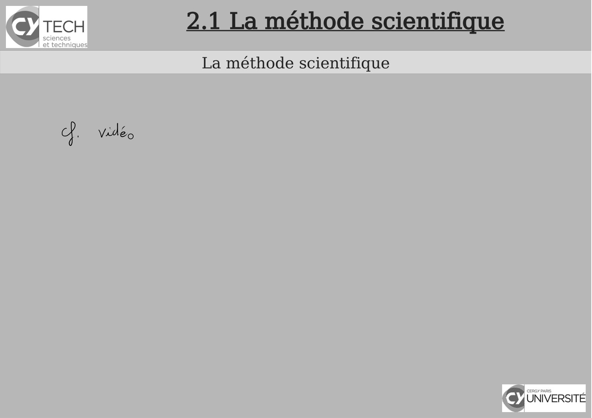
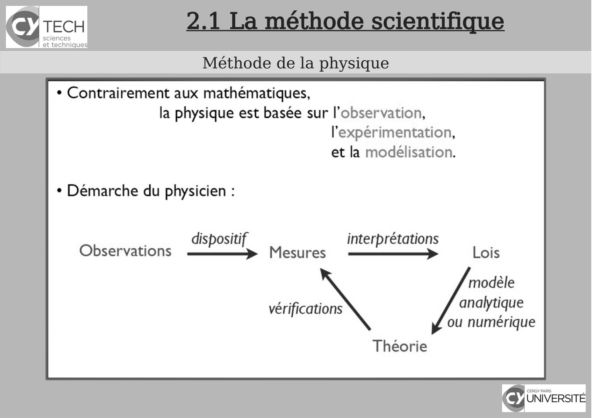
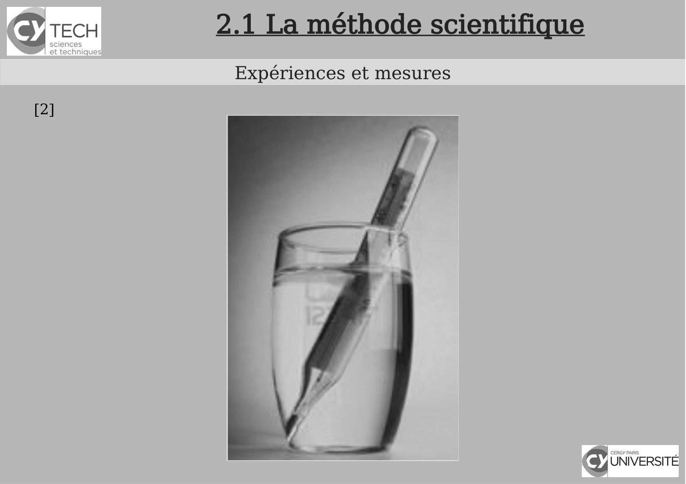
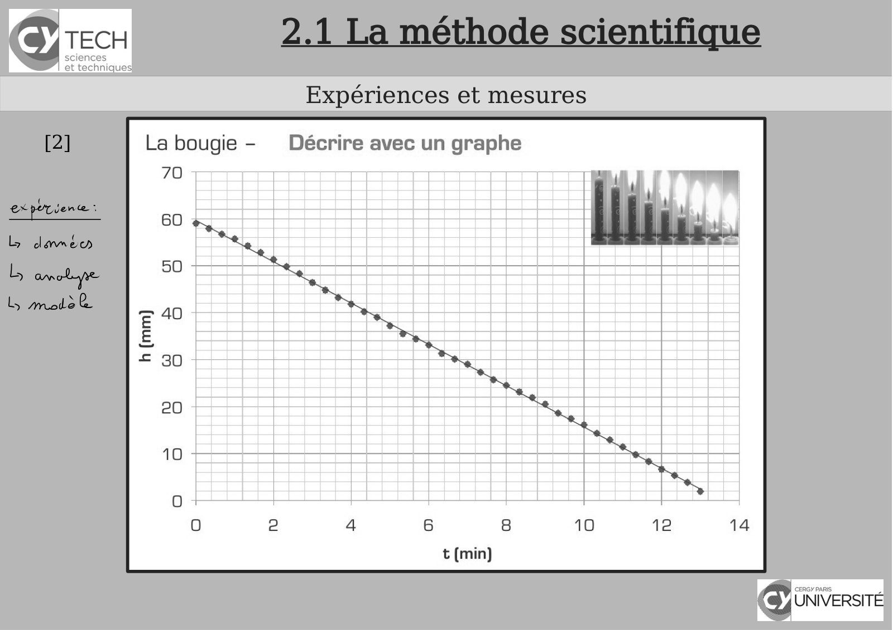
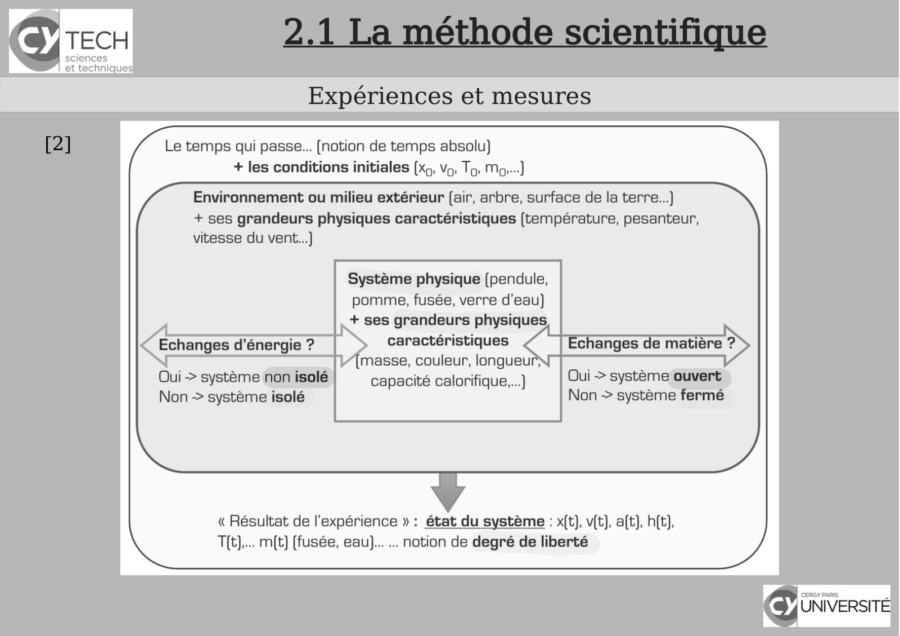
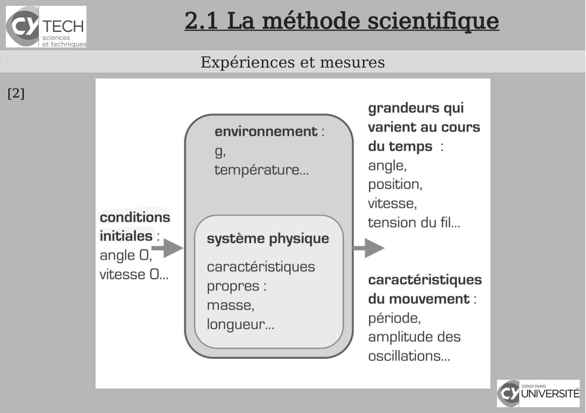

# CM-Chapitre2-Introduction_2023-2024_Physique1_P1S1_EDupont.pdf

[Ouvrir l’original](https://drive.google.com/open?id=1KKGhp8G40wlCb9_YXFr__lT-9-wQcWXh) · Les pages signalées comprennent du texte reconnu automatiquement ou des éléments graphiques. Le fac-similé permet de vérifier chaque lecture.

**Pages avec fac-similé ou lecture OCR** — 3, 6, 9–11, 13.

## Page 1

~~~text
                                      Panorama sur la Physique

       Chapitre 2 – Introduction à la « pensée scientifique »

               Physique - 2023-2024

Présentation rédigée par Émilie Dupont (Cergy) : emilie.dupont@cyu.fr, CY308
~~~

## Page 2

~~~text
                Programme de Panorama sur la Physique


    Chapitre 1 - Introduction


    Chapitre 2 - Introduction à la pensée scientifique


    Chapitre 3 - Optique : l’étude de la lumière


    Chapitre 4 – Cinématique : la description du mouvement


    Chapitre 5 - Mécanique
~~~

## Page 3

~~~text
2.1 La méthode scientifique
 La méthode scientifique
~~~

**Lecture OCR à contrôler**

~~~text
SB) TECH 2.1 La méthode scientifique

La méthode scientifique

of. vidé

cy UNIVERSITÉ
~~~

## Page 4

~~~text
                           2.1 La méthode scientifique
                            La méthode de la Physique

Les notions
Une notion est une idée, une grandeur physique utilisées pour analyser
les phénomènes physiques.
Exemples : espace, énergie, temps, longueur, masse, ...

Les lois et les principes
Par l’observation, par l’analyse, nous pouvons tirer des relations entre
les grandeurs physiques. Ces relations qui peuvent être
mathématiques, sont appelés lois.

Les lois peuvent être limités à un certain domaine de la Physique ou ont
une portée très générale sur le fonctionnement de la Physique : ce sont
des principes.
~~~

## Page 5

~~~text
                       2.1 La méthode scientifique
                       La méthode de la Physique

Les modèles
Un modèle est une analogie ou une représentation pratique d’un
système physique. Des simplifications sont parfois nécessaires dans le
modèle. Les modèles sont parfois utiles comme des étapes
intermédiaires. Il existe aussi des modèles purement mathématiques
dont les propriétés reflètent la réalité, bien que les entités
mathématiques ne soient pas observées.

Les théories
Une théorie rassemble les notions, les principes, un modèle, des
postulats pour élaborer des lois.
Une théorie doit être descriptive et prédictive et c’est l’expérimentation
qui dira si une théorie sera acceptée ou rejetée pour le domaine
considérée de l’expérimentation.
~~~

## Page 6

~~~text
2.1 La méthode scientifique
 Méthode de la physique
~~~

**Lecture OCR à contrôler**

~~~text
Icy TECH

sciences
et technique:

Méthode de la physique

+ Contrairement aux mathématiques,
la physique est basée sur l'observation,
l’'expérimentation,
et la modélisation.

+ Démarche du physicien :

| dispositif interprétations
Observations mm Mesures =} Lois

modèle

vérifications analytique
ou numérique

Théorie

€ UNIVERSITÉ
~~~

## Page 7

~~~text
                               2.1 La méthode scientifique
                                Expériences et mesures

   Exemple : la chute des corps
   On lâche en même temps sur la Lune un marteau et une plume. Lequel arrive le
   premier au sol ?
     La plume ?
     Le marteau ?
   

     Les 2 en même temps ?
   

     Dans le vide, aucun des deux ne tombe ?
   

   

AristoteI IV       siècle
              ème- 2020-2021
                                       Galilée (1564-
                                       1642)
          Physique
~~~

## Page 8

~~~text
2.1 La méthode scientifique
 Expériences et mesures

        Galilée (1564-
        1642)
~~~

## Page 9

~~~text
      2.1 La méthode scientifique
       Expériences et mesures
[2]
~~~

**Lecture OCR à contrôler**

~~~text
SY TECH 2.1 La méthode scientifique

Expériences et mesures

[2]

Cy UNIVERSITE
~~~

## Page 10

~~~text
      2.1 La méthode scientifique
       Expériences et mesures
[2]
~~~

**Lecture OCR à contrôler**

~~~text
Icy TECH

sciences
et technique:

Expériences et mesures

La bougie - Décrire avec un graphe
70

€ UNIVERSITÉ
~~~

## Page 11

~~~text
      2.1 La méthode scientifique
       Expériences et mesures
[2]
~~~

**Lecture OCR à contrôler**

~~~text
TECH

sciences
et technique:

Expériences et mesures

Le temps qui passe... (notion de temps absolu)
+ les conditions initiales (xg, Vo, To: Mo...)

Environnement ou milieu extérieur (air, arbre, surface de la terre...)
+ ses grandeurs physiques caractéristiques (température, pesanteur,
vitesse du vent...)

Système physique (pendule,
pomme, fusée, verre d'eau)
+ ses grandeurs physiques

Echanges d'énergie? | > caractéristiques 7° |Echanges de matière ?>
masse, couleur, longueur

Oui > système non isolé capacité calorifique....) Oui > système ouvert
Non > système isolé Non > système fermé

« Résultat de l'expérience » : état du système : x(t), v(t), a(t), h(t),
T[(t),... m(t) (fusée, eau)... ... notion de degré de liberté

€ UNIVERSITÉ
~~~

## Page 12

~~~text
            2.1 La méthode scientifique
               Expériences et mesures
[2]   dans la plupart des cas, cette
      année...
~~~

## Page 13

~~~text
      2.1 La méthode scientifique
       Expériences et mesures
[2]
~~~

**Lecture OCR à contrôler**

~~~text
Icy TECH

sciences
et technique:

conditions
initiales :

angle o>

vitesse O...

Expériences et mesures

système physique

caractéristiques
propres :
masse,
longueur...

grandeurs qui
varient au cours
du temps :
angle,

position,

vitesse,

tension du fil...

caractéristiques
du mouvement :
période,
amplitude des
oscillations...

€ UNIVERSITÉ
~~~

## Page 14

~~~text
         2.2 Dimensions, unités, analyse dimensionnelle
                           Dimensions

• Par convention, toutes les grandeurs sont organisées selon un
système de dimensions. Chacune des sept grandeurs de base a sa
propre dimension, représentée symboliquement par une lettre
majuscule.
~~~

## Page 15

~~~text
           2.2 Dimensions, unités, analyse dimensionnelle
                              Dimensions

• Toutes les autres grandeurs sont des grandeurs dérivées. Les
dimensions des grandeurs dérivées se déterminent à partir des
dimensions des 7 grandeurs de base et des équations de la
physique.
    La dimension d’une grandeur G se note entre crochets : [G].
          Si [G]=1, la grandeur G est sans dimension


    Déterminer l’unité de n’importe quelle grandeur simplement à
    partir de sa dimension.

~~~

## Page 16

~~~text
      2.2 Dimensions, unités, analyse dimensionnelle
                   Dimensions
[2]
~~~

## Page 17

~~~text
      2.2 Dimensions, unités, analyse dimensionnelle
                   Dimensions
[2]
~~~

## Page 18

~~~text
      2.2 Dimensions, unités, analyse dimensionnelle
                     Unités
[7]
~~~

## Page 19

~~~text
                 2.2 Dimensions, unités, analyse dimensionnelle
                             Analyse dimensionnelle
[2]
              une grandeur physique ↔ une dimension ↔ une unité
            expression en fonction des grandeurs physiques de base
                   on compare grandeurs de même dimension

      Quatre intérêts :
          Vérifier l’homogénéité d’une formule et repérer les erreurs.
          Rechercher les dimensions d’une grandeur inconnue.
      

          Identifier une grandeur caractéristique d’un système.
      

          Déterminer la loi qui exprime une grandeur en fonction
      

          d’autres grandeurs : « analyse dimensionnelle » .
      
~~~

## Page 20

~~~text
2.2 Dimensions, unités, analyse dimensionnelle
         Analyse dimensionnelle
~~~

## Page 21

~~~text
       2.2 Dimensions, unités, analyse dimensionnelle
              Analyse dimensionnelle - Exemples

Khan Academy :

         Présentation de l'analyse dimensionnelle

Exemple 1 :

on cherche à déterminer la dimension d’une vitesse V.
~~~

## Page 22

~~~text
         2.2 Dimensions, unités, analyse dimensionnelle
               Analyse dimensionnelle - Exemples

Exemple 2 :

Déterminer l’unité d’une force F dans le Système

international, on détermine sa dimension [F] à l’aide d’une

équation de la physique : P=m.g.
~~~

## Page 23

~~~text
          2.2 Dimensions, unités, analyse dimensionnelle
                  Analyse dimensionnelle - Exemples

Exemple 3 :

Vérifier l’homogénéité de la formule suivante :

avec T, période de révolution d’une planète, G, constante de gravitation

universelle, R, rayon de l’orbite circulaire, M, masse de l’astre

attracteur.
~~~

## Page 24

~~~text
                                        Bibliographie


    [1]Polycopié de cours


    [2] Maria Barbi - 1P001 Concepts et Methodes de la Physique - groupes MIPI


    [3] Wikipédia


    [4] Encyclopédie Universalis


    [5] David Sénéchal - « Histoire des sciences » PHQ399 Université de Sherbrooke, QC


    [6] pour la suite : Khan Academy , Unisciel etc.


    [7] Transparents de Lucie Desplat (Pau)

    [8] Playlist « Panorama sur la Physique » :
    https://www.youtube.com/playlist?list=PLjo5Br6lsjzt-sBwfAfqdydnJsX_N_2dt

~~~
