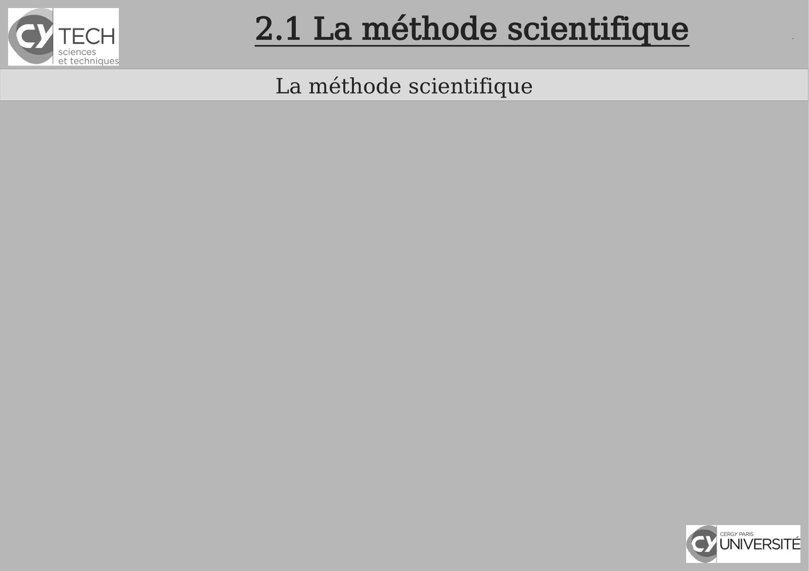
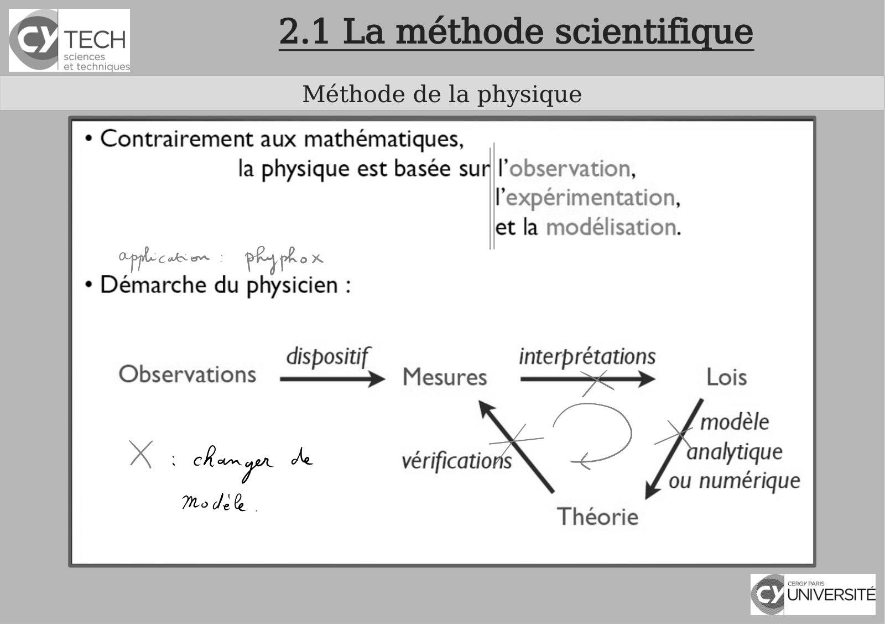
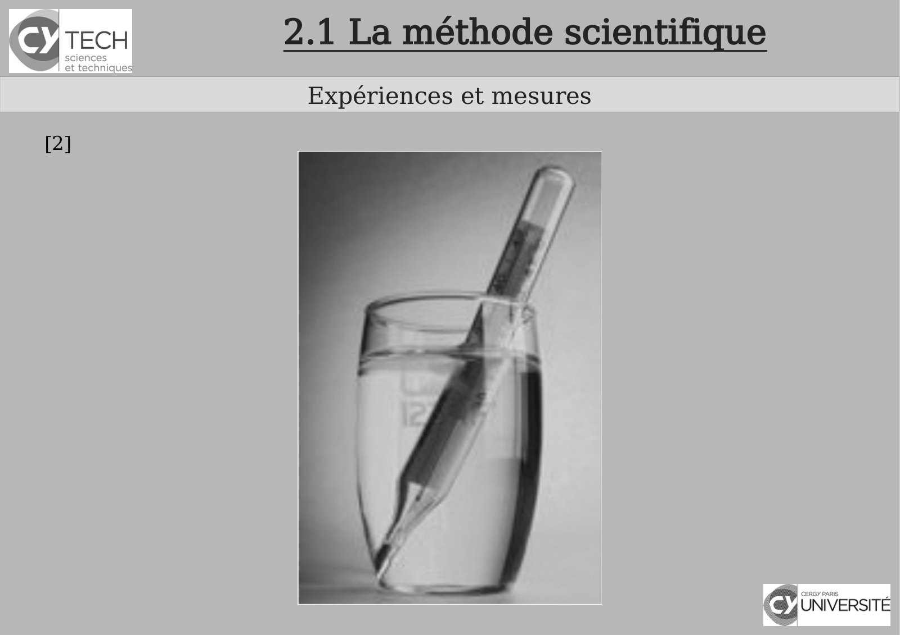
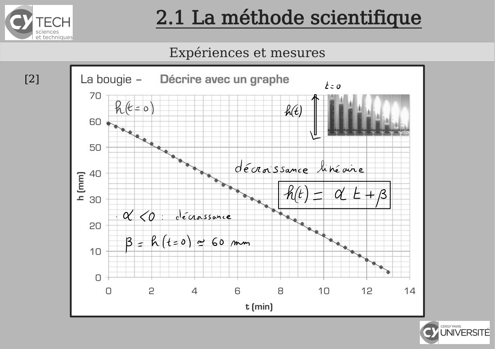
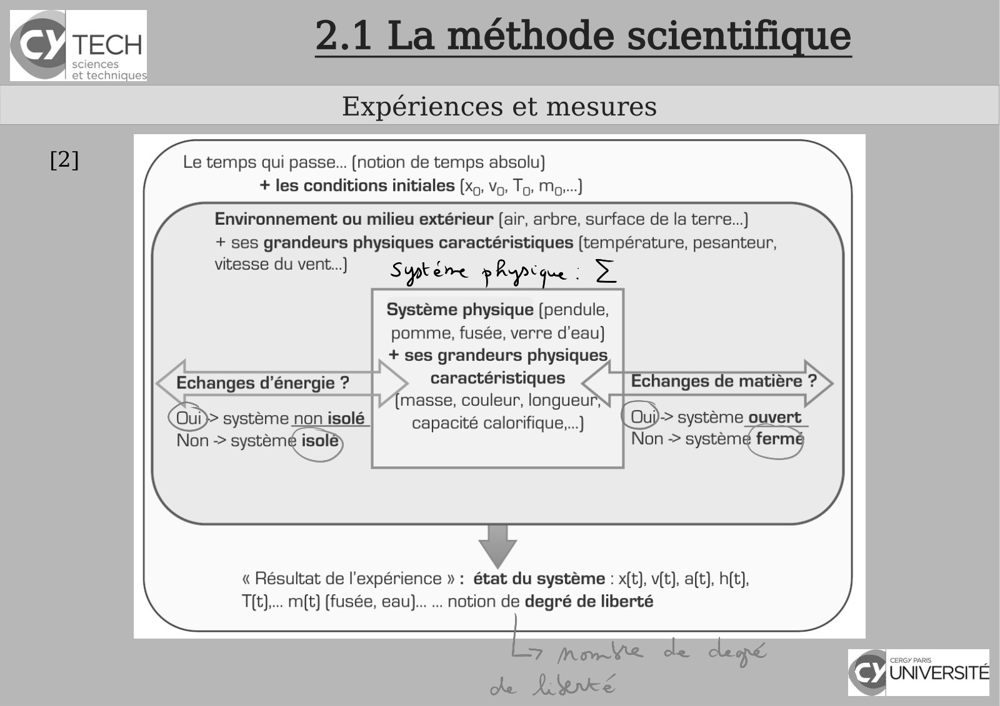
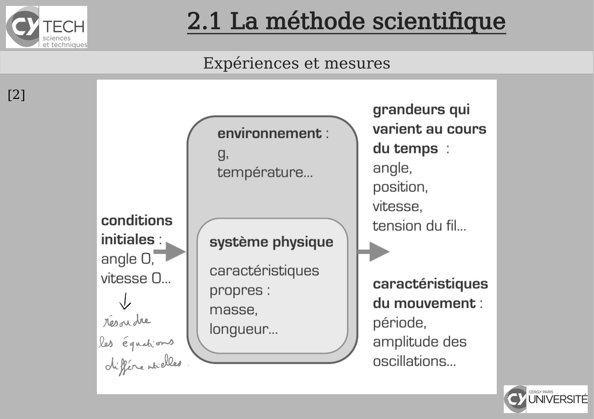

# CM-Chapitre2-Introduction_2024-2025_Physique1_P1S1_EDupont.pdf

[Ouvrir l’original](https://drive.google.com/open?id=1RMxBBfOQtloNa1KQv7u_ybhSQhUQpLux) · Les pages signalées comprennent du texte reconnu automatiquement ou des éléments graphiques. Le fac-similé permet de vérifier chaque lecture.

**Pages avec fac-similé ou lecture OCR** — 3, 6, 9–11, 13.

## Page 1

~~~text
                                      Panorama sur la Physique

       Chapitre 2 – Introduction à la « pensée scientifique »

               Physique - 2023-2024

Présentation rédigée par Émilie Dupont (Cergy) : emilie.dupont@cyu.fr, CY308
~~~

## Page 2

~~~text
                Programme de Panorama sur la Physique


    Chapitre 1 - Introduction


    Chapitre 2 - Introduction à la pensée scientifique


    Chapitre 3 - Optique : l’étude de la lumière


    Chapitre 4 – Cinématique : la description du mouvement


    Chapitre 5 - Mécanique
~~~

## Page 3

~~~text
2.1 La méthode scientifique
 La méthode scientifique
~~~

**Lecture OCR à contrôler**

~~~text
Sy TECH 2.1 La méthode scientifique

La méthode scientifique

cy UNIVERSITÉ
~~~

## Page 4

~~~text
                           2.1 La méthode scientifique
                            La méthode de la Physique

Les notions
Une notion est une idée, une grandeur physique utilisées pour analyser
les phénomènes physiques.
Exemples : espace, énergie, temps, longueur, masse, ...

Les lois et les principes
Par l’observation, par l’analyse, nous pouvons tirer des relations entre
les grandeurs physiques. Ces relations qui peuvent être
mathématiques, sont appelés lois.

Les lois peuvent être limités à un certain domaine de la Physique ou ont
une portée très générale sur le fonctionnement de la Physique : ce sont
des principes.
~~~

## Page 5

~~~text
                       2.1 La méthode scientifique
                       La méthode de la Physique

Les modèles
Un modèle est une analogie ou une représentation pratique d’un
système physique. Des simplifications sont parfois nécessaires dans le
modèle. Les modèles sont parfois utiles comme des étapes
intermédiaires. Il existe aussi des modèles purement mathématiques
dont les propriétés reflètent la réalité, bien que les entités
mathématiques ne soient pas observées.

Les théories
Une théorie rassemble les notions, les principes, un modèle, des
postulats pour élaborer des lois.
Une théorie doit être descriptive et prédictive et c’est l’expérimentation
qui dira si une théorie sera acceptée ou rejetée pour le domaine
considérée de l’expérimentation.
~~~

## Page 6

~~~text
2.1 La méthode scientifique
 Méthode de la physique
~~~

**Lecture OCR à contrôler**

~~~text
Icy TECH

sciences
et technique:

Méthode de la physique

+ Contrairement aux mathématiques,
la physique est basée sur l'observation,
l’expérimentation,
et la modélisation.
ce | peyphox
+ Démarche du physicien :

| dispositif interprétations
Observations MH Mesures — Lois

D modèle
X : han ger de vérifications nalytique

ou numérique
Mode - ee
. Théorie

€ UNIVERSITÉ
~~~

## Page 7

~~~text
                               2.1 La méthode scientifique
                                Expériences et mesures

   Exemple : la chute des corps
   On lâche en même temps sur la Lune un marteau et une plume. Lequel arrive le
   premier au sol ?
     La plume ?
     Le marteau ?
   

     Les 2 en même temps ?
   

     Dans le vide, aucun des deux ne tombe ?
   

   

AristoteI IV       siècle
              ème- 2020-2021
                                       Galilée (1564-
                                       1642)
          Physique
~~~

## Page 8

~~~text
2.1 La méthode scientifique
 Expériences et mesures

        Galilée (1564-
        1642)
~~~

## Page 9

~~~text
      2.1 La méthode scientifique
       Expériences et mesures
[2]
~~~

**Lecture OCR à contrôler**

~~~text
Sy TECH 2.1 La méthode scientifique

Expériences et mesures

[2]

cy UNIVERSITÉ
~~~

## Page 10

~~~text
      2.1 La méthode scientifique
       Expériences et mesures
[2]
~~~

**Lecture OCR à contrôler**

~~~text
fe) UNIVERSI

ps
Ned

hé ane

A SSamce

dei

n
oO
a
S
n
©
|
fs)
oO
n
oO
5
2
i=
SO
@
ta
eal

Décrire avec un graphe

La bougie -

sciences
et technique:

Cy TECH

PF.
~~~

## Page 11

~~~text
      2.1 La méthode scientifique
       Expériences et mesures
[2]
~~~

**Lecture OCR à contrôler**

~~~text
TECH

sciences
et technique:

Expériences et mesures

Le temps qui passe... (notion de temps absolu)
+ les conditions initiales (xg, Vo, To: Mo...)
Environnement ou milieu extérieur (air, arbre, surface de la terre...)

+ ses grandeurs physiques caractéristiques (température, pesanteur,
vitesse du vent...) S gt éne » Re we &

Système physique (pendule,
pomme, fusée, verre d'eau)
+ ses grandeurs physiques

Echanges d'énergie? | > caractéristiques < "| Echanges de matière ?>
: masse, couleur, longueur = ;
(Oui) capacité calorifique....) [Ou)> system fermé

« Résultat de l'expérience » : état du système : x(t), v(t), a(t), h(t),
T[(t),... m(t) (fusée, eau)... ... notion de degré de liberté

CEE
~~~

## Page 12

~~~text
            2.1 La méthode scientifique
               Expériences et mesures
[2]   dans la plupart des cas, cette
      année...
~~~

## Page 13

~~~text
      2.1 La méthode scientifique
       Expériences et mesures
[2]
~~~

**Lecture OCR à contrôler**

~~~text
Icy TECH

sciences
et technique:

conditions
initiales :

angle o>

vitesse O...

Do Equa

Expériences et mesures

environnement :

système physique

caractéristiques
propres :
masse,
longueur...

grandeurs qui
varient au cours
du temps :
angle,

position,

vitesse,

tension du fil...

caractéristiques
du mouvement :
période,
amplitude des
oscillations...

€ UNIVERSITÉ
~~~

## Page 14

~~~text
         2.2 Dimensions, unités, analyse dimensionnelle
                           Dimensions

• Par convention, toutes les grandeurs sont organisées selon un
système de dimensions. Chacune des sept grandeurs de base a sa
propre dimension, représentée symboliquement par une lettre
majuscule.
~~~

## Page 15

~~~text
           2.2 Dimensions, unités, analyse dimensionnelle
                              Dimensions

• Toutes les autres grandeurs sont des grandeurs dérivées. Les
dimensions des grandeurs dérivées se déterminent à partir des
dimensions des 7 grandeurs de base et des équations de la
physique.
    La dimension d’une grandeur G se note entre crochets : [G].
          Si [G]=1, la grandeur G est sans dimension


    Déterminer l’unité de n’importe quelle grandeur simplement à
    partir de sa dimension.

~~~

## Page 16

~~~text
      2.2 Dimensions, unités, analyse dimensionnelle
                   Dimensions
[2]
~~~

## Page 17

~~~text
      2.2 Dimensions, unités, analyse dimensionnelle
                   Dimensions
[2]
~~~

## Page 18

~~~text
Informations supplémentaires sur le Système international d’unités

                    Histoire et évolution du système international d’unités
Fin 18ème siècle (Révolution française), un système métrique décimal voit le jour avec
comme premières grandeurs de base (et unités) :
• la longueur (le mètre),
• la masse (le kilogramme),
• le temps (la seconde).
                                                                                                          • Le temps (en seconde)
                            • La masse (en kilogramme)
 • la longueur      (en
   mètre)

                            https://www.ladepeche.fr/article/2012/03/21/1311673-regime-draconien-pour-trois-https://www.cerveauetpsycho.fr/sd/neurosciences/les-neurones-du-temps-qui-pas
                            elephants-d-un-cirque-suisse-en-surpoids.html                                   se-15194.php
~~~

## Page 19

~~~text
 Informations supplémentaires sur le Système international d’unités

                       Histoire et évolution du système international d’unités

Le système métrique décimal doit être complété pour plusieurs raisons:
• nouvelles instrumentations,
• nouvelles machines créées pour pallier les besoins relatifs aux évolutions industrielles.
• Le développement de l’industrie électrique,
• l’apparition de l’éclairage,
• le développement des machines à vapeur, et d’autres nécessités métrologiques.
En 1948 une enquête est demandée par la CGPM* sur trois domaines d’activité
(photométrie, électricité et température). Il en résulte que :

• L’ampère est ajouté en 1948. La candela et le kelvin sont introduits en 1954 (10ème CGPM).
• En 1960 (11 ème CGPM), le système de mesure est renommé : le Système international
  d’unités (SI). Introduction d’une septième unité, la mole (14ème CGPM en 1971, chimie).
~~~

## Page 20

~~~text
Informations supplémentaires sur le Système international d’unités

                     Histoire et évolution du système international d’unités
À ce jour, le système international d’unités, SI, est donc constitué de sept unités de base
adoptées au niveau international par la CGPM :
  • le mètre (m),
  • le kilogramme (kg),
  • la seconde (s),
  • l’ampère (A),
  • le kelvin (K),
  • la candela (cd)
  • et la mole (mol).

Utilisées par tous au quotidien, elles sont essentielles dans la science, dans l’industrie et
la vie courante.
~~~

## Page 21

~~~text
Informations supplémentaires sur le Système international d’unités

• En physique, mesurer revient à déterminer le rapport entre deux quantités de même nature
   dont l’une – supposée constante – fait office d’étalon ou d’unité.
• Premiers étalons pratiques basés sur le corps humain :mesurer en pieds, en pouces ou en
   coudées, la distance entre deux objets.
• Problème : si tout le monde a un pied, tout le monde n’a pas la même pointure… →
   Étalons anthropomorphiques
• Avec l’essor des sciences et des échanges internationaux: besoin d’unités plus précises et
   plus universelles.
• Pour rendre fiables et comparables les mesures (et faciliter les échanges) , il faut assurer un
   minimum de constance…

Le système métrique doit reposer sur des constantes physiques d’où la nécessité d’une
redéfinition de 4 unités de mesure sur les 7 du SI.
~~~

## Page 22

~~~text
Informations supplémentaires sur le Système international d’unités

« Un système d’unités est une construction humaine et les définitions du Système international
se sont donc à l’origine appuyées sur la physique classique. Les changements successifs de
définition ont découlé de la volonté d’utiliser des mesures plus stables et plus fondamentales,
accompagnant ainsi les progrès de la physique »
 Jean-Philippe Uzan, physicien à l’Institut d’astrophysique de Paris   Sphère de Silicium
~~~

## Page 23

~~~text
Informations supplémentaires sur le Système international d’unités
                          https://www.lne.fr/fr/comprendre/systeme-international-unites/
~~~

## Page 24

~~~text
  Informations supplémentaires sur le Système international d’unités

Sur les 7 unités du SI,       4 unités ont ainsi fait l’objet d’une redéfinition en 2018 (26ème CGPM) :

        1 Définition du kelvin                                     2 Définition de l’ampère

                                                                   par rapport à la charge élémentaire:

                                                                           Expérience : réseau de
                                                                            Hall pour générateur
    Expérience :
                                                                                quantique*
    Résonateur
    acoustique*
                                                     3 Définition de la mole

      *Vous trouverez des informations
                                                     Expérience:
      concernant les expériences permettant
      la mesure des constantes en regardant           Sphère de
      les liens fournis en fin de présentation.       silicium*
~~~

## Page 25

~~~text
Informations supplémentaires sur le Système international d’unités

           4 Définition du kilogramme

            Depuis 1889: l'unité de masse était définie par
            un cylindre de platine iridié conservé au Bureau
            international des poids et mesures (BIPM), à
            Sèvres.
            L’IPK (International Protype of Kilogram) est
            gardé en sécurité, dans un caveau, sous trois
            cloches de verre : sa masse est par définition
            exactement égale à 1 kg.
                                                               Étalon national du
                                                               kilogramme conservé au LNE
~~~

## Page 26

~~~text
Informations supplémentaires sur le Système international d’unités

              Définition du kilogramme
  Depuis 1889: l'unité de masse était définie par un cylindre
  de platine iridié conservé au Bureau international des
  poids et mesures (BIPM), à Sèvres.

  L’IPK (International Protype of Kilogram) est gardé en
  sécurité, dans un caveau, sous trois cloches de verre : sa
  masse est par définition exactement égale à 1 kg.

                                                                Pour définir l’unité de masse, il faut
                                                            définir très précisément la constante de
                                                            Planck…par l’expérience de la balance
                                                                             de Watt…
~~~

## Page 27

~~~text
  Informations supplémentaires sur le Système international d’unités

                    Définition du kilogramme

  Expérience de la balance du Watt (ou balance de Kibble)

Pour mesurer la constante de Planck, les chercheurs ont utilisé une
balance de Kibble qui compare des puissances électrique et mécanique.

Son principe : une balance dont l’un des bras supporte une masse et
l’autre est relié à une bobine placée dans un champ magnétique.

Par une mesure en deux temps, il est possible de relier cette masse (en
kg), à une tension aux bornes de la bobine et un courant y circulant.

Le lien avec la constante de Planck se fait via des phénomènes
quantiques (effets Josephson et Hall quantique) impliquant cette tension   Balance de Kibble du National Institute of Standards and Technology. Photo by
                                                                                  Richard Steiner (Original téléversé par Greg L sur Wikipédia anglais.)

et ce courant.
~~~

## Page 28

~~~text
Informations supplémentaires sur le Système international d’unités

        Et ce n’est pas fini…

Les technologies étant sans cesse en
évolution, la précision au niveau de la
mesure s’améliore au fil des années.

Cela devrait aboutir, dans les prochaines
années, à une nouvelle définition de la
seconde et de la candela.

Pour redéfinir la seconde, une des pistes
étudiées : utilisation de l’horloge optique.
~~~

## Page 29

~~~text
                 2.2 Dimensions, unités, analyse dimensionnelle
                             Analyse dimensionnelle
[2]
              une grandeur physique ↔ une dimension ↔ une unité
            expression en fonction des grandeurs physiques de base
                   on compare grandeurs de même dimension

      Quatre intérêts :
          Vérifier l’homogénéité d’une formule et repérer les erreurs.
          Rechercher les dimensions d’une grandeur inconnue.
      

          Identifier une grandeur caractéristique d’un système.
      

          Déterminer la loi qui exprime une grandeur en fonction
      

          d’autres grandeurs : « analyse dimensionnelle » .
      
~~~

## Page 30

~~~text
2.2 Dimensions, unités, analyse dimensionnelle
         Analyse dimensionnelle
~~~

## Page 31

~~~text
       2.2 Dimensions, unités, analyse dimensionnelle
              Analyse dimensionnelle - Exemples

Khan Academy :

         Présentation de l'analyse dimensionnelle

Exemple 1 :

on cherche à déterminer la dimension d’une vitesse V.
~~~

## Page 32

~~~text
         2.2 Dimensions, unités, analyse dimensionnelle
               Analyse dimensionnelle - Exemples

Exemple 2 :

Déterminer l’unité d’une force F dans le Système

international, on détermine sa dimension [F] à l’aide d’une

équation de la physique : P=m.g.
~~~

## Page 33

~~~text
          2.2 Dimensions, unités, analyse dimensionnelle
                  Analyse dimensionnelle - Exemples

Exemple 3 :

Vérifier l’homogénéité de la formule suivante :

avec T, période de révolution d’une planète, G, constante de gravitation

universelle, R, rayon de l’orbite circulaire, M, masse de l’astre

attracteur.
~~~

## Page 34

~~~text
                                        Bibliographie


    [1]Polycopié de cours


    [2] Maria Barbi - 1P001 Concepts et Methodes de la Physique - groupes MIPI


    [3] Wikipédia


    [4] Encyclopédie Universalis


    [5] David Sénéchal - « Histoire des sciences » PHQ399 Université de Sherbrooke, QC


    [6] pour la suite : Khan Academy , Unisciel etc.


    [7] Transparents de Lucie Desplat (Pau)


    [8] Playlist « Panorama sur la Physique » :
    https://www.youtube.com/playlist?list=PLjo5Br6lsjzt-sBwfAfqdydnJsX_N_2dt
~~~

## Page 35

~~~text
                                Références

• Laboratoire      national     de      métrologie      et     d’essais     LNE,
 https://www.lne.fr/fr/comprendre/systeme-international-unites/
• https://www.bipm.org/utils/fr/pdf/24_CGPM_Resolution_1.pdf
• https://www.bipm.org/utils/en/pdf/si-revised-brochure/Draft-SI-Brochure-2018.pdf
• https://www.bipm.org/fr/measurement-units/
• https://lejournal.cnrs.fr/articles/ces-constantes-qui-donnent-la-mesure
~~~
