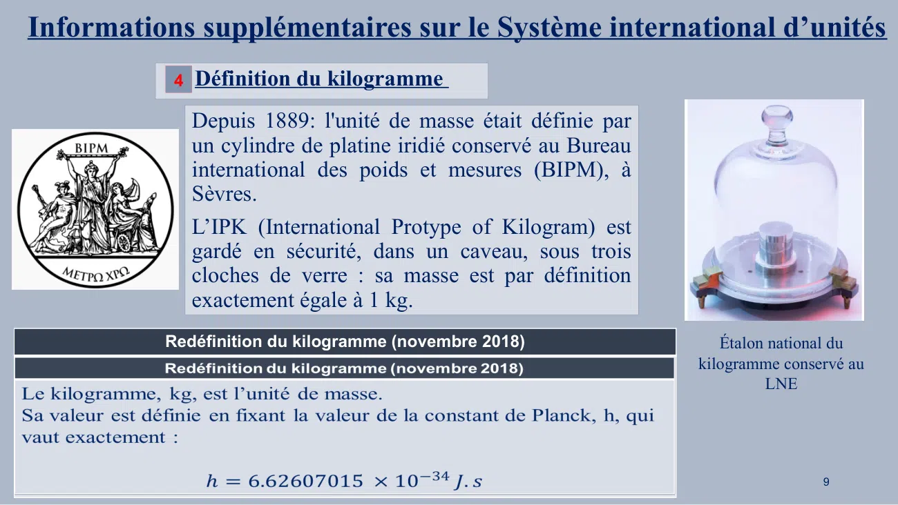
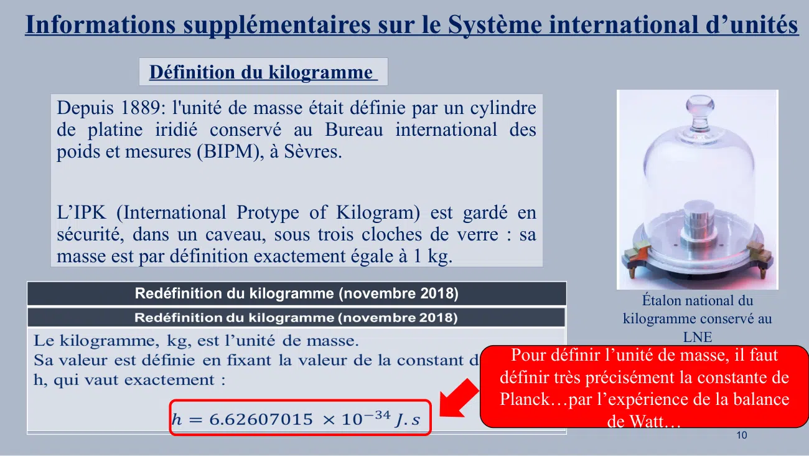

# CM-Chapitre2-Unitee-SI_2023-2024_Physique1_P1S1_EDupont-LDesplat.pdf

[Ouvrir l’original](https://drive.google.com/open?id=1dLqlZGxcouW26rAX_hkkSczozXNBSRSH) · Les deux lectures automatiques du PDF divergent sur les pages indiquées. Leur fac-similé accompagne le texte.

**Pages présentant un écart entre les deux extractions** — 9–10.

## Page 1

~~~text
                                                 Panorama sur la physique
                                    Informations supplémentaires sur le Système
                                               International d’unités

                                                                    PRE-ING1 2020/2021
                                                                                         1
Présentation rédigée par : Lucie Desplat: ld@eisti.eu, salle E207
~~~

## Page 2

~~~text
Informations supplémentaires sur le Système international d’unités
                       Histoire et évolution du système international d’unités
Fin 18ème siècle (Révolution française), un système métrique décimal voit le jour avec comme premières
grandeurs de base (et unités) :
• la longueur (le mètre),
• la masse (le kilogramme),
• le temps (la seconde).

                              • La masse (en kilogramme)                                                         • Le temps (en seconde)
 • la   longueur       (en
   mètre)

                              https://www.ladepeche.fr/article/2012/03/21/1311673-regime-draconien-pour-trois-   https://www.cerveauetpsycho.fr/sd/neurosciences/les-neurones-du-temps-qui-pas
                              elephants-d-un-cirque-suisse-en-surpoids.html                                      se-15194.php

                                                                                                                                                                                         2
~~~

## Page 3

~~~text
 Informations supplémentaires sur le Système international d’unités
                       Histoire et évolution du système international d’unités

Le système métrique décimal doit être complété pour plusieurs raisons:
• nouvelles instrumentations,
• nouvelles machines créées pour pallier les besoins relatifs aux évolutions industrielles.
• Le développement de l’industrie électrique,
• l’apparition de l’éclairage,
• le développement des machines à vapeur, et d’autres nécessités métrologiques.
En 1948 une enquête est demandée par la CGPM* sur trois domaines d’activité
(photométrie, électricité et température). Il en résulte que :
• L’ampère est ajouté en 1948. La candela et le kelvin sont introduits en 1954 (10ème CGPM).
• En 1960 (11ème CGPM), le système de mesure est renommé : le Système international
  d’unités (SI). Introduction d’une septième unité, la mole (14ème CGPM en 1971, chimie).

                                             *Conférence Générale des Poids et Mesures         3
~~~

## Page 4

~~~text
Informations supplémentaires sur le Système international d’unités
                     Histoire et évolution du système international d’unités
  À ce jour, le système international d’unités, le SI, est donc constitué de sept unités de base
  adoptées au niveau international par la CGPM :
  • le mètre (m),
  • le kilogramme (kg),
  • la seconde (s),
  • l’ampère (A),
  • le kelvin (K),
  • la candela (cd)
  • et la mole (mol).

  Utilisées par tous au quotidien, elles sont essentielles dans la science, dans l’industrie et la vie
  courante.
                                                                                                    4
~~~

## Page 5

~~~text
Informations supplémentaires sur le Système international d’unités

• En physique, mesurer revient à déterminer le rapport entre deux quantités de même nature
  dont l’une – supposée constante – fait office d’étalon ou d’unité.
• Premiers étalons pratiques basés sur le corps humain :mesurer en pieds, en pouces ou en
  coudées, la distance entre deux objets.
• Problème : si tout le monde a un pied, tout le monde n’a pas la même pointure… →
  Etalons anthropomorphiques
• Avec l’essor des sciences et des échanges internationaux: besoin d’unités plus précises et
  plus universelles.
• Pour rendre fiables et comparables les mesures (et faciliter les échanges) , il faut assurer un
  minimum de constance…

Le système métrique doit reposer sur des constantes physiques d’où la nécessité d’une
redéfinition de 4 unités de mesure sur les 7 du SI.
                                                                                           5
~~~

## Page 6

~~~text
Informations supplémentaires sur le Système international d’unités

« Un système d’unités est une construction humaine et les définitions du Système international
se sont donc à l’origine appuyées sur la physique classique. Les changements successifs de
définition ont découlé de la volonté d’utiliser des mesures plus stables et plus fondamentales,
accompagnant ainsi les progrès de la physique »
 Jean-Philippe Uzan, physicien à l’Institut d’astrophysique de Paris

                                                                       Sphère de Silicium   6
~~~

## Page 7

~~~text
Informations supplémentaires sur le Système international d’unités

                                                                                  7
                 https://www.lne.fr/fr/comprendre/systeme-international-unites/
~~~

## Page 8

~~~text
  Informations supplémentaires sur le Système international d’unités
Sur les 7 unités du SI, 4 unités ont ainsi fait l’objet d’une redéfinition en 2018 (26ème CGPM) :
        1 Définition du kelvin                                      2 Définition de l’ampère
   par rapport à la constante de Boltzmann:                        par rapport à la charge élémentaire:

                                                                            Expérience : réseau de
                                                                             Hall pour générateur
    Expérience :
                                                                                  quantique*
    Résonateur
    acoustique*
                                                     3   Définition de la mole
                                                  par rapport à la constante d’Avogadro:

        Avec R=8.31 USI.
        C’est la constante des gaz parfaits.

      *Vous trouverez des informations              Expérience:
      concernant les expériences permettant          Sphère de
      la mesure des constantes en regardant          silicium*
      les liens fournis en fin de présentation.                                                           8
~~~

## Page 9

~~~text
Informations supplémentaires sur le Système international d’unités
                 4 Définition du kilogramme

                   Depuis 1889: l'unité de masse était définie par
                   un cylindre de platine iridié conservé au Bureau
                   international des poids et mesures (BIPM), à
                   Sèvres.
                   L’IPK (International Protype of Kilogram) est
                   gardé en sécurité, dans un caveau, sous trois
                   cloches de verre : sa masse est par définition
                   exactement égale à 1 kg.
                Redéfinition du kilogramme (novembre 2018)                      Étalon national du
                                                                             kilogramme conservé au
Le kilogramme, kg, est l’unité de masse.                                              LNE
Sa valeur est définie en fixant la valeur de la constant de Planck, h, qui
vaut exactement :

                                                                                             9
~~~

## Page 10

~~~text
Informations supplémentaires sur le Système international d’unités
               Définition du kilogramme
   Depuis 1889: l'unité de masse était définie par un cylindre
   de platine iridié conservé au Bureau international des
   poids et mesures (BIPM), à Sèvres.

   L’IPK (International Protype of Kilogram) est gardé en
   sécurité, dans un caveau, sous trois cloches de verre : sa
   masse est par définition exactement égale à 1 kg.
             Redéfinition du kilogramme (novembre 2018)                           Étalon national du
Le kilogramme, kg, est l’unité de masse.                                       kilogramme conservé au
Sa valeur est définie en fixant la valeur de la constant de Planck,                     LNE
                                                              Pour définir l’unité de masse, il faut
h, qui vaut exactement :
                                                              définir très précisément la constante de
                                                              Planck…par l’expérience de la balance
                                                                              de Watt…
                                                                                               10
~~~

## Page 11

~~~text
Informations supplémentaires sur le Système international d’unités
                 Définition du kilogramme

Expérience de la balance du watt (ou balance de Kibble)

Pour mesurer la constante de Planck, les chercheurs ont utilisé une
balance de Kibble qui compare des puissances électrique et mécanique.

Son principe : une balance dont l’un des bras supporte une masse et
l’autre est relié à une bobine placée dans un champ magnétique.

Par une mesure en deux temps, il est possible de relier cette masse (en
kg), à une tension aux bornes de la bobine et un courant y circulant.

Le lien avec la constante de Planck se fait via des phénomènes
quantiques (effets Josephson et Hall quantique) impliquant cette tension   Balance de Kibble du National Institute of Standards and Technology. Photo by
                                                                               Richard Steiner (Original téléversé par Greg L sur Wikipédia anglais.)

et ce courant.

                                                                                                                                        11
~~~

## Page 12

~~~text
Informations supplémentaires sur le Système international d’unités
          Et ce n’est pas fini…

Les technologies étant sans cesse en
évolution, la précision au niveau de la
mesure s’améliore au fil des années.

Cela devrait aboutir, dans les prochaines
années, à une nouvelle définition de la
seconde et de la candela.

Pour redéfinir la seconde, une des pistes
étudiées : utilisation de l’horloge optique.
                                                            12
~~~

## Page 13

~~~text
                                   Références

• Laboratoire       national      de       métrologie        et     d’essais         LNE,
 https://www.lne.fr/fr/comprendre/systeme-international-unites/
• https://www.bipm.org/utils/fr/pdf/24_CGPM_Resolution_1.pdf
• https://www.bipm.org/utils/en/pdf/si-revised-brochure/Draft-SI-Brochure-2018.pdf
• https://www.bipm.org/fr/measurement-units/
• https://lejournal.cnrs.fr/articles/ces-constantes-qui-donnent-la-mesure

                                                                                     13
~~~
