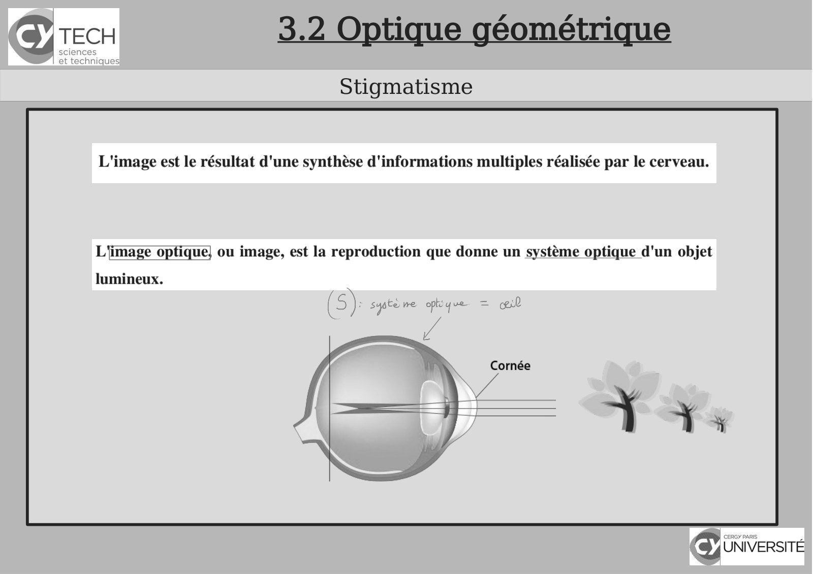
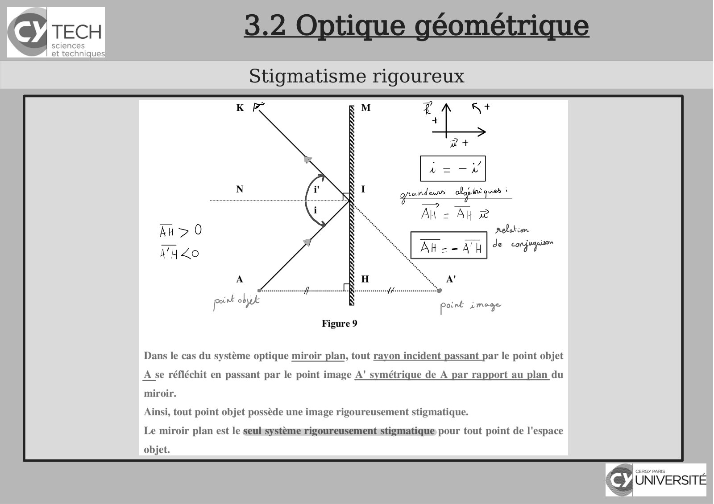
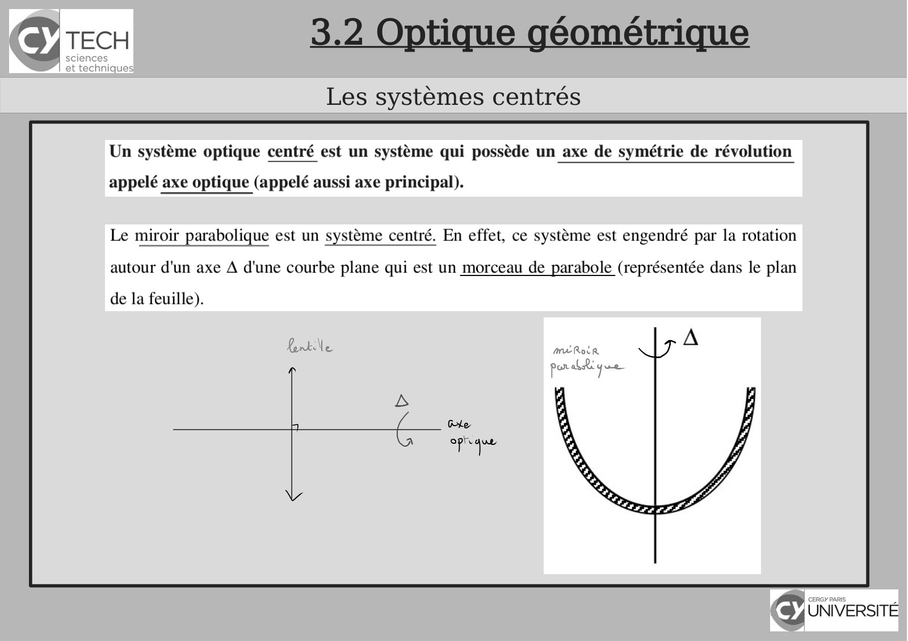
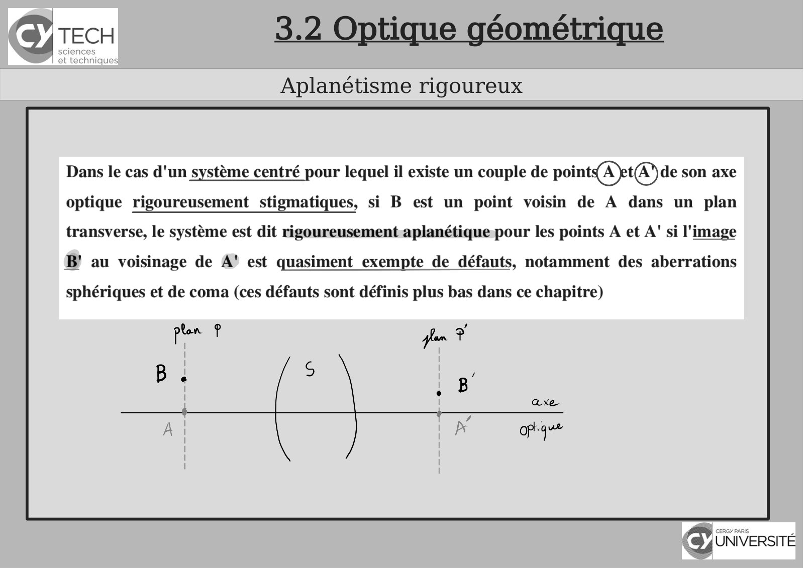
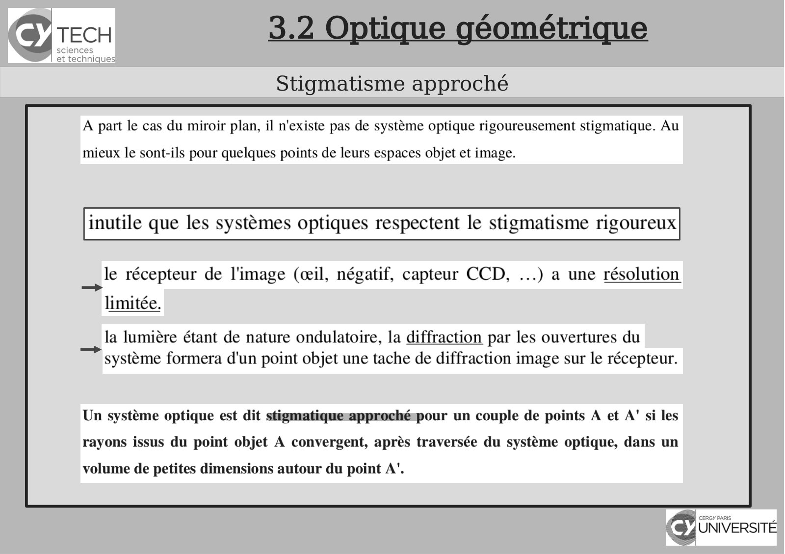
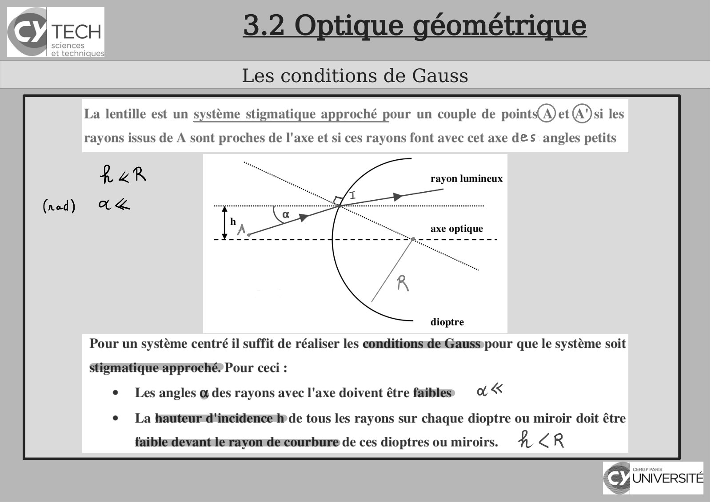
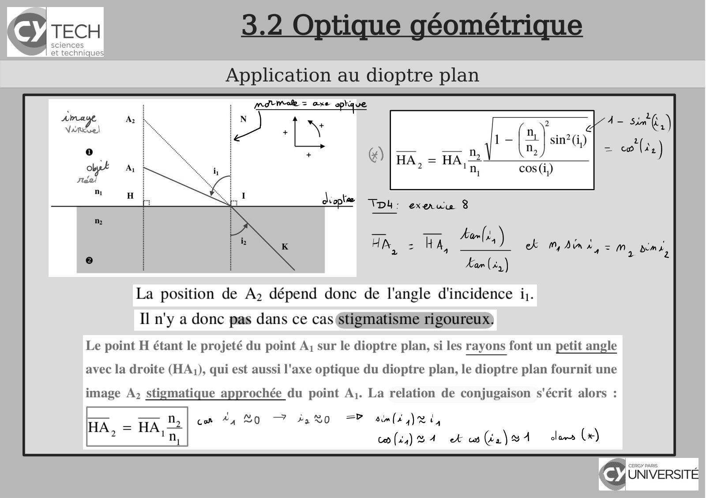
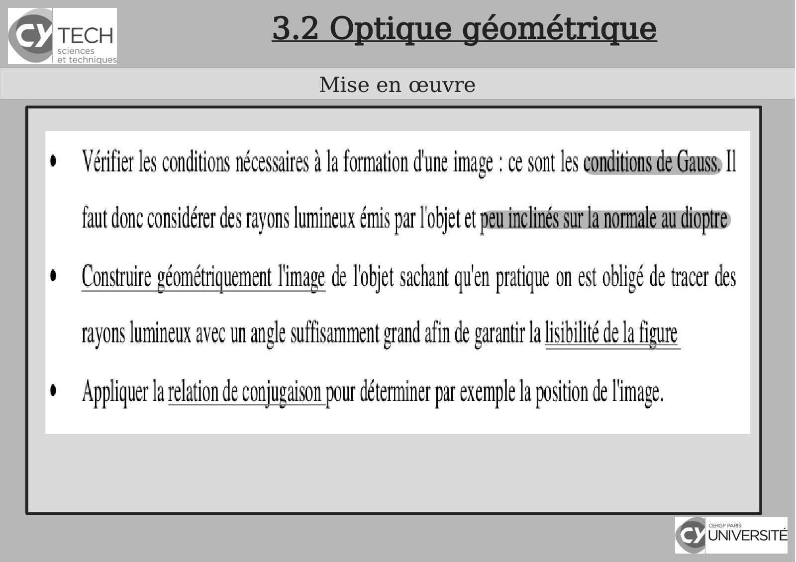
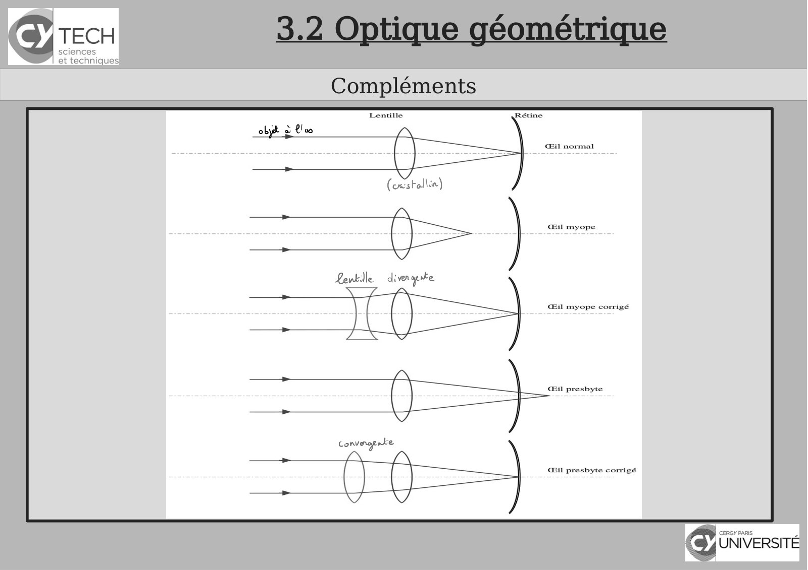
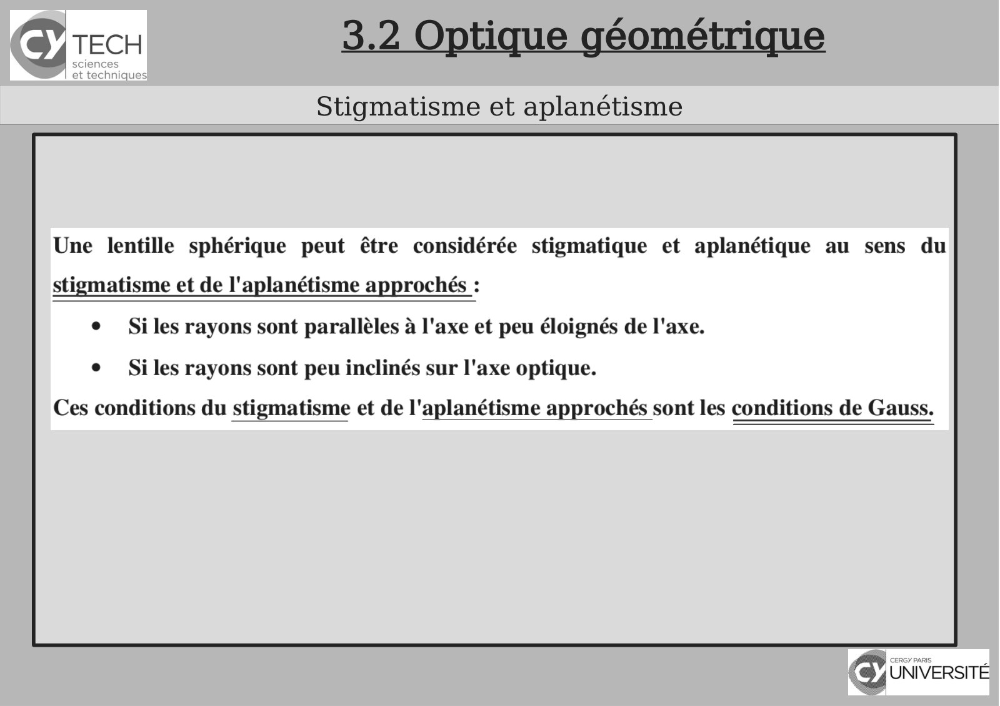

# CM-Chapitre3-Optique_2023-2024_Physique1_P1S1_EDupont.pdf

[Ouvrir l’original](https://drive.google.com/open?id=156AqaCLSeiVhewUjV_MWYe-7n7aXo_l4) · Les pages signalées comprennent du texte reconnu automatiquement ou des éléments graphiques. Le fac-similé permet de vérifier chaque lecture.

**Pages avec fac-similé ou lecture OCR** — 19, 26, 32–34, 36, 40, 42–43, 48.

## Page 1

~~~text
                                        Panorama sur la Physique

                     Chapitre 3 – Optique : l’étude de la lumière

               I Physique - 2022-2023

Présentation rédigée par Émilie Dupont (Cergy) : emilie.dupont@cyu.fr, CY308
~~~

## Page 2

~~~text
                Programme de Panorama sur la Physique


    Chapitre 1 - Introduction


    Chapitre 2 - Introduction à la pensée scientifique


    Chapitre 3 - Optique : l’étude de la lumière


    Chapitre 4 – Cinématique : la description du mouvement


    Chapitre 5 - Mécanique
~~~

## Page 3

~~~text
              3.1 Les modèles décrivant la lumière
       Approche physique de la lumière et de ses interactions

Les sources de lumière

Les milieux de propagation
~~~

## Page 4

~~~text
                 3.1 Les modèles décrivant la lumière
        Approche physique de la lumière et de ses interactions

Les récepteurs de lumière
Corps entre l’œil et un objet lumineux :
~~~

## Page 5

~~~text
     3.1 Les modèles décrivant la lumière
Approche historique de la lumière et de ses modèles
~~~

## Page 6

~~~text
              3.1 Les modèles décrivant la lumière
        Approche historique de la lumière et de ses modèles

Modèles corpusculaire et ondulatoire

Modèle ondulatoire : ondes électromagnétiques
~~~

## Page 7

~~~text
     3.1 Les modèles décrivant la lumière
Approche historique de la lumière et de ses modèles
~~~

## Page 8

~~~text
     3.1 Les modèles décrivant la lumière
Approche historique de la lumière et de ses modèles
~~~

## Page 9

~~~text
              3.1 Les modèles décrivant la lumière
        Approche historique de la lumière et de ses modèles

Propagation de la lumière dans les milieux matériels transparents
~~~

## Page 10

~~~text
               3.1 Les modèles décrivant la lumière
        Approche historique de la lumière et de ses modèles

Dispersion de la lumière

       Loi de Cauchy

          Nombre
          d’Abbe :
~~~

## Page 11

~~~text
             3.1 Les modèles décrivant la lumière
    Propagation rectiligne dans un M.H.T.I. et Rayon lumineux

Hypothèse fondamentale de l’Optique Géométrique

Approximation de l’Optique Géométrique

Notion de rayon lumineux
~~~

## Page 12

~~~text
              3.1 Les modèles décrivant la lumière
     Propagation rectiligne dans un M.H.T.I. et Rayon lumineux

Interprétation de l’hypothèse fondamentale de l’Optique Géométrique
~~~

## Page 13

~~~text
                   3.1 Les modèles décrivant la lumière
                    Loi de la réflexion : 1ère loi de Descartes

Énoncé

Conséquences :

         Loi du retour inverse de la lumière
~~~

## Page 14

~~~text
               3.1 Les modèles décrivant la lumière
                Loi de la réflexion : 1ère loi de Descartes

Notions d’objet réel et d’image virtuelle

Rotation d’un miroir plan
~~~

## Page 15

~~~text
         3.1 Les modèles décrivant la lumière
         Loi de la réfraction : 2ème loi de Descartes

Énoncé

                        pour les petits angles
~~~

## Page 16

~~~text
               3.1 Les modèles décrivant la lumière
               Loi de la réfraction : 2ème loi de Descartes

Construction de Huygens et interprétation

Conséquences : réfraction limite – réflexion totale
~~~

## Page 17

~~~text
                  3.1 Les modèles décrivant la lumière
                  Loi de la réfraction : 2ème loi de Descartes

Passage d’un MHTI (1) vers un MHTI (2) plus réfringent : réfraction limite

Passage d’un MHTI (1) vers un MHTI (2) moins réfringent : réflexion totale
~~~

## Page 18

~~~text
             3.1 Les modèles décrivant la lumière
                 1ère et 2ème lois de Descartes

Exemples :
~~~

## Page 19

~~~text
3.2 Optique géométrique
   Stigmatisme
~~~

**Lecture OCR à contrôler**

~~~text
TECH 3.2 Optique géométrique

Stigmatisme

L'image est le résultat d'une synthèse d'informations multiples réalisée par le cerveau.

L'image optique} ou image, est la reproduction que donne un système optique d'un objet

lumineux.

a : 7
(5) sypte re pq ced
1

Cornée
/
~~~

## Page 20

~~~text
                           3.2 Optique géométrique
              Notion de Point Objet et de Point Image

Système optique

             Convention d’orientation de
             l’espace
~~~

## Page 21

~~~text
                         3.2 Optique géométrique
                Notion de Point Objet et de Point Image
Rayon incident et rayon émergent

Point objet réel ou virtuel – Point image réel ou virtuel
~~~

## Page 22

~~~text
       3.2 Optique géométrique
Notion de Point Objet et de Point Image
~~~

## Page 23

~~~text
                        3.2 Optique géométrique
                 Notion de Point Objet et de Point Image

Objet et image

Espace Objet - Espace Image
~~~

## Page 24

~~~text
                       3.2 Optique géométrique
                       Stigmatisme rigoureux

Stigmatisme rigoureux – Points conjugués

Que voit l’œil ?
~~~

## Page 25

~~~text
                       3.2 Optique géométrique
                        Stigmatisme rigoureux

Mirage

Miroir plan : système optique rigoureusement stigmatique
~~~

## Page 26

~~~text
3.2 Optique géométrique
Stigmatisme rigoureux
~~~

**Lecture OCR à contrôler**

~~~text
TECH

sciences
et technique:

Stigmatisme rigoureux

px ob pont image
Figure 9

Dans le cas du systéme optique miroir plan, tout rayon incident passant par le point objet
A se réfléchit en passant par le point image A' symétrique de A par rapport au plan du

miroir.
Ainsi, tout point objet possède une image rigoureusement stigmatique.

Le miroir plan est le seubsystèmerigoureusementstigmatique pour tout point de l'espace
objet.

UNIVERSITÉ
~~~

## Page 27

~~~text
                         3.2 Optique géométrique
                          Stigmatisme rigoureux

Réalité et virtualité dans le cas du miroir plan

Construction d’une image
~~~

## Page 28

~~~text
                          3.2 Optique géométrique
                          Stigmatisme rigoureux
Image d’un objet étendu dans un miroir plan

Relation de conjugaison

Grandissement transversal
~~~

## Page 29

~~~text
                      3.2 Optique géométrique
                      Stigmatisme rigoureux

Grandissement axial
~~~

## Page 30

~~~text
                       3.2 Optique géométrique
                       Stigmatisme rigoureux

Exemples :

      Si le miroir tourne d’un angle α
      que vaut β ?
~~~

## Page 31

~~~text
                        3.2 Optique géométrique
                         Stigmatisme rigoureux

Si le miroir tourne d’un angle α que vaut β ?
Le rayon lumineux s’est déplacé de d sur la règle.
Que vaut d ?
~~~

## Page 32

~~~text
3.2 Optique géométrique
Les systèmes centrés
~~~

**Lecture OCR à contrôler**

~~~text
CES 3.2 Optique géométrique
Les systèmes centrés

Un système optique centré est un système qui possède un axe de symétrie de révolution

appelé axe optique (appelé aussi axe principal).

Le miroir parabolique est un système centré. En effet, ce système est engendré par la rotation

autour d'un axe A d'une courbe plane qui est un morceau de parabole (représentée dans le plan
de la feuille).

MERLR

per dique
~~~

## Page 33

~~~text
3.2 Optique géométrique
Aplanétisme rigoureux
~~~

**Lecture OCR à contrôler**

~~~text
Sy TECH 3.2 Optique géométrique

Aplanétisme rigoureux

Dans le cas d'un systéme centré pour lequel il existe un couple de points(A)et(A de son axe
optique rigoureusement stigmatiques, si B est un point voisin de A dans un plan
transverse, le système est dit rigoureusement aplanétique pour les points A et A' si l'image

B' au voisinage de A’ est quasiment exempte de défauts, notamment des aberrations

sphériques et de coma (ces défauts sont définis plus bas dans ce chapitre)

pen ? fan *

i

A

I
[
I
|
|
B . |
° i
i
I
i
i
|
I
I
I
~~~

## Page 34

~~~text
3.2 Optique géométrique
Stigmatisme approché
~~~

**Lecture OCR à contrôler**

~~~text
CES 3.2 Optique géométrique
Stigmatisme approché

A part le cas du miroir plan, il n'existe pas de système optique rigoureusement stigmatique. Au

mieux le sont-ils pour quelques points de leurs espaces objet et image.

inutile que les systèmes optiques respectent le stigmatisme rigoureux

le récepteur de l'image (œil, négatif, capteur CCD, ...) a une résolution
limitée.

la lumière étant de nature ondulatoire, la diffraction par les ouvertures du
système formera d'un point objet une tache de diffraction image sur le récepteur.

Un système optique est dit stigmatiquesapprochéspour un couple de points A et A' si les
rayons issus du point objet A convergent, après traversée du système optique, dans un

volume de petites dimensions autour du point A’.
~~~

## Page 35

~~~text
                       3.2 Optique géométrique
                       Les conditions de Gauss
Mise en évidence des conditions de Gauss
~~~

## Page 36

~~~text
3.2 Optique géométrique
Les conditions de Gauss
~~~

**Lecture OCR à contrôler**

~~~text
SY TECH 3.2 Optique géométrique

et techniques

Les conditions de Gauss

La lentille est un système stigmatique approché pour un couple de points(A) et @)si les

rayons issus de A sont proches de l'axe et si ces rayons font avec cet axe des: angles petits

rayon lumineux

axe optique

dioptre
Pour un système centré il suffit de réaliser les conditionsdeGausspour que le système soit
Stigmatique-approché? Pour ceci :
e Les angles @ des rayons avec l'axe doivent être faibles ASS
e La hauteurd'incidence'l» de tous les rayons sur chaque dioptre ou miroir doit être

faibledevantlerayonde:courbure de ces dioptres ou miroirs. 4 ER
~~~

## Page 37

~~~text
                         3.2 Optique géométrique
                         Les conditions de Gauss
Conséquences des conditions de Gauss
      Approximations
      trigonométriques
      Aplanétisme
      approché

     Relation de
     conjugaison
~~~

## Page 38

~~~text
                               3.2 Optique géométrique
                               Les conditions de Gauss
Construction des
images

Grandissement transversal et grandissement
angulaire
~~~

## Page 39

~~~text
        3.2 Optique géométrique
        Les conditions de Gauss

Foyer
s
~~~

## Page 40

~~~text
 3.2 Optique géométrique
Application au dioptre plan
~~~

**Lecture OCR à contrôler**

~~~text
TECH 3.2 Optique géométrique

Application au dioptre plan

mavmale = axe sprque

deoplæ TDb: exauu 8
Kan,
Felts) oe mains, « es
Kan (23)
La position de A, dépend donc de l'angle d'incidence i.
Il n'y a donc pas dans ce cas Stigmatisme rigoureux:
Le point H étant le projeté du point A; sur le dioptre plan, si les rayons font un petit angle
avec la droite (HA:), qui est aussi l'axe optique du dioptre plan, le dioptre plan fournit une

image A, stigmatique approchée du point A;. La relation de conjugaison s'écrit alors :

con #4 BQ 7 4220 =F aim( rt,

co(is)B4 ek es (én) BA

(9) UNIVERSITÉ
~~~

## Page 41

~~~text
                      3.2 Optique géométrique
                 Aberrations des systèmes optiques

Aberrations de
sphéricité
                                              distorsio
                                              n
~~~

## Page 42

~~~text
3.2 Optique géométrique
  Mise en œuvre
~~~

**Lecture OCR à contrôler**

~~~text
SY TECH 3.2 Optique géométrique
Mise en œuvre
Vérifier les conditions nécessaires a la formation d'une image : ce sont les conditionsiderGauss) 1!
faut donc considérer des rayons lumineux émis par l'objet et peurinclinéssurla normale audioptre

Construire géométriquement l'image de l'objet sachant qu'en pratique on est obligé de tracer des

rayons lumineux avec un angle suffisamment grand afin de garantir La lisibilité de la figure

Appliquer la relation de conjugaison pour déterminer par exemple la position de l'image.

cy UNIVERSITÉ
~~~

## Page 43

~~~text
3.2 Optique géométrique
   Compléments
~~~

**Lecture OCR à contrôler**

~~~text
TECH

sciences
et technique:

Compléments

Lentille

CS
h
~~~

## Page 44

~~~text
                    3.2 Optique géométrique
                     Lentilles sphériques
Lentilles réelles
~~~

## Page 45

~~~text
                         3.2 Optique géométrique
                          Lentilles sphériques
Lentilles convergentes                           Lentilles
divergentes
~~~

## Page 46

~~~text
                        3.2 Optique géométrique
                          Lentilles sphériques

Approximation de la lentille mince sphérique
~~~

## Page 47

~~~text
         3.2 Optique géométrique
Algébrisation - Espace objet et image

   https://femto-physique.fr/simulations/lentilles-minces.php
~~~

## Page 48

~~~text
 3.2 Optique géométrique
Stigmatisme et aplanétisme
~~~

**Lecture OCR à contrôler**

~~~text
Sy TECH 3.2 Optique géométrique

Stigmatisme et aplanétisme

Une lentille sphérique peut étre considérée stigmatique et aplanétique au sens du

stigmatisme et de l'aplanétisme approchés :

e Si les rayons sont parallèles à l'axe et peu éloignés de l'axe.

e _ Siles rayons sont peu inclinés sur l'axe optique.

Ces conditions du stigmatisme et de l'aplanétisme approchés sont les conditions de Gauss.
~~~

## Page 49

~~~text
                        3.2 Optique géométrique
                    Propriétés des lentilles minces
Centre optique d’une lentille mince

Foyers, plans focaux, distances focales
~~~

## Page 50

~~~text
   3.2 Optique géométrique
Propriétés des lentilles minces
~~~

## Page 51

~~~text
                            3.2 Optique géométrique
                         Propriétés des lentilles minces

I Physique - 2020-2021
~~~

## Page 52

~~~text
              3.2 Optique géométrique
           Propriétés des lentilles minces
Vergence
~~~

## Page 53

~~~text
                        3.2 Optique géométrique
                Construction géométrique d’une image
Image d’un objet perpendiculaire à l’axe optique
~~~

## Page 54

~~~text
                         3.2 Optique géométrique
             Relations de conjugaison et de grandissement
Avec origine au centre (Descartes)

Avec origine aux foyers (Newton)
~~~

## Page 55

~~~text
                       3.2 Optique géométrique
             Relations de conjugaison et de grandissement

Exemples :
~~~

## Page 56

~~~text
                         3.2 Optique géométrique
                     Association de lentilles minces
Lentilles accolées

Lentilles non accolées
~~~

## Page 57

~~~text
                          3.2 Optique géométrique
                Aberration chromatique d’une lentille
Mise en évidence

Correction de l’aberration
             Combinaison de lentilles de nature et de matériaux
             différentsSystème
                     achromatique
                     Lentilles accolées telles
                     que
~~~

## Page 58

~~~text
                                     Bibliographie


    [1] Polycopié de cours – Optique (ex- EISTI)


    [2]
~~~
