# CM-Chapitre4-Cinematique_2023-2024_Physique1_P1S1_EDupont.pdf

[Ouvrir l’original](https://drive.google.com/open?id=10fZu_10EwjQaflQwzUkP3s1QgONhWumt) · Les pages signalées comprennent du texte reconnu automatiquement ou des éléments graphiques. Le fac-similé permet de vérifier chaque lecture.

**Pages avec fac-similé ou lecture OCR** — 25–28, 34–35, 38, 51–52, 63, 66.

## Page 1

~~~text
                                        Panorama sur la Physique

                                                Chapitre 4 – Cinématique

               I Physique - 2023-2024

Présentation rédigée par Émilie Dupont (Cergy) : emilie.dupont@cyu.fr, CY308
~~~

## Page 2

~~~text
                Programme de Panorama sur la Physique


    Chapitre 1 - Introduction


    Chapitre 2 - Introduction à la pensée scientifique


    Chapitre 3 - Optique : l’étude de la lumière


    Chapitre 4 – Cinématique : la description du mouvement


    Chapitre 5 - Mécanique
~~~

## Page 3

~~~text
                Programme de Panorama sur la Physique


    Chapitre 1 - Introduction


    Chapitre 2 - Introduction à la pensée scientifique


    Chapitre 3 - Optique : l’étude de la lumière


    Chapitre 4 – Cinématique : la description du mouvement


    Chapitre 5 - Mécanique
~~~

## Page 4

~~~text
             4.1.1 Nature et repérage de l’espace
                Qu’est-ce que la Cinématique ?

Du grec ancien Kinematikos = « mouvement »

                   Étude du mouvement,

        sans se soucier des causes qui le provoquent
~~~

## Page 5

~~~text
      4.1.1 Nature et repérage de l’espace
        Qu’est-ce que la Cinématique ?

[3]
~~~

## Page 6

~~~text
4.1.1 Nature et repérage de l’espace
  Qu’est-ce que la Cinématique ?
~~~

## Page 7

~~~text
      4.1.1 Nature et repérage de l’espace
        Qu’est-ce que la Cinématique ?

[3]
~~~

## Page 8

~~~text
4.1.1 Nature et repérage de l’espace
  Qu’est-ce que la Cinématique ?
~~~

## Page 9

~~~text
4.1.1 Nature et repérage de l’espace
 Position, vitesse, accélération … ?
~~~

## Page 10

~~~text
              4.1.1 Nature et repérage de l’espace
                 Position, vitesse, accélération … ?

1) Définition des vitesses et accélération (1D)

2) Mouvement rectiligne uniformément accéléré.
~~~

## Page 11

~~~text
4.1.1 Nature et repérage de l’espace
   Notion de point en physique

       Repérer un solide dans
       l’espace
~~~

## Page 12

~~~text
               4.1.1 Nature et repérage de l’espace
                     Notion de point en physique

                Mécanique des solides, un objet :
                             6 degrés de liberté

3 mouvements de translation                 3 mouvements de rotation
    (directions x, y et z)                 (autour des axes Ox, Oy et Oz)
~~~

## Page 13

~~~text
                 4.1.1 Nature et repérage de l’espace
                      Notion de point en physique

Étude en mécanique du point ⇒ simplifier le problème :

Passer de 6 degrés de liberté (6 inconnues) à 3 degrés de liberté (3 inconnues)
~~~

## Page 14

~~~text
                  4.1.1 Nature et repérage de l’espace
      Quand peut-on assimiler un système à un point matériel ?

Pas de réponse simple (cf. définition) : tout dépend si on peut

négliger son extension spatiale et sa rotation sur lui-même.

Exemple : mouvement orbital de la Terre autour du Soleil
~~~

## Page 15

~~~text
         4.1.1 Nature et repérage de l’espace
Quand peut-on assimiler un système à un point matériel ?
~~~

## Page 16

~~~text
                  4.1.2 Espace et temps
Grandeurs vectorielles : vecteur position, vitesse, accélération...
                                                                [2]
~~~

## Page 17

~~~text
             4.1.2 Espace et temps
      Que fait le ballon de basket en chute libre ?
[2]
~~~

## Page 18

~~~text
               4.1.2 Espace et temps
      Vitesse et accélération : grandeurs algébriques
[2]
~~~

## Page 19

~~~text
                4.1.2 Espace et temps
      Si la balle rebondit, elle monte puis elle descend.
[2]
~~~

## Page 20

~~~text
                4.1.2 Espace et temps
      Si la balle rebondit, elle monte puis elle descend.
[2]
~~~

## Page 21

~~~text
                4.1.2 Espace et temps
      Si la balle rebondit, elle monte puis elle descend.
[2]
~~~

## Page 22

~~~text
                               4.1.2 Espace et temps
                                Mouvement d’un point M

Étudier la trajectoire de M :


    Repère d’espace :


    Repère de temps :

      I Physique - 2020-2021
~~~

## Page 23

~~~text
                 4.1.2 Espace et temps
              Repérage d’un point dans l’espace

- mouvement possède un caractère relatif :

         Principe de la relativité du mouvement (Galilée)

- Mécanique newtonienne :

       Espace physique = Espace euclidien à 3 dimensions

   =
~~~

## Page 24

~~~text
  4.1.3 Repérage spatial
Repérage d’un point dans l’espace
~~~

## Page 25

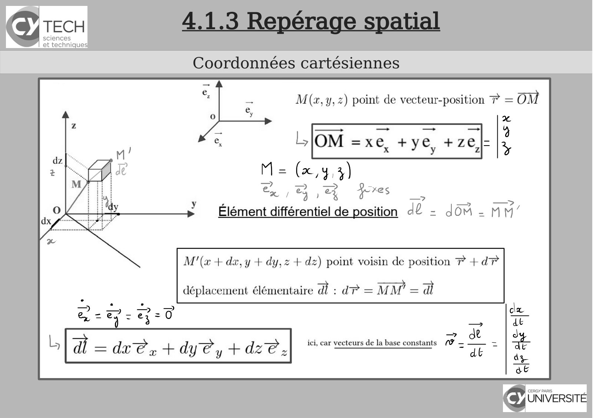

~~~text
4.1.3 Repérage spatial
Coordonnées cartésiennes
~~~

**Lecture OCR à contrôler**

~~~text
Icy TECH

sciences
et technique:

Coordonnées cartésiennes

M(z,y, 2) point de vecteur-position 7 = OM
2

Ar ré Pus 1 19

= = (x, 43)
2 ) oa pres —

mH

7

—

i ——?
Elément nl de position dû - dou-n M’

M'(a + dx, y + dy,z + dz) point voisin de position ? +d?

déplacement élémentaire ad: dr = MM = di

= ae
= a. ef dy@y fs dz@ x ici, car vecteurs de la base constants Pa =
~~~

## Page 26

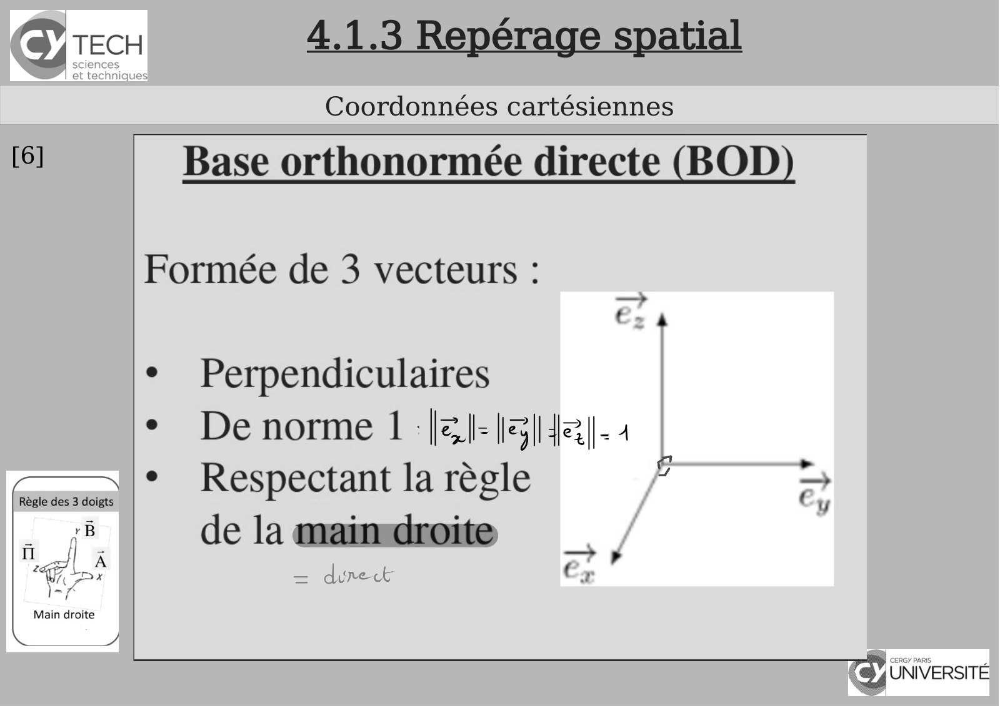

~~~text
      4.1.3 Repérage spatial
      Coordonnées cartésiennes
[6]
~~~

**Lecture OCR à contrôler**

~~~text
(8) TECH 4.1.3 Repérage spatial
Coordonnées cartésiennes

[6] Base orthonormée directe (BOD)

Formée de 3 vecteurs :

+

¢ Perpendiculaires

* Denorme 1 läl-|3|{e|-4

+ Respectant la règle F -,
de la maimdroite

= dunect

~

CY UNIVERSITÉ
~~~

## Page 27

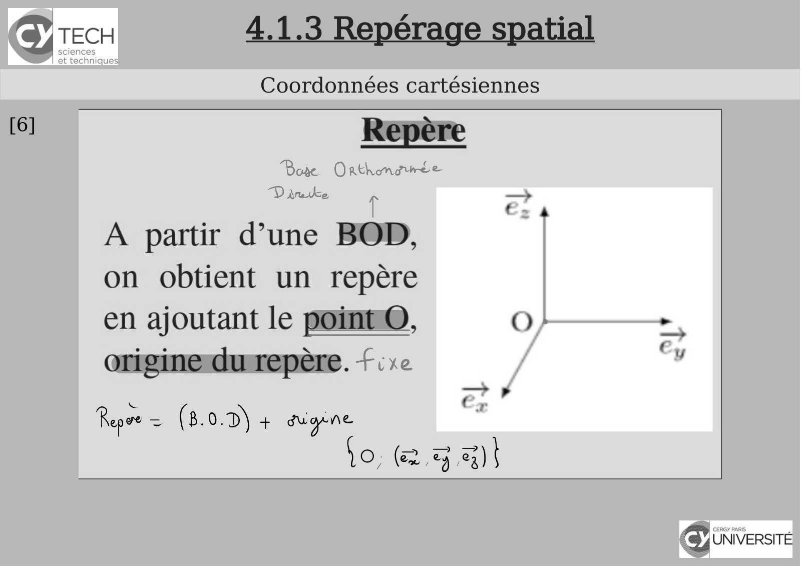

~~~text
      4.1.3 Repérage spatial
      Coordonnées cartésiennes
[6]
~~~

**Lecture OCR à contrôler**

~~~text
SY TECH 4.1.3 Repérage spatial

Coordonnées cartésiennes

[6] Repére
Bose Onrthmaurée
DV dnetke ed

T
A partir d’une BOD,
on obtient un repère

en ajoutant le points, O} .
origine du repère. « d

Repoe = (8.0.D) a gupne
o,(&,32)|

cy UNIVERSITÉ
~~~

## Page 28

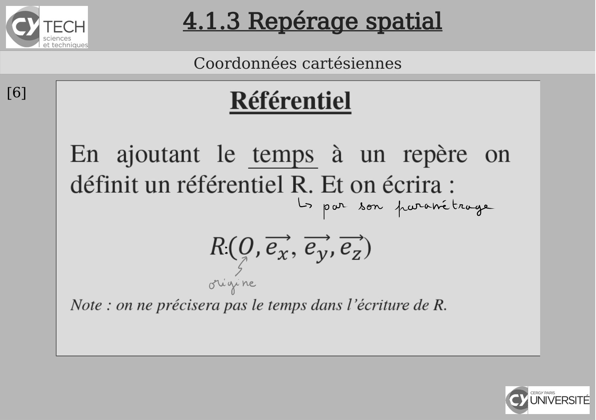

~~~text
      4.1.3 Repérage spatial
      Coordonnées cartésiennes
[6]
~~~

**Lecture OCR à contrôler**

~~~text
SY TECH 4.1.3 Repérage spatial

Coordonnées cartésiennes

i) Référentiel
En ajoutant le temps a un repère on
définit un référentiel R. Et on écrira :
= pe how for Enoge
RO, ex, Cy, e,)
ere ne
Note : on ne précisera pas le temps dans l'écriture de R.

cy UNIVERSITÉ
~~~

## Page 29

~~~text
    4.1.3 Repérage spatial
      Coordonnées cylindriques
Bien adapté pour repérer un point sur un
cylindre
~~~

## Page 30

~~~text
                         4.1.3 Repérage spatial
                          Coordonnées cylindriques

I Physique - 2020-2021
~~~

## Page 31

~~~text
                         4.1.3 Repérage spatial
                          Coordonnées cylindriques

I Physique - 2020-2021
~~~

## Page 32

~~~text
                         4.1.3 Repérage spatial
                          Coordonnées cylindriques

I Physique - 2020-2021
~~~

## Page 33

~~~text
                         4.1.3 Repérage spatial
                          Coordonnées cylindriques

I Physique - 2020-2021
~~~

## Page 34

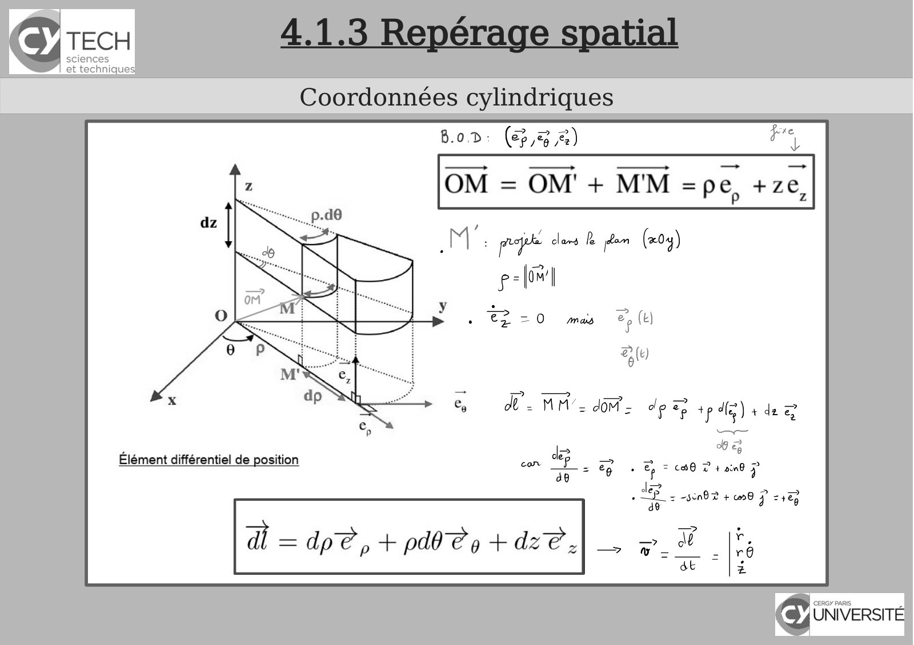

~~~text
4.1.3 Repérage spatial
 Coordonnées cylindriques
~~~

**Lecture OCR à contrôler**

~~~text
Icy TECH

sciences
et technique:

Coordonnées cylindriques

B.0.d; (2% 2) Fe

OM = OM' + MM =pe, +ze,

M: pp cles À jean (x04)
pelo

EZ =O mas > (tI

PAC)

nl

d= MM. dot op & tp dela dee

ai
ob

a © = CO 2 4 vind D

Jde? PL. p
e P= sen 2 + 0 À =38,
46 El @

ré

Icy UNIVERSITE
A
~~~

## Page 35

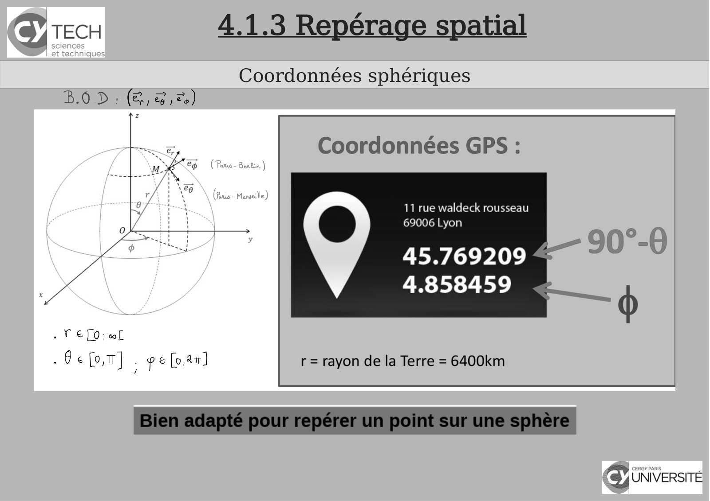

~~~text
4.1.3 Repérage spatial
 Coordonnées sphériques
~~~

**Lecture OCR à contrôler**

~~~text
(8) TECH 4.1.3 Repérage spatial

Coordonnées sphériques

B.O D: (&, @,%)

Coordonnées GPS :

11 rue waldeck rousseau
69006 Lyon

45.769209
4.858459

» VEL: wf

-Gefot] . pe fan]

r = rayon de la Terre = 6400km

-90°-0

cy UNIVERSITÉ
~~~

## Page 36

~~~text
                         4.1.3 Repérage spatial
                          Coordonnées sphériques

I Physique - 2020-2021
~~~

## Page 37

~~~text
                         4.1.3 Repérage spatial
                         Coordonnées intrinsèques

I Physique - 2020-2021
~~~

## Page 38

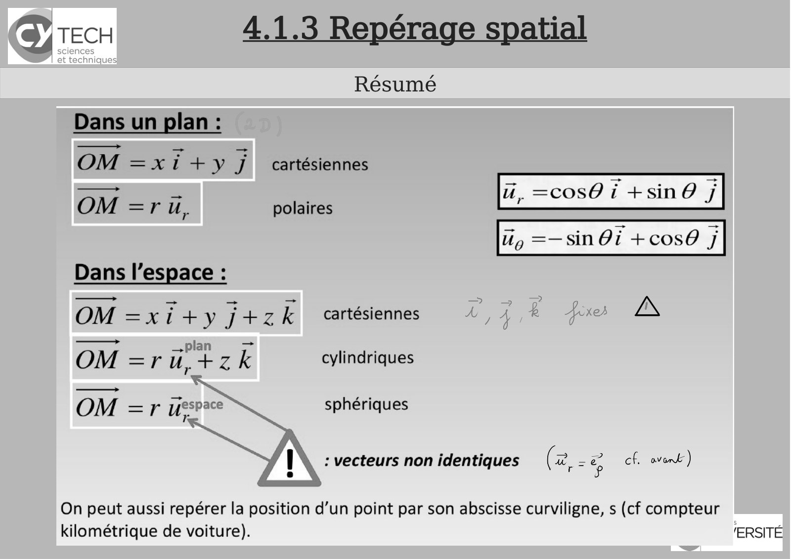

~~~text
                         4.1.3 Repérage spatial
                                Résumé

I Physique - 2020-2021
~~~

**Lecture OCR à contrôler**

~~~text
(8) TECH 4.1.3 Repérage spatial

Résumé
Dans un plan :
OM =xi+ y 1 cartésiennes
u, =cos@i +sin @ 7

OM =r iu, polaires

Ug =—sin Oi +cos@ J

Dans l’espace :

OM =x ity j+z k  cartésiennes A, 4% fes A
pl
OM = —" ü, + Zz k cylindriques
== sphériques
_ ; espace ~
OM =F ure aoa phériq

_ : vecteurs non identiques (2, -8 cf. ovenk)

On peut aussi repérer la position d’un point par son abscisse curviligne, s (cf compteur

kilométrique de voiture). 'ERSITE
~~~

## Page 39

~~~text
                        4.1.4 Produit scalaire et vectoriel
                                       ?

En Mécanique, on modélise les mouvements et leurs causes, les forces,
par des vecteurs.

Afin de résoudre les problèmes de Mécanique, d’Électromagnétisme
etc… , on a besoin de projeter les vecteurs sur des directions particulières
en utilisant les produits scalaires.

En présence de rotations, on utilise également le produit vectoriel, ce qui
sera un cas rencontré souvent en Électromagnétisme 1 et 2 lors qu’on
s’intéressera au champ magnétique.
      I Physique - 2020-2021
~~~

## Page 40

~~~text
      4.2.1 Produit scalaire et vectoriel
        Calcul vectoriel - Relation de Chasles
[6]
~~~

## Page 41

~~~text
      4.2.1 Produit scalaire et vectoriel
         Calcul vectoriel - Le produit scalaire
[6]
~~~

## Page 42

~~~text
                  4.1.4 Produit scalaire et vectoriel
                         Produit scalaire de deux vecteurs

I Physique - 2020-2021
~~~

## Page 43

~~~text
      4.2.1 Produit scalaire et vectoriel
         Calcul vectoriel - Le produit scalaire
[6]
~~~

## Page 44

~~~text
                        4.2.1 Produit scalaire et vectoriel
                               Calcul vectoriel - Le produit vectoriel
[6]

      I Physique - 2020-2021
~~~

## Page 45

~~~text
                  4.1.4 Produit scalaire et vectoriel
                         Produit vectoriel de deux vecteurs

I Physique - 2020-2021
~~~

## Page 46

~~~text
4.1.4 Produit scalaire et vectoriel
    Produit vectoriel : orientation...
~~~

## Page 47

~~~text
4.1.4 Produit scalaire et vectoriel
    Produit vectoriel : orientation...
~~~

## Page 48

~~~text
                  4.1.4 Produit scalaire et vectoriel
        Propriétés du produit scalaire et du produit vectoriel

I Physique - 2020-2021
~~~

## Page 49

~~~text
                  4.1.4 Produit scalaire et vectoriel
        Propriétés du produit scalaire et du produit vectoriel

I Physique - 2020-2021
~~~

## Page 50

~~~text
      4.2.1 Produit scalaire et vectoriel
         Calcul de produits vectoriels utiles
[6]
~~~

## Page 51

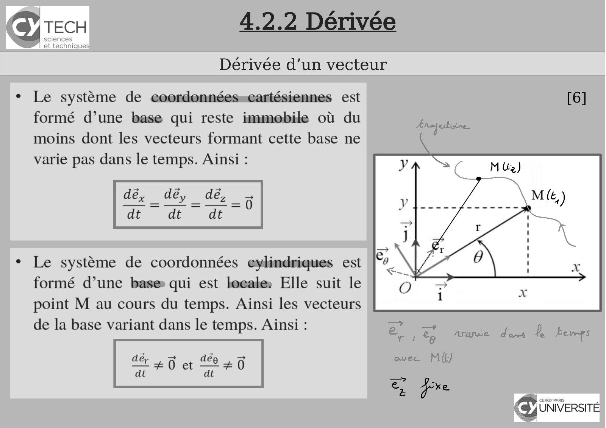

~~~text
  4.2.2 Dérivée
Dérivée d’un vecteur

                       [6]
~~~

**Lecture OCR à contrôler**

~~~text
TECH 4.2.2 Dérivée

Dérivée d’un vecteur

+ Le système de coordonnées=cartésiennes est [6]

formé d’une base qui reste immobile où du
moins dont les vecteurs formant cette base ne
varie pas dans le temps. Ainsi :

dé, déy dé,
dt dt dt

Le système de coordonnées evylindriques est
formé d’une base qui est locale: Elle suit le
point M au cours du temps. Ainsi les vecteurs

de la base variant dans le temps. Ainsi : ao > | 2
rit Vane dans te Æenps
20 ct +0 CNE
dt dt

SS
(CHEQUE
~~~

## Page 52

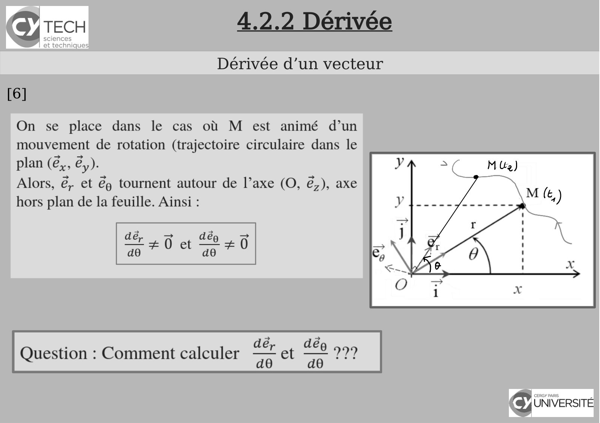

~~~text
        4.2.2 Dérivée
      Dérivée d’un vecteur
[6]
~~~

**Lecture OCR à contrôler**

~~~text
Icy TECH

sciences
et technique:

Dérivée d’un vecteur

On se place dans le cas où M est animé d’un
mouvement de rotation (trajectoire circulaire dans le
plan (é,, é,).

Alors, &, et &) tournent autour de l’axe (O, &,), axe
hors plan de la feuille. Ainsi :

: dé, dé
Question : Comment calculer aa et a 22?

GI iniversire
<7
~~~

## Page 53

~~~text
                           4.2.2 Dérivée
                         Dérivée d’un vecteur
                                                [6]

I Physique - 2020-2021
~~~

## Page 54

~~~text
                           4.2.2 Dérivée
                         Dérivée d’un vecteur
                                                [6]

I Physique - 2020-2021
~~~

## Page 55

~~~text
                           4.2.2 Dérivée
                         Dérivée d’un vecteur
                                                [6]

I Physique - 2020-2021
~~~

## Page 56

~~~text
                              Scalaire ou vecteurs ?
                             Qu’est-ce qu’un déplacement ?

                    Introduction aux vecteurs et aux scalaires

https://fr.khanacademy.org/math/be-4eme-secondaire2/x213a6fc6f6c9e122:geometrie-vectorielle/x213a6fc6f
6c9e122:les-bases-vecteurs/v/introduction-to-vectors-and-scalars

                                                                                              [7]
~~~

## Page 57

~~~text
      4.3 Les grandeurs cinématiques
       Système de coordonnées cartésiennes

[6]
~~~

## Page 58

~~~text
4.3 Les grandeurs cinématiques
 Système de coordonnées cartésiennes
                                       [6]
~~~

## Page 59

~~~text
4.3 Les grandeurs cinématiques
 Système de coordonnées cartésiennes
                                       [6]
~~~

## Page 60

~~~text
    4.3 Les grandeurs cinématiques
Système de coordonnées cartésiennes - Trajectoires
                                                     [6]
~~~

## Page 61

~~~text
       4.3 Les grandeurs cinématiques
      Système de coordonnées cartésiennes - vitesse

[6]
~~~

## Page 62

~~~text
       4.3 Les grandeurs cinématiques
      Système de coordonnées cartésiennes - vitesse
[6]
~~~

## Page 63

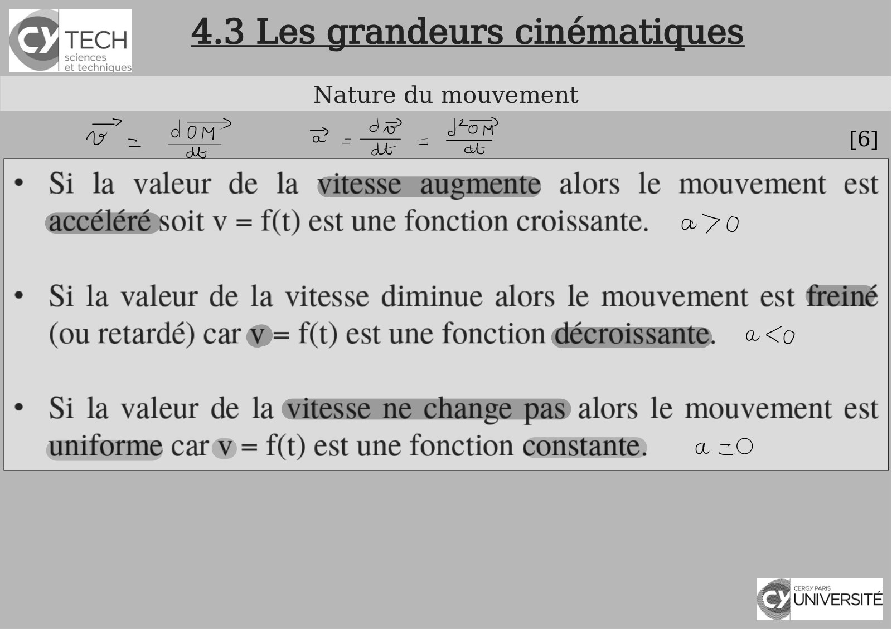

~~~text
4.3 Les grandeurs cinématiques
      Nature du mouvement
                                 [6]
~~~

**Lecture OCR à contrôler**

~~~text
(8) TECH 4.3 Les grandeurs cinématiques

Nature du mouvement
= dom” => _ 2 Jon
vz TE C= ye = ae [6]

¢ Si la valeur de la witesseqwawgmente alors le mouvement est
accélérésoit v = f(t) est une fonction croissante. a 7o

¢ Si la valeur de la vitesse diminue alors le mouvement est fréiné
(ou retardé) car W= f(t) est une fonction décroissante. «<o

* Si la valeur de la Gitessemetchangempas alors le mouvement est
uniforme car v = f(t) est une fonction constante: a =O

cy UNIVERSITÉ
~~~

## Page 64

~~~text
         4.3 Les grandeurs cinématiques
     Système de coordonnées cartésiennes - accélération
[6
]
~~~

## Page 65

~~~text
                    4.3 Les grandeurs cinématiques
                           Mouvements usuels
                                                     [6]

I Physique - 2020-2021
~~~

## Page 66

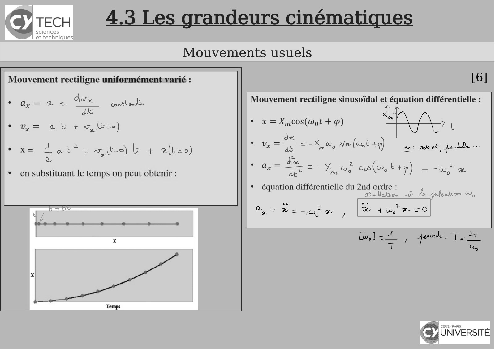

~~~text
4.3 Les grandeurs cinématiques
       Mouvements usuels
                                 [6]
~~~

**Lecture OCR à contrôler**

~~~text
(8) TECH 4.3 Les grandeurs cinématiques

Mouvements usuels

Mouvement rectiligne uniformément varié :

Ww
ee ey EE corre unke

* y= ab + w, ze)
ex= Age*4 wilt) b + afteo)

Ly

* en substituant le temps on peut obtenir :

[6]

a à — .

x

Temps

Mouvement rectiligne sinusoïdal et équation différentielle :

x
Xm V
* x =X,,cos(Wot + p) 74
. Br So, ain (at +9) ex weak, D …
ea, = 4% 2
ax” Fe 7 = Po co(e, +9) — és co
¢ équation différentielle du 2nd ordre : A
allo à Aa ylpabor WW,
ae Be ono! oe j | ee

emied a a
T° Co Gy,

cy UNIVERSITÉ
~~~

## Page 67

~~~text
4.3 Les grandeurs cinématiques
 Système de coordonnées cylindriques
~~~

## Page 68

~~~text
4.3 Les grandeurs cinématiques
 Système de coordonnées cylindriques
~~~

## Page 69

~~~text
4.3 Les grandeurs cinématiques
 Système de coordonnées cylindriques
~~~

## Page 70

~~~text
4.3 Les grandeurs cinématiques
  Système de coordonnées sphériques
~~~

## Page 71

~~~text
4.3 Les grandeurs cinématiques
  Système de coordonnées sphériques
~~~

## Page 72

~~~text
4.3 Les grandeurs cinématiques
  Système de coordonnées sphériques
~~~

## Page 73

~~~text
4.3 Les grandeurs cinématiques
  Système de coordonnées sphériques
~~~

## Page 74

~~~text
                                      Bibliographie


    [1] Polycopié de cours – Panorama sur la Physique, Chapitre 4, CY Tech


    [2] Maria Barbi - 1P001 Concepts et Methodes de la Physique - groupes MIPI


    [3] Richard Laffont - Cours de mécanique du point, EISTI.


    [4] David Sénéchal - Mécanique I - D. Senechal -PHQ114


    [5] Claude Pasquier - Mécanique


    [6] Présentation de Lucie Desplat (campus de Pau).


    [7] Khan Academy , Unisciel etc...
~~~
