# CM-Chapitre4-Cinematique_2024-2025_Physique1_P1S1_EDupont.pdf

[Ouvrir l’original](https://drive.google.com/open?id=1JRvzpveiDRpxFrTcqC7BOZEKGDK0mtRH) · Les pages signalées comprennent du texte reconnu automatiquement ou des éléments graphiques. Le fac-similé permet de vérifier chaque lecture.

**Pages avec fac-similé ou lecture OCR** — 25–28, 34–35, 38, 51–52, 69, 72.

## Page 1

~~~text
                                        Panorama sur la Physique

                                                Chapitre 4 – Cinématique

               I Physique - 2024-2025

Présentation rédigée par Émilie Dupont (Cergy) : emilie.dupont@cyu.fr, CY308
~~~

## Page 2

~~~text
                Programme de Panorama sur la Physique


    Chapitre 1 - Introduction


    Chapitre 2 - Introduction à la pensée scientifique


    Chapitre 3 - Optique : l’étude de la lumière


    Chapitre 4 – Cinématique : la description du mouvement


    Chapitre 5 - Mécanique
~~~

## Page 3

~~~text
                Programme de Panorama sur la Physique


    Chapitre 1 - Introduction


    Chapitre 2 - Introduction à la pensée scientifique


    Chapitre 3 - Optique : l’étude de la lumière


    Chapitre 4 – Cinématique : la description du mouvement


    Chapitre 5 - Mécanique
~~~

## Page 4

~~~text
             4.1.1 Nature et repérage de l’espace
                Qu’est-ce que la Cinématique ?

Du grec ancien Kinematikos = « mouvement »

                   Étude du mouvement,

        sans se soucier des causes qui le provoquent
~~~

## Page 5

~~~text
      4.1.1 Nature et repérage de l’espace
        Qu’est-ce que la Cinématique ?

[3]
~~~

## Page 6

~~~text
4.1.1 Nature et repérage de l’espace
  Qu’est-ce que la Cinématique ?
~~~

## Page 7

~~~text
      4.1.1 Nature et repérage de l’espace
        Qu’est-ce que la Cinématique ?

[3]
~~~

## Page 8

~~~text
4.1.1 Nature et repérage de l’espace
  Qu’est-ce que la Cinématique ?
~~~

## Page 9

~~~text
4.1.1 Nature et repérage de l’espace
 Position, vitesse, accélération … ?
~~~

## Page 10

~~~text
               4.1.1 Nature et repérage de l’espace
                 Position, vitesse, accélération … ?

1) Définition des vitesses et accélération (1D)

2) Mouvement rectiligne uniformément accéléré.
~~~

## Page 11

~~~text
4.1.1 Nature et repérage de l’espace
   Notion de point en physique

       Repérer un solide dans
       l’espace
~~~

## Page 12

~~~text
             4.1.1 Nature et repérage de l’espace
                  Notion de point en physique

              Mécanique des solides, un objet :
                      6 degrés de liberté

3 mouvements de translation            3 mouvements de rotation
    (directions x, y et z)            (autour des axes Ox, Oy et Oz)
~~~

## Page 13

~~~text
                  4.1.1 Nature et repérage de l’espace
                        Notion de point en physique

Étude en mécanique du point ⇒ simplifier le problème :

Passer de 6 degrés de liberté (6 inconnues) à 3 degrés de liberté (3 inconnues)
~~~

## Page 14

~~~text
                  4.1.1 Nature et repérage de l’espace
      Quand peut-on assimiler un système à un point matériel ?

Pas de réponse simple (cf. définition) : tout dépend si on peut

négliger son extension spatiale et sa rotation sur lui-même.

Exemple : mouvement orbital de la Terre autour du Soleil
~~~

## Page 15

~~~text
         4.1.1 Nature et repérage de l’espace
Quand peut-on assimiler un système à un point matériel ?
~~~

## Page 16

~~~text
                  4.1.2 Espace et temps
Grandeurs vectorielles : vecteur position, vitesse, accélération...
                                                                [2]
~~~

## Page 17

~~~text
             4.1.2 Espace et temps
      Que fait le ballon de basket en chute libre ?
[2]
~~~

## Page 18

~~~text
               4.1.2 Espace et temps
      Vitesse et accélération : grandeurs algébriques
[2]
~~~

## Page 19

~~~text
                4.1.2 Espace et temps
      Si la balle rebondit, elle monte puis elle descend.
[2]
~~~

## Page 20

~~~text
                4.1.2 Espace et temps
      Si la balle rebondit, elle monte puis elle descend.
[2]
~~~

## Page 21

~~~text
                4.1.2 Espace et temps
      Si la balle rebondit, elle monte puis elle descend.
[2]
~~~

## Page 22

~~~text
                               4.1.2 Espace et temps
                                Mouvement d’un point M

Étudier la trajectoire de M :


    Repère d’espace :


    Repère de temps :

      I Physique - 2020-2021
~~~

## Page 23

~~~text
                  4.1.2 Espace et temps
               Repérage d’un point dans l’espace

- mouvement possède un caractère relatif :

         Principe de la relativité du mouvement (Galilée)

- Mécanique newtonienne :

       Espace physique = Espace euclidien à 3 dimensions

   =
~~~

## Page 24

~~~text
  4.1.3 Repérage spatial
Repérage d’un point dans l’espace
~~~

## Page 25

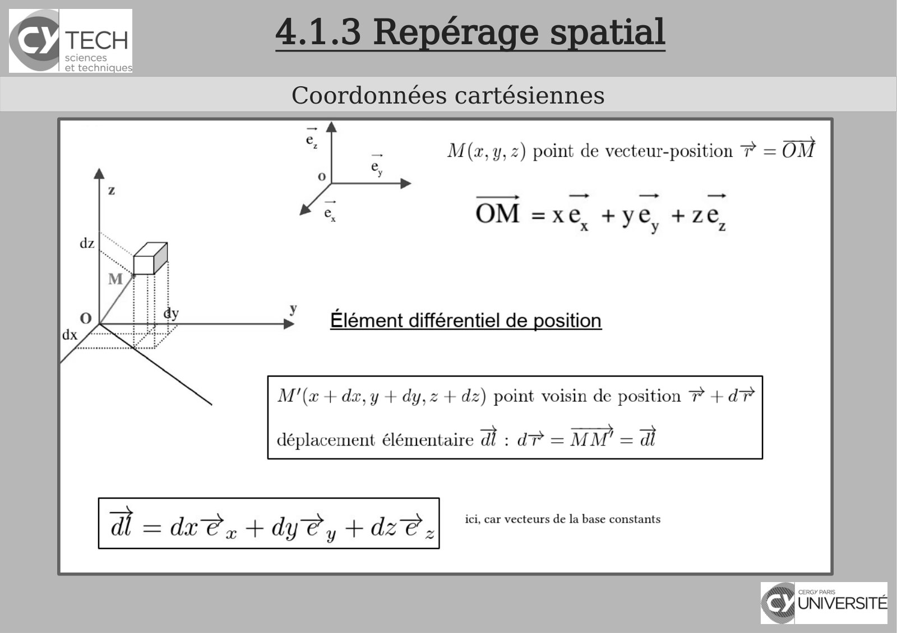

~~~text
4.1.3 Repérage spatial
Coordonnées cartésiennes
~~~

**Lecture OCR à contrôler**

~~~text
Icy TECH

sciences
et technique:

Coordonnées cartésiennes

M(z,y,2) point de vecteur-position 7 = OM

OM =xe, +ye, +ze,

” Élément différentiel de position

M'(a + dx, y + dy, + dz) point voisin de position P +d?

déplacement élémentaire ad: d?=MM =a

a _ die » + dy@y + die, ici, car vecteurs de la base constants

BH eros
inverse
~~~

## Page 26

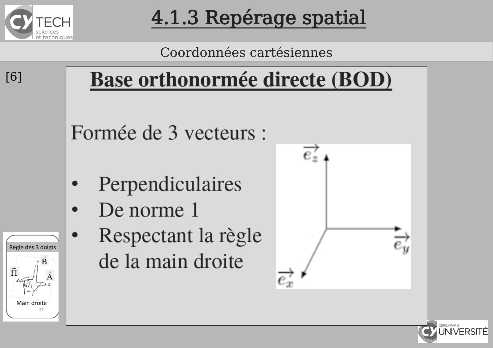

~~~text
      4.1.3 Repérage spatial
      Coordonnées cartésiennes
[6]
~~~

**Lecture OCR à contrôler**

~~~text
SY TECH 4.1.3 Repérage spatial
Coordonnées cartésiennes

[6] Base orthonormée directe (BOD)

Formée de 3 vecteurs :

~
LA

¢ Perpendiculaires

° Denorme |

* Respectant la règle / =,
de la main droite

TA UNIVERSITÉ
~~~

## Page 27

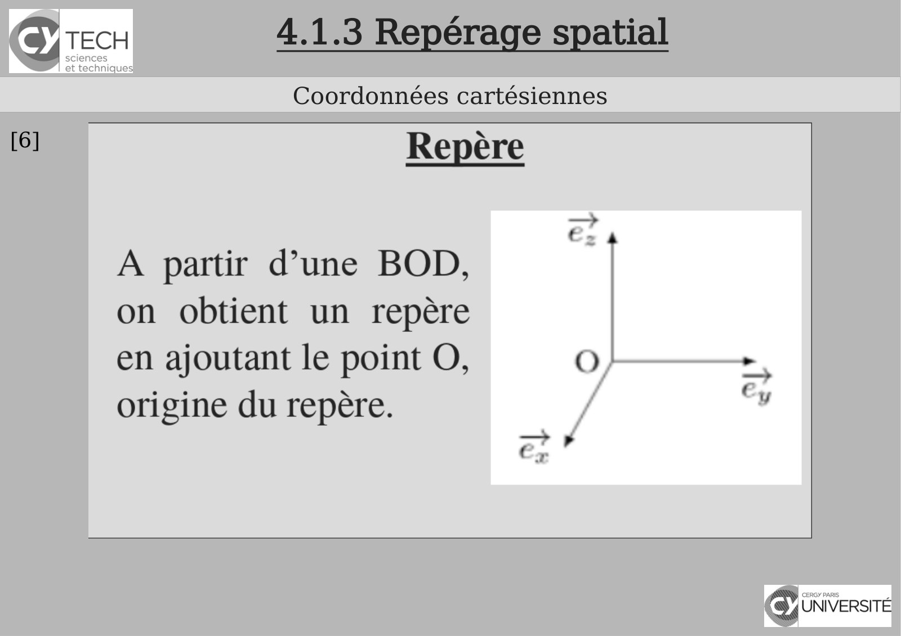

~~~text
      4.1.3 Repérage spatial
      Coordonnées cartésiennes
[6]
~~~

**Lecture OCR à contrôler**

~~~text
Coordonnées cartésiennes

Repère

A partir d’une BOD,
on obtient un repère

en ajoutant le point O,
origine du repère.

| pi

S

\ UNIVERSITÉ
ll
~~~

## Page 28

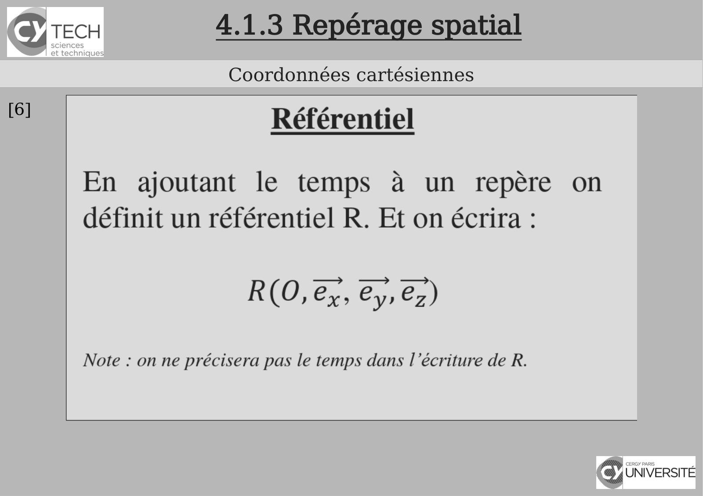

~~~text
      4.1.3 Repérage spatial
      Coordonnées cartésiennes
[6]
~~~

**Lecture OCR à contrôler**

~~~text
(Sy TECH 4.1.3 Repérage spatial

Coordonnées cartésiennes

[6] Référentiel

~

En ajoutant le temps à un repère on
définit un référentiel R. Et on écrira :

R(O, 2, 2, 2)

Note : on ne précisera pas le temps dans l'écriture de R.

UNIVERSITÉ
~~~

## Page 29

~~~text
    4.1.3 Repérage spatial
      Coordonnées cylindriques
Bien adapté pour repérer un point sur un cylindre
~~~

## Page 30

~~~text
                         4.1.3 Repérage spatial
                          Coordonnées cylindriques

I Physique - 2020-2021
~~~

## Page 31

~~~text
                         4.1.3 Repérage spatial
                          Coordonnées cylindriques

I Physique - 2020-2021
~~~

## Page 32

~~~text
                         4.1.3 Repérage spatial
                          Coordonnées cylindriques

I Physique - 2020-2021
~~~

## Page 33

~~~text
                         4.1.3 Repérage spatial
                          Coordonnées cylindriques

I Physique - 2020-2021
~~~

## Page 34

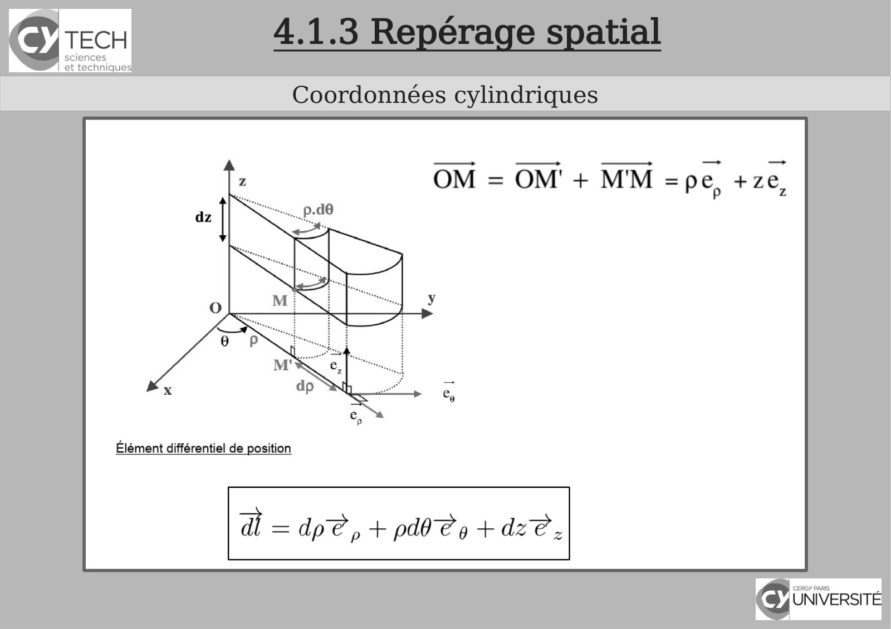

~~~text
4.1.3 Repérage spatial
 Coordonnées cylindriques
~~~

**Lecture OCR à contrôler**

~~~text
Coordonnées cylindriques

Élément différentiel de position

À = dpe, + pd Cy + dz?

BH ores
inverse
~~~

## Page 35

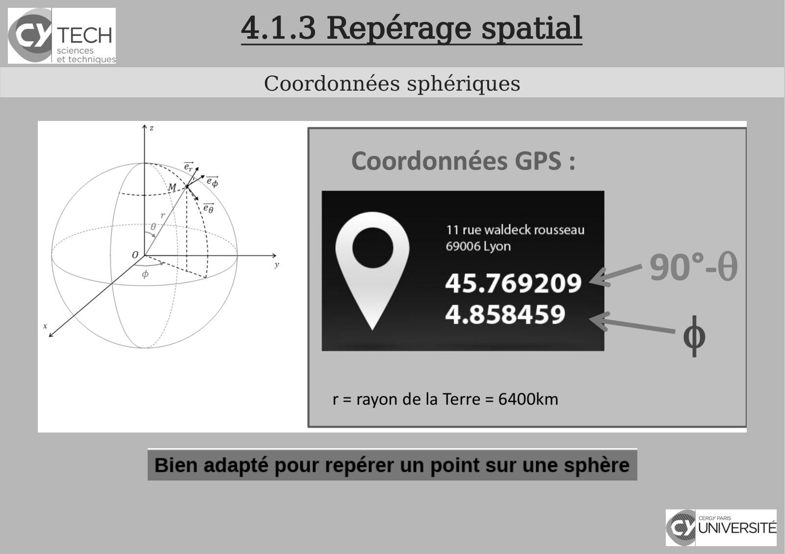

~~~text
4.1.3 Repérage spatial
 Coordonnées sphériques
~~~

**Lecture OCR à contrôler**

~~~text
(SY TECH 4.1.3 Repérage spatial

Coordonnées sphériques

Coordonnées GPS :

11 rue waldeck rousseau
69006 Lyon

45.769209 #
4.858459

r= rayon de la Terre = 6400km

{& UNIVERSITÉ
~~~

## Page 36

~~~text
                         4.1.3 Repérage spatial
                          Coordonnées sphériques

I Physique - 2020-2021
~~~

## Page 37

~~~text
                         4.1.3 Repérage spatial
                         Coordonnées intrinsèques

I Physique - 2020-2021
~~~

## Page 38

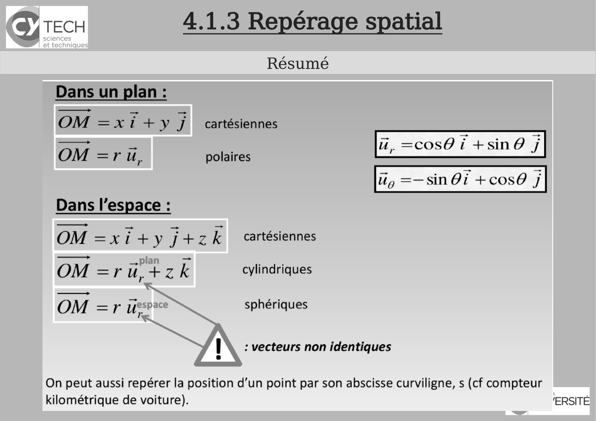

~~~text
                         4.1.3 Repérage spatial
                                Résumé

I Physique - 2020-2021
~~~

**Lecture OCR à contrôler**

~~~text
SY TECH 4.1.3 Repérage spatial

Résumé
Dans un plan :

OM =Xi+7y J  cartésiennes

=p = ui. =cos0 i +sin @ j
OM =ru, polaires - 1

Ug =—sin Oi +cos0 j

Dans l’espace :
OM =x i+ y De 7 k cartésiennes

OM =ru.+zk cylindriques
Tr
—ry sphériques
OM =r ue pneriq
IN : vecteurs non identiques

On peut aussi repérer la position d’un point par son abscisse curviligne, s (cf compteur

kilométrique de voiture). 'ERSITE
~~~

## Page 39

~~~text
                        4.1.4 Produit scalaire et vectoriel
                                       ?

En Mécanique, on modélise les mouvements et leurs causes, les forces,
par des vecteurs.

Afin de résoudre les problèmes de Mécanique, d’Électromagnétisme
etc… , on a besoin de projeter les vecteurs sur des directions particulières
en utilisant les produits scalaires.

En présence de rotations, on utilise également le produit vectoriel, ce qui
sera un cas rencontré souvent en Électromagnétisme 1 et 2 lors qu’on
s’intéressera au champ magnétique.
      I Physique - 2020-2021
~~~

## Page 40

~~~text
      4.2.1 Produit scalaire et vectoriel
        Calcul vectoriel - Relation de Chasles
[6]
~~~

## Page 41

~~~text
      4.2.1 Produit scalaire et vectoriel
         Calcul vectoriel - Le produit scalaire
[6]
~~~

## Page 42

~~~text
                  4.1.4 Produit scalaire et vectoriel
                         Produit scalaire de deux vecteurs

I Physique - 2020-2021
~~~

## Page 43

~~~text
      4.2.1 Produit scalaire et vectoriel
         Calcul vectoriel - Le produit scalaire
[6]
~~~

## Page 44

~~~text
                        4.2.1 Produit scalaire et vectoriel
                               Calcul vectoriel - Le produit vectoriel
[6]

      I Physique - 2020-2021
~~~

## Page 45

~~~text
                  4.1.4 Produit scalaire et vectoriel
                         Produit vectoriel de deux vecteurs

I Physique - 2020-2021
~~~

## Page 46

~~~text
4.1.4 Produit scalaire et vectoriel
    Produit vectoriel : orientation...
~~~

## Page 47

~~~text
4.1.4 Produit scalaire et vectoriel
    Produit vectoriel : orientation...
~~~

## Page 48

~~~text
                  4.1.4 Produit scalaire et vectoriel
       Propriétés du produit scalaire et du produit vectoriel

I Physique - 2020-2021
~~~

## Page 49

~~~text
                  4.1.4 Produit scalaire et vectoriel
       Propriétés du produit scalaire et du produit vectoriel

I Physique - 2020-2021
~~~

## Page 50

~~~text
      4.2.1 Produit scalaire et vectoriel
         Calcul de produits vectoriels utiles
[6]
~~~

## Page 51

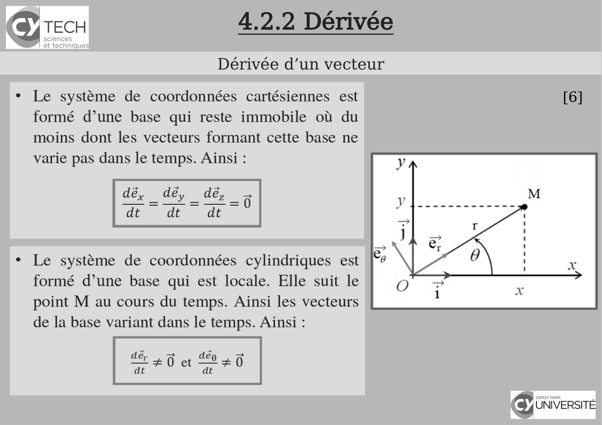

~~~text
  4.2.2 Dérivée
Dérivée d’un vecteur

                       [6]
~~~

**Lecture OCR à contrôler**

~~~text
| TECH 4.2.2 Dérivée

Dérivée d’un vecteur

Le système de coordonnées cartésiennes est [6]
formé d’une base qui reste immobile où du
moins dont les vecteurs formant cette base ne
varie pas dans le temps. Ainsi :

dé, _ déy - dé,
‘dt dt dt

Le système de coordonnées cylindriques est
formé d’une base qui est locale. Elle suit le
point M au cours du temps. Ainsi les vecteurs
de la base variant dans le temps. Ainsi :

ae ate

+0 et +0

ED) cnr paris ”
cy UNIVERSITÉ
~~~

## Page 52

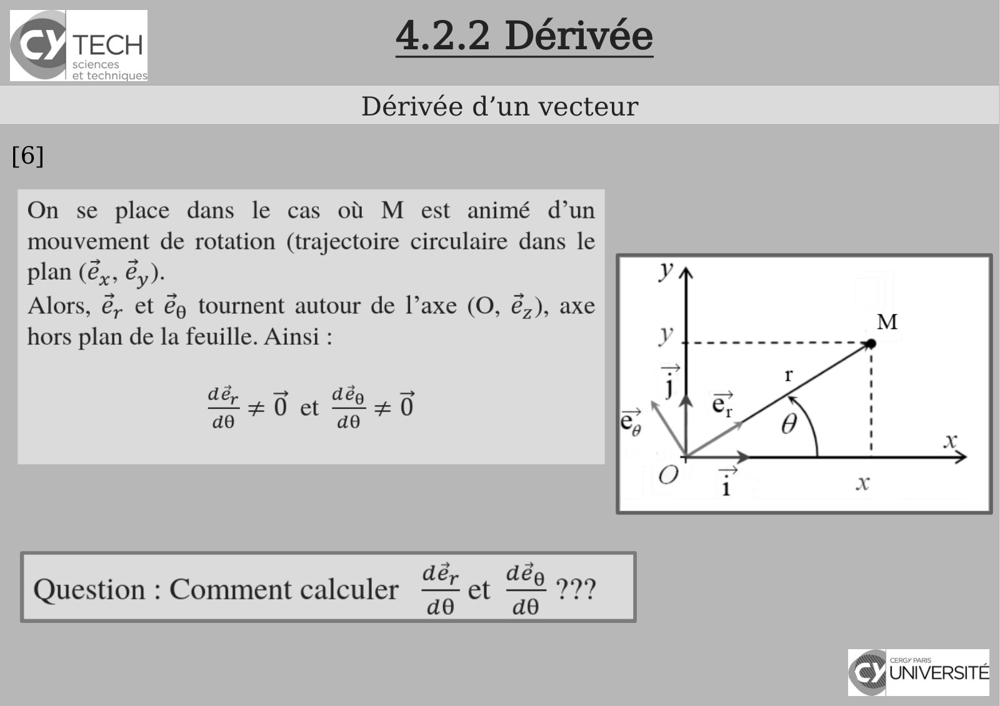

~~~text
        4.2.2 Dérivée
      Dérivée d’un vecteur
[6]
~~~

**Lecture OCR à contrôler**

~~~text
Icy TECH

sciences
et technique:

Dérivée d’un vecteur

On se place dans le cas où M est animé d’un
mouvement de rotation (trajectoire circulaire dans le
plan (é,, é,).

Alors, &, et &) tournent autour de l’axe (O, &,), axe
hors plan de la feuille. Ainsi :

LE 40 et Le

dé, En dée 999

Question : Comment calculer FLE

CE
(Rés
~~~

## Page 53

~~~text
                           4.2.2 Dérivée
                         Dérivée d’un vecteur
                                                [6]

I Physique - 2020-2021
~~~

## Page 54

~~~text
                           4.2.2 Dérivée
                         Dérivée d’un vecteur
                                                [6]

I Physique - 2020-2021
~~~

## Page 55

~~~text
                           4.2.2 Dérivée
                         Dérivée d’un vecteur
                                                [6]

I Physique - 2020-2021
~~~

## Page 56

~~~text
   Qu’est-ce qu’une trajectoire ?
Vitesse et accélération : grandeurs algébriques
~~~

## Page 57

~~~text
           Qu’est-ce qu’une trajectoire ?
      Si la balle rebondit, elle monte puis elle descend.
[2]
~~~

## Page 58

~~~text
           Qu’est-ce qu’une trajectoire ?
      Si la balle rebondit, elle monte puis elle descend.
[2]
~~~

## Page 59

~~~text
           Qu’est-ce qu’une trajectoire ?
      Si la balle rebondit, elle monte puis elle descend.
[2]
~~~

## Page 60

~~~text
      Grandeurs vectorielles : vitesse...
           Qu’est-ce qu’un déplacement ?
[2]
~~~

## Page 61

~~~text
      Grandeurs vectorielles : vitesse...
           Qu’est-ce qu’un déplacement ?
[2]
~~~

## Page 62

~~~text
                              Scalaire ou vecteurs ?
                             Qu’est-ce qu’un déplacement ?

                    Introduction aux vecteurs et aux scalaires

https://fr.khanacademy.org/math/be-4eme-secondaire2/x213a6fc6f6c9e122:geometrie-vectorielle/x213a6fc6f
6c9e122:les-bases-vecteurs/v/introduction-to-vectors-and-scalars

                                                                                              [7]
~~~

## Page 63

~~~text
      4.3 Les grandeurs cinématiques
       Système de coordonnées cartésiennes

[6]
~~~

## Page 64

~~~text
4.3 Les grandeurs cinématiques
 Système de coordonnées cartésiennes
                                       [6]
~~~

## Page 65

~~~text
4.3 Les grandeurs cinématiques
 Système de coordonnées cartésiennes
                                       [6]
~~~

## Page 66

~~~text
    4.3 Les grandeurs cinématiques
Système de coordonnées cartésiennes - Trajectoires
                                                     [6]
~~~

## Page 67

~~~text
       4.3 Les grandeurs cinématiques
      Système de coordonnées cartésiennes - vitesse

[6]
~~~

## Page 68

~~~text
       4.3 Les grandeurs cinématiques
      Système de coordonnées cartésiennes - vitesse
[6]
~~~

## Page 69

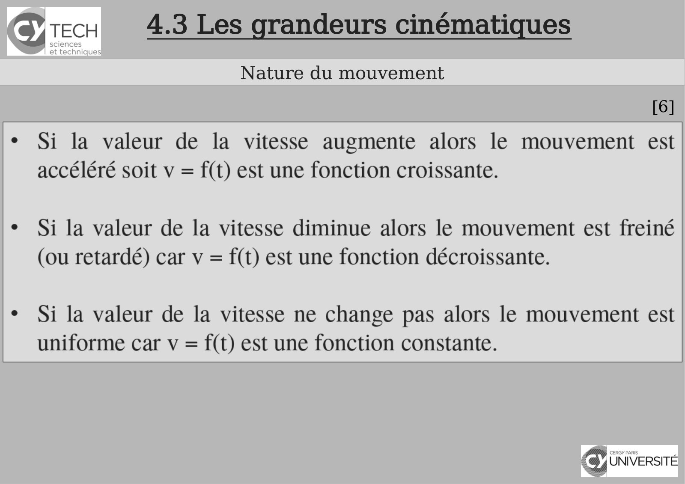

~~~text
4.3 Les grandeurs cinématiques
      Nature du mouvement
                                 [6]
~~~

**Lecture OCR à contrôler**

~~~text
@'recx 4.3 Les grandeurs cinématiques

Nature du mouvement

[6]

* Si la valeur de la vitesse augmente alors le mouvement est
accéléré soit v = f(t) est une fonction croissante.

¢ Si la valeur de la vitesse diminue alors le mouvement est freiné
(ou retardé) car v = f(t) est une fonction décroissante.

+ Si la valeur de la vitesse ne change pas alors le mouvement est
uniforme car v = f(t) est une fonction constante.

UNIVERSITÉ
~~~

## Page 70

~~~text
         4.3 Les grandeurs cinématiques
     Système de coordonnées cartésiennes - accélération
[6
]
~~~

## Page 71

~~~text
                    4.3 Les grandeurs cinématiques
                           Mouvements usuels
                                                     [6]

I Physique - 2020-2021
~~~

## Page 72

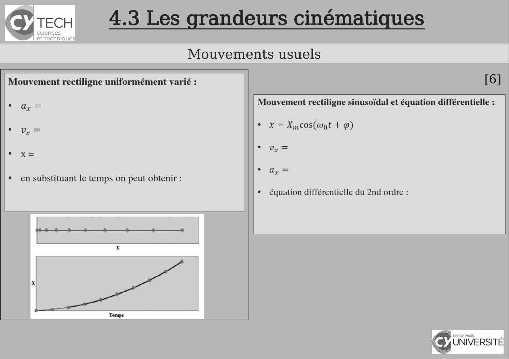

~~~text
4.3 Les grandeurs cinématiques
       Mouvements usuels
                                 [6]
~~~

**Lecture OCR à contrôler**

~~~text
@'recx 4.3 Les grandeurs cinématiques

Mouvements usuels

Mouvement rectiligne uniformément varié :

° ay =
=
* x=

* en substituant le temps on peut obtenir :

[6]

a + + 4

x

Temps

Mouvement rectiligne sinusoidal et équation différentielle :
° x =X,,cos(Wot + p)

RC —

0 =

¢ équation différentielle du 2nd ordre :

UNIVERSITÉ
~~~

## Page 73

~~~text
4.3 Les grandeurs cinématiques
 Système de coordonnées cylindriques
~~~

## Page 74

~~~text
4.3 Les grandeurs cinématiques
 Système de coordonnées cylindriques
~~~

## Page 75

~~~text
4.3 Les grandeurs cinématiques
 Système de coordonnées cylindriques
~~~

## Page 76

~~~text
4.3 Les grandeurs cinématiques
  Système de coordonnées sphériques
~~~

## Page 77

~~~text
4.3 Les grandeurs cinématiques
  Système de coordonnées sphériques
~~~

## Page 78

~~~text
4.3 Les grandeurs cinématiques
  Système de coordonnées sphériques
~~~

## Page 79

~~~text
4.3 Les grandeurs cinématiques
  Système de coordonnées sphériques
~~~

## Page 80

~~~text
                                      Bibliographie


    [1] Polycopié de cours – Panorama sur la Physique, Chapitre 4, CY Tech


    [2] Maria Barbi - 1P001 Concepts et Methodes de la Physique - groupes MIPI


    [3] Richard Laffont - Cours de mécanique du point, EISTI.


    [4] David Sénéchal - Mécanique I - D. Senechal -PHQ114


    [5] Claude Pasquier - Mécanique


    [6] Présentation de Lucie Desplat (campus de Pau).


    [7] Khan Academy , Unisciel etc...
~~~
