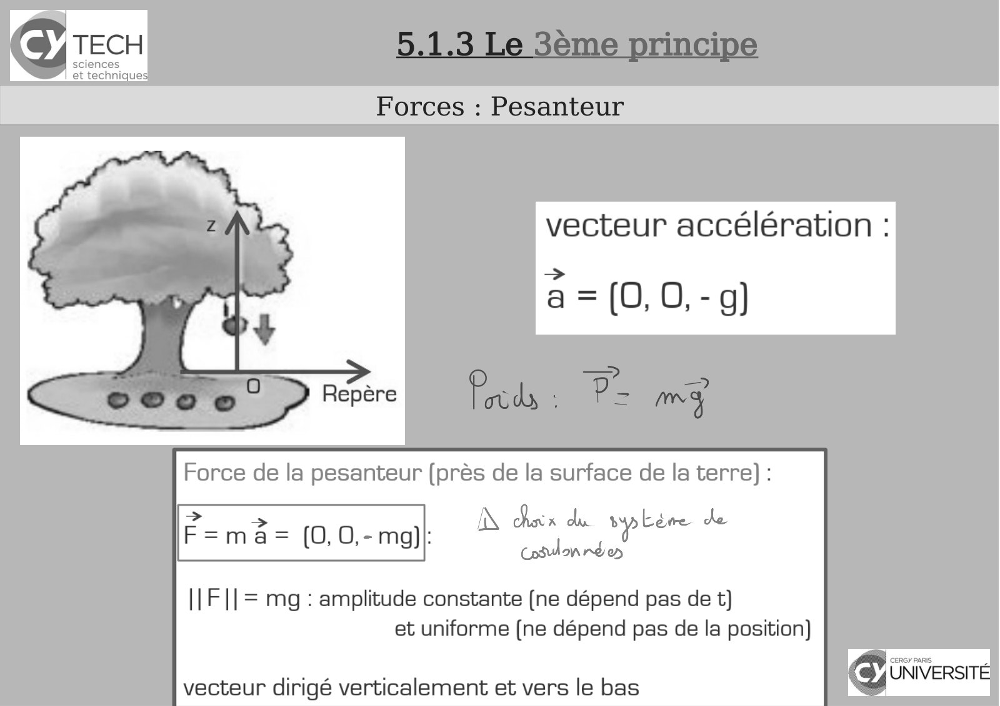
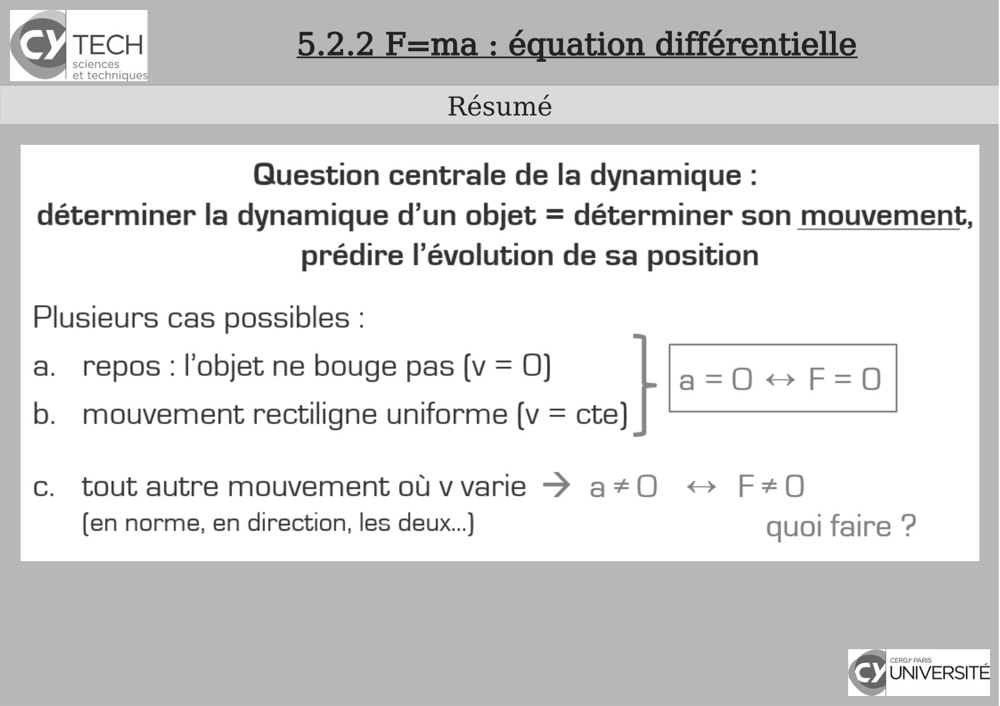

# CM-Chapitre5-Mecanique_2023-2024_Physique1_P1S1_EDupont.pdf

[Ouvrir l’original](https://drive.google.com/open?id=1bynRftYDTORQXwfWA2XbkoUNzTbdmTSM) · Les pages signalées comprennent du texte reconnu automatiquement ou des éléments graphiques. Le fac-similé permet de vérifier chaque lecture.

**Pages avec fac-similé ou lecture OCR** — 15, 26.

## Page 1

~~~text
                                        Panorama sur la Physique

                                                  Chapitre 5 – Mécanique
                                 5.1 Les 3 principes fondamentaux de la dynamique
                                                5.2 F=ma : équation différentielle

               I Physique - 2023-2024

Présentation rédigée par Émilie Dupont (Cergy) : emilie.dupont@cyu.fr, CY308
~~~

## Page 2

~~~text
                               Programme de Panorama sur la Physique

●   Chapitre 1 - Introduction
●   Chapitre 2 - Introduction à la pensée scientifique
●   Chapitre 3 - Optique : l’étude de la lumière
●   Chapitre 4 – Cinématique : la description du mouvement
●   Chapitre 5 - Mécanique

      I Physique - 2021-2022
~~~

## Page 3

~~~text
                Programme de Panorama sur la Physique

●   Chapitre 1 - Introduction
●   Chapitre 2 - Introduction à la pensée scientifique
●   Chapitre 3 - Optique : l’étude de la lumière
●   Chapitre 4 – Cinématique : la description du mouvement
●   Chapitre 5 - Mécanique
~~~

## Page 4

~~~text
     5.1.1 Des référentiels pas comme les autres : le 1er
                           principe
Référentiels en mouvement relatif : composition des vitesses
   https://www.youtube.com/watch?v=ZzF73XtFiTo
~~~

## Page 5

~~~text
      5.1.1 Des référentiels pas comme les autres : le 1er
                            principe
 Référentiels en mouvement relatif : composition des vitesses

1. Le comportement physique d’un objet dans un
référentiel donné ne permet pas de dire si ce
référentiel est fixe ou en translation avec vitesse
constante.
C’est un principe de la physique.

2. Un même mouvement vu depuis deux référentiels en
mouvement relatif n’est pas le même.
Comment déduire l’un de l’autre ?
Changements de référentiel.
~~~

## Page 6

~~~text
5.1.1 Des référentiels pas comme les autres : le 1er
                      principe
         Changements de référentiel
~~~

## Page 7

~~~text
5.1.1 Des référentiels pas comme les autres : le 1er
                      principe
         Changements de référentiel
~~~

## Page 8

~~~text
             5.1.1 Des référentiels pas comme les autres : le 1er
                                   principe
                              Questions

  Un oiseau et un avion volent dans la
  même direction.
  Par rapport au sol, la vitesse de
  l’oiseau est V, celle de l’avion v.

  Quelle est la vitesse de l’avion vue
  par l’oiseau!?

Quelle est la vitesse de
l’avion vue par l’oiseau!?
~~~

## Page 9

~~~text
                 5.1.1 Des référentiels pas comme les autres : le 1er
                                       principe
                                 Questions

masse qui tombe sur un chariot qui se
déplace à vitesse V :
quelle est la vitesse horizontale de la
masse par rapport au sol ?

     I Physique - 2020-2021
~~~

## Page 10

~~~text
       5.1.1 Des référentiels pas comme les autres : le 1er
                             principe
                 Principe de relativité de Galilée

Principe de relativité de Galilée : Les lois de la mécanique sont
identiques dans tous les référentiels inertiels.

Mais c’est quoi un référentiel inertiel ?

1er principe ou PRINCIPE D’INERTIE : Il existe une classe
de référentiels en translation uniforme les uns par rapport
aux autres, appelés galiléens ou inertiels, dans lesquels
tout point matériel isolé (c’est à dire sur lequel s’exerce
une résultante des forces nulle) est soit au repos soit en
translation rectiligne uniforme.

c’est quoi, cette force qui doit être nulle!? c’est quoi un
système isolé!?
~~~

## Page 11

~~~text
       5.1.2 Le 2nd principe comme définition (dynamique)
                            de la force
2nd principe ou PRINCIPE FONDAMENTAL DE LA DYNAMIQUE

INTERACTION :
deux systèmes physiques (objets) peuvent interagir =
influencer chacun l’état de l’autre (et notamment son état
de mouvement)

système isolé : suffisamment éloigné de tout pour ne pas interagir

2nd principe :
Dans un référentiel inertiel un corps de masse m constante subit
une accélération proportionnelle à la résultante des forces
extérieures qui s’exercent sur lui et inversement proportionnelle
à sa masse m :
                              ou
~~~

## Page 12

~~~text
                          FILM : un test en apesanteur

http://www.nasa.gov/audience/foreducators/diypodcast/nl-video-index.html
~~~

## Page 13

~~~text
            5.1.3 Le 3ème principe
Lois de la dynamique : questions ouvertes

         équilibre des forces,
  action et réaction (3ème principe)
~~~

## Page 14

~~~text
         5.1.3 Le 3ème principe
       Forces : Pesanteur

Expériences :
• chute de 2 masses différentes
• tube de Newton
~~~

## Page 15

~~~text
 5.1.3 Le 3ème principe
Forces : Pesanteur
~~~

**Lecture OCR à contrôler**

~~~text
Icy TECH

sciences
et techniques

Forces : Pesanteur

vecteur accélération :

a =(0,0,-g)

Force de la pesanteur (près de la surface de la terre):
=
F=ma= (0,0,-mg)|:

|| F || = mg: amplitude constante (ne dépend pas de t)
et uniforme (ne dépend pas de la position)

GO itiversre
a : UNIVERSITÉ
vecteur dirigé verticalement et vers le bas <”
~~~

## Page 16

~~~text
                            5.1.3 Le 3ème principe
                          Forces : Pesanteur

  Mais :

G = 6,67 10-11 S.I.!

   r12 = rterre + h ≈ rterre si h << rterre = 6400 km
~~~

## Page 17

~~~text
                         5.1.3 Le 3ème principe
                           Équilibre

                              EQUILIBRE = objet au repos :

I Physique - 2020-2021
~~~

## Page 18

~~~text
                          5.1.3 Le 3ème principe
                        Question Flash Card

Une pomme est posée sur un
train qui voyage
à vitesse constante.
La pomme est-elle au repos ?

    A. OUI
    B. NON
    C. La question est mal posée
~~~

## Page 19

~~~text
       5.1.3 Le 3ème principe
          Équilibre

    Diagramme Objet Interaction (DOI)

  faire l'inventaire de tous les objets concernés
➢ faire l'inventaire de toutes les interactions
➢

entre objets :

• interactions directes dites de contact :
trait plein
• interactions indirectes dites à distance :
trait pointillé
➢ entourer sur le diagramme le système étudié.
~~~

## Page 20

~~~text
   5.1.3 Le 3ème principe
      Équilibre

Schéma :
indiquer tous les vecteurs forces
La masse est au repos
~~~

## Page 21

~~~text
                                   5.1.3 Le 3ème principe
                                        Énoncé

REM : On ne parle pas d’équilibre, cette relation est toujours réalisée, même s’il y a une
dynamique !
~~~

## Page 22

~~~text
                                 5.1.3 Le 3ème principe
                   Action et réaction : Exemple : patineurs

https://www.youtube.com/watch?feature=player_detailpage&v=WvExCwm_ThE

    Le patineur de gauche pèse 72 kg, tandis que le patineur
    de droite pèse 95 kg.

    Puisqu'il y a action-réaction, la force appliquée aux deux
    patineurs est équivalente. Donc, il est normal que le
    patineur de 95 kg parcourra une distance moindre.
~~~

## Page 23

~~~text
                                   5.2.1 Le ressort
                           La force d’un ressort

Force exercée par un ressort :

où Δx = allongement = x – x0
x0 longueur au repos (ressort non étiré ni comprimé)
donc:

          direction opposée à Δx

k = constante de raideur du ressort (dépend du ressort considéré)

                            REM : aussi en compression
~~~

## Page 24

~~~text
      5.2.1 Le ressort
La force d’un ressort

dynamomètre : un ressort étalonné
pour mesurer des forces

   Force :

   Dimensions :
   [F] = [ma] = ?

   Unité : Newton (N)
   1N=?
   [k] = ?
~~~

## Page 25

~~~text
      5.2.1 Le ressort
La force d’un ressort

dynamomètre

   Force :

   Dimensions :
   [F] = [ma] = M L T-2

   Unité : Newton (N)
   1 N = 1kg x 1m x (1s)-2
   [k] = M T-2
~~~

## Page 26

~~~text
5.2.2 F=ma : équation différentielle
         Résumé
~~~

**Lecture OCR à contrôler**

~~~text
Icy TECH

sciences
et techniques

Résumé

Question centrale de la dynamique :
déterminer la dynamique d’un objet = déterminer son mouvement,
prédire l’évolution de sa position

Plusieurs cas possibles :

repos : l'objet ne bouge pas [v = QO)

mouvement rectiligne uniforme (v = cte)

tout autre mouvement où v varie > a#0 «+ F+0
(en norme, en direction, les deux...) quoi faire ?

LA 0200
Œiniversre
~~~

## Page 27

~~~text
            5.2.2 F=ma : équation différentielle
          Question centrale de la dynamique

déterminer la dynamique d’un objet = déterminer son
                     mouvement,
       prédire l’évolution de sa position : x(t)

   équation différentielle du second ordre à résoudre
              pour obtenir la fonction x(t)
~~~

## Page 28

~~~text
          5.2.2 F=ma : équation différentielle
        Exemple 1 : ressort en mouvement

                       Animation
(depuis le site «!Figures animées pour la physique!»)
               Question : déterminer x(t)
~~~

## Page 29

~~~text
 5.2.2 F=ma : équation différentielle
Exemple 1 : ressort en mouvement
~~~

## Page 30

~~~text
5.2.2 F=ma : équation différentielle
 Exemple 2 : ressort vertical

                        Animation
 (depuis le site «!Figures animées pour la physique!»)
                Question : déterminer x(t)
~~~

## Page 31

~~~text
5.2.2 F=ma : équation différentielle
 Exemple 2 : ressort vertical
~~~

## Page 32

~~~text
                                      Bibliographie


    [1]Polycopié de cours


    [2] Maria Barbi - 1P001 Concepts et Methodes de la Physique - groupes MIPI


    [3] David Sénéchal - Mécanique I - D. Senechal -PHQ114


    [4] Claude Pasquier - Mécanique


    [5] pour la suite : Khan Academy , Unisciel etc...
~~~
