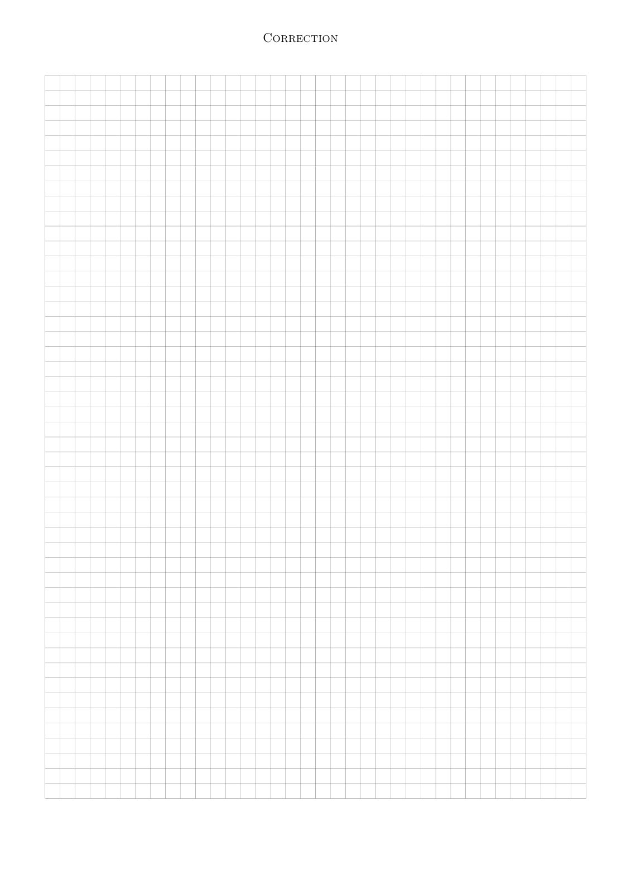

# Rattrapage-2023-2024-Correction_Physique1-CC_P1S1_DPhysique.pdf

[Ouvrir l’original](https://drive.google.com/open?id=1NaiJuNdSFkp8v3tXYr9PuwASkQkZx7us) · Les pages signalées comprennent du texte reconnu automatiquement ou des éléments graphiques. Le fac-similé permet de vérifier chaque lecture.

**Pages avec fac-similé ou lecture OCR** — 14.

## Page 1

~~~text
                                        Correction

                                      Rattrapage
                                Panorama sur la Physique
                                07 Février 2024 — PréIng1

                   Durée : 1 heure 30 min (2 heures en cas de tiers temps)
Sont interdits :
  — les documents ;
  — tous les objets électroniques (téléphone, tablette, ordinateur...) de même que les montres
      connectées ;
  — les déplacements et les échanges.
Consignes :
   1. Vérifiez que le sujet est composé de 16 pages et 21 questions ;
   2. Seules les dernières feuilles doivent être rendues ;
   3. Complétez la page 9 (nom, prénom etc. . .) dès le début officiel de l’épreuve ;
   4. Les détails des calculs demandés doivent être portés sur ces dernières feuilles à l’empla-
      cement correspondant à la question ;
   5. Dans la grille, la case correspondant à la bonne réponse doit être remplie complètement
      au stylo noir ;
   6. Chaque question ne comporte qu’une seule réponse possible ;
   7. Il n’y a de point négatif pour une mauvaise réponse que pour les questions de cours ;
   8. Une case simplement cochée ne sera pas comptabilisée.

             Seule une calculatrice collège est autorisée
                            Le barème est donné à titre indicatif.
~~~

## Page 2

~~~text
                                           Correction

                         Lentille divergente (6 points)
Une allumette de longueur 5, 00 cm est placée à 10, 00 cm d’une lentille divergente mince de
distance focale f 1 “ ´30 cm et de centre O.
Pour déterminer la position de l’image, on doit utiliser la relation de conjugaison liant la position
de l’objet OA et celle de l’image OA1 . Elle s’écrit :
Question 1 (1 point)
       1       1      1
  A        ´       “
      OA1 OA         f1
       1       1      1
  B        `       “
      OA1 OA         f1
         1       1      1
  C ´        `       “ 1
       OA  1    OA      f
         1       1      1
  D ´        ´       “ 1
       OA  1    OA      f
    E Aucune des réponses précédentes n’est correcte.
Question 2 (1 point)
On en déduit que l’image est telle que :

    A OA1 “ ´15 cm et elle est virtuelle.
    B OA1 “ `7, 5 cm et elle est réelle.
    C OA1 “ ´7, 5 cm et elle est virtuelle.
    D OA1 “ `15 cm et elle est réelle.
    E Aucune des réponses précédentes n’est correcte.
Question 3 (2 points)
Le grandissement transversale γ et la taille de l’image sont donc :

    A γ “ ´1, 5 et A1 B 1 “ ´7, 6 cm.
    B γ “ `1, 5 et A1 B 1 “ `7, 6 cm.
    C γ “ `0, 75 et A1 B 1 “ `3, 8 cm.
    D γ “ ´0, 75 et A1 B 1 “ ´3, 8 cm.
    E Aucune des réponses précédentes n’est correcte.
Question 4 (2 points)
Faire la construction sur les feuilles quadrillées, à la fin. Vous prendrez l’échelle 1 : 2.
Répondez sur la feuille correspondante, à la fin du sujet.
~~~

## Page 3

~~~text
                                          Correction

                    Trajectoire d’un oiseau (7 points)
Pour suivre la trajectoire d’un point M , on a besoin des coordonnées de ce point dans un des
systèmes de coordonnées, puis parfois de les exprimer dans un autre des systèmes de coordon-
nées. Aussi :
Question 5 (0.5 point)
en deux dimensions, les coordonnées cartésiennes x et y peuvent s’exprimer en fonction des
coordonnées polaires par la formule :

    A x “ r cos θ et y “ r sin θ
    B x “ r sin θ et y “ r cos θ
    C x “ r et y “ r tan θ
    D Aucune des réponses précédentes n’est correcte.
Question 6 (1 point)
De plus, en coordonnées cylindriques, le vecteur déplacement élémentaire de M s’écrit :
       # »
    A dOM “ dr #»
               u r ` rdθ #»
                          u θ ` dz #»
                                   uz
       # »
    B dOM “ dr #»
               u r ` rdθ #»
                          u θ ` r sin θdφ #»
                                          uφ
       # »
    C dOM “ dr #»
               u r ` dθ #»
                        u θ ` dz #»
                                  uz
    D Aucune des réponses précédentes n’est correcte.
Question 7 (0.5 point)
Ce point M a pour coordonnées cartésiennes : M “ pb, 0q avec b ă 0.
Ses coordonnées polaires sont données par :

    A rB “ ´b et θB “ π                                D rB “ b2 et θB “ 3π
                                                                          2
           ?
    B rB “ b et θB “ 0                                 E Aucune des réponses précédentes n’est
    C   rB “ b et θB “ π2                                correcte.

Maintenant, on veut suivre la trajectoire d’un oiseau dans le référentiel terrestre R T approximé
galiléen.
Cet oiseau volant vers l’est (axe x) parcourt 100 m à une vitesse moyenne vx1 “ 10 m{s. Il fait
ensuite demi-tour et vole pendant 15 s à une vitesse moyenne |vx2 | “ 20 m{s.
On oriente l’axe des x vers l’est, avec l’origine à la position de départ de l’oiseau.

Question 8 (1 point)
L’intervalle de temps Δt1 avant de faire demi-tour vaut :

    A Δt1 “ 0,1 s                                      D Δt1 “ 0,2 s
    B Δt1 “ 5 s                                        E Aucune des réponses précédentes n’est
    C Δt1 “ 10 s                                         correcte.
~~~

## Page 4

~~~text
                                        Correction

Question 9 (1 point)
Dans la deuxième partie du parcours, la distance parcourue vaut :

   A d “ 200 m                                      D d “ 100 m
    B d “ 300 m                                     E Aucune des réponses précédentes n’est
    C d “ 150 m                                       correcte.

Question 10 (1 point)
Sur tout le parcours, la vitesse scalaire moyenne v vaut donc :

   A v “ 16 m{s                                     D v “ 4 m{s
    B v “ 8 m{s                                     E Aucune des réponses précédentes n’est
    C v “ 12 m{s                                      correcte.

Question 11 (1 point)
Le déplacement (donc algébrique) total Δx vaut :

   A Δx “ 300 m                                     D Δx “ ´200 m
    B Δx “ 200 m                                    E Aucune des réponses précédentes n’est
    C Δx “ ´100 m                                     correcte.

Question 12 (1 point)
La vitesse moyenne de l’oiseau vxmoy vaut alors :

   A vxmoy “ ´8 m{s                                 D vxmoy “ ´12 m{s
    B vxmoy “ 8 m{s                                 E Aucune des réponses précédentes n’est
    C vxmoy “ 12 m{s                                  correcte.
~~~

## Page 5

~~~text
                                           Correction

                 Engin militaire : Trébuchet (8 points)
L’analyse dimensionnelle est un outil puissant pour résoudre un problème de physique. On va
s’intéresser ici au Trébuchet.
C’est un engin militaire et pièce d’artillerie médiévale à contrepoids. Il s’agit d’une arme de
siège utilisée au Moyen-âge pour détruire la maçonnerie des murs d’enceinte ou pour lancer
toutes sortes de projectiles par-dessus les remparts et fortifications d’un château fort.

Dans le référentiel terrestre RT approximé galiléen, on considèrera la masse m représentée par
le point M . Initialement elle part au niveau du sol.
                                                                                            Ñ
                                                                                            Ý
Sa position initiale est alors confondue avec l’origine O du repère. Et sa vitesse initiale V 0 , de
norme V0 “ 50 m.s´1 , est inclinée par rapport à l’horizontal d’un angle α “ 45˝ .
Lors de sa trajectoire, on supposera que la masse est en chute libre dans le champ de pesanteur.
Pour l’étude du mouvement, on définit un repère pOxyq avec l’axe pOxq horizontal orienté dans
le sens du mouvement, l’axe pOyq vertical orienté vers le haut et l’origine O fixée à la position
initiale de la masse.
Donnée : g “ 10 m.s´2

Question 13 (0.5 point)
Les dimensions d’une accélération sont :

    A L ¨ T´1                                          D M ¨ L ¨ T´2
    B M ¨ L ¨ T´1                                      E Aucune des réponses précédentes n’est
    C L ¨ T´2                                            correcte.

Question 14 (1 point)
Les unités SI d’une force sont :

    A m ¨ s´1                                          D kg ¨ m ¨ s´2
    B kg ¨ m ¨ s´1                                     E Aucune des réponses précédentes n’est
    C m¨s   ´2                                           correcte.
~~~

## Page 6

~~~text
                                         Correction

Question 15 (0.5 point)
Un angle est une grandeur

    A avec une dimension mais sans unité.            D sans dimension et donc sans unité.
    B sans dimension mais avec une unité.            E Aucune des réponses précédentes n’est
    C sans unité donc sans dimension.                  correcte.

Question 16 (2 points)
Par une analyse dimensionnelle, exprimer la portée d, distance maximale atteinte par le pro-
jectile, en fonction de deux paramètres du problème.
Répondez sur la feuille correspondante, à la fin du sujet.
Question 17 (4 points)
Donner les équations horaires xptq et yptq. Puis en déduire l’expression de d.
Répondez sur la feuille correspondante, à la fin du sujet.
~~~

## Page 7

~~~text
                                            Correction

                 Deux lentilles convergentes (7 points)
Deux lentilles L1 et L2 convergentes de distances focales f11 “ `0, 30 m, f21 “ `0, 50 m sont
distantes de 0, 20 m. L1 a pour centre O1 et L2 a pour centre O2 (O1 O2 “ 0, 20 m).
Un petit objet AB se trouve sur l’axe principal à 0, 50 m devant la première lentille.
Question 18 (1 point)
L’image intermédiaire A1 B1 se situe donc à la distance :

    A O1 A1 “ ´0, 1875 m
    B O1 A1 “ ´0, 75 m
    C O1 A1 “ `0, 75 m
    D O1 A1 “ `0, 1875 m
    E Aucune des réponses précédentes n’est correcte.
Question 19 (2 points)
En appliquant à la deuxième lentille la formule de conjugaison, on peut en déduire la position
de l’image définitive A1 B 1 par rapport à L2 . On trouve :

    A O2 A1 “ ´0, 26 m et elle est virtuelle.
    B O2 A1 “ `0, 3 m et elle est réelle.
    C O2 A1 “ ´0, 3 m et elle est virtuelle.
    D O2 A1 “ `0, 26 m et elle est réelle.
    E Aucune des réponses précédentes n’est correcte.
Question 20 (1 point)
Si F11 et F2 sont confondus alors :

    A l’image d’un objet à l’infini se forme nécessairement sur le plan focal objet de L 1 .
    B l’image d’un objet à l’infini se forme nécessairement sur le plan focal image de L 2 .
    C l’image d’un objet à l’infini est virtuelle.
    D l’image d’un objet à l’infini est à l’infini.
    E Aucune des réponses précédentes n’est correcte.
Question 21 (3 points)
Faire la construction sur les feuilles quadrillées, à la fin. Vous prendrez l’échelle 1 : 10.
Répondez sur la feuille correspondante, à la fin du sujet.
~~~

## Page 8

~~~text
                                  Correction

Les réponses au QCM ne doivent être apportées que sur cette feuille.
La copie ne sera corrigée que si :
  — elle comporte vos nom, prénom et groupe ;
  — les cases sont complètement coloriées avec un stylo noir ;
  — la feuille-réponse ne comporte pas de ratures.

Question 1 : A    B   C D   E
Question 2 : A    B   C D   E
Question 3 : A    B   C D   E
Question 5 : A    B   C D
Question 6 : A    B   C D
Question 7 : A    B   C D   E
Question 8 : A    B   C D   E
Question 9 : A    B   C D   E
Question 10 : A   B   C D    E
Question 11 : A   B   C D    E
Question 12 : A   B   C D    E
Question 13 : A   B   C D    E
Question 14 : A   B   C D    E
Question 15 : A   B   C D    E
Question 18 : A   B   C D    E
Question 19 : A   B   C D    E
Question 20 : A   B   C D    E
~~~

## Page 9

~~~text
               Correction

Question 4 :    Lentille divergente .5 .5 1   Réservé à l’enseignant(e)
~~~

## Page 10

~~~text
                Correction

Question 16 :           Portée d   .5 .5 1   Réservé à l’enseignant(e)
~~~

## Page 11

~~~text
                                   Correction

Question 17 :   Équations horaires et expression de d   .5 .5 1   2   Réservé à l’enseignant(e)
~~~

## Page 12

~~~text
                         Correction

Question 21 :   Deux lentilles convergentes .5 .5 1   1   Réservé à l’enseignant(e)
~~~

## Page 13

~~~text
                           Correction

Feuille supplémentaire - (indiquer le numéro de la question rédigée)
~~~

## Page 14

~~~text
Correction
~~~

**Lecture OCR à contrôler**

~~~text
CORRECTION
~~~
