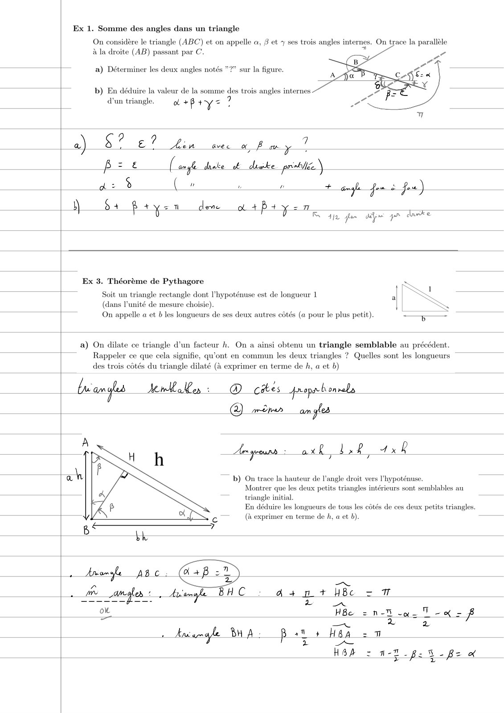
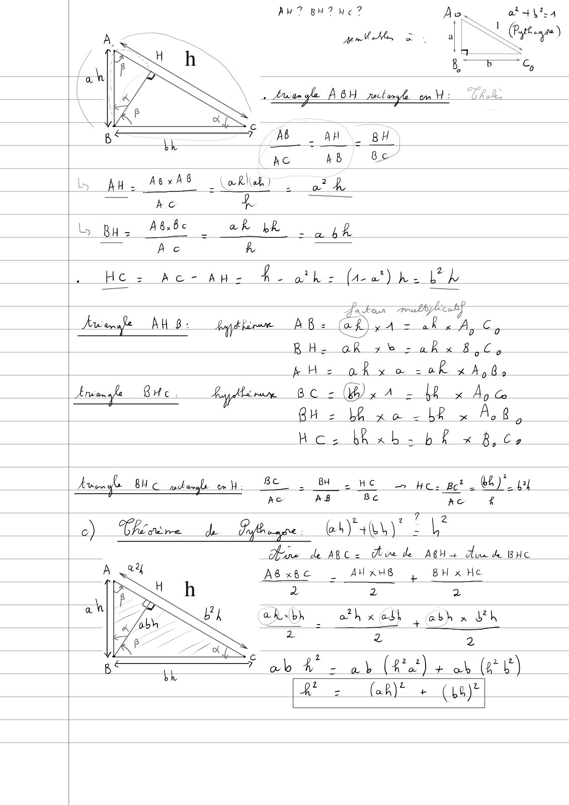
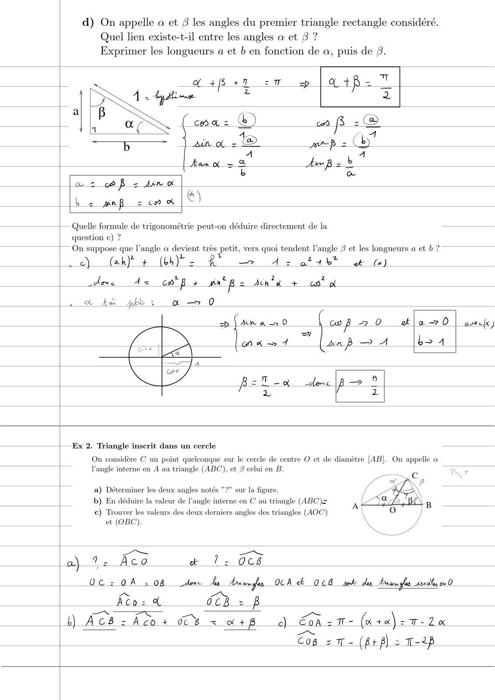
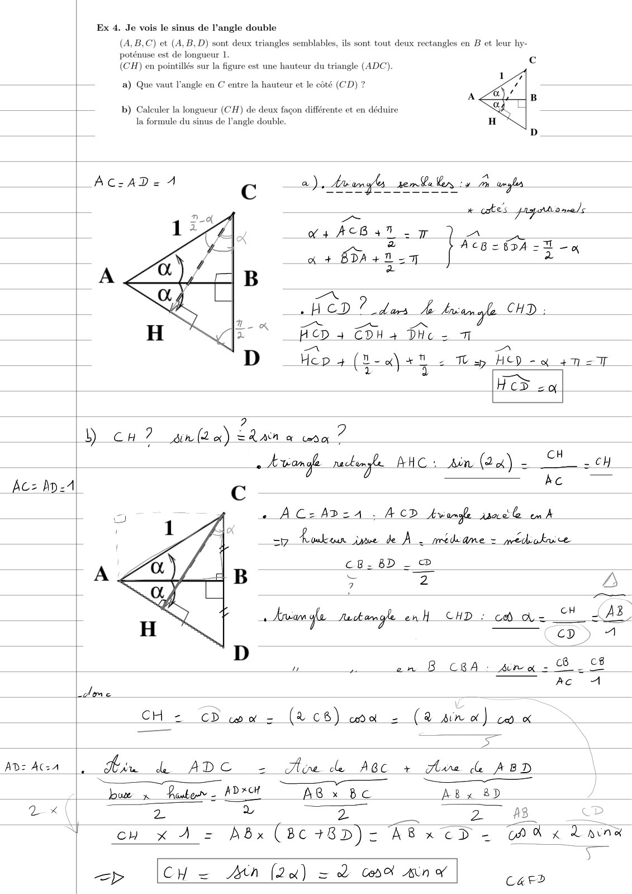
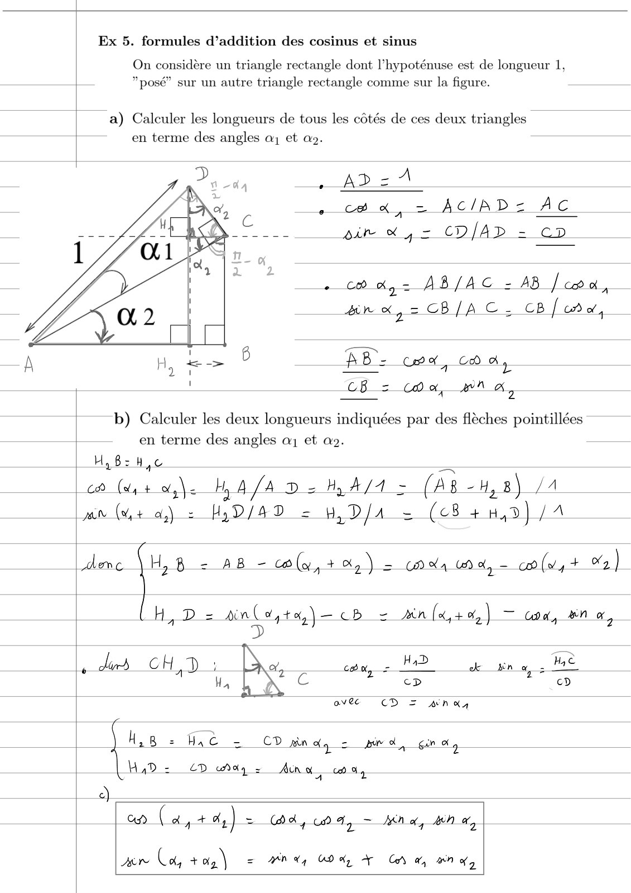
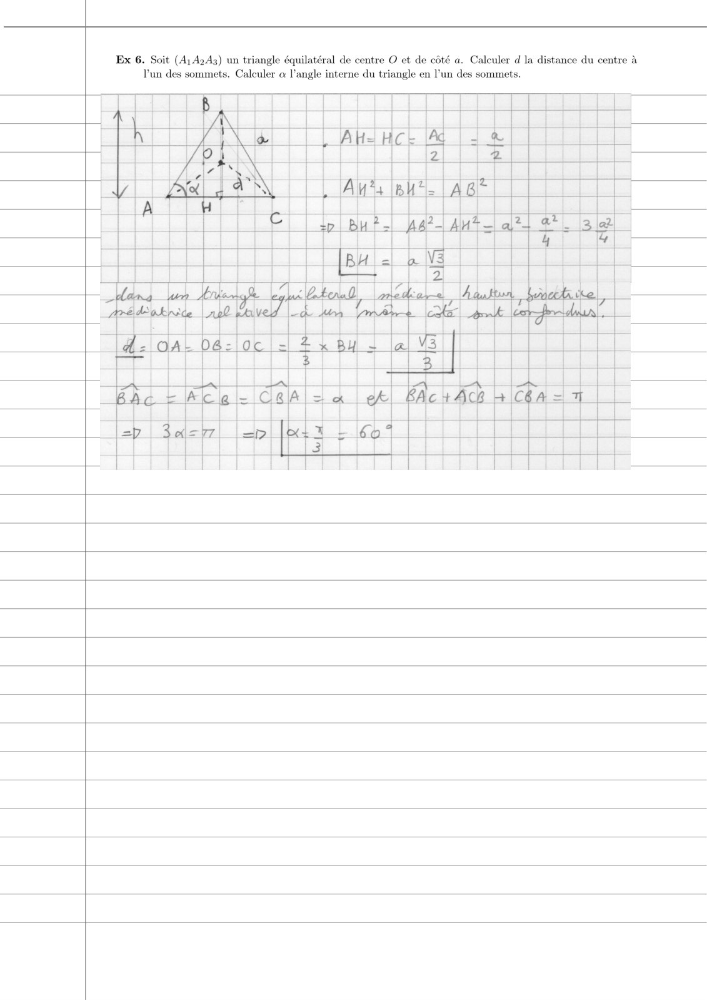

# TD2-Geometrie-Correction_2023-2024_Physique1_P1S1_EDupont.pdf

[Ouvrir l’original](https://drive.google.com/open?id=1Kzu_h-fpaTvtT_VoO2O39yRycI7yJgNc) · Les pages signalées comprennent du texte reconnu automatiquement ou des éléments graphiques. Le fac-similé permet de vérifier chaque lecture.

**Pages avec fac-similé ou lecture OCR** — 1–6.

## Page 1

**Lecture OCR à contrôler**

~~~text
Ex 1. Somme des angles dans un triangle

On considère le triangle (ABC) et on appelle a, 8 et + ses trois angles internes. On trace la parallèle
à la droite (AB) passant par C. 7

a) Déterminer les deux angles notés ”?” sur la figure.

b) En déduire la valeur de la somme des trois angles internes
d'un triangle. gf +B += 7

a) $? 2? Hib ver x Pm

B= (ot hate t demke print.)

a: 2 (_» L ä + ange fou 2 fou)

\ $4 $ +yen deme of +P + Y-

7 :
Rain fe ape pm dawke

Ex 3. Théorème de Pythagore

Soit un triangle rectangle dont l'hypoténuse est de longueur 1 a
(dans l'unité de mesure choisie).
On appelle a et b les longueurs de ses deux autres côtés (a pour le plus petit).

a) On dilate ce triangle d’un facteur h. On a ainsi obtenu un triangle semblable au précédent.
Rappeler ce que cela signifie, qu'ont en commun les deux triangles ? Quelles sont les longueurs
des trois côtés du triangle dilaté (à exprimer en terme de h, a et b)

fu amas knbales : D ces p-opahonrels
OR om gles

Aegean : axk 1 8 4x8

b) On trace la hauteur de l'angle droit vers I’
Montrer que les deux petits triangles intérieu
triangle initial.

En déduire les longueurs de tous les côtés de ces deux petits triangles.
(à exprimer en terme de h, a et b). —

poténuse.
sont semblables au
~~~

## Page 2

**Lecture OCR à contrôler**

~~~text
Aw? BH? uc? Ae a +14

: SL pre)
gente En i À SR
Bb GC
Aran gle ABH rectum H: 24,

Ac AB Be

pa ALAS atlas LR
a Ac fq —

5 Bue Abbe : ak LR =: 48
Ace A

He: Ac- awe Ae othe (at) he Lh

akan ratte

Ananas AM 8: ph AG: ay A = RAC,

oO
BH. oR xb» >akx B,C,

k Hie okxo -0R xh, 8,

Eran le Buc Rd nacre, BC = (GB) x A = [Pg Ae a

8H: Lh xo bk x AB,
Ho. bhRub- bh x B,C,

Ariege ONC pbm ooh BO, BY HE» he: ct. WA)".
5 Ac ASB €

AC À

0) Than de Ppegpe. eur)" = |

fine de ARCs ue de pena duck Bue

ABxBe _ AUxu8 | BH x He
a 2 2
EUX : a? x od, Es abh x dk
pe 2 2

Fol hw wi (Bat) oe ty GE)

RE 2 Ch + (Lay
~~~

## Page 3

**Lecture OCR à contrôler**

~~~text
d) On appelle a et B les angles du premier triangle rectangle considéré.
Quel lien existe-t-il entre les angles a et B ?

Exprimer les longueurs a et b en fonction de a, puis de 8.

| (sper sm oy |UtPp= 7
4. Lu z 2
a
| coa: b) ro -@
— ih _} aun of _® mp = (by
A 4
tan oo = & Hp z à
b œ
az of - sin x
ee ew a |)
= n§ = cn

| Quelle formule de trigonométrie peut-on déduire directement de la
question c) ?

1—On suppose que l'angle a devient très petit, vers quoi tendent l'angle B et les longueurs a et b ?
2. +

s c) Ch} + th) 2 À — A = ot +b*

dme A=

Æ (à)

cp + wn’ B= Ath à + an* à

2 tk kw bles à — 0

| sp | An a 0 A 7 0 et | a 7 0 | ok)
IS =
(on à = 4

(ap 2A boa

RET ae done |B — d

+—Ex 2. Triangle inscrit dans un cercle

On considère Cun point quelconque sur le cercle de centre O et de diamètre [AB]. On appelle a
l'angle interne en A au triangle (ABC), et 8 celui en B.

a) Déterminer les deux angles notés

sur la figure.

à C au triangle (ABC)z

c) Trouver les valeurs des deux derniers angles des triangles (AOC)
| et (OBC).

b) En déduire la valeur de l’angle inti

a) 1: Keo al. Oc8
OC. 0A 2046 dene ky tee OCA & ae en oa on O
oC 2p
= a+, c) Soa 2 T- (x +0) - 4-20

Piel
Cop = tr - (Bt fp) = T-2h
~~~

## Page 4

**Lecture OCR à contrôler**

~~~text
Ex 4. Je vois le sinus de l’angle double

(A, B,C) et (A, B, D) sont deux triangles semblables, ils sont tout deux rectangles en B et leur hy-
poténuse est de longueur 1.
(CH) en pointillés sur la figure est une hauteur du triangle (ADC).

a) Que vaut l'angle en C entre la hauteur et le côté (CD) ?

L_ b) Calculer la longueur (CH) de deux façon différente et en déduire
la formule du sinus de l'angle double.

| AczAD=4

| HCD? das À tne

TK 2 =

En HCD + CDH +

wt
| D Hep + (12 4 at
CE j —
Hed 2a
7 9

cH? gn (ea) tan à oro’

cz Mp. C

«Arrange mdeyle AAC: Ain (24) = CH cH
46 —

« ACzAD=4 , ACD kvorghe waéle enh
sy Route jme de À | prideame = médiokuce

CB. BD -®

7 2 2

—

———~ C ed a
n a wns (8 CRA air a = 8 _ C8
AC A

dome

CH = CD was (268) ma 2 (2 ain à) co à
ane _—

AD: ACzA

L

Kx

— Aix bk ADC 2 Ace de AGC + Ave ABD

Re
Joux x fautes. AD XH AB x BC AB x 8D
2: ol 2 2. 48

cn x A = Abx (BC +BD) = Re xcD = ch À x Lane
a —

<p CH = Ath (2a) = 2 Cope An w exe
~~~

## Page 5

**Lecture OCR à contrôler**

~~~text
Ex 5. formules d’addition des cosinus et sinus
On considère un triangle rectangle dont l’hypoténuse est de longueur 1,

?posé” sur un autre triangle rectangle comme sur la figure.

a) Calculer les longueurs de tous les côtés de ces deux triangles
en terme des angles aj et ag.

. AD = À
. ce à, = ACIAD= AC
bir w ,- CD/AD = cp

. co a,= AB/AC - AB Ja,
wrx, = CB/AC. CB [cn à,

ao
AB - Ha, Cou,

CB = Ca, wi à,

b) Calculer les deux longueurs indiquées par des flèches pointillées
en terme des angles a et a2.
H,8:H ae

a (v4 + à, hy A ADs HA/AA - (AR -H 8) A
JAN (+ ay) = H9/49 = W, D/A = (<8 +H,d} (A

donc \H,B = AB - caly,+%,) = aa Woy = co (v4 o% )

H, D = dino, ta,) = cb = sn (x,40,) = an à
D
, dis CHAD: D CA con, = HD x ne, Me
Hy mS G cD cD
: ovee CD = NK,
[lise me = CD pin dy = pir gain of
H4D = cd Aq = Ana, PRE

0)

oN (a, +) = BA, Fy = KN of, Bhar, |

Ain Ca, +0) = MN, OD dy Cow, OM wD
~~~

## Page 6

**Lecture OCR à contrôler**

~~~text
Ex 6. Soit (414243) un triangle équilatéral de centre O et de côté a. Calculer d la distance du centre à
Tun des sommets. Calculer a l'angle interne du triangle en l’un des sommets.

| |

k At :
a | He Hc Ae = +

of \ [Als But | AB

p | BH À- 2 AW al*4 -3#
~~~
