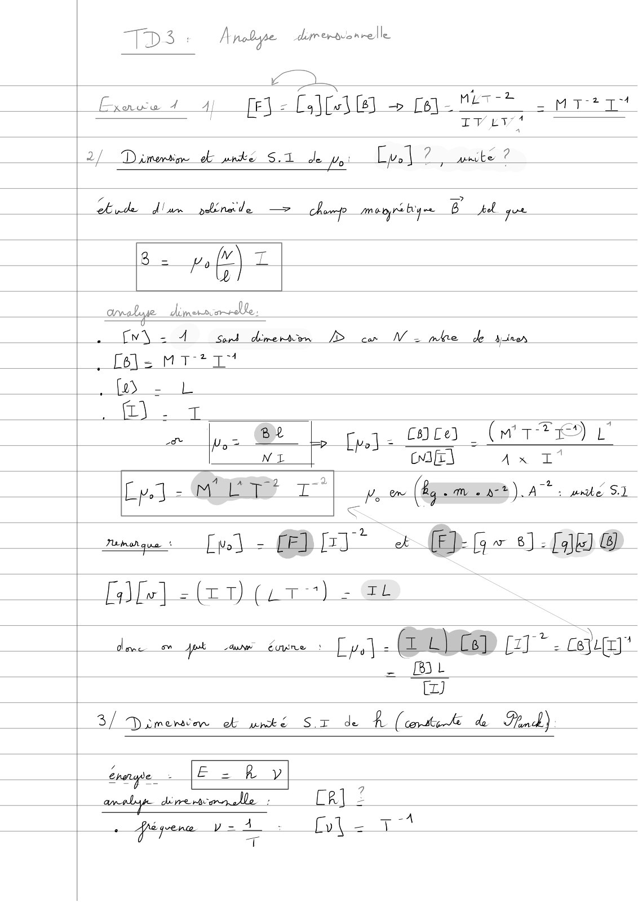
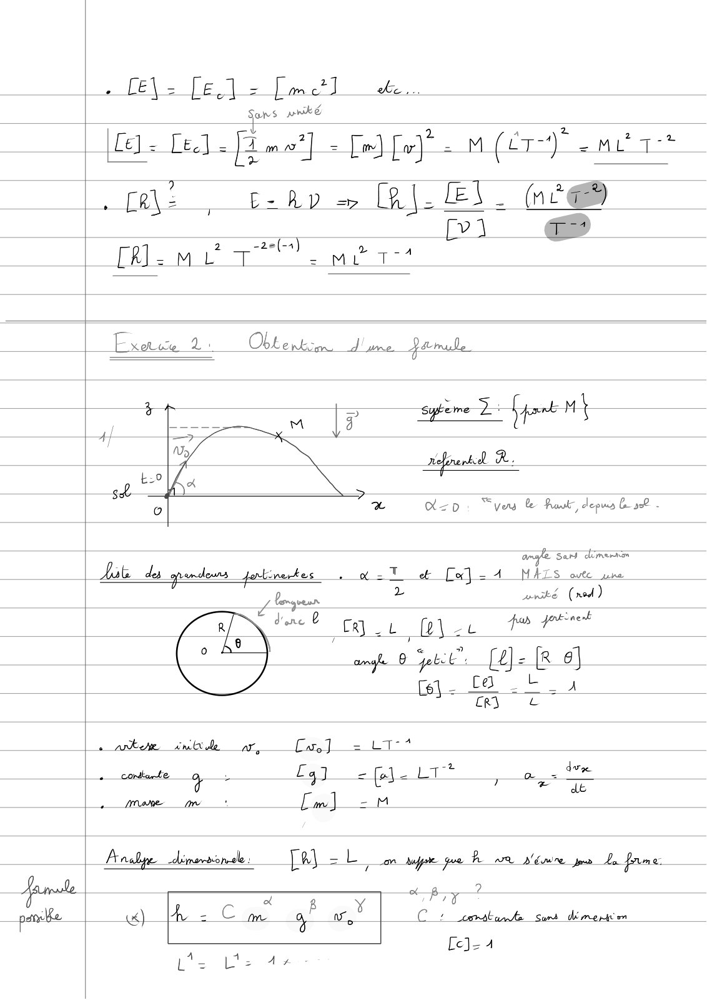
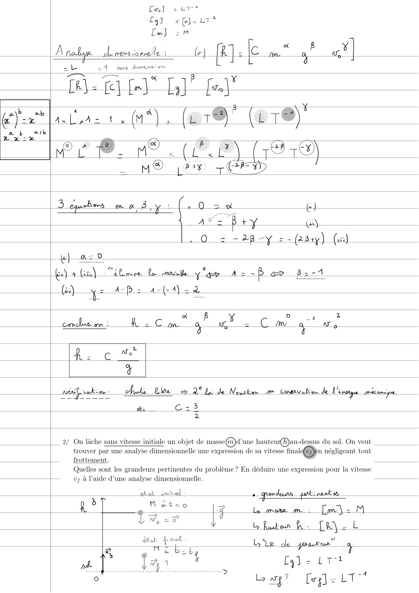
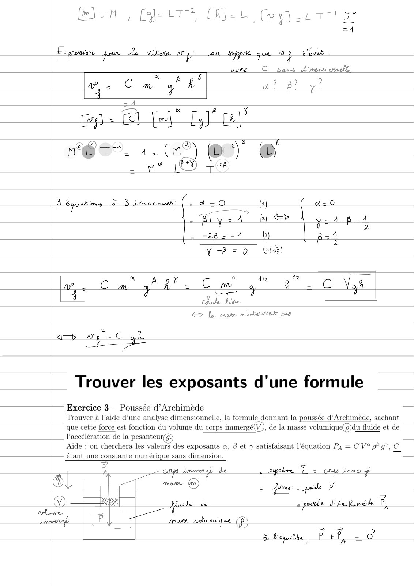
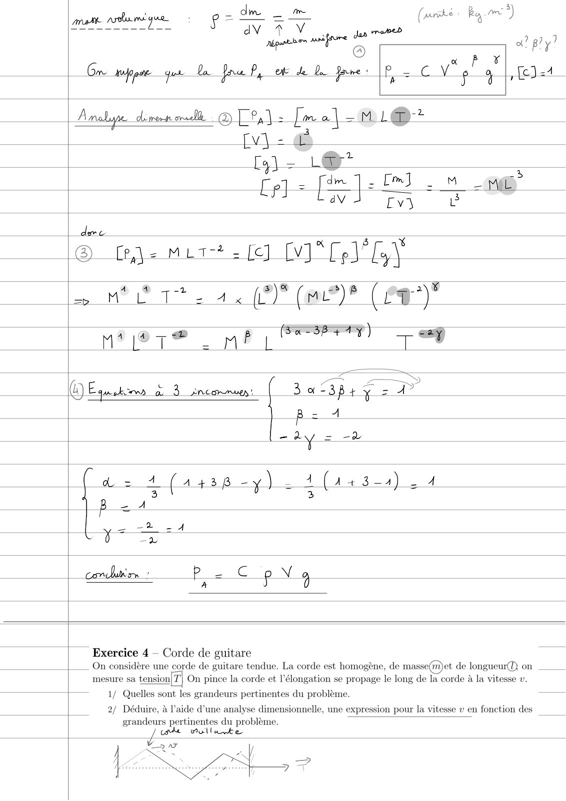
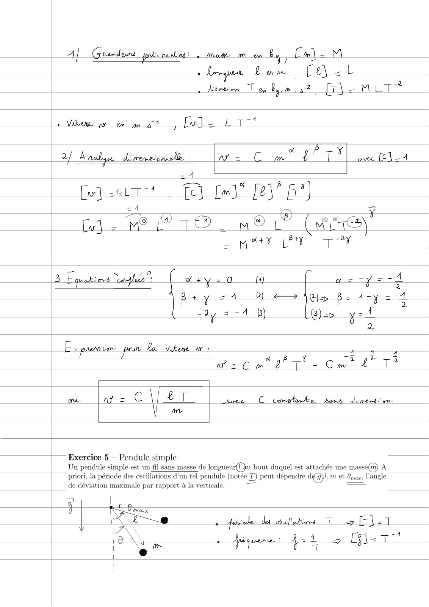
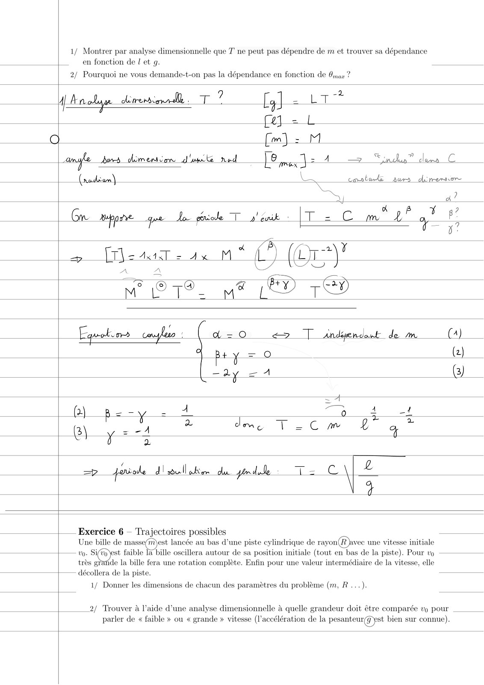
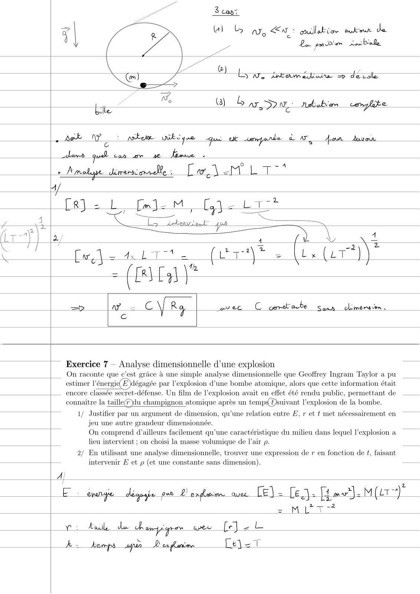
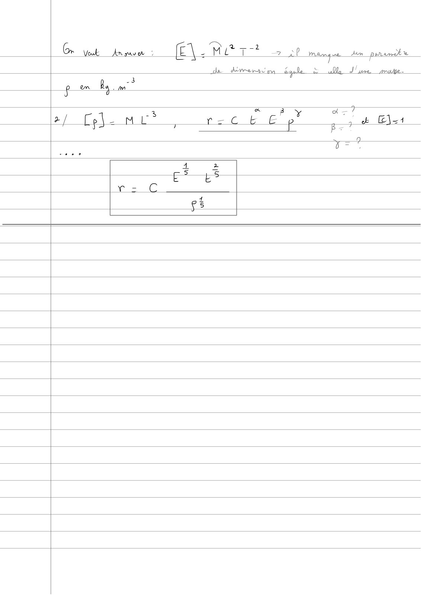

# TD3-Analyse-dimensionnelle-Correction-(1-a-7)_2023-2024_Physique1_P1S1_EDupont.pdf

[Ouvrir l’original](https://drive.google.com/open?id=1fC3b4TtMcAkm5UsU8g-Ec7mo-m-I9Im4) · Les pages signalées comprennent du texte reconnu automatiquement ou des éléments graphiques. Le fac-similé permet de vérifier chaque lecture.

**Pages avec fac-similé ou lecture OCR** — 1–9.

## Page 1

**Lecture OCR à contrôler**

~~~text
TD3 : A nobgpe dirergconrelle

1: 0)010) > [a- METZ mT?1"*

Exnww 4 4) fF
T es F] Fa
IV LT :

Fuel 7 unite ?

2

Dimertion of wnke S.1 de My

Bide dian pebins'de —> Komp Aim trys beg ne. ri pri gee

B = paf) TZ

Ornate dimorsvrsalle,

fv\ = À Sord dimen [> cn NW 2 mke de Are
_fe\s MT +T*
. HD 2 L

ff). T _

Pte Lu = Be Fu 1 rs C8 Ce} = CL L'
(ws Um Ax I‘
[pe] = io ae (By -m 2%) A: wrhe SI

<
[ol - MDI + Opa ).Gu@

Cale] =(2t) (LT) = Th

dene pt canes dune > Ly} 2 SED [17 “- cole”
- BL

@

3/ Dameron cb wnté ST de À (conte le de Fea)

ELR yp

erage - |E = R ,
CR] 2

4: Cvi = 7

fips Y=
~~~

## Page 2

**Lecture OCR à contrôler**

~~~text
. fE\ = [els [mel de.
Sows pwké
v 2
Le] - LE] = [Ame] = Tm] fw} : M (cT~) -MLT
om. cars (RE. oe
— [V1 a
[Rl - mM Lot =m 174
Eee 2: Obbenkcmn. J'ume jarude
, pire 2: M
— LA
YN refirarbl À.
4

LA =D: “veu & fout, depus sh -
San demernm
dot de ondes yedinetes eat ct [a] = 4 MALS ovte une
a uunské (nod)
Jess —
a? eg ye fr"
mp jt [Ee Ba
fej - £6
CRY &
Cars] = LT" *
“2 dx.
fg] 2{fj- LT es Me
Lm] = MA
[a = Lan Apr joe k or p'émre jme Le Pme.
Fa
ey] wv |
4 wr, C1 comitat Sums dimers’ on
Lc]- 4
~~~

## Page 3

**Lecture OCR à contrôler**

~~~text
Cu] = LT"
Es] -(@j-LT*
[mJ] 2m

A cali de roms onrelle à (+) fAJ-Ie je ai |

24 A mere

[l= fe} Le)" []° fe)!

um‘), (or@* (wre)

PO. we (PDP (8)

M® i Tere

3 equations mo By: (+0 = à &)

3 ry we)

—
o-*
ay

= DB —Y = -(281y) (us)

4} a= 0
a ‘ <ey

néifiukir chute Lee 2 2° fy de Newham 2% Caravan de Venarge mécenip.
de Ce Ë,

2

2/ On lâche sans vitesse initiale un objet de masse(n)d’une hauteur(A)au-dessus du sol. On veut

trouver par une analyse dimensionnelle une expression de sa vitesse finale@en négligeant tout
D frottement. a
Quelles sont les grandeurs pertinentes du problème ? En déduire une expression pour la vitesse

vy à l’aide d’une analyse dimensionnelle.

ek ok iw-al : * grd a pars nent ob

è =
R " ia {3 Ly nue m 1 [om \ - M
Vo =0 by Posteur fa EM 2b
Beak rat L< un”
z ME bie NU
~~~

## Page 4

**Lecture OCR à contrôler**

~~~text
Cm

Gen, Ctr OIL Goyer
=4
Een par An vikene Ag. mn Apr que ap aleve
x : avec CC Sans Arersronnell,
Aes Cm yA a? p? y!
= A
= x B FA
Es = fel Fel Ly] £8]
; @ x ¥
HT”. 1. (n°) @)" @
: vie ET TT
3 equations à 3 inconnu ( d=O (tj (_a=0
Bry eA py) <=> qeipat
-a8 = -4 6) pat
z
YB=0 (WA)
x ° Ala

"4"

—
Ruske Le

<> Le mate mlabeviet pad

amp —

; Exercice 3 — Poussée d’Archimède

Vaccélération de la pesanteur,

|— étant une constante numérique sans dimension.
=

| Trouver les exposants d’une formule

Trouver à l’aide d'une analyse dimensionnelle, la formule donnant la poussée d’Archiméde, sachant
que cette force est fonction du volume du corps immergé!

, de la masse volumique(p)du fluide et de

Aide : on cherchera les valeurs des exposants a, 3 et 7 satisfaisant l'équation P4 = CV®p# 97, Cc

in = caps Aim ere ¢ de tire 7 - Lrrmen-op
: A at ai F
ou T mere (er) ER pode Pg

ate

fuses

@ se

pag |?

a

ma paki que. D

a purée d'AncRiré de F.

>

> >
à l'équilhe P+r, = ©
~~~

## Page 5

**Lecture OCR à contrôler**

~~~text
. dm _ om ki: Rom?
aan, QE dv * V meted (™ ° )
wotiben mnifrre Jae a? gly?
Jip @ BY

Gm mp ge Bo far, ete de Da pre p — © ve 5 <2=1

A

Analype deres aval | @ | ad fm a| -M!1@2

i
|
Fs By
| 5
US
74
=| 2/5
WA Aad
“i
|=
NM
É

a MU Tt. 44 (9) (me)? (eg)

mete mh See TS

WE uk à à inconnu! z 4

x)

ETS
a =3p+ 2
4

Pp (Le

y"

L 4 (443-4) 24
3

Exercice 4 — Corde de guitare

On considère une corde de guitare tendue. La corde est homogène, de masse(m)et de longueur@} on
mesure sa tension|T| On pince la corde et l'élongation se propage le long de la corde à la vitesse v.
1/ Quelles sont les grandeurs pertinentes du problème.

2/ Déduire, à l’aide d’une analyse dimensionnelle, une expression pour la vitesse v en fonction des
grandeurs pertinentes du problème.
cn ou

aa

Mulla wke
7 . af =>
~~~

## Page 6

**Lecture OCR à contrôler**

~~~text
A] Grades ati nenked à mate mn ls, Cm\- M
= le

À Æeräèm T on À Mi-mLT*

pa

+ Vibue py em pnt [oJ — LT

3 Anabyue dress ons : a= C oil L°TY avec (1-4

[x] uit fe) fm" [23° [7]
z4 =
Lu = M° 19 TO MOL” (ire
MAY LÉO TU
ayléa” perse (4) ( gas ap eed
+ y = (2) le Bs 4-y = 4
iu ay = =4 1) Ge y=1
2

| Ex pre lor _peur lo. _Vikene ny

ow ars (el 40 avec C cemstnte Lary olemenstern
me

| Exercice 5 - Pendule simple

Un pendule simple est un fil sans masse de longueur(u bout duquel est attachée une masse(m) A
| prior, la période des oscillations d'un tel pendule (notée T) peut dépendre dé 9}, et Brae» l'angle
de déviation maximale par rapport à la verticale.

+ fovede dy obullabions Tp Fr} = T

équen: fat > l= T°
~~~

## Page 7

**Lecture OCR à contrôler**

~~~text
1/ Montrer par analyse dimensionnelle que T ne peut pas dépendre de m et trouver sa dépendance
en fonction de Let g.

2/ Pourquoi ne vous demande-t-on pas la dépendance en fonction de Imax

A Aerob. dimerenrdle . a 2%

[ai -

Q Cm) = u

clams C

angle ds dimension d'uncte ned LE max] eA > indus?
(rodèan) L

mstorka Aurs dc person

au a?

Gr Mendes: que Ao éiole T pewk |T = C m 2? a? g?

7
[= = 4x M * a (Gua

MOTS. ye (RO TE

|___ Exercice 6 — Trajectoires possibles
Une bille de masse/m)est lancée au bas d’une piste cylindrique de rayon(R avec une vitesse initiale
st faible la bille oscillera autour de sa position initiale (tout en bas de la piste). Pour vo

de la bille fera une rotation complète. Enfin pour une valeur intermédiaire de la vitesse, elle
|— décollera de la piste.

très gh
1/ Donner les dimensions de chacun des paramètres du problème (m, R ...).

2/ Trouver à l’aide d’une analyse dimensionnelle à quelle grandeur doit être comparée vp pour
parler de « faible » ou « grande » vitesse (l'accélération de la pesanteur@ pst bien sur connue).
~~~

## Page 8

**Lecture OCR à contrôler**

~~~text
3 can:

G1 by ne En: œiletio ovtmn de

Le padre Ansbiale
ee F °

ee @)

oy
a=
Ne

ES ve éaméoe dédie

iis | Wo (3) b ATs DP! rsbuken complete

. Ak ve :_ ntere Wako yore que uk emails à NT, Jan. avan

dans quel can mm ne Loose.
É Amelyge Lentille : Le À L To"

CR] = LL [ml: M, [a

ay
z

Jet
aed
Lo ieben Sent 4 =
| |

covet C corabarte San dément,

Exercice 7 — Analyse dimensionnelle d’une explosion

On raconte que c’est grâce à une simple analyse dimensionnelle que Geoffrey Ingram Taylor a pu
estimer l’énergi égagée par l'explosion d'une bombe atomique, alors que cette information était
encore classée secret-défense. Un film de l'explosion avait en effet été rendu public, permettant de
connaître la taille@du champignon atomique après un temp Dsuivant l'explosion de la bombe.
F— 1/ Justifier par un argument de dimension, qu’une relation entre E, r et t met nécessairement en
jeu une autre grandeur dimensionnée.

On comprend d’ailleurs facilement qu'une carac

istique du milieu dans lequel l'explosion a
lieu intervient ; on choisi la masse volumique de l'air p.

2/ En utilisant une analyse dimensionnelle, trouver une expression de r en fonction de t, faisant

— intervenir E et p (et une constante sans dimension).

2H mo} M(Lr

E i Lgoape pan LI Ej= le
= M

CEE >
LT

-2

vi antl de Ranpiger wee [rl - L

ki kemps aq 2 exphenion Maran
~~~

## Page 9

**Lecture OCR à contrôler**

~~~text
us
~~~
