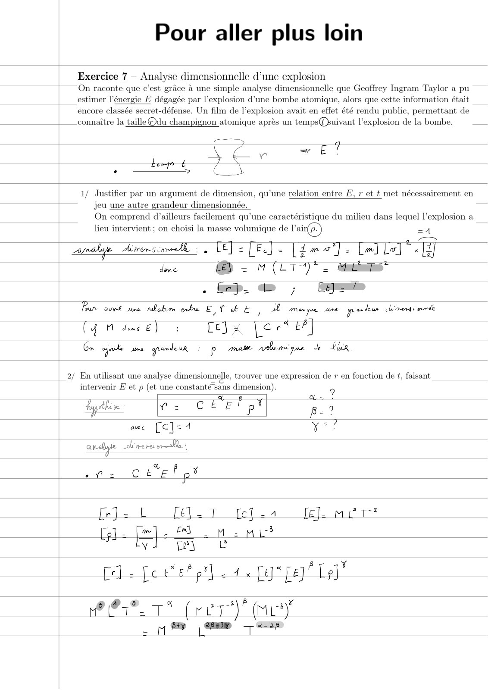
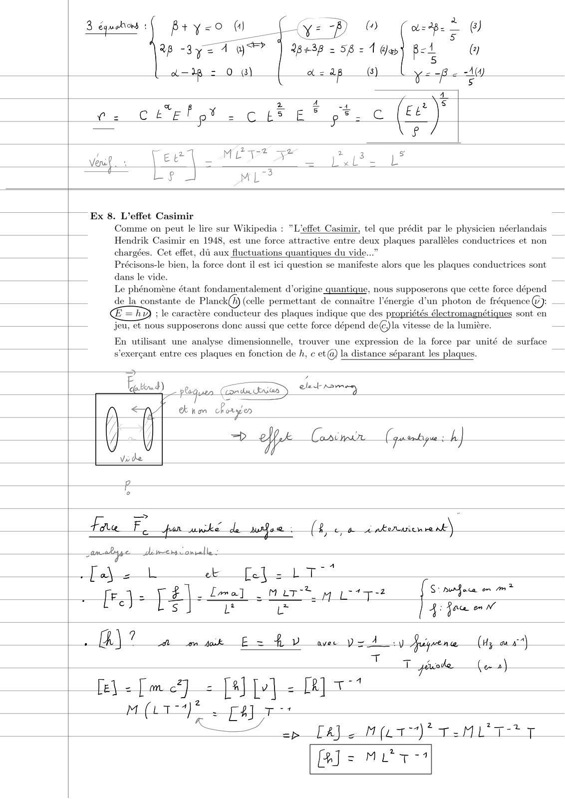
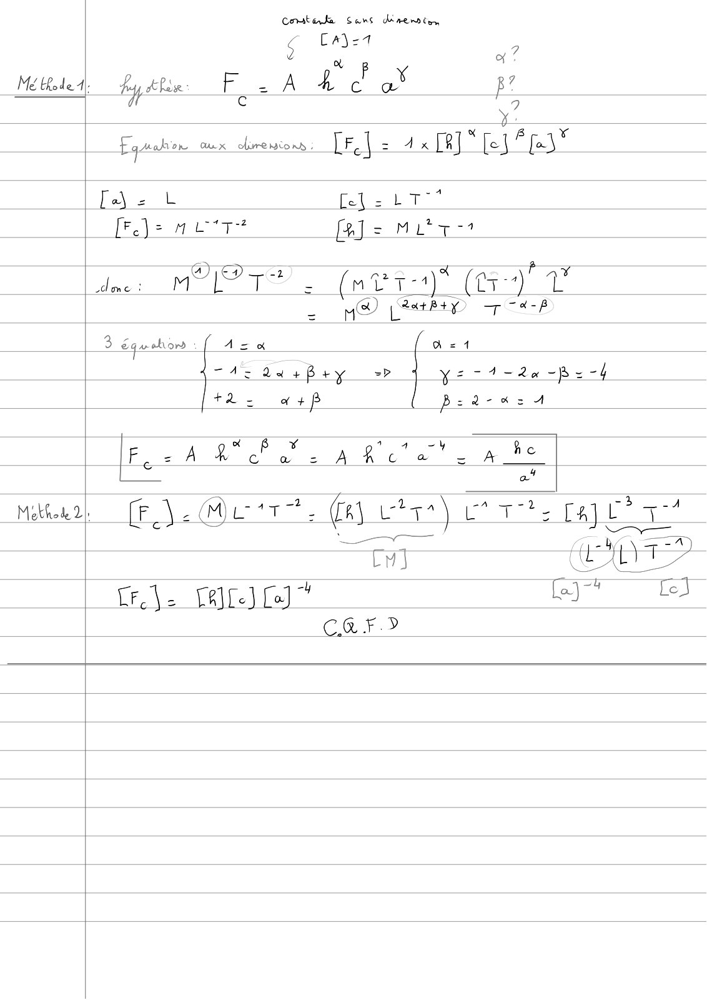
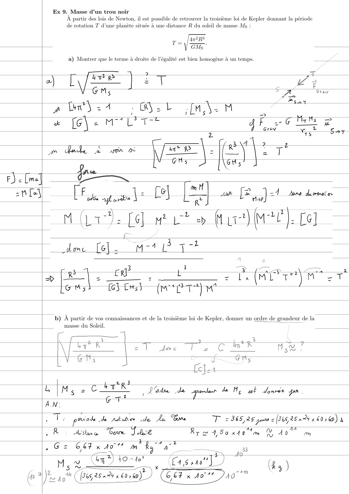
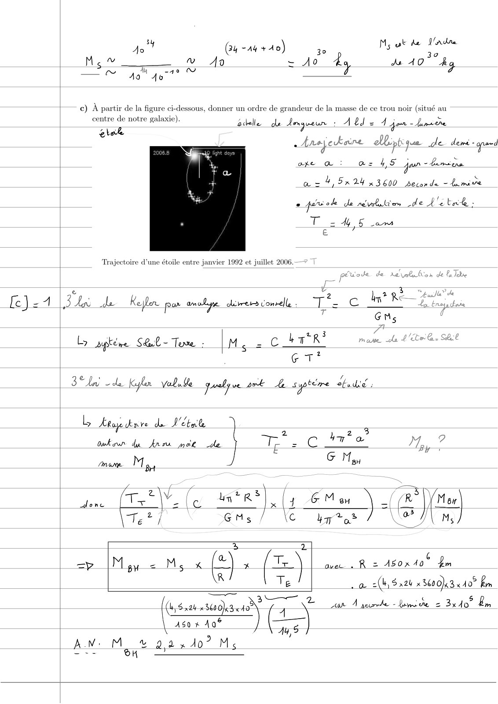
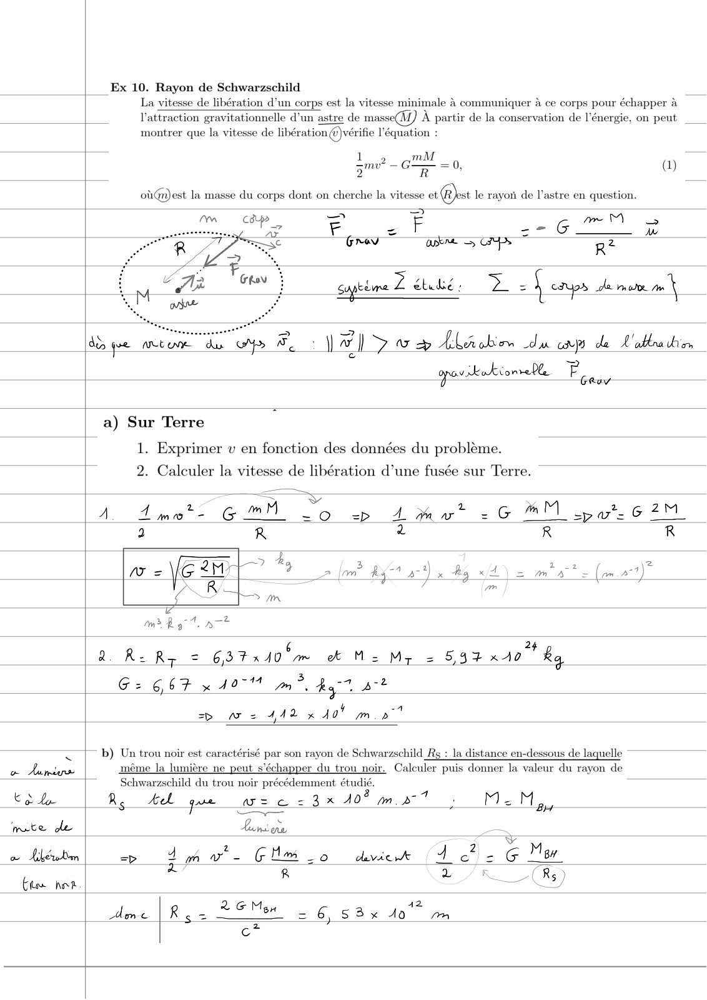

# TD3-Analyse-dimensionnelle-Correction-(Pour-aller-plus-loin)_2023-2024_Physique1_P1S1_EDupont.pdf

[Ouvrir l’original](https://drive.google.com/open?id=1Vj8a7mJrV0sKc6TSk11WMIo1p1lWQeoJ) · Les pages signalées comprennent du texte reconnu automatiquement ou des éléments graphiques. Le fac-similé permet de vérifier chaque lecture.

**Pages avec fac-similé ou lecture OCR** — 1–6.

## Page 1

**Lecture OCR à contrôler**

~~~text
Pour aller plus loin

Exercice 7 — Analyse dimensionnelle d’une explosion

| On raconte que c’est grâce à une simple analyse dimensionnelle que Geoffrey Ingram Taylor a pu
estimer l'énergie E dégagée par l'explosion d’une bombe atomique, alors que cette information était
encore classée secret-défense. Un film de l'explosion avait en effet été rendu public, permettant de
connaître la taille@du champignon atomique après un temps@®suivant l'explosion de la bombe.

ES E 9
7
A 5 er
er À
7 Nes ms
1/ Justifier par un argument de dimension, qu’une relation entre E, r et t met nécessairement en

jeu une autre grandeur dimensionnée.
On comprend d’ailleurs facilement qu’une caractéristique du milieu dans lequel l'explosion a

lieu intervient ; on choisi la masse volumique de l'air(p.) #4
anale Aewrorscormele : , LE] = [Ee] = [ime]. [m] Lo] «
done = (LT )*. Mat

. Cr: Lb; Cee
Four ovet une ndahe enka EVE, A muque une pete chmod on

(4 dense) : [ey x ter" EA]

Gm orks ue garder: p mate polar gue de Vuix

|_2/ En utilisant une ana
intervenir E et p (et une constantésans dimension).

fyethere T= C LŸE Pot

ac [C]=4

dimensionnelle, trouver une expression de r en fonction de t, faisant

ren roll,

an

= cevel ov
~~~

## Page 2

**Lecture OCR à contrôler**

~~~text
3 éguehons : B+ y<0 Mo y= Pp 0) ape À @)
Rp -3y= 4 YF? | 28438 = 58: À Wes ped @

a= = 0 (3) = op (3) ya Pe 20

Ex 8. L'effet Casimir
Comme on peut le lire sur Wikipedia : L'effet Casimir, tel que prédit par le physicien néerlandais
Hendrik Casimir en 1948, est une force attractive entre deux plaques parallèles conductrices et non
chargées. Cet effet, dû aux fluctuations quantiques du vide...”

Précisons-le bien, la force dont il est ici question se manifeste alors que les plaques conductrices sont
dans le vide.
Le phénomène étant fondamentalement d’origine quantique, nous supposerons que cette force dépend
de la constante de Planck(f) (celle permettant de connaître l'énergie d'un photon de fréquence (2}:
; le caractère conducteur des plaques indique que des propriétés électromagnétiques sont 64
[7 jeu, ef nous supposerons donc aussi que cette force dépend de@)la vitesse de la lumière.

En utilisant une analyse dimensionnelle, trouver une expression de la force par unité de surface
s’exercant entre ces plaques en fonction de h, c et@) la distance séparant les plaques.

Bd ous Gauss dti)

(\ Hi nom Fee
À / + elf nw
Uo Uf y /

Fide Fe jar nxké de me: (hoe À nkeruicire nk)

nlge — Jamemsconelle:

een

fF}: él. feel am bitty 47 ft ==
i : Lace en

A) À A om uk E = tv = À D ave can À ine (Hy ax)

[e\ = [mc] = [alo] - MT

M (LT Fajr
ee eae ee

[Js Mut
~~~

## Page 3

**Lecture OCR à contrôler**

~~~text
Combate Sans drenncs,

Cai-1
7
tp x a
Métated, fy shaw FiAkca Be
~ € y?
Egaohen aux olurenions : LF. | = 1x [RJ “ [e] F3"
[et ee Lt
[Foje ALT BJ: Mitt?

A) e4 Zz a
dacs MIT? > (nuts) (ed i

= Co) [tary +7 4-P

3 éqguehon  ( Aza [az
TA: ae +P+y => Ys 74-20 -Pz=-4
[+2 2 a+f B=zd-%xz 1

F ARS ace" a he

mal FA Metrt. fu vtr) rt pa
ns a ay

LH) CEA T
CF\e Rte) Co] ” lay? LE

CGT»
~~~

## Page 4

**Lecture OCR à contrôler**

~~~text
Ex 9. Masse d’un trou noir
À partir des lois de Newton, il est possible de retrouver la troisième loi de Kepler donnant la période
de rotation T d’une planète située à une distance R du soleil de masse Ms :

a) Montrer que le terme à droite de l'égalité est bien homogène à un temps.

aw Uae = T FT
Ly GM, ] € Es

a te S <4 GLE ANIM
» [G\- ML qk G M D»

2 TS Tt
on dl me (EE |. a) 27°
GMs eu” |
fos
F) = [mel a EH
nm TE > _4 _
He [hi ul: C8) Eu pe QE VA uen —
/ 2 -2 = Ly?
M (La) [6] M L + fur) M ). £6]
ae 3
deme [el]. m-11° a7? —
A
Fo3 43 >? DT As 2
+ | | = — : = z LME TN “7
GMs fe} Es} (mT) M
b) À partir de vos connaissances et de la troisième loi de Kepler, donner un ordre de grandeur de la
masse du Soleil.
Cs] 5 yes
byt zl dme 1 2 C M5 !
Gh; 5
= [efe4
| 2zp 3
LIM, = rer 3 = a iar paren de Me wt done yor
AN:
T : pouode de rotation de La Gore T = 366,25 prns = (366,25 a x 60 10) à
JR dima “beve S hack Rp = 4,50 RANG ig a qo m
. GG: Gétx AO m Rat as

wa 2 <A
Jo" Gus 254% x 60 160) 664 x so 21077

Mey ee HO Cason’) es)
~~~

## Page 5

**Lecture OCR à contrôler**

~~~text
!
Pr (24 “nj sde) Ms wk ke Pad

30 7
Mou YO = Ao dy ds 107 hg

— © 49 4077” Ee

c) A partir de la figu
centre de notre ge

glak

ssous, donner un ordre de grandeur de la masse de ce trou noir (situé au

édele de Aergueun : Abd = À jen - tana tre

. Anejeukaine all ptique de deme - pad
ake _@ as 45 Goer = br one
az 4, 5x24 x 3600 seconde -tamive
° gare ole de rvbikien de L'itrk :
Ts My § am

Trajectoire d'une étoile entre janvier 1992 et juillet 2006.

e ¢ ed
[ela | 3 toi de Keppler par mel dress Conrell TR ce Ih

GMs
Ly aipténe S@L- Ton [MS 2 CHR
G T°
Ben! ale Kyo vebile quelque 24 ke sptère hdi;
L Keay ove de Dette
2 ha? 3 2
auteur du free mot de Tes CAT Toy
Oe Mos G Moy
tata A aa
lone (T+ - le ñ x (1 ey | Ce fe)
ei GMs / \c bq? LA JUN

EN z
6
=P M gu = Ms x e x (=) avec. R = 450x 40 fm

R Te La a(S n2h x 860013 40° im

‘ ee a) var A peurhe - bomide 2 3x40" bm
( 5

Aso x Aa®

AN: M 2,2 x 407 Ms
~~~

## Page 6

**Lecture OCR à contrôler**

~~~text
Ex 10. Rayon de Schwarzschild

La vitesse de libération d’un corps est la vitesse minimale à communiquer à ce corps pour échapper à

l'attraction gravitationnelle d'un astre de masse) À partir de la conservation de l'énergie, on peut
montrer que la vitesse de libération @)vérifie l'équation

M
pine — Le , (1)
oiGa)est la masse du corps dont on cherche la vitesse ot @est le rayoïi de l'astre en question.
= 2
me M
F = F ET G 7 ré
Grev ae aps R 2
sapeiine Z Shue; D = ! caps de mom m |

dd pe ntm de > Bw yay Alaober du cp de L'ablradies

gparkokionrehle F aay

a) Sur Terre

1. Exprimer v en fonction des données du problème.

2. Calculer la vitesse de libération d’une fusée sur Terre.

2 R:Ry = 637 x 40 2m a M: Mr

= 5,93 x10 ka
Ge 667 x 140" mm? byt ot

sp aw = 442 x 40} mp

| b) Un trou noir est caractérisé par son rayon de Schwarzschild _Rs : la distance en-dessous de laquelle

même la lumière ne peut s'échapper du trou noir. Calculer puis donner la valeur du rayon de
Schwarzschild du trou noir précédemment étudié.

oo Aunies

CN Rs beh que asc = 3x 40% mat. MM,
‘mate Le Lancers
ow Lkewten => 4 in a G Mew z0 view 4 of
aa 8 yy
qs ho
Ame [RÇ= EM 2 6 58% Jo” 2m
ae
~~~
