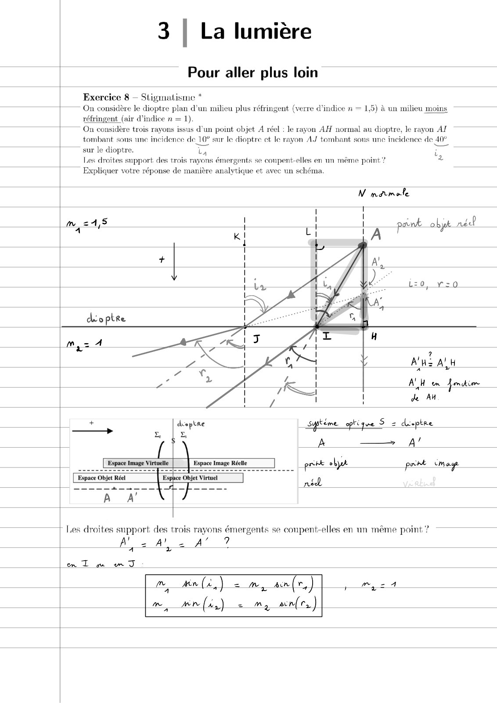
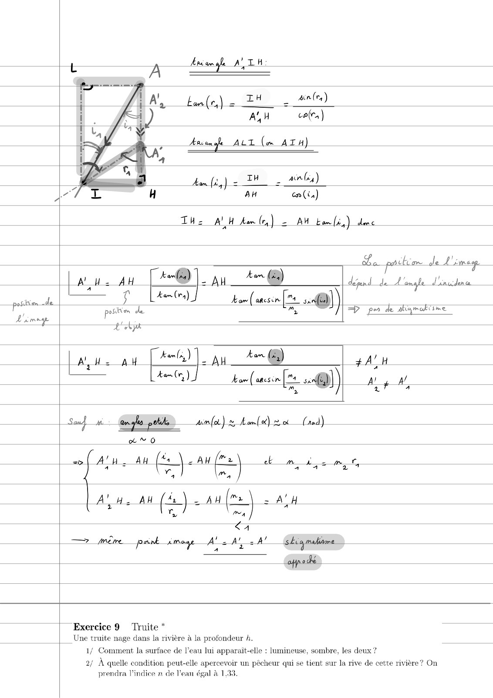
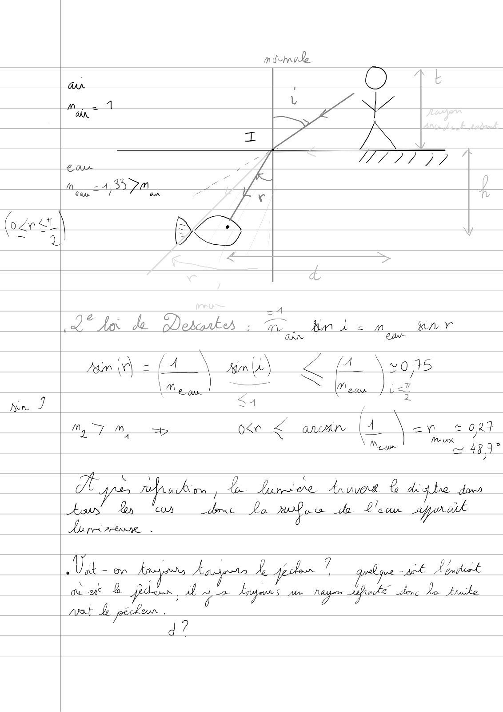
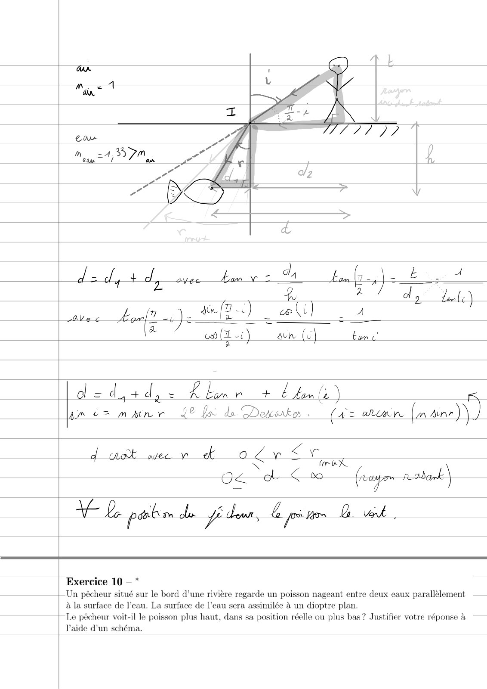
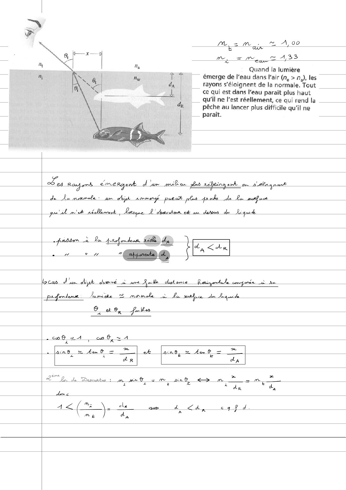

# TD3-Lumiere-Correction-(Pour-aller-plus-loin)_2024-2025_Physique1_P1S1_EDupont.pdf

[Ouvrir l’original](https://drive.google.com/open?id=1-QDr1yZHayY29w35XW152nFOkVI8Ogif) · Les pages signalées comprennent du texte reconnu automatiquement ou des éléments graphiques. Le fac-similé permet de vérifier chaque lecture.

**Pages avec fac-similé ou lecture OCR** — 1–5.

## Page 1

**Lecture OCR à contrôler**

~~~text
3 | La lumière

Pour aller plus loin

Exercice 8 — Stigmatisme *
On considère le dioptre plan d’un milieu plus réfringent (verre d'indice n — 1,5) à un milieu moins

réfringent (air d'indice n = 1).
— On considère trois rayons issus d’un point objet À réel : le rayon AH normal au dioptre, le rayon AI
tombant sous une incidence de 10° sur le dioptre ct le rayon AJ tombant sons une incidence de 40°

sur le dioptre. La i
Les droites support des trois rayons émergents se conpent-elles en un même point ? 2

Expliquer votre réponse de manière analytique et avec un schéma.

N matmale

i t
| x iq
{ A pant objt adel

: Les droites support des trois rayons émergents se coupent-elles en un même point?
' /
= Ah 5 9
A == ae A

em Tu JT

a an (2,) =m, snl re ) mys

me, wer (42) = My acne, )
~~~

## Page 2

**Lecture OCR à contrôler**

~~~text
t A Ana an gle ATH:

L (eq) = 24 ou An(r)

AN we)

Area fe ALT (x ATH)

ban (eg) = IH _ and)

AH cn (in)

THe AY H fam (ry) = AH bom [iiy) de

La portion. de L'image

| Alu AH Ca) |. AH tn @) déprd_ de A ange d'autre —__

Lau tes) J arcs [rs
pe — kL , Hae nin ms -@)) =p pe de drame
dent LG >
Aye AU fot. au _ + @ $ALH

Kam (ry)

2

de anes oar) /
. | 4 4

Sat CD fu) dos ui)

ER au @ \<AW fee bm dem
ws a

Lau au (4 =) -4#| ce) = AH

<a

— mère pnnl image A’. Al. A’ ska maliame
7 Y à 2

CEB

| Exercice 9 Truite *
| Une truite nage dans la rivière à la profondeur 4.

1/ Comment la surface de l’eau lui apparait-elle : lumineuse, sombre, les deux ?

2/ À quelle condition peut-elle apercevoir un pêcheur qui se tient sur la rive de cette rivière ? On
prendra l'indice n de l'ean égal à 1,33.
~~~

## Page 3

**Lecture OCR à contrôler**

~~~text
as

( ri
~ QU
0 Ai de Dedarkhs ; in hm à sm gn vr
OWN Lan
Zn (A = (A \ xml /1 \ vos
Me gy | Se) et
Now i <4 ;
M, mM ae ote € ani |A ew 2 oF
: eon 1 4B

ays fs wiht fp Linisre: Hruver 6 pres dons
dent La a ce de Cor afparl

a +

aU hie ti on Anata Asso le gp clon ? a apt Ayuhuet

a

pt _L pélaon
~~~

## Page 4

**Lecture OCR à contrôler**

~~~text
dad, vd, bam v = Va La

avec Lol ie MB) | eo)

{

(& (XL -i) AUR (al tone

d=d,+d, ~ Rlmr + E fn fi.

Ma c= mAMnvr 22 ls de Desk . (A= WOR PSN

dut weep oLrET

al Le! (ea ñ san

TE Le paie du dur, Ae pites ti ved

Exercice 10 — *
Un pêcheur situé sur le bord d’une rivière regarde un poisson nageant entre deux eaux parallèlement ——
à la surface de l’eau. La surface de l’eau sera assimilée à un dioptre plan.
| Le pêcheur voit-il le poisson plus haut, dans sa position réelle ou plus bas? Justifier votre réponse à
l’aide d'un schéma.
~~~

## Page 5

**Lecture OCR à contrôler**

~~~text
= . A, 00
Me ma À

M. =m, = 433

x
Quand la lumière

~~ merge de l'eau dans l'air (n, > n,), les
rayons s'éloignent de la normale, Tout

| ce qui est dans l'eau paraît plus haut

___ qu'il ne l'est réellement, ce qui rend la
pêche au lancer plus difficile qu'il ne
paraît.

Ts Rafer’ emergenk dare milion 7 néeing erk on D'élna nant

de Le morale: y A tem eng

quil mt néllmmenk, Deere L'éukon ee aa derour de quid

Li <ke

pabber x. Pa Arsah mdeur 26 by à
4 an "spams da i

Loan d'un diyk sore à _pre Rolle dokimce — Ratiogrtahe corpora dre

_prferdenr.  Jumiète © mamele Lon mafia Un Lequde

C 46, fares

HG 2 A af = A
fans, = ham = | 4 loins, = 4m 0 = _* |
* © LR da
LT Qu de Descartes : mn® 2m nf > m * rm, À
i z + € z €
‘ de a,
dee
A MN ele d_<a sig Pid
~~~
