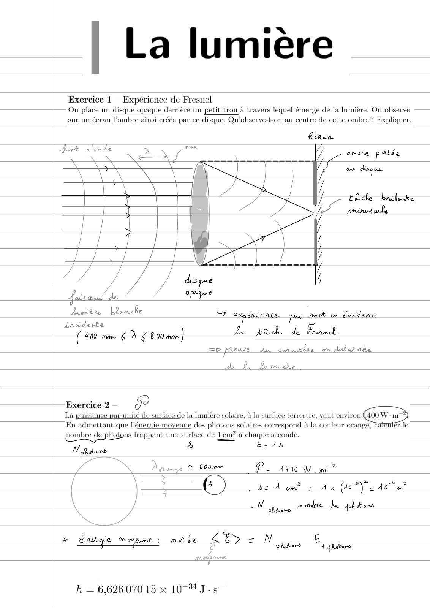
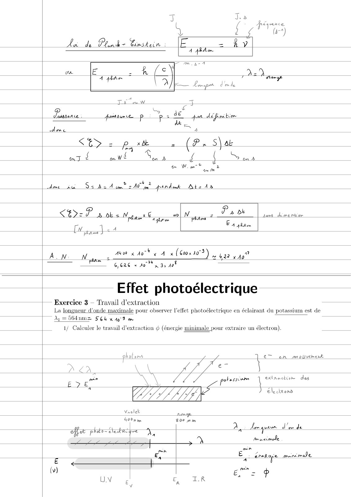
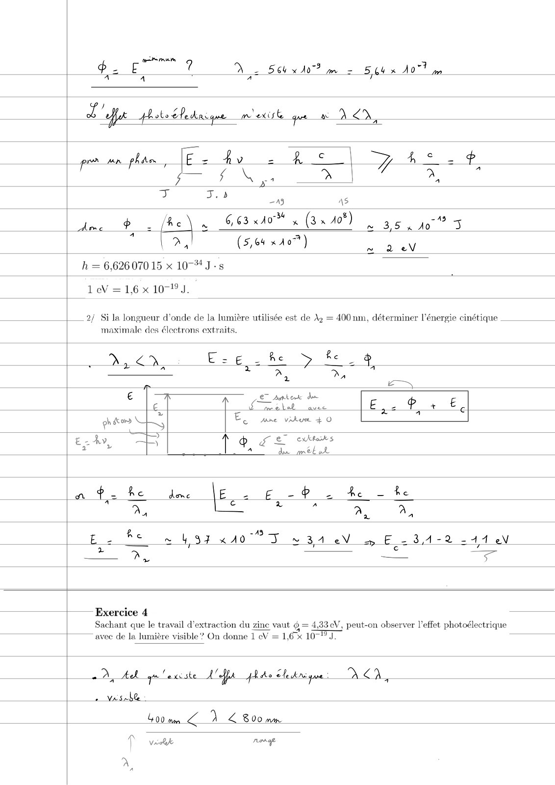
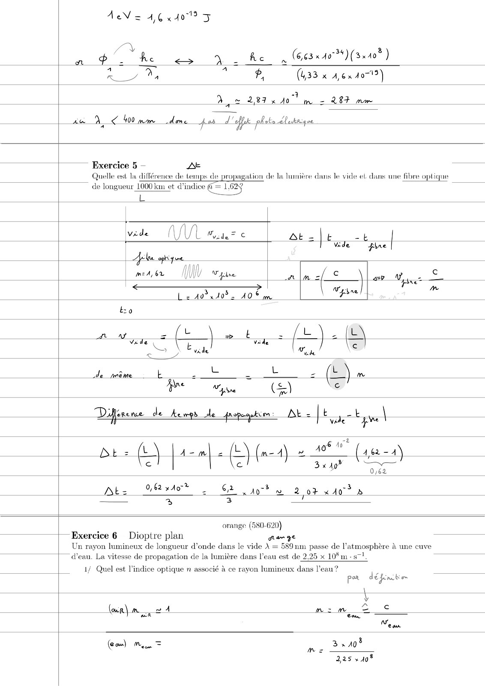
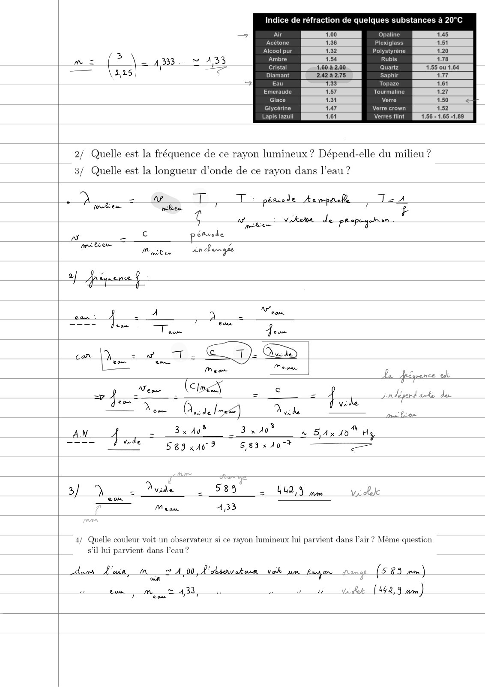
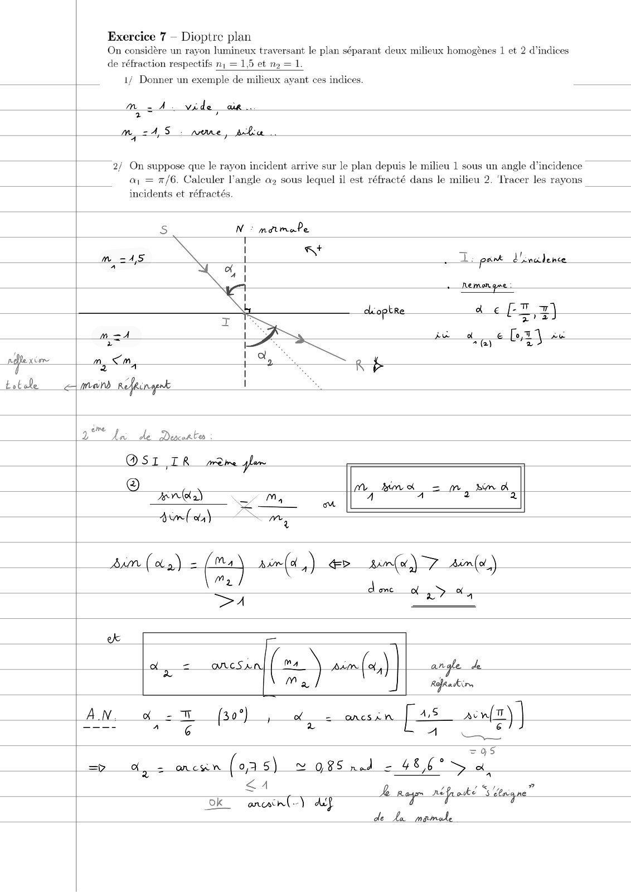
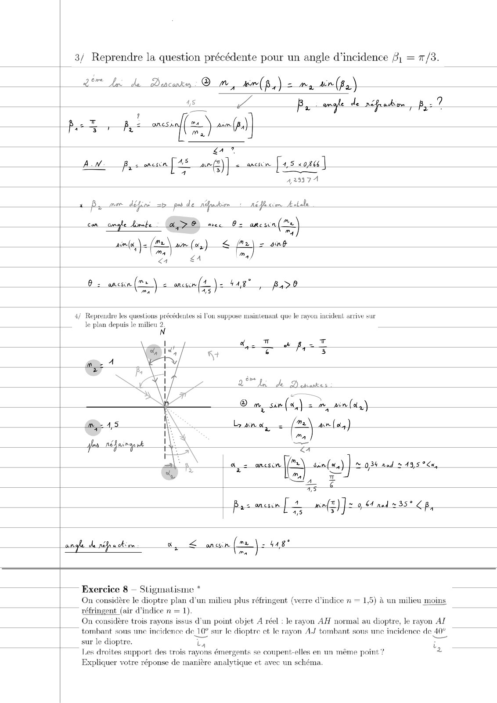
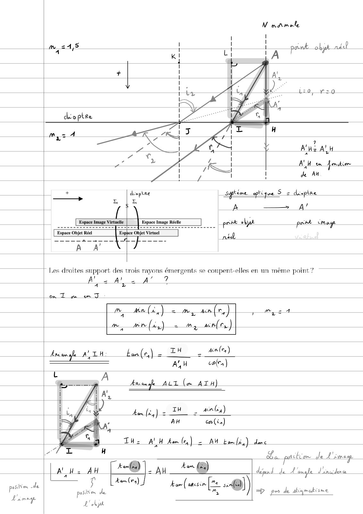
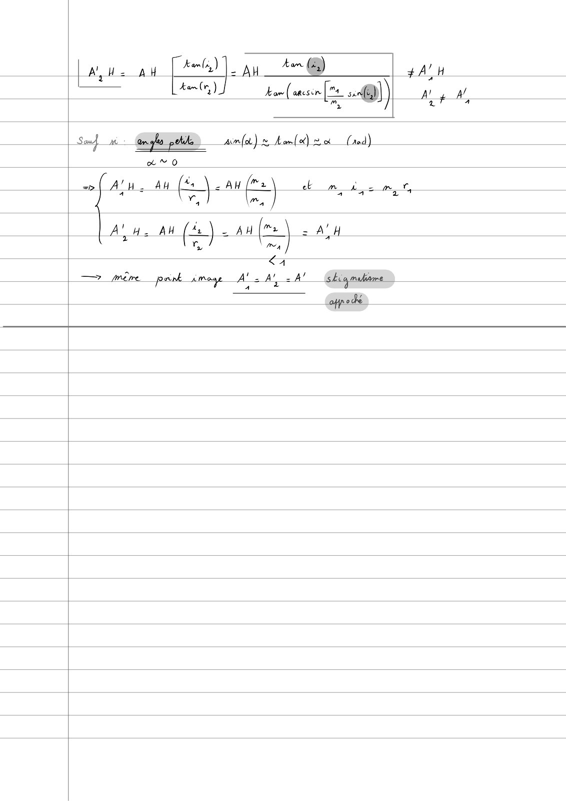

# TD3-Lumiere-Correction_2024-2025_Physique1_P1S1_EDupont.pdf

[Ouvrir l’original](https://drive.google.com/open?id=1UBB7rJa-7mgRrZSsfvVTv1oKc3do63D6) · Les pages signalées comprennent du texte reconnu automatiquement ou des éléments graphiques. Le fac-similé permet de vérifier chaque lecture.

**Pages avec fac-similé ou lecture OCR** — 1–9.

## Page 1

**Lecture OCR à contrôler**

~~~text
| La lumière

Exercice 1 Expérience de Fresnel
On place un disque opaque derrière un petit trou à travers lequel émerge de la lumière. On observe

sur un écran l'ombre ainsi créée par ce disque. Qu’observe-t-on au centre de cette ombre ? Expliquer.

Écran

if tède bacllanke

Sa prépa ule

Jumiére blanche DL expercence que mA em évidence

inéderte ) La pide de Fume

( 400 mm < x < 800 ww)
=p preuve da canokire momlatrie

de La fume.

Exercice 2 de
La puissance par unité de surface de la lumière solaire, à la surface lerrestre, vaul environ
| En sdmettant que l'énergie moyenne des photons solaires correspond à la couleur orange time

nombre de photons frappant tme surface de Lem? à chaque seconde.

Wah À =A

fo Pe Asoo Wim
[ 82 À cmt 2 Ax (00%) 40m
|

\ ; N press mom Le phoma

NQ DA

x  Éfuiae fm : mkee LES = N

prado E À pideors

h = 6,62607015 x 10-4 J-s
~~~

## Page 2

**Lecture OCR à contrôler**

~~~text
ao

Ax de Plunk =~ Cioskein

mE À 5) pu

+" =
À w 5

aisance : Auris dum tp

D. F à
ES - PE z (8: S) ae
mJ £ on wb mb af { S en»
te Wem ey
tn m
cde in Sz 22 A om 2 A ng? perdank Abs 12
LED P à nha yy x |" Pants doc
pr Eee PEN pages =
x) LA À pen
FRS
ALN Ng: Abo x 407" x A (600540) 4 92 to”
phe

6,626 « son 3, 408

Effet photoélectrique

+ Exercice 3 — Travail d'extraction
La longueur d'onde maximale pour observer l'effet photoélectrique en éclairant du potassium est de
F A=56dnmz SEU x 409 m

1/ Calculer le travail d'extraction @ (énergie minimale pour extraire un électron).

photons € en movement
U _
D 42 au JEL \

potes qe des

À electrons

Vrolek nage
40° nm 800 mm x ,
fx phabs= éledtrt fe 5, a Am gue dee de
| ne) Im axmele
| ee ET érshye mime
A
(v) € mn
UNE E LR =?
~~~

## Page 3

**Lecture OCR à contrôler**

~~~text
RER
pe E ? DN 2 564 x 107? m = 564 x do
A A

peo wn _phden [Ee - fy = pc | Re +
mis + x,

PI J.5 ig ae

Mme Pe (Re) ~ 6,63 AD 5 (3 x 40°) TU lo” a

° | >, | (5,64 x Ao)

A

h = 6,62607015 x 10-4 J-s

1 eV = 1,6 x 10-9).

|___2/ Si la longueur d'onde de la lumière utilisée est de Az = 400 nm, déterminer l’énergie cinétique
maximale des électrons extraits.

Or E-¢ 2 he fe à
2 3 x = z
ET = a
ES
€ eT Aten de
€ iin ve Ee p + EL
EL ane viku + 0
z- Ay ee ee etes
ET» | TA, PE ME

2 >. ec

Exercice 4
Sachant qué le travail d'éxtraction du zinc vaut @ = 4:33 eV, péut-on observer Veffet photoéleetrique
avec de la lumière visible? On donne 1 eV = 16% 10 TJ.

D, Ak qu'excste Aa

va she

400 mn 1 800 mm

12272 ee
~~~

## Page 4

**Lecture OCR à contrôler**

~~~text
ai ov he 9 ke (663x404) (310° )

ny Ma e (433 x A,6x 407")

a2 283 Ao” m= 287 mm

ze A 400 mam done pos LM plots dlerique

Exercice 5 — ZE
Quelle est la différence de temps de propagation de la lumière dans le vide el dans une fibre optique
de longueur 1000 km et d’indice @ = 1.629
Le
+
vide UT Miide= © AE = tb
Vide fine |
Fike aq 5
m2 4,6% A Ve n ln = € en «€
re | DE”
Le 40x10 2 10% m pe
Eo
a we Cet, fe) fe
nde rede
LÀ Ep Fa! Ve
Je seme. E a i+ = L = ¢ ) m
foe Vivre (=) Le

mn
Diner de _kewps de propegekten : nee ae Hp

i feed 2 une

ë 10°

+
DE Dot 2 GA io yw 2 07 x 40 8
—_ a 3 i

orange (580-620)

; Exercice 6  Dioptre plan Gan ge

Un rayon lumineux de longueur d’onde dans le vide À — 589 nm passe de l'atmosphère à une cuve
d’eau. La vitesse de propagation de la lumière dans l'eau est de 2.25 x 108 m - 87!

1/ Quel est l'indice optique n associé à ce rayon lumineux dans l’eau ?

par définie
\
Ÿ
(or) mi, 24 mim TT ©
ar LUS
eus
(eon) m= 3,401
RE
~~~

## Page 5

**Lecture OCR à contrôler**

~~~text
Indice de réfraction de quelques substances à 20°C

Air 1.00 Opaline
Acétone 1.36 Plexiglass
Alcool pur 4.32 Polystyrene

Pe 3 À = 1353 w À Ambre 1.54 Rubis
TT — Cristal 1.60 à 2.00 Quartz

225 Diamant 2424275 Saphir

Eau 133 Topaze
Emeraude 1:57. Tourmaline
Glace 131 Verre
Glycérine 147 Verre crown
Lapis lazuli 1.61 Verres flint 1.56 - 1.65 1.89

2/ Quelle est la fréquence de ce rayon lumineux ? Dépend-elle du milieu ?

3/ Quelle est la longueur d’onde de ce rayon dans l’eau ?

Dine = VS To, TT pérele Aempac Tat
¢ Yen VA de prepegeh on -
ea L © pétiede
mate ———= 0 7
Mason An Range
2] Jreqaemee À
A eam
es À —— , A =
7 Team Jean
cor \Q os wT © 7). G5
Mean ee

Aa fréquence dt
Zn dépend are du

of Ven (cimecy - ©
Von  Cwitelnet) Ava

3
AN. 4 = 34h? 3x4"  S4x10" Hy
_ Vide

7 vd

malien

589 x2 SEA AO

3) D, = Due 4 589 2 Us vilx

eux
Mean A,33

47 Quelle couleur voit un observateur si ce rayon lumineux lui parvient dans lair? Même question

S'il lui parvient dans l’eau ?

durs L'air, _m © 4,00, 'atavateur vote um Ram (583 am)
ax

um en, me 483, ou uk (42,5 mm)
rs
~~~

## Page 6

**Lecture OCR à contrôler**

~~~text
Exercice 7 — Dioptre plan
On considère un rayon lumineux traversant le plan séparant deux milieux homogènes 1 et 2 d'indices
de réfraction respectifs nj = 1,5 et ny = 1.

1/ Donner un exemple de milieux ayant ces indices.

2 7

m =4, 5 none, aa …

2/ On suppose que le rayon incident arrive sur le plan depuis le milieu 1 sous un angle d’incidence
a) = 7/6. Calculer l'angle ay sous lequel il est réfracté dans le milieu 2. ‘Tracer les rayons
incidents et réfractés.

TL: part d'énalence

Remon que
ae fT 7)
i zrad
m 24 ! jé 4e (24 ra
nif xian m, <M,
totele man nefeingenk \
2" fa de Dinorte :
®SI,IR pene som
© Mm kimd = m, wma
BK 2) = Ma À A 2 2
ae au
Avil oa) > m

amr (aa) = [ma amd ,) &>__sum(w,) “7 _Aen(al,)
me

SA

donc of > #4

Æ
Lo + ancsr [ms am (a1) J} angle de
x Um 4
a Refrain

AN x =T (30°) po 2 ancsin [as acn(2) |
—--- A 6 a A as

=z 11
=P dy = ancin (025) Y 985 rad = 486 6° a

<A

?

À Rage Mfr ocke “Ss Coney ne”
de Le mpmale

“Ok antn(-) dlp
~~~

## Page 7

**Lecture OCR à contrôler**

~~~text
3/ Reprendre la question précédente pour un angle d’incidence 6,

1/3.

| AT RL Duscants © m, wm(p,) 2 my sin (fy)

5
Per Ai {2 (|

7

An pas mena [is A] 2 our [4.5 «oi |
223371
ap, mer defend 22 pa de ndbanskin icon Aolale |

4s a By angle de ncfrocbon, Pye?

con ongle Limit A> OÙ nec O= ane (2)

"4

an(s) [ms wm(o,) < fa) ant

Um] m
<4 eA 4

62 ancun (> 2 tx nf.) 4ag? B,>0

ma

4/ Repreudre les questions précédentes si Yon suppose maintenant que le rayou incident arrive sur
le plan depuis le milieu 2

© im, sun (4,) = me ain (a)

Lana, 2 m\ an(ay)
Pa
a
ancsen ic san()| S 034 rad 2195 °C,
a mA
Cl, à

aS

Bas meun ] 2. CIE 0,4 ned 235° CB,

angfe de rép a, < main (28) 2 448"

ma

; Exercice 8 — Stigmatisme *

On considère le dioptre plan d’un milieu plus réfringent (verre d'indice n — 1,5) à un milieu moins
| réfringent (air d'indice n = 1).
On considère trois rayons issus d'un point objet À réel : le rayon AH normal au dioptr

sur le dioptre. Th i
Les droites support des trois rayons émergents se conpent-elles en un même point ? 2

Expliquer votre réponse de manière analytique et avec un schéma.

tombant sous une incidence de 10° 10° sur le dioptre ct le rayon A.J tombant sous une incidence de 40°
YS
~~~

## Page 8

**Lecture OCR à contrôler**

~~~text
N mamele

Me
A2 Aly

a

A’, Hem fmdim
de M

+ déeptre syptème optique 2 deeptre
LE x
|_| { $ À ——_— A’
a Espace Image Virtuelle Espace Image Réclle prb objet prhk image
Espace Objet Réel Esphce Objet Virtuel
} Goon <=} mr” nid
A A’

Les droites support des trois rayons émergents se conpent-elles en un même point ?

Ale A 2 A’?

Len T au um J

fe, don (i,) = m, an(r,) 5 My es A

me ns, =m an(r,)

"rh (2) _ IH _ an)

| AH cal)

EER Asin fe ALT (« ATH)

PRE TH _ alu)
AH cn (in)

The A! H ham (rs) = Au bals) dmc

LTT 4

Ba potion ale L' cms

su. An [@) yy + @) Lipad de Longe Jinshan —
Les 7 [ team Cra) (ir 2s)

asition dl
pes . postes de

A abyh

=p per de alcgmakisme
L'image L
~~~

## Page 9

**Lecture OCR à contrôler**

~~~text
Ay He AH [inte tm @ #AlH
an (1) kon ( ancsin a à j
(uses s))) ar ga
imo) » o) = (red)
evo
( / 4 fad
sts Aju. au fl Al ‘) a
Fa 4
Ane AW fa). an(s 2 a'y
À Ur, \ *
~~~
