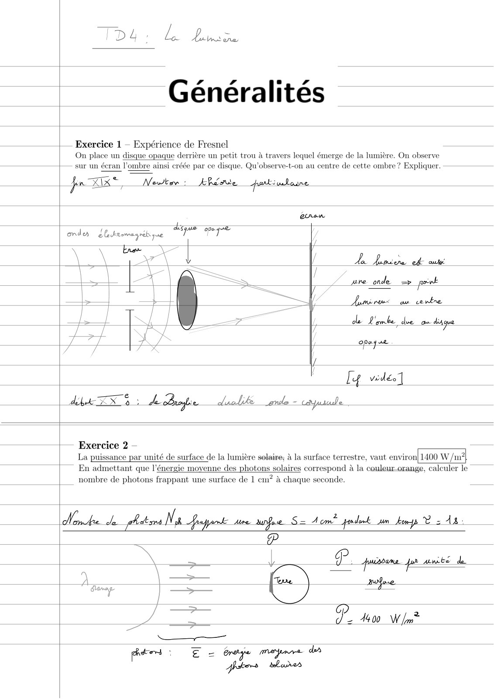
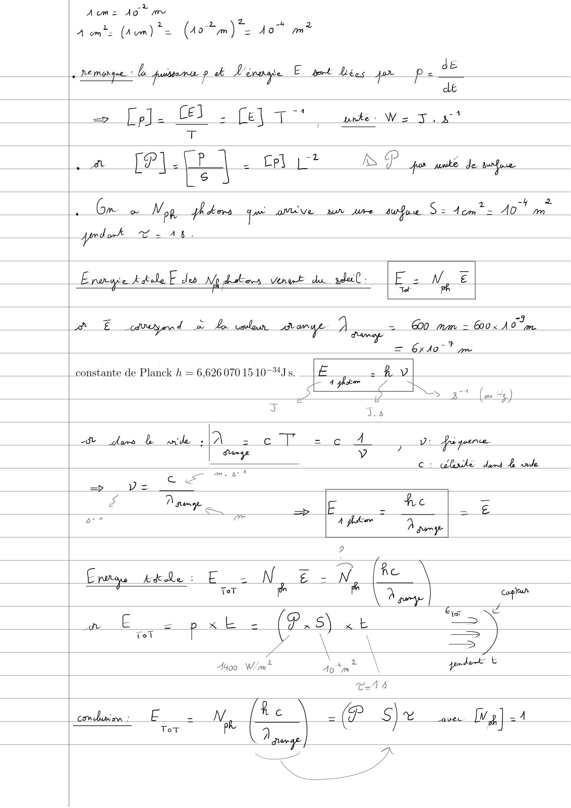
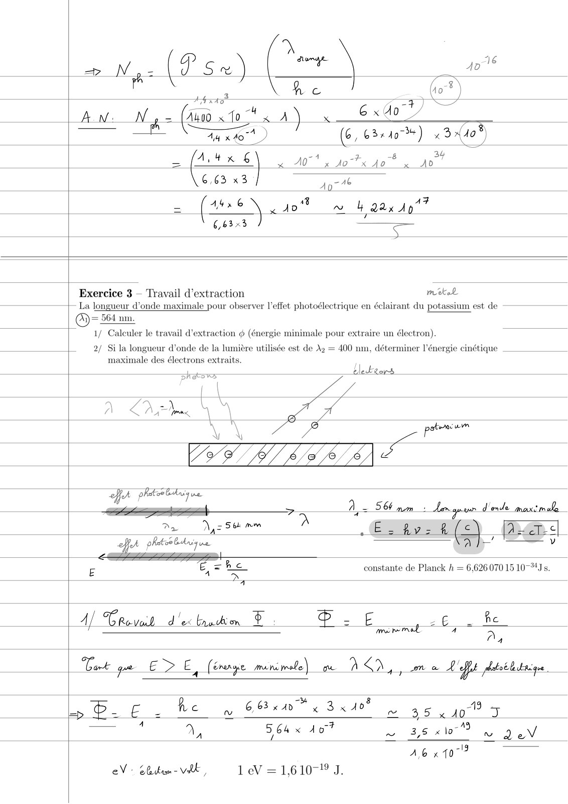
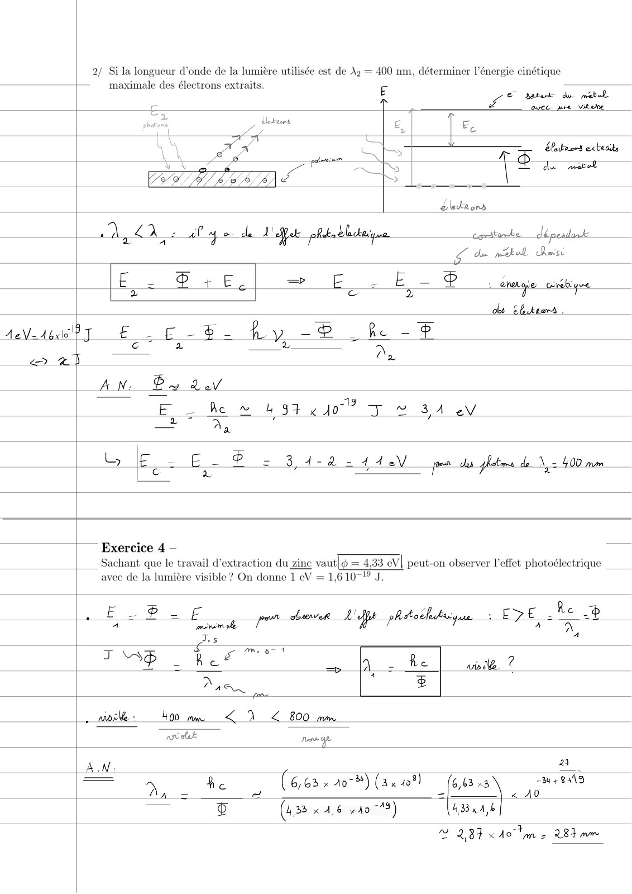
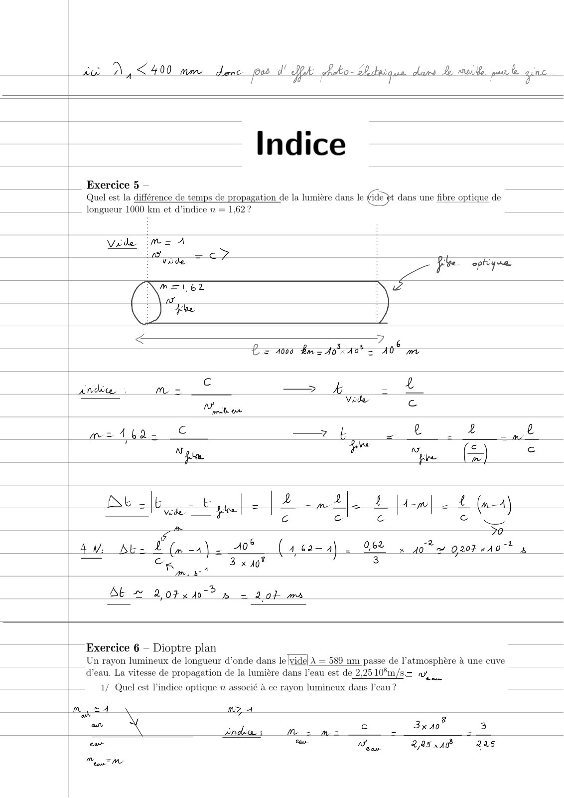
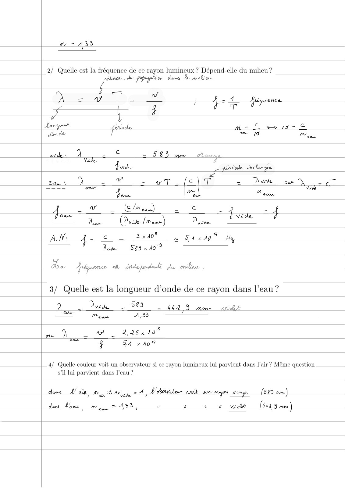
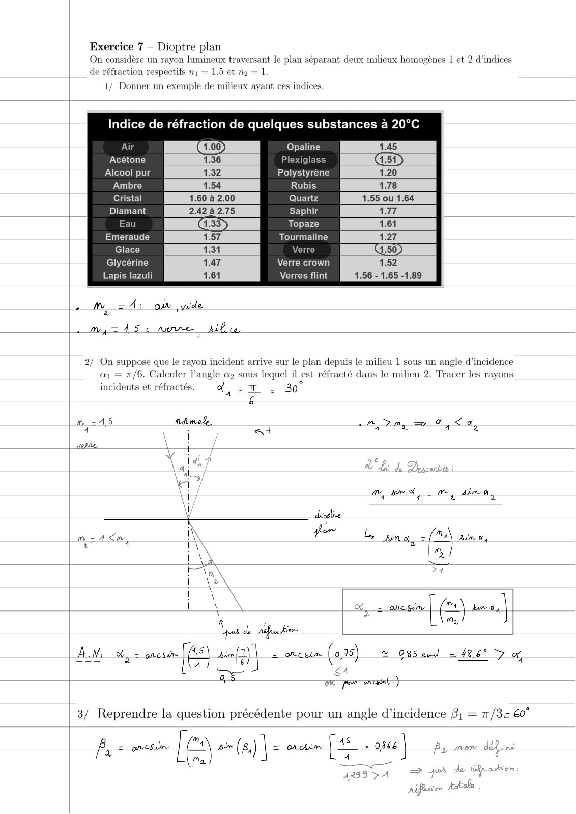
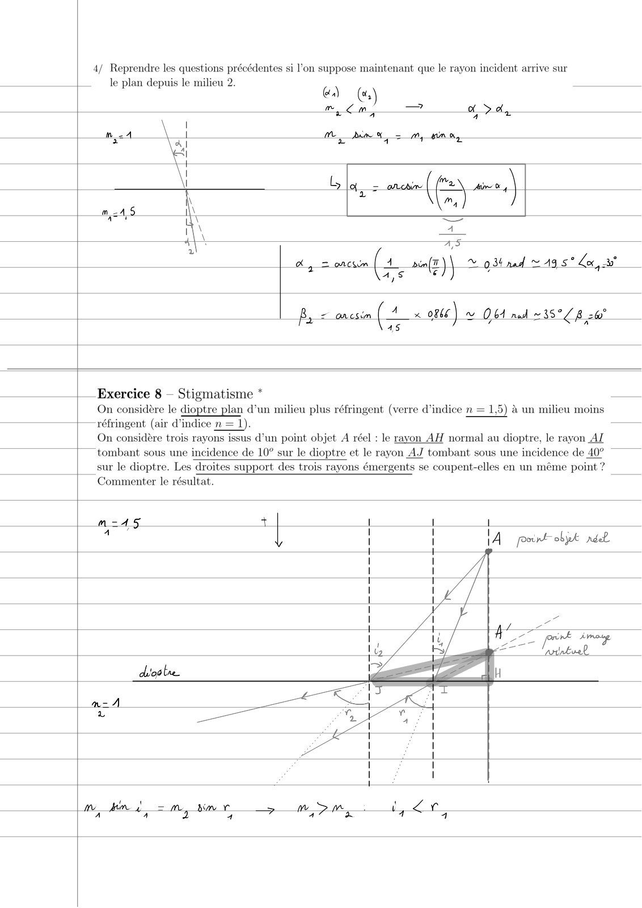
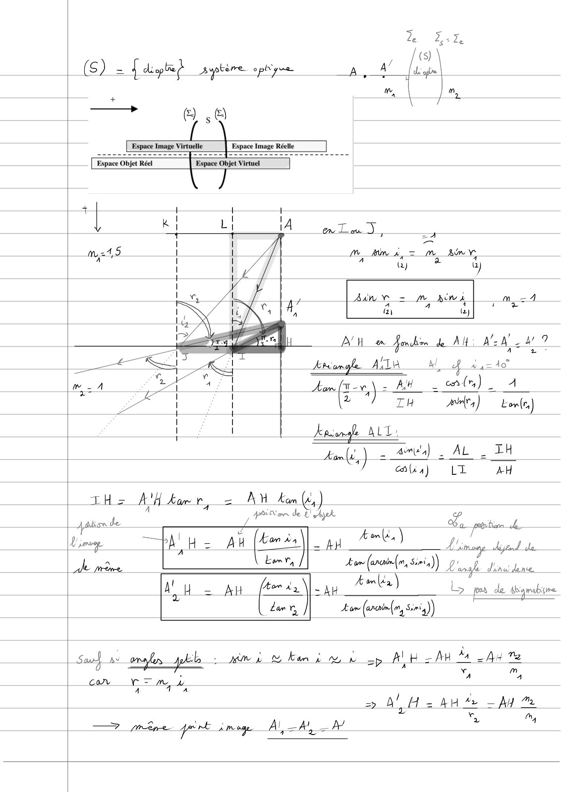

# TD4-Lumiere-Correction-(1-a-8)_2023-2024_Physique1_P1S1_EDupont.pdf

[Ouvrir l’original](https://drive.google.com/open?id=110pAOOHf3OyRYYpidefZ56v-S0cbPBdm) · Les pages signalées comprennent du texte reconnu automatiquement ou des éléments graphiques. Le fac-similé permet de vérifier chaque lecture.

**Pages avec fac-similé ou lecture OCR** — 1–10.

## Page 1

**Lecture OCR à contrôler**

~~~text
TDS: Le bre

Généralités

| Exercice 1 — Expérience de Fresnel

On place un disque opaque derrière un petit trou à travers lequel émerge de la lumière. On observe
sur un écran l'ombre ainsi créée par ce disque. Qu’observe-t-on au centre de cette ombre? Expliquer.

Jon 7x © Newton» Æfdot bs

Aa. famine ed: ous,

are onde = pr

Laminin: au centre

de L'ombe due om disque

opoyse

[4 vides]

Abe ZX $ : Barre. daclile eve = ceyusade

;— Exercice 2 —

doute de phdiors Na

La puissance par unité de surface de la lumière solaire, à la surface terrestre, vaut environ! 1400 W/m?

En admettant que l'énergie moyenne des photons solaires correspond à la couleur-orange, calculer le
nombre de photons frappant une surface de 1 em? à chaque seconde.

= À om _pordork v -

P
7 \ > L FR. uso. por Annee de

a 4400 W [om

dar —— Fee. Bune
J
7 >
VV

patos : E = rage mapare des
~~~

## Page 2

**Lecture OCR à contrôler**

~~~text
=
a [PIE ca Le D P ju unité de anf

4 2
Gm oA Mop ph bers que mit BW MWe sw fae. SE tome AO bn

prdek we Ab.

Enexyce tebe F des Ny debms venu du adit: | F2 Vee
| %

AE editeryend a Lon am = = @o< Ao”,
= 6x0 me
| constante de Planck h = 6,626 0701510 %Js. _ je - À
4 te
& NS 37 (ou Hy)
a Jia
8 dune Le onde a = eT 2 6e 4, v piquer
sr v
Le C1 uk dams Le side
em
=> p= z
à a
& Dam + Æ : c LE
2-4 ow 4 fer Dogs
a
_ =>
Err Ækde : Es N é = N fe
ToT F RE cotun
Ex m4
wo Ee poh « fut) à b = \
Tol | \ \ —
\ =>
A4oo W/m? dom À\ pre &

T=14

Tot

he
cmdème Fe Me ec | =(P_S)% ss [ig] =
Dur

XN

NS
~~~

## Page 3

**Lecture OCR à contrôler**

~~~text
7
.(P sx) on

Asa

— 2 Un
ALN: N ge (400s 10" A) Gxdo
44 x 107" ) fi (6, 63x40) x 3008)
= [At x & 6 \ A0" 3 do x jo > A6
NE ae

(HSE N do à 4 gan Ag?”

663.3 ) =

Exercice 3 — Travail d’extraction mekel
La longueur d’onde maximale pour observer l'effet photoélectrique en éclairant du potassium est de
= 564 nm.

1/ Calculer le travail d'extraction @ (énergie minimale pour extraire un électron).
2/ Si la longueur d'onde de la lumière utilisée est de À? = 400 nm, déterminer l'énergie cinétique

maximale des électrons extraits. .
tlettors

prats

À Doux Us ae prince

ee ee eS A= 56 mm: conde
»

fe phares bkniy ne

fA phatos Bk ve

De Nye 5e mm

À

.Eztv-R(e\ Die
A _' y

ne

E A be constante de Planck h = 6,626 070 15 10-%Js.
4
. !
4 CRovacd dex bruvtion $. ca = E s £ . fe
LCS A à
4

Cant qu E E, (Enerye miviwebs\ me À Dd, Lon aw 27 phetoë ludique

he 8
CS ho 9, Géixm x 3x 40m 35 410 5
— 4 2] 564 x 407 nu 3,6 «10° w DaN

A
Ao «1079
eV: eben - VAE, 1 eV = 1,61071 J.
~~~

## Page 4

**Lecture OCR à contrôler**

~~~text
2/ Si la longueur d'onde de la lumière utilisée est de A2 = 400 nm, déterminer l'énergie cinétique
maximale des électrons extraits. €
€ pate du met
fo ee pre Vevre
&, Ee
. Oks ras letnors ex thoile
= pS [+ =
> a
éledrons
on À al ge de 4 ébctu, tinke dé
A
gd mékal heist
2: P+E = E_- E - $ : ehetge corebiyve
> ce 2 T' oh
bd Eliteers .
Beer £ LE -8- fy -8 he -F
c a L a
> ay Ox
AN: Pa ev
>. = 1
Eo he n 4937410 TY 34e
ET 7,
e - @ - -2-
2 Ee = E- Pos 34-8 2 44 eV pen de ÿltrs de \ > 400 mm
| Exercice 4 —
| Sachant que le travail d'extraction du zinc vaut[@ = 4,33 eV] peut-on observer l'effet photoélectrique
avec de la lumière visible? On donne 1 eV = 1,61071 J.
EB. ied Epes Re 8
3 = Eg pe 177
Ts 1
LA rer *
i“? Re Qj. he md ?
7 :
Man E
. 400 mm <2 < 800 mm
wvetk Just ge
A a
— 4 6,63 x 207%) (3x 408) (6 63 3 rss
D, _ ce ( 1 a ) € eal ee \
Ÿ (4.38 «4,6 4078) (433224)
D 287 «40 me 28m
~~~

## Page 5

**Lecture OCR à contrôler**

~~~text
aa D, < 400 mmr dme pe J! fk. hbo éhdaique dans fe make pure june

Indice

ide pt dans une fibre optique de

Exercice 5 —
différence de temps de propagation de la lumière dans le

Quel est la d
| _ longueur 1000 km et d'indice n = 1,62?
Vide m= A
A =e : :
ve pee ophyue
< 7 &
Le 000 Box A0 = 10 mt
E

and : Mm = > Es _ À
Mois un . c

m=A16a- © 7 & z Lt. 4,2

Ke
Ne $ Lu com (=
pe pee =)
Nb aE + «| = | 2 nl. 1 |4-m| 2 { (m=A)
Er c el © &
7 70
AW br £ (male A0  (ucan al _ 96% à yo tn 20740 7! à
—_ Ce 3 x 0° | 3
Ar. À
Ab © 2otx4o7? » = 20k mas

Exercice 6 - Dioptre plan
| Un rayon lumineux de longueur d'onde dans le[vide| À = 589 nm passe de l'atmosphère à une cuve
d’eau. La vitesse de propagation de la lumière dans l’eau est de 2,25 10°m/s.= Lu

| 1/7 Quel est l'indice optique n associé à ce rayon lumineux dans l’eau ?
ne MZ 4
ow X 8
an ï c 3x40 3
ndbca. ; mM = m= = x
eur de CAR 225 A0 225

sm
~~~

## Page 6

**Lecture OCR à contrôler**

~~~text
m = 1,33

| 2/ Quelle est la fréquence de ce rayon lumineux ? Dépend-elle du milieu ?
nikon de pool dams Be mate

Zoom ow
s) ay: = 4 4 éguence

FE À

Lamson forioe, ma Se wa ft
dire dae ~ © ews
Cc
md Ay = = 589 mm orange
Yade firvole inchangé
2
Can, À = 7 = wT _(¢\T Due com Qe oT
=== Cow 3 mn vale
eam. Ban cow
_ Ww _ (c/n oan) = fel _ _
da Den (Avide /meu) Dust Tree 4
AN: 4 - CRE EL aw 54x40" Wa

Di 569 x AO?

Ds. Me bande pond

| 3/ Quelle est la longueur d’onde de ce rayon dans l’eau ?

A Due 2 565 7 442 9 mm ant
LE Mean A330 —
um À | w _ 225440?
coe 4 54 20%

|_4/ Quelle couleur voit un observateur si ce rayon lumineux lui parvient dans l’air? Même question
s’il lui parvient dans l’eau ?

dans L'air Mag RM ay = À, 'ébateur nt An Dave dram ge (S23. mm)

daw _À en gg = 1,58 ñ P Va. bake 442.4 mm)
~~~

## Page 7

**Lecture OCR à contrôler**

~~~text
Exercice 7 - Dioptre plan
On considère un rayon lumineux traversant le plan séparant deux milieux homogènes 1 et 2 d'indices
de réfraction respectifs n1 = 1,5 et ng = 1.

1/ Donner un exemple de milieux ayant ces indices.

ndice de réfraction de quelques substances à 20°C

Air (4.00) Opaline 1.45

Acétone Plexiglass
Alcool pur Polystyréne
Ambre Rubis
Cristal Quartz
Diamai Saphir
Eau Topaze
Emeraude Tourmaline
Glace Verre
Glycérine Verre crown 1.52

Lapis lazuli Verres flint 1.56 - 1.65 -1.89

. Mm = 1: om wide
T

.myzA15S: nee phe

2/ On suppose que le rayon incident arrive sur le plan depuis le milieu 1 sous un angle d'incidence
a = 7/6. Calculer l’angle a2 sous lequel il est réfracté dans le milieu 2. Tracer les rayons
incidents et réfractés. a, 2 2 BO

&

m =45 mamode Dm =p a, <a,

A : i St
voue :

oe por onu)
3/ Reprendre la question précédente pour un angle d'incidence 3; = 7/3= 60°
: m s
À = onu [cs Air (a) | <-aAcièms _ x os | Brno den
Ma ge

=> por de Kip asbion

AQIS PA
pSflestor Æstalle
~~~

## Page 8

**Lecture OCR à contrôler**

~~~text
4/ Reprendre les questions précédentes si l’on suppose maintenant que le rayon incident arrive sur
le plan depuis le milieu 2.
CA] Ce)
mom

& A 7 +

no 1 Me RS, = my pin

Gla = mmf an, |

m24,9
—
2
AS
ap = onu (4 s(r)| © 034 nad © 49 5° Lo,

B = aacsin (A 0866) Obl nad 35°C 8 2h"
45

| Exercice 8 - Stigmatisme * _—
On considère le dioptre plan d’un milieu plus réfringent (verre d’indice n = 1,5) à un milieu moins

; —~réfringent (air d’indice n = 1). —
On considère trois rayons issus d’un point objet A réel : le rayon AH normal au dioptre, le rayon AZ

| tombant sous une incidence de 10° sur le dioptre et le rayon AJ tombant sous une incidence de 40°

sur le dioptre. Les droites support des trois rayons émergents se coupent-elles en un même point ?
Commenter le résultat.

n=-415 +]

1
1A poort objet nil

_ |
~~~

## Page 9

**Lecture OCR à contrôler**

~~~text
Espace Objet Réel

Espace Objet Virtuel

' '
\ I
\ I
+ 1 ; =A
| I =
! u = m OR
| | Ain = A
I I a) 4)
| |
| s
1 Aste = m NA m =A
A Fr 4 pe
\ ay (2)
Ly

NH em en de AH, WWW 9
A 2 7

Atsomgle Ara M, 4 44240

& | on {tav,\ 2 At. rls) A
| \2 TH a) 20)
Æniondke ALL:
aol) = aires), AL. TH
clin) LT AH
tHe AU torr, = AW Am)
ei de ‘ HP et vie ob, presi
us a
Mimo PAH = pu (les) 4, Are) Li:mang A
à Use, / few (anin(o, Sin) 9. À binds
AH = At (4742 || ap A) b pa de Hymabiire
dar vy Ham (arerin(m, Simi)
Sau} a+ malin pl + mn à Re am nts bop A oI HA oA Te
can rem À VU 7,
> DAs AH te = Ay ZA
À ‘ . A 1 à Fa M4
Eten nn ——
~~~

## Page 10

Page de cahier lignée, sans texte.
