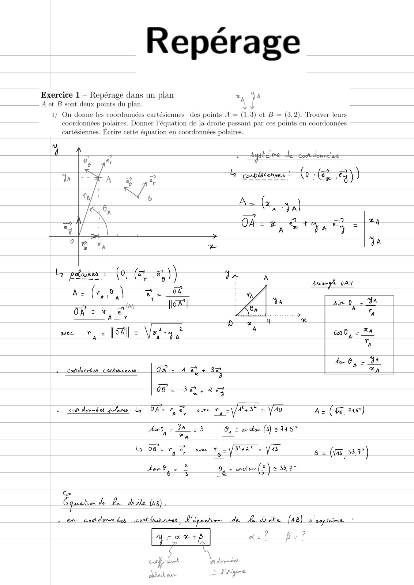
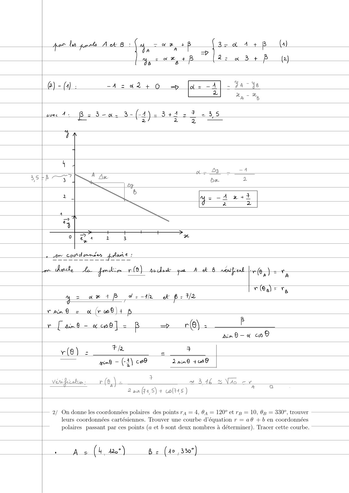
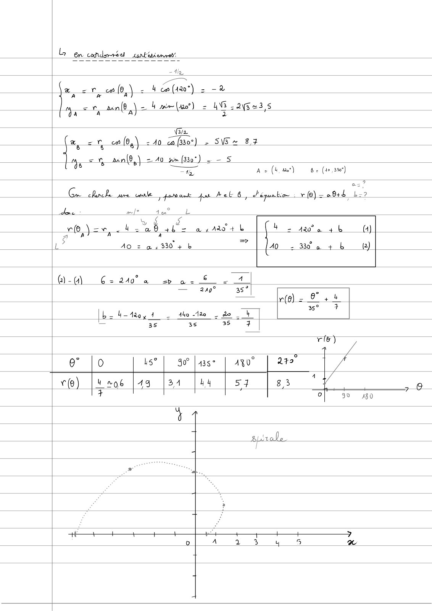
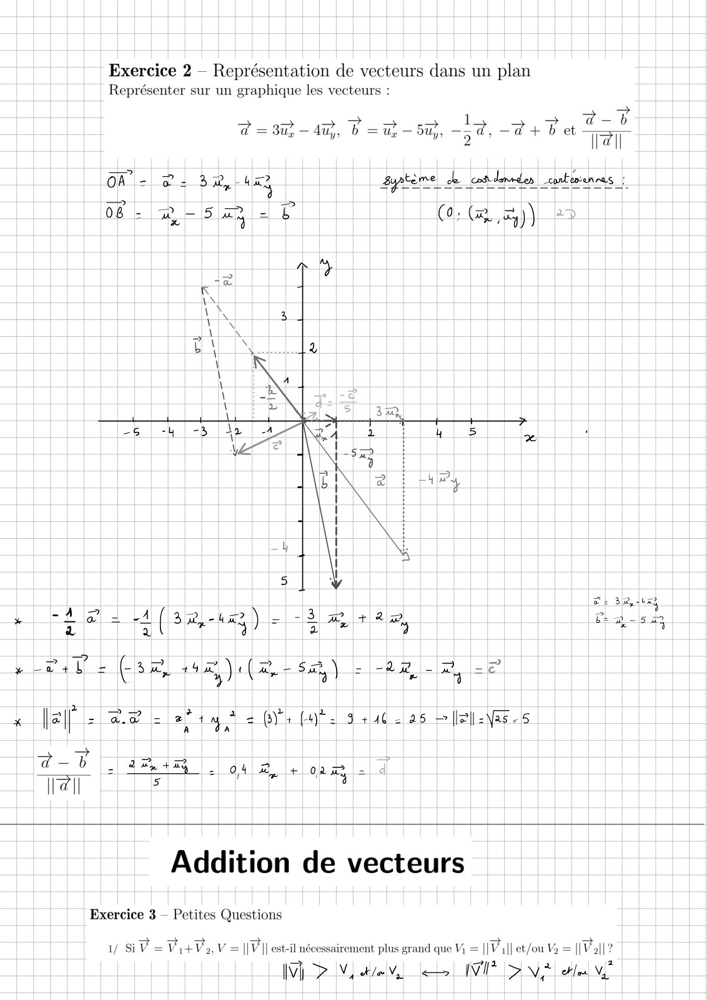
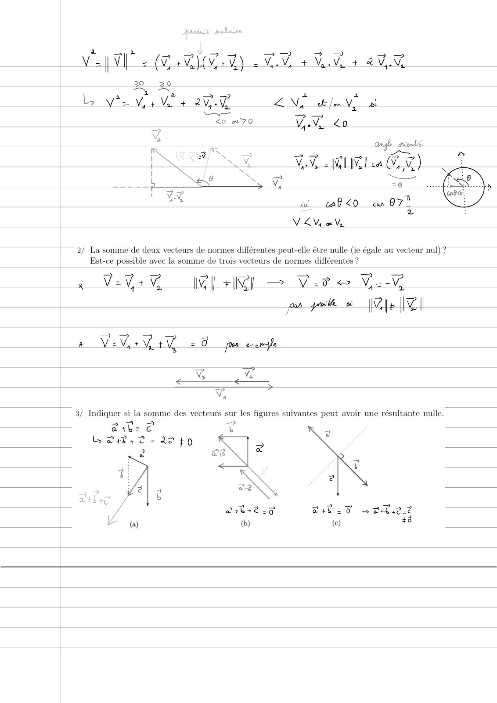
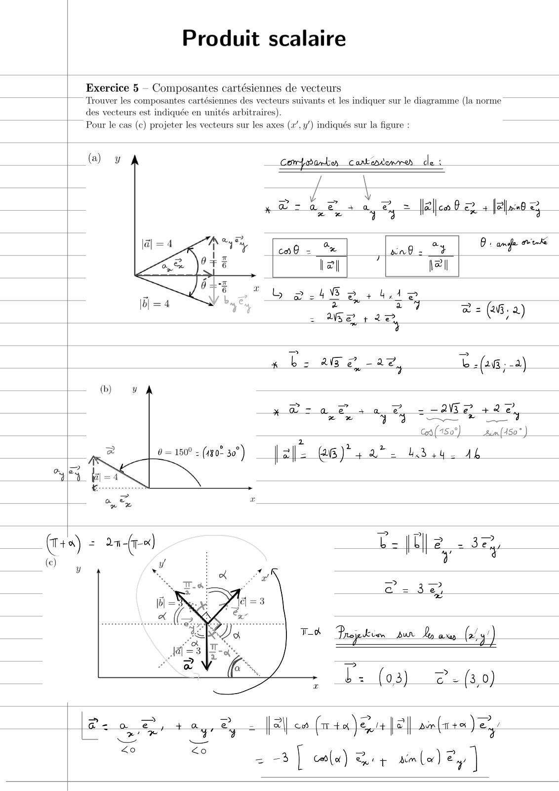
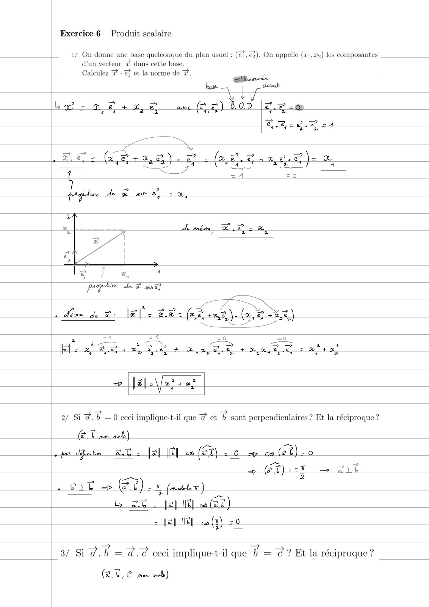
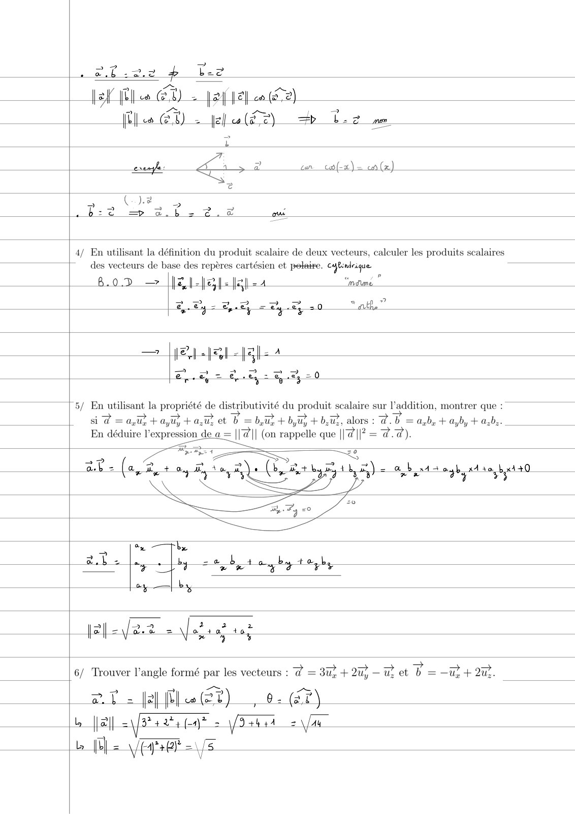
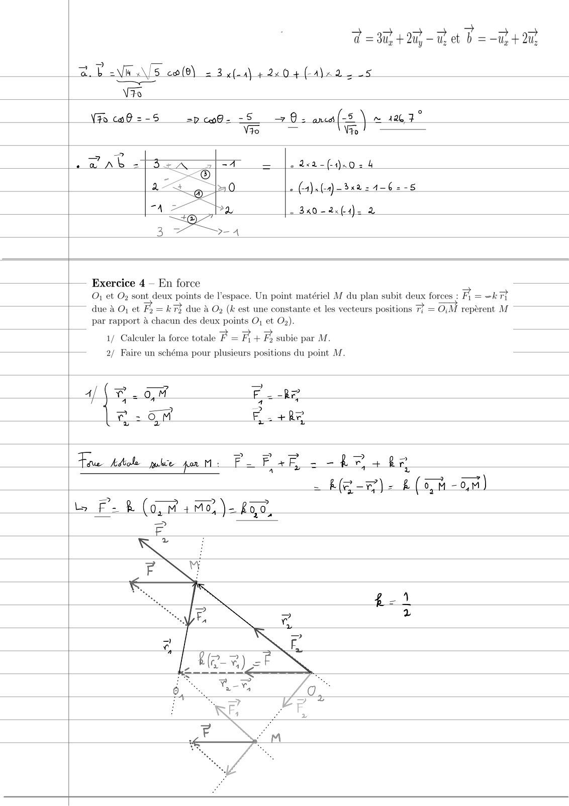
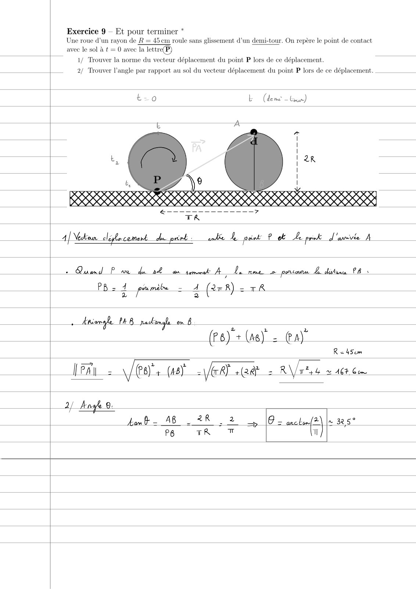

# TD7-Correction-(1-a-9)_2023-2024_Physique1_P1S1_EDupont.pdf

[Ouvrir l’original](https://drive.google.com/open?id=1JzhRSQ59MVlB8SSq5LVlMJiWno6xdUvr) · Les pages signalées comprennent du texte reconnu automatiquement ou des éléments graphiques. Le fac-similé permet de vérifier chaque lecture.

**Pages avec fac-similé ou lecture OCR** — 1–10.

## Page 1

**Lecture OCR à contrôler**

~~~text
Repérage

Exercice 1 - Repérage dans un plan CL

A et B sont deux points du plan. be

iennes des points A = (1,3) et B = (3,2). Trouver leurs
équation de la droite passant par ces points en coordonnées

cartésiennes. Ecrire cette équation en coordonnées polaires.

1/ On donne les coordonnées carté
coordonnées polaires. Donner

LB cabésienres (0: a

2.8)

dA A
: Awamgl OAH
LD
ba sin 6; GA
/SSa ‘ > F
p 4 oa
A _ &A
cab, = ~
A
Kom Oy = oe
|. coñdimréen cantenenner, | OA = A 2? + sy XA
0B. 37,42
mn
+ cot danmbs pu ly R= vy Ca avec a, Yaar L ÿ”0 Az (Wo, 5°)

ss G, = an dar (3) + 145°

wine ve VE

6 = (8 33,7")

sente (2) 2 333°

2 en cordenndes cormtéiaenres L'épuaiee de A dndke (48) s'esprime

4 = et pe 2

off 2
coeff vont gdevrées
ped oom à Layee
~~~

## Page 2

**Lecture OCR à contrôler**

~~~text
por de par A ck 8: EE À 32a 4+ 6 (a)

x a: 3
jy, = ee, 48 x 3 + P

2)
}

42+ 6 =» [a- -A] - 74-48
eg
Hp -
«Ai Bs 3-a. 3-(4)2 34427 235
ul Ap he oe Be E nr
TA
4 2 4
a —
38837 À A BE 2
4 2.
2 | 5 = -A2x2+t
ta
.
at
> + + >
oy) Ou 2 3 2

ME ax + ,d:-1h ck p= 2

Chine = a (rwO)+ p

v [ani - ecoo] = B => r@). — À

ACTE th = ni
— pm — (-4) co amd +0
Véu Diz aim r (6, = ? = 344 % Vio ev
Se at r=)
2 ain (74,5) + 09345 )

|— 2/ On donne les coordonnées polaires des points r4 = 4, 04 = 120° et rp = 10, 0g = 330°, trouver
leurs coordonnées cartésiennes. Trouver une courbe d’équation r = a@ +b en coordonnées
polaires passant par ces points (a et b sont deux nombres à déterminer). Tracer cette courbe.

Ae (4 4207) & < (Jo, 330°)
~~~

## Page 3

**Lecture OCR à contrôler**

~~~text
Len condanréd  cantéiemrent

D
= re (9,\ - 4 ce (420°) - -2

yay a(8 \- Uma) = ANG 223,5

Vin

i ca (04) = 40 ca (330°) = SW 8,7
%

it.
a
o
VON

aen(6,\ = 40 wm (330°) - = S
— Az (4, tet) & = (40, 3%")

TE

as?
Gn chanel ure carte pomant fur Aol 6, d'équaho : (6) = 081d L:?
deme ad is tee L

y & °
offre 1 RÉ ols a y A0 + L PRE (4)
aA A 4
À

=>

L Ao = a 13304 b 0. 330 à + b fa)

@-0) 6-2 a » o-% - 11
— 24g? 3s°| 5
— r(e) = 9° + 4
35°
[b= box 1 do 120. do __h
= 35 36 35 4

9" |0 ls? | 90° Jase | Aÿ0° 27° a

c@) [usoe [as [a1 las [sa [as ‘“ŸY

>
p
oe
ic
a
R Ÿ
~~~

## Page 4

**Lecture OCR à contrôler**

~~~text
Exercice 2 — Représentation de vecteurs dans un plan
Représenter sur un graphique les vecteurs :

> 1
d = 3u,—4u,, b =u,—5u,, -~d, -d + b et
! 7 2 Ir

Œ- à 2-0 (9; (Ray)

Fy
Sr = = zy =
x ae +0 + (Sees +4 (Rs) = LR -2
> =
2|| > ae = site = Gyr (Yt. 9 +462 as > ell \as-5

Addition de vecteurs

Exercice 3 — Petites Questions

1/ SV =VitVo, V = ||P || est-il nécessairement plus grand que Vi = ||Va|| et/ou Va = || Pal]?

IV Ny kde, en IID NF etl NÉ
~~~

## Page 5

**Lecture OCR à contrôler**

~~~text
> ms Mer 3 > 4 >
Vel V2 (24 \(y.V) VV 4 Vi 4 a
BR 20
Le Ng = 2 2
Ly vie Vi V4 app Vo pe à
= <o «70 AA 0
= = angle sriemke
ah 5 ay S a
| FLUX VV WU) ca VW)
I was Ny = Waly Peas OY <
! e Se a
L ss M, ze >
i

i 0 <0 ew 075
a a
VEY où Vs

En
C7

2/ La somme de deux vecteurs de normes différentes peut-elle être nulle (ie égale au vecteur nul) ?
Est-ce possible avec la somme de trois vecteurs de normes différentes ?

x VeVi

I +R —

Vit <& V _.V

A=

es pn de v

AI

ye
<_<.
v

3/ Indiquer si la somme des vecteurs sur les figures suivantes peut avoir une résultante nulle.

CAE ?
ly 24842 = A240

er
~~~

## Page 6

**Lecture OCR à contrôler**

~~~text
Produit scalaire

Exercice 5 - Composantes cartésiennes de vecteurs
Trouver les composantes cartésiennes des vecteurs suivants et les indiquer sur le diagramme (la norme
arbit

des vecteurs est indiquée en uni

Pour le cas (c) projeter les vecteurs sur les axes (x”, y/) indiqués sur la figure :

_Comdamlien carkeriemres de :

To Projpvon pur D ox (a4)

= l'- (03) @- (3,0)

QU

= oe, + oy, ey = l= cs (T+ eit |e pm (at ae
Sat Sr
Zo

=O 2 =3 [ cfa) tt am (er) zy |
~~~

## Page 7

**Lecture OCR à contrôler**

~~~text
Exercice 6 — Produit scalaire

1/ On donne une base quelconque du plan usuel : (ef, @%). On appelle (1,7) les composantes
d’un vecteur @ dans cette base.

Le Calculez @ - Z et la norme de #. _.
| dl

PES JE ane

Mam de 2: VEV 2 RE: fine). (rx)

es Grue)

= >
| 2/ Si @.b =0 ceci implique-t-il que @ et b sont perpendiculaires ? Et la réciproque ?

per dif lim er: |+ El 0 of).
~~~

## Page 8

**Lecture OCR à contrôler**

~~~text
4/ En utilisant la définition du produit scalaire de deux vecteurs, caleuler les produits scalaires
des vecteurs de base des repères cartésien et polaire. cn

8.02 — |f#l-}e1- fal aa “matans”

y= Bey = Ty 20 at?

el

2

RC RCE
2, = € oy = eg = 0

| 5/ En utilisant la propriété de di: stributivité du produit scalaire sur l’addition, montrer que :
si @ = aus +ayu? + a,ù et D =b LU + du + DU, alors : @.U = aby + ayby + a:b..
En déduire l'expression de a = || #|| (on rappelle que ||@||? = a. à).

Fit =o

1e) = a L goa sabre, beta

| ar - a, À ty Rte) .

pu
4
#
(
aS
e
Lu
6
a

ay —| by
| 2 2
= \fo 4a” 40
Nr 4 4
7 ; 4 + o> ar
| 6/ Trouver l’angle formé par les vecteurs : @ = 3u; + 2u, —u: et b = —u; + 2uz.

BL 2 ff EX), 07)

Dal 21/84 244 (a)? = Var 2 Vu
lo [Ul = s/s FE = 5
A
~~~

## Page 9

**Lecture OCR à contrôler**

~~~text
>
d = 3u, + Qu, —u; et b =D +2

= 3x(-4) #2404(4122, 25
ee
Vio
Vio cof =-5 =p co9- -S + 0: an(s Ÿ naa 7"
Vio ~ Vio

« 1x2 - (120 2 4

zg (4). (-2)-3x@ 21-6 =-5

340-2x(4)- 2

-— Exercice 4 — En force

Où et Op sont deux points de l'espace. Un point matériel M du plan subit deux forces : Fi = -k7?

due à O; et Fy =k 73 due à Op (k est une constante et les vecteurs positions 7? = O;M repèrent M
par rapport à chacun des deux points O, et O2).
1/ Calculer la force totale F = Fi + Fh subie par M.

2/ Faire un schéma pour plusieurs positions du point M.

Tn FR?
a 3
Le 264 Fa +ke
~~~

## Page 10

**Lecture OCR à contrôler**

~~~text
Exercice 9 — Et pour terminer *
Une roue d’un rayon de À = 45cm roule sans glissement d’un demi-tour, On repère le point de contact
avec le sol à t = 0 avec la lettre(P)

1/ Trouver la norme du vecteur déplacement du point P lors de ce déplacement.
|__.2/ Trouver l'angle par rapport au sol du vecteur déplacement du point P lors de ce déplacement.

t-0 L (deme — Gear)

40, OO, 0, OOOO 000,00 OOOO OOOO, 0 OOO, O,O,4)
SIRET SSII ESS

A| Nedioun cleple-coment: du print: enlie Le ovink Pet Ae pont d'anivie A

+ Quand P ae de pt ax sement i Danese porte Ly distin PB :

PR 1 prumibe - A (2rR) = TR
EY al

Aréamgle 48 packanale em B

(Ps) + (46) = a)”
R=4Scm

Pay. \/@8)"+ (sy VERT Get 2 RV etek suc

V
~~~
