# TD8-Cinematique-Correction-(1-a-7)_2023-2024_Physique1_P1S1_EDupont.pdf

[Ouvrir l’original](https://drive.google.com/open?id=1Q2eNSA1rMvUFOcLPBRhQCSAO8a5-OHMp) · Les pages signalées comprennent du texte reconnu automatiquement ou des éléments graphiques. Le fac-similé permet de vérifier chaque lecture.

**Pages avec fac-similé ou lecture OCR** — 1–17.

## Page 1

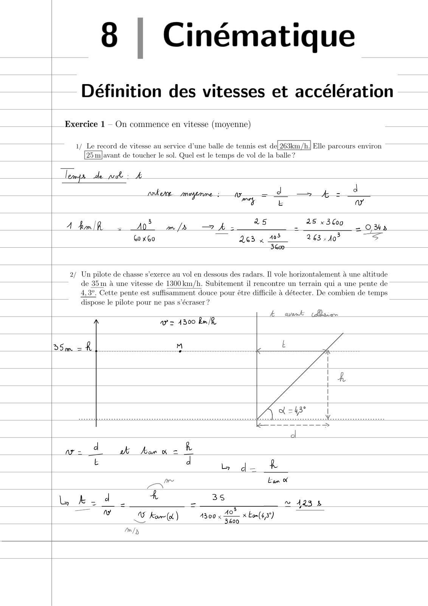

**Lecture OCR à contrôler**

~~~text
8 | Cinématique

Définition des vitesses et accélération

Exercice 1 - On commence en vitesse (moyenne)

1/ Le record de vitesse au service d’une balle de tennis est de[263km/h.| Elle parcours environ
25 mJavant de toucher le sol. Quel est le temps de vol de la balle?

l'es de wh sh

abere mayenme Wray =

f 3 26 x
A ml 2 AN m/s —k= *8 = 300 _ oma
Go x6o 265 4 20% 263, 10? Ss
3600

2/ Un pilote de chasse s’exerce au vol en dessous des radars. Il vole horizontalement à une altitude
de

n à une vitesse de 1300km/h. Subitement il rencontre un terrain qui a une pente de
Cette pente est suffisamment douce pour être difficile à détecter. De combien de temps
spose le pilote pour ne pas s'écraser ?

A avonk (lise
ay = 4300 En/R “

Sm =R| M

bub Jd. k&
ae | Ean À
Lk. 4 - 4 = oF 4a
La VU kav (ot) 4300 x _ x Eon(4,3°)

m/f)
~~~

## Page 2

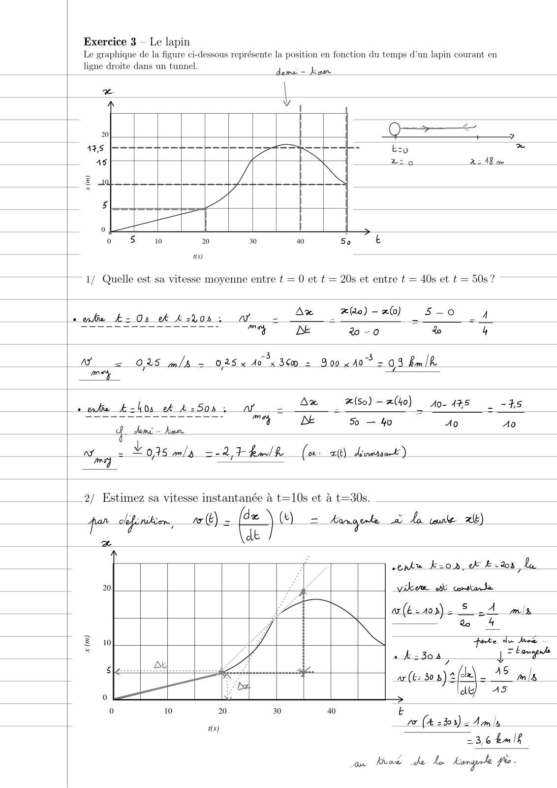

**Lecture OCR à contrôler**

~~~text
Exercice 3 — Le lapin

Le graphique de la figure ci-dessous représente la position en fonction du temps d’un lapin courant en
ligne droite dans un tunnel.
8! dems - kor

* \
A Vv
1
20 A
175 2e
| AS
a.
L_ 5
0
15)
5 1/ Quelle est sa vitesse moyenne entre t = 0 et t = 20s et entre t = 40s et t = 50s?
. 7 chon: w _ Dx _ Æ(to) - x60) 5-0 1
D ms M %-0 & 4
nh ~
= 025 ms = 025 x 40x 36m = 900 «40 = 93 Émlk
«of zh 4508: nr © S* | #60) alle) 40 495-35
rr RRRRRESS % De 50 —
don ham a ee 19 sd
wt = Vos mg = -2,F hal (our lt) dénamret)
7j 2 ==“ rl ol le 2

| __2/ Estimez sa vitesse instantanée à t=10s et à t=30s.

for chfenilèm. rel) = ES) (D = tangent, à de cate at)

CA

ete E-o», de Æ-208 Le
20 5 vikene at conotante

7 ——" &

= 10 forte de ed
x Fé whe
L i «+230, JE TT
; w(eos0s) (oe) - As mls
ad 45
3 40 Eb
L a (4233): Amis
us) à
=3,64bmlf

an fad de Le Kamynle fo.
~~~

## Page 3

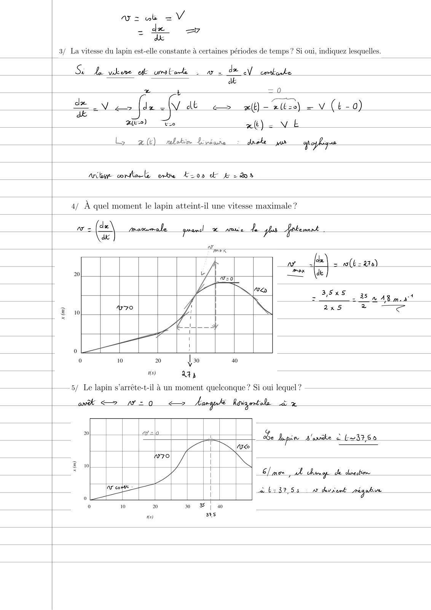

**Lecture OCR à contrôler**

~~~text
ay = ok = V
= de =D
dé

3/ La vitesse du lapin est-elle constante à certaines périodes de temps ? Si oui, indiquez lesquelles.

Si Le vikene eft umatorls : ar. 4 VV embute

d&
x + =o
a {ae “fv dé <> x(t) - tés) = v (4-0)
AE) Le at): VE

Ly a(t) bohm Liane drake yur ph

ait conflate entre tz09 &

k=»

4/ A quel moment le lapin atteint-il une vitesse maximale ?

ay = (=) Amonumale game x nue de ps Jstement .

a

is À 2 w(t = 278)
n mer \de |

ro
LUXE as AR mat

70

2x5 2 ce

+} 5/ Le lapin s’arrête-t-il à un moment quelconque ? Si oui lequel ?

as) aq b

and <> "= 0 <> langue Raigntole à x

20] AY =}0

ee = - be Lapin s'avêke à (3755

M<o

x(m)

6) mow, sh Rema de dinechion

A b2 37,86 9 dut rigahve

0 10 20 50 | 40

00 as
~~~

## Page 4

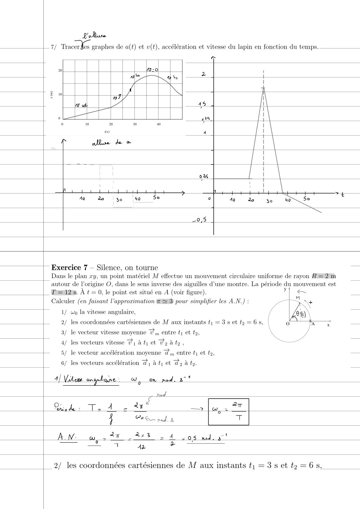

**Lecture OCR à contrôler**

~~~text
Youre

7/ Tracerdes graphes de a(t) et v(t), accélération et vitesse du lapin en fonction du temps.

r

x 4m)
à
&

à
==
LE

| 49
|| !
° 428. H
oO 10 20 30 40 = i
mn 4 |
ia T
are de o Li
- | i |
I
\
Li]
0% !
, st
' i ot
40 do 30 Ho Se o 40 do 30 4

Exercice 7 — Silence, on tourne

Dans le plan zy, un point matériel M effectue un mouvement circulaire uniforme de rayon RE=2m
| autour de l’origine O, dans le sens inverse des aiguilles d’une montre. La période du mouvement est

B=u2%s. À t = 0, le point est situé en A (voir figure).
Calculer (en faisant Vapproximation #213 pour simplifier les A.N.) :

1/ wo la vitesse angulaire,

2/ les coordonnées cartésiennes de M aux instants t; = 3 s et tg = 6 s,

3/ le vecteur vitesse moyenne Vp entre ty et ta,
4/ les vecteurs vitesse Uy à ty ct V2 Ate ,
5/ le vecteur accélération moyenne @ » entre # et to,

6/ les vecteurs accélération @ à t, et do à ty.

Sf Ve ngpVabios ca, ie pad a4

; had
Quodr Te A = 20 =
4 PO pad. 3
AN w 22 843 2 4 los md. 3
— 0 FY —_

| 2/ les coordonnées cartésiennes de M aux instants {1 = 3s et ty =6s,
~~~

## Page 5

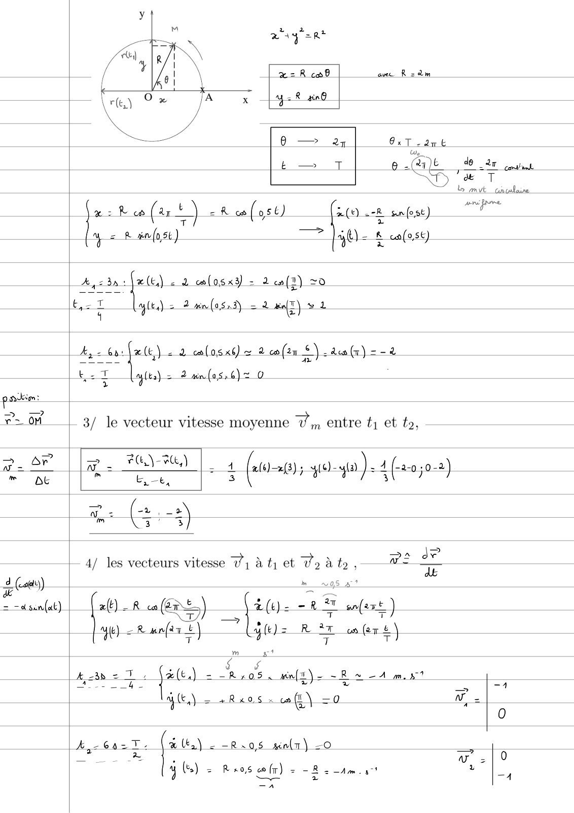

**Lecture OCR à contrôler**

~~~text
a's yee

w= R cod aver Rom
p= and
6 — 2 OxT ant
E— 7) e-Cn)e 4 tr cout
"ae T
by mvt cntalaise
(a: tee (ar +) =A ca(ost) (5.(0 2-8 sin (ost) ET
T FA
a= Bim (ns) 7 Ja) = & ea(ost)
k,:3 x(t) 2d ca(0sx3) = 2 (1) +0
6, ; (ts) z 2 ren (0,53) =2 #5) vai
‘ x(t) 22 c(osx6) ~ 2 co(tn €) des (x) == 2
alta) = 2 nin (05,6) = 0
3/ le vecteur vitesse moyenne Vin entre {1 et to,
=> OP R(t.) 2Ut,) | ) 4 oan.
ees TF 4 {ali}; 49-40 2Afa 0;0-2)
2 (+. -2\
LE 3 3}
. N N DA dv
— 4/ les vecteurs vitesse ré at; et Ve ate, 1
d (code) m 0S 4°
pr =
LD A & 2 = a
a sun(at) a(t) R ca (GR) “|e R sn(ext )
i _ a
= Runfirt) {)= R : on (ent)
oe
£
ka = 1, (xe(t,) - pos mnfr\ 2 2 R ~ LA my? \
CRE 2 cv = =
JE) = «Re0s col) =0 w=
0
Ga=T, pure x0,5 nm) -O 4
oP: a =| 0
= R x05 colt) = -R 2 -Am. yt zu
aes. à —4

=A
~~~

## Page 6

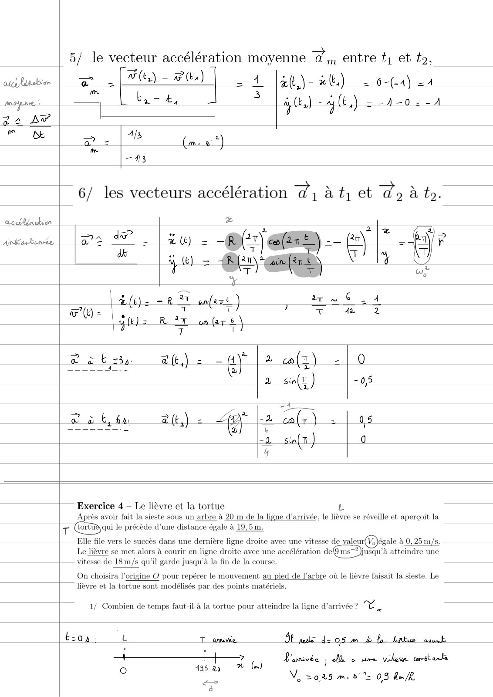

**Lecture OCR à contrôler**

~~~text
5/ le vecteur accélération moyenne re entre {1 et ta,

at | or [F0 - PO) À 4 [gay eb) 204
mare: CDN 1 = ETAT EE ETES]
34 IF | ____
" Be Gee Us Cm. act)
43
| 6/ les vecteurs accélération ré à t, et do à ty.
œcciténakion x ote =
étés! [oe 4. | uy - glen), —{ {ir
OR 0 wh

ore Se A
/ T 4 2
2 cr) -| 0
a
2 sin(_) -0,5
L
=
a
-2 car) 2 | 05
ni
La sir) 0
2 /

~~ Exercice 4 - Le lièvre et la tortue
| Après avoir fait la si

7 GomTaid qui le précède d’une distance égale à 19,5 m.

| ___ Elle file vers le succès dans une dernière ligne droite avec une vitesse de valeui
Le lièvre se met alors à courir en ligne droite avec une accélération de
vitesse de 18m/s qu'il garde jusqu’à la fin de la course.

qu'à atteindre une

lièvre et la tortue sont modélis

par des points matériels.

1/ Combien de temps faut-il à la tortue pour atteindre la ligne d'arrivée? ©.

E-04. L T_amivée À pus d= 05 m à fo bata au
+ + i Pasivée ; ble à wre vilese write
435 fm
2 * Vi 50,25 m. 2°72 03 km
ee | ,

te sous un arbre à 20 m de la ligne d'arrivée, le lièvre se réveille et aperçoit la

(V,)égale &.0, 25 m/s. —___

On choisira l’origine © pour repérer le mouvement au pied de l'arbre où le lièvre faisait la sieste. Le
~~~

## Page 7

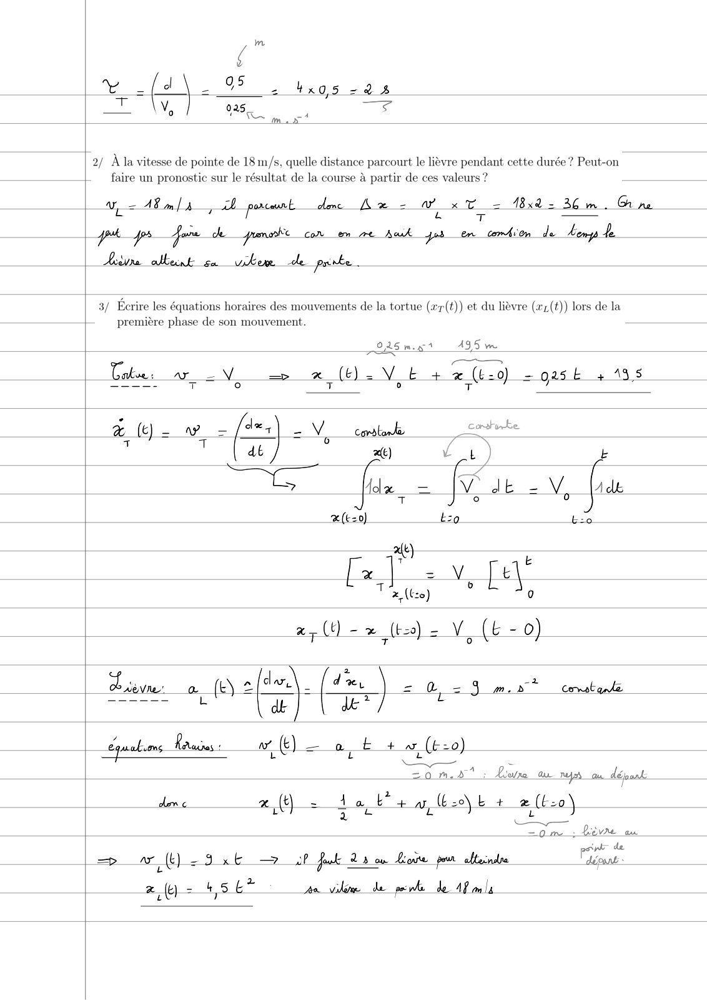

**Lecture OCR à contrôler**

~~~text
ce

-\-2 2 4xas -a 2
TO W

2/ À la vitesse de pointe de 18m/s, quelle distance parcourt le lièvre pendant cette durée? Peut-on
L faire un pronostic sur le résultat de la course à partir de ces valeurs?

av, = AB 7m] À

if porcaunt —_clene Lx - Ww x = 18x22: 36m Gh no
T

ri
pr ps Jos ch ponoke con en re hark yes en comtion de Lemys te

Are obbenk sa ikem de psibe

3/. Écrire les équations horaires des mouvements de la tortue (ær(t)) et du lièvre (arz(t)) lors de la
|. première phase de son mouvement.

0,25 mit 1935 m
Calne ar aN, =p (t) 2 Vib + æ (20) = gask +135

“(je “FA LV Ent cash be
T T 7

{ dt 2 x6) Zt)
7 fide = Iv dE

E
z V (ue
a)

~(c=0) kzo be

a)

mn

ë
[x,| Ns FA,

x (4) = æ_(t) = Vv, (b - 0)

= a

= Jim. db Comat anda

és ¢ Rares w (6) = à E + x (k-0)
L L L
LE =
som d* : Lope au ryss au départ:
Le x(t) 25 de tx a, (ze L + x (ko)
wi
=o Livre aw
2 _ pr de
ar (6) 2 5 x —7 iP fut 2 3 où Love pur oltendre dégats +
a (= 4,5 E? Aa vile de pue de 49 oma
~~~

## Page 8

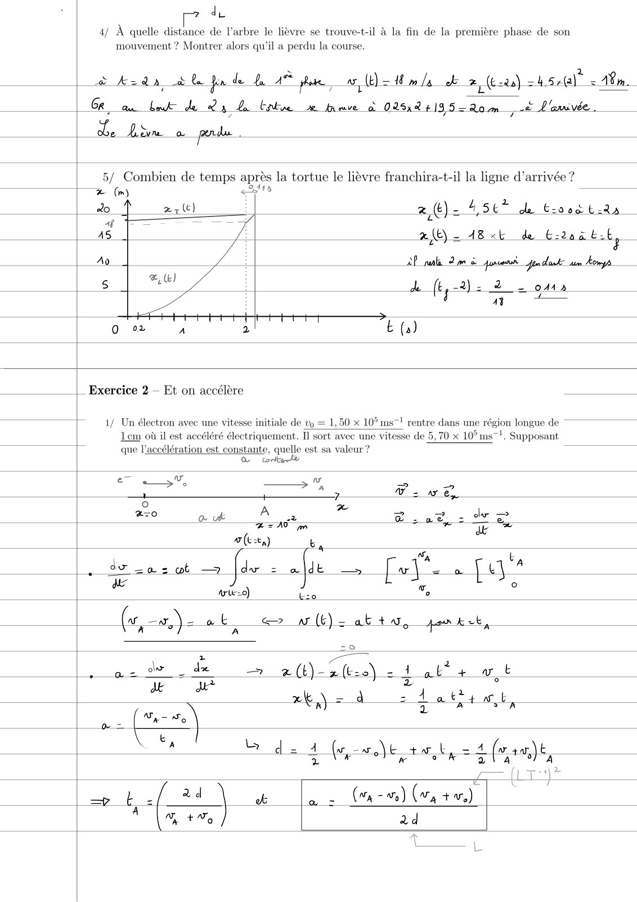

**Lecture OCR à contrôler**

~~~text
de

4/ À quelle distance de l'arbre le lièvre se trouve-t-il à la fin de la première phase de son
mouvement ? Montrer alors qu’il a perdu la course.

= 2
hadnt be fin de Le AM pue oe (= m/s chm (boas) = Se (@] «An.
GR, an Lot de 23 La Entre xe trove à 026x24195=R2om ,-é L'amivée.
Le Live à pod
5/ Combien de temps après la tortue le lièvre franchira-t-il la ligne d’arrivée ?
EC) 2115 e—
; ——_— 2b) 2 4,56 de Eos te2a
ag
AS 6) AB xt de 6-2aaà kit
7H) = 48 « sètet,
Ao AP sant 2m à param gon cake am era
s os de C 2) 2 2 2 041»
‘i n LT
o & à 2 E (4)

Exercice 2 — Et on accélère

re dans une région longue de
70 x 10°ms~!, Supposant
on est constante, quelle est sa valeur ?

OW cont
—
A
on B= AT am
(b=)
ov 2a: ot — (se = mt
ae J
4-0)

ae dde
dt dt
na)
o =
Sa le de
=p t - 24 ok ai = (wave) (vs +070)
A NW $07

° ad
~~~

## Page 9

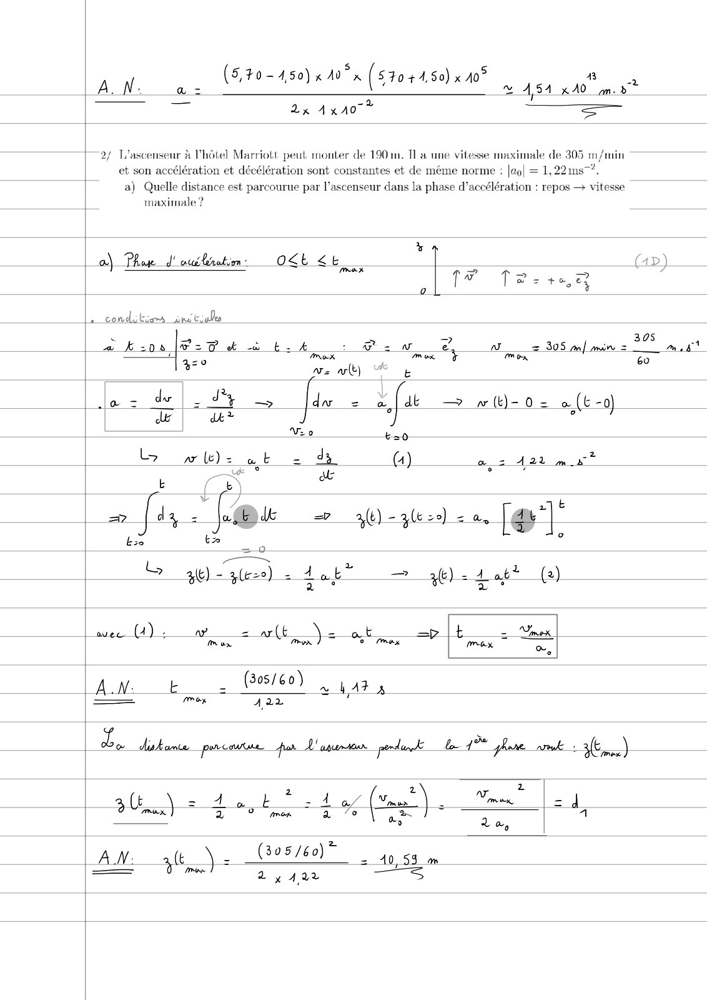

**Lecture OCR à contrôler**

~~~text
5,40-450 x Aen (570 4,50 0° 43
AN. a= (6 d RASE] wd Me A4 AD md?

Lx 4x 407%

2/ L'ascenseur à l'hôtel Marriott peut monter de 190m. Tha une vitesse maximale de 305 m/min

et son accélération et décélération sont constantes et de même norme : |ao| = 1,22ms 7.

a) Quelle distance est parcourue par l'ascenseur dans la phase d'accélération : repos + vitesse
maximale ?

%
0) Ph d'ouélérabm: OS Lb

x i (4p)
L

a condi tiers ani tale

“ 305
a hips [20 & à tik 1 Paw €, a

= = + = 305 mm min = mat
. ox oe te
LE az alt) : E

—  ]dw = 2 {at —_wlt)-0= o(t-o)
de de 7] °

620
Bowl: ot = de (4) me 2 À tr qu NE
5 i,
&
ty 2 L@w ( Tab
ar {4 - ji —_ a(t) - 4le22) = 0, [ee]
bs te °
=a
Ly) glee) à Lab > gt) = 4 at (2)
wee UV). ws mt Ne ot =P bt a
AN: L _ (308/60) à LA3 y
mox Ald

dish amu perce pad L'agent perdant 1 fe am -3t..)

2
~~~

## Page 10

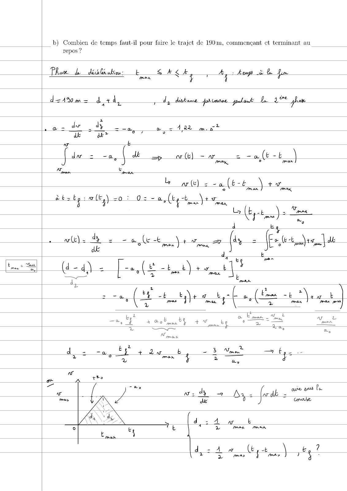

**Lecture OCR à contrôler**

~~~text
b) Combien de temps faut-il pour faire le trajet de 190m, commençant ct terminant au

repos ?

Pore db dééGiabimr b Sk gk A, hemp ia ba. Ji
het de cam. <= Ag j 277 fam
dsA%m= di xd, CT
was dr 4 o = 122 mst

7 ee 5

a 2

fur = a, | dE =p ar (6) =a = -a,(¢-t_)

w 6

4 we) s-a(b-e \ +

à Tmax ree

abs : E \ =o : = 5
tg ul) oi 0 a te CAES

d ë “
¥
L di _ a _ {c 7
«le . wc Ca) + wae fa fe: & ban) dé
d t
— a en
(ded) = [ua (ur ass 41
ñ o\ TS max |
ne ban
2 2
+ = t “a b ole Eur LE 2
æ as (+ te s\+ ra F sy mr +
Le, 4° bt a, Ema 2 ont ve
EE —
Na
d= ty 4 2 b ~ 3 Mme 9 bye
RE RE DEN Er j
Ww
a tho
TT sp
ae _d : qe pra Pa
oa [, / sity > by = fordb =
ANS = law à
D mer RRA
“| tigi“

a
j
i
à
=
~~~

## Page 11

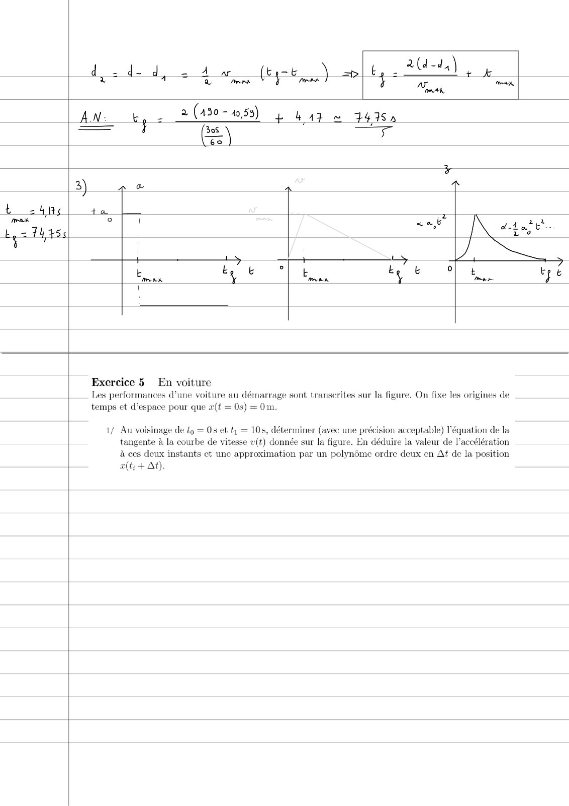

**Lecture OCR à contrôler**

~~~text
dpe ded, 2 Aw pes) te

x Es a Es T
me
ke . 2 (430 - 10,53) + k417 e 7435
(=) Tr
Go
ES
3) œ T |
shits ta.

Exercice 5 En voiture
Les performances d'une voiture au démarrage sont transcrites sur la figure. On fixe les origines de
temps et d'espace pour que a(t = 0s) = 0m.

1/ Au voisinage de fg = 0s et fy = 10s, déterminer (avec une précision acceptable) l'équation de la
— tangente à la courbe de vitesse v(t) donnée sur la figure. En déduire la valeur de l'accélération
à ces deux instants ct unc approximation par un polynôme ordre deux en At de la position

= a(t; + At).
~~~

## Page 12

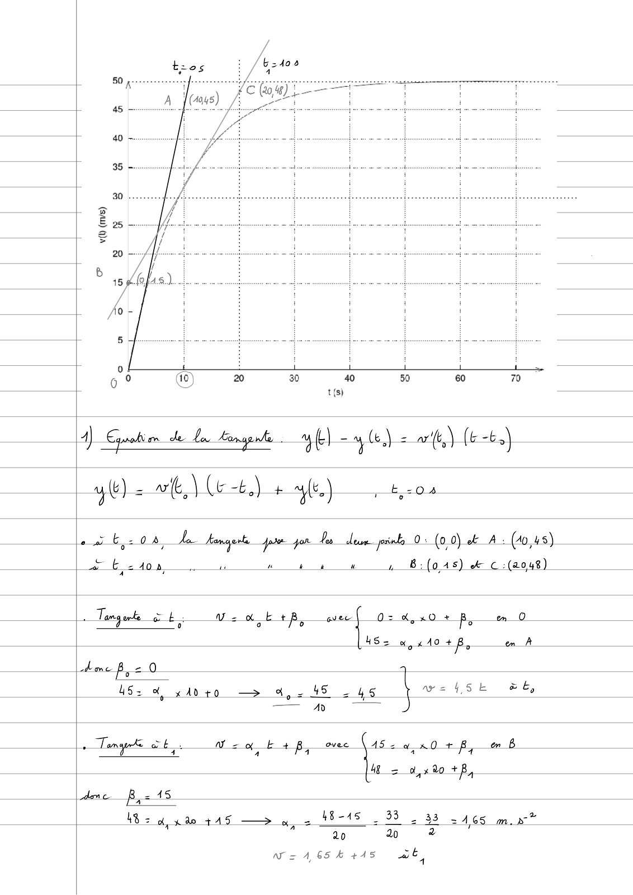

**Lecture OCR à contrôler**

~~~text
E -024
0

ow 6,08, de rt ee a de prnds 0: (0.0) & A: (40,85)

B: (045) Æ C:(a048)

ob 2408 ‘ …“
Tang urke ot, Vz kk +B, = +B,
uss x10 + By en_h
Ame B, = 0 2
46. 4 x A10+0 —> 4,. 46 14 nee 45 b CA
— nw —— J
Ti _ a wz ok + B, over (452 « O +R, en B
fa 4 a

Hz o,xdo +B,

dane B= AS.
48-15 | 33 2 33 -46es mix”

WSs gd pao +45 —> à
4 a
20 20 x

we A 65h 44S we,
~~~

## Page 13

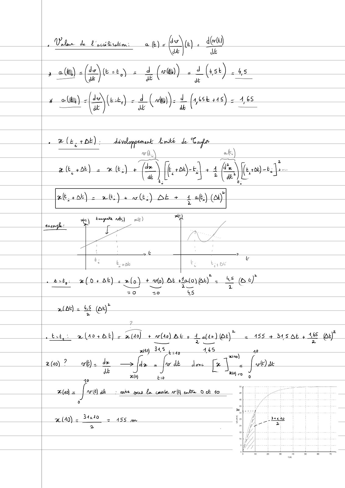

**Lecture OCR à contrôler**

~~~text
Von de L'on birobion’ of e) 4
; CORDES) d (ot) - 1 (vs) 245
4 ol) [32 (sk) = 4 (we): 4 ‘ fuseus) = 4,65

x(k, +E): mar Aim de Top
+)
4 co El (0- 1.

a(t, +dt) = 20.) +4

alt, + n6\ 2
mt nt) at) a.
et /
csergfe: Lb ré
i at _
ne bea t NT
«babys (04 SE) 2 x(o) + vb) At dope) = 45 el”
SES me dre TL
=0 20 45
ald) = LS (pe)”
(OS)
2
=
bet: (404 ht) = mo) + bel Be + told alte) (O6)” = 155 4 MS Ab + AS @)
xt) Us, Ezto 465
za)? a) = = — fe fa d ET: fo
x)
raie fra Lane pad La conte nf onthe 0 ok to à
a nif
40) =< 342 2 456 y i] À ae
2 7 py
w VA
14
17
~~~

## Page 14

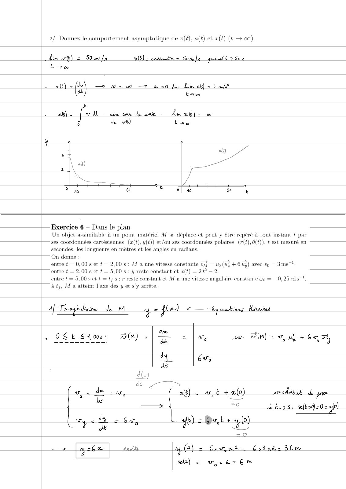

**Lecture OCR à contrôler**

~~~text
2/ Donnez le comportement asymptotique de v(4), a(#) et a(t) (F — 00).

Aina ne) = 50 me [a a(t) = contente = Som/a quad & > S04

E=%

alt) fe — Ni —7 à 20 due Lim alt) = 0 mot

Env

me fuit am mn Due | lim 24) = 0

4 de wl) Eu
Ye |
6)

à

ct)
2
Sa — sn +
ap 60 € o| 40 50 &

| Exercice 6 - Dans le plan

| entre t = 2.00 s ct t= 5,00

Un objet. assimilable A un point matériel M se déplace el peut. y être repéré à tout instant £ par

ses coordonnées cartésiennes (æ(t),y{#)) et/ou ses coordonnées polaires (r(t),@(t)). t est mesuré en ———
secondes, les longueurs en mètres et les angles en radians.

On donne :

entre t = 0,00 s et t= 2,00 s : M a une vitesse constante Thy = Up (7 + 6%) avec vo = 3ms°!.

y reste constant et a(t) = 24? — 2.

reste constant et M à une vitesse angulaire constante wo — —0,25rds 1.

entre = 3,00 $ et 4 — tps:

| Ady, M a atteint l'axe des y et s’y arrête.

4] Ta age dre. de M: 4 = fe <— égrekios Reruded

~ OSE £200: a(n) - | is an (M) 2 DP + Cu D

d

de.
Æ
dy 6%
dk

at) = a,b + a(0) wm hes if de ja

= "i

de
ay 2/4 = ba, Ly: [CAES 30

dt | (2) = Bir eter À state BC

x) = argn d= G™
~~~

## Page 15

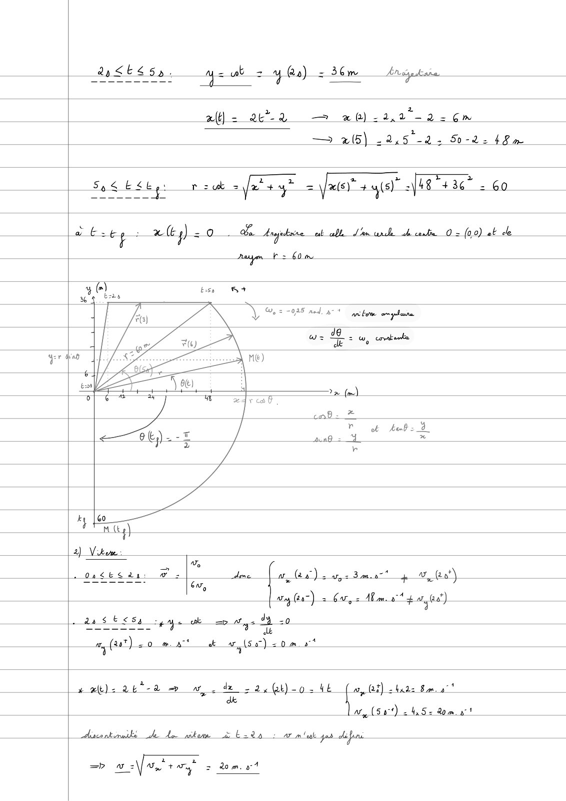

**Lecture OCR à contrôler**

~~~text
36 Ang nie.

R>
È
IN
FA
IN
ha
b
[ll
ss
à
4
as
BS
>
Ra
4

afl) = 262 = al) 22,2°-2 26m

— 25) 22,52, 50-22 48m

Aasyon b> 60m

= il
oy 6 " Bade cat
Sf cof. #
rt inf > 9
8E)--T 18 = D ir”

7 | a, (GA) 2 vs 3m" 4 9, (ot)

[ary (207) + Gary = Am vt payee’)

abit fp: x (4) = 0 a. Anges ob able d'u urs haute 0 (00) at de

r
A
Eke

y (aut) 20 mat & DATES) <0m. rt
eae). 26*-a æ à, + 2 2xQt)-02 4b (ai) 24a: Bima’!

ty, (5.0°*) 2 45e ms"

hace kinwihs he Ao piton à b= 2a: ar moh pad hifer

z
= neutre = Bom
~~~

## Page 16

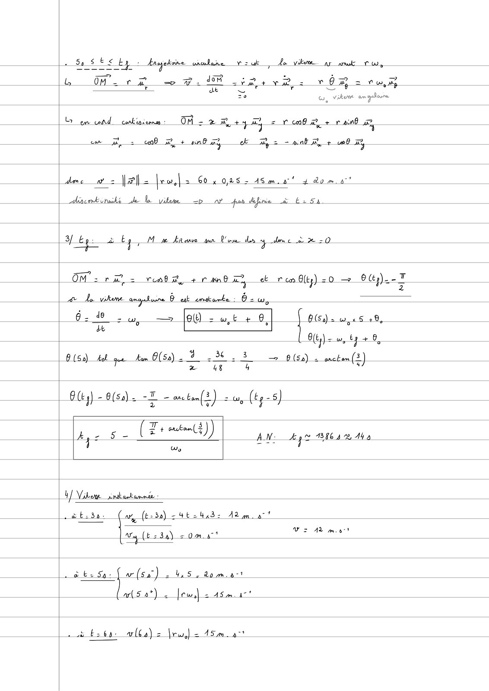

**Lecture OCR à contrôler**

~~~text
: Asgebence orolane Yiuk , Le vom pp out ru,

= om + = à
= “#2 488 => > x @

Z & a
de ~ r

= >
Hy = way

Fo co, Vikume am gilosra
Ly ew cond. conkiniemm: OM 2 æ m+ + 21 of + rare,
coe, 2 et Rt ny ks = ant, + ef
= ||] = |= Go x 0,28 - AS ma! 4 do m4"

dincorliitwihe de le vite =p ar ar definie à bs 54

3 it ve e oe -0
OM 2 rit = vais mk r =O — Olt))_-7
. 2
4 le yikene amsphure À eat _emante ; CEE
624 Lu, — (zut +0] {66.0
ue

Bley) =u, y+ 8,
BUS tat gee ton (50) 23 at: 5 — (52) = mcton(2)
na

Ales) - 0(50) -T = ons bon(3) zu, (es)

hye 5 = (F+ ment $))

AN: D 4386 4 © 44
j ne

We

4 ae View senakarkamnde :

CAT ps (e230) 4b 24.3: Am a"
( \ oma? Vi Ad mis!

à b2 Sa { arfsa) 2 US. dom

Luts a) = [ri] 2 45m. 47"

otis wl6a) 2 \ru,| = 45m.
~~~

## Page 17

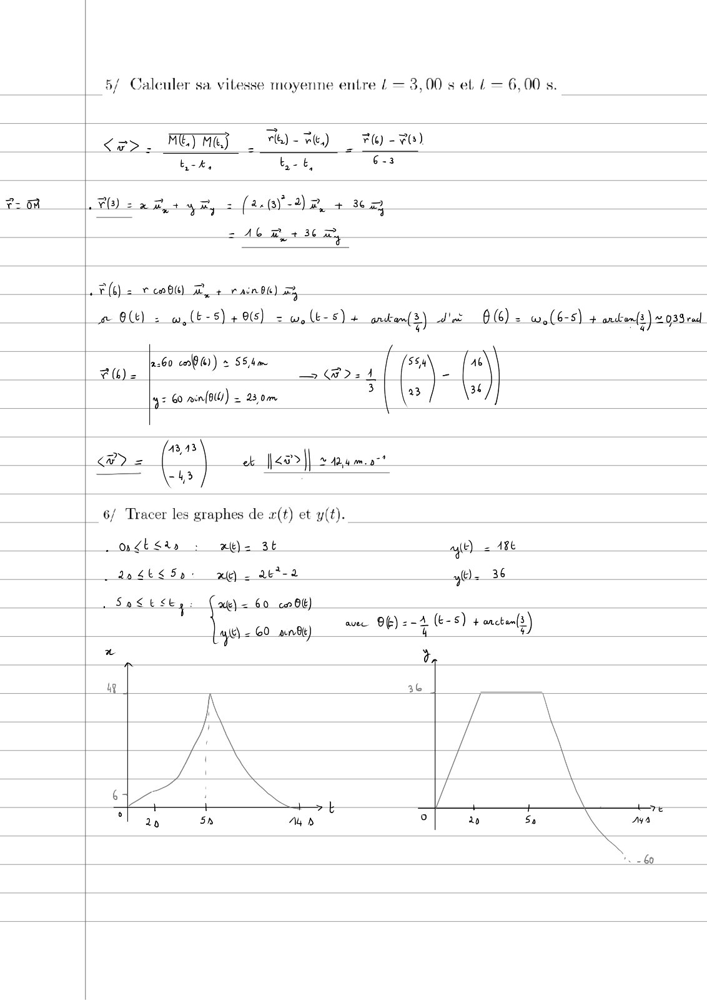

**Lecture OCR à contrôler**

~~~text
5/ Calculer sa vitesse moyenne entre 1 = 3,00 s el 1 = 6,00 s.

<e>. MO _ re)-%e) _ 7-70)

t,-4, t- 6, 6-3

+= ¥Q) cams ym, = (2-2), + 82

= Ab Wi + 36

ui

F(6) 2 re) 2, + rain Ble) 2

a OC) sw (E-5) + (5) = w,(E-s) 4 srten(3) dnt 6(6) = w,(6-s) + andan(s) #933 ad

260 cool) = 554m 554 a
4 (6) = 2:14 2
47 Go ninfOll) = 230m 2 3 36

TEE
D. ( \ x <a>] sam

ts)

6/ Tracer les graphes de x(t) et y(t).

age Sa»: xe)= 34 4e) = ABE

| aa SES So: xe) 2 aera y= 36

Sostsey: (ade) = 60 x 8)

9¢)--4 (&-s) + anche)
wi) = CO ant) "7 n ë
Le
Le Ÿ,
x à
4 iN 36
jh
i
64 a
; + b ie
2 5h ALD 9 20 En 244
~~~
