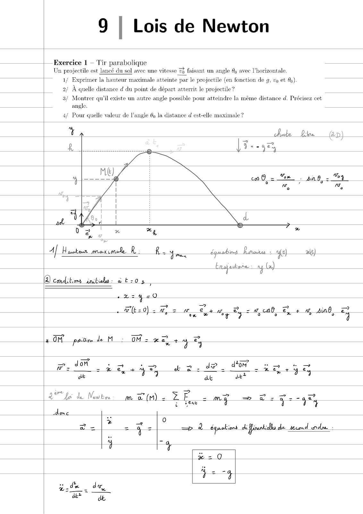
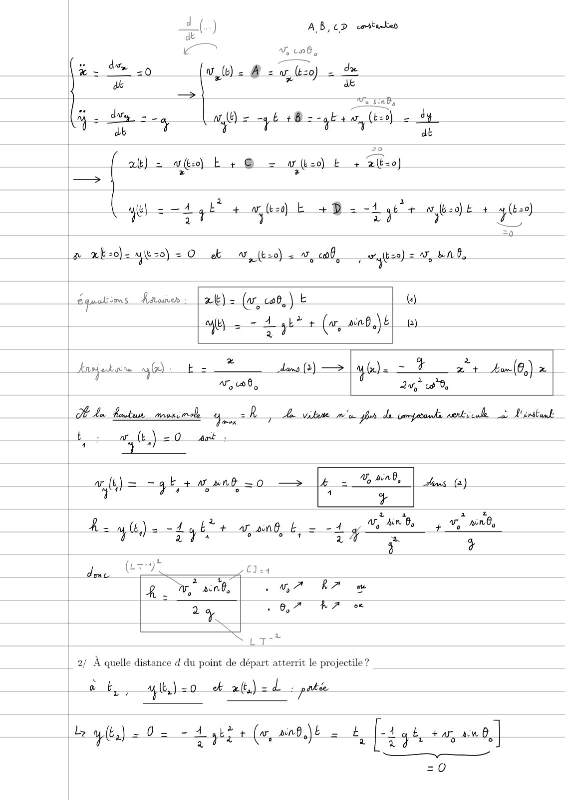
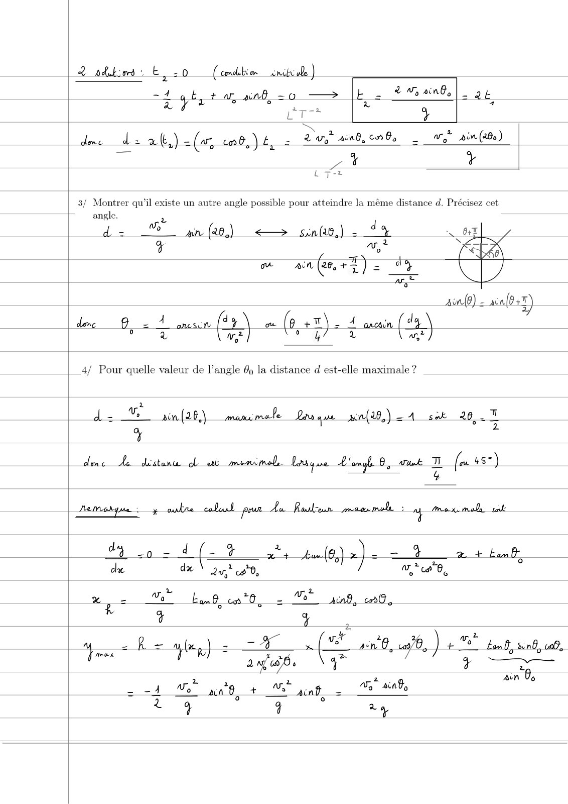
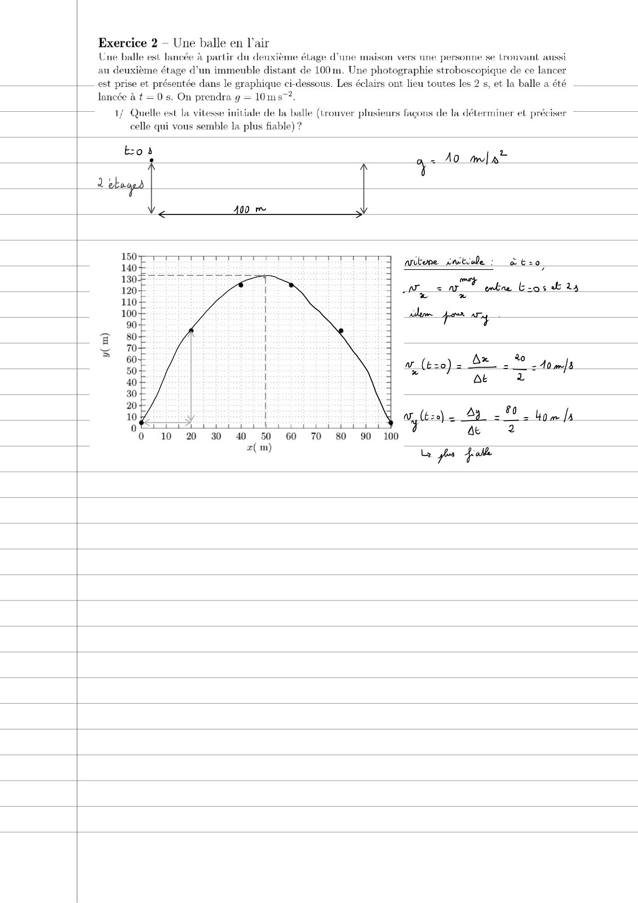

# TD9-Correction-(1-a-2)_2023-2024_Physique1_P1S1_EDupont.pdf

[Ouvrir l’original](https://drive.google.com/open?id=1-nVDFXlm-5340cAgBau9ojBp4xgwAKzu) · Les pages signalées comprennent du texte reconnu automatiquement ou des éléments graphiques. Le fac-similé permet de vérifier chaque lecture.

**Pages avec fac-similé ou lecture OCR** — 1–4.

## Page 1

**Lecture OCR à contrôler**

~~~text
9 | Lois de Newton

| Exercice 1 — Tir parabolique
Un projectile est lancé du sol avec une vitesse 7 faisant un angle % avec l'horizontale.

1/ Exprimer la hanteur maximale atteinte par le projectile (en fonction de g, vo et %)

2/ À quelle distance d du point de départ atterrit le projectile?

3/ Montrer qu'il existe un autre angle possible pour atteindre la même distance d. Précisez cet
L angle.

æ

Pour quelle valeur de l'angle 49 la distance d est-elle maximale ?

% bake Pie @p)
2 >

+054 0.
~ (E20) = wp = ae Mey By = woah €, + a, sind, 4
«OM pas de M Es OM = xe ty ey
=
= m 4 5 = om ss i
wr. 9 2h +4, ee. de dot Bt yy
ae 9 dk a?

a fac de Nowken  m 2 (M2 ZE = my me 2 Pang

ase
FE

Ij ky
~~~

## Page 2

**Lecture OCR à contrôler**

~~~text
AB,cD cmitaken

dé
— V, 106,
‘on vb 8 sv, bso) =
[ * > ets
i das. d
ss EY os wb) = -4 6 +8 - kaw (to) 2 Sd
db + vi t “4 at
at) = wo) b + @ = (bec) E + tbe)
—> % +
ised q+ Ed = -1 ÿ 2 20
ule - E Ag 60) E +D 1 a yh
=o
a at-o)- 4Eze) = 0 ek (bz) = 0, oof, wat) =a, nb,

éqaulièos Rae :

ye

x) = (a, CT E
- 4 yb + («, ab) E

()
(2)

Ansjuk ane ay) :

æ

Es

a, 0,

dam (2) —>

4

DE

x + Aan(€,) x
2 0,

À Le ewkeu rmx male re?

7

A vilene yor de compatanle. nentriculk. oe TS 2

| 2/ A quelle distance d du point de départ atterrit le projectile?

à aw (Ca) =O 4rt :
mt)= — qb + want =0o — lé =O | hans (a)
° 4
i t
4. u(t.) = dy + af, on0_E. ris + Vo rin by
à L à
4 +
dene. (CR Eu
g nv," acnd, CUP RA ow
| 2 à 16,7 RA
ut

ttyl) <0 ek lbs] dpa

Le y) =< 02 = 4 ge (w, ap) = 4 [-t9% ar, and, |

DR

=0
~~~

## Page 3

**Lecture OCR à contrôler**

~~~text
2 ndtimi: E,:0 (cmd ride )
-4

Ee . _ _ + My and,
tbat a and, o —> IE

|- 24
z La
ET

Z 3
dome d2 at.) =(r, cob, ) ty = à a, ain8, Fo

ar ain (260)
yams +
Tr
37 Montrer qu'il existe un autre angle possible pour atteindre la même distance d. Précisez cet
angle. : 1
we
de  wn(e) <— sina8,) - °%
2
ws
à Tr
ow an (ar, +2) = de
7
Aon) - ain(0s%)
de 0,2 4 omun (#2) (pet). 4 wan (49)
0 ry we oar EI wt)

4/ Pour quelle valeur de l’angle 4 la distance d est-elle maximale ?

ls

= ain. (20,) man male Lars que sin(28,) =A sok 26, af
+

dnc Le distanw ol ut mecimode Lardy sre Lama 0, vaut = fos us”)

Perreodyrie y bre cell prun_du Roubun-maaumal + ue rex mule tol
d ip - d (- 4% re bu-(6,) x) = = 4 a + banb,
du dx \ 2? «90, / LA A

Xs Vo” bam co "0, = LE

Anh, cn0

t

4 R= 4er) = er Æ an 8, sit.) + bam, sind, ub

| pie
z
2. ain De
aun 8 + > Ant - %
——

4 ra
~~~

## Page 4

**Lecture OCR à contrôler**

~~~text
Exercice 2 — Une balle en l'air
Une balle est lancée à partir du deuxièn

étage d'une maison vers une personne se trouvant aussi
au deuxième étage d’un immeuble distant de 100m. Une photographie stroboscopique de ce lancer
est prise et présentée dans le graphique ci-dessous. Les éclairs ont lieu toutes les 2 s, et la balle a été
lancée à t = 0 s. On prendra g = 10ms~?.

1/ Quelle est la vitesse initiale de la balle (trouver plusieurs fagons de la déterminer et. préciser ————
celle qui vous semble la plus fiable) ?

Eos
.

qe

2 bg |
aay

Î
400 me |

( Ay. £0 L
FA er OTHER ENT HT OR Ae

0 10 20 30 40 50 60 70 80 90 100
L ps fol

æ(m)
~~~
