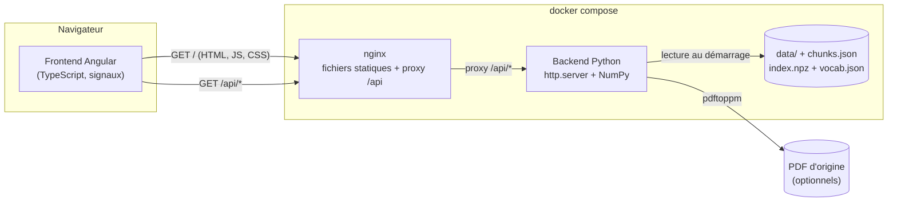
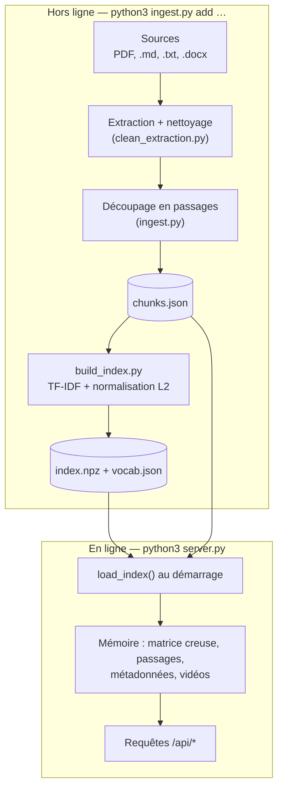
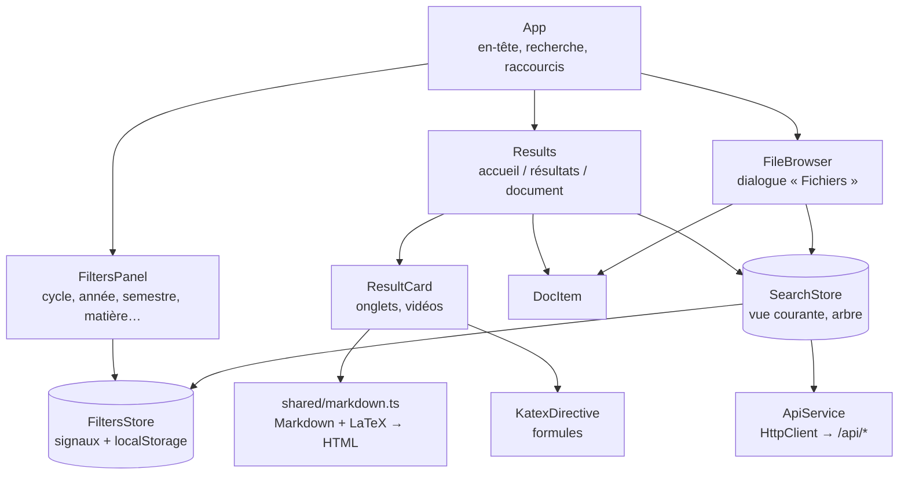
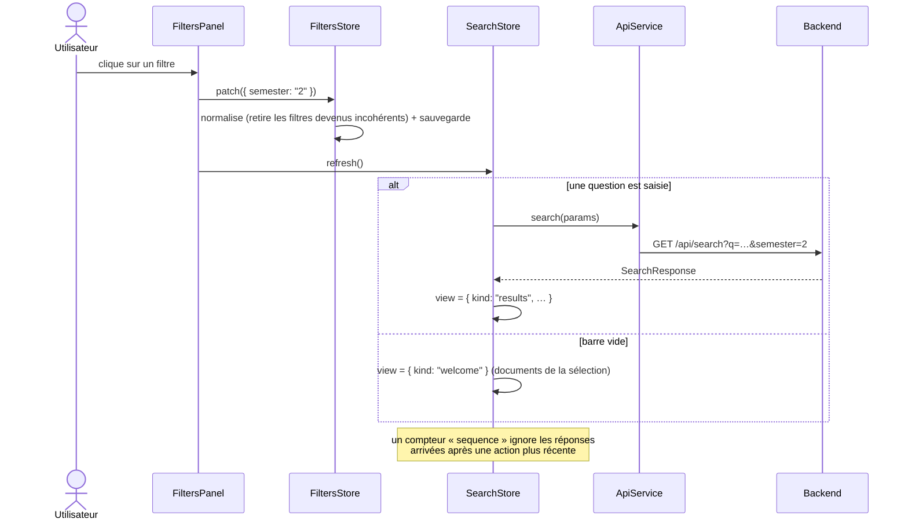
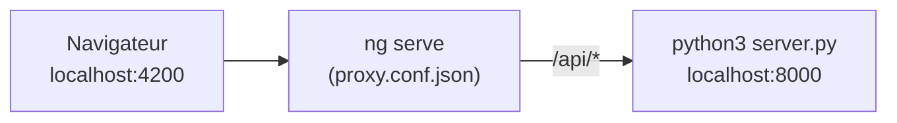
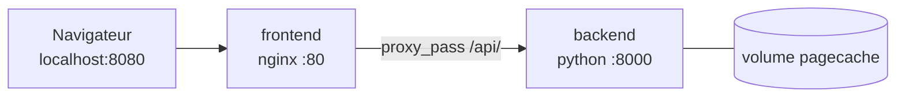

# Architecture

Ce document décrit comment le projet est découpé, comment les données circulent et
pourquoi les choix ont été faits ainsi. Pour lancer le projet, voir le
[README](../README.md) ; pour déployer, voir [DEPLOYMENT.md](DEPLOYMENT.md).

## Vue d'ensemble

Le projet est un moteur de recherche dans des documents de cours (CM, TD, DS, corrigés…).
Il retrouve le bon passage pour une question ; il ne génère pas de réponse.
Deux applications indépendantes communiquent par une API HTTP/JSON :



| Couche | Dossier | Rôle | Technologies |
| --- | --- | --- | --- |
| Frontend | [`frontend/`](../frontend) | Interface : filtres, recherche, lecture des passages | Angular 20, TypeScript strict, KaTeX |
| Backend | [`backend/`](../backend) | API de recherche, import des documents, index | Python 3, NumPy (pas de framework web) |
| Données | `backend/data/`, `chunks.json`, `index.npz` | Documents, transcriptions, passages indexés | Fichiers (texte, Markdown, JSON, NPZ) |
| Infra | `docker-compose.yml` | Assemble les deux services | Docker, nginx |

Règle de séparation : **le frontend ne connaît du backend que l'URL `/api/*`**, et le
backend ne connaît rien du frontend (il peut en servir le build en local, c'est tout).
On peut donc remplacer l'un sans toucher à l'autre.

## Arborescence

```
.
├── docker-compose.yml        # backend + frontend (nginx)
├── docs/                     # cette documentation
├── backend/
│   ├── server.py             # API HTTP (routes /api/*)
│   ├── search.py             # recherche TF-IDF + filtres + récence
│   ├── build_index.py        # construit index.npz / vocab.json depuis chunks.json
│   ├── ingest.py             # import de PDF/Markdown/Word → passages (+ ingest_series.py)
│   ├── courses.py            # registre des matières (cycle, année, semestre, parcours)
│   ├── references.py         # « TD1 exercice 2 » → référence structurée
│   ├── reflow.py             # mise en forme des formules extraites des PDF
│   ├── clean_extraction.py   # nettoyage du texte brut des PDF
│   ├── pdf_crops.py          # découpe d'une formule dans la page PDF
│   ├── videos.py             # vidéos liées à chaque passage
│   ├── text_utils.py         # tokenisation française sans dépendance
│   ├── document_sources.py   # localisation des fichiers d'origine
│   ├── data/<matière>/       # documents, transcriptions/, sources.json, source_meta.json
│   ├── chunks.json           # tous les passages indexés
│   ├── index.npz, vocab.json # index TF-IDF
│   ├── tests/                # tests unittest
│   ├── model.py, train.py, chat.py, generate.py, vocab.py, ask.py   # expériences (voir « Code historique »)
│   └── Dockerfile
└── frontend/
    ├── src/app/              # application Angular (voir frontend/README.md)
    ├── proxy.conf.json       # /api → backend en développement
    ├── nginx.conf            # /api → backend en production
    └── Dockerfile            # build Node puis image nginx
```

## Backend

### Cycle de vie : deux phases séparées



L'index est construit **hors ligne** et chargé **une fois** au démarrage : une requête ne
touche jamais le disque (sauf pour rendre une page PDF). Après un import, il faut
reconstruire l'index (fait automatiquement par `ingest.py`) puis **redémarrer** le serveur.

### Moteur de recherche

1. `text_utils.tokenize` : minuscules, accents retirés, mots vides supprimés.
2. `references.parse_reference` : si la question contient « TD1 exercice 2 », la référence
   filtre les passages avant le classement.
3. Score = cosinus entre le vecteur TF-IDF de la question et celui de chaque passage
   (`search.py`), multiplié par un bonus de récence (désactivable) : à pertinence proche,
   le document le plus récent passe devant.
4. Les filtres (matière, cycle, année, semestre, parcours, type, version, année scolaire)
   deviennent un masque booléen (`filter_mask`) appliqué avant le classement.

Les formules mathématiques ne sont jamais interprétées côté backend : les passages
contiennent du LaTeX brut ou des blocs `pdf` (texte d'une formule mal extraite), et le
frontend se charge de l'affichage.

### Routes de l'API

Toutes les routes sont des `GET` et répondent en JSON, sauf les images.

| Route | Paramètres | Réponse |
| --- | --- | --- |
| `/api/health` | — | `{"status": "ok"}` (sonde Docker) |
| `/api/meta` | — | `Meta` : matières, types de documents, cycles, contextes |
| `/api/tree` | — | `Tree` : documents de chaque matière (fenêtre « Fichiers ») |
| `/api/doc` | `key` | `{results: SearchResult[]}` : tous les passages d'un document |
| `/api/search` | `q`, `k` (1–20), `recent` (0/1), `course`, `program`, `track`, `study_year`, `semester`, `kinds`, `versions`, `years` (listes séparées par des virgules) | `SearchResponse` |
| `/api/page` | `doc`, `n` | JPEG de la page `n` du PDF (cache disque, `pdftoppm`) |
| `/api/crop` | `doc`, `n`, `box` | PNG d'une formule découpée dans une page |

Les types TypeScript correspondants sont dans
[`frontend/src/app/core/models.ts`](../frontend/src/app/core/models.ts) ; ce fichier est
la copie du contrat côté frontend et doit être mis à jour avec `result_json` / `build_meta`
de `server.py`.

### Configuration (variables d'environnement)

| Variable | Défaut | Effet |
| --- | --- | --- |
| `PORT` | `8000` | Port d'écoute |
| `HOST` | `0.0.0.0` | Interface d'écoute |
| `WEB_DIR` | `../frontend/dist/tuteur/browser` | Dossier de fichiers statiques à servir ; `none` désactive (production) |
| `CORS_ORIGIN` | vide | Origine autorisée si le front est sur un autre domaine ; vide = même origine |

### Données et état

- Un dossier par matière dans `backend/data/<id>/` : documents sources en texte,
  `transcriptions/` (versions Markdown/LaTeX relues à la main, prioritaires sur
  l'extraction brute), `sources.json` (empreintes pour ignorer les doublons) et
  `source_meta.json`.
- `chunks.json` (~30 Mo) et `index.npz` sont **versionnés** : le dépôt contient donc
  tout ce qu'il faut pour démarrer sans réimporter les PDF.
- Les PDF d'origine (`*.pdf`) ne sont pas versionnés (voir `.gitignore`). S'ils sont
  présents sur la machine, `/api/page` et `/api/crop` fonctionnent ; sinon ces routes
  répondent 404 et le frontend n'affiche pas l'onglet « Page d'origine ».
- Le backend ne garde aucun état de session : plusieurs instances derrière un
  répartiteur de charge sont possibles (seul le cache d'images `.pagecache/` est local).

## Frontend

Application Angular **autonome** (composants *standalone*, sans NgModule), **sans
zone.js** (détection de changement pilotée par les signaux), en TypeScript strict.



### Responsabilités

| Élément | Fichier | Responsabilité |
| --- | --- | --- |
| `ApiService` | `core/api.service.ts` | Seul endroit qui appelle `/api/*` |
| `FiltersStore` | `core/filters.store.ts` | État des filtres, valeurs dérivées (`computed`), cohérence entre filtres, persistance |
| `SearchStore` | `core/search.store.ts` | Vue affichée (une à la fois), lancement des recherches, chargement de l'arbre |
| `ThemeService` | `core/theme.service.ts` | Thème clair/sombre |
| `markdown.ts` | `shared/markdown.ts` | Fonctions **pures** : Markdown + LaTeX → chaîne HTML échappée |
| `KatexDirective` | `shared/katex.directive.ts` | Rend les formules LaTeX d'un élément |
| `ImageFallbackDirective` | `shared/image-fallback.directive.ts` | Remplace une image cassée par une note |
| `TrustedHtmlPipe` | `shared/html.pipe.ts` | Marque la sortie de `markdown.ts` comme HTML fiable |
| composants | `features/*` | Affichage et événements ; pas de logique métier |

### Flux de données



Principes :

- **Une source de vérité par domaine** : filtres dans `FiltersStore`, vue dans
  `SearchStore`. Les composants lisent des signaux et appellent des méthodes.
- **Cohérence des filtres** : toute modification passe par `patch()`, qui retire les
  valeurs sans objet (une matière hors du semestre choisi redevient « toutes »).
- **Réponses tardives ignorées** : `SearchStore.sequence` est incrémenté à chaque action ;
  une réponse HTTP dont le numéro n'est plus courant est jetée.
- **Rendu du contenu** : le backend renvoie des blocs (`md`, `text`, `code`…) ;
  `markdown.ts` les convertit en HTML en **échappant tout le texte source**, puis
  `KatexDirective` rend les formules. C'est la seule zone où `innerHTML` est utilisé,
  via `TrustedHtmlPipe`. Toute nouvelle fonction de rendu doit échapper ses entrées
  et être couverte par un test dans `markdown.spec.ts`.
- **Styles** : feuille globale unique (`src/styles.css`), thème par variables CSS
  (`data-theme` sur `<html>`). Les composants n'ont pas de styles propres : ils
  réutilisent les classes de cette feuille.

### Tests

- `ng test` (Karma + Jasmine, Chrome headless) : rendu Markdown (`markdown.spec.ts`),
  carte de résultat, store de filtres, message d'erreur de l'application.
- `python3 -m unittest discover -s tests` dans `backend/` : import, index, recherche,
  références, lisibilité des passages, vidéos.

## Exécution

### Développement



Deux terminaux : `cd backend && python3 server.py` et `cd frontend && npm start`.

### Conteneurs (docker compose)



- `frontend` : image multi-étapes (Node compile Angular, nginx sert le résultat).
  `nginx.conf` relaie `/api/` vers `http://backend:8000` et renvoie `index.html` pour
  toute autre URL.
- `backend` : image Python avec `poppler-utils` (`pdftoppm`) ; l'index est copié dans
  l'image. Un volume nommé conserve le cache d'images de pages entre redémarrages.
- Le port du backend n'est **pas** publié : seul nginx est exposé.

## Décisions

| Décision | Raison |
| --- | --- |
| Deux applications séparées (API + SPA) | Déploiement et évolution indépendants ; le front peut être hébergé sur un CDN |
| Backend sans framework | Dépendances minimales (NumPy + pypdf) ; l'API tient en quelques routes `GET` |
| Index en mémoire, construit hors ligne | Requêtes rapides, pas de base de données à opérer ; adapté à la taille actuelle (~17 000 passages) |
| Index versionné dans git | Un `git clone` suffit pour démarrer ; coût : dépôt volumineux (voir « Limites ») |
| Angular sans zone.js, signaux | Moins de code de synchronisation, détection de changement explicite |
| Rendu Markdown maison (pur) | Le format des passages est spécifique (blocs `pdf`, notes, listes `a)`) ; ni `marked` ni `ngx-markdown` ne le gèrent, et la fonction pure se teste facilement |
| Origine unique (`/api` relayé par nginx) | Pas de CORS en production, pas d'URL d'API à configurer dans le front |

## Limites connues et évolutions possibles

- **Taille du dépôt** : `chunks.json` (32 Mo) et `index.npz` sont versionnés ; chaque
  réimport ajoute une version complète à l'historique. À terme : Git LFS, ou génération
  de l'index à la construction de l'image.
- **Mémoire** : tout l'index est chargé dans chaque instance du backend.
- **Pas d'authentification** : l'API est publique ; c'est voulu pour ce périmètre.
- **Contrat d'API recopié à la main** (`models.ts`) : pas de génération de types. Si
  l'API grossit, produire un schéma OpenAPI côté backend et générer les types.
- **Tests de bout en bout** : aucun ; la vérification complète (accueil, recherche,
  ouverture d'un document, fenêtre « Fichiers ») est manuelle.

## Code historique

`backend/model.py`, `train.py`, `chat.py`, `generate.py`, `vocab.py`, `checkpoint.npz`
et `vocab_char.json` sont une expérience de petit réseau de neurones génératif au
niveau caractère. Ils ne font pas partie du service web ; ils restent sous `backend/`
pour que `tests/test_legacy.py` continue de passer. Ils peuvent être déplacés dans
un sous-dossier `backend/ml/` sans impact sur l'API.
